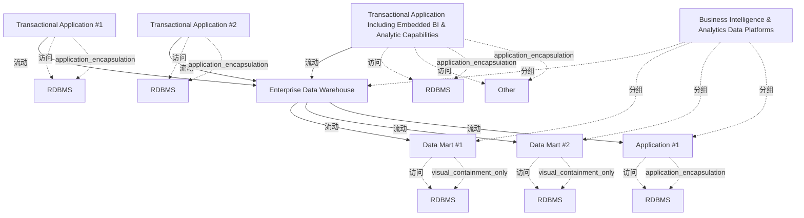

# G238/fig3-1 · 步骤 1——现状架构

类型：`system-or-data-reference-architecture`。建立迁移路线图的基线：说明现状下企业数据仓库是历史数据的单一事实来源，同时暴露只有关系型历史数据、缺少原始数据存储与非关系分析等缺口（表 3-2），为步骤 2 引入新一代平台提供理由。

英文 PDF 物理页：[18]。本页为架构语义分析，原文与原图分别保留。

## 原图与可编辑图


[完整 JSON](fig3-1.json) · [可编辑 Mermaid](fig3-1.mmd) · [仅关系图](fig3-1.relations.mmd) · [层级分解图](fig3-1.hierarchy.mmd)

图形重建表达语义，不复制源图布局。虚线表示解释、矩阵映射或分组关系，不自动表示不确定性的概率。



## 架构分析

从左向右读：左侧三个事务型应用各带一个或多个圆柱（本地数据库）；灰色虚线箭头（入站流）把它们的数据送入中央的 Enterprise Data Warehouse；数仓再用灰色实线箭头（出站流）向右侧 Data Mart #1、Data Mart #2、Application #1 供数，这三个消费方也各带 RDBMS。大虚线框“Business Intelligence & Analytics Data Platforms”只圈住数仓与右侧消费方，是平台范围而非一个组件。

- 本图有 15 个具名或隐含元素、13 条关系和 11 条包含/分组记录。
- 包含/分组树最大深度为 2；根节点为 商业智能与分析数据平台、事务型应用 #1、事务型应用 #2、含内嵌 BI 与分析能力的事务型应用。
- 本图没有可直接确认为人员直属汇报的关系；视觉上下位置、能力分解和治理职责分别读取。
- 逐一核对全部15标签及6条显式平台/应用数据流，保留原图入站虚线、出站实线、现状蓝边、目标橙边以及平台边界。
- 数据库圆柱按宿主分组；已有access关系保持隐式，不能作为额外显式流。

### 如何用于项目

- 先划定平台边界，登记应用、存储、数据来源及消费者，再逐条读取输入/输出流。
- 区分基线、过渡与目标架构，以及现有、保留与新增对象；范围包含不自动表示组件实现或组织管理。

### 结构所表达的逻辑

- 三个事务型应用（#1、#2、含内嵌 BI 与分析能力的应用）各自带 RDBMS；第三个还多一个 Other 存储，说明其数据不只是关系型。
- 三个事务型应用都通过入站流把数据送入企业数据仓库；数仓因此成为单一事实来源与企业历史数据的参考库（正文 p18）。
- 数仓通过出站流向两个数据集市和一个应用供数，三个消费方各自带 RDBMS，形成“交易系统→数仓→集市/应用”的两级结构。
- 全图元素都是蓝色边框=现状架构；图例虽给出橙色的“目标架构”，但本图没有任何橙色元素，是纯基线视图。
- 平台边界（大虚线框）不包含事务型应用：应用在边界外，只有数仓及其下游在平台范围内。
- 图中不画现状的缺失能力（原始数据存储、非关系数据分析、分析结果集、库内分析、影子 BI 治理），这些只列在表 3-2 的 Missing Capabilities 中。

## 上下级与包含

两层：平台范围容器（大虚线框）包含企业数据仓库与右侧的 Data Mart #1、Data Mart #2、Application #1；三个事务型应用位于容器之外。每个应用/集市旁的 RDBMS 圆柱不构成第三层，而是该元素的本地数据存储（用隐式访问关系表示）。图中没有组织或功能层级。

|父项|子项|层级类型|依据与解释|
|---|---|---|---|
|商业智能与分析数据平台|企业数据仓库|visual_grouping|框、泳道、域或分类组的成员归属；没有额外证据不提升为业务组合或管理关系。|
|商业智能与分析数据平台|数据集市 #1|visual_grouping|框、泳道、域或分类组的成员归属；没有额外证据不提升为业务组合或管理关系。|
|商业智能与分析数据平台|数据集市 #2|visual_grouping|框、泳道、域或分类组的成员归属；没有额外证据不提升为业务组合或管理关系。|
|商业智能与分析数据平台|应用 #1|visual_grouping|框、泳道、域或分类组的成员归属；没有额外证据不提升为业务组合或管理关系。|
|事务型应用 #1|关系型数据库（RDBMS）|application_encapsulation|应用组件包含其数据、行为或子组件。|
|事务型应用 #2|关系型数据库（RDBMS）|application_encapsulation|应用组件包含其数据、行为或子组件。|
|含内嵌 BI 与分析能力的事务型应用|关系型数据库（RDBMS）|application_encapsulation|应用组件包含其数据、行为或子组件。|
|含内嵌 BI 与分析能力的事务型应用|其他|application_encapsulation|应用组件包含其数据、行为或子组件。|
|数据集市 #1|关系型数据库（RDBMS）|visual_containment_only|保存原图解释中的包含；业务关系类型需要图例或正文进一步限定。|
|数据集市 #2|关系型数据库（RDBMS）|visual_containment_only|保存原图解释中的包含；业务关系类型需要图例或正文进一步限定。|
|应用 #1|关系型数据库（RDBMS）|application_encapsulation|应用组件包含其数据、行为或子组件。|

## 全部元素与角色

|元素ID|原文名称|类型|含义|直接父项|深度|
|---|---|---|---|---|---|
|platform_scope|Business Intelligence & Analytics Data Platforms|group|平台范围边界，不是可部署组件。|—||
|txn_app_1|Transactional Application #1|application|蓝色=现状；自带 RDBMS。|—||
|txn_app_2|Transactional Application #2|application|蓝色=现状；自带 RDBMS。|—||
|txn_app_bi|Transactional Application Including Embedded BI & Analytic Capabilities|application|蓝色=现状；自带 RDBMS 与 Other 两个存储。|—||
|edw|Enterprise Data Warehouse|data|灰底蓝框；单一事实来源与企业历史数据参考库。|商业智能与分析数据平台|1|
|data_mart_1|Data Mart #1|data|蓝框；由数仓供数，自带 RDBMS。|商业智能与分析数据平台|1|
|data_mart_2|Data Mart #2|data|蓝框；由数仓供数，自带 RDBMS。|商业智能与分析数据平台|1|
|app_1|Application #1|application|蓝框；由数仓供数，自带 RDBMS。|商业智能与分析数据平台|1|
|db_txn_1|RDBMS|data|贴附于该应用/数据集市的存储图标；归属依据图形附属关系，图上没有另外画出的access连线。|事务型应用 #1|1|
|db_txn_2|RDBMS|data|贴附于该应用/数据集市的存储图标；归属依据图形附属关系，图上没有另外画出的access连线。|事务型应用 #2|1|
|db_txn_bi|RDBMS|data|贴附于该应用/数据集市的存储图标；归属依据图形附属关系，图上没有另外画出的access连线。|含内嵌 BI 与分析能力的事务型应用|1|
|db_other_bi|Other|data|贴附于该应用/数据集市的存储图标；归属依据图形附属关系，图上没有另外画出的access连线。|含内嵌 BI 与分析能力的事务型应用|1|
|db_dm_1|RDBMS|data|贴附于该应用/数据集市的存储图标；归属依据图形附属关系，图上没有另外画出的access连线。|数据集市 #1|2|
|db_dm_2|RDBMS|data|贴附于该应用/数据集市的存储图标；归属依据图形附属关系，图上没有另外画出的access连线。|数据集市 #2|2|
|db_app_1|RDBMS|data|贴附于该应用/数据集市的存储图标；归属依据图形附属关系，图上没有另外画出的access连线。|应用 #1|2|

## 全部关系

灰色虚线箭头=入站流（Inbound Flow，数据进入平台/数仓）；灰色实线箭头=出站流（Outbound Flow，平台向外供数）；箭头指向数据接收方。RDBMS 圆柱紧贴宿主框、不画连线，表示该应用/集市自带的关系型数据库。颜色编码：蓝色边框=现状架构，橙色边框=目标架构（本图未使用）。

|主体|语义关系|客体|显式线/隐式|原文标签|依据|
|---|---|---|---|---|---|
|事务型应用 #1|流动|企业数据仓库|显式连线|Inbound Flow|灰色虚线箭头，由应用指向数仓。|
|事务型应用 #2|流动|企业数据仓库|显式连线|Inbound Flow|灰色虚线箭头。|
|含内嵌 BI 与分析能力的事务型应用|流动|企业数据仓库|显式连线|Inbound Flow|灰色虚线箭头，从内嵌 BI 应用指向数仓。|
|企业数据仓库|流动|数据集市 #1|显式连线|Outbound Flow|灰色实线箭头。|
|企业数据仓库|流动|数据集市 #2|显式连线|Outbound Flow|灰色实线箭头。|
|企业数据仓库|流动|应用 #1|显式连线|Outbound Flow|灰色实线箭头。|
|事务型应用 #1|访问|关系型数据库（RDBMS）|implicit||圆柱紧贴应用，表示该应用使用这个本地 RDBMS；原图未画线。|
|事务型应用 #2|访问|关系型数据库（RDBMS）|implicit||访问|
|含内嵌 BI 与分析能力的事务型应用|访问|关系型数据库（RDBMS）|implicit||访问|
|含内嵌 BI 与分析能力的事务型应用|访问|其他|implicit||除 RDBMS 外还使用 Other 存储。|
|数据集市 #1|访问|关系型数据库（RDBMS）|implicit||访问|
|数据集市 #2|访问|关系型数据库（RDBMS）|implicit||访问|
|应用 #1|访问|关系型数据库（RDBMS）|implicit||访问|

## 误读检查

- 不要把灰色虚线读成“可选”“计划中”或弱依赖：图例明确它是入站流（Inbound Flow），与实线只是方向/角色不同。
- 不要把 RDBMS 圆柱当成独立系统：它紧贴某个应用或集市，表示该元素的本地关系型数据库。
- 不要把大虚线框当成一个应用组件或网络边界；它是“BI & Analytics 数据平台”的范围标注。
- 本图是现状（as-is），不是目标架构；目标架构见 3-4，中间还有步骤 2、3 两个过渡架构。
- 图中三个事务型应用都画了 RDBMS，但正文只说“部分基于 RDBMS 的事务型应用向数仓供数”，不要把图示当成所有组织的普遍现状。

## 原文证据

### [PDF 第 18 页](../../../documents/G238.md#page-18)

> Four Transition Architectures are described in the four following steps.
> Life before the new generation BI & Analytics data platform – a generic “as-is” situation is described here, but the level of maturity can vary a lot depending on the organization including no existing as-is enterprise data warehouse.
### [PDF 第 19 页](../../../documents/G238.md#page-19)


## 来源与分析状态

所有元素/关系均有来源定位；未把历史解释重命名为本轮逐线视觉确认。源图与语义图是两种视图，布局不证明汇报或因果。

源 PDF SHA-256：`87e00e009377a887627417ceffc28b1f480bfaf57c9c84ee6f8757cc5c1c9444`。

源图记录：[原始解释与转录](../../../figures/G238/fig3-1.json)。

```json
{
  "quality": {
    "graph_integrity": "checked",
    "semantic_analysis": "typed-graph-and-context-analysis",
    "visual_review": "source-content-audited",
    "notice_zh": "所有元素/关系均有来源定位；未把历史解释重命名为本轮逐线视觉确认。源图与语义图是两种视图，布局不证明汇报或因果。"
  },
  "source_uncertainty": {
    "confidence": "high",
    "uncertainties_zh": [
      "RDBMS 圆柱与宿主框之间没有画线，本分析用隐式 access 关系表示归属；原图也可能只是排版上的贴近。",
      "图例包含橙色“目标架构”，但本图没有橙色元素，无法从图内验证橙色的具体用法（见 3-2 至 3-4）。",
      "三个事务型应用都画了 RDBMS，而正文只说“部分基于 RDBMS 的事务型应用向数仓供数”，图示是通用化的示例。"
    ],
    "analyzed_from": [
      "英文 PDF 第 18 页图 3-1 截图与 3×3 放大分块",
      "英文 PDF 第 18–19 页步骤 1 正文与表 3-2",
      "中文稿 G238e_信息架构_商业智能与分析.md 第 196–226 行",
      "figs/zh/g238e_fig3-1_zh.png 与 figs/g238_fig3-1.svg",
      "figs/g238e_fig3-1_en.png（相似度 0.99）"
    ],
    "date": "2026-10-31"
  },
  "source_conflicts": []
}
```
