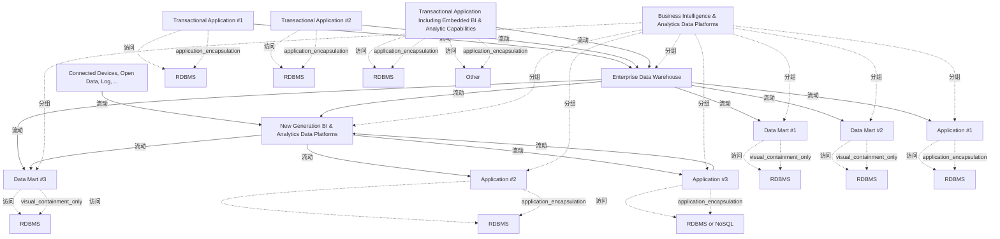

# G238/fig3-2 · 步骤 2——引入新一代平台

类型：`system-or-data-reference-architecture`。展示从现状走向目标的第一步：在不拆除企业数据仓库的前提下引入新一代平台，用它处理数仓无法覆盖的新数据源（日志、联网设备等），同时让部分新集市/应用先跑起来，暴露“历史数据双份存储、新平台不存原始数据、血缘困难”等过渡期缺口（表 3-3）。

英文 PDF 物理页：[20]。本页为架构语义分析，原文与原图分别保留。

## 原图与可编辑图


[完整 JSON](fig3-2.json) · [可编辑 Mermaid](fig3-2.mmd) · [仅关系图](fig3-2.relations.mmd) · [层级分解图](fig3-2.hierarchy.mmd)

图形重建表达语义，不复制源图布局。虚线表示解释、矩阵映射或分组关系，不自动表示不确定性的概率。



## 架构分析

先看左右两侧的状态：左侧三个事务型应用与中央企业数据仓库仍是蓝框（现状），下方新增的 New Generation BI & Analytics Data Platforms 是橙框（目标）。灰色虚线箭头从三个事务型应用进入数仓；橙色实线箭头从数仓向下进入新平台（清洗数据），再从新平台指向右侧 Data Mart #3、Application #2、Application #3。左下的 Connected Devices, Open Data, Log 通过橙色虚线入站流进入新平台。注意 Data Mart #3 同时收到来自数仓和新平台的两条橙色实线箭头。

- 本图有 23 个具名或隐含元素、23 条关系和 18 条包含/分组记录。
- 包含/分组树最大深度为 2；根节点为 商业智能与分析数据平台、事务型应用 #1、事务型应用 #2、含内嵌 BI 与分析能力的事务型应用、互联设备、开放数据、日志等。
- 本图没有可直接确认为人员直属汇报的关系；视觉上下位置、能力分解和治理职责分别读取。
- 逐一核对全部23标签及13条显式平台/应用数据流，保留原图入站虚线、出站实线、现状蓝边、目标橙边以及平台边界。
- 数据库圆柱按宿主分组；已有access关系保持隐式，不能作为额外显式流。

### 如何用于项目

- 先划定平台边界，登记应用、存储、数据来源及消费者，再逐条读取输入/输出流。
- 区分基线、过渡与目标架构，以及现有、保留与新增对象；范围包含不自动表示组件实现或组织管理。

### 结构所表达的逻辑

- 企业数据仓库仍是现状核心（蓝框），新一代平台是新增目标元素（橙框）；两者并存，尚未替换。
- 数仓→新平台是一条橙色实线出站流，表示数仓把清洗后的数据提供给新平台——这是新平台原本拿不到的数据（正文 p20）。
- 新平台通过橙色虚线入站流接收 Connected Devices、Open Data、Log 等新数据源，并接收 Application #3 回写的入站流（应用产生的新数据经摄取进入平台以保留历史）。
- Data Mart #3 是双供数的典型：同时收到数仓（上）与新平台（下）两条橙色实线箭头，对应正文“部分需快速交付的集市同时由数仓与新平台供数”。
- Data Mart #1、Data Mart #2、Application #1 仍只由数仓供数（灰色实线），尚未切换。
- 新平台向 Data Mart #3、Application #2、Application #3 供数；后两者的存储标为 RDBMS 或 NoSQL，说明新用例不一定落在关系型库。
- 过渡期代价写在表 3-3：历史数据双份存储、新平台不保存来自数仓的原始数据、原始数据缺失导致数据血缘困难。

## 上下级与包含

两层：平台范围容器（大虚线框）包含企业数据仓库、新一代平台、Data Mart #1/#2/#3、Application #1/#2/#3；三个事务型应用与 Connected Devices 在容器之外。每个应用/集市旁的圆柱是其本地存储，不是独立层级。两个平台（数仓与新平台）是并列关系，不是上下级。

|父项|子项|层级类型|依据与解释|
|---|---|---|---|
|商业智能与分析数据平台|企业数据仓库|visual_grouping|框、泳道、域或分类组的成员归属；没有额外证据不提升为业务组合或管理关系。|
|商业智能与分析数据平台|新一代 BI 与分析数据平台|visual_grouping|框、泳道、域或分类组的成员归属；没有额外证据不提升为业务组合或管理关系。|
|商业智能与分析数据平台|数据集市 #1|visual_grouping|框、泳道、域或分类组的成员归属；没有额外证据不提升为业务组合或管理关系。|
|商业智能与分析数据平台|数据集市 #2|visual_grouping|框、泳道、域或分类组的成员归属；没有额外证据不提升为业务组合或管理关系。|
|商业智能与分析数据平台|应用 #1|visual_grouping|框、泳道、域或分类组的成员归属；没有额外证据不提升为业务组合或管理关系。|
|商业智能与分析数据平台|数据集市 #3|visual_grouping|框、泳道、域或分类组的成员归属；没有额外证据不提升为业务组合或管理关系。|
|商业智能与分析数据平台|应用 #2|visual_grouping|框、泳道、域或分类组的成员归属；没有额外证据不提升为业务组合或管理关系。|
|商业智能与分析数据平台|应用 #3|visual_grouping|框、泳道、域或分类组的成员归属；没有额外证据不提升为业务组合或管理关系。|
|事务型应用 #1|关系型数据库（RDBMS）|application_encapsulation|应用组件包含其数据、行为或子组件。|
|事务型应用 #2|关系型数据库（RDBMS）|application_encapsulation|应用组件包含其数据、行为或子组件。|
|含内嵌 BI 与分析能力的事务型应用|关系型数据库（RDBMS）|application_encapsulation|应用组件包含其数据、行为或子组件。|
|含内嵌 BI 与分析能力的事务型应用|其他|application_encapsulation|应用组件包含其数据、行为或子组件。|
|数据集市 #1|关系型数据库（RDBMS）|visual_containment_only|保存原图解释中的包含；业务关系类型需要图例或正文进一步限定。|
|数据集市 #2|关系型数据库（RDBMS）|visual_containment_only|保存原图解释中的包含；业务关系类型需要图例或正文进一步限定。|
|应用 #1|关系型数据库（RDBMS）|application_encapsulation|应用组件包含其数据、行为或子组件。|
|数据集市 #3|关系型数据库（RDBMS）|visual_containment_only|保存原图解释中的包含；业务关系类型需要图例或正文进一步限定。|
|应用 #2|关系型数据库（RDBMS）|application_encapsulation|应用组件包含其数据、行为或子组件。|
|应用 #3|关系型数据库或 NoSQL|application_encapsulation|应用组件包含其数据、行为或子组件。|

## 全部元素与角色

|元素ID|原文名称|类型|含义|直接父项|深度|
|---|---|---|---|---|---|
|platform_scope|Business Intelligence & Analytics Data Platforms|group|平台范围边界。|—||
|txn_app_1|Transactional Application #1|application|蓝框=现状；自带 RDBMS。|—||
|txn_app_2|Transactional Application #2|application|蓝框=现状；自带 RDBMS。|—||
|txn_app_bi|Transactional Application Including Embedded BI & Analytic Capabilities|application|蓝框=现状；RDBMS+Other 两个存储。|—||
|connected_devices|Connected Devices, Open Data, Log, ...|data|橙框=目标；新数据源，原图中没有对应实体框。|—||
|edw|Enterprise Data Warehouse|data|蓝框灰底；现状唯一的历史数据仓库。|商业智能与分析数据平台|1|
|ng_platform|New Generation BI & Analytics Data Platforms|application|橙框灰底；目标平台，处理新数据源与新用例。|商业智能与分析数据平台|1|
|data_mart_1|Data Mart #1|data|蓝框；仍只由数仓供数。|商业智能与分析数据平台|1|
|data_mart_2|Data Mart #2|data|蓝框；仍只由数仓供数。|商业智能与分析数据平台|1|
|app_1|Application #1|application|蓝框；仍只由数仓供数。|商业智能与分析数据平台|1|
|data_mart_3|Data Mart #3|data|橙框；同时由数仓与新平台供数。|商业智能与分析数据平台|1|
|app_2|Application #2|application|橙框；由新平台供数，存储为 RDBMS。|商业智能与分析数据平台|1|
|app_3|Application #3|application|橙框；由新平台供数，并把新产生的数据回写给新平台。|商业智能与分析数据平台|1|
|db_txn_1|RDBMS|data|贴附于该应用/数据集市的存储图标；归属依据图形附属关系，图上没有另外画出的access连线。|事务型应用 #1|1|
|db_txn_2|RDBMS|data|贴附于该应用/数据集市的存储图标；归属依据图形附属关系，图上没有另外画出的access连线。|事务型应用 #2|1|
|db_txn_bi|RDBMS|data|贴附于该应用/数据集市的存储图标；归属依据图形附属关系，图上没有另外画出的access连线。|含内嵌 BI 与分析能力的事务型应用|1|
|db_other_bi|Other|data|贴附于该应用/数据集市的存储图标；归属依据图形附属关系，图上没有另外画出的access连线。|含内嵌 BI 与分析能力的事务型应用|1|
|db_dm_1|RDBMS|data|贴附于该应用/数据集市的存储图标；归属依据图形附属关系，图上没有另外画出的access连线。|数据集市 #1|2|
|db_dm_2|RDBMS|data|贴附于该应用/数据集市的存储图标；归属依据图形附属关系，图上没有另外画出的access连线。|数据集市 #2|2|
|db_app_1|RDBMS|data|贴附于该应用/数据集市的存储图标；归属依据图形附属关系，图上没有另外画出的access连线。|应用 #1|2|
|db_dm_3|RDBMS|data|贴附于该应用/数据集市的存储图标；归属依据图形附属关系，图上没有另外画出的access连线。|数据集市 #3|2|
|db_app_2|RDBMS|data|贴附于该应用/数据集市的存储图标；归属依据图形附属关系，图上没有另外画出的access连线。|应用 #2|2|
|db_app_3|RDBMS or NoSQL|data|贴附于该应用/数据集市的存储图标；归属依据图形附属关系，图上没有另外画出的access连线。|应用 #3|2|

## 全部关系

灰色虚线箭头=现状入站流；橙色虚线箭头=目标入站流（新数据源、应用回写）；灰色实线箭头=现状出站流；橙色实线箭头=目标出站流（数仓→新平台、新平台→新集市/应用、数仓→新集市）。箭头指向数据接收方。图例只说明实线/虚线与蓝/橙框架，箭头颜色随所连接元素的现状/目标状态而变化，未单独列图例。

|主体|语义关系|客体|显式线/隐式|原文标签|依据|
|---|---|---|---|---|---|
|事务型应用 #1|流动|企业数据仓库|显式连线|Inbound Flow|灰色虚线。|
|事务型应用 #2|流动|企业数据仓库|显式连线|Inbound Flow|灰色虚线。|
|含内嵌 BI 与分析能力的事务型应用|流动|企业数据仓库|显式连线|Inbound Flow|灰色虚线。|
|互联设备、开放数据、日志等|流动|新一代 BI 与分析数据平台|显式连线|Inbound Flow|橙色虚线；新数据源进入新平台。|
|企业数据仓库|流动|数据集市 #1|显式连线|Outbound Flow|灰色实线。|
|企业数据仓库|流动|数据集市 #2|显式连线|Outbound Flow|灰色实线。|
|企业数据仓库|流动|应用 #1|显式连线|Outbound Flow|灰色实线。|
|企业数据仓库|流动|新一代 BI 与分析数据平台|显式连线|Outbound Flow|橙色实线，垂直向下；数仓向新平台提供清洗数据。|
|企业数据仓库|流动|数据集市 #3|显式连线|Outbound Flow|橙色实线，从数仓右下方进入 Data Mart #3 的上方箭头。|
|新一代 BI 与分析数据平台|流动|数据集市 #3|显式连线|Outbound Flow|橙色实线；Data Mart #3 因此双供数。|
|新一代 BI 与分析数据平台|流动|应用 #2|显式连线|Outbound Flow|橙色实线。|
|新一代 BI 与分析数据平台|流动|应用 #3|显式连线|Outbound Flow|橙色实线。|
|应用 #3|流动|新一代 BI 与分析数据平台|显式连线|Inbound Flow|橙色虚线，箭头指向新平台；应用产生的新数据经摄取回写平台。|
|事务型应用 #1|访问|关系型数据库（RDBMS）|implicit||圆柱紧贴宿主，原图未画线。|
|事务型应用 #2|访问|关系型数据库（RDBMS）|implicit||访问|
|含内嵌 BI 与分析能力的事务型应用|访问|关系型数据库（RDBMS）|implicit||访问|
|含内嵌 BI 与分析能力的事务型应用|访问|其他|implicit||访问|
|数据集市 #1|访问|关系型数据库（RDBMS）|implicit||访问|
|数据集市 #2|访问|关系型数据库（RDBMS）|implicit||访问|
|应用 #1|访问|关系型数据库（RDBMS）|implicit||访问|
|数据集市 #3|访问|关系型数据库（RDBMS）|implicit||访问|
|应用 #2|访问|关系型数据库（RDBMS）|implicit||访问|
|应用 #3|访问|关系型数据库或 NoSQL|implicit||访问|

## 误读检查

- 不要把 Data Mart #3 的两条入站箭头读成重复或错误：它刻意表示同时由企业数仓与新平台供数。
- 不要把 Application #3 → 新平台的虚线箭头读成“平台依赖应用”；它是入站流，表示应用产生的新数据被摄取回平台保留历史。
- 不要因为新平台出现就认为数仓已被替换：本步骤中数仓仍是蓝框现状元素，且继续向 DM#1/#2/App#1 供数。
- 不要把橙色理解为“可选/未来才用”：橙色是目标架构元素，在本过渡步骤中已经存在并承担新数据源用例。
- 不要忽视 Application #2/#3 的存储标注“RDBMS or NoSQL”：它们与原 RDBMS 集市不是同一种存储形态。
- 中文稿引用的中文化 PNG 把第三个事务型应用框画坏、把“应用 #2”文字变成白色，容易让人误判元素缺失。

## 原文证据

### [PDF 第 20 页](../../../documents/G238.md#page-20)

> • In that Transition Architecture, some data marts, like Data Mart #3 in Figure 3-2, that have to be delivered in short delays to the business, are fed some data from the enterprise data warehouse, and also from the new generation BI & Analytics data platforms
### [PDF 第 21 页](../../../documents/G238.md#page-21)


## 来源与分析状态

所有元素/关系均有来源定位；未把历史解释重命名为本轮逐线视觉确认。源图与语义图是两种视图，布局不证明汇报或因果。

源 PDF SHA-256：`87e00e009377a887627417ceffc28b1f480bfaf57c9c84ee6f8757cc5c1c9444`。

源图记录：[原始解释与转录](../../../figures/G238/fig3-2.json)。

```json
{
  "quality": {
    "graph_integrity": "checked",
    "semantic_analysis": "typed-graph-and-context-analysis",
    "visual_review": "source-content-audited",
    "notice_zh": "所有元素/关系均有来源定位；未把历史解释重命名为本轮逐线视觉确认。源图与语义图是两种视图，布局不证明汇报或因果。"
  },
  "source_uncertainty": {
    "confidence": "high",
    "uncertainties_zh": [
      "箭头颜色（灰/橙）在原图图例中没有单独说明，本分析按“现状流/目标流”解释；图例只规定实线=出站、虚线=入站。",
      "Connected Devices 框内的“...”在原图是省略号，未列出全部数据源类型。",
      "中文稿中文化 PNG 的第三个事务型应用框绘制损坏，本分析以英文原图为准。"
    ],
    "analyzed_from": [
      "英文 PDF 第 20 页图 3-2 截图与 3×3 放大分块",
      "英文 PDF 第 20–21 页步骤 2 正文与表 3-3",
      "中文稿 G238e_信息架构_商业智能与分析.md 第 240–280 行",
      "figs/zh/g238e_fig3-2_zh.png、figs/g238e_fig3-2_en.png（相似度 0.986）"
    ],
    "date": "2026-10-31"
  },
  "source_conflicts": []
}
```
