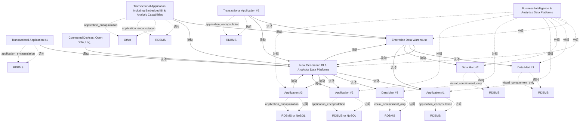

# G238/fig3-3 · 步骤 3——新一代平台成长

类型：`system-or-data-reference-architecture`。展示新平台成熟后的过渡状态：它开始保存原始/集成/加工数据并与数仓双向交换，逐步替代暂存区或 ODS，数据集市与应用按机会分步从数仓切走；同时说明“双份历史存储、双摄取流”的过渡代价（表 3-4）。

英文 PDF 物理页：[22]。本页为架构语义分析，原文与原图分别保留。

## 原图与可编辑图


[完整 JSON](fig3-3.json) · [可编辑 Mermaid](fig3-3.mmd) · [仅关系图](fig3-3.relations.mmd) · [层级分解图](fig3-3.hierarchy.mmd)

图形重建表达语义，不复制源图布局。虚线表示解释、矩阵映射或分组关系，不自动表示不确定性的概率。



## 架构分析

先看中央：上方是蓝框的企业数据仓库，下方是橙框的新一代平台，两者之间有两条方向相反的橙色实线箭头，表示双向交换。左侧事务型应用 #2 与内嵌 BI 应用同时有灰色箭头（指向数仓）和橙色虚线（指向新平台）；事务型应用 #1 只有橙色虚线。右侧 Application #1 收到来自数仓和新平台的两条橙色实线；Data Mart #1/#2 仍只收数仓的灰色实线；Data Mart #3 只收新平台；Application #2/#3 既有来自新平台的橙色实线，也有指回新平台的橙色虚线。

- 本图有 23 个具名或隐含元素、27 条关系和 18 条包含/分组记录。
- 包含/分组树最大深度为 2；根节点为 商业智能与分析数据平台、事务型应用 #1、事务型应用 #2、含内嵌 BI 与分析能力的事务型应用、互联设备、开放数据、日志等。
- 本图没有可直接确认为人员直属汇报的关系；视觉上下位置、能力分解和治理职责分别读取。
- 逐一核对全部23标签及17条显式平台/应用数据流，保留原图入站虚线、出站实线、现状蓝边、目标橙边以及平台边界。
- 数据库圆柱按宿主分组；已有access关系保持隐式，不能作为额外显式流。
- 相邻正文举例写Transactional Application #1，但图中接受两个平台输出的是右侧Application #1。保留图上端点，不把文字中的名称替换进图；这是一处源文名称差异。

### 如何用于项目

- 先划定平台边界，登记应用、存储、数据来源及消费者，再逐条读取输入/输出流。
- 区分基线、过渡与目标架构，以及现有、保留与新增对象；范围包含不自动表示组件实现或组织管理。

### 结构所表达的逻辑

- 数仓与新平台之间出现一对方向相反的橙色实线箭头：数仓→新平台与新平台→数仓，表示两者双向交换数据（正文：新平台向数仓提供新数据并覆盖原始数据全貌）。
- 事务型应用 #1 只保留指向新平台的橙色虚线入站流，不再有指向数仓的灰色箭头；事务型应用 #2 与内嵌 BI 应用仍同时向数仓（灰色实线）和新平台（橙色虚线）供数。
- 应用 #1 已改为双供数：同时收到来自数仓和来自新平台的橙色实线箭头；Data Mart #3 只由新平台供数。
- Data Mart #1、Data Mart #2 仍只由数仓供数（灰色实线），尚未迁移。
- 应用 #2、应用 #3 与新平台之间是双向流：新平台向它们供数，它们又以橙色虚线把新产生的数据回写给新平台。
- 平台范围容器内已包含数仓、新平台与全部集市/应用；事务型应用与 Connected Devices 仍在范围外。
- 表 3-4 的缺失能力仍是历史数据双份存储、没有单一事实来源、需维护双摄取流、成本翻倍。

## 上下级与包含

两层：平台范围容器包含企业数据仓库、新一代平台、Data Mart #1/#2/#3 与 Application #1/#2/#3；三个事务型应用与 Connected Devices 在容器外。每个应用/集市的圆柱是其本地存储。数仓与新平台是并列的两个历史数据存储，本步骤尚未合并。

|父项|子项|层级类型|依据与解释|
|---|---|---|---|
|商业智能与分析数据平台|企业数据仓库|visual_grouping|框、泳道、域或分类组的成员归属；没有额外证据不提升为业务组合或管理关系。|
|商业智能与分析数据平台|新一代 BI 与分析数据平台|visual_grouping|框、泳道、域或分类组的成员归属；没有额外证据不提升为业务组合或管理关系。|
|商业智能与分析数据平台|数据集市 #1|visual_grouping|框、泳道、域或分类组的成员归属；没有额外证据不提升为业务组合或管理关系。|
|商业智能与分析数据平台|数据集市 #2|visual_grouping|框、泳道、域或分类组的成员归属；没有额外证据不提升为业务组合或管理关系。|
|商业智能与分析数据平台|应用 #1|visual_grouping|框、泳道、域或分类组的成员归属；没有额外证据不提升为业务组合或管理关系。|
|商业智能与分析数据平台|数据集市 #3|visual_grouping|框、泳道、域或分类组的成员归属；没有额外证据不提升为业务组合或管理关系。|
|商业智能与分析数据平台|应用 #2|visual_grouping|框、泳道、域或分类组的成员归属；没有额外证据不提升为业务组合或管理关系。|
|商业智能与分析数据平台|应用 #3|visual_grouping|框、泳道、域或分类组的成员归属；没有额外证据不提升为业务组合或管理关系。|
|事务型应用 #1|关系型数据库（RDBMS）|application_encapsulation|应用组件包含其数据、行为或子组件。|
|事务型应用 #2|关系型数据库（RDBMS）|application_encapsulation|应用组件包含其数据、行为或子组件。|
|含内嵌 BI 与分析能力的事务型应用|关系型数据库（RDBMS）|application_encapsulation|应用组件包含其数据、行为或子组件。|
|含内嵌 BI 与分析能力的事务型应用|其他|application_encapsulation|应用组件包含其数据、行为或子组件。|
|数据集市 #1|关系型数据库（RDBMS）|visual_containment_only|保存原图解释中的包含；业务关系类型需要图例或正文进一步限定。|
|数据集市 #2|关系型数据库（RDBMS）|visual_containment_only|保存原图解释中的包含；业务关系类型需要图例或正文进一步限定。|
|应用 #1|关系型数据库（RDBMS）|application_encapsulation|应用组件包含其数据、行为或子组件。|
|数据集市 #3|关系型数据库（RDBMS）|visual_containment_only|保存原图解释中的包含；业务关系类型需要图例或正文进一步限定。|
|应用 #2|关系型数据库或 NoSQL|application_encapsulation|应用组件包含其数据、行为或子组件。|
|应用 #3|关系型数据库或 NoSQL|application_encapsulation|应用组件包含其数据、行为或子组件。|

## 全部元素与角色

|元素ID|原文名称|类型|含义|直接父项|深度|
|---|---|---|---|---|---|
|platform_scope|Business Intelligence & Analytics Data Platforms|group|平台范围边界。|—||
|txn_app_1|Transactional Application #1|application|蓝框；只向新平台供数（无至数仓的箭头）。|—||
|txn_app_2|Transactional Application #2|application|蓝框；同时向数仓与新平台供数。|—||
|txn_app_bi|Transactional Application Including Embedded BI & Analytic Capabilities|application|蓝框；同时向数仓与新平台供数。|—||
|connected_devices|Connected Devices, Open Data, Log, ...|data|橙框=目标；新数据源。|—||
|edw|Enterprise Data Warehouse|data|蓝框灰底；仍保留的历史数据仓库。|商业智能与分析数据平台|1|
|ng_platform|New Generation BI & Analytics Data Platforms|application|橙框灰底；已存储原始/集成/加工数据。|商业智能与分析数据平台|1|
|data_mart_1|Data Mart #1|data|蓝框；仍只由数仓供数。|商业智能与分析数据平台|1|
|data_mart_2|Data Mart #2|data|蓝框；仍只由数仓供数。|商业智能与分析数据平台|1|
|app_1|Application #1|application|橙框；同时由数仓与新平台供数。|商业智能与分析数据平台|1|
|data_mart_3|Data Mart #3|data|橙框；只由新平台供数。|商业智能与分析数据平台|1|
|app_2|Application #2|application|橙框；与新平台双向交换。|商业智能与分析数据平台|1|
|app_3|Application #3|application|橙框；与新平台双向交换。|商业智能与分析数据平台|1|
|db_txn_1|RDBMS|data|贴附于该应用/数据集市的存储图标；归属依据图形附属关系，图上没有另外画出的access连线。|事务型应用 #1|1|
|db_txn_2|RDBMS|data|贴附于该应用/数据集市的存储图标；归属依据图形附属关系，图上没有另外画出的access连线。|事务型应用 #2|1|
|db_txn_bi|RDBMS|data|贴附于该应用/数据集市的存储图标；归属依据图形附属关系，图上没有另外画出的access连线。|含内嵌 BI 与分析能力的事务型应用|1|
|db_other_bi|Other|data|贴附于该应用/数据集市的存储图标；归属依据图形附属关系，图上没有另外画出的access连线。|含内嵌 BI 与分析能力的事务型应用|1|
|db_dm_1|RDBMS|data|贴附于该应用/数据集市的存储图标；归属依据图形附属关系，图上没有另外画出的access连线。|数据集市 #1|2|
|db_dm_2|RDBMS|data|贴附于该应用/数据集市的存储图标；归属依据图形附属关系，图上没有另外画出的access连线。|数据集市 #2|2|
|db_app_1|RDBMS|data|贴附于该应用/数据集市的存储图标；归属依据图形附属关系，图上没有另外画出的access连线。|应用 #1|2|
|db_dm_3|RDBMS|data|贴附于该应用/数据集市的存储图标；归属依据图形附属关系，图上没有另外画出的access连线。|数据集市 #3|2|
|db_app_2|RDBMS or NoSQL|data|贴附于该应用/数据集市的存储图标；归属依据图形附属关系，图上没有另外画出的access连线。|应用 #2|2|
|db_app_3|RDBMS or NoSQL|data|贴附于该应用/数据集市的存储图标；归属依据图形附属关系，图上没有另外画出的access连线。|应用 #3|2|

## 全部关系

橙色虚线箭头=入站流（事务型应用/联网设备进入新平台）；灰色实线箭头=现状出站流（数仓→DM#1/#2）；橙色实线箭头=目标出站流（数仓→App#1、数仓↔新平台、新平台→App#1/DM#3/App#2/App#3）；橙色虚线从 App#2/#3 指回新平台=应用回写的入站流。箭头指向接收方。

|主体|语义关系|客体|显式线/隐式|原文标签|依据|
|---|---|---|---|---|---|
|事务型应用 #1|流动|新一代 BI 与分析数据平台|显式连线|Inbound Flow|橙色虚线；图 3-3 中事务型应用 #1 不再连数仓。|
|事务型应用 #2|流动|企业数据仓库|显式连线||灰色实线，箭头指向数仓；图例把实线定义为出站流，但此处方向是入站，原图未在线旁标注，线型与图 3-1/3-2 的虚线不一致。|
|事务型应用 #2|流动|新一代 BI 与分析数据平台|显式连线|Inbound Flow|橙色虚线。|
|含内嵌 BI 与分析能力的事务型应用|流动|企业数据仓库|显式连线||灰色实线，箭头指向数仓；线型与图例的入站流（虚线）不一致，原图未标注。|
|含内嵌 BI 与分析能力的事务型应用|流动|新一代 BI 与分析数据平台|显式连线|Inbound Flow|橙色虚线。|
|互联设备、开放数据、日志等|流动|新一代 BI 与分析数据平台|显式连线|Inbound Flow|橙色虚线。|
|企业数据仓库|流动|新一代 BI 与分析数据平台|显式连线|Outbound Flow|橙色实线，向下。|
|新一代 BI 与分析数据平台|流动|企业数据仓库|显式连线|Outbound Flow|橙色实线，向上；新平台向数仓提供新数据。|
|企业数据仓库|流动|数据集市 #1|显式连线|Outbound Flow|灰色实线。|
|企业数据仓库|流动|数据集市 #2|显式连线|Outbound Flow|灰色实线。|
|企业数据仓库|流动|应用 #1|显式连线|Outbound Flow|橙色实线，从数仓右下方进入应用 #1。|
|新一代 BI 与分析数据平台|流动|应用 #1|显式连线|Outbound Flow|橙色实线；应用 #1 因此双供数。|
|新一代 BI 与分析数据平台|流动|数据集市 #3|显式连线|Outbound Flow|橙色实线。|
|新一代 BI 与分析数据平台|流动|应用 #2|显式连线|Outbound Flow|橙色实线。|
|应用 #2|流动|新一代 BI 与分析数据平台|显式连线|Inbound Flow|橙色虚线，箭头指向新平台。|
|新一代 BI 与分析数据平台|流动|应用 #3|显式连线|Outbound Flow|橙色实线。|
|应用 #3|流动|新一代 BI 与分析数据平台|显式连线|Inbound Flow|橙色虚线，箭头指向新平台。|
|事务型应用 #1|访问|关系型数据库（RDBMS）|implicit||圆柱紧贴宿主，原图未画线。|
|事务型应用 #2|访问|关系型数据库（RDBMS）|implicit||访问|
|含内嵌 BI 与分析能力的事务型应用|访问|关系型数据库（RDBMS）|implicit||访问|
|含内嵌 BI 与分析能力的事务型应用|访问|其他|implicit||访问|
|数据集市 #1|访问|关系型数据库（RDBMS）|implicit||访问|
|数据集市 #2|访问|关系型数据库（RDBMS）|implicit||访问|
|应用 #1|访问|关系型数据库（RDBMS）|implicit||访问|
|数据集市 #3|访问|关系型数据库（RDBMS）|implicit||访问|
|应用 #2|访问|关系型数据库或 NoSQL|implicit||访问|
|应用 #3|访问|关系型数据库或 NoSQL|implicit||访问|

## 误读检查

- 数仓与新平台之间的两条垂直箭头不是重复：一条向下（数仓→新平台），一条向上（新平台→数仓），表示双向交换。
- 不要把 App#2/App#3 指向新平台的橙色虚线读成平台向应用供数；箭头指向新平台，是应用回写的入站流。
- 事务型应用 #1 没有指向数仓的箭头，不应假定是漏画；图中它只向新平台供数，但正文没有解释这一变化的业务原因。
- 英文原文 p22 举例“Transaction Application #1”被两者同时供数，与图 3-3 不符：图中双供数的是右侧 Application #1，左侧 Transactional Application #1 只连新平台。以图为准。
- 不要把 Data Mart #1/#2 的灰色箭头当成已迁移：它们仍只由数仓供数，迁移是分步的。
- 中文稿引用的中文化 PNG 把第三个事务型应用框画成两条竖线，容易让人以为该元素被删除。

## 原文证据

### [PDF 第 22 页](../../../documents/G238.md#page-22)

> In this transition step, some may now be fed by both the new generation BI & Analytics data platform and the enterprise data warehouse, like “Transactional Application #1” in Figure 3-3.
### [PDF 第 23 页](../../../documents/G238.md#page-23)

> ◦All the metadata from the transactional application including foreign keys, data dictionary
> Such information is rarely explicit in the flow feeding the data warehouse. Indeed, that metadata may not be required in the data warehouse as some of this information is kept in the data warehouse modeling.
### [PDF 第 24 页](../../../documents/G238.md#page-24)


## 来源与分析状态

所有元素/关系均有来源定位；未把历史解释重命名为本轮逐线视觉确认。源图与语义图是两种视图，布局不证明汇报或因果。

源 PDF SHA-256：`87e00e009377a887627417ceffc28b1f480bfaf57c9c84ee6f8757cc5c1c9444`。

源图记录：[原始解释与转录](../../../figures/G238/fig3-3.json)。

```json
{
  "quality": {
    "graph_integrity": "checked",
    "semantic_analysis": "typed-graph-and-context-analysis",
    "visual_review": "source-content-audited",
    "notice_zh": "所有元素/关系均有来源定位；未把历史解释重命名为本轮逐线视觉确认。源图与语义图是两种视图，布局不证明汇报或因果。"
  },
  "source_uncertainty": {
    "confidence": "medium",
    "uncertainties_zh": [
      "事务型应用 #2 与内嵌 BI 应用指向数仓的箭头是灰色实线，而图 3-1/3-2 中同样的入站流是虚线；图例把实线定义为出站流，二者矛盾。本分析按箭头指向记录为“流向数仓”，未强行改型。",
      "图 3-3 中事务型应用 #1 不再连数仓，原图与正文均未解释原因；不能确定是刻意表示已切换还是绘制省略。",
      "英文 p22 的“Transaction Application #1 双供数”与图中 Application #1 双供数不一致，本分析以图为准并记为原文笔误。",
      "箭头颜色（灰/橙）在图例中没有单独说明，按现状/目标流解释。"
    ],
    "analyzed_from": [
      "英文 PDF 第 22 页图 3-3 截图与 3×3 放大分块",
      "英文 PDF 第 22–24 页步骤 3 正文与表 3-4",
      "中文稿 G238e_信息架构_商业智能与分析.md 第 284–325 行",
      "figs/zh/g238e_fig3-3_zh.png、figs/g238e_fig3-3_en.png（相似度 0.988）"
    ],
    "date": "2026-10-31"
  },
  "source_conflicts": []
}
```
