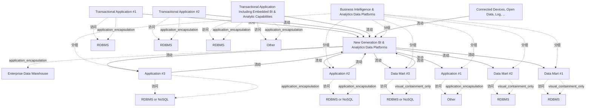

# G238/fig3-4 · 步骤 4——目标架构

类型：`system-or-data-reference-architecture`。给出路线图的终点：说明为什么最终不应保留数仓与新平台两个历史库，以及目标状态下新平台如何覆盖数仓的全部范围（含统一企业数据模型）、向所有数据集市与既有应用供数，并成为历史数据的单一事实来源。

英文 PDF 物理页：[25]。本页为架构语义分析，原文与原图分别保留。

## 原图与可编辑图


[完整 JSON](fig3-4.json) · [可编辑 Mermaid](fig3-4.mmd) · [仅关系图](fig3-4.relations.mmd) · [层级分解图](fig3-4.hierarchy.mmd)

图形重建表达语义，不复制源图布局。虚线表示解释、矩阵映射或分组关系，不自动表示不确定性的概率。



## 架构分析

先看中央的大橙框：它就是 New Generation BI & Analytics Data Platforms，企业数据仓库被画在它内部，表示数仓的范围已被新平台覆盖，二者不再并列。左侧三个事务型应用与 Connected Devices 全部通过橙色虚线进入新平台，没有一条箭头指向旧数仓。右侧六个消费方分两类：Data Mart #1、#2 与 Application #1 是蓝框、琥珀色填充的既有资产，只收灰色实线；Data Mart #3、Application #2、Application #3 是橙框新资产，既有来自新平台的橙色实线，也有指回新平台的橙色虚线（回写）。

- 本图有 23 个具名或隐含元素、23 条关系和 18 条包含/分组记录。
- 包含/分组树最大深度为 2；根节点为 商业智能与分析数据平台、事务型应用 #1、事务型应用 #2、含内嵌 BI 与分析能力的事务型应用、互联设备、开放数据、日志等。
- 本图没有可直接确认为人员直属汇报的关系；视觉上下位置、能力分解和治理职责分别读取。
- 逐一核对全部23标签及13条显式平台/应用数据流，保留原图入站虚线、出站实线、现状蓝边、目标橙边以及平台边界。
- 数据库圆柱按宿主分组；已有access关系保持隐式，不能作为额外显式流。
- EDW包含于新平台，右侧Application #1存储为Other；Data Mart #3、App #2/#3均有一实一虚的双向数据流。黄色填充无单独图例，不臆定为迁移状态。

### 如何用于项目

- 先划定平台边界，登记应用、存储、数据来源及消费者，再逐条读取输入/输出流。
- 区分基线、过渡与目标架构，以及现有、保留与新增对象；范围包含不自动表示组件实现或组织管理。

### 结构所表达的逻辑

- 企业数据仓库不再是独立元素：它被画在新平台内部（橙框灰底），对应正文“新平台将覆盖数仓的完整范围，包括为分析需求构建的统一企业数据模型”。
- 所有数据源都直接进入新平台：三个事务型应用与 Connected Devices/Open Data/Log 均为橙色虚线入站流；图中没有任何事务型应用再直接向数仓供数。
- 新平台向 Data Mart #1/#2 和 Application #1 供数（灰色实线），这三个是保留下来的既有资产（蓝边框、琥珀色填充），正文称“现有数据集市接入新平台”。
- Data Mart #3、Application #2、Application #3 是目标状态的新消费方（橙框），既接收新平台数据，又通过橙色虚线把新产生的数据回写新平台。
- 目标是单一事实来源：新平台同时存储原始、集成与加工数据，覆盖历史数据；正文明确“同时保留数仓与新平台两个历史库不是可靠的目标愿景”。
- 平台范围大虚线框包含新平台、被吸收的数仓与全部集市/应用；数据源在框外。

## 上下级与包含

三层：L1 平台范围容器；L2 新一代平台（含其内部的 L3 企业数据仓库）与 Data Mart #1/#2/#3、Application #1/#2/#3 并列；数据源（三个事务型应用、Connected Devices）在容器外。每个应用/集市的圆柱是其本地存储。EDW 的嵌套表示范围被覆盖，不是“EDW 是平台的子应用”。

|父项|子项|层级类型|依据与解释|
|---|---|---|---|
|商业智能与分析数据平台|新一代 BI 与分析数据平台|visual_grouping|框、泳道、域或分类组的成员归属；没有额外证据不提升为业务组合或管理关系。|
|新一代 BI 与分析数据平台|企业数据仓库|application_encapsulation|应用组件包含其数据、行为或子组件。|
|商业智能与分析数据平台|数据集市 #1|visual_grouping|框、泳道、域或分类组的成员归属；没有额外证据不提升为业务组合或管理关系。|
|商业智能与分析数据平台|数据集市 #2|visual_grouping|框、泳道、域或分类组的成员归属；没有额外证据不提升为业务组合或管理关系。|
|商业智能与分析数据平台|应用 #1|visual_grouping|框、泳道、域或分类组的成员归属；没有额外证据不提升为业务组合或管理关系。|
|商业智能与分析数据平台|数据集市 #3|visual_grouping|框、泳道、域或分类组的成员归属；没有额外证据不提升为业务组合或管理关系。|
|商业智能与分析数据平台|应用 #2|visual_grouping|框、泳道、域或分类组的成员归属；没有额外证据不提升为业务组合或管理关系。|
|商业智能与分析数据平台|应用 #3|visual_grouping|框、泳道、域或分类组的成员归属；没有额外证据不提升为业务组合或管理关系。|
|事务型应用 #1|关系型数据库（RDBMS）|application_encapsulation|应用组件包含其数据、行为或子组件。|
|事务型应用 #2|关系型数据库（RDBMS）|application_encapsulation|应用组件包含其数据、行为或子组件。|
|含内嵌 BI 与分析能力的事务型应用|关系型数据库（RDBMS）|application_encapsulation|应用组件包含其数据、行为或子组件。|
|含内嵌 BI 与分析能力的事务型应用|其他|application_encapsulation|应用组件包含其数据、行为或子组件。|
|数据集市 #1|关系型数据库（RDBMS）|visual_containment_only|保存原图解释中的包含；业务关系类型需要图例或正文进一步限定。|
|数据集市 #2|关系型数据库（RDBMS）|visual_containment_only|保存原图解释中的包含；业务关系类型需要图例或正文进一步限定。|
|应用 #1|其他|application_encapsulation|应用组件包含其数据、行为或子组件。|
|数据集市 #3|关系型数据库或 NoSQL|visual_containment_only|保存原图解释中的包含；业务关系类型需要图例或正文进一步限定。|
|应用 #2|关系型数据库或 NoSQL|application_encapsulation|应用组件包含其数据、行为或子组件。|
|应用 #3|关系型数据库或 NoSQL|application_encapsulation|应用组件包含其数据、行为或子组件。|

## 全部元素与角色

|元素ID|原文名称|类型|含义|直接父项|深度|
|---|---|---|---|---|---|
|platform_scope|Business Intelligence & Analytics Data Platforms|group|平台范围边界。|—||
|txn_app_1|Transactional Application #1|application|蓝框；直接向新平台供数。|—||
|txn_app_2|Transactional Application #2|application|蓝框；直接向新平台供数。|—||
|txn_app_bi|Transactional Application Including Embedded BI & Analytic Capabilities|application|蓝框；直接向新平台供数。|—||
|connected_devices|Connected Devices, Open Data, Log, ...|data|橙框=目标数据源。|—||
|ng_platform|New Generation BI & Analytics Data Platforms|application|目标平台，吸收数仓并成为单一事实来源。|商业智能与分析数据平台|1|
|edw|Enterprise Data Warehouse|data|橙框灰底；表示数仓范围被新平台覆盖，不再独立接收数据。|新一代 BI 与分析数据平台|2|
|data_mart_1|Data Mart #1|data|蓝框、琥珀色填充；保留的既有集市，由新平台供数。|商业智能与分析数据平台|1|
|data_mart_2|Data Mart #2|data|蓝框、琥珀色填充；保留的既有集市。|商业智能与分析数据平台|1|
|app_1|Application #1|application|蓝框、琥珀色填充；保留的既有应用，由新平台供数。|商业智能与分析数据平台|1|
|data_mart_3|Data Mart #3|data|橙框新集市；与新平台双向交换。|商业智能与分析数据平台|1|
|app_2|Application #2|application|橙框新应用；与新平台双向交换。|商业智能与分析数据平台|1|
|app_3|Application #3|application|橙框新应用；与新平台双向交换。|商业智能与分析数据平台|1|
|db_txn_1|RDBMS|data|贴附于该应用/数据集市的存储图标；归属依据图形附属关系，图上没有另外画出的access连线。|事务型应用 #1|1|
|db_txn_2|RDBMS|data|贴附于该应用/数据集市的存储图标；归属依据图形附属关系，图上没有另外画出的access连线。|事务型应用 #2|1|
|db_txn_bi|RDBMS|data|贴附于该应用/数据集市的存储图标；归属依据图形附属关系，图上没有另外画出的access连线。|含内嵌 BI 与分析能力的事务型应用|1|
|db_other_bi|Other|data|贴附于该应用/数据集市的存储图标；归属依据图形附属关系，图上没有另外画出的access连线。|含内嵌 BI 与分析能力的事务型应用|1|
|db_dm_1|RDBMS|data|贴附于该应用/数据集市的存储图标；归属依据图形附属关系，图上没有另外画出的access连线。|数据集市 #1|2|
|db_dm_2|RDBMS|data|贴附于该应用/数据集市的存储图标；归属依据图形附属关系，图上没有另外画出的access连线。|数据集市 #2|2|
|db_app_1|Other|data|贴附于该应用/数据集市的存储图标；归属依据图形附属关系，图上没有另外画出的access连线。|应用 #1|2|
|db_dm_3|RDBMS or NoSQL|data|贴附于该应用/数据集市的存储图标；归属依据图形附属关系，图上没有另外画出的access连线。|数据集市 #3|2|
|db_app_2|RDBMS or NoSQL|data|贴附于该应用/数据集市的存储图标；归属依据图形附属关系，图上没有另外画出的access连线。|应用 #2|2|
|db_app_3|RDBMS or NoSQL|data|贴附于该应用/数据集市的存储图标；归属依据图形附属关系，图上没有另外画出的access连线。|应用 #3|2|

## 全部关系

橙色虚线箭头=入站流（所有数据源进入新平台）；灰色实线箭头=保留下来的既有出站流（新平台→Data Mart #1/#2、Application #1）；橙色实线箭头=目标出站流（新平台→Data Mart #3、Application #2/#3）；从 DM#3/App#2/App#3 指回新平台的橙色虚线=应用回写的入站流。图例只解释线型与蓝/橙框，未解释灰色与橙色箭头的区别。

|主体|语义关系|客体|显式线/隐式|原文标签|依据|
|---|---|---|---|---|---|
|事务型应用 #1|流动|新一代 BI 与分析数据平台|显式连线|Inbound Flow|橙色虚线。|
|事务型应用 #2|流动|新一代 BI 与分析数据平台|显式连线|Inbound Flow|橙色虚线。|
|含内嵌 BI 与分析能力的事务型应用|流动|新一代 BI 与分析数据平台|显式连线|Inbound Flow|橙色虚线。|
|互联设备、开放数据、日志等|流动|新一代 BI 与分析数据平台|显式连线|Inbound Flow|橙色虚线。|
|新一代 BI 与分析数据平台|流动|数据集市 #1|显式连线|Outbound Flow|灰色实线；保留的既有供数关系。|
|新一代 BI 与分析数据平台|流动|数据集市 #2|显式连线|Outbound Flow|灰色实线。|
|新一代 BI 与分析数据平台|流动|应用 #1|显式连线|Outbound Flow|灰色实线。|
|新一代 BI 与分析数据平台|流动|数据集市 #3|显式连线|Outbound Flow|橙色实线。|
|数据集市 #3|流动|新一代 BI 与分析数据平台|显式连线|Inbound Flow|橙色虚线，箭头指向新平台。|
|新一代 BI 与分析数据平台|流动|应用 #2|显式连线|Outbound Flow|橙色实线。|
|应用 #2|流动|新一代 BI 与分析数据平台|显式连线|Inbound Flow|橙色虚线，箭头指向新平台。|
|新一代 BI 与分析数据平台|流动|应用 #3|显式连线|Outbound Flow|橙色实线。|
|应用 #3|流动|新一代 BI 与分析数据平台|显式连线|Inbound Flow|橙色虚线，箭头指向新平台。|
|事务型应用 #1|访问|关系型数据库（RDBMS）|implicit||圆柱紧贴宿主，原图未画线。|
|事务型应用 #2|访问|关系型数据库（RDBMS）|implicit||访问|
|含内嵌 BI 与分析能力的事务型应用|访问|关系型数据库（RDBMS）|implicit||访问|
|含内嵌 BI 与分析能力的事务型应用|访问|其他|implicit||访问|
|数据集市 #1|访问|关系型数据库（RDBMS）|implicit||访问|
|数据集市 #2|访问|关系型数据库（RDBMS）|implicit||访问|
|应用 #1|访问|其他|implicit||访问|
|数据集市 #3|访问|关系型数据库或 NoSQL|implicit||访问|
|应用 #2|访问|关系型数据库或 NoSQL|implicit||访问|
|应用 #3|访问|关系型数据库或 NoSQL|implicit||访问|

## 误读检查

- 不要把 EDW 画在新平台内部读成“EDW 是新平台的一个子应用”；它表示数仓的范围与职责被目标平台覆盖。
- 不要因为 DM#1/#2、App#1 是蓝框就认为它们仍是“现状未迁移”：它们是被保留并改由新平台供数的既有资产；琥珀色填充在图例中没有定义。
- 不要把灰色实线当成已废弃的旧流：它表示保留下来的既有供数关系，箭头仍指向现有集市/应用。
- 不要把 DM#3/App#2/App#3 的回写虚线读成查询请求或双向同步；它是应用产生的新数据经摄取进入平台以保留历史。
- 目标图中没有任何数据源再直接连数仓，若把 EDW 当作仍在独立接收数据就会误读目标状态。
- 中文稿引用的中文化 PNG 把第三个事务型应用框画成两条竖线、丢失出站流图例箭头，容易造成元素缺失的错觉。

## 原文证据

### [PDF 第 24 页](../../../documents/G238.md#page-24)

### [PDF 第 25 页](../../../documents/G238.md#page-25)

> [Target Architecture] The new generation BI & Analytics data platforms feed all the data marts and cover all the BI & Analytics requirements from business users.
> Structurally, because of its capacity to store more volume, variety, and velocity, the new generation BI & Analytics data platforms can cover the scope of the data warehouse data and more. The conviction was established that having two repositories, data warehouse and new generation BI & Analytics data platforms for historical data, is not a reliable target vision. It will take time, but at the target new generation BI & Analytics data platforms will cover the full scope of the data warehouse, including the harmonized enterprise data model built to answer analytics requirements.
### [PDF 第 26 页](../../../documents/G238.md#page-26)


## 来源与分析状态

所有元素/关系均有来源定位；未把历史解释重命名为本轮逐线视觉确认。源图与语义图是两种视图，布局不证明汇报或因果。

源 PDF SHA-256：`87e00e009377a887627417ceffc28b1f480bfaf57c9c84ee6f8757cc5c1c9444`。

源图记录：[原始解释与转录](../../../figures/G238/fig3-4.json)。

```json
{
  "quality": {
    "graph_integrity": "checked",
    "semantic_analysis": "typed-graph-and-context-analysis",
    "visual_review": "source-content-audited",
    "notice_zh": "所有元素/关系均有来源定位；未把历史解释重命名为本轮逐线视觉确认。源图与语义图是两种视图，布局不证明汇报或因果。"
  },
  "source_uncertainty": {
    "confidence": "medium",
    "uncertainties_zh": [
      "琥珀色填充只出现在 Data Mart #1/#2 与 Application #1，图例未解释；本分析按正文“现有数据集市接入新平台/保留既有投资”推断为“保留下来的既有资产”，不能确定作者是否另有编码。",
      "箭头灰/橙的区分没有图例说明；按“灰色=既有关系、橙色=新增/目标关系”解释。",
      "EDW 嵌套在新平台内的确切含义（范围覆盖 vs. 逻辑包含）正文支持“覆盖数仓完整范围”，但图形本身没有文字说明。",
      "Application #1 的存储圆柱标注为 Other，与步骤 1–3 中同一应用的 RDBMS 不同，原图未说明原因。"
    ],
    "analyzed_from": [
      "英文 PDF 第 25 页图 3-4 截图与 3×3 放大分块",
      "英文 PDF 第 24–25 页步骤 4 正文与表 3-5",
      "中文稿 G238e_信息架构_商业智能与分析.md 第 332–368 行",
      "figs/zh/g238e_fig3-4_zh.png、figs/g238e_fig3-4_en.png（相似度 0.988）"
    ],
    "date": "2026-10-31"
  },
  "source_conflicts": []
}
```
