# G238/fig4-1 · 利益相关者借助 BI 与分析能力追求的目标

类型：`decomposition-or-organization-model`。把表 4-1 的目标按“谁追求”重新组织：让读者一眼看出 CEO 关注业务结果、CIO 关注平台与运营、CDO 关注数据价值与治理，作为定义 BI 与分析能力目标与 KPI 的起点。

英文 PDF 物理页：[28]。本页为架构语义分析，原文与原图分别保留。

## 原图与可编辑图


[完整 JSON](fig4-1.json) · [可编辑 Mermaid](fig4-1.mmd) · [仅关系图](fig4-1.relations.mmd) · [层级分解图](fig4-1.hierarchy.mmd)

图形重建表达语义，不复制源图布局。虚线表示解释、矩阵映射或分组关系，不自动表示不确定性的概率。

```mermaid
flowchart TB
  %% Semantic reconstruction; see original source image for exact layout.
  n0["CEO"]
  n1["CIO"]
  n2["CDO"]
  n3["Improve Customer or Partner Satisfaction"]
  n4["Improve Operational Efficiency"]
  n5["Comply with Regulations (Privacy, Solvency II, etc.)"]
  n6["Leverage Innovation Opportunities"]
  n7["Store Data as an Asset including Metadata"]
  n8["Reduce Use-Case Time-to-Market"]
  n9["Reduce Total Cost of Ownership"]
  n10["Comply with Security"]
  n11["Guarantee Quality of Service"]
  n12["Support Digital and Data Innovation"]
  n13["Provide Interoperability between Systems"]
  n14["Generate Business Value Leveraging New Data Capabilities (e.g., Data Science)"]
  n15["Data Quality is Under Control"]
  n16["Democratize Use of Data"]
  n0 -.->|"visual_containment_only"| n3
  n0 -.->|"visual_containment_only"| n4
  n0 -.->|"visual_containment_only"| n5
  n0 -.->|"visual_containment_only"| n6
  n1 -.->|"visual_containment_only"| n7
  n1 -.->|"visual_containment_only"| n8
  n1 -.->|"visual_containment_only"| n9
  n1 -.->|"visual_containment_only"| n10
  n1 -.->|"visual_containment_only"| n11
  n1 -.->|"visual_containment_only"| n12
  n1 -.->|"visual_containment_only"| n13
  n2 -.->|"visual_containment_only"| n14
  n2 -.->|"visual_containment_only"| n15
  n2 -.->|"visual_containment_only"| n16
```



## 架构分析

从左到右三列，列顶的 CEO / CIO / CDO 是被拉长的 Stakeholder 框（右上角双圆图标），列内每个淡紫色切角框是一个 Goal（右上角靶心图标）。目标归属完全由它落在哪一列决定；列内自上而下没有先后或优先级含义。图中没有箭头，因此目标之间的关系（如“合规”与“安全”的包含关系）不在图上表达。

- 本图有 17 个具名或隐含元素、0 条关系和 14 条包含/分组记录。
- 包含/分组树最大深度为 1；根节点为 首席执行官（CEO）、首席信息官（CIO）、首席数据官（CDO）。
- 本图没有可直接确认为人员直属汇报的关系；视觉上下位置、能力分解和治理职责分别读取。
- 原图靠嵌套表达结构，没有连线；新语义图将包含单独显式化，不补造流程、数据流或依赖。
- 包含分组后有 3 个连通分量；分离可能源于图例、并列分类或独立示例，未自动补边。
- 核对CEO四目标、CIO七目标、CDO三目标，共17标签。三个利益相关者框并列，没有组织汇报关系或目标之间的箭头。

### 如何用于项目

- 按父项展开所有直接子项，检查同层粒度、重叠和缺项。
- 保留组成、分类、能力分解与组织汇报的区别；将示例名称替换为已确认的项目对象。

### 结构所表达的逻辑

- CEO 有 4 项目标：提升客户或伙伴满意度、提升运营效率、遵守法规、利用创新机会——偏业务结果与合规。
- CIO 有 7 项目标：数据作为资产（含元数据）、缩短用例上市时间、降低总拥有成本、遵守安全、保证服务质量、支撑数字与数据创新、提供系统间互操作性——偏平台、运营与安全。
- CDO 有 3 项目标：借助新数据能力创造业务价值、数据质量受控、数据民主化使用——聚焦数据价值、质量与共享。
- 图中共 14 个 Goal；表 4-1 有 17 项，因为表中把“Comply with Security”拆成数据分级与加密、数据泄露、身份与访问管理、基础设施基线 4 项（编号 2–5）。
- 目标与 KPI 的对应关系不在图内，只在表 4-1 中给出（如满意度→NPS、TCO→每用户成本、互操作→API 数量）。
- 同一目标可能被多个利益相关者追求，但图中每个目标只出现一次，表示作者给出的示例性归属，不是排他归属。

## 上下级与包含

两层：L1 是三个 Stakeholder（CEO、CIO、CDO）；L2 是其下的 Goal。Goal 被画在 Stakeholder 框内，表示“该利益相关者追求这些目标”（包含/归属，不是分类学上的子类型）。目标之间没有上下级。

|父项|子项|层级类型|依据与解释|
|---|---|---|---|
|首席执行官（CEO）|提升客户或伙伴满意度|visual_containment_only|保存原图解释中的包含；业务关系类型需要图例或正文进一步限定。|
|首席执行官（CEO）|提升运营效率|visual_containment_only|保存原图解释中的包含；业务关系类型需要图例或正文进一步限定。|
|首席执行官（CEO）|遵守法规（隐私、偿付能力 II 等）|visual_containment_only|保存原图解释中的包含；业务关系类型需要图例或正文进一步限定。|
|首席执行官（CEO）|利用创新机会|visual_containment_only|保存原图解释中的包含；业务关系类型需要图例或正文进一步限定。|
|首席信息官（CIO）|将数据作为资产存储（含元数据）|visual_containment_only|保存原图解释中的包含；业务关系类型需要图例或正文进一步限定。|
|首席信息官（CIO）|缩短用例上市时间|visual_containment_only|保存原图解释中的包含；业务关系类型需要图例或正文进一步限定。|
|首席信息官（CIO）|降低总拥有成本|visual_containment_only|保存原图解释中的包含；业务关系类型需要图例或正文进一步限定。|
|首席信息官（CIO）|遵守安全|visual_containment_only|保存原图解释中的包含；业务关系类型需要图例或正文进一步限定。|
|首席信息官（CIO）|保证服务质量|visual_containment_only|保存原图解释中的包含；业务关系类型需要图例或正文进一步限定。|
|首席信息官（CIO）|支撑数字与数据创新|visual_containment_only|保存原图解释中的包含；业务关系类型需要图例或正文进一步限定。|
|首席信息官（CIO）|提供系统间互操作性|visual_containment_only|保存原图解释中的包含；业务关系类型需要图例或正文进一步限定。|
|首席数据官（CDO）|借助新数据能力（如数据科学）创造业务价值|visual_containment_only|保存原图解释中的包含；业务关系类型需要图例或正文进一步限定。|
|首席数据官（CDO）|数据质量受控|visual_containment_only|保存原图解释中的包含；业务关系类型需要图例或正文进一步限定。|
|首席数据官（CDO）|数据民主化使用|visual_containment_only|保存原图解释中的包含；业务关系类型需要图例或正文进一步限定。|

## 全部元素与角色

|元素ID|原文名称|类型|含义|直接父项|深度|
|---|---|---|---|---|---|
|st_ceo|CEO|stakeholder|追求 4 项业务结果类目标。|—||
|st_cio|CIO|stakeholder|追求 7 项平台、运营与安全类目标。|—||
|st_cdo|CDO|stakeholder|追求 3 项数据价值、质量与民主化目标。|—||
|g_customer_satisfaction|Improve Customer or Partner Satisfaction|goal|表 4-1 编号 9；KPI 为 NPS。|首席执行官（CEO）|1|
|g_operational_efficiency|Improve Operational Efficiency|goal|表 4-1 编号 10；KPI 为自动化功能数量。|首席执行官（CEO）|1|
|g_regulations|Comply with Regulations (Privacy, Solvency II, etc.)|goal|表 4-1 编号 1；涉及 GDPR、Solvency II。|首席执行官（CEO）|1|
|g_innovation|Leverage Innovation Opportunities|goal|表 4-1 编号 11；KPI 为创新功能。|首席执行官（CEO）|1|
|g_data_asset|Store Data as an Asset including Metadata|goal|表 4-1 编号 14。|首席信息官（CIO）|1|
|g_time_to_market|Reduce Use-Case Time-to-Market|goal|表 4-1 编号 13。|首席信息官（CIO）|1|
|g_tco|Reduce Total Cost of Ownership|goal|表 4-1 编号 12。|首席信息官（CIO）|1|
|g_security|Comply with Security|goal|表 4-1 把它拆为编号 2–5：数据分级与加密、数据泄露、身份与访问管理、基础设施基线。|首席信息官（CIO）|1|
|g_qos|Guarantee Quality of Service|goal|表 4-1 编号 8。|首席信息官（CIO）|1|
|g_digital_innovation|Support Digital and Data Innovation|goal|表 4-1 编号 17。|首席信息官（CIO）|1|
|g_interoperability|Provide Interoperability between Systems|goal|表 4-1 编号 16。|首席信息官（CIO）|1|
|g_new_data_value|Generate Business Value Leveraging New Data Capabilities (e.g., Data Science)|goal|表 4-1 编号 15。|首席数据官（CDO）|1|
|g_data_quality|Data Quality is Under Control|goal|表 4-1 编号 6。|首席数据官（CDO）|1|
|g_democratize|Democratize Use of Data|goal|表 4-1 编号 7。|首席数据官（CDO）|1|

## 全部关系

图中没有任何连线或箭头。Stakeholder 与 Goal 的关系由“目标位于该列之内”隐含表达（ArchiMate 中通常是关联或组成）；不能把列的左右顺序读成汇报关系或权限大小。

|主体|语义关系|客体|显式线/隐式|原文标签|依据|
|---|---|---|---|---|---|

## 误读检查

- 不要把图数成 17 个目标：原图只有 14 个，17 项是表 4-1 的编号体系（安全被拆为 4 项）。
- 不要以为 CDO 只负责 3 项、CIO 负责 7 项就是完整的职责边界；图只列与 BI & Analytics 能力相关的目标。
- 不要按列内从上到下理解优先级或时间顺序。
- 不要把 CEO/CIO/CDO 三列读成组织汇报链（CEO→CIO→CDO）；三列是并列的利益相关者类别。
- 中文稿当前引用的 figs/g238_fig4-1.svg 把图改成 17 项无归属清单并混入表 4-1 的内容，不能据此判断目标归属。

## 原文证据

### [PDF 第 28 页](../../../documents/G238.md#page-28)

> Figure 4-1: Goals Targeted by Stakeholders with BI & Analytics Capability

## 来源与分析状态

所有元素/关系均有来源定位；未把历史解释重命名为本轮逐线视觉确认。源图与语义图是两种视图，布局不证明汇报或因果。

源 PDF SHA-256：`87e00e009377a887627417ceffc28b1f480bfaf57c9c84ee6f8757cc5c1c9444`。

源图记录：[原始解释与转录](../../../figures/G238/fig4-1.json)。

```json
{
  "quality": {
    "graph_integrity": "checked",
    "semantic_analysis": "typed-graph-and-context-analysis",
    "visual_review": "source-content-audited",
    "notice_zh": "所有元素/关系均有来源定位；未把历史解释重命名为本轮逐线视觉确认。源图与语义图是两种视图，布局不证明汇报或因果。"
  },
  "source_uncertainty": {
    "confidence": "medium",
    "uncertainties_zh": [
      "原图只有 14 个目标框，表 4-1 有 17 项；本分析按原图 14 个元素转录，并在描述中标注表 4-1 编号，未把安全 4 个子目标拆成图中元素。",
      "Stakeholder 框与 Goal 框之间未画连线，按 ArchiMate 语义应为关联/组成；这里用 parent 表示列包含。",
      "CDO 一列下方留有大片空白，原图未说明是留给未来目标还是纯版式。"
    ],
    "analyzed_from": [
      "英文 PDF 第 28 页图 4-1 截图与 3×3 放大分块",
      "英文 PDF 第 28–30 页表 4-1（目标、说明、KPI）",
      "中文稿 G238e_信息架构_商业智能与分析.md 第 390–414 行",
      "figs/g238_fig4-1.svg 源码"
    ],
    "date": "2026-10-31"
  },
  "source_conflicts": []
}
```
