# G238/fig4-2 · BI 与分析详细业务功能

类型：`decomposition-or-organization-model`。给出业务侧参考模型的详细层级：把图 2-1 的 9 项高层业务功能逐项展开，供组织评估现状、设计目标 BI & Analytics 能力时逐项核对；它也是表 4-2 的图形版，用嵌套位置说明“宏观功能—子功能”的归属。

英文 PDF 物理页：[31]。本页为架构语义分析，原文与原图分别保留。

## 原图与可编辑图


[完整 JSON](fig4-2.json) · [可编辑 Mermaid](fig4-2.mmd) · [仅关系图](fig4-2.relations.mmd) · [层级分解图](fig4-2.hierarchy.mmd)

图形重建表达语义，不复制源图布局。虚线表示解释、矩阵映射或分组关系，不自动表示不确定性的概率。

```mermaid
flowchart TB
  %% Semantic reconstruction; see original source image for exact layout.
  n0["BI &amp; Analytics Business Functions"]
  n1["Define the Strategy &amp; Roadmaps"]
  n2["Build the BI &amp; Analytics Strategy"]
  n3["Build the Roadmap"]
  n4["Maintain BI &amp; Analytics Usages Backlog"]
  n5["Define KPIs"]
  n6["Identify &amp; Develop Sponsorship"]
  n7["Ensure Consistency with Related Strategies (Security, Sustainability, etc.)"]
  n8["Provide Necessary Data Sources for BI &amp; Analytics Purposes"]
  n9["Identify Relevant Data Sources"]
  n10["Identify &amp; Manage Data Providers"]
  n11["Design &amp; Build Necessary Interfaces"]
  n12["Design &amp; Develop BI &amp; Analytics Value Chain"]
  n13["Define BI &amp; Analytics Architecture Principles and Ensure Consistency of Solutions"]
  n14["Design Infrastructure &amp; Adapted Storage Spaces"]
  n15["Model &amp; Build Data Structuration Depending on Related Uses (Raw, Warehouse, Business Views)"]
  n16["Define &amp; Implement Business Rules"]
  n17["Define &amp; Implement Technical Rules"]
  n18["Define &amp; Implement Specific Data Protection Rules"]
  n19["Design &amp; Develop Data Pipelines"]
  n20["Design Semantic Layer"]
  n21["Data Wrangling"]
  n22["Design &amp; Build Advanced Analytical Models"]
  n23["Design &amp; Build Industrialized Stable Reports"]
  n24["Design &amp; Build Ad Hoc Reports"]
  n25["Industrialize &amp; Deploy Advanced Analytical Models"]
  n26["Govern &amp; Measure"]
  n27["Define Governance Organization &amp; RACI"]
  n28["Define &amp; Enforce Process to Onboard New Source Data"]
  n29["Define &amp; Enforce Cost Optimization Principles"]
  n30["Define &amp; Enforce Compliance Requirements"]
  n31["Measure Data Volumes"]
  n32["Measure Data Use Frequencies"]
  n33["Follow Up ROI of Usages"]
  n34["Protect Data &amp; Ensure Compliance"]
  n35["Define &amp; Manage Data Access"]
  n36["Audit Platform Security &amp; Compliance"]
  n37["Define Anonymization Requirements &amp; Processes"]
  n38["Detect &amp; Notify a Data Breach"]
  n39["Support for Handling Data Portability Requests"]
  n40["Define &amp; Apply a Data Quality Framework (Measures, Quality Management, etc.)"]
  n41["Leverage Metadata Management for BI &amp; Analytics"]
  n42["Operate Platforms"]
  n43["Detect &amp; Manage Incidents"]
  n44["Detect &amp; Manage Data Issues"]
  n45["Monitor &amp; Control Costs"]
  n46["Monitor &amp; Control Data Quality"]
  n47["Monitor &amp; Control Model Accuracy"]
  n48["Schedule Data Integration &amp; Pipeline"]
  n49["Grant Access"]
  n50["Communicate &amp; Train"]
  n51["Train End Users in BI &amp; Analytics &amp; Tools"]
  n52["Leverage Technical Evangelism"]
  n53["Animate BI &amp; Analytics Users &amp; Expert Communities"]
  n54["Communicate Strategy, Business, &amp; Technical Roadmaps"]
  n0 -.->|"functional_decomposition"| n1
  n1 -.->|"functional_decomposition"| n2
  n1 -.->|"functional_decomposition"| n3
  n1 -.->|"functional_decomposition"| n4
  n1 -.->|"functional_decomposition"| n5
  n1 -.->|"functional_decomposition"| n6
  n1 -.->|"functional_decomposition"| n7
  n0 -.->|"functional_decomposition"| n8
  n8 -.->|"functional_decomposition"| n9
  n8 -.->|"functional_decomposition"| n10
  n8 -.->|"functional_decomposition"| n11
  n0 -.->|"functional_decomposition"| n12
  n12 -.->|"functional_decomposition"| n13
  n12 -.->|"functional_decomposition"| n14
  n12 -.->|"functional_decomposition"| n15
  n12 -.->|"functional_decomposition"| n16
  n12 -.->|"functional_decomposition"| n17
  n12 -.->|"functional_decomposition"| n18
  n12 -.->|"functional_decomposition"| n19
  n12 -.->|"functional_decomposition"| n20
  n12 -.->|"functional_decomposition"| n21
  n12 -.->|"functional_decomposition"| n22
  n12 -.->|"functional_decomposition"| n23
  n12 -.->|"functional_decomposition"| n24
  n12 -.->|"functional_decomposition"| n25
  n0 -.->|"functional_decomposition"| n26
  n26 -.->|"functional_decomposition"| n27
  n26 -.->|"functional_decomposition"| n28
  n26 -.->|"functional_decomposition"| n29
  n26 -.->|"functional_decomposition"| n30
  n26 -.->|"functional_decomposition"| n31
  n26 -.->|"functional_decomposition"| n32
  n26 -.->|"functional_decomposition"| n33
  n0 -.->|"functional_decomposition"| n34
  n34 -.->|"functional_decomposition"| n35
  n34 -.->|"functional_decomposition"| n36
  n34 -.->|"functional_decomposition"| n37
  n34 -.->|"functional_decomposition"| n38
  n34 -.->|"functional_decomposition"| n39
  n0 -.->|"functional_decomposition"| n40
  n0 -.->|"functional_decomposition"| n41
  n0 -.->|"functional_decomposition"| n42
  n42 -.->|"functional_decomposition"| n43
  n42 -.->|"functional_decomposition"| n44
  n42 -.->|"functional_decomposition"| n45
  n42 -.->|"functional_decomposition"| n46
  n42 -.->|"functional_decomposition"| n47
  n42 -.->|"functional_decomposition"| n48
  n42 -.->|"functional_decomposition"| n49
  n0 -.->|"functional_decomposition"| n50
  n50 -.->|"functional_decomposition"| n51
  n50 -.->|"functional_decomposition"| n52
  n50 -.->|"functional_decomposition"| n53
  n50 -.->|"functional_decomposition"| n54
```



## 架构分析

从外到内读：最外层大框是全部 BI & Analytics 业务功能；内部 9 个带标题的功能框是宏观功能（与图 2-1 左栏一一对应）；宏观功能框内的小圆角框是子功能。所有框右上角的旗帜图标表示 ArchiMate 功能元素。图中没有箭头，框的包含关系就是组成关系；版式上 Define the Strategy & Roadmaps 横贯顶部，Provide Necessary Data Sources 在左列，Design & Develop Value Chain 是中央最大块，Govern & Measure 在右列纵贯，Protect/Quality/Metadata/Operate/Communicate 依次向下横贯。

- 本图有 55 个具名或隐含元素、0 条关系和 54 条包含/分组记录。
- 包含/分组树最大深度为 2；根节点为 BI 与分析业务功能。
- 本图没有可直接确认为人员直属汇报的关系；视觉上下位置、能力分解和治理职责分别读取。
- 原图靠嵌套表达结构，没有连线；新语义图将包含单独显式化，不补造流程、数据流或依赖。
- 逐项核对55标签与9组/45子功能的嵌套，包含战略6、来源3、价值链13、治理7、保护5、运营7、沟通4项。
- 质量框架与元数据管理是未展开的一级功能；未将上下排列错误解释为阶段。无显式连线或表格。

### 如何用于项目

- 按父项展开所有直接子项，检查同层粒度、重叠和缺项。
- 保留组成、分类、能力分解与组织汇报的区别；将示例名称替换为已确认的项目对象。

### 结构所表达的逻辑

- 9 个高层业务功能与图 2-1 左栏完全对应：定义战略与路线图、提供必要数据源、设计与开发价值链条、治理与度量、保护数据与确保合规、定义并应用数据质量框架、利用元数据管理、运营平台、沟通与培训。
- 子功能数量：定义战略 6、提供数据源 3、设计与开发价值链条 13（最大）、治理与度量 7、保护数据与合规 5、运营平台 7、沟通与培训 4；数据质量框架与元数据管理没有子功能，是叶子功能。
- 设计与开发价值链条的 13 项覆盖从架构原则、基础设施与存储空间、数据结构化，到业务/技术/数据保护规则、数据管道、语义层、数据整理、高级分析模型、工业化/即席报表与模型部署的完整链条。
- 治理与度量 7 项关注组织与 RACI、新数据源接入、成本优化、合规要求、数据量、使用频率与 ROI，是横跨其他功能的治理面。
- 运营平台 7 项关注事件、数据问题、成本、数据质量、模型准确性、调度与授权，是平台运行面。
- 图只给功能名称，不给定义；每个子功能的说明见表 4-2（粗体行是宏观功能，其余是子功能）。
- 嵌套与字号只表示层级和分组，不表示成熟度、优先级或执行顺序；图中没有流程箭头。

## 上下级与包含

三层：L0 是“BI & Analytics Business Functions”总容器；L1 是 9 个宏观业务功能；L2 是 45 个子功能。数据质量框架与元数据管理两个 L1 功能没有 L2 子项。所有层级都是 ArchiMate 功能，父框在视觉上包住子框表示组成。

|父项|子项|层级类型|依据与解释|
|---|---|---|---|
|BI 与分析业务功能|定义战略与路线图|functional_decomposition|同类功能/过程/服务的嵌套分解；不推断执行顺序。|
|定义战略与路线图|构建 BI 与分析战略|functional_decomposition|同类功能/过程/服务的嵌套分解；不推断执行顺序。|
|定义战略与路线图|构建路线图|functional_decomposition|同类功能/过程/服务的嵌套分解；不推断执行顺序。|
|定义战略与路线图|维护 BI 与分析用途待办列表|functional_decomposition|同类功能/过程/服务的嵌套分解；不推断执行顺序。|
|定义战略与路线图|定义 KPI|functional_decomposition|同类功能/过程/服务的嵌套分解；不推断执行顺序。|
|定义战略与路线图|识别并发展赞助|functional_decomposition|同类功能/过程/服务的嵌套分解；不推断执行顺序。|
|定义战略与路线图|确保与相关战略一致（安全、可持续性等）|functional_decomposition|同类功能/过程/服务的嵌套分解；不推断执行顺序。|
|BI 与分析业务功能|为 BI 与分析提供必要数据源|functional_decomposition|同类功能/过程/服务的嵌套分解；不推断执行顺序。|
|为 BI 与分析提供必要数据源|识别相关数据源|functional_decomposition|同类功能/过程/服务的嵌套分解；不推断执行顺序。|
|为 BI 与分析提供必要数据源|识别并管理数据提供方|functional_decomposition|同类功能/过程/服务的嵌套分解；不推断执行顺序。|
|为 BI 与分析提供必要数据源|设计并构建必要数据接口|functional_decomposition|同类功能/过程/服务的嵌套分解；不推断执行顺序。|
|BI 与分析业务功能|设计与开发 BI 与分析价值链条|functional_decomposition|同类功能/过程/服务的嵌套分解；不推断执行顺序。|
|设计与开发 BI 与分析价值链条|定义 BI 与分析架构原则并确保方案一致性|functional_decomposition|同类功能/过程/服务的嵌套分解；不推断执行顺序。|
|设计与开发 BI 与分析价值链条|设计基础设施与适配的存储空间|functional_decomposition|同类功能/过程/服务的嵌套分解；不推断执行顺序。|
|设计与开发 BI 与分析价值链条|依据用途建模并构建数据结构化（原始、仓库、业务视图）|functional_decomposition|同类功能/过程/服务的嵌套分解；不推断执行顺序。|
|设计与开发 BI 与分析价值链条|定义并实施业务规则|functional_decomposition|同类功能/过程/服务的嵌套分解；不推断执行顺序。|
|设计与开发 BI 与分析价值链条|定义并实施技术规则|functional_decomposition|同类功能/过程/服务的嵌套分解；不推断执行顺序。|
|设计与开发 BI 与分析价值链条|定义并实施特定数据保护规则|functional_decomposition|同类功能/过程/服务的嵌套分解；不推断执行顺序。|
|设计与开发 BI 与分析价值链条|设计与开发数据管道|functional_decomposition|同类功能/过程/服务的嵌套分解；不推断执行顺序。|
|设计与开发 BI 与分析价值链条|设计语义层|functional_decomposition|同类功能/过程/服务的嵌套分解；不推断执行顺序。|
|设计与开发 BI 与分析价值链条|数据整理（Data Wrangling）|functional_decomposition|同类功能/过程/服务的嵌套分解；不推断执行顺序。|
|设计与开发 BI 与分析价值链条|设计与构建高级分析模型|functional_decomposition|同类功能/过程/服务的嵌套分解；不推断执行顺序。|
|设计与开发 BI 与分析价值链条|设计与构建工业化稳定报表|functional_decomposition|同类功能/过程/服务的嵌套分解；不推断执行顺序。|
|设计与开发 BI 与分析价值链条|设计与构建即席报表|functional_decomposition|同类功能/过程/服务的嵌套分解；不推断执行顺序。|
|设计与开发 BI 与分析价值链条|工业化并部署高级分析模型|functional_decomposition|同类功能/过程/服务的嵌套分解；不推断执行顺序。|
|BI 与分析业务功能|治理与度量|functional_decomposition|同类功能/过程/服务的嵌套分解；不推断执行顺序。|
|治理与度量|定义治理组织与 RACI|functional_decomposition|同类功能/过程/服务的嵌套分解；不推断执行顺序。|
|治理与度量|定义并执行新数据源接入流程|functional_decomposition|同类功能/过程/服务的嵌套分解；不推断执行顺序。|
|治理与度量|定义并执行成本优化原则|functional_decomposition|同类功能/过程/服务的嵌套分解；不推断执行顺序。|
|治理与度量|定义并执行合规要求|functional_decomposition|同类功能/过程/服务的嵌套分解；不推断执行顺序。|
|治理与度量|度量数据量|functional_decomposition|同类功能/过程/服务的嵌套分解；不推断执行顺序。|
|治理与度量|度量数据使用频率|functional_decomposition|同类功能/过程/服务的嵌套分解；不推断执行顺序。|
|治理与度量|跟踪用途 ROI|functional_decomposition|同类功能/过程/服务的嵌套分解；不推断执行顺序。|
|BI 与分析业务功能|保护数据并确保合规|functional_decomposition|同类功能/过程/服务的嵌套分解；不推断执行顺序。|
|保护数据并确保合规|定义并管理数据访问|functional_decomposition|同类功能/过程/服务的嵌套分解；不推断执行顺序。|
|保护数据并确保合规|审计平台安全与合规|functional_decomposition|同类功能/过程/服务的嵌套分解；不推断执行顺序。|
|保护数据并确保合规|定义匿名化需求与流程|functional_decomposition|同类功能/过程/服务的嵌套分解；不推断执行顺序。|
|保护数据并确保合规|检测并通知数据泄露|functional_decomposition|同类功能/过程/服务的嵌套分解；不推断执行顺序。|
|保护数据并确保合规|支持处理数据可携带请求|functional_decomposition|同类功能/过程/服务的嵌套分解；不推断执行顺序。|
|BI 与分析业务功能|定义并应用数据质量框架（度量、质量管理等）|functional_decomposition|同类功能/过程/服务的嵌套分解；不推断执行顺序。|
|BI 与分析业务功能|为 BI 与分析利用元数据管理|functional_decomposition|同类功能/过程/服务的嵌套分解；不推断执行顺序。|
|BI 与分析业务功能|运营平台|functional_decomposition|同类功能/过程/服务的嵌套分解；不推断执行顺序。|
|运营平台|检测并管理事件|functional_decomposition|同类功能/过程/服务的嵌套分解；不推断执行顺序。|
|运营平台|检测并管理数据问题|functional_decomposition|同类功能/过程/服务的嵌套分解；不推断执行顺序。|
|运营平台|监控与控制成本|functional_decomposition|同类功能/过程/服务的嵌套分解；不推断执行顺序。|
|运营平台|监控与控制数据质量|functional_decomposition|同类功能/过程/服务的嵌套分解；不推断执行顺序。|
|运营平台|监控与控制模型准确性|functional_decomposition|同类功能/过程/服务的嵌套分解；不推断执行顺序。|
|运营平台|调度数据集成与管道|functional_decomposition|同类功能/过程/服务的嵌套分解；不推断执行顺序。|
|运营平台|授予访问|functional_decomposition|同类功能/过程/服务的嵌套分解；不推断执行顺序。|
|BI 与分析业务功能|沟通与培训|functional_decomposition|同类功能/过程/服务的嵌套分解；不推断执行顺序。|
|沟通与培训|培训最终用户使用 BI 与分析工具|functional_decomposition|同类功能/过程/服务的嵌套分解；不推断执行顺序。|
|沟通与培训|利用技术布道|functional_decomposition|同类功能/过程/服务的嵌套分解；不推断执行顺序。|
|沟通与培训|活跃 BI 与分析用户与专家社区|functional_decomposition|同类功能/过程/服务的嵌套分解；不推断执行顺序。|
|沟通与培训|就战略、业务与技术路线图开展沟通|functional_decomposition|同类功能/过程/服务的嵌套分解；不推断执行顺序。|

## 全部元素与角色

|元素ID|原文名称|类型|含义|直接父项|深度|
|---|---|---|---|---|---|
|bf_root|BI & Analytics Business Functions|function|整个业务功能参考模型的容器。|—||
|bf_strategy|Define the Strategy & Roadmaps|function|功能：定义战略与路线图|BI 与分析业务功能|1|
|bf_build_strategy|Build the BI & Analytics Strategy|function|功能：构建 BI 与分析战略|定义战略与路线图|2|
|bf_build_roadmap|Build the Roadmap|function|功能：构建路线图|定义战略与路线图|2|
|bf_maintain_backlog|Maintain BI & Analytics Usages Backlog|function|功能：维护 BI 与分析用途待办列表|定义战略与路线图|2|
|bf_define_kpis|Define KPIs|function|功能：定义 KPI|定义战略与路线图|2|
|bf_sponsorship|Identify & Develop Sponsorship|function|功能：识别并发展赞助|定义战略与路线图|2|
|bf_consistency|Ensure Consistency with Related Strategies (Security, Sustainability, etc.)|function|功能：确保与相关战略一致（安全、可持续性等）|定义战略与路线图|2|
|bf_sources|Provide Necessary Data Sources for BI & Analytics Purposes|function|功能：为 BI 与分析提供必要数据源|BI 与分析业务功能|1|
|bf_identify_sources|Identify Relevant Data Sources|function|功能：识别相关数据源|为 BI 与分析提供必要数据源|2|
|bf_manage_providers|Identify & Manage Data Providers|function|功能：识别并管理数据提供方|为 BI 与分析提供必要数据源|2|
|bf_build_interfaces|Design & Build Necessary Interfaces|function|功能：设计并构建必要数据接口|为 BI 与分析提供必要数据源|2|
|bf_value_chain|Design & Develop BI & Analytics Value Chain|function|功能：设计与开发 BI 与分析价值链条|BI 与分析业务功能|1|
|bf_arch_principles|Define BI & Analytics Architecture Principles and Ensure Consistency of Solutions|function|功能：定义 BI 与分析架构原则并确保方案一致性|设计与开发 BI 与分析价值链条|2|
|bf_storage_spaces|Design Infrastructure & Adapted Storage Spaces|function|功能：设计基础设施与适配的存储空间|设计与开发 BI 与分析价值链条|2|
|bf_structuration|Model & Build Data Structuration Depending on Related Uses (Raw, Warehouse, Business Views)|function|功能：依据用途建模并构建数据结构化（原始、仓库、业务视图）|设计与开发 BI 与分析价值链条|2|
|bf_business_rules|Define & Implement Business Rules|function|功能：定义并实施业务规则|设计与开发 BI 与分析价值链条|2|
|bf_technical_rules|Define & Implement Technical Rules|function|功能：定义并实施技术规则|设计与开发 BI 与分析价值链条|2|
|bf_protection_rules|Define & Implement Specific Data Protection Rules|function|功能：定义并实施特定数据保护规则|设计与开发 BI 与分析价值链条|2|
|bf_pipelines|Design & Develop Data Pipelines|function|功能：设计与开发数据管道|设计与开发 BI 与分析价值链条|2|
|bf_semantic_layer|Design Semantic Layer|function|功能：设计语义层|设计与开发 BI 与分析价值链条|2|
|bf_data_wrangling|Data Wrangling|function|功能：数据整理（Data Wrangling）|设计与开发 BI 与分析价值链条|2|
|bf_advanced_models|Design & Build Advanced Analytical Models|function|功能：设计与构建高级分析模型|设计与开发 BI 与分析价值链条|2|
|bf_industrial_reports|Design & Build Industrialized Stable Reports|function|功能：设计与构建工业化稳定报表|设计与开发 BI 与分析价值链条|2|
|bf_adhoc_reports|Design & Build Ad Hoc Reports|function|功能：设计与构建即席报表|设计与开发 BI 与分析价值链条|2|
|bf_industrial_models|Industrialize & Deploy Advanced Analytical Models|function|功能：工业化并部署高级分析模型|设计与开发 BI 与分析价值链条|2|
|bf_govern|Govern & Measure|function|功能：治理与度量|BI 与分析业务功能|1|
|bf_governance_org|Define Governance Organization & RACI|function|功能：定义治理组织与 RACI|治理与度量|2|
|bf_onboard_source|Define & Enforce Process to Onboard New Source Data|function|功能：定义并执行新数据源接入流程|治理与度量|2|
|bf_cost_principles|Define & Enforce Cost Optimization Principles|function|功能：定义并执行成本优化原则|治理与度量|2|
|bf_compliance_req|Define & Enforce Compliance Requirements|function|功能：定义并执行合规要求|治理与度量|2|
|bf_measure_volumes|Measure Data Volumes|function|功能：度量数据量|治理与度量|2|
|bf_measure_frequencies|Measure Data Use Frequencies|function|功能：度量数据使用频率|治理与度量|2|
|bf_roi|Follow Up ROI of Usages|function|功能：跟踪用途 ROI|治理与度量|2|
|bf_protect|Protect Data & Ensure Compliance|function|功能：保护数据并确保合规|BI 与分析业务功能|1|
|bf_data_access|Define & Manage Data Access|function|功能：定义并管理数据访问|保护数据并确保合规|2|
|bf_audit|Audit Platform Security & Compliance|function|功能：审计平台安全与合规|保护数据并确保合规|2|
|bf_anonymization|Define Anonymization Requirements & Processes|function|功能：定义匿名化需求与流程|保护数据并确保合规|2|
|bf_breach|Detect & Notify a Data Breach|function|功能：检测并通知数据泄露|保护数据并确保合规|2|
|bf_portability|Support for Handling Data Portability Requests|function|功能：支持处理数据可携带请求|保护数据并确保合规|2|
|bf_quality|Define & Apply a Data Quality Framework (Measures, Quality Management, etc.)|function|没有子功能的叶子宏观功能。|BI 与分析业务功能|1|
|bf_metadata|Leverage Metadata Management for BI & Analytics|function|没有子功能的叶子宏观功能。|BI 与分析业务功能|1|
|bf_operate|Operate Platforms|function|功能：运营平台|BI 与分析业务功能|1|
|bf_incidents|Detect & Manage Incidents|function|功能：检测并管理事件|运营平台|2|
|bf_data_issues|Detect & Manage Data Issues|function|功能：检测并管理数据问题|运营平台|2|
|bf_costs|Monitor & Control Costs|function|功能：监控与控制成本|运营平台|2|
|bf_data_quality_monitor|Monitor & Control Data Quality|function|功能：监控与控制数据质量|运营平台|2|
|bf_model_accuracy|Monitor & Control Model Accuracy|function|功能：监控与控制模型准确性|运营平台|2|
|bf_schedule|Schedule Data Integration & Pipeline|function|功能：调度数据集成与管道|运营平台|2|
|bf_grant_access|Grant Access|function|功能：授予访问|运营平台|2|
|bf_communicate|Communicate & Train|function|功能：沟通与培训|BI 与分析业务功能|1|
|bf_train_users|Train End Users in BI & Analytics & Tools|function|功能：培训最终用户使用 BI 与分析工具|沟通与培训|2|
|bf_evangelism|Leverage Technical Evangelism|function|功能：利用技术布道|沟通与培训|2|
|bf_communities|Animate BI & Analytics Users & Expert Communities|function|功能：活跃 BI 与分析用户与专家社区|沟通与培训|2|
|bf_roadmap_comms|Communicate Strategy, Business, & Technical Roadmaps|function|功能：就战略、业务与技术路线图开展沟通|沟通与培训|2|

## 全部关系

图中没有任何连线或箭头。父子关系完全由“框内嵌框”表达（ArchiMate 组合）；同层框并排只表示同属一个宏观功能，不表示顺序或依赖。value chain 组的子功能虽然按“原则→基础设施→规则→管道→语义/模型→报表”自上而下排布，但没有箭头，不能当作正式流程。

|主体|语义关系|客体|显式线/隐式|原文标签|依据|
|---|---|---|---|---|---|

## 误读检查

- 不要把设计与开发价值链条的子功能按从上到下读成有先后时序的流水线；图中没有箭头，位置只是版式。
- 不要把“定义并应用数据质量框架”“利用元数据管理”当成次要功能：它们与其余 7 项同为宏观功能，只是没有画出子功能。
- 不要把嵌套关系读成组织汇报或系统部署关系；它只表示功能组成。
- 不要把 9 个高层功能当成 9 个流程阶段或 ADM 阶段。
- 中文稿中文化 PNG 有几个子功能标签被缩得很小并带底色块，容易让人误以为它们属于另一个层级或不是正式功能；应以英文原图为准。

## 原文证据

### [PDF 第 31 页](../../../documents/G238.md#page-31)

> Figure 4-2 provides detailed business functions of the BI & Analytics capability.
### [PDF 第 32 页](../../../documents/G238.md#page-32)

> In Table 4-2, bold lines are macro functions and the others are related sub-functions.

## 来源与分析状态

所有元素/关系均有来源定位；未把历史解释重命名为本轮逐线视觉确认。源图与语义图是两种视图，布局不证明汇报或因果。

源 PDF SHA-256：`87e00e009377a887627417ceffc28b1f480bfaf57c9c84ee6f8757cc5c1c9444`。

源图记录：[原始解释与转录](../../../figures/G238/fig4-2.json)。

```json
{
  "quality": {
    "graph_integrity": "checked",
    "semantic_analysis": "typed-graph-and-context-analysis",
    "visual_review": "source-content-audited",
    "notice_zh": "所有元素/关系均有来源定位；未把历史解释重命名为本轮逐线视觉确认。源图与语义图是两种视图，布局不证明汇报或因果。"
  },
  "source_uncertainty": {
    "confidence": "high",
    "uncertainties_zh": [
      "“Identify & Develop Sponsorship”的中文沿用表 4-2 的“识别并发展赞助”，含义应是识别并发展赞助人/发起关系，译法偏直译。",
      "外层大框右上角的图标是一个网格（table/grid）而非其余框的旗帜图标，原图未解释；本分析仍将其作为功能容器。",
      "设计与开发价值链条的子功能在版式上呈自上而下排列，但图中无箭头，不能确定作者是否想暗示价值链顺序。"
    ],
    "analyzed_from": [
      "英文 PDF 第 31 页图 4-2 截图与 3×3 放大分块（逐块转录）",
      "英文 PDF 第 32 页起表 4-2 的宏观/子功能结构",
      "中文稿 G238e_信息架构_商业智能与分析.md 第 418–516 行",
      "figs/zh/g238e_fig4-2_zh.png、figs/g238e_fig4-2_en.png（相似度 0.99）"
    ],
    "date": "2026-10-31"
  },
  "source_conflicts": []
}
```
