# G238/fig4-3 · BI 与分析参考模型——详细层级

类型：`decomposition-or-organization-model`。给出应用侧参考模型的详细层级：把图 2-1 右栏 9 项高层应用功能逐项展开，作为评估/设计 BI & Analytics 平台应用功能的清单，也是表 4-3 的图形版；4.4 节的架构需求按这些功能逐项给出。

英文 PDF 物理页：[35]。本页为架构语义分析，原文与原图分别保留。

## 原图与可编辑图


[完整 JSON](fig4-3.json) · [可编辑 Mermaid](fig4-3.mmd) · [仅关系图](fig4-3.relations.mmd) · [层级分解图](fig4-3.hierarchy.mmd)

图形重建表达语义，不复制源图布局。虚线表示解释、矩阵映射或分组关系，不自动表示不确定性的概率。

```mermaid
flowchart TB
  %% Semantic reconstruction; see original source image for exact layout.
  n0["BI &amp; Analytics Application Functions"]
  n1["Data Integration"]
  n2["Metadata Exchange"]
  n3["Batch Exchange"]
  n4["Query Execution"]
  n5["Manual Upload or Download"]
  n6["Data Interface"]
  n7["Streaming"]
  n8["External Device Connection"]
  n9["In-Transit Encryption"]
  n10["Interface Management"]
  n11["Data Storage"]
  n12["Raw Data Storage"]
  n13["Prepared Data Storage"]
  n14["Information Data Storage"]
  n15["Stored Data Encryption"]
  n16["Data Copy"]
  n17["Sensitive Data Storage"]
  n18["Metadata Storage"]
  n19["Data Versioning"]
  n20["Archiving &amp; Compressing"]
  n21["Data Processing"]
  n22["Batch Processing"]
  n23["Near Realtime Processing"]
  n24["Business Transformation"]
  n25["Technical Preparation"]
  n26["Quality Profiling"]
  n27["Masking"]
  n28["Statistical Computing"]
  n29["Metadata Inferring"]
  n30["Deletion"]
  n31["Change Data Capture"]
  n32["Information Reporting &amp; Dashboarding"]
  n33["Information Servicing"]
  n34["Formatted Online Reporting"]
  n35["Report Diffusion Scheduling"]
  n36["Report Authoring"]
  n37["Basic Data Tables Manipulation &amp; Analysis"]
  n38["Decision Support Analysis &amp; Visualization"]
  n39["Visual Data Discovery"]
  n40["Statistical Analysis"]
  n41["Dynamic Data Preparation"]
  n42["Data Access for Engineering &amp; Data Management Use"]
  n43["Search Data Access"]
  n44["SQL Data Access"]
  n45["Data Visualization"]
  n46["Metadata Exploration"]
  n47["Administration"]
  n48["Resources Management"]
  n49["Access Management"]
  n50["Scheduling"]
  n51["Service Recovery"]
  n52["Manage Laboratory &amp; Production Environment"]
  n53["Development"]
  n54["Data Engineering &amp; Data Science Development"]
  n55["Development in Integrated Development Environment (IDE)"]
  n56["Interactive Notebook-Like Development"]
  n57["Data Wrangling &amp; Data Discovery Tools"]
  n58["Statistic &amp; Machine Learning Tools"]
  n59["Integration &amp; Deployment"]
  n60["Source Code Mgmt"]
  n61["Analytical Model Mgmt"]
  n62["Testing"]
  n63["Build Mgmt"]
  n64["Deployment"]
  n65["Monitoring"]
  n66["Technical Monitoring"]
  n67["Business Usage Monitoring"]
  n68["Security Monitoring"]
  n69["Data &amp; Application Monitoring"]
  n70["Lineage &amp; Audit"]
  n0 -.->|"functional_decomposition"| n1
  n1 -.->|"functional_decomposition"| n2
  n1 -.->|"functional_decomposition"| n3
  n1 -.->|"functional_decomposition"| n4
  n1 -.->|"functional_decomposition"| n5
  n1 -.->|"functional_decomposition"| n6
  n1 -.->|"functional_decomposition"| n7
  n1 -.->|"functional_decomposition"| n8
  n1 -.->|"functional_decomposition"| n9
  n1 -.->|"functional_decomposition"| n10
  n0 -.->|"functional_decomposition"| n11
  n11 -.->|"functional_decomposition"| n12
  n11 -.->|"functional_decomposition"| n13
  n11 -.->|"functional_decomposition"| n14
  n11 -.->|"functional_decomposition"| n15
  n11 -.->|"functional_decomposition"| n16
  n11 -.->|"functional_decomposition"| n17
  n11 -.->|"functional_decomposition"| n18
  n11 -.->|"functional_decomposition"| n19
  n11 -.->|"functional_decomposition"| n20
  n0 -.->|"functional_decomposition"| n21
  n21 -.->|"functional_decomposition"| n22
  n21 -.->|"functional_decomposition"| n23
  n21 -.->|"functional_decomposition"| n24
  n21 -.->|"functional_decomposition"| n25
  n21 -.->|"functional_decomposition"| n26
  n21 -.->|"functional_decomposition"| n27
  n21 -.->|"functional_decomposition"| n28
  n21 -.->|"functional_decomposition"| n29
  n21 -.->|"functional_decomposition"| n30
  n21 -.->|"functional_decomposition"| n31
  n0 -.->|"functional_decomposition"| n32
  n32 -.->|"functional_decomposition"| n33
  n32 -.->|"functional_decomposition"| n34
  n32 -.->|"functional_decomposition"| n35
  n32 -.->|"functional_decomposition"| n36
  n32 -.->|"functional_decomposition"| n37
  n0 -.->|"functional_decomposition"| n38
  n38 -.->|"functional_decomposition"| n39
  n38 -.->|"functional_decomposition"| n40
  n38 -.->|"functional_decomposition"| n41
  n0 -.->|"functional_decomposition"| n42
  n42 -.->|"functional_decomposition"| n43
  n42 -.->|"functional_decomposition"| n44
  n42 -.->|"functional_decomposition"| n45
  n42 -.->|"functional_decomposition"| n46
  n0 -.->|"functional_decomposition"| n47
  n47 -.->|"functional_decomposition"| n48
  n47 -.->|"functional_decomposition"| n49
  n47 -.->|"functional_decomposition"| n50
  n47 -.->|"functional_decomposition"| n51
  n47 -.->|"functional_decomposition"| n52
  n0 -.->|"functional_decomposition"| n53
  n53 -.->|"functional_decomposition"| n54
  n54 -.->|"functional_decomposition"| n55
  n54 -.->|"functional_decomposition"| n56
  n54 -.->|"functional_decomposition"| n57
  n54 -.->|"functional_decomposition"| n58
  n53 -.->|"functional_decomposition"| n59
  n59 -.->|"functional_decomposition"| n60
  n59 -.->|"functional_decomposition"| n61
  n59 -.->|"functional_decomposition"| n62
  n59 -.->|"functional_decomposition"| n63
  n59 -.->|"functional_decomposition"| n64
  n0 -.->|"functional_decomposition"| n65
  n65 -.->|"functional_decomposition"| n66
  n65 -.->|"functional_decomposition"| n67
  n65 -.->|"functional_decomposition"| n68
  n65 -.->|"functional_decomposition"| n69
  n65 -.->|"functional_decomposition"| n70
```



## 架构分析

从外到内读：最外层是 BI & Analytics Application Functions 总框；内部 9 个带标题的功能组（数据集成、数据存储、数据处理、信息报表与仪表盘、决策支持分析与可视化、数据访问、管理、开发、监控）；组内小框是子功能。左侧 Data Integration 纵贯一列，中央 Data Storage 与 Data Processing 上下排列，右侧 Information Reporting & Dashboarding、Decision Support、Data Access 依次向下；Administration、Development、Monitoring 横贯底部。Development 组内还分“Data Engineering & Data Science Development”和“Integration & Deployment”两个二级分组。所有框右上角的旗帜图标表示功能元素，图中没有箭头。

- 本图有 71 个具名或隐含元素、0 条关系和 70 条包含/分组记录。
- 包含/分组树最大深度为 3；根节点为 BI 与分析应用功能。
- 本图没有可直接确认为人员直属汇报的关系；视觉上下位置、能力分解和治理职责分别读取。
- 原图靠嵌套表达结构，没有连线；新语义图将包含单独显式化，不补造流程、数据流或依赖。
- 逐项核对71标签：9大组、59叶功能及Development下2个二级分组。
- Integration9、Storage9、Processing10、Reporting5、Decision3、Data Access4、Administration5、Development9、Monitoring5项逐一核对。仅分组包含关系，没有处理顺序箭头。

### 如何用于项目

- 按父项展开所有直接子项，检查同层粒度、重叠和缺项。
- 保留组成、分类、能力分解与组织汇报的区别；将示例名称替换为已确认的项目对象。

### 结构所表达的逻辑

- 9 个功能组与图 2-1 右栏完全对应；子功能数为：数据集成 9、数据存储 9、数据处理 10、信息报表与仪表盘 5、决策支持分析与可视化 3、数据访问 4、管理 5、开发（2 个二级分组、共 9 项）、监控 5。
- Development 是唯一有第三层的组：下设 Data Engineering & Data Science Development（IDE 开发、Notebook 开发、数据整理与发现工具、统计与机器学习工具）和 Integration & Deployment（源代码管理、分析模型管理、测试、构建管理、部署）。
- 数据存储组把存储分为原始、已准备、信息、敏感四类，并配以加密、复制、版本管理、归档压缩、元数据存储，体现从原始到业务可用数据的存储谱系。
- 数据处理组同时覆盖批处理与近实时处理，并含质量剖析、掩码、统计计算、元数据推断、删除、变更数据捕获，支撑关系型与非关系型数据。
- 信息报表与仪表盘（格式化在线报表、报表分发调度、报表编制、基础数据表分析）与决策支持分析与可视化（可视化数据发现、统计分析、动态数据准备）是两种不同的消费方式：前者面向固定报表/仪表盘，后者面向探索式分析。
- 图只给功能名称，具体定义见表 4-3；4.4 节再按功能给出架构需求示例。
- 嵌套只表示功能组成，不表示调用顺序、部署位置或成熟度；图中没有数据流箭头。

## 上下级与包含

四层：L0 为“BI & Analytics Application Functions”总容器；L1 为 9 个功能组；L2 为子功能，其中 Development 组下还有 L2 的两个二级分组（Data Engineering & Data Science Development、Integration & Deployment），这两个分组下才是 L3 子功能（各 4 项与 5 项）。其余 8 个组的子功能都直接挂在 L1 下。

|父项|子项|层级类型|依据与解释|
|---|---|---|---|
|BI 与分析应用功能|数据集成|functional_decomposition|同类功能/过程/服务的嵌套分解；不推断执行顺序。|
|数据集成|元数据交换|functional_decomposition|同类功能/过程/服务的嵌套分解；不推断执行顺序。|
|数据集成|批交换|functional_decomposition|同类功能/过程/服务的嵌套分解；不推断执行顺序。|
|数据集成|查询执行|functional_decomposition|同类功能/过程/服务的嵌套分解；不推断执行顺序。|
|数据集成|手工上传或下载|functional_decomposition|同类功能/过程/服务的嵌套分解；不推断执行顺序。|
|数据集成|数据接口|functional_decomposition|同类功能/过程/服务的嵌套分解；不推断执行顺序。|
|数据集成|流式|functional_decomposition|同类功能/过程/服务的嵌套分解；不推断执行顺序。|
|数据集成|外部设备连接|functional_decomposition|同类功能/过程/服务的嵌套分解；不推断执行顺序。|
|数据集成|传输加密|functional_decomposition|同类功能/过程/服务的嵌套分解；不推断执行顺序。|
|数据集成|接口管理|functional_decomposition|同类功能/过程/服务的嵌套分解；不推断执行顺序。|
|BI 与分析应用功能|数据存储|functional_decomposition|同类功能/过程/服务的嵌套分解；不推断执行顺序。|
|数据存储|原始数据存储|functional_decomposition|同类功能/过程/服务的嵌套分解；不推断执行顺序。|
|数据存储|已准备数据存储|functional_decomposition|同类功能/过程/服务的嵌套分解；不推断执行顺序。|
|数据存储|信息数据存储|functional_decomposition|同类功能/过程/服务的嵌套分解；不推断执行顺序。|
|数据存储|存储数据加密|functional_decomposition|同类功能/过程/服务的嵌套分解；不推断执行顺序。|
|数据存储|数据复制|functional_decomposition|同类功能/过程/服务的嵌套分解；不推断执行顺序。|
|数据存储|敏感数据存储|functional_decomposition|同类功能/过程/服务的嵌套分解；不推断执行顺序。|
|数据存储|元数据存储|functional_decomposition|同类功能/过程/服务的嵌套分解；不推断执行顺序。|
|数据存储|数据版本管理|functional_decomposition|同类功能/过程/服务的嵌套分解；不推断执行顺序。|
|数据存储|归档与压缩|functional_decomposition|同类功能/过程/服务的嵌套分解；不推断执行顺序。|
|BI 与分析应用功能|数据处理|functional_decomposition|同类功能/过程/服务的嵌套分解；不推断执行顺序。|
|数据处理|批处理|functional_decomposition|同类功能/过程/服务的嵌套分解；不推断执行顺序。|
|数据处理|近实时处理|functional_decomposition|同类功能/过程/服务的嵌套分解；不推断执行顺序。|
|数据处理|业务转换|functional_decomposition|同类功能/过程/服务的嵌套分解；不推断执行顺序。|
|数据处理|技术准备|functional_decomposition|同类功能/过程/服务的嵌套分解；不推断执行顺序。|
|数据处理|质量剖析|functional_decomposition|同类功能/过程/服务的嵌套分解；不推断执行顺序。|
|数据处理|掩码|functional_decomposition|同类功能/过程/服务的嵌套分解；不推断执行顺序。|
|数据处理|统计计算|functional_decomposition|同类功能/过程/服务的嵌套分解；不推断执行顺序。|
|数据处理|元数据推断|functional_decomposition|同类功能/过程/服务的嵌套分解；不推断执行顺序。|
|数据处理|删除|functional_decomposition|同类功能/过程/服务的嵌套分解；不推断执行顺序。|
|数据处理|变更数据捕获|functional_decomposition|同类功能/过程/服务的嵌套分解；不推断执行顺序。|
|BI 与分析应用功能|信息报表与仪表盘|functional_decomposition|同类功能/过程/服务的嵌套分解；不推断执行顺序。|
|信息报表与仪表盘|信息服务|functional_decomposition|同类功能/过程/服务的嵌套分解；不推断执行顺序。|
|信息报表与仪表盘|格式化在线报表|functional_decomposition|同类功能/过程/服务的嵌套分解；不推断执行顺序。|
|信息报表与仪表盘|报表分发调度|functional_decomposition|同类功能/过程/服务的嵌套分解；不推断执行顺序。|
|信息报表与仪表盘|报表编制|functional_decomposition|同类功能/过程/服务的嵌套分解；不推断执行顺序。|
|信息报表与仪表盘|基础数据表操作与分析|functional_decomposition|同类功能/过程/服务的嵌套分解；不推断执行顺序。|
|BI 与分析应用功能|决策支持分析与可视化|functional_decomposition|同类功能/过程/服务的嵌套分解；不推断执行顺序。|
|决策支持分析与可视化|可视化数据发现|functional_decomposition|同类功能/过程/服务的嵌套分解；不推断执行顺序。|
|决策支持分析与可视化|统计分析|functional_decomposition|同类功能/过程/服务的嵌套分解；不推断执行顺序。|
|决策支持分析与可视化|动态数据准备|functional_decomposition|同类功能/过程/服务的嵌套分解；不推断执行顺序。|
|BI 与分析应用功能|面向工程与数据管理的数据访问|functional_decomposition|同类功能/过程/服务的嵌套分解；不推断执行顺序。|
|面向工程与数据管理的数据访问|搜索数据访问|functional_decomposition|同类功能/过程/服务的嵌套分解；不推断执行顺序。|
|面向工程与数据管理的数据访问|SQL 数据访问|functional_decomposition|同类功能/过程/服务的嵌套分解；不推断执行顺序。|
|面向工程与数据管理的数据访问|数据可视化|functional_decomposition|同类功能/过程/服务的嵌套分解；不推断执行顺序。|
|面向工程与数据管理的数据访问|元数据探索|functional_decomposition|同类功能/过程/服务的嵌套分解；不推断执行顺序。|
|BI 与分析应用功能|管理|functional_decomposition|同类功能/过程/服务的嵌套分解；不推断执行顺序。|
|管理|资源管理|functional_decomposition|同类功能/过程/服务的嵌套分解；不推断执行顺序。|
|管理|访问管理|functional_decomposition|同类功能/过程/服务的嵌套分解；不推断执行顺序。|
|管理|调度|functional_decomposition|同类功能/过程/服务的嵌套分解；不推断执行顺序。|
|管理|服务恢复|functional_decomposition|同类功能/过程/服务的嵌套分解；不推断执行顺序。|
|管理|实验与生产环境管理|functional_decomposition|同类功能/过程/服务的嵌套分解；不推断执行顺序。|
|BI 与分析应用功能|开发|functional_decomposition|同类功能/过程/服务的嵌套分解；不推断执行顺序。|
|开发|数据工程与数据科学开发|functional_decomposition|同类功能/过程/服务的嵌套分解；不推断执行顺序。|
|数据工程与数据科学开发|集成开发环境（IDE）开发|functional_decomposition|同类功能/过程/服务的嵌套分解；不推断执行顺序。|
|数据工程与数据科学开发|交互式类 Notebook 开发|functional_decomposition|同类功能/过程/服务的嵌套分解；不推断执行顺序。|
|数据工程与数据科学开发|数据整理与数据发现工具|functional_decomposition|同类功能/过程/服务的嵌套分解；不推断执行顺序。|
|数据工程与数据科学开发|统计与机器学习工具|functional_decomposition|同类功能/过程/服务的嵌套分解；不推断执行顺序。|
|开发|集成与部署|functional_decomposition|同类功能/过程/服务的嵌套分解；不推断执行顺序。|
|集成与部署|源代码管理|functional_decomposition|同类功能/过程/服务的嵌套分解；不推断执行顺序。|
|集成与部署|分析模型管理|functional_decomposition|同类功能/过程/服务的嵌套分解；不推断执行顺序。|
|集成与部署|测试|functional_decomposition|同类功能/过程/服务的嵌套分解；不推断执行顺序。|
|集成与部署|构建管理|functional_decomposition|同类功能/过程/服务的嵌套分解；不推断执行顺序。|
|集成与部署|部署|functional_decomposition|同类功能/过程/服务的嵌套分解；不推断执行顺序。|
|BI 与分析应用功能|监控|functional_decomposition|同类功能/过程/服务的嵌套分解；不推断执行顺序。|
|监控|技术监控|functional_decomposition|同类功能/过程/服务的嵌套分解；不推断执行顺序。|
|监控|业务使用监控|functional_decomposition|同类功能/过程/服务的嵌套分解；不推断执行顺序。|
|监控|安全监控|functional_decomposition|同类功能/过程/服务的嵌套分解；不推断执行顺序。|
|监控|数据与应用监控|functional_decomposition|同类功能/过程/服务的嵌套分解；不推断执行顺序。|
|监控|血缘与审计|functional_decomposition|同类功能/过程/服务的嵌套分解；不推断执行顺序。|

## 全部元素与角色

|元素ID|原文名称|类型|含义|直接父项|深度|
|---|---|---|---|---|---|
|af_root|BI & Analytics Application Functions|function|功能：BI 与分析应用功能|—||
|af_integration|Data Integration|function|功能：数据集成|BI 与分析应用功能|1|
|af_metadata_exchange|Metadata Exchange|function|功能：元数据交换|数据集成|2|
|af_batch_exchange|Batch Exchange|function|功能：批交换|数据集成|2|
|af_query_execution|Query Execution|function|功能：查询执行|数据集成|2|
|af_manual_upload|Manual Upload or Download|function|功能：手工上传或下载|数据集成|2|
|af_data_interface|Data Interface|function|功能：数据接口|数据集成|2|
|af_streaming|Streaming|function|功能：流式|数据集成|2|
|af_external_device|External Device Connection|function|功能：外部设备连接|数据集成|2|
|af_transit_encryption|In-Transit Encryption|function|功能：传输加密|数据集成|2|
|af_interface_mgmt|Interface Management|function|功能：接口管理|数据集成|2|
|af_storage|Data Storage|function|功能：数据存储|BI 与分析应用功能|1|
|af_raw_storage|Raw Data Storage|function|功能：原始数据存储|数据存储|2|
|af_prepared_storage|Prepared Data Storage|function|功能：已准备数据存储|数据存储|2|
|af_information_storage|Information Data Storage|function|功能：信息数据存储|数据存储|2|
|af_stored_encryption|Stored Data Encryption|function|功能：存储数据加密|数据存储|2|
|af_data_copy|Data Copy|function|功能：数据复制|数据存储|2|
|af_sensitive_storage|Sensitive Data Storage|function|功能：敏感数据存储|数据存储|2|
|af_metadata_storage|Metadata Storage|function|功能：元数据存储|数据存储|2|
|af_data_versioning|Data Versioning|function|功能：数据版本管理|数据存储|2|
|af_archiving|Archiving & Compressing|function|功能：归档与压缩|数据存储|2|
|af_processing|Data Processing|function|功能：数据处理|BI 与分析应用功能|1|
|af_batch_processing|Batch Processing|function|功能：批处理|数据处理|2|
|af_near_realtime|Near Realtime Processing|function|功能：近实时处理|数据处理|2|
|af_business_transform|Business Transformation|function|功能：业务转换|数据处理|2|
|af_technical_prep|Technical Preparation|function|功能：技术准备|数据处理|2|
|af_quality_profiling|Quality Profiling|function|功能：质量剖析|数据处理|2|
|af_masking|Masking|function|功能：掩码|数据处理|2|
|af_statistical_computing|Statistical Computing|function|功能：统计计算|数据处理|2|
|af_metadata_inferring|Metadata Inferring|function|功能：元数据推断|数据处理|2|
|af_deletion|Deletion|function|功能：删除|数据处理|2|
|af_cdc|Change Data Capture|function|功能：变更数据捕获|数据处理|2|
|af_reporting|Information Reporting & Dashboarding|function|功能：信息报表与仪表盘|BI 与分析应用功能|1|
|af_information_servicing|Information Servicing|function|功能：信息服务|信息报表与仪表盘|2|
|af_formatted_online|Formatted Online Reporting|function|功能：格式化在线报表|信息报表与仪表盘|2|
|af_diffusion|Report Diffusion Scheduling|function|功能：报表分发调度|信息报表与仪表盘|2|
|af_report_authoring|Report Authoring|function|表 4-3 译作“报表创作”。|信息报表与仪表盘|2|
|af_basic_tables|Basic Data Tables Manipulation & Analysis|function|表 4-3 译作“基本数据表操作与分析”。|信息报表与仪表盘|2|
|af_decision|Decision Support Analysis & Visualization|function|功能：决策支持分析与可视化|BI 与分析应用功能|1|
|af_visual_discovery|Visual Data Discovery|function|功能：可视化数据发现|决策支持分析与可视化|2|
|af_stat_analysis|Statistical Analysis|function|功能：统计分析|决策支持分析与可视化|2|
|af_dynamic_prep|Dynamic Data Preparation|function|功能：动态数据准备|决策支持分析与可视化|2|
|af_data_access|Data Access for Engineering & Data Management Use|function|功能：面向工程与数据管理的数据访问|BI 与分析应用功能|1|
|af_search_access|Search Data Access|function|功能：搜索数据访问|面向工程与数据管理的数据访问|2|
|af_sql_access|SQL Data Access|function|功能：SQL 数据访问|面向工程与数据管理的数据访问|2|
|af_data_viz|Data Visualization|function|功能：数据可视化|面向工程与数据管理的数据访问|2|
|af_metadata_exploration|Metadata Exploration|function|功能：元数据探索|面向工程与数据管理的数据访问|2|
|af_admin|Administration|function|功能：管理|BI 与分析应用功能|1|
|af_resources|Resources Management|function|功能：资源管理|管理|2|
|af_access_mgmt|Access Management|function|功能：访问管理|管理|2|
|af_scheduling|Scheduling|function|功能：调度|管理|2|
|af_service_recovery|Service Recovery|function|功能：服务恢复|管理|2|
|af_lab_production|Manage Laboratory & Production Environment|function|功能：实验与生产环境管理|管理|2|
|af_development|Development|function|功能：开发|BI 与分析应用功能|1|
|af_dev_engineering|Data Engineering & Data Science Development|function|二级分组，本身不是叶子功能。|开发|2|
|af_ide|Development in Integrated Development Environment (IDE)|function|功能：集成开发环境（IDE）开发|数据工程与数据科学开发|3|
|af_notebook|Interactive Notebook-Like Development|function|功能：交互式类 Notebook 开发|数据工程与数据科学开发|3|
|af_wrangling_tools|Data Wrangling & Data Discovery Tools|function|功能：数据整理与数据发现工具|数据工程与数据科学开发|3|
|af_stat_ml_tools|Statistic & Machine Learning Tools|function|功能：统计与机器学习工具|数据工程与数据科学开发|3|
|af_integration_deploy|Integration & Deployment|function|二级分组，本身不是叶子功能。|开发|2|
|af_source_control|Source Code Mgmt|function|功能：源代码管理|集成与部署|3|
|af_model_mgmt|Analytical Model Mgmt|function|功能：分析模型管理|集成与部署|3|
|af_testing|Testing|function|功能：测试|集成与部署|3|
|af_build_mgmt|Build Mgmt|function|功能：构建管理|集成与部署|3|
|af_deployment|Deployment|function|功能：部署|集成与部署|3|
|af_monitoring|Monitoring|function|功能：监控|BI 与分析应用功能|1|
|af_tech_monitoring|Technical Monitoring|function|功能：技术监控|监控|2|
|af_business_monitoring|Business Usage Monitoring|function|功能：业务使用监控|监控|2|
|af_security_monitoring|Security Monitoring|function|功能：安全监控|监控|2|
|af_data_app_monitoring|Data & Application Monitoring|function|功能：数据与应用监控|监控|2|
|af_lineage_audit|Lineage & Audit|function|功能：血缘与审计|监控|2|

## 全部关系

图中没有任何连线或箭头。父子关系完全由框的包含表达（ArchiMate 组合）；同层框并排/上下排列只表示同属一个功能组，不表示顺序、依赖或数据流。

|主体|语义关系|客体|显式线/隐式|原文标签|依据|
|---|---|---|---|---|---|

## 误读检查

- 不要因为 Data Integration 在左侧纵贯就读成“所有数据先经过集成再进入其他功能”的流水线；图中没有箭头，集成只是并列的功能组之一。
- 不要把 Development 组内的两个二级分组当成与 Development 平级的 9 个功能组之一；它们嵌在 Development 内部。
- 不要把 9 个功能组读成架构分层（如数据层/应用层）；它们同属应用功能层，只是按职责分组。
- 不要把 Information Reporting & Dashboarding 与 Decision Support Analysis & Visualization 混为一谈：前者是报表/仪表盘生产与分发，后者是数据发现、统计分析与动态准备。
- 中文稿中文化 PNG 把原始数据存储、元数据存储、源代码管理放得过大并溢出，又把若干子功能缩得很小；不能据此判断哪些功能更重要或属于不同层级。

## 原文证据

### [PDF 第 35 页](../../../documents/G238.md#page-35)


## 来源与分析状态

所有元素/关系均有来源定位；未把历史解释重命名为本轮逐线视觉确认。源图与语义图是两种视图，布局不证明汇报或因果。

源 PDF SHA-256：`87e00e009377a887627417ceffc28b1f480bfaf57c9c84ee6f8757cc5c1c9444`。

源图记录：[原始解释与转录](../../../figures/G238/fig4-3.json)。

```json
{
  "quality": {
    "graph_integrity": "checked",
    "semantic_analysis": "typed-graph-and-context-analysis",
    "visual_review": "source-content-audited",
    "notice_zh": "所有元素/关系均有来源定位；未把历史解释重命名为本轮逐线视觉确认。源图与语义图是两种视图，布局不证明汇报或因果。"
  },
  "source_uncertainty": {
    "confidence": "high",
    "uncertainties_zh": [
      "英文原图把 Development 下的两个分组画成带标题的框，但表 4-3 没有把“Data Engineering & Data Science Development”“Integration & Deployment”列为独立功能；本分析按图中的二级分组建模。",
      "Development 内的“Source Code Mgmt”“Analytical Model Mgmt”“Build Mgmt”使用了缩写 Mgmt，中文按表 4-3 译。",
      "中文图内“报表编制/基础数据表”与表 4-3 的“报表创作/基本数据表”不一致，本分析以图内标签为准并注明表格译法。"
    ],
    "analyzed_from": [
      "英文 PDF 第 35 页图 4-3 截图与 3×3 放大分块（逐块转录）",
      "英文 PDF 第 35 页表 4-3 开头",
      "中文稿 G238e_信息架构_商业智能与分析.md 第 522–690 行",
      "figs/zh/g238e_fig4-3_zh.png、figs/g238e_fig4-3_en.png（相似度 0.985）"
    ],
    "date": "2026-10-31"
  },
  "source_conflicts": []
}
```
