# G242/fig1-2 · 表征 ICT 行业动态的因果回路图

类型：`causal-model`。作者用系统动力学而不是线性因果来解释 ICT 增长与排放：数字使用和基础设施之间是增强型回路，本应起刹车作用的成本/性能平衡回路在 ICT 中被削弱，因此行业呈现指数级动态。它把“为什么数字化越多、排放越高”从直觉变成可追踪的变量结构，并为后文“必须设置约束、走充足性路线”提供理论依据。

英文 PDF 物理页：[22]。本页为架构语义分析，原文与原图分别保留。

## 原图与可编辑图


[完整 JSON](fig1-2.json) · [可编辑 Mermaid](fig1-2.mmd) · [仅关系图](fig1-2.relations.mmd) · [层级分解图](fig1-2.hierarchy.mmd)

图形重建表达语义，不复制源图布局。虚线表示解释、矩阵映射或分组关系，不自动表示不确定性的概率。

```mermaid
flowchart TB
  %% Semantic reconstruction; see original source image for exact layout.
  n0["Business needing fossils energy &amp; non renewable"]
  n1["Business regenerating biosphere"]
  n2["Digital Usages"]
  n3["Infrastructure"]
  n4["Pollution (CO2, waste...); energy consumption, metal mining"]
  n5["Addictive algorithm"]
  n6["Digital Sufficiency"]
  n7["Price of energy &amp; metals"]
  n8["Cost of Digital"]
  n9["Digital Margin"]
  n10["Digital Performance"]
  n11["Digital Investments"]
  n0 -->|"因果 (+)"| n2
  n2 -->|"因果 (+)"| n0
  n1 -->|"因果 (+)"| n2
  n2 -->|"因果 (+)"| n1
  n0 -->|"因果 (+)"| n4
  n1 -->|"因果 (-)"| n4
  n5 -->|"因果 (-)"| n2
  n6 -->|"因果 (-)"| n2
  n2 -->|"因果 (+)"| n3
  n3 -->|"因果 (+)"| n2
  n3 -->|"因果 (+)"| n4
  n8 -->|"因果 (+) &#91;图文冲突&#93;"| n2
  n3 -->|"因果 (+)"| n8
  n10 -->|"因果 (-)"| n3
  n10 -->|"因果 (-)"| n8
  n7 -->|"因果 (+)"| n8
  n9 -->|"因果 (+)"| n8
  n8 -->|"因果 (+)"| n9
  n10 -->|"因果 (+)"| n9
  n9 -->|"因果 (+)"| n11
  n11 -->|"因果 (+)"| n10
```



## 架构分析

先识别12个变量，再沿蓝色箭头和端点正负号读取21条关系；最后对照R1、B1、R2和PDF第23页解释。B1必须保留图中正号与正文负反馈的冲突。

- 本图有 12 个具名或隐含元素、21 条关系和 0 条包含/分组记录。
- 本图没有可直接确认为人员直属汇报的关系；视觉上下位置、能力分解和治理职责分别读取。
- 全部12个变量与21条箭头逐一对原图核对；没有包含框或人员汇报关系。
- 旧Digital Usages→Cost of Digital方向相反，原图为Cost of Digital→Digital Usages；旧Cost→Infrastructure线不存在。
- Digital Performance→Infrastructure的箭头旁有负号；原图Cost→Usages正号与第23页正文“higher cost, less usage”冲突，二者分别记录。
- 原图Addictive algorithm→Usages旁为负号，按图保留，不按直觉改为正；成本与利润双向正号也按图保留。

### 如何用于项目

- 把因果方向、正负极性和回路分别录入模型，并记录来源适用范围。
- 示意因果关系没有自动提供数量、延迟或统计因果证明。

### 结构所表达的逻辑

- R1：使用增加带来基础设施扩张，部署后追求收益又促进使用。
- B1：正文说明基础设施增加成本，成本抑制使用；但图中成本→使用标+，属于源图和正文不一致。
- 性能改善对基础设施和成本的直接边均标-，对利润的边标+；利润→投资→性能构成R2。
- 基础设施和化石能源业务对污染标+，再生生物圈业务对污染标-。
- Addictive algorithm→使用在图中标-，数字充足性→使用也标-；前者与直觉不同，只记录源图不擅自订正。
- 优化效率本身不能保证污染减少；第23页说明更便宜、更容易获得的服务会导致需求反弹，应约束用途并向生物圈再生转变。

## 上下级与包含

没有封闭分组、从属层级或组织汇报树。12个量之间构成因果网络，三个回路只表示反馈结构。

|父项|子项|层级类型|依据与解释|
|---|---|---|---|
|—|—|无视觉包含|关系中明确的组成/特化见 JSON semantic_hierarchy。|

## 全部元素与角色

|元素ID|原文名称|类型|含义|直接父项|深度|
|---|---|---|---|---|---|
|biz_fossil|Business needing fossils energy & non renewable|concept|以化石能源/不可再生资源为基础的业务类型变量。|—||
|biz_biosphere|Business regenerating biosphere|concept|以再生生物圈方式运营的业务类型变量。|—||
|digital_usages|Digital Usages|concept|核心变量；与基础设施构成 R1。|—||
|infrastructure|Infrastructure|concept|数字基础设施；与数字使用构成 R1，与数字成本构成 B1。|—||
|pollution|Pollution (CO2, waste...); energy consumption, metal mining|concept|复合环境影响变量。|—||
|addictive_algorithm|Addictive algorithm|concept|影响数字使用的设计因素；原图标 −。|—||
|digital_sufficiency|Digital Sufficiency|concept|节制/够用原则；原图标 −，抑制使用。|—||
|price_energy_metals|Price of energy & metals|concept|外生成本驱动。|—||
|cost_digital|Cost of Digital|concept|数字服务/基础设施的成本；B1 的另一端。|—||
|digital_margin|Digital Margin|concept|数字业务的利润空间；R2 的起点。|—||
|digital_performance|Digital Performance|concept|数字服务/设备性能；影响成本、利润与基础设施。|—||
|digital_investments|Digital Investments|concept|对数字性能的再投资。|—||

## 全部关系

蓝色箭头是有向因果连线，+表示同向变动，-表示反向变动；不是时间先后或组织指挥。黑色R/B环形图标是回路注记，不是另外的实体间边。

|主体|语义关系|客体|显式线/隐式|原文标签|依据|
|---|---|---|---|---|---|
|依赖化石能源与非可再生能源的业务|因果|数字使用|显式连线||依赖化石能源的业务越多，数字使用越多。|
|数字使用|因果|依赖化石能源与非可再生能源的业务|显式连线||数字使用扩大该类业务（箭尾在数字使用、箭头指向业务变量）。|
|再生生物圈的业务|因果|数字使用|显式连线||再生生物圈的业务也推动数字使用。|
|数字使用|因果|再生生物圈的业务|显式连线||数字使用反过来扩大再生生物圈业务。|
|依赖化石能源与非可再生能源的业务|因果|污染（CO2、废弃物……）；能源消耗、金属开采|显式连线||沿顶部大弧线指向污染，箭头旁标 +。|
|再生生物圈的业务|因果|污染（CO2、废弃物……）；能源消耗、金属开采|显式连线||沿最上方长弧线指向污染，箭头旁标 −。|
|成瘾性算法|因果|数字使用|显式连线||原图箭头旁标 −（与直觉相反，按图照录）。|
|数字充足性|因果|数字使用|显式连线||数字充足性抑制数字使用。|
|数字使用|因果|基础设施|显式连线||R1 上半环：使用增加推动基础设施建设。|
|基础设施|因果|数字使用|显式连线||R1 下半环：基础设施增加又带动使用。|
|基础设施|因果|污染（CO2、废弃物……）；能源消耗、金属开采|显式连线||水平短箭头，箭头旁标 +。|
|数字成本|因果|数字使用|显式连线||沿Cost上方向左上曲线追踪，箭头落在Digital Usages且近端为+；旧解释方向颠倒。原文第23页却说成本越高使用越少，保存图文冲突。|
|基础设施|因果|数字成本|显式连线||B1 上半环：基础设施越多成本越高。|
|数字性能|因果|基础设施|显式连线||原图Digital Performance向左上的实线箭头指向Infrastructure，箭头近端标负号；旧解释漏掉极性并写成推动基础设施。|
|数字性能|因果|数字成本|显式连线||水平箭头向左，箭头旁标 −：性能提升降低成本。|
|能源与金属价格|因果|数字成本|显式连线||能源与金属价格上涨推高数字成本。|
|数字利润空间|因果|数字成本|显式连线||左侧弯曲线，箭头在数字成本端，标 +。|
|数字成本|因果|数字利润空间|显式连线||右侧弯曲线，箭头在数字利润空间端，标 +。|
|数字性能|因果|数字利润空间|显式连线||长斜线，箭头指向利润空间。|
|数字利润空间|因果|数字投资|显式连线||R2：利润空间带来投资。|
|数字投资|因果|数字性能|显式连线||R2：投资提升性能。|

### 极性、基数与图文冲突

数值和符号按原图记录；业务解释与原图冲突时分别保存，不静默修正原文。

|关系ID|极性|基数/端点标记|冲突说明|
|---|---|---|---|
|G242/fig1-2#r0001|+|null||
|G242/fig1-2#r0002|+|null||
|G242/fig1-2#r0003|+|null||
|G242/fig1-2#r0004|+|null||
|G242/fig1-2#r0005|+|null||
|G242/fig1-2#r0006|-|null||
|G242/fig1-2#r0007|-|null||
|G242/fig1-2#r0008|-|null||
|G242/fig1-2#r0009|+|null||
|G242/fig1-2#r0010|+|null||
|G242/fig1-2#r0011|+|null||
|G242/fig1-2#r0012|+|null|{"kind": "printed-polarity-versus-prose", "figure_polarity": "+", "prose_polarity": "-", "prose_pdf_page": 23, "quote_en": "the higher the cost, the less the usage", "resolution": "unresolved-source-inconsistency-do-not-silently-normalize"}|
|G242/fig1-2#r0013|+|null||
|G242/fig1-2#r0015|-|null||
|G242/fig1-2#r0016|-|null||
|G242/fig1-2#r0017|+|null||
|G242/fig1-2#r0018|+|null||
|G242/fig1-2#r0019|+|null||
|G242/fig1-2#r0020|+|null||
|G242/fig1-2#r0021|+|null||
|G242/fig1-2#r0022|+|null||

## 本轮否定的历史关系

以下旧解释保留用于追溯，不进入当前关系图、层级或知识图谱的有效边。

|旧记录|主体|旧关系|客体|否定依据|
|---|---|---|---|---|
|13|数字成本|causal|基础设施|原图不存在Cost of Digital→Infrastructure的独立线；朝Infrastructure的斜线源端是Digital Performance。|

## 本轮语义修正

- 沿Cost上方向左上曲线追踪，箭头落在Digital Usages且近端为+；旧解释方向颠倒。原文第23页却说成本越高使用越少，保存图文冲突。
- 原图不存在Cost of Digital→Infrastructure的独立线；朝Infrastructure的斜线源端是Digital Performance。
- 原图Digital Performance向左上的实线箭头指向Infrastructure，箭头近端标负号；旧解释漏掉极性并写成推动基础设施。

## 误读检查

- 禁止把旧成本→基础设施虚构线用于平衡回路。
- 图上+/-不是统计相关系数、概率或实际测量参数。
- B1标题/正文与所画极性不一致，分析必须同时保留两者。
- 成本和利润两向+、成瘾算法边的-均保持源图字面值，不替作者修改。

## 原文证据

### [PDF 第 22 页](../../../documents/G242.md#page-22)

> Figure 1-2 is an illustration of this reinforcing feedback loop at work.
> Figure 1-2: Causal Loop Diagram Representing the Dynamic of the ICT Sector [The Shift Project, from the Work
### [PDF 第 23 页](../../../documents/G242.md#page-23)

> • A reinforcing feedback loop R1 between digital usages and infrastructure
> The more usage is required from the business, the more infrastructure is deployed; and when the infrastructure is deployed, the operator’s search for profitability leads to usage promotion and therefore to its increase.

## 来源与分析状态

所有元素/关系均有来源定位；未把历史解释重命名为本轮逐线视觉确认。源图与语义图是两种视图，布局不证明汇报或因果。

源 PDF SHA-256：`517339a5e3f509f08699c10b929f5ae14b6bca356b55e76163ffe437d54d5d19`。

源图记录：[原始解释与转录](../../../figures/G242/fig1-2.json)。

```json
{
  "quality": {
    "graph_integrity": "checked",
    "semantic_analysis": "typed-graph-and-context-analysis",
    "visual_review": "source-content-audited",
    "notice_zh": "所有元素/关系均有来源定位；未把历史解释重命名为本轮逐线视觉确认。源图与语义图是两种视图，布局不证明汇报或因果。"
  },
  "source_uncertainty": {
    "confidence": "medium",
    "uncertainties_zh": [
      "“Addictive algorithm → Digital Usages”在原图标为 −，与常识（成瘾性算法会增加使用）相反；放大核对了箭头旁符号，仍按图照录，可能为原图笔误。",
      "“Digital Performance → Infrastructure”这条线没有极性标记，方向按箭头位置判为指向基础设施，含义需结合正文理解。",
      "数字成本与数字利润空间之间的两条箭头都标 +；按图照录，但其中一条可能本意为 −。",
      "顶部两条长弧线（两类业务→污染）在图中相互交叉，只能按端点与 +/− 符号配对，存在配对错误的可能。",
      "原图分辨率有限，个别 +/− 与箭头归属靠放大判读。",
      "正文对 B1 的文字解释（成本高→使用少）与原图连线（成本高→基础设施少）不完全对应，可能影响对 B1 的复述。"
    ],
    "analyzed_from": [
      "英文 PDF 第 22 页原图截图（1115×1057）与 4 个 2×2 放大分块",
      "原图局部放大：数字使用簇、成本—利润、污染—性能、基础设施底部",
      "英文 PDF 第 22 页正文",
      "中文稿 G242e_环境可持续的信息系统.md 第 200–236 行",
      "figs/zh/g242_fig1-2_zh.svg 源码",
      "figs/g242_fig1-2_en.png（缩略图相似度核对）"
    ],
    "date": "2026-10-31"
  },
  "source_conflicts": []
}
```
