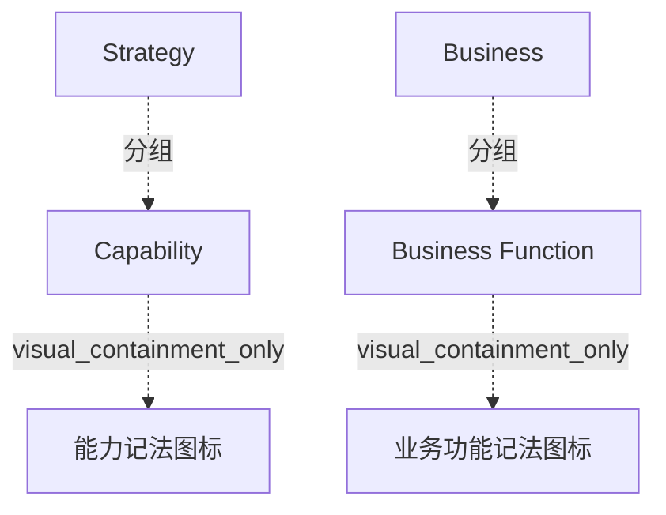

# G242/fig2-1 · 本文档使用的 ArchiMate 建模记法元素

类型：`notation-or-legend`。在进入具体架构内容前，先固定本文档使用的 ArchiMate 元素子集及其画法：哪个层、用什么形状、右上角用什么图标。读者据此能认出后文各图中黄色圆角矩形分别代表能力还是业务功能。

英文 PDF 物理页：[26]。本页为架构语义分析，原文与原图分别保留。

## 原图与可编辑图


[完整 JSON](fig2-1.json) · [可编辑 Mermaid](fig2-1.mmd) · [仅关系图](fig2-1.relations.mmd) · [层级分解图](fig2-1.hierarchy.mmd)

图形重建表达语义，不复制源图布局。虚线表示解释、矩阵映射或分组关系，不自动表示不确定性的概率。



## 架构分析

自上而下读两行：灰色带标题是架构层（Strategy、Business），带内的黄色圆角矩形是该层的元素样例，右上角小图标是 ArchiMate 的元素类型符号。每一行只给一个元素，不是完整元素清单。

- 本图有 6 个具名或隐含元素、0 条关系和 4 条包含/分组记录。
- 包含/分组树最大深度为 2；根节点为 战略层、业务层。
- 本图没有可直接确认为人员直属汇报的关系；视觉上下位置、能力分解和治理职责分别读取。
- 原图靠嵌套表达结构，没有连线；新语义图将包含单独显式化，不补造流程、数据流或依赖。
- 包含分组后有 2 个连通分量；分离可能源于图例、并列分类或独立示例，未自动补边。
- 两行Strategy/Capability与Business/Business Function完整可见；能力与功能图标不同，元素无连接线。
- 本页原图仅选择两种记法且正文分别定义，不根据子集展示断言PDF图像被裁切。

### 如何用于项目

- 先用图例解释记法与颜色，再读取使用该符号的图。
- 记法符号是类型说明，不是实际项目实体。

### 结构所表达的逻辑

- 选取战略层Capability和业务层Business Function两种ArchiMate元素。
- 能力使用右上角叠方块图标，业务功能使用双折角图标。
- 层带包含对应元素，图标属于记法组成，不是额外业务实体。
- 原图没有表达能力与业务功能之间的连线，不能补造实现关系。

## 上下级与包含

两层：灰色层带（Strategy、Business）为容器，黄色元素框（Capability、Business Function）分别位于对应层带之内；层带之间上下排列，无连线。

|父项|子项|层级类型|依据与解释|
|---|---|---|---|
|战略层|能力|visual_grouping|框、泳道、域或分类组的成员归属；没有额外证据不提升为业务组合或管理关系。|
|能力|能力记法图标|visual_containment_only|保存原图解释中的包含；业务关系类型需要图例或正文进一步限定。|
|业务层|业务功能|visual_grouping|框、泳道、域或分类组的成员归属；没有额外证据不提升为业务组合或管理关系。|
|业务功能|业务功能记法图标|visual_containment_only|保存原图解释中的包含；业务关系类型需要图例或正文进一步限定。|

## 全部元素与角色

|元素ID|原文名称|类型|含义|直接父项|深度|
|---|---|---|---|---|---|
|strategy_layer|Strategy|group|ArchiMate 战略层，作为 Capability 的容器。|—||
|capability|Capability|capability|黄色圆角矩形，右上角为能力图标。|战略层|1|
|capability_icon|能力记法图标|note|由三个小方块叠成的 ArchiMate 能力图标。|能力|2|
|business_layer|Business|group|ArchiMate 业务层，作为 Business Function 的容器。|—||
|business_function|Business Function|function|黄色圆角矩形，右上角为功能图标。|业务层|1|
|function_icon|业务功能记法图标|note|折角/屋脊形的 ArchiMate 功能图标。|业务功能|2|

## 全部关系

图中没有任何连线或箭头。层与元素的从属关系完全由“元素框位于层带内”表达；元素类型由右上角图标编码。

|主体|语义关系|客体|显式线/隐式|原文标签|依据|
|---|---|---|---|---|---|

## 误读检查

- 两种元素的具体定义见PDF第26页；层带排列不代表人员汇报。
- 此图是所选元素示例，不能据其数量断言源图被裁切或标准仅有两种元素。

## 原文证据

### [PDF 第 26 页](../../../documents/G242.md#page-26)

> To answer to the specific modeling needs in this document, a subset of the ArchiMate modeling notation elements was chosen. This subset is given in Figure 2-1, with the definition of each concept.
> Figure 2-1: The ArchiMate Modeling Notation Elements Used in this Document

## 来源与分析状态

所有元素/关系均有来源定位；未把历史解释重命名为本轮逐线视觉确认。源图与语义图是两种视图，布局不证明汇报或因果。

源 PDF SHA-256：`517339a5e3f509f08699c10b929f5ae14b6bca356b55e76163ffe437d54d5d19`。

源图记录：[原始解释与转录](../../../figures/G242/fig2-1.json)。

```json
{
  "quality": {
    "graph_integrity": "checked",
    "semantic_analysis": "typed-graph-and-context-analysis",
    "visual_review": "source-content-audited",
    "notice_zh": "所有元素/关系均有来源定位；未把历史解释重命名为本轮逐线视觉确认。源图与语义图是两种视图，布局不证明汇报或因果。"
  },
  "source_uncertainty": {
    "confidence": "high",
    "uncertainties_zh": [
      "原图在 PDF 页面底部被裁切，只显示两行；被裁掉部分（若有）无法核对。",
      "右上角图标的具体图形细节在原图分辨率下只能辨认为 ArchiMate 能力/功能符号，未逐笔核对。"
    ],
    "analyzed_from": [
      "英文 PDF 第 26 页原图截图与整页截图",
      "英文 PDF 第 26 页正文",
      "中文稿 G242e_环境可持续的信息系统.md 第 279–308 行",
      "figs/zh/g242_fig2-1_zh.png",
      "figs/g242_fig2-1_en.png"
    ],
    "date": "2026-10-31"
  },
  "source_conflicts": []
}
```
