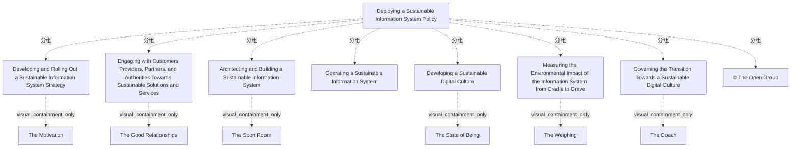

# G242/fig3-1 · 数字可持续性参考模型（高层版）——信息系统“健身计划”

类型：`architecture-concept-or-system-model`。为“如何部署可持续信息系统政策”提供一张高层参考模型：把散落的可持续 ICT 活动归并为七个业务功能，并用健身房比喻降低理解门槛。它既是分类框架（可用来盘点已开展活动、评估成熟度与改进点），也是后文 3.3–3.9 各节的目录。

英文 PDF 物理页：[31]。本页为架构语义分析，原文与原图分别保留。

## 原图与可编辑图


[完整 JSON](fig3-1.json) · [可编辑 Mermaid](fig3-1.mmd) · [仅关系图](fig3-1.relations.mmd) · [层级分解图](fig3-1.hierarchy.mmd)

图形重建表达语义，不复制源图布局。虚线表示解释、矩阵映射或分组关系，不自动表示不确定性的概率。



## 架构分析

先看最外层的米色容器标题“Deploying a Sustainable Information System Policy”，它框定整个计划。容器内自上而下分三层：顶部横带是战略，中部左/中/右三栏分别是互动、建设运营与文化、度量，底部横带是治理。每个黄色块右上角的小折角图标表示它是 ArchiMate 业务功能；灰色斜体字（The Motivation 等）是健身比喻，不是功能名。图中没有箭头，位置只表达分组，不表达先后。

- 本图有 15 个具名或隐含元素、0 条关系和 14 条包含/分组记录。
- 包含/分组树最大深度为 2；根节点为 部署可持续信息系统政策。
- 本图没有可直接确认为人员直属汇报的关系；视觉上下位置、能力分解和治理职责分别读取。
- 原图靠嵌套表达结构，没有连线；新语义图将包含单独显式化，不补造流程、数据流或依赖。
- 外框内七项业务功能、六个健身类比文字和版权标注与转录一致，无箭头或时序连线。
- 七项功能平级放在总容器中；顶部战略、底部治理的横向布局本身不构成上下级或执行先后。
- 正文明确文化建设是前提，模型要结合组织具体语境裁剪。

### 如何用于项目

- 围绕作者目的读取本图实体、分组与连线，并用对应原文限定其含义。
- 把参考模型与项目事实分开，实际范围、约束、值和责任须有项目证据。

### 结构所表达的逻辑

- 七个功能为战略、对外互动、架构构建、运营、文化、环境影响度量、转型治理。
- 总容器表示共同部署可持续信息系统政策；七项功能平级，没有线把战略或治理设为其他功能的管理父项。
- 六个健身类比文字是注释：Motivation、Good Relationships、Sport Room、State of Being、Weighing、Coach。运营没有单独类比标签。
- 原文将文化认知和承诺视作其他活动成功的前提，将模型作为活动分类、成熟度和对标起点；须按组织上下文裁剪。

## 上下级与包含

最外框包含七个业务功能；类比标签是各功能内的注记。布局没有表示执行顺序或人员直属关系。

|父项|子项|层级类型|依据与解释|
|---|---|---|---|
|部署可持续信息系统政策|制定并推展可持续信息系统战略|visual_grouping|框、泳道、域或分类组的成员归属；没有额外证据不提升为业务组合或管理关系。|
|制定并推展可持续信息系统战略|动机|visual_containment_only|保存原图解释中的包含；业务关系类型需要图例或正文进一步限定。|
|部署可持续信息系统政策|与客户、供应商、伙伴及主管部门互动，共同走向可持续的解决方案与服务|visual_grouping|框、泳道、域或分类组的成员归属；没有额外证据不提升为业务组合或管理关系。|
|与客户、供应商、伙伴及主管部门互动，共同走向可持续的解决方案与服务|良好关系|visual_containment_only|保存原图解释中的包含；业务关系类型需要图例或正文进一步限定。|
|部署可持续信息系统政策|架构并构建可持续信息系统|visual_grouping|框、泳道、域或分类组的成员归属；没有额外证据不提升为业务组合或管理关系。|
|架构并构建可持续信息系统|健身房|visual_containment_only|保存原图解释中的包含；业务关系类型需要图例或正文进一步限定。|
|部署可持续信息系统政策|运营可持续信息系统|visual_grouping|框、泳道、域或分类组的成员归属；没有额外证据不提升为业务组合或管理关系。|
|部署可持续信息系统政策|发展可持续数字文化|visual_grouping|框、泳道、域或分类组的成员归属；没有额外证据不提升为业务组合或管理关系。|
|发展可持续数字文化|存在状态|visual_containment_only|保存原图解释中的包含；业务关系类型需要图例或正文进一步限定。|
|部署可持续信息系统政策|从摇篮到坟墓度量信息系统的环境影响|visual_grouping|框、泳道、域或分类组的成员归属；没有额外证据不提升为业务组合或管理关系。|
|从摇篮到坟墓度量信息系统的环境影响|称重|visual_containment_only|保存原图解释中的包含；业务关系类型需要图例或正文进一步限定。|
|部署可持续信息系统政策|治理向可持续数字文化的转型|visual_grouping|框、泳道、域或分类组的成员归属；没有额外证据不提升为业务组合或管理关系。|
|治理向可持续数字文化的转型|教练|visual_containment_only|保存原图解释中的包含；业务关系类型需要图例或正文进一步限定。|
|部署可持续信息系统政策|© The Open Group|visual_grouping|框、泳道、域或分类组的成员归属；没有额外证据不提升为业务组合或管理关系。|

## 全部元素与角色

|元素ID|原文名称|类型|含义|直接父项|深度|
|---|---|---|---|---|---|
|policy_program|Deploying a Sustainable Information System Policy|group|七个业务功能的总容器；右上角另有一个小的 ArchiMate 分组图标。|—||
|fn_strategy|Developing and Rolling Out a Sustainable Information System Strategy|function|对应正文 3.4 节。|部署可持续信息系统政策|1|
|an_motivation|The Motivation|note|健身比喻；配一只手托举齿轮/火花的图标。|制定并推展可持续信息系统战略|2|
|fn_engage|Engaging with Customers Providers, Partners, and Authorities Towards Sustainable Solutions and Services|function|对外互动功能。|部署可持续信息系统政策|1|
|an_relationships|The Good Relationships|note|健身比喻；配三个人物图标。|与客户、供应商、伙伴及主管部门互动，共同走向可持续的解决方案与服务|2|
|fn_architect|Architecting and Building a Sustainable Information System|function|对应正文 3.5 节。|部署可持续信息系统政策|1|
|an_sport_room|The Sport Room|note|健身比喻；配哑铃图标。|架构并构建可持续信息系统|2|
|fn_operate|Operating a Sustainable Information System|function|系统运行阶段的可持续功能。|部署可持续信息系统政策|1|
|fn_culture|Developing a Sustainable Digital Culture|function|对应正文 3.3 节；正文称其为其他活动的前提。|部署可持续信息系统政策|1|
|an_state_of_being|The State of Being|note|健身比喻；配日出下张开双臂的人像照片。|发展可持续数字文化|2|
|fn_measure|Measuring the Environmental Impact of the Information System from Cradle to Grave|function|对应正文 3.6 节。|部署可持续信息系统政策|1|
|an_weighing|The Weighing|note|健身比喻；配苹果与体重计图标。|从摇篮到坟墓度量信息系统的环境影响|2|
|fn_govern|Governing the Transition Towards a Sustainable Digital Culture|function|横贯全宽的治理功能；不是最后一步。|部署可持续信息系统政策|1|
|an_coach|The Coach|note|健身比喻；配教练指导躺卧者的图标。|治理向可持续数字文化的转型|2|
|copyright|© The Open Group|note|版权标注。|部署可持续信息系统政策|1|

## 全部关系

图中没有任何连线或箭头。功能块之间的从属只由外层容器表达；战略/治理横贯全宽、其余分栏，属于版式暗示的“统领/兜底”关系，不是画出的流程。右上角的折角小图标是 ArchiMate 业务功能记法，不是导航箭头。

|主体|语义关系|客体|显式线/隐式|原文标签|依据|
|---|---|---|---|---|---|

## 误读检查

- 这不是流程图：七个功能没有先后顺序，不能按从上到下当作实施步骤。
- 灰色斜体 The Motivation、The Sport Room 等是健身比喻，不是第七个功能或子功能。
- “治理转型”不是最后一步，而是贯穿全过程的兜底功能；它在底部横贯全宽正是这个意思。
- 中文稿当前引用的 figs/g242_fig3-1.svg 是自拟的 7 框清单，丢了外层容器、空间结构与全部比喻，还把治理降为普通第 7 项；不能据它理解原图。
- 七个功能不是 TOGAF ADM 阶段，而是可持续 ICT 政策的业务能力清单。

## 原文证据

### [PDF 第 30 页](../../../documents/G242.md#page-30)

> • Provision to customers, shareholders, and investors of a vision and an approach aligned with their civic concerns
> • Accurate reporting of GHG and climate risk data to shareholders and financial analysts comply with existing and foreseeable transparent reporting duties and guidelines
### [PDF 第 31 页](../../../documents/G242.md#page-31)

> The reference model in Figure 3-1 describes the seven high-level business functions required to set up and deploy an effective sustainable ICT system policy in any organization. A high-level description of these seven activities is provided in this chapter and then more details are provided in the ones that follow.
> Figure 3-1: Digital Sustainability Reference Model (High-Level Version): The Information System Fitness
### [PDF 第 32 页](../../../documents/G242.md#page-32)

> To become more sustainable, the information system needs an ongoing long-term program. This requires the support of the company’s leadership and a strong sponsor, such as the director of operations, IT department, or sustainability department. It involves formulating and sharing motivations and objectives for transformation towards a sustainable information system. These objectives must be part of the global sustainability strategy of the organization and reflected in the ICT strategy and Enterprise Architecture.
> Once the sustainable ICT strategy has been defined, it is necessary to set up a team that will be responsible for leading the transformation through the activities described below.

## 来源与分析状态

所有元素/关系均有来源定位；未把历史解释重命名为本轮逐线视觉确认。源图与语义图是两种视图，布局不证明汇报或因果。

源 PDF SHA-256：`517339a5e3f509f08699c10b929f5ae14b6bca356b55e76163ffe437d54d5d19`。

源图记录：[原始解释与转录](../../../figures/G242/fig3-1.json)。

```json
{
  "quality": {
    "graph_integrity": "checked",
    "semantic_analysis": "typed-graph-and-context-analysis",
    "visual_review": "source-content-audited",
    "notice_zh": "所有元素/关系均有来源定位；未把历史解释重命名为本轮逐线视觉确认。源图与语义图是两种视图，布局不证明汇报或因果。"
  },
  "source_uncertainty": {
    "confidence": "high",
    "uncertainties_zh": [
      "左侧功能名在图中因换行写作“Engaging with Customers Providers, Partners, and Authorities…”，Customers 后是否漏逗号无法从图判断；按可见文字照录。",
      "原图右上角的小 ArchiMate 分组图标与七个功能块的图标细节较模糊，仅能确认类型，未逐笔核对。"
    ],
    "analyzed_from": [
      "英文 PDF 第 31 页原图截图（1460×655）",
      "英文 PDF 第 31 页正文",
      "中文稿 G242e_环境可持续的信息系统.md 第 390–399 行",
      "figs/g242_fig3-1.svg 源码"
    ],
    "date": "2026-10-31"
  },
  "source_conflicts": []
}
```
