# G242/fig3-10 · 信息系统的年度环境评估（来源：The Shift Project Lean-ICT 工作组）

类型：`mapping-or-assessment-matrix`。把 3.6.1 节列出的七类排放来源落成可逐年填报的矩阵：左列是核算步骤，上方是对象与数据源，中间填度量方法或公式，底部汇总为年度 MtCO₂e，并明确“抵消必须单列”“客户终端只填其使用本组织数字服务所需终端的比例”。

英文 PDF 物理页：[61]。本页为架构语义分析，原文与原图分别保留。

## 原图与可编辑图


[完整 JSON](fig3-10.json) · [可编辑 Mermaid](fig3-10.mmd) · [仅关系图](fig3-10.relations.mmd) · [层级分解图](fig3-10.hierarchy.mmd)

图形重建表达语义，不复制源图布局。虚线表示解释、矩阵映射或分组关系，不自动表示不确定性的概率。

```mermaid
flowchart TB
  %% Semantic reconstruction; see original source image for exact layout.
  n0["Yearly Measure Over 2-3 Years"]
  n1["On-Premise Data Centers Managed by the Organization"]
  n2["DC#1"]
  n3["DC#2"]
  n4["…"]
  n5["Public Cloud"]
  n6["Microsoft Office 365"]
  n7["Microsoft Azure"]
  n8["AWS"]
  n9["…"]
  n10["Sub-contractors"]
  n11["Marketing Campaign, Sub-contractor Services"]
  n12["Public Network"]
  n13["Internet"]
  n14["Workstation / Salaries / Sub-contractors"]
  n15["Computers, Phones, Printers, Screens, etc."]
  n16["Customers&#x27; Terminals"]
  n17["% of Terminals Required by Customer to Use the Organization Digital Services"]
  n18["PUE"]
  n19["Electricity Consumption"]
  n20["Inventories, Equipment&#x27;s Lifetime"]
  n21["Total MtCO2e/Year"]
  n22["MtCO2e Offset"]
  n23["Storage Terabyte"]
  n24["Carbon Accounting"]
  n25["Analysis"]
  n26["#kWH * Electric Mix of the Location"]
  n27["MtCO2e"]
  n28["Measure Method to Identify"]
  n29["Measure Method to Identify"]
  n30["#kWH * Electric Mix of the Location"]
  n31["#kWH * Electric Mix of the Location"]
  n32["#Physical Servers #Virtual Servers #Network Equipment #Storage Bays…"]
  n33["#Services"]
  n34["#Terminals #Equipment"]
  n35["#Terminals #Equipment"]
  n36["Use public reference data: balance sheet GHG emissions ADEME, TSP REN, GES published by providers"]
  n37["Offset Should be Counted Separately"]
  n38["# Volume in TB"]
  n39["Not Concerned"]
  n1 -.->|"分组"| n2
  n1 -.->|"分组"| n3
  n1 -.->|"分组"| n4
  n5 -.->|"分组"| n6
  n5 -.->|"分组"| n7
  n5 -.->|"分组"| n8
  n5 -.->|"分组"| n9
  n10 -.->|"分组"| n11
  n12 -.->|"分组"| n13
  n14 -.->|"分组"| n15
  n16 -.->|"分组"| n17
  n24 -.->|"分组"| n19
  n24 -.->|"分组"| n20
  n24 -.->|"分组"| n21
  n24 -.->|"分组"| n22
  n25 -.->|"分组"| n23
  n1 -.->|"分组"| n26
  n5 -.->|"分组"| n27
  n10 -.->|"分组"| n28
  n12 -.->|"分组"| n29
  n14 -.->|"分组"| n30
  n16 -.->|"分组"| n31
  n1 -.->|"分组"| n32
  n5 -.->|"分组"| n33
  n14 -.->|"分组"| n34
  n16 -.->|"分组"| n35
```



## 架构分析

按六类对象逐年度度量，并用2–3年序列看趋势。PUE是独立行；Carbon Accounting左括号覆盖用电、清单、总量、抵消四行，Analysis括号只覆盖存储行。

- 本图有 40 个具名或隐含元素、0 条关系和 26 条包含/分组记录。
- 包含/分组树最大深度为 1；根节点为 连续 2–3 年年度度量、组织自营的数据中心、公有云、分包商、公共网络、工作站/薪酬/分包商、客户终端、PUE（电力使用效率）、碳核算、分析、使用公开参考数据：ADEME 温室气体排放清单（bilan GES）、TSP REN，以及提供方公布的温室气体排放（GES）、抵消应单独计算、# 容量（TB）、不涉及。
- 本图没有可直接确认为人员直属汇报的关系；视觉上下位置、能力分解和治理职责分别读取。
- 原图靠嵌套表达结构，没有连线；新语义图将包含单独显式化，不补造流程、数据流或依赖。
- 包含分组后有 14 个连通分量；分离可能源于图例、并列分类或独立示例，未自动补边。
- 六列对象、示例子项、六行指标、两个行括号与颜色图例均对原图核对。
- PUE 1.2位于Microsoft Office365下，旧总结把它移到自营数据中心并声称云不填PUE，是误读。
- Carbon Accounting括号从Electricity Consumption延至Offset；Analysis只括Storage行，旧前三行/后三行分组错误。
- 存储行分隔落在分包商列内部，未与列边界对齐；只能确认自营/云属于Volume，网络/工作站/客户属于Not Concerned，分包商归属不确定。

### 如何用于项目

- 先固定行、列所代表的维度及单元格含义，再登记有证据的映射或评分。
- 空白、无关系、未测量和不适用分别处理；颜色不自动等于优先级。

### 结构所表达的逻辑

- 六列依次是自营数据中心、公有云、分包商、公共网络、Workstation / Salaries / Sub-contractors、客户终端。Salaries原词保留，不静默改成人员或设备。
- PUE示例1.5/1.4在DC#1/DC#2，1.2在Microsoft Office365下；不能声称公有云不填PUE。空白不是0，也不能据图判定所有其他对象均不适用。
- 用电行：自营与工作站黄色表示范围2，公有云/分包商/网络/客户蓝色表示范围3；云格写MtCO2e而非同一kWH公式。
- 清单行区分物理/虚拟服务器、网络、存储，云服务数量，以及两类终端/设备。分包商和网络各有纵跨两行的Measure Method to Identify。
- Total行提示使用公开参考数据；没有说不许汇总，也不提供可直接照搬的完整求和或PUE乘法公式。
- Offset单列，与第62页reduce what you can, offset what you cannot及分开追踪排放的正文一致。
- 存储行的合并边界与分包商表头不对齐；该列归属保持未知。
- 第62页允许先按数量级估算，缺少精确供应商数据不应导致不评估；云迁移可能把范围2转为范围3，并不自动减排。

## 上下级与包含

行列分类、两条行括号与合并单元格共同组织表格，不是业务实体树。Carbon Accounting含四行，Analysis只有存储行；PUE位于两括号之外。

|父项|子项|层级类型|依据与解释|
|---|---|---|---|
|组织自营的数据中心|数据中心 #1|classified_under|按表头归类，表头并未视觉包围子项。|
|组织自营的数据中心|数据中心 #2|classified_under|按表头归类，表头并未视觉包围子项。|
|组织自营的数据中心|……（更多数据中心）|classified_under|按表头归类，表头并未视觉包围子项。|
|公有云|微软 Office 365|classified_under|按表头归类，表头并未视觉包围子项。|
|公有云|微软 Azure|classified_under|按表头归类，表头并未视觉包围子项。|
|公有云|AWS（亚马逊云）|classified_under|按表头归类，表头并未视觉包围子项。|
|公有云|……（更多云服务）|classified_under|按表头归类，表头并未视觉包围子项。|
|分包商|营销活动、分包服务|classified_under|按表头归类，表头并未视觉包围子项。|
|公共网络|互联网|classified_under|按表头归类，表头并未视觉包围子项。|
|工作站/薪酬/分包商|计算机、电话、打印机、屏幕等|classified_under|按表头归类，表头并未视觉包围子项。|
|客户终端|客户使用组织数字服务所需终端的百分比|classified_under|按表头归类，表头并未视觉包围子项。|
|碳核算|用电量|classified_under|左侧Carbon Accounting括号实际覆盖这四行。|
|碳核算|设备清单、设备寿命|classified_under|左侧Carbon Accounting括号实际覆盖这四行。|
|碳核算|年度 MtCO₂e 总量|classified_under|左侧Carbon Accounting括号实际覆盖这四行。|
|碳核算|MtCO₂e 抵消|classified_under|左侧Carbon Accounting括号实际覆盖这四行。|
|分析|存储容量（TB）|classified_under|Analysis括号只覆盖Storage Terabyte行。|
|组织自营的数据中心|#kWh × 当地电力结构|classified_under|按表头归类，表头并未视觉包围子项。|
|公有云|MtCO₂e|classified_under|按表头归类，表头并未视觉包围子项。|
|分包商|用于识别的度量方法|classified_under|按表头归类，表头并未视觉包围子项。|
|公共网络|用于识别的度量方法|classified_under|按表头归类，表头并未视觉包围子项。|
|工作站/薪酬/分包商|#kWh × 当地电力结构|classified_under|按表头归类，表头并未视觉包围子项。|
|客户终端|#kWh × 当地电力结构|classified_under|按表头归类，表头并未视觉包围子项。|
|组织自营的数据中心|#物理服务器 #虚拟服务器 #网络设备 #存储架……|classified_under|按表头归类，表头并未视觉包围子项。|
|公有云|#服务数量|classified_under|按表头归类，表头并未视觉包围子项。|
|工作站/薪酬/分包商|#终端 #设备|classified_under|按表头归类，表头并未视觉包围子项。|
|客户终端|#终端 #设备|classified_under|按表头归类，表头并未视觉包围子项。|

## 全部元素与角色

|元素ID|原文名称|类型|含义|直接父项|深度|
|---|---|---|---|---|---|
|yearly_measure|Yearly Measure Over 2-3 Years|note|说明：连续 2–3 年年度度量|—||
|col_onprem|On-Premise Data Centers Managed by the Organization|group|分组：组织自营的数据中心|—||
|sub_dc1|DC#1|data|信息/数据：数据中心 #1|组织自营的数据中心|1|
|sub_dc2|DC#2|data|信息/数据：数据中心 #2|组织自营的数据中心|1|
|sub_dc_more|…|data|信息/数据：……（更多数据中心）|组织自营的数据中心|1|
|col_cloud|Public Cloud|group|分组：公有云|—||
|sub_office365|Microsoft Office 365|application|应用：微软 Office 365|公有云|1|
|sub_azure|Microsoft Azure|application|应用：微软 Azure|公有云|1|
|sub_aws|AWS|application|应用：AWS（亚马逊云）|公有云|1|
|sub_cloud_more|…|application|应用：……（更多云服务）|公有云|1|
|col_subcon|Sub-contractors|group|分组：分包商|—||
|sub_marketing|Marketing Campaign, Sub-contractor Services|process|流程：营销活动、分包服务|分包商|1|
|col_publicnet|Public Network|group|分组：公共网络|—||
|sub_internet|Internet|technology|技术：互联网|公共网络|1|
|col_workstation|Workstation / Salaries / Sub-contractors|group|分组：工作站/薪酬/分包商|—||
|sub_devices|Computers, Phones, Printers, Screens, etc.|technology|技术：计算机、电话、打印机、屏幕等|工作站/薪酬/分包商|1|
|col_customers|Customers' Terminals|group|分组：客户终端|—||
|sub_terminal_pct|% of Terminals Required by Customer to Use the Organization Digital Services|metric|度量：客户使用组织数字服务所需终端的百分比|客户终端|1|
|row_pue|PUE|metric|度量：PUE（电力使用效率）|—||
|row_electricity|Electricity Consumption|metric|度量：用电量|碳核算|1|
|row_inventories|Inventories, Equipment's Lifetime|data|信息/数据：设备清单、设备寿命|碳核算|1|
|row_total|Total MtCO2e/Year|metric|度量：年度 MtCO₂e 总量|碳核算|1|
|row_offset|MtCO2e Offset|metric|度量：MtCO₂e 抵消|碳核算|1|
|row_storage|Storage Terabyte|metric|度量：存储容量（TB）|分析|1|
|grp_carbon_accounting|Carbon Accounting|group|分组：碳核算|—||
|grp_analysis|Analysis|group|分组：分析|—||
|cell_mix_onprem|#kWH * Electric Mix of the Location|metric|度量：#kWh × 当地电力结构|组织自营的数据中心|1|
|cell_cloud_mtco2e|MtCO2e|metric|度量：MtCO₂e|公有云|1|
|cell_measure_sub|Measure Method to Identify|note|说明：用于识别的度量方法|分包商|1|
|cell_measure_net|Measure Method to Identify|note|说明：用于识别的度量方法|公共网络|1|
|cell_mix_workstation|#kWH * Electric Mix of the Location|metric|度量：#kWh × 当地电力结构|工作站/薪酬/分包商|1|
|cell_mix_customers|#kWH * Electric Mix of the Location|metric|度量：#kWh × 当地电力结构|客户终端|1|
|cell_inventory_onprem|#Physical Servers #Virtual Servers #Network Equipment #Storage Bays…|data|信息/数据：#物理服务器 #虚拟服务器 #网络设备 #存储架……|组织自营的数据中心|1|
|cell_services|#Services|data|信息/数据：#服务数量|公有云|1|
|cell_terminals_ws|#Terminals #Equipment|data|信息/数据：#终端 #设备|工作站/薪酬/分包商|1|
|cell_terminals_cust|#Terminals #Equipment|data|信息/数据：#终端 #设备|客户终端|1|
|cell_total_note|Use public reference data: balance sheet GHG emissions ADEME, TSP REN, GES published by providers|note|说明：使用公开参考数据：ADEME 温室气体排放清单（bilan GES）、TSP REN，以及提供方公布的温室气体排放（GES）|—||
|cell_offset_note|Offset Should be Counted Separately|note|说明：抵消应单独计算|—||
|cell_storage_note|# Volume in TB|metric|横向合并白框写# Volume in TB；右边界穿过分包商列，不能准确投射为完整列集合。|—||
|cell_not_concerned|Not Concerned|note|浅灰合并框写Not Concerned；左边界位于分包商列内部；公共网络、工作站和客户终端明确位于其内。|—||

## 全部关系

图中没有连接线或箭头。语义完全由行列位置与底色表达：同一行=同一核算步骤，同一列=同一核算对象；黄色=范围 2，蓝色=范围 3；跨列的大白框表示该步骤对所有对象统一处理。

|主体|语义关系|客体|显式线/隐式|原文标签|依据|
|---|---|---|---|---|---|

## 年度环境评估矩阵（按原图逐格转录；黄=范围 2，蓝=范围 3）

```json
{
  "id": "t_yearly_assessment",
  "title_zh": "年度环境评估矩阵（按原图逐格转录；黄=范围 2，蓝=范围 3）",
  "columns": [
    "核算步骤",
    "自营数据中心（DC#1 / DC#2 / …）",
    "公有云（Office 365 / Azure / AWS / …）",
    "分包商（营销活动、分包服务）",
    "公共网络（互联网）",
    "工作站/薪酬/分包商（计算机、电话、打印机、屏幕等）",
    "客户终端（所需终端百分比）"
  ],
  "rows": [
    [
      "PUE",
      "1.5 / 1.4 / ……",
      "1.2 / …… / …… / ……",
      "",
      "",
      "",
      ""
    ],
    [
      "用电量 Electricity Consumption",
      "#kWH * Electric Mix of the Location（黄）",
      "MtCO₂e（蓝）",
      "Measure Method to Identify（蓝）",
      "Measure Method to Identify（蓝）",
      "#kWH * Electric Mix of the Location（黄）",
      "#kWH * Electric Mix of the Location（蓝）"
    ],
    [
      "设备清单、设备寿命 Inventories, Equipment's Lifetime",
      "#Physical Servers #Virtual Servers #Network Equipment #Storage Bays…（蓝）",
      "#Services（蓝）",
      "Measure Method to Identify（蓝）",
      "Measure Method to Identify（蓝）",
      "#Terminals #Equipment（蓝）",
      "#Terminals #Equipment（蓝）"
    ],
    [
      "Total MtCO₂e/Year",
      "Use public reference data: balance sheet GHG emissions ADEME, TSP REN, GES published by providers（白，跨全部列）",
      "",
      "",
      "",
      "",
      ""
    ],
    [
      "MtCO₂e Offset",
      "Offset Should be Counted Separately（白，跨全部列）",
      "",
      "",
      "",
      "",
      ""
    ],
    [
      "Storage Terabyte",
      "# Volume in TB（白）",
      "# Volume in TB（白）",
      null,
      "Not Concerned（浅灰）",
      "Not Concerned（浅灰）",
      "Not Concerned（浅灰）"
    ]
  ],
  "cell_legend": [
    "黄色：范围 2——与用电相关的间接温室气体排放",
    "蓝色：范围 3——与服务、材料采购相关的间接温室气体排放",
    "白色：无范围着色（公式、度量方法说明或汇总）",
    "浅灰：Not Concerned，该项不适用于此核算对象"
  ],
  "notes_zh": "PUE中DC#1=1.5、DC#2=1.4、Microsoft Office365=1.2为图内示例。总量与抵消两行横跨全部对象列。存储行界线落在分包商列内，无法将该列完整判入Volume或Not Concerned；null表示源图边界含混，不表示零。分包商与网络的Measure Method to Identify分别纵跨用电/清单两行。",
  "source_layout_uncertainties": [
    {
      "row": "Storage Terabyte",
      "column": "Sub-contractors",
      "kind": "merged-cell-boundary-not-aligned-to-column",
      "description_zh": "Volume/Not Concerned分界在分包商列中间；保留横向合并区域，拒绝猜测列归属。"
    }
  ],
  "merged_regions": [
    {
      "rows": [
        "Total MtCO2e/Year"
      ],
      "columns": "all-six-object-columns",
      "text": "Use public reference data: balance sheet GHG emissions ADEME, TSP REN, GES published by providers"
    },
    {
      "rows": [
        "MtCO2e Offset"
      ],
      "columns": "all-six-object-columns",
      "text": "Offset Should be Counted Separately"
    },
    {
      "rows": [
        "Electricity Consumption",
        "Inventories, Equipment’s Lifetime"
      ],
      "columns": [
        "Sub-contractors"
      ],
      "text": "Measure Method to Identify"
    },
    {
      "rows": [
        "Electricity Consumption",
        "Inventories, Equipment’s Lifetime"
      ],
      "columns": [
        "Public Network"
      ],
      "text": "Measure Method to Identify"
    },
    {
      "rows": [
        "Storage Terabyte"
      ],
      "confirmed_columns": [
        "On-Premise Data Centers Managed by the Organization",
        "Public Cloud"
      ],
      "ambiguous_partial_column": "Sub-contractors",
      "text": "# Volume in TB"
    },
    {
      "rows": [
        "Storage Terabyte"
      ],
      "confirmed_columns": [
        "Public Network",
        "Workstation / Salaries / Sub-contractors",
        "Customers’ Terminals"
      ],
      "ambiguous_partial_column": "Sub-contractors",
      "text": "Not Concerned"
    }
  ]
}
```

## 误读检查

- 1.2不是自营数据中心的第三个示例值，而是Office365列下的值。
- 原图没有禁止对恰当边界下的排放求和；公开因子说明不能被解释成年度总量无需计算。
- 分包商的存储归属在源图中含混，不能硬填Not Concerned。
- 抵消单列，不能用净值掩盖总排放趋势；本模板不能替代核算边界和方法说明。

## 原文证据

### [PDF 第 61 页](../../../documents/G242.md#page-61)

> Figure 3-10: Yearly Environmental Assessment of the Information System (Source: The Shift Project Lean-ICT
### [PDF 第 62 页](../../../documents/G242.md#page-62)

> The model above is inspired by the work conducted by the AXA Group in 2020 as part of the digital sustainability program to measure and manage the impact of ICT. In this schema, “public network” can also refer to mobile operators’ assets.
> To be pragmatic, the team leading the transformation needs to make approximations and to prioritize effort in the measurement. Indeed, some data, more often on Scope 3, can be difficult to obtain. In this case, a workaround is to calculate the orders of magnitude while waiting for the suppliers to provide the data. The absence of precise data should never result in no evaluation. For example, for providers publishing their CO2 emissions in the Carbon Disclosure Project [CDP], one can simply evaluate the Scope 3 emissions based on their global revenue, their global emissions, and the revenue derived from one’s organization:

## 来源与分析状态

所有元素/关系均有来源定位；未把历史解释重命名为本轮逐线视觉确认。源图与语义图是两种视图，布局不证明汇报或因果。

源 PDF SHA-256：`517339a5e3f509f08699c10b929f5ae14b6bca356b55e76163ffe437d54d5d19`。

源图记录：[原始解释与转录](../../../figures/G242/fig3-10.json)。

```json
{
  "quality": {
    "graph_integrity": "checked",
    "semantic_analysis": "typed-graph-and-context-analysis",
    "visual_review": "source-content-audited",
    "notice_zh": "所有元素/关系均有来源定位；未把历史解释重命名为本轮逐线视觉确认。源图与语义图是两种视图，布局不证明汇报或因果。"
  },
  "source_uncertainty": {
    "confidence": "high",
    "uncertainties_zh": [
      "PUE 值 1.5/1.4/1.2 是示例值，原图未说明取值口径。",
      "“MtCO₂e”格在公有云列的含义按上下文理解为提供方披露的服务排放，原图未加注。",
      "分包商与公共网络列只有“Measure Method to Identify”，具体方法未在图中给出。",
      "左上角“Yearly Measure Over 2-3 Years”是否也覆盖“存储”行，图中未明示。"
    ],
    "analyzed_from": [
      "英文 PDF 第 61 页（印刷页 43）原图截图与 2×2 放大分块",
      "英文 PDF 第 61 页正文",
      "中文稿 G242e_环境可持续的信息系统.md 第 1017–1064 行",
      "figs/zh/g242_fig3-10_zh.svg 源码、figs/zh/g242_fig3-10_zh.png、figs/g242_fig3-10_en.png"
    ],
    "date": "2026-10-31"
  },
  "source_conflicts": []
}
```
