# G242/fig3-11 · 在不同层面度量信息系统的环境影响（来源：The Shift Project Lean-ICT 工作组）

类型：`process-or-method-model`。把业务用途、软件应用、基础设施网络三种归集视角的中间指标转成碳足迹，支持利益相关者在各自决策范围采取减排措施。

英文 PDF 物理页：[65]。本页为架构语义分析，原文与原图分别保留。

## 原图与可编辑图


[完整 JSON](fig3-11.json) · [可编辑 Mermaid](fig3-11.mmd) · [仅关系图](fig3-11.relations.mmd) · [层级分解图](fig3-11.hierarchy.mmd)

图形重建表达语义，不复制源图布局。虚线表示解释、矩阵映射或分组关系，不自动表示不确定性的概率。

```mermaid
flowchart TB
  %% Semantic reconstruction; see original source image for exact layout.
  n0["Business Uses"]
  n1["Infrastructure Indicators by Use/Business Management"]
  n2["Application Indicators by Use/Business Management"]
  n3["Software &amp; Applications"]
  n4["Infrastructure Indicators by Application/Software"]
  n5["Number of Used Applications/Software"]
  n6["Number of Different Libraries Used by Internal Applications"]
  n7["Frequency/Usage Time of Applications, or More Details of Applications&#x27; Function"]
  n8["Infrastructure &amp; Network"]
  n9["Carbon Emission Related to Equipment Fabrication"]
  n10["Energy Consumption"]
  n11["Volume of Stored Data"]
  n12["Volume of Transferred Data Internally and Externally"]
  n13["CO₂ Equivalent Frame"]
  n14["Carbon Footprint"]
  n15["Carbon Footprint by Use and/or by Business Management"]
  n16["Carbon Footprint by Application/Software"]
  n17["Carbon Footprint by Equipment/Material, by Relevant Infrastructure Overall"]
  n0 -->|"产生/交付"| n15
  n3 -->|"产生/交付"| n16
  n8 -->|"产生/交付"| n17
  n0 -.->|"分组"| n1
  n0 -.->|"分组"| n2
  n3 -.->|"分组"| n4
  n3 -.->|"分组"| n5
  n3 -.->|"分组"| n6
  n3 -.->|"分组"| n7
  n8 -.->|"分组"| n9
  n8 -.->|"分组"| n10
  n8 -.->|"分组"| n11
  n8 -.->|"分组"| n12
  n14 -.->|"分组"| n15
  n14 -.->|"分组"| n16
  n14 -.->|"分组"| n17
```



## 架构分析

从上到下读三层：业务用途（最抽象）、软件与应用、基础设施与网络（最具体）。每层左侧是若干指标框；右侧有一支与层色一致的箭头，穿过中间的“CO₂ 等效框架”竖列，指向右端灰色列中同色的碳足迹框。也就是说：本层指标 → 统一折算 → 本层碳足迹。

- 本图有 18 个具名或隐含元素、3 条关系和 13 条包含/分组记录。
- 包含/分组树最大深度为 1；根节点为 业务用途、软件与应用、基础设施与网络、CO₂ 当量框架、碳足迹。
- 本图没有可直接确认为人员直属汇报的关系；视觉上下位置、能力分解和治理职责分别读取。
- 包含分组后有 2 个连通分量；分离可能源于图例、并列分类或独立示例，未自动补边。
- 业务2、软件4、基础设施4项指标，三种结果与三条真实箭头完整核对。
- 箭头从每层分组右边界出发，穿过CO2 Equivalent Frame到相应结果；不另造每指标到框架连线。
- 原文支持利益相关者决策范围内采取减排措施，没有把三个层级规定为三个正式岗位。

### 如何用于项目

- 按阶段/事件/行为关系读取入口、出口、责任和产物；检查循环与例外路径。
- 工作流先后不表示组织管理权；在项目中显式记录条件和完成标准。

### 结构所表达的逻辑

- 业务用途层两项：按用途/业务管理归集的基础设施与应用指标。
- 软件应用层四项：按应用归集基础设施指标、应用数量、内部应用使用的不同库数量、使用频率/时长或功能细节。
- 基础设施网络层四项：设备制造排放、能耗、存储量、内部外部传输数据量。
- 三条箭头共同穿过CO2当量框架，分别到按用途/业务、应用/软件、设备/材料及相关基础设施归集的碳足迹。
- 图示共同折算框架，不声称某一工具是唯一合法方法，也不赋予三个岗位排他责任。
- 第65–66页建议统一共享原始因子、来源、电力结构等数据以保证一致性和同行复核；当云供应商细节不足时中间指标可支持先行动。

## 上下级与包含

三个并列度量视角，每个视角包含指标，右侧Carbon Footprint列归集对应结果；没有人员汇报层级。

|父项|子项|层级类型|依据与解释|
|---|---|---|---|
|业务用途|按用途/业务管理的基础设施指标|visual_grouping|框、泳道、域或分类组的成员归属；没有额外证据不提升为业务组合或管理关系。|
|业务用途|按用途/业务管理的应用指标|visual_grouping|框、泳道、域或分类组的成员归属；没有额外证据不提升为业务组合或管理关系。|
|软件与应用|按应用/软件的基础设施指标|visual_grouping|框、泳道、域或分类组的成员归属；没有额外证据不提升为业务组合或管理关系。|
|软件与应用|使用的应用/软件数量|visual_grouping|框、泳道、域或分类组的成员归属；没有额外证据不提升为业务组合或管理关系。|
|软件与应用|内部应用使用的不同库数量|visual_grouping|框、泳道、域或分类组的成员归属；没有额外证据不提升为业务组合或管理关系。|
|软件与应用|应用的使用频率/时长，或应用功能的更多细节|visual_grouping|框、泳道、域或分类组的成员归属；没有额外证据不提升为业务组合或管理关系。|
|基础设施与网络|与设备制造相关的碳排放|visual_grouping|框、泳道、域或分类组的成员归属；没有额外证据不提升为业务组合或管理关系。|
|基础设施与网络|能耗|visual_grouping|框、泳道、域或分类组的成员归属；没有额外证据不提升为业务组合或管理关系。|
|基础设施与网络|存储数据量|visual_grouping|框、泳道、域或分类组的成员归属；没有额外证据不提升为业务组合或管理关系。|
|基础设施与网络|内外部传输的数据量|visual_grouping|框、泳道、域或分类组的成员归属；没有额外证据不提升为业务组合或管理关系。|
|碳足迹|按用途和/或业务管理的碳足迹|visual_grouping|框、泳道、域或分类组的成员归属；没有额外证据不提升为业务组合或管理关系。|
|碳足迹|按应用/软件的碳足迹|visual_grouping|框、泳道、域或分类组的成员归属；没有额外证据不提升为业务组合或管理关系。|
|碳足迹|按设备/材料、按相关基础设施总体的碳足迹|visual_grouping|框、泳道、域或分类组的成员归属；没有额外证据不提升为业务组合或管理关系。|

## 全部元素与角色

|元素ID|原文名称|类型|含义|直接父项|深度|
|---|---|---|---|---|---|
|grp_business|Business Uses|group|分组：业务用途|—||
|ind_bus_infra|Infrastructure Indicators by Use/Business Management|metric|度量：按用途/业务管理的基础设施指标|业务用途|1|
|ind_bus_app|Application Indicators by Use/Business Management|metric|度量：按用途/业务管理的应用指标|业务用途|1|
|grp_software|Software & Applications|group|分组：软件与应用|—||
|ind_sw_infra|Infrastructure Indicators by Application/Software|metric|度量：按应用/软件的基础设施指标|软件与应用|1|
|ind_sw_count|Number of Used Applications/Software|metric|度量：使用的应用/软件数量|软件与应用|1|
|ind_sw_libs|Number of Different Libraries Used by Internal Applications|metric|度量：内部应用使用的不同库数量|软件与应用|1|
|ind_sw_freq|Frequency/Usage Time of Applications, or More Details of Applications' Function|metric|度量：应用的使用频率/时长，或应用功能的更多细节|软件与应用|1|
|grp_infrastructure|Infrastructure & Network|group|分组：基础设施与网络|—||
|ind_if_build|Carbon Emission Related to Equipment Fabrication|metric|度量：与设备制造相关的碳排放|基础设施与网络|1|
|ind_if_energy|Energy Consumption|metric|度量：能耗|基础设施与网络|1|
|ind_if_storage|Volume of Stored Data|metric|度量：存储数据量|基础设施与网络|1|
|ind_if_transfer|Volume of Transferred Data Internally and Externally|metric|度量：内外部传输的数据量|基础设施与网络|1|
|frame_co2|CO₂ Equivalent Frame|concept|概念：CO₂ 当量框架|—||
|grp_footprint|Carbon Footprint|group|分组：碳足迹|—||
|fp_use|Carbon Footprint by Use and/or by Business Management|metric|度量：按用途和/或业务管理的碳足迹|碳足迹|1|
|fp_app|Carbon Footprint by Application/Software|metric|度量：按应用/软件的碳足迹|碳足迹|1|
|fp_infra|Carbon Footprint by Equipment/Material, by Relevant Infrastructure Overall|metric|度量：按设备/材料、按相关基础设施总体的碳足迹|碳足迹|1|

## 全部关系

三支水平箭头是全图唯一的连线：橙箭头从业务用途色带右缘出发，青箭头从软件与应用色带出发，深蓝箭头从基础设施与网络色带出发，均穿过“CO₂ 当量框架”竖列，箭头指向同色的碳足迹框。箭头表示“指标经统一框架折算为该层级碳足迹”，不是数据流或时序。

|主体|语义关系|客体|显式线/隐式|原文标签|依据|
|---|---|---|---|---|---|
|业务用途|产生/交付|按用途和/或业务管理的碳足迹|显式连线|CO₂ Equivalent Frame|橙色箭头：业务用途层的指标经 CO₂ 当量框架折算为按用途/业务管理的碳足迹|
|软件与应用|产生/交付|按应用/软件的碳足迹|显式连线|CO₂ Equivalent Frame|青色箭头：软件与应用层指标经同一框架折算为按应用/软件的碳足迹|
|基础设施与网络|产生/交付|按设备/材料、按相关基础设施总体的碳足迹|显式连线|CO₂ Equivalent Frame|深蓝箭头：基础设施与网络层指标经同一框架折算为按设备/材料与相关基础设施的碳足迹|

## 误读检查

- 三层不是成熟度等级，也不是先后步骤；它们是同一信息系统的三种度量视角，可同时使用。
- “CO₂ 当量框架”不是一层或一个指标，而是折算方法/口径列，三支箭头都穿过它。
- 最右侧“Carbon Footprint”灰列不是第四个层级，而是三层各自结果所在的位置。
- 业务用途层的指标并不“更粗”，只是归集口径按用途/业务而非按设备。
- 中文稿当前引用的重绘 SVG 把第一层改成浅蓝灰，不能据颜色判断原图没有橙色层级编码。

## 原文证据

### [PDF 第 64 页](../../../documents/G242.md#page-64)

> NegaOctet is a carbon database for ICT assets assessing and improving the environmental performance of digital services. The repository was co-constructed by responsible digital experts on an order of ADEME, the French environmental agency. NegaOctet proposes a database containing 1,500 components and equipment classified according to four levels of granularity. Each piece of equipment is associated with up to 30 impact factors: from depletion of abiotic resources to global warming and eutrophication.
> Boavizta is a French open carbon database and working group for ICT assets. It is a Non- Governmental Organization (NGO) proposing an open database and the sharing of best practices on an environmental ICT assets’ footprint.
### [PDF 第 65 页](../../../documents/G242.md#page-65)

> Figure 3-11: Measuring the Environmental Impact of the Information System at Different Levels (Source: The
### [PDF 第 66 页](../../../documents/G242.md#page-66)

> the organization and therefore facilitate peer review and inspire others. It will also help to fight against greenwashing communications from the market and help avoid obsolete data remaining available online.
> This file should include the initial, uninterpreted unitary data with its source for each perimeter considered: emissions factors from device manufacturers (run and build phases) and related electricity consumption, calculated emissions and consumption from on-premise data centers, and emissions from public cloud services. To be fully transparent on the calculation methodologies, other physical values must be communicated, such as the reference carbon intensity of energy mixes considered by the company. This repository should be presented as part of a larger onboarding of suborganizations, to help them become autonomous on the subject and to support their own bottom- up initiatives.

## 来源与分析状态

所有元素/关系均有来源定位；未把历史解释重命名为本轮逐线视觉确认。源图与语义图是两种视图，布局不证明汇报或因果。

源 PDF SHA-256：`517339a5e3f509f08699c10b929f5ae14b6bca356b55e76163ffe437d54d5d19`。

源图记录：[原始解释与转录](../../../figures/G242/fig3-11.json)。

```json
{
  "quality": {
    "graph_integrity": "checked",
    "semantic_analysis": "typed-graph-and-context-analysis",
    "visual_review": "source-content-audited",
    "notice_zh": "所有元素/关系均有来源定位；未把历史解释重命名为本轮逐线视觉确认。源图与语义图是两种视图，布局不证明汇报或因果。"
  },
  "source_uncertainty": {
    "confidence": "high",
    "uncertainties_zh": [
      "三支箭头的起点在色带右缘，未明确锚定到某一个指标框；按“该层指标整体”理解。",
      "原图未给出任何计算公式或权重，CO₂ 当量框架的具体折算方法不在图中。",
      "“Business Uses”层为何只有基础设施与应用两类指标、没有业务自身指标，图中未解释。"
    ],
    "analyzed_from": [
      "英文 PDF 第 65 页（印刷页 47）原图截图与 2×2 放大分块",
      "英文 PDF 第 65 页正文",
      "中文稿 G242e_环境可持续的信息系统.md 第 1137–1171 行",
      "figs/zh/g242_fig3-11_zh.svg 源码、figs/zh/g242_fig3-11_zh.png、figs/g242_fig3-11_en.png"
    ],
    "date": "2026-10-31"
  },
  "source_conflicts": []
}
```
