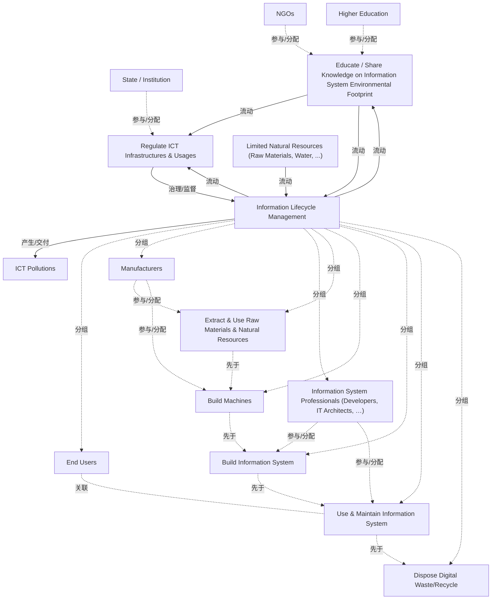

# G242/fig3-12 · ICT 资产生命周期中信息系统生态系统的利益相关者

类型：`process-or-method-model`。说明ICT资产生命周期中的参与者和知识、数据、规则、资源、污染交换；为组织与客户、供应商、监管和知识机构合作提供地图。

英文 PDF 物理页：[67]。本页为架构语义分析，原文与原图分别保留。

## 原图与可编辑图


[完整 JSON](fig3-12.json) · [可编辑 Mermaid](fig3-12.mmd) · [仅关系图](fig3-12.relations.mmd) · [层级分解图](fig3-12.hierarchy.mmd)

图形重建表达语义，不复制源图布局。虚线表示解释、矩阵映射或分组关系，不自动表示不确定性的概率。



## 架构分析

中间五阶段从左到右，制造商括号位于前两段下方，IS专业人员括号位于第三第四段下方，最终用户在使用维护上方。上部三条与教育有关的交换及两条与监管有关的交换，共五箭头；底部资源流入、污染流出另两箭头。

- 本图有 16 个具名或隐含元素、19 条关系和 8 条包含/分组记录。
- 包含/分组树最大深度为 1；根节点为 非政府组织、高等教育、国家/机构、就信息系统环境足迹开展教育/共享知识、监管 ICT 基础设施与使用、信息生命周期管理、有限的自然资源（原材料、水……）、ICT 污染。
- 本图没有可直接确认为人员直属汇报的关系；视觉上下位置、能力分解和治理职责分别读取。
- 治理边回答谁提供约束、指导或监督；它们与岗位汇报边分别存储。
- 17个角色/活动/阶段/外部性标签、7条实际交换箭头、2条角色括号及五个带间隙的V形块完整核对。
- 五个生命周期块之间没有单独连线；右向V形表达排列顺序，不能当作四条实体传输箭头。
- 制造商与IS专业人员括号只说明图示作用范围；没有画废弃阶段括号不等于把其责任转给其他人。

### 如何用于项目

- 按阶段/事件/行为关系读取入口、出口、责任和产物；检查循环与例外路径。
- 工作流先后不表示组织管理权；在项目中显式记录条件和完成标准。

### 结构所表达的逻辑

- 五段为开采使用自然资源、制造设备、构建信息系统、使用维护、处置数字废弃物/回收；块之间有间隙。
- 制造商括号覆盖前两段，信息系统专业人员括号覆盖第三第四段。图没有赋予任何角色排他或全部生命周期责任。
- 教育/共享知识→监管为Knowledge to Influence；生命周期向教育和监管分别提供Real Data；教育向生命周期提供Knowledge to Influence，监管向其提供Rules。
- 底部有限自然资源流入生命周期，ICT污染流出；不是两个信息系统数据库。
- NGO、高教、国家/机构和最终用户等人物图标表示角色类别，不是实际人数或岗位技能矩阵。
- 第66–68页要求生态合作、供应商全生命周期透明度、明确披露范围与采购选择条件；职责应结合正文和项目约定进一步界定。

## 上下级与包含

三层：最外层是生态系统（全部元素）；中层是“Information Lifecycle Management”大框，框内是五个生命周期阶段；阶段之下用括号归给两类执行者（制造商、信息系统专业人员）。顶部两个活动块（教育、监管）与底部两个外部性块位于生命周期框之外，属于治理层与外部环境层，不是阶段的下级。

|父项|子项|层级类型|依据与解释|
|---|---|---|---|
|信息生命周期管理|最终用户|visual_grouping|框、泳道、域或分类组的成员归属；没有额外证据不提升为业务组合或管理关系。|
|信息生命周期管理|制造商|visual_grouping|框、泳道、域或分类组的成员归属；没有额外证据不提升为业务组合或管理关系。|
|信息生命周期管理|信息系统专业人员（开发人员、IT 架构师……）|visual_grouping|框、泳道、域或分类组的成员归属；没有额外证据不提升为业务组合或管理关系。|
|信息生命周期管理|开采与使用原材料及自然资源|visual_grouping|框、泳道、域或分类组的成员归属；没有额外证据不提升为业务组合或管理关系。|
|信息生命周期管理|制造机器|visual_grouping|框、泳道、域或分类组的成员归属；没有额外证据不提升为业务组合或管理关系。|
|信息生命周期管理|构建信息系统|visual_grouping|框、泳道、域或分类组的成员归属；没有额外证据不提升为业务组合或管理关系。|
|信息生命周期管理|使用与维护信息系统|visual_grouping|框、泳道、域或分类组的成员归属；没有额外证据不提升为业务组合或管理关系。|
|信息生命周期管理|处置数字废弃物/回收|visual_grouping|框、泳道、域或分类组的成员归属；没有额外证据不提升为业务组合或管理关系。|

### 治理范围

|父项/范围/类型|子项/责任对象/实例|语义|
|---|---|---|
|监管 ICT 基础设施与使用|信息生命周期管理|governs|

## 全部元素与角色

|元素ID|原文名称|类型|含义|直接父项|深度|
|---|---|---|---|---|---|
|ngos|NGOs|stakeholder|利益相关者：非政府组织|—||
|higher_education|Higher Education|stakeholder|利益相关者：高等教育|—||
|state_institution|State / Institution|stakeholder|利益相关者：国家/机构|—||
|end_users|End Users|stakeholder|利益相关者：最终用户|信息生命周期管理|1|
|manufacturers|Manufacturers|stakeholder|利益相关者：制造商|信息生命周期管理|1|
|is_professionals|Information System Professionals (Developers, IT Architects, …)|stakeholder|利益相关者：信息系统专业人员（开发人员、IT 架构师……）|信息生命周期管理|1|
|educate|Educate / Share Knowledge on Information System Environmental Footprint|process|流程：就信息系统环境足迹开展教育/共享知识|—||
|regulate|Regulate ICT Infrastructures & Usages|process|流程：监管 ICT 基础设施与使用|—||
|lifecycle|Information Lifecycle Management|group|分组：信息生命周期管理|—||
|stage_extract|Extract & Use Raw Materials & Natural Resources|phase|阶段：开采与使用原材料及自然资源|信息生命周期管理|1|
|stage_build_machines|Build Machines|phase|阶段：制造机器|信息生命周期管理|1|
|stage_build_is|Build Information System|phase|阶段：构建信息系统|信息生命周期管理|1|
|stage_use_maintain|Use & Maintain Information System|phase|阶段：使用与维护信息系统|信息生命周期管理|1|
|stage_dispose|Dispose Digital Waste/Recycle|phase|阶段：处置数字废弃物/回收|信息生命周期管理|1|
|limited_resources|Limited Natural Resources (Raw Materials, Water, ...)|resource|资源：有限的自然资源（原材料、水……）|—||
|ict_pollutions|ICT Pollutions|other|生命周期的负面环境产出（非风险项，故用 other）|—||

## 全部关系

五条上部知识/数据/规则箭头加两条资源/污染箭头共7条实际连线。四条阶段sequence是V形排列的解释；角色花括号不是方向箭头。

|主体|语义关系|客体|显式线/隐式|原文标签|依据|
|---|---|---|---|---|---|
|开采与使用原材料及自然资源|先于|制造机器|chevron-sequence||阶段之间留有空白，没有独立连接线；顺序由右向V形及左到右布局表达。|
|制造机器|先于|构建信息系统|chevron-sequence||阶段之间留有空白，没有独立连接线；顺序由右向V形及左到右布局表达。|
|构建信息系统|先于|使用与维护信息系统|chevron-sequence||阶段之间留有空白，没有独立连接线；顺序由右向V形及左到右布局表达。|
|使用与维护信息系统|先于|处置数字废弃物/回收|chevron-sequence||阶段之间留有空白，没有独立连接线；顺序由右向V形及左到右布局表达。|
|就信息系统环境足迹开展教育/共享知识|流动|监管 ICT 基础设施与使用|显式连线|Knowledge to Influence|两块之间的水平箭头|
|信息生命周期管理|流动|就信息系统环境足迹开展教育/共享知识|显式连线|Real Data|生命周期框上缘向上箭头，位于左侧|
|就信息系统环境足迹开展教育/共享知识|流动|信息生命周期管理|显式连线|Knowledge to Influence|教育块下方向下箭头，进入生命周期框|
|信息生命周期管理|流动|监管 ICT 基础设施与使用|显式连线|Real Data|生命周期框上缘向上箭头，位于右侧|
|监管 ICT 基础设施与使用|治理/监督|信息生命周期管理|显式连线|Rules|监管块下方向下箭头，进入生命周期框|
|有限的自然资源（原材料、水……）|流动|信息生命周期管理|显式连线||框外左下向上箭头，资源流入生命周期|
|信息生命周期管理|产生/交付|ICT 污染|显式连线||框外右下向下箭头，污染流出|
|非政府组织|参与/分配|就信息系统环境足迹开展教育/共享知识|implicit||人群图标位于教育块上方，表示由非政府组织承担|
|高等教育|参与/分配|就信息系统环境足迹开展教育/共享知识|implicit||高等教育机构与 NGO 并排，共同承担教育/共享知识|
|国家/机构|参与/分配|监管 ICT 基础设施与使用|implicit||人群图标位于监管块上方|
|制造商|参与/分配|开采与使用原材料及自然资源|implicit||花括号覆盖阶段 1–2；此处连到阶段 1，阶段 2 同属制造商（见 r_manufacturers_stage2）|
|制造商|参与/分配|制造机器|implicit||花括号右端覆盖“制造机器”|
|信息系统专业人员（开发人员、IT 架构师……）|参与/分配|构建信息系统|implicit||花括号覆盖阶段 3–4|
|信息系统专业人员（开发人员、IT 架构师……）|参与/分配|使用与维护信息系统|implicit||花括号右端覆盖“使用与维护信息系统”|
|最终用户|关联|使用与维护信息系统|implicit||最终用户标签位于使用与维护阶段上方，表示其为该阶段的需求方/使用者|

## 本轮语义修正

- 阶段之间留有空白，没有独立连接线；顺序由右向V形及左到右布局表达。
- 阶段之间留有空白，没有独立连接线；顺序由右向V形及左到右布局表达。
- 阶段之间留有空白，没有独立连接线；顺序由右向V形及左到右布局表达。
- 阶段之间留有空白，没有独立连接线；顺序由右向V形及左到右布局表达。

## 误读检查

- 废弃回收没有角色括号并不意味着IS专业人员或制造商没有相关责任，也不能据此把责任指定给最终用户。
- 最终用户位于使用维护附近，图中没有规定其不能执行任何生命周期活动。
- 图示角色范围不是排他责任边界或完整RACI。

## 原文证据

### [PDF 第 66 页](../../../documents/G242.md#page-66)

> the organization and therefore facilitate peer review and inspire others. It will also help to fight against greenwashing communications from the market and help avoid obsolete data remaining available online.
> This file should include the initial, uninterpreted unitary data with its source for each perimeter considered: emissions factors from device manufacturers (run and build phases) and related electricity consumption, calculated emissions and consumption from on-premise data centers, and emissions from public cloud services. To be fully transparent on the calculation methodologies, other physical values must be communicated, such as the reference carbon intensity of energy mixes considered by the company. This repository should be presented as part of a larger onboarding of suborganizations, to help them become autonomous on the subject and to support their own bottom- up initiatives.
### [PDF 第 67 页](../../../documents/G242.md#page-67)

> Figure 3-12: Information System Ecosystem Stakeholders Along the ICT Assets Lifecycle
### [PDF 第 68 页](../../../documents/G242.md#page-68)

> • Publicly announce via the sponsor that transparency and environmental impact reduction plans give competitive advantages
> • Identify the main suppliers of ICT services and equipment, set up a dialogue on the issue of sustainable ICT, work in partnership on ICT solutions with high added value and low need for resources

## 来源与分析状态

所有元素/关系均有来源定位；未把历史解释重命名为本轮逐线视觉确认。源图与语义图是两种视图，布局不证明汇报或因果。

源 PDF SHA-256：`517339a5e3f509f08699c10b929f5ae14b6bca356b55e76163ffe437d54d5d19`。

源图记录：[原始解释与转录](../../../figures/G242/fig3-12.json)。

```json
{
  "quality": {
    "graph_integrity": "checked",
    "semantic_analysis": "typed-graph-and-context-analysis",
    "visual_review": "source-content-audited",
    "notice_zh": "所有元素/关系均有来源定位；未把历史解释重命名为本轮逐线视觉确认。源图与语义图是两种视图，布局不证明汇报或因果。"
  },
  "source_uncertainty": {
    "confidence": "high",
    "uncertainties_zh": [
      "“最终用户”标签位于框内右上，未用括号或箭头绑定到具体阶段；按其靠近“使用与维护”推断关联。",
      "“处置数字废弃物/回收”阶段没有归属括号，图中未说明由谁负责。",
      "原图未标注作者/版权。"
    ],
    "analyzed_from": [
      "英文 PDF 第 67 页（印刷页 49）原图截图与 2×2 放大分块",
      "英文 PDF 第 67 页正文",
      "中文稿 G242e_环境可持续的信息系统.md 第 1184–1217 行",
      "figs/zh/g242_fig3-12_zh.svg 源码、figs/zh/g242_fig3-12_zh.png、figs/g242_fig3-12_en.png"
    ],
    "date": "2026-10-31"
  },
  "source_conflicts": []
}
```
