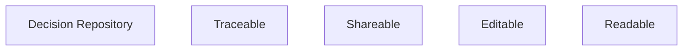

# G242/fig3-13 · 决策仓库

类型：`analytical-view`。为 3.9.1 节末尾的“决策仓库”提供直观符号：把决策日志放进组织内共享的仓库，而不是散落在会议纪要或个人文档里，从而同时获得可追溯性、共享性、可更新性与可用性。

英文 PDF 物理页：[77]。本页为架构语义分析，原文与原图分别保留。

## 原图与可编辑图


[完整 JSON](fig3-13.json) · [可编辑 Mermaid](fig3-13.mmd) · [仅关系图](fig3-13.relations.mmd) · [层级分解图](fig3-13.hierarchy.mmd)

图形重建表达语义，不复制源图布局。虚线表示解释、矩阵映射或分组关系，不自动表示不确定性的概率。



## 架构分析

左边是符号，右边是解释。蓝色圆柱是“决策仓库”（数据库的标准画法）；右侧四个勾选项是该仓库带来的四项性质。没有箭头，勾选号就是“具备”的标记。

- 本图有 5 个具名或隐含元素、0 条关系和 0 条包含/分组记录。
- 本图没有可直接确认为人员直属汇报的关系；视觉上下位置、能力分解和治理职责分别读取。
- 包含分组后有 5 个连通分量；分离可能源于图例、并列分类或独立示例，未自动补边。
- 决策仓库圆柱和四个带勾属性完整；没有箭头、数据字段或工具选择。
- 正文说日志可以记录到共享仓库，未要求必须采用某类数据库，旧“不可以是文档”过度推断。

### 如何用于项目

- 围绕作者目的读取本图实体、分组与连线，并用对应原文限定其含义。
- 把参考模型与项目事实分开，实际范围、约束、值和责任须有项目证据。

### 结构所表达的逻辑

- Decision Repository用圆柱示意存放决策日志；第77页原文使用can be recorded，未指定数据库产品或排除文档型实现。
- 四项图中文字为Traceable、Shareable、Editable、Readable，分别可追溯、可共享、可编辑、可读；正文updatability/availability措辞另保留。
- 四个勾表示期望性质，不是某项目已经实施完成的证明。
- 原文下一段把数字可持续性评审模板误指为Figure3-13，而下方实际模板图题为Figure3-14；保留引用编号不一致。

## 上下级与包含

只有一层：决策仓库（容器）与其四项性质（并列属性）。图中没有上下级，也没有把四项性质画成仓库的组成部分。

|父项|子项|层级类型|依据与解释|
|---|---|---|---|
|—|—|无视觉包含|关系中明确的组成/特化见 JSON semantic_hierarchy。|

## 全部元素与角色

|元素ID|原文名称|类型|含义|直接父项|深度|
|---|---|---|---|---|---|
|decision_repository|Decision Repository|data|信息/数据：决策仓库|—||
|prop_traceable|Traceable|concept|概念：可追溯|—||
|prop_shareable|Shareable|concept|概念：可共享|—||
|prop_editable|Editable|concept|概念：可编辑（可更新）|—||
|prop_readable|Readable|concept|概念：可读（可用）|—||

## 全部关系

没有任何连线或箭头。右侧四行的勾选符号（✓）不是线，而是“具备该性质”的标记；四项与仓库的关联由左右并置表达。

|主体|语义关系|客体|显式线/隐式|原文标签|依据|
|---|---|---|---|---|---|

## 误读检查

- 仓库符号不能推导某技术栈、数据库强制要求或禁用文档。
- 四项并列性质不是流程顺序或已完成待办。

## 原文证据

### [PDF 第 76 页](../../../documents/G242.md#page-76)

> To add the environmental criterion to decision-making, it is important to have reference tables enabling fast and efficient measurement of CO2e emissions, rare metals extraction, and drinkable water use, according to the company’s assumptions. This reference data can come from multiple sources.
> Here, the company weighed the environmental criterion across several fundamental criteria, such as finance, functional coverage, and customer experience.
### [PDF 第 77 页](../../../documents/G242.md#page-77)

> Figure 3-13 shows an example of a template for a digital sustainability review in an Enterprise Architecture governance board.

## 来源与分析状态

所有元素/关系均有来源定位；未把历史解释重命名为本轮逐线视觉确认。源图与语义图是两种视图，布局不证明汇报或因果。

源 PDF SHA-256：`517339a5e3f509f08699c10b929f5ae14b6bca356b55e76163ffe437d54d5d19`。

源图记录：[原始解释与转录](../../../figures/G242/fig3-13.json)。

```json
{
  "quality": {
    "graph_integrity": "checked",
    "semantic_analysis": "typed-graph-and-context-analysis",
    "visual_review": "source-content-audited",
    "notice_zh": "所有元素/关系均有来源定位；未把历史解释重命名为本轮逐线视觉确认。源图与语义图是两种视图，布局不证明汇报或因果。"
  },
  "source_uncertainty": {
    "confidence": "high",
    "uncertainties_zh": [
      "“Editable”在中文稿正文对应“可更新性”，图内译“可编辑”；“Readable”对应“可用性/可读”。已按正文与图面分别记录。",
      "原图未标注来源或版权。"
    ],
    "analyzed_from": [
      "英文 PDF 第 77 页（印刷页 59）原图截图与 2×2 放大分块",
      "英文 PDF 第 77 页正文",
      "中文稿 G242e_环境可持续的信息系统.md 第 1435–1453 行",
      "figs/zh/g242_fig3-13_zh.png、figs/g242_fig3-13_en.png"
    ],
    "date": "2026-10-31"
  },
  "source_conflicts": [
    {
      "kind": "cross-reference-mismatch",
      "pdf_page": 77,
      "literal_reference": "Figure 3-13 shows an example of a template",
      "caption_of_template": "Figure 3-14",
      "resolution_zh": "模板路由指向3-14，同时保留原文误指。"
    }
  ]
}
```
