# G242/fig3-14 · AXA 企业架构治理委员会中数字可持续性评审的模板

类型：`mapping-or-assessment-matrix`。示范企业架构治理委员会如何把环境议题纳入架构评审：不只问“业务价值”，还要求申报业务正向环境影响、目标架构的碳足迹增减（分范围 2/范围 3 服务/IT 设备制造，分两年），以及已研究过的五类减排手段。它把定性判断与定量核算放在同一页，便于委员会横向比较方案。

英文 PDF 物理页：[77]。本页为架构语义分析，原文与原图分别保留。

## 原图与可编辑图


[完整 JSON](fig3-14.json) · [可编辑 Mermaid](fig3-14.mmd) · [仅关系图](fig3-14.relations.mmd) · [层级分解图](fig3-14.hierarchy.mmd)

图形重建表达语义，不复制源图布局。虚线表示解释、矩阵映射或分组关系，不自动表示不确定性的概率。

```mermaid
flowchart TB
  %% Semantic reconstruction; see original source image for exact layout.
  n0["Sustain the Organization Climate Transition"]
  n1["IT Contribution"]
  n2["Environmental Business Positive Impacts – Target Architecture will help business to:"]
  n3["Measure an Environmental Impact"]
  n4["Reduce a Business Environmental Impact"]
  n5["Train Business About Environmental &amp; Climate Change"]
  n6["If yes, explain how (new functions to do so)"]
  n7["If yes, explain how, and evaluate gain with targeted reduction"]
  n8["If yes, explain how, and evaluate gain with targeted reduction"]
  n9["IT Carbon Footprint (a) – Target Architecture will:"]
  n10["Increase"]
  n11["Decrease"]
  n12["Comment"]
  n13["Target Architecture Was Studied to Minimize IT Environmental Impact, Thanks To:"]
  n14["Take into account environmental impact in software or data science developments"]
  n15["Improve technical equipment regarding energy efficiency, carbon footprint, and increased equipment&#x27;s life time"]
  n16["Include environmental criteria in the process to select solution providers (RFI, RFP, ...)"]
  n17["Ensure to minimize data volumes increase along time (Data Minimization)"]
  n18["Propose to end users functions to help them to have low carbon behavior in their IT usage"]
  n19["底部未命名空白输入框"]
  n0 -.->|"分组"| n1
  n2 -.->|"分组"| n3
  n2 -.->|"分组"| n4
  n2 -.->|"分组"| n5
  n3 -.->|"分组"| n6
  n4 -.->|"分组"| n7
  n5 -.->|"分组"| n8
  n9 -.->|"分组"| n10
  n9 -.->|"分组"| n11
  n9 -.->|"分组"| n12
  n13 -.->|"分组"| n14
  n13 -.->|"分组"| n15
  n13 -.->|"分组"| n16
  n13 -.->|"分组"| n17
  n13 -.->|"分组"| n18
```



## 架构分析

自上而下三块。第一块“环境业务正向影响”：三项各选 YES/NO，选中项为深色；本例度量环境影响=YES、降低业务影响=NO、培训业务=YES。第二块“IT 碳足迹”：先选 Increase/Decrease（本例 Increase），再填表——行是投入（新增资源）、产出（退役资源）、平衡（投入−产出），列是 Total、第 1 年（范围 2/范围 3 服务/IT 设备制造）、第 2 年（范围 2/范围 3 服务/IT 设备制造）。右侧 Comment 为空白备注。第三块列出五类减排手段，本例全部勾 YES。

- 本图有 20 个具名或隐含元素、0 条关系和 15 条包含/分组记录。
- 包含/分组树最大深度为 2；根节点为 支撑组织气候转型、环境业务正向影响——目标架构将帮助业务：、IT 碳足迹（a）——目标架构将：、为最小化 IT 环境影响，目标架构研究了以下手段：、底部未命名空白输入框。
- 本图没有可直接确认为人员直属汇报的关系；视觉上下位置、能力分解和治理职责分别读取。
- 原图靠嵌套表达结构，没有连线；新语义图将包含单独显式化，不补造流程、数据流或依赖。
- 包含分组后有 5 个连通分量；分离可能源于图例、并列分类或独立示例，未自动补边。
- 19个标签、3个业务判断、五类手段、碳足迹表的21个数值及选中状态完整核对。
- 保留Total884与分项883、Scope2平衡-390与计算-391的差异；不猜测四舍五入原因。
- Increase深色选中同时总平衡-103，源图两种信号不一致；不把此示例当作项目评审结论。
- 底部绿色大空白输入框与右侧Comment框分别存在，旧节点记录遗漏底部空白框。

### 如何用于项目

- 先固定行、列所代表的维度及单元格含义，再登记有证据的映射或评分。
- 空白、无关系、未测量和不适用分别处理；颜色不自动等于优先级。

### 结构所表达的逻辑

- 模板把“环境影响”分成两类：对业务的正向影响（度量、降低、培训）与 IT 自身的碳足迹（增加/减少），前者定性、后者定量。
- 碳足迹列按范围 2、范围 3 服务、IT 设备制造（范围 3）划分，Year 1 与 Year 2 各含三列。图中未说明各项排放发生频率。
- 表格总量三行分别为新增资源884、退役资源987、平衡−103；这里保留原图值，不把它推导成已验证的目标架构结论。
- 本例业务影响中度量与培训选 YES，降低影响选 NO；IT 侧 Increase 按钮呈深色，同时表格总平衡为 −103，须保留这两个事实，不自动消解其含义。
- 五类手段覆盖开发、设备、采购、数据、用户行为，与正文 3.5/3.6/3.7 各节一一对应。
- 表格保留原图数值：新增总量884、分项和883差1；Scope 2 的69−460=−391，与原图−390差1；差异原因未确定。
- “Sustain the Organization Climate Transition / IT Contribution”表明该模板把 IT 定位为组织气候转型的贡献者，而非独立议题。

## 上下级与包含

标题和三个带状标题将表单分为业务影响、IT碳足迹和环境影响最小化手段；是字段分类，不是人员或业务组件层级。

|父项|子项|层级类型|依据与解释|
|---|---|---|---|
|支撑组织气候转型|IT 贡献|classified_under|标题/带状分组用于表单分类，并不视觉包围下方字段；无组成或人事语义。|
|环境业务正向影响——目标架构将帮助业务：|度量环境影响|classified_under|标题/带状分组用于表单分类，并不视觉包围下方字段；无组成或人事语义。|
|环境业务正向影响——目标架构将帮助业务：|降低业务环境影响|classified_under|标题/带状分组用于表单分类，并不视觉包围下方字段；无组成或人事语义。|
|环境业务正向影响——目标架构将帮助业务：|就环境与气候变化培训业务|classified_under|标题/带状分组用于表单分类，并不视觉包围下方字段；无组成或人事语义。|
|度量环境影响|若是，说明如何实现（为此新增的功能）|classified_under|标题/带状分组用于表单分类，并不视觉包围下方字段；无组成或人事语义。|
|降低业务环境影响|若是，说明如何实现，并评估目标减排带来的收益|classified_under|标题/带状分组用于表单分类，并不视觉包围下方字段；无组成或人事语义。|
|就环境与气候变化培训业务|若是，说明如何实现，并评估目标减排带来的收益|classified_under|标题/带状分组用于表单分类，并不视觉包围下方字段；无组成或人事语义。|
|IT 碳足迹（a）——目标架构将：|增加|classified_under|标题/带状分组用于表单分类，并不视觉包围下方字段；无组成或人事语义。|
|IT 碳足迹（a）——目标架构将：|减少|classified_under|标题/带状分组用于表单分类，并不视觉包围下方字段；无组成或人事语义。|
|IT 碳足迹（a）——目标架构将：|备注|classified_under|标题/带状分组用于表单分类，并不视觉包围下方字段；无组成或人事语义。|
|为最小化 IT 环境影响，目标架构研究了以下手段：|在软件或数据科学开发中考虑环境影响|classified_under|标题/带状分组用于表单分类，并不视觉包围下方字段；无组成或人事语义。|
|为最小化 IT 环境影响，目标架构研究了以下手段：|提升技术设备的能效与碳足迹表现，并延长设备使用寿命|classified_under|标题/带状分组用于表单分类，并不视觉包围下方字段；无组成或人事语义。|
|为最小化 IT 环境影响，目标架构研究了以下手段：|在选择解决方案提供方的流程（RFI、RFP……）中纳入环境标准|classified_under|标题/带状分组用于表单分类，并不视觉包围下方字段；无组成或人事语义。|
|为最小化 IT 环境影响，目标架构研究了以下手段：|确保随时间推移最小化数据量增长（数据最小化）|classified_under|标题/带状分组用于表单分类，并不视觉包围下方字段；无组成或人事语义。|
|为最小化 IT 环境影响，目标架构研究了以下手段：|向最终用户提供功能，帮助其在 IT 使用中采取低碳行为|classified_under|标题/带状分组用于表单分类，并不视觉包围下方字段；无组成或人事语义。|

## 全部元素与角色

|元素ID|原文名称|类型|含义|直接父项|深度|
|---|---|---|---|---|---|
|title|Sustain the Organization Climate Transition|goal|目标/成果：支撑组织气候转型|—||
|subtitle|IT Contribution|note|说明：IT 贡献|支撑组织气候转型|1|
|band_positive|Environmental Business Positive Impacts – Target Architecture will help business to:|group|分组：环境业务正向影响——目标架构将帮助业务：|—||
|impact_measure|Measure an Environmental Impact|requirement|需求：度量环境影响|环境业务正向影响——目标架构将帮助业务：|1|
|impact_reduce|Reduce a Business Environmental Impact|requirement|需求：降低业务环境影响|环境业务正向影响——目标架构将帮助业务：|1|
|impact_train|Train Business About Environmental & Climate Change|requirement|需求：就环境与气候变化培训业务|环境业务正向影响——目标架构将帮助业务：|1|
|explain_measure|If yes, explain how (new functions to do so)|note|说明：若是，说明如何实现（为此新增的功能）|度量环境影响|2|
|explain_reduce|If yes, explain how, and evaluate gain with targeted reduction|note|说明：若是，说明如何实现，并评估目标减排带来的收益|降低业务环境影响|2|
|explain_train|If yes, explain how, and evaluate gain with targeted reduction|note|说明：若是，说明如何实现，并评估目标减排带来的收益|就环境与气候变化培训业务|2|
|band_carbon|IT Carbon Footprint (a) – Target Architecture will:|group|分组：IT 碳足迹（a）——目标架构将：|—||
|toggle_increase|Increase|note|说明：增加|IT 碳足迹（a）——目标架构将：|1|
|toggle_decrease|Decrease|note|说明：减少|IT 碳足迹（a）——目标架构将：|1|
|comment|Comment|note|说明：备注|IT 碳足迹（a）——目标架构将：|1|
|band_minimize|Target Architecture Was Studied to Minimize IT Environmental Impact, Thanks To:|group|分组：为最小化 IT 环境影响，目标架构研究了以下手段：|—||
|lever_dev|Take into account environmental impact in software or data science developments|process|流程：在软件或数据科学开发中考虑环境影响|为最小化 IT 环境影响，目标架构研究了以下手段：|1|
|lever_equipment|Improve technical equipment regarding energy efficiency, carbon footprint, and increased equipment's life time|process|流程：提升技术设备的能效与碳足迹表现，并延长设备使用寿命|为最小化 IT 环境影响，目标架构研究了以下手段：|1|
|lever_procurement|Include environmental criteria in the process to select solution providers (RFI, RFP, ...)|process|流程：在选择解决方案提供方的流程（RFI、RFP……）中纳入环境标准|为最小化 IT 环境影响，目标架构研究了以下手段：|1|
|lever_data|Ensure to minimize data volumes increase along time (Data Minimization)|process|流程：确保随时间推移最小化数据量增长（数据最小化）|为最小化 IT 环境影响，目标架构研究了以下手段：|1|
|lever_users|Propose to end users functions to help them to have low carbon behavior in their IT usage|process|流程：向最终用户提供功能，帮助其在 IT 使用中采取低碳行为|为最小化 IT 环境影响，目标架构研究了以下手段：|1|
|blank_bottom_field|底部未命名空白输入框|note|原图绿色边框空白区域，没有字段名或填写内容。|—||

## 全部关系

图中没有连接线或箭头。语义靠区块顺序与控件状态表达：深色按钮=已选，白色按钮=未选；表格的 Year 1/Year 2 表头合并单元格形成两级列分组；绿色细框是输入框。

|主体|语义关系|客体|显式线/隐式|原文标签|依据|
|---|---|---|---|---|---|

## IT 碳足迹表（按原图逐格转录，单位 kgCO2e）

```json
{
  "id": "t_carbon_footprint",
  "title_zh": "IT 碳足迹表（按原图逐格转录，单位 kgCO2e）",
  "columns": [
    "项目",
    "Total",
    "Year 1 · Scope 2 KgCO2e",
    "Year 1 · Scope 3 service kgCO2e",
    "Year 1 · IT equipments build - Scope 3 KgCO2e",
    "Year 2 · Scope 2 KgCO2e",
    "Year 2 · Scope 3 service kgCO2e",
    "Year 2 · IT equipments build - Scope 3 KgCO2e"
  ],
  "rows": [
    [
      "IN : Added Resources",
      "884",
      "69",
      "224",
      "590",
      "0",
      "0",
      "0"
    ],
    [
      "OUT : Decommissioned Resources",
      "987",
      "460",
      "0",
      "527",
      "0",
      "0",
      "0"
    ],
    [
      "BALANCE (IN-OUT)",
      "-103",
      "-390",
      "224",
      "63",
      "0",
      "0",
      "0"
    ]
  ],
  "cell_legend": [
    "绿色表头：第 1 年",
    "黄色表头：第 2 年",
    "Total 列：整行合计",
    "BALANCE：投入减产出（负值=净减排）"
  ],
  "notes_zh": "直接核对英文 PDF 第 77 页。Total 只有一列，Year 1 和 Year 2 各有三项；不存在 Year 1 Total 列。原图数值不改：新增分项 69+224+590=883，与印刷总量884差1；Scope 2 的69−460=−391，与印刷平衡−390差1；未判定差异成因。深色 Increase 按钮与总平衡−103并存，保留原图状态。"
}
```

## 评审表单的判断项与选中状态

```json
{
  "id": "t_form_answers",
  "title_zh": "评审表单的判断项与选中状态",
  "columns": [
    "区块",
    "条目",
    "选中",
    "说明/备注"
  ],
  "rows": [
    [
      "环境业务正向影响",
      "Measure an Environmental Impact",
      "YES",
      "If yes, explain how (new functions to do so)"
    ],
    [
      "环境业务正向影响",
      "Reduce a Business Environmental Impact",
      "NO",
      "If yes, explain how, and evaluate gain with targeted reduction"
    ],
    [
      "环境业务正向影响",
      "Train Business About Environmental & Climate Change",
      "YES",
      "If yes, explain how, and evaluate gain with targeted reduction"
    ],
    [
      "IT 碳足迹",
      "Target Architecture will: Increase / Decrease",
      "Increase",
      "右侧 Comment 框为空"
    ],
    [
      "减排手段",
      "Take into account environmental impact in software or data science developments",
      "YES",
      ""
    ],
    [
      "减排手段",
      "Improve technical equipment regarding energy efficiency, carbon footprint, and increased equipment's life time",
      "YES",
      ""
    ],
    [
      "减排手段",
      "Include environmental criteria in the process to select solution providers (RFI, RFP, ...)",
      "YES",
      ""
    ],
    [
      "减排手段",
      "Ensure to minimize data volumes increase along time (Data Minimization)",
      "YES",
      ""
    ],
    [
      "减排手段",
      "Propose to end users functions to help them to have low carbon behavior in their IT usage",
      "YES",
      ""
    ]
  ],
  "cell_legend": [
    "深色按钮=已选；白色按钮=未选"
  ],
  "notes_zh": "选中状态按原图按钮填充色判读：度量=YES、降低=NO、培训=YES、Increase=选中、五个手段均=YES。"
}
```

## 误读检查

- 深色 YES/NO 是“已选”，不是“强调”；第二个影响项深色的是 NO，不要读成 YES（中文重绘 SVG 恰好画反了）。
- 原图 Increase 按钮呈深色、Decrease 呈白色，同时表内总平衡为 −103。图中未解释两者关系，不推断其是否矛盾或各自统计口径。
- 表格只有一个 Total 列（884/987/−103），之后是 Year 1 三列和 Year 2 三列；不存在 Year 1 Total 列。新增分项和883与Total884差1，Scope 2 计算−391与印刷−390差1，差异原因未确定。
- “IN / OUT”是新增资源与退役资源，不是现金流入流出；“BALANCE (IN-OUT)”是排放盈亏，不是财务平衡。
- 第 1 年 IT equipments build - Scope 3 三行分别为新增590、退役527、平衡63；第 2 年的三类分项均为0。不以这些示例值推断排放发生时点或业务原因。
- 英文 PDF 第 77 页正文把“数字可持续性评审模板”的示例写成“Figure 3-13 shows…”，而模板实际是图 3-14；这是原文的交叉引用笔误，不要把图 3-13（决策仓库）误认为模板。

## 原文证据

### [PDF 第 77 页](../../../documents/G242.md#page-77)

> Figure 3-14: Template for Digital Sustainability Review in AXA Enterprise Architecture Governance Board

## 来源与分析状态

所有元素/关系均有来源定位；未把历史解释重命名为本轮逐线视觉确认。源图与语义图是两种视图，布局不证明汇报或因果。

源 PDF SHA-256：`517339a5e3f509f08699c10b929f5ae14b6bca356b55e76163ffe437d54d5d19`。

源图记录：[原始解释与转录](../../../figures/G242/fig3-14.json)。

```json
{
  "quality": {
    "graph_integrity": "checked",
    "semantic_analysis": "typed-graph-and-context-analysis",
    "visual_review": "source-content-audited",
    "notice_zh": "所有元素/关系均有来源定位；未把历史解释重命名为本轮逐线视觉确认。源图与语义图是两种视图，布局不证明汇报或因果。"
  },
  "source_uncertainty": {
    "confidence": "high",
    "uncertainties_zh": [
      "本次已核对原图列名并纠正历史解释：没有 Year 1 Total 列；原图两处1单位差异保留，未确定其成因。",
      "“IT Carbon Footprint (a)”中的“(a)”脚注标记在图内没有对应脚注。",
      "“Increase”被选中但平衡为净减少，二者关系需结合评审语境理解，图中未说明。",
      "底部有一个无标签的空白说明框，未纳入元素（无可见文字）。"
    ],
    "analyzed_from": [
      "英文 PDF 第 77 页（印刷页 59）原图截图、600 dpi 局部放大与 2×2/3×3 分块",
      "英文 PDF 第 77 页正文",
      "中文稿 G242e_环境可持续的信息系统.md 第 1431–1484 行",
      "figs/zh/g242_fig3-14_zh.svg 源码、figs/zh/g242_fig3-14_zh.png、figs/g242_fig3-14_en.png"
    ],
    "date": "2026-10-31"
  },
  "source_conflicts": [
    {
      "id": "source-g242-fig3-14",
      "figure_id": "G242/fig3-14",
      "status": "observed-conflict",
      "description": "JSON把新增总量884和年度分项69、224、590误读；原图分项和883与总量884有1单位差异，Scope2净值也存在1单位差异。",
      "evidence": [
        "G242 §3.8–3.9",
        "figs/g242_fig3-14_en.png",
        "figs/ai/G242/fig3-14.json"
      ],
      "resolution": "保存原值、列头、算术差异及可能舍入；不得静默更正或认定选项矛盾已消解。"
    },
    {
      "kind": "printed-arithmetic-mismatch",
      "row": "IN : Added Resources",
      "printed_total": 884,
      "visible_component_sum": 883
    },
    {
      "kind": "printed-arithmetic-mismatch",
      "column": "Year 1 Scope 2",
      "printed_balance": -390,
      "difference_of_visible_inputs": -391
    },
    {
      "kind": "toggle-and-balance-tension",
      "selected_toggle": "Increase",
      "printed_total_balance": -103,
      "resolution_zh": "保留按钮与数值，不推断作者意图或自动修改。"
    }
  ]
}
```
