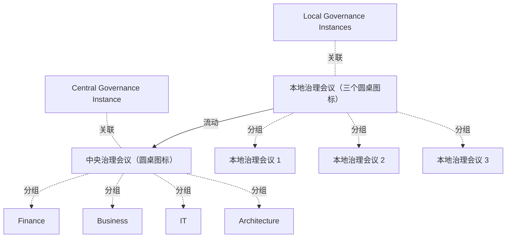

# G242/fig3-15 · 分布式治理模型示意图（来源：The Shift Project Lean-ICT 工作组）

类型：`decomposition-or-organization-model`。说明按环境影响与组织选定标准进行分层决策验证；本地可记录、传达以求认可或升级到相关机构。

英文 PDF 物理页：[78]。本页为架构语义分析，原文与原图分别保留。

## 原图与可编辑图


[完整 JSON](fig3-15.json) · [可编辑 Mermaid](fig3-15.mmd) · [仅关系图](fig3-15.relations.mmd) · [层级分解图](fig3-15.hierarchy.mmd)

图形重建表达语义，不复制源图布局。虚线表示解释、矩阵映射或分组关系，不自动表示不确定性的概率。



## 架构分析

先看右侧：上面一个圆桌图标，四周标着 Finance（上）、Business（左）、IT（右）、Architecture（下），代表中央治理机构的组成。下面三个同样的圆桌图标代表多个本地治理机构，它们被一条横向括号连起，括号中央向上伸出一支箭头直达中央图标，箭头右侧写“Endorsement or Escalation of Decisions（决策的认可或上报）”。左侧两个蓝框只是给上下两组图标贴标签：上=中央治理机构，下=本地治理机构。

- 本图有 11 个具名或隐含元素、3 条关系和 7 条包含/分组记录。
- 包含/分组树最大深度为 1；根节点为 中央治理机构、本地治理机构、中央治理会议（圆桌图标）、本地治理会议（三个圆桌图标）。
- 本图没有可直接确认为人员直属汇报的关系；视觉上下位置、能力分解和治理职责分别读取。
- 中央一个与本地三个会议图标、四类中央参与视角、两个文字标签及本地汇至中央的一组箭头完整核对。
- 本地三个图标表示多个治理实例；人物小图标不赋予实际人数、职位或人事汇报。
- 表3-6只给示例门槛Y tCO2e，并未给具体数值；决策是否上报取决于选择的标准。

### 如何用于项目

- 按父项展开所有直接子项，检查同层粒度、重叠和缺项。
- 保留组成、分类、能力分解与组织汇报的区别；将示例名称替换为已确认的项目对象。

### 结构所表达的逻辑

- 中央图标周围是Finance、Business、IT、Architecture四种参与视角；未指定实际委员人数。
- 本地三个会议图标表示复数实例，三支线汇合为一条向上箭头，标签Endorsement or Escalation of Decisions。
- 第78页允许依规模设多个治理层级，此图不强制所有组织固定两级或三个本地机构。
- 表3-6列新托管服务、新应用服务、超过Y tCO2e作为提交委员会的示例标准，Y未赋具体数值。
- 图没有向下批复箭头或员工直属汇报关系；这些需要另有证据。

## 上下级与包含

两层：中央治理机构（1 个，含业务/IT/财务/架构四个席位）在上；本地治理机构（3 个图标表示多个）在下。左侧两个蓝框是对这两层的文字标注，不是第三层。

|父项|子项|层级类型|依据与解释|
|---|---|---|---|
|中央治理会议（圆桌图标）|财务|classified_under|Finance/Business/IT/Architecture是会议图标四周的参与视角标签，不是被封闭机构框包含的岗位。|
|中央治理会议（圆桌图标）|业务|classified_under|Finance/Business/IT/Architecture是会议图标四周的参与视角标签，不是被封闭机构框包含的岗位。|
|中央治理会议（圆桌图标）|IT|classified_under|Finance/Business/IT/Architecture是会议图标四周的参与视角标签，不是被封闭机构框包含的岗位。|
|中央治理会议（圆桌图标）|架构|classified_under|Finance/Business/IT/Architecture是会议图标四周的参与视角标签，不是被封闭机构框包含的岗位。|
|本地治理会议（三个圆桌图标）|本地治理会议 1|visual_grouping|框、泳道、域或分类组的成员归属；没有额外证据不提升为业务组合或管理关系。|
|本地治理会议（三个圆桌图标）|本地治理会议 2|visual_grouping|框、泳道、域或分类组的成员归属；没有额外证据不提升为业务组合或管理关系。|
|本地治理会议（三个圆桌图标）|本地治理会议 3|visual_grouping|框、泳道、域或分类组的成员归属；没有额外证据不提升为业务组合或管理关系。|

## 全部元素与角色

|元素ID|原文名称|类型|含义|直接父项|深度|
|---|---|---|---|---|---|
|central_gov|Central Governance Instance|organization_unit|组织单元：中央治理机构|—||
|local_gov|Local Governance Instances|organization_unit|组织单元：本地治理机构|—||
|central_meeting|中央治理会议（圆桌图标）|actor|参与者：中央治理会议（圆桌图标）|—||
|role_finance|Finance|role|角色：财务|中央治理会议（圆桌图标）|1|
|role_business|Business|role|角色：业务|中央治理会议（圆桌图标）|1|
|role_it|IT|role|角色：IT|中央治理会议（圆桌图标）|1|
|role_architecture|Architecture|role|角色：架构|中央治理会议（圆桌图标）|1|
|local_meetings|本地治理会议（三个圆桌图标）|group|分组：本地治理会议（三个圆桌图标）|—||
|local_meeting_1|本地治理会议 1|actor|参与者：本地治理会议 1|本地治理会议（三个圆桌图标）|1|
|local_meeting_2|本地治理会议 2|actor|参与者：本地治理会议 2|本地治理会议（三个圆桌图标）|1|
|local_meeting_3|本地治理会议 3|actor|参与者：本地治理会议 3|本地治理会议（三个圆桌图标）|1|

## 全部关系

唯一的一组连线是下方的括号树：三个本地图标各有一条短竖线向上接到一条横线，横线中点再向上画一支带箭头的竖线，指向中央会议图标。箭头向上=决策上行；旁边的文字“Endorsement or Escalation of Decisions”说明上行的两种性质（认可或上报）。左侧蓝框与图标之间没有连线，是并置标注。

|主体|语义关系|客体|显式线/隐式|原文标签|依据|
|---|---|---|---|---|---|
|本地治理会议（三个圆桌图标）|流动|中央治理会议（圆桌图标）|显式连线|Endorsement or Escalation of Decisions|三个本地图标共用横向支线和一个向中央的箭头；一组汇合线表示决策认可/升级，不是直接人员汇报。|
|中央治理机构|关联|中央治理会议（圆桌图标）|implicit||左侧蓝框为右侧上方图标贴标签（并置标注，无连线）|
|本地治理机构|关联|本地治理会议（三个圆桌图标）|implicit||左侧蓝框为右侧下方三个图标贴标签（并置标注，无连线）|

## 本轮语义修正

- 三个本地图标共用横向支线和一个向中央的箭头；一组汇合线表示决策认可/升级，不是直接人员汇报。

## 误读检查

- 三个本地图标不代表只有三个本地机构，是“多个”的示意。
- 箭头不是“中央向本地下达”，方向是本地→中央；图中没有画下行箭头。
- “Endorsement（认可）”与“Escalation（上报）”是同一支箭头上的两种处理方式，不是两条不同的线。
- Business/IT/Finance/Architecture 是中央机构的席位/视角，不是四个独立的治理机构。
- 左侧蓝框不是流程步骤，只是图例式标注；不要读成“先中央后本地”的先后顺序。

## 原文证据

### [PDF 第 78 页](../../../documents/G242.md#page-78)

> Figure 3-15: Diagram of a Distributed Governance Model (Source: The Shift Project Lean-ICT Work Group)

## 来源与分析状态

所有元素/关系均有来源定位；未把历史解释重命名为本轮逐线视觉确认。源图与语义图是两种视图，布局不证明汇报或因果。

源 PDF SHA-256：`517339a5e3f509f08699c10b929f5ae14b6bca356b55e76163ffe437d54d5d19`。

源图记录：[原始解释与转录](../../../figures/G242/fig3-15.json)。

```json
{
  "quality": {
    "graph_integrity": "checked",
    "semantic_analysis": "typed-graph-and-context-analysis",
    "visual_review": "source-content-audited",
    "notice_zh": "所有元素/关系均有来源定位；未把历史解释重命名为本轮逐线视觉确认。源图与语义图是两种视图，布局不证明汇报或因果。"
  },
  "source_uncertainty": {
    "confidence": "high",
    "uncertainties_zh": [
      "三个本地图标仅表示复数，图中未标注具体数量或层级名称。",
      "中央图标四周的四个词是席位还是会议议题视角，图中未明确；按席位/视角理解。",
      "原图未标注作者/版权以外的来源信息。"
    ],
    "analyzed_from": [
      "英文 PDF 第 78 页（印刷页 60）原图截图与 2×2 放大分块",
      "英文 PDF 第 78 页正文与表 3-6",
      "中文稿 G242e_环境可持续的信息系统.md 第 1487–1517 行",
      "figs/zh/g242_fig3-15_zh.png、figs/g242_fig3-15_en.png"
    ],
    "date": "2026-10-31"
  },
  "source_conflicts": []
}
```
