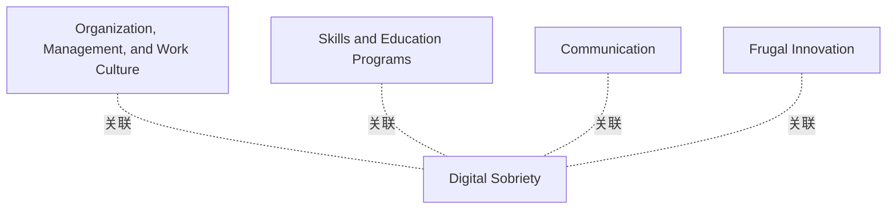

# G242/fig3-2 · 数字可持续性的关键文化轴

类型：`analytical-view`。把“发展可持续数字文化”这一抽象功能拆成四个可操作、可评估的维度，并明确四者共同服务于“数字节制”这一目标。它为 3.3.1–3.3.4 各小节提供结构，也提示文化转型不是单一培训活动，而是组织、能力、传播与创新方式的组合。

英文 PDF 物理页：[35]。本页为架构语义分析，原文与原图分别保留。

## 原图与可编辑图


[完整 JSON](fig3-2.json) · [可编辑 Mermaid](fig3-2.mmd) · [仅关系图](fig3-2.relations.mmd) · [层级分解图](fig3-2.hierarchy.mmd)

图形重建表达语义，不复制源图布局。虚线表示解释、矩阵映射或分组关系，不自动表示不确定性的概率。



## 架构分析

先看中心的浅紫色框“Digital Sobriety（数字节制）”，它是四个象限共同指向的目标。再按顺时针或任意顺序读四个象限：左上组织/管理与工作文化、右上技能与教育计划、右下节俭式创新、左下沟通。四个象限没有坐标轴标签，也没有箭头，位置只表示并列分组，不表示先后或高低。

- 本图有 5 个具名或隐含元素、4 条关系和 0 条包含/分组记录。
- 本图没有可直接确认为人员直属汇报的关系；视觉上下位置、能力分解和治理职责分别读取。
- 四象限和中心Digital Sobriety五个标签完整，十字为分隔线而不是四条带方向关系。
- 已有四条关系标implicit association是语义解释，不伪装成显式箭头；无阶段或成熟度数值。

### 如何用于项目

- 围绕作者目的读取本图实体、分组与连线，并用对应原文限定其含义。
- 把参考模型与项目事实分开，实际范围、约束、值和责任须有项目证据。

### 结构所表达的逻辑

- 四个维度是：组织、管理与工作文化；技能与教育计划；沟通；节俭式创新。
- 中心“数字节制（Digital Sobriety）”不是第五个维度，而是四者共同服务的共同目标。
- 组织/管理与工作文化维度承载管理层承诺、目标设定、集体碳目标与榜样作用（正文 3.3.1）。
- 技能与教育计划对应员工培训，使其理解能源—气候问题并形成节制习惯。
- 沟通负责在组织内外传播转型意义与良好实践；节俭式创新负责以更少资源满足同样需求。
- 四个维度并列，没有优先级或成熟度刻度；图不能用来判断组织当前处于哪个阶段。

## 上下级与包含

无层级。一个中心目标框 + 四个平级象限标签；象限由白色十字线划分，中心框压在十字交点上。

|父项|子项|层级类型|依据与解释|
|---|---|---|---|
|—|—|无视觉包含|关系中明确的组成/特化见 JSON semantic_hierarchy。|

## 全部元素与角色

|元素ID|原文名称|类型|含义|直接父项|深度|
|---|---|---|---|---|---|
|digital_sobriety|Digital Sobriety|goal|四个文化维度共同指向的目标。|—||
|axis_org|Organization, Management, and Work Culture|group|3.3.1 节展开的维度。|—||
|axis_skills|Skills and Education Programs|group|员工培训与能力建设维度。|—||
|axis_communication|Communication|group|内外沟通与动员维度。|—||
|axis_frugal|Frugal Innovation|group|以更少资源实现同等效用的创新维度。|—||

## 全部关系

图中白色十字划分四个文化维度，没有箭头。四条association记录是对中心主题的解释性关联。

|主体|语义关系|客体|显式线/隐式|原文标签|依据|
|---|---|---|---|---|---|
|组织、管理与工作文化|关联|数字节制|implicit||象限围绕中心，表示该维度服务于数字节制目标。|
|技能与教育计划|关联|数字节制|implicit||同上。|
|沟通|关联|数字节制|implicit||同上。|
|节俭式创新|关联|数字节制|implicit||同上。|

## 误读检查

- 这不是带两个变量的 2×2 矩阵：没有横纵轴名称、没有刻度，四个象限不是“高/低”组合。
- 四个象限没有先后顺序，不能按阅读顺序当作转型四步。
- 中心“数字节制”不是第五个文化轴，而是四轴共同指向的目标。
- 不要把“节俭式创新（Frugal Innovation）”理解为单纯省钱，它指以更少资源实现同等效用。

## 原文证据

### [PDF 第 34 页](../../../documents/G242.md#page-34)

> This transformation can be conducted and evaluated according to four main dimensions depicting the digital sufficiency common goal; see Figure 3-2.
### [PDF 第 35 页](../../../documents/G242.md#page-35)

> Figure 3-2: Digital Sustainability Key Culture Axes (Source: The Shift Project Lean-ICT Work Group)
### [PDF 第 36 页](../../../documents/G242.md#page-36)

> Professionals working in the digital sector have a key role to play in the development of a sustainable digital culture. All the information system actors and especially those with the highest level of expertise must be involved. Thus, depending on their positions, they should:
> • Be included into education program plans and receive specific resources for the completion of their mission

## 来源与分析状态

所有元素/关系均有来源定位；未把历史解释重命名为本轮逐线视觉确认。源图与语义图是两种视图，布局不证明汇报或因果。

源 PDF SHA-256：`517339a5e3f509f08699c10b929f5ae14b6bca356b55e76163ffe437d54d5d19`。

源图记录：[原始解释与转录](../../../figures/G242/fig3-2.json)。

```json
{
  "quality": {
    "graph_integrity": "checked",
    "semantic_analysis": "typed-graph-and-context-analysis",
    "visual_review": "source-content-audited",
    "notice_zh": "所有元素/关系均有来源定位；未把历史解释重命名为本轮逐线视觉确认。源图与语义图是两种视图，布局不证明汇报或因果。"
  },
  "source_uncertainty": {
    "confidence": "high",
    "uncertainties_zh": [
      "四个象限没有坐标轴名称，图本身不能说明象限位置是否另有含义；按并列分组理解。",
      "原图未给各维度的具体活动，需结合 3.3.1–3.3.4 正文。"
    ],
    "analyzed_from": [
      "英文 PDF 第 35 页原图截图（1214×742）",
      "英文 PDF 第 34–35 页正文",
      "中文稿 G242e_环境可持续的信息系统.md 第 469–488 行",
      "figs/zh/g242_fig3-2_zh.png",
      "figs/g242_fig3-2_en.png（缩略图相似度核对）"
    ],
    "date": "2026-10-31"
  },
  "source_conflicts": []
}
```
