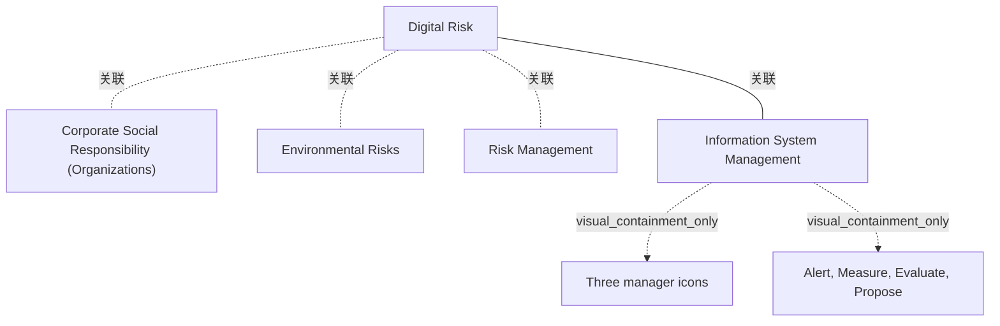

# G242/fig3-3 · 风险、责任与 CIO 的角色

类型：`analytical-view`。把“数字风险”放进企业治理的既有范畴：它既是环境风险的一种，又同时属于风险管理与企业社会责任（CSR）的视野；信息系统管理则被指定为对该风险采取行动的角色。作者借此说明可持续 IT 不是 IT 部门的孤立议题，而需要 CSR、风险管理与业务共同承担，并为 3.4.3 节“需要 CEO 赞助”做铺垫。

英文 PDF 物理页：[41]。本页为架构语义分析，原文与原图分别保留。

## 原图与可编辑图


[完整 JSON](fig3-3.json) · [可编辑 Mermaid](fig3-3.mmd) · [仅关系图](fig3-3.relations.mmd) · [层级分解图](fig3-3.hierarchy.mmd)

图形重建表达语义，不复制源图布局。虚线表示解释、矩阵映射或分组关系，不自动表示不确定性的概率。



## 架构分析

先读左侧CSR与风险管理两个圆及交集中的环境风险，再读黑椭圆Digital Risk和右侧信息系统管理团队。

- 本图有 7 个具名或隐含元素、4 条关系和 2 条包含/分组记录。
- 包含/分组树最大深度为 1；根节点为 企业社会责任（组织）、环境风险、风险管理、数字风险、信息系统管理。
- 本图没有可直接确认为人员直属汇报的关系；视觉上下位置、能力分解和治理职责分别读取。
- 实际图为CSR与Risk Management两个相交圆，Environmental Risks是交集区域文字，不是第三个圆。
- Digital Risk黑椭圆位于交集；右侧三个人像与Information System Management及Alert/Measure/Evaluate/Propose说明不是正式人事树。

### 如何用于项目

- 围绕作者目的读取本图实体、分组与连线，并用对应原文限定其含义。
- 把参考模型与项目事实分开，实际范围、约束、值和责任须有项目证据。

### 结构所表达的逻辑

- 两个相交圆的标签是Corporate Social Responsibility (Organizations)和Risk Management。
- Environmental Risks位于交集，Digital Risk位于该共同区域；图中没有第三个独立Environmental Risks圆。
- 水平黑线无箭头，将数字风险与信息系统管理团队及四项行动联系起来。
- Alert、Measure、Evaluate、Propose为预警、度量、评估和建议；不据此赋予CIO全部风险接受权。
- 第41页正文要求可持续IT愿景由CSR、风险管理和业务单元共同构建，并需要CEO赞助。

## 上下级与包含

只有两圆交叠和数字风险黑椭圆；非互斥分类，不是三个独立圆或人员汇报。

|父项|子项|层级类型|依据与解释|
|---|---|---|---|
|信息系统管理|三位管理者图标|visual_containment_only|保存原图解释中的包含；业务关系类型需要图例或正文进一步限定。|
|信息系统管理|预警、度量、评估、建议|visual_containment_only|保存原图解释中的包含；业务关系类型需要图例或正文进一步限定。|

## 全部元素与角色

|元素ID|原文名称|类型|含义|直接父项|深度|
|---|---|---|---|---|---|
|csr|Corporate Social Responsibility (Organizations)|group|企业社会责任范畴；与环境风险圆、风险管理圆相交。|—||
|environmental_risks|Environmental Risks|concept|CSR与风险管理两圆交集中的环境风险标签，没有单独第三圆。|—||
|risk_management|Risk Management|group|企业风险管理范畴。|—||
|digital_risk|Digital Risk|risk|在两圆交集内部的黑色椭圆；环境风险标签不构成另一个可见父框。|—||
|is_management|Information System Management|organization_unit|承担数字风险的信息系统管理团队。|—||
|is_team_icon|Three manager icons|note|用三个人像表示团队，而非单个 CIO。|信息系统管理|1|
|actions|Alert, Measure, Evaluate, Propose|process|IS 管理面对数字风险的四项职责。|信息系统管理|1|

## 全部关系

只有一条黑色实线，连接 Digital Risk 椭圆与右侧 IS 管理区域，没有箭头。它表示“由谁负责/关注”的关联，不表示因果或数据流；三圆之间的包含与交集由圆的叠压表达。

|主体|语义关系|客体|显式线/隐式|原文标签|依据|
|---|---|---|---|---|---|
|数字风险|关联|环境风险|implicit||黑色椭圆位于环境风险圆内，表示数字风险属于环境风险。|
|数字风险|关联|风险管理|implicit||位于风险管理圆内，表示应纳入企业风险管理。|
|数字风险|关联|企业社会责任（组织）|implicit||位于 CSR 圆内，表示属于企业社会责任议题。|
|数字风险|关联|信息系统管理|显式连线||水平实线连接黑色椭圆与右侧 IS 管理区域，无箭头；表示责任/关注关联。|

## 误读检查

- 黑色椭圆不是“黑洞”或独立风险类别，而是三圆交集里的 Digital Risk。
- 连接线没有箭头，不能读成“数字风险导致 IS 管理”或“IS 管理产生数字风险”。
- IS 管理的职责是 Alert/Measure/Evaluate/Propose，图中没有“决策”或“批准”字样；不要扩大为 CIO 独自拍板。
- 这不是风险清单或流程，圆内没有列具体风险项；具体风险分类见正文表 3-1。
- 中文稿当前引用的 figs/zh/g242_fig3-3_zh.png 被巨大的“风险管理”粉色框遮住中心，且右侧被裁切，不能据它辨认 Digital Risk 与环境风险的层级关系。

## 原文证据

### [PDF 第 40 页](../../../documents/G242.md#page-40)

> It should be noted that this taxonomy is limited to energy-climate issues, and that the risks induced by the Information System and its physical construction go beyond pressure on finite mineral resources, water and soil pollution, social and political tensions.
> As proposed in the TOGAF ADM approach, this taxonomy can be an input to identify the Business Transformation Risks and Migration Activities assessing initial and residual level of risk.
### [PDF 第 41 页](../../../documents/G242.md#page-41)

> Figure 3-3: Risks, Responsibilities, and Role of the CIO (Source: The Shift Project, Working Group Production)

## 来源与分析状态

所有元素/关系均有来源定位；未把历史解释重命名为本轮逐线视觉确认。源图与语义图是两种视图，布局不证明汇报或因果。

源 PDF SHA-256：`517339a5e3f509f08699c10b929f5ae14b6bca356b55e76163ffe437d54d5d19`。

源图记录：[原始解释与转录](../../../figures/G242/fig3-3.json)。

```json
{
  "quality": {
    "graph_integrity": "checked",
    "semantic_analysis": "typed-graph-and-context-analysis",
    "visual_review": "source-content-audited",
    "notice_zh": "所有元素/关系均有来源定位；未把历史解释重命名为本轮逐线视觉确认。源图与语义图是两种视图，布局不证明汇报或因果。"
  },
  "source_uncertainty": {
    "confidence": "high",
    "uncertainties_zh": [
      "三个圆大小相近、彼此部分重叠，原图未说明哪个范畴包含哪个；Digital Risk 的归属完全由“位于交集”表达。",
      "连接线无箭头，其责任方向（谁对谁负责）由图题“Role of the CIO”与正文推断，线条本身不编码方向。",
      "三个圆的层叠顺序（CSR 在上、风险管理在下）是否另有含义，图中未说明。"
    ],
    "analyzed_from": [
      "英文 PDF 第 41 页原图截图（1119×893）",
      "英文 PDF 第 41 页正文",
      "中文稿 G242e_环境可持续的信息系统.md 第 575–605 行",
      "figs/zh/g242_fig3-3_zh.png",
      "figs/g242_fig3-3_en.png（缩略图相似度核对）"
    ],
    "date": "2026-10-31"
  },
  "source_conflicts": []
}
```
