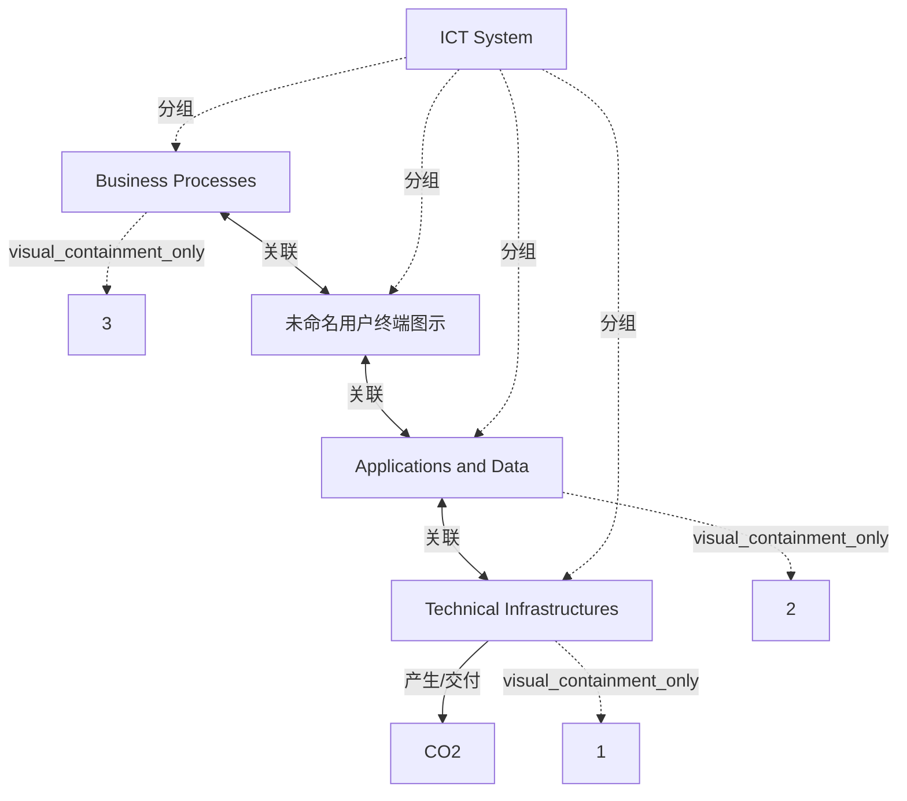

# G242/fig3-4 · 架构层与碳排放

类型：`architecture-concept-or-system-model`。用一张极简的系统边界图说明：企业 ICT 系统的碳足迹来自技术基础设施（设备、服务器、存储、网络、终端及其建造、运行与报废），而技术基础设施只是为业务流程存储/传输/处理数据、运行应用而存在。它把“架构层”与“碳排放来源”绑定，为随后“在多个层面调整设计”的架构杠杆讨论建立对象模型。

英文 PDF 物理页：[47]。本页为架构语义分析，原文与原图分别保留。

## 原图与可编辑图


[完整 JSON](fig3-4.json) · [可编辑 Mermaid](fig3-4.mmd) · [仅关系图](fig3-4.relations.mmd) · [层级分解图](fig3-4.hierarchy.mmd)

图形重建表达语义，不复制源图布局。虚线表示解释、矩阵映射或分组关系，不自动表示不确定性的概率。



## 架构分析

先看最外框“ICT System”，它划定核算边界。框内从左到右三个竖框：带人物插画的 Business Processes、Applications and Data、Technical Infrastructures；相邻框之间是粗双向箭头，表示相互调用/支撑。最右侧技术基础设施上方冲出边界的粗黑箭头标着 CO2，表示排放从这一层产生并离开系统。三个圆形编号 1/2/3 与正文三条编号说明一一对应。

- 本图有 9 个具名或隐含元素、4 条关系和 7 条包含/分组记录。
- 包含/分组树最大深度为 2；根节点为 ICT 系统、CO2（二氧化碳）。
- 本图没有可直接确认为人员直属汇报的关系；视觉上下位置、能力分解和治理职责分别读取。
- 三个编号分别位于技术、应用数据、业务流程；CO2箭头穿出ICT边界。
- 业务人与应用数据之间画有未命名终端图标，两侧各一支双头箭头，旧解析漏掉终端并合成了直接边。

### 如何用于项目

- 围绕作者目的读取本图实体、分组与连线，并用对应原文限定其含义。
- 把参考模型与项目事实分开，实际范围、约束、值和责任须有项目证据。

### 结构所表达的逻辑

- ICT系统边界内有业务流程、应用与数据、技术基础设施三个具名框，并有用户终端图示。
- 业务人物↔终端、终端↔应用数据、应用数据↔基础设施共三支双头箭头。
- CO2向上穿出边界，正文将运行、制造、安装、维护、报废以及境外和外包设备纳入技术基础设施碳足迹。
- 编号1/2/3对应正文论点，不是执行步骤、成熟度或组织层级。

## 上下级与包含

两层：最外层“ICT System”是系统边界容器；其内三个竖框（Business Processes、Applications and Data、Technical Infrastructures）为并列的组成层，从左到右排列，彼此无父子关系。编号圆点附在对应框上，CO2 箭头附在技术基础设施上并穿出外框。

|父项|子项|层级类型|依据与解释|
|---|---|---|---|
|ICT 系统|业务流程|visual_grouping|框、泳道、域或分类组的成员归属；没有额外证据不提升为业务组合或管理关系。|
|ICT 系统|应用与数据|visual_grouping|框、泳道、域或分类组的成员归属；没有额外证据不提升为业务组合或管理关系。|
|ICT 系统|技术基础设施|visual_grouping|框、泳道、域或分类组的成员归属；没有额外证据不提升为业务组合或管理关系。|
|业务流程|3|visual_containment_only|保存原图解释中的包含；业务关系类型需要图例或正文进一步限定。|
|应用与数据|2|visual_containment_only|保存原图解释中的包含；业务关系类型需要图例或正文进一步限定。|
|技术基础设施|1|visual_containment_only|保存原图解释中的包含；业务关系类型需要图例或正文进一步限定。|
|ICT 系统|未命名用户终端图示|visual_grouping|框、泳道、域或分类组的成员归属；没有额外证据不提升为业务组合或管理关系。|

## 全部元素与角色

|元素ID|原文名称|类型|含义|直接父项|深度|
|---|---|---|---|---|---|
|ict_system|ICT System|group|系统边界容器。|—||
|business_processes|Business Processes|process|带人物在工位前的剪影插画。|ICT 系统|1|
|applications_data|Applications and Data|application|原图把应用与数据合为一个框。|ICT 系统|1|
|technical_infrastructures|Technical Infrastructures|technology|设备、服务器、存储、网络、终端及技术软件。|ICT 系统|1|
|badge_3|3|note|对应正文第 3 条说明。|业务流程|2|
|badge_2|2|note|对应正文第 2 条说明。|应用与数据|2|
|badge_1|1|note|对应正文第 1 条说明。|技术基础设施|2|
|co2_arrow|CO2|other|向上跨出技术基础设施框及ICT总边界的CO2排放箭头标注。|—||
|user_terminal|未命名用户终端图示|technology|原图未命名终端图标；不能当作当前企业设备实例或新增架构域。|ICT 系统|1|

## 全部关系

两条粗双向箭头（业务流程↔应用与数据、应用与数据↔技术基础设施）表示相邻层之间的相互依赖与调用，不是单向数据流；向上粗箭头表示 CO2 排放离开系统边界，方向由技术基础设施指向外部。外框实线只表示系统边界，不表示连接。

|主体|语义关系|客体|显式线/隐式|原文标签|依据|
|---|---|---|---|---|---|
|业务流程|关联|未命名用户终端图示|显式连线||左侧双头箭头实际位于业务人物与终端之间；另有终端到应用数据的独立双头箭头。|
|应用与数据|关联|技术基础设施|显式连线||粗双向箭头，表示应用/数据与技术基础设施相互依赖。|
|技术基础设施|产生/交付|CO2（二氧化碳）|显式连线|CO2|向上粗箭头，表示排放由技术基础设施产生并离开系统。|
|未命名用户终端图示|关联|应用与数据|显式连线||屏幕右侧与应用数据矩形之间的独立双头箭头；保持两段图形交互，不压成一条线。|

## 本轮语义修正

- 左侧双头箭头实际位于业务人物与终端之间；另有终端到应用数据的独立双头箭头。
- 屏幕右侧与应用数据矩形之间的独立双头箭头；保持两段图形交互，不压成一条线。

## 误读检查

- 不要把三个竖框读成先后阶段或三个独立系统；它们是同一 ICT 系统的三个层面。
- 双向箭头不是“数据双向流动”的技术细节，而是层间相互依赖的抽象表示。
- CO2 箭头画在技术基础设施上方，不等于只有运行用电产生排放；正文明确还包括建造、安装、维护、报废以及境外制造。
- 编号 1/2/3 不是阅读顺序，而是与正文三条解释对应的编号；1 在最右、3 在最左。
- 中文稿当前引用的 figs/g242_fig3-4.svg 是自拟的四层“架构杠杆”清单，增加了原图没有的数据架构层，并丢失 CO2 箭头与系统边界，不能据它理解本图。

## 原文证据

### [PDF 第 47 页](../../../documents/G242.md#page-47)

> The Target Architecture for sustainable information systems must coherently reshape the business processes and uses of the associated systems, applications, and data, as well as the technical infrastructures supporting these components.
> 1. The carbon footprint of the company’s ICT system consists of the ones of its technical infrastructures: equipment components, servers, storage units, network controllers, screens, fixed and mobile devices, and the technical software operating them

## 来源与分析状态

所有元素/关系均有来源定位；未把历史解释重命名为本轮逐线视觉确认。源图与语义图是两种视图，布局不证明汇报或因果。

源 PDF SHA-256：`517339a5e3f509f08699c10b929f5ae14b6bca356b55e76163ffe437d54d5d19`。

源图记录：[原始解释与转录](../../../figures/G242/fig3-4.json)。

```json
{
  "quality": {
    "graph_integrity": "checked",
    "semantic_analysis": "typed-graph-and-context-analysis",
    "visual_review": "source-content-audited",
    "notice_zh": "所有元素/关系均有来源定位；未把历史解释重命名为本轮逐线视觉确认。源图与语义图是两种视图，布局不证明汇报或因果。"
  },
  "source_uncertainty": {
    "confidence": "high",
    "uncertainties_zh": [
      "三个竖框内除标题外没有其他文字，编号与正文条目的对应关系按数字顺序确认。",
      "两条粗箭头是否严格表示双向依赖，还是表示“之间的接口”，图中无图例；按双向箭头直观含义记录。"
    ],
    "analyzed_from": [
      "英文 PDF 第 47 页原图截图（1265×956）",
      "英文 PDF 第 47 页正文",
      "中文稿 G242e_环境可持续的信息系统.md 第 712–724 行",
      "figs/g242_fig3-4.svg 源码"
    ],
    "date": "2026-10-31"
  },
  "source_conflicts": []
}
```
