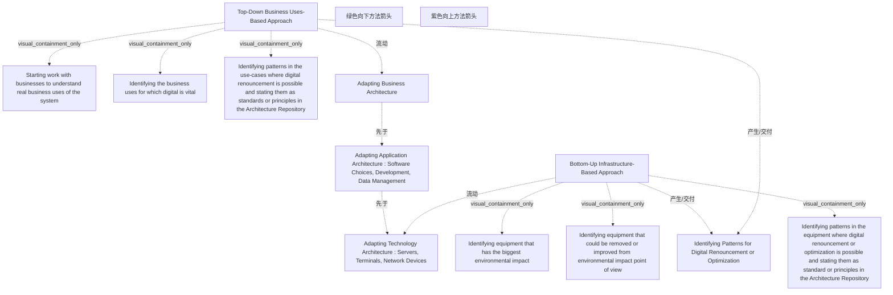

# G242/fig3-5 · 结合自上而下与自下而上的方法以捕获数字可持续性需求

类型：`process-or-method-model`。说明捕获数字可持续性需求不能只靠单一视角：自上而下贴近业务运营者，识别哪些用途真正需要数字技术；自下而上贴近基础设施，识别环境影响最大的设备。两条路径最终都落到同一组业务/应用/技术架构调整，并沉淀为可复用的“数字放弃或优化”模式。

英文 PDF 物理页：[48]。本页为架构语义分析，原文与原图分别保留。

## 原图与可编辑图


[完整 JSON](fig3-5.json) · [可编辑 Mermaid](fig3-5.mmd) · [仅关系图](fig3-5.relations.mmd) · [层级分解图](fig3-5.hierarchy.mmd)

图形重建表达语义，不复制源图布局。虚线表示解释、矩阵映射或分组关系，不自动表示不确定性的概率。



## 架构分析

先读左侧绿色框：Top-Down Business Uses-Based Approach，三条要点说明从业务真实用途出发、识别关键用途、把可放弃的模式写入架构存储库。再看中间纵列三个架构框：业务架构 → 应用架构 → 技术架构。右侧紫色框是 Bottom-Up Infrastructure-Based Approach，三条要点从设备环境影响出发。绿色粗箭头向下、紫色粗箭头向上，表示两条路径方向相反；底部横条是两条路径的共同产出。

- 本图有 14 个具名或隐含元素、6 条关系和 6 条包含/分组记录。
- 包含/分组树最大深度为 1；根节点为 自上而下、基于业务用途的方法、调整业务架构、调整应用架构：软件选择、开发、数据管理、调整技术架构：服务器、终端、网络设备、自下而上、基于基础设施的方法、识别数字放弃或优化的模式、绿色向下方法箭头、紫色向上方法箭头。
- 本图没有可直接确认为人员直属汇报的关系；视觉上下位置、能力分解和治理职责分别读取。
- 包含分组后有 3 个连通分量；分离可能源于图例、并列分类或独立示例，未自动补边。
- 左右方法各三项要点，中间业务/应用/技术三个框和底部共同产出全部核对。
- 绿色向下和紫色向上箭头沿中间列外侧，没有落到单个框；现有两条flow只可表示方法解释，不是直接连接。

### 如何用于项目

- 按阶段/事件/行为关系读取入口、出口、责任和产物；检查循环与例外路径。
- 工作流先后不表示组织管理权；在项目中显式记录条件和完成标准。

### 结构所表达的逻辑

- 自上而下路径的起点是业务：先与业务方一起理解系统真实的业务用途，再识别哪些用途对数字技术至关重要。
- 自下而上路径的起点是设备：先找出环境影响最大的设备，再识别可移除或可改进的设备。
- 两条路径都把识别出的模式写成标准或原则，放入架构存储库（Architecture Repository）。
- 中间三层是两条路径共同的落点：业务架构、应用架构（软件选择、开发、数据管理）、技术架构（服务器、终端、网络设备）。
- 绿色向下箭头表示自上而下逐层下探，紫色向上箭头表示自下而上逐层上升；两条路径不是二选一，而是同时实施。
- 底部“Identifying Patterns for Digital Renouncement or Optimization”是共同产出：可复用的数字放弃/优化模式。
- 正文强调两者唯一变化的参数是切入点：优化业务用途要“向下”走到技术系统，优化技术系统要“向上”走到业务用途并取得业务方接受。

## 上下级与包含

三栏并列：左方法框、中架构列、右方法框。中间三个架构框自上而下排列（业务→应用→技术），但彼此没有画线，顺序由上下位置与两条方向箭头表达；左右方法框各含三条平级要点；底部汇合条横贯全宽，是共同产出。

|父项|子项|层级类型|依据与解释|
|---|---|---|---|
|自上而下、基于业务用途的方法|与业务方一起工作，理解系统真实的业务用途|visual_containment_only|保存原图解释中的包含；业务关系类型需要图例或正文进一步限定。|
|自上而下、基于业务用途的方法|识别哪些业务用途对数字技术至关重要|visual_containment_only|保存原图解释中的包含；业务关系类型需要图例或正文进一步限定。|
|自上而下、基于业务用途的方法|识别可“数字放弃”的用例模式，并将其写入架构存储库作为标准或原则|visual_containment_only|保存原图解释中的包含；业务关系类型需要图例或正文进一步限定。|
|自下而上、基于基础设施的方法|识别环境影响最大的设备|visual_containment_only|保存原图解释中的包含；业务关系类型需要图例或正文进一步限定。|
|自下而上、基于基础设施的方法|从环境影响角度识别可移除或可改进的设备|visual_containment_only|保存原图解释中的包含；业务关系类型需要图例或正文进一步限定。|
|自下而上、基于基础设施的方法|识别设备层面可“数字放弃”或优化的模式，并写入架构存储库作为标准或原则|visual_containment_only|保存原图解释中的包含；业务关系类型需要图例或正文进一步限定。|

## 全部元素与角色

|元素ID|原文名称|类型|含义|直接父项|深度|
|---|---|---|---|---|---|
|top_down|Top-Down Business Uses-Based Approach|concept|以业务用途为切入点的需求识别方法。|—||
|td_b1|Starting work with businesses to understand real business uses of the system|note|说明：与业务方一起工作，理解系统真实的业务用途|自上而下、基于业务用途的方法|1|
|td_b2|Identifying the business uses for which digital is vital|note|说明：识别哪些业务用途对数字技术至关重要|自上而下、基于业务用途的方法|1|
|td_b3|Identifying patterns in the use-cases where digital renouncement is possible and stating them as standards or principles in the Architecture Repository|note|说明：识别可“数字放弃”的用例模式，并将其写入架构存储库作为标准或原则|自上而下、基于业务用途的方法|1|
|business_arch|Adapting Business Architecture|architecture|架构：调整业务架构|—||
|application_arch|Adapting Application Architecture : Software Choices, Development, Data Management|architecture|架构：调整应用架构：软件选择、开发、数据管理|—||
|technology_arch|Adapting Technology Architecture : Servers, Terminals, Network Devices|architecture|架构：调整技术架构：服务器、终端、网络设备|—||
|bottom_up|Bottom-Up Infrastructure-Based Approach|concept|以基础设施/设备为切入点的需求识别方法。|—||
|bu_b1|Identifying equipment that has the biggest environmental impact|note|说明：识别环境影响最大的设备|自下而上、基于基础设施的方法|1|
|bu_b2|Identifying equipment that could be removed or improved from environmental impact point of view|note|说明：从环境影响角度识别可移除或可改进的设备|自下而上、基于基础设施的方法|1|
|bu_b3|Identifying patterns in the equipment where digital renouncement or optimization is possible and stating them as standard or principles in the Architecture Repository|note|说明：识别设备层面可“数字放弃”或优化的模式，并写入架构存储库作为标准或原则|自下而上、基于基础设施的方法|1|
|outcome|Identifying Patterns for Digital Renouncement or Optimization|artifact|两条路径的共同产出。|—||
|arrow_top_down|绿色向下方法箭头|note|长向下箭头没有接触实体边界，表示从用途下探技术的阅读方向。|—||
|arrow_bottom_up|紫色向上方法箭头|note|长向上箭头没有接触实体边界，表示从基础设施上溯用途的阅读方向。|—||

## 全部关系

两条长箭头表示方向而不是实体之间的传输连接。三个中间框没有相互连线；顺序关系与共同产出关系均为结合正文的方法解释。

|主体|语义关系|客体|显式线/隐式|原文标签|依据|
|---|---|---|---|---|---|
|自上而下、基于业务用途的方法|流动|调整业务架构|diagram-direction-annotation|Top-Down|长箭头是整个方法跨架构层的方向注记，没有连接该方法文本块与某一个架构框；本边保留为解释性路径。|
|自下而上、基于基础设施的方法|流动|调整技术架构：服务器、终端、网络设备|diagram-direction-annotation|Bottom-Up|长箭头是整个方法跨架构层的方向注记，没有连接该方法文本块与某一个架构框；本边保留为解释性路径。|
|调整业务架构|先于|调整应用架构：软件选择、开发、数据管理|implicit||中栏自上而下的相邻关系，对应自上而下路径的顺序。|
|调整应用架构：软件选择、开发、数据管理|先于|调整技术架构：服务器、终端、网络设备|implicit||同上。|
|自上而下、基于业务用途的方法|产生/交付|识别数字放弃或优化的模式|implicit||方法产出底部汇合条中的模式。|
|自下而上、基于基础设施的方法|产生/交付|识别数字放弃或优化的模式|implicit||同上。|

## 本轮语义修正

- 长箭头是整个方法跨架构层的方向注记，没有连接该方法文本块与某一个架构框；本边保留为解释性路径。
- 长箭头是整个方法跨架构层的方向注记，没有连接该方法文本块与某一个架构框；本边保留为解释性路径。

## 误读检查

- 不要把自上而下与自下而上理解为先后两步；正文要求同时实施（combining simultaneously）。
- 绿色/紫色箭头不是数据流，也不是架构层之间的接口，只表示两条路径的行进方向。
- 中间三个架构框不是三个项目阶段，而是同一系统的三个架构层。
- 底部“数字放弃（digital renouncement）”不是简单删除功能，而是经业务确认后放弃不必要的数字用途或设备。
- 中文稿当前引用的 figs/zh/g242_fig3-5_zh.svg 结构忠实；但仓库中的 figs/zh/g242_fig3-5_zh.png 只译了标题，要点仍是英文，若误用该 PNG 会以为中文版缺内容。

## 原文证据

### [PDF 第 48 页](../../../documents/G242.md#page-48)

> Figure 3-5: Combining Top-Down and Bottom-Up Approaches to Capture Digital Sustainability Requirements
### [PDF 第 49 页](../../../documents/G242.md#page-49)

> These two approaches come together to identify a complete set of mitigation actions:
> • The business uses-based approach must deliver a prioritized list of business uses that could be renounced or optimized

## 来源与分析状态

所有元素/关系均有来源定位；未把历史解释重命名为本轮逐线视觉确认。源图与语义图是两种视图，布局不证明汇报或因果。

源 PDF SHA-256：`517339a5e3f509f08699c10b929f5ae14b6bca356b55e76163ffe437d54d5d19`。

源图记录：[原始解释与转录](../../../figures/G242/fig3-5.json)。

```json
{
  "quality": {
    "graph_integrity": "checked",
    "semantic_analysis": "typed-graph-and-context-analysis",
    "visual_review": "source-content-audited",
    "notice_zh": "所有元素/关系均有来源定位；未把历史解释重命名为本轮逐线视觉确认。源图与语义图是两种视图，布局不证明汇报或因果。"
  },
  "source_uncertainty": {
    "confidence": "high",
    "uncertainties_zh": [
      "两条粗箭头未与具体框端点相接，起止点按其在架构列两侧的上下方向与语义判定。",
      "底部汇合条与上方两方法之间没有画线，产出关系按版式推断。"
    ],
    "analyzed_from": [
      "英文 PDF 第 48 页原图截图（1519×787）",
      "英文 PDF 第 48–49 页正文",
      "中文稿 G242e_环境可持续的信息系统.md 第 730–767 行",
      "figs/zh/g242_fig3-5_zh.svg 源码",
      "figs/zh/g242_fig3-5_zh.png"
    ],
    "date": "2026-10-31"
  },
  "source_conflicts": []
}
```
