# G242/fig3-6 · 数字可持续性举措中非功能需求的变化

类型：`analytical-view`。把“敢于约束信息系统”翻译成可执行的非功能需求变化清单：哪些质量属性要下调、哪些保持不变、哪些必须上调。它给架构师一张谈判底牌——可持续不是全面降级，而是用更少的可用性/存储/能耗换取更长的寿命、更好的可维护性与稳健性。

英文 PDF 物理页：[50]。本页为架构语义分析，原文与原图分别保留。

## 原图与可编辑图


[完整 JSON](fig3-6.json) · [可编辑 Mermaid](fig3-6.mmd) · [仅关系图](fig3-6.relations.mmd) · [层级分解图](fig3-6.hierarchy.mmd)

图形重建表达语义，不复制源图布局。虚线表示解释、矩阵映射或分组关系，不自动表示不确定性的概率。

```mermaid
flowchart TB
  %% Semantic reconstruction; see original source image for exact layout.
  n0["要求降低的一组"]
  n1["红色右下箭头（降低）"]
  n2["Availability"]
  n3["Storage Capacity"]
  n4["Energy Needs"]
  n5["要求维持的一组"]
  n6["深蓝水平箭头（维持）"]
  n7["Safety"]
  n8["Performance"]
  n9["要求提高的一组"]
  n10["绿色右上箭头（提高）"]
  n11["Longevity"]
  n12["Maintainability"]
  n13["Dismantlability/Repairability"]
  n14["Portability/Interoperability"]
  n15["Robustness"]
  n0 -.-|"相关"| n1
  n5 -.-|"相关"| n6
  n9 -.-|"相关"| n10
  n0 -.->|"分组"| n1
  n0 -.->|"分组"| n2
  n0 -.->|"分组"| n3
  n0 -.->|"分组"| n4
  n5 -.->|"分组"| n6
  n5 -.->|"分组"| n7
  n5 -.->|"分组"| n8
  n9 -.->|"分组"| n10
  n9 -.->|"分组"| n11
  n9 -.->|"分组"| n12
  n9 -.->|"分组"| n13
  n9 -.->|"分组"| n14
  n9 -.->|"分组"| n15
```



## 架构分析

从左到右读三栏。左栏红色箭头向右下，表示这些需求要降低：Availability、Storage Capacity、Energy Needs。中栏深蓝箭头水平向右，表示维持不变：Safety、Performance。右栏绿色箭头向右上，表示这些需求要提高：Longevity、Maintainability、Dismantlability/Repairability、Portability/Interoperability、Robustness。箭头只标趋势，没有刻度。

- 本图有 16 个具名或隐含元素、3 条关系和 13 条包含/分组记录。
- 包含/分组树最大深度为 1；根节点为 要求降低的一组、要求维持的一组、要求提高的一组。
- 本图没有可直接确认为人员直属汇报的关系；视觉上下位置、能力分解和治理职责分别读取。
- 包含分组后有 3 个连通分量；分离可能源于图例、并列分类或独立示例，未自动补边。
- 10项非功能属性按3/2/5分栏准确，三个趋势箭头没有实体端点，图中没有定量目标。
- 表中Dismantlability/Repairability及Portability/Interoperability各为一框两个词，不能拆成新的原图行。

### 如何用于项目

- 围绕作者目的读取本图实体、分组与连线，并用对应原文限定其含义。
- 把参考模型与项目事实分开，实际范围、约束、值和责任须有项目证据。

### 结构所表达的逻辑

- 要降低的三项是可用性、存储容量与能源需求，对应正文“敢于约束系统及其使用”的直接代价。
- 要保持的是安全性与性能：可持续转型不以牺牲安全和基本性能为代价。
- 要提高的五项是长寿性、可维护性、可拆解性/可维修性、可移植性/互操作性、稳健性，均指向延长设备寿命、便于维修与迁移。
- 箭头方向是唯一编码：右下=降低、水平=不变、右上=提高；图中没有数值刻度或目标值。
- 这组变化把“节制”从口号变成架构质量属性，可直接写入非功能需求与新 ICT 项目的要求。
- 右栏五项彼此支撑：可维修、可拆解、可移植与互操作共同服务于长寿性，稳健性则保证约束之下系统仍可靠。

## 上下级与包含

无层级。三条竖虚线把画面分成三个并列分区，每个分区内若干需求标签上下排列；标签之间没有上下级，也没有连线。

|父项|子项|层级类型|依据与解释|
|---|---|---|---|
|要求降低的一组|红色右下箭头（降低）|visual_grouping|框、泳道、域或分类组的成员归属；没有额外证据不提升为业务组合或管理关系。|
|要求降低的一组|可用性|visual_grouping|框、泳道、域或分类组的成员归属；没有额外证据不提升为业务组合或管理关系。|
|要求降低的一组|存储容量|visual_grouping|框、泳道、域或分类组的成员归属；没有额外证据不提升为业务组合或管理关系。|
|要求降低的一组|能源需求|visual_grouping|框、泳道、域或分类组的成员归属；没有额外证据不提升为业务组合或管理关系。|
|要求维持的一组|深蓝水平箭头（维持）|visual_grouping|框、泳道、域或分类组的成员归属；没有额外证据不提升为业务组合或管理关系。|
|要求维持的一组|安全性|visual_grouping|框、泳道、域或分类组的成员归属；没有额外证据不提升为业务组合或管理关系。|
|要求维持的一组|性能|visual_grouping|框、泳道、域或分类组的成员归属；没有额外证据不提升为业务组合或管理关系。|
|要求提高的一组|绿色右上箭头（提高）|visual_grouping|框、泳道、域或分类组的成员归属；没有额外证据不提升为业务组合或管理关系。|
|要求提高的一组|长寿性|visual_grouping|框、泳道、域或分类组的成员归属；没有额外证据不提升为业务组合或管理关系。|
|要求提高的一组|可维护性|visual_grouping|框、泳道、域或分类组的成员归属；没有额外证据不提升为业务组合或管理关系。|
|要求提高的一组|可拆解性/可维修性|visual_grouping|框、泳道、域或分类组的成员归属；没有额外证据不提升为业务组合或管理关系。|
|要求提高的一组|可移植性/互操作性|visual_grouping|框、泳道、域或分类组的成员归属；没有额外证据不提升为业务组合或管理关系。|
|要求提高的一组|稳健性|visual_grouping|框、泳道、域或分类组的成员归属；没有额外证据不提升为业务组合或管理关系。|

## 全部元素与角色

|元素ID|原文名称|类型|含义|直接父项|深度|
|---|---|---|---|---|---|
|col_decrease|要求降低的一组|group|分组：要求降低的一组|—||
|trend_decrease|红色右下箭头（降低）|note|说明：红色右下箭头（降低）|要求降低的一组|1|
|availability|Availability|requirement|需求：可用性|要求降低的一组|1|
|storage_capacity|Storage Capacity|requirement|需求：存储容量|要求降低的一组|1|
|energy_needs|Energy Needs|requirement|需求：能源需求|要求降低的一组|1|
|col_stable|要求维持的一组|group|分组：要求维持的一组|—||
|trend_stable|深蓝水平箭头（维持）|note|说明：深蓝水平箭头（维持）|要求维持的一组|1|
|safety|Safety|requirement|需求：安全性|要求维持的一组|1|
|performance|Performance|requirement|需求：性能|要求维持的一组|1|
|col_increase|要求提高的一组|group|分组：要求提高的一组|—||
|trend_increase|绿色右上箭头（提高）|note|说明：绿色右上箭头（提高）|要求提高的一组|1|
|longevity|Longevity|requirement|需求：长寿性|要求提高的一组|1|
|maintainability|Maintainability|requirement|需求：可维护性|要求提高的一组|1|
|dismantlability|Dismantlability/Repairability|requirement|需求：可拆解性/可维修性|要求提高的一组|1|
|portability|Portability/Interoperability|requirement|需求：可移植性/互操作性|要求提高的一组|1|
|robustness|Robustness|requirement|需求：稳健性|要求提高的一组|1|

## 全部关系

红向下、蓝水平、绿向上三个箭头是趋势注记，不连接变量；列间虚线仅分隔。

|主体|语义关系|客体|显式线/隐式|原文标签|依据|
|---|---|---|---|---|---|
|要求降低的一组|相关|红色右下箭头（降低）|trend-annotation|Decrease|箭头是整栏趋势图例，不是从分类容器到图标的实际连线；记录注记关联。|
|要求维持的一组|相关|深蓝水平箭头（维持）|trend-annotation|Unchanged|箭头是整栏趋势图例，不是从分类容器到图标的实际连线；记录注记关联。|
|要求提高的一组|相关|绿色右上箭头（提高）|trend-annotation|Increase|箭头是整栏趋势图例，不是从分类容器到图标的实际连线；记录注记关联。|

## 非功能需求变化方向（按原图三栏转录）

```json
{
  "id": "t_nfr_trend",
  "title_zh": "非功能需求变化方向（按原图三栏转录）",
  "columns": [
    "趋势",
    "非功能需求（英文）",
    "非功能需求（中文）"
  ],
  "rows": [
    [
      "降低（红↘）",
      "Availability",
      "可用性"
    ],
    [
      "降低（红↘）",
      "Storage Capacity",
      "存储容量"
    ],
    [
      "降低（红↘）",
      "Energy Needs",
      "能源需求"
    ],
    [
      "维持（深蓝→）",
      "Safety",
      "安全性"
    ],
    [
      "维持（深蓝→）",
      "Performance",
      "性能"
    ],
    [
      "提高（绿↗）",
      "Longevity",
      "长寿性"
    ],
    [
      "提高（绿↗）",
      "Maintainability",
      "可维护性"
    ],
    [
      "提高（绿↗）",
      "Dismantlability/Repairability",
      "可拆解性/可维修性"
    ],
    [
      "提高（绿↗）",
      "Portability/Interoperability",
      "可移植性/互操作性"
    ],
    [
      "提高（绿↗）",
      "Robustness",
      "稳健性"
    ]
  ],
  "cell_legend": [
    "红↘=降低，深蓝→=维持，绿↗=提高"
  ],
  "notes_zh": "原图无刻度或目标值，只给方向。"
}
```

## 本轮语义修正

- 箭头是整栏趋势图例，不是从分类容器到图标的实际连线；记录注记关联。
- 箭头是整栏趋势图例，不是从分类容器到图标的实际连线；记录注记关联。
- 箭头是整栏趋势图例，不是从分类容器到图标的实际连线；记录注记关联。

## 误读检查

- Availability下降是本指南节制语境的需求趋势，不是要求任何业务无条件降低可用性。
- Safety按原文原词保留，不直接扩展成完整信息安全要求。
- 没有幅度、阈值或阶段，不能推造量化指标。

## 原文证据

### [PDF 第 49 页](../../../documents/G242.md#page-49)

> Overall, the delivery of these mitigation and reduction opportunities must result in revising the non- functional requirements on the systems and in new ICT projects, with the main trends shown in Figure 3-6.
### [PDF 第 50 页](../../../documents/G242.md#page-50)

> Figure 3-6: Non-Functional Requirements Move in a Digital Sustainability Initiative (Source: The Shift Project

## 来源与分析状态

所有元素/关系均有来源定位；未把历史解释重命名为本轮逐线视觉确认。源图与语义图是两种视图，布局不证明汇报或因果。

源 PDF SHA-256：`517339a5e3f509f08699c10b929f5ae14b6bca356b55e76163ffe437d54d5d19`。

源图记录：[原始解释与转录](../../../figures/G242/fig3-6.json)。

```json
{
  "quality": {
    "graph_integrity": "checked",
    "semantic_analysis": "typed-graph-and-context-analysis",
    "visual_review": "source-content-audited",
    "notice_zh": "所有元素/关系均有来源定位；未把历史解释重命名为本轮逐线视觉确认。源图与语义图是两种视图，布局不证明汇报或因果。"
  },
  "source_uncertainty": {
    "confidence": "high",
    "uncertainties_zh": [
      "三支箭头只是趋势标注，原图没有图例解释颜色；按箭头方向解读为降低/维持/提高。",
      "中栏水平箭头在原图清晰，但中文 PNG 中几乎丢失；以英文原因为准。"
    ],
    "analyzed_from": [
      "英文 PDF 第 50 页原图截图（1518×657）",
      "英文 PDF 第 49–50 页正文",
      "中文稿 G242e_环境可持续的信息系统.md 第 786–809 行",
      "figs/zh/g242_fig3-6_zh.png",
      "figs/g242_fig3-6_en.png（缩略图相似度核对）"
    ],
    "date": "2026-10-31"
  },
  "source_conflicts": []
}
```
