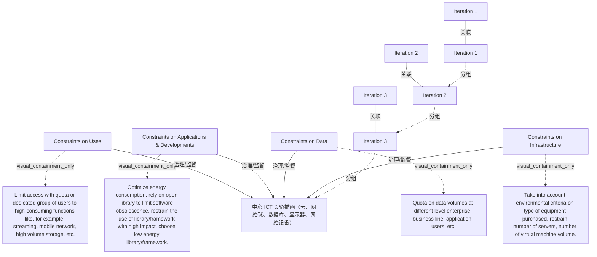

# G242/fig3-7 · 为实现可持续而应施加的四类约束

类型：`architecture-concept-or-system-model`。把“设置约束”落到可执行的四种对象上，并用三层迭代框强调约束是逐步加严而非一次到位。它告诉架构师：可持续性约束不是抽象口号，可以具体到配额、库/框架选择、数据量上限、设备采购标准与服务器/虚拟机数量。

英文 PDF 物理页：[51]。本页为架构语义分析，原文与原图分别保留。

## 原图与可编辑图


[完整 JSON](fig3-7.json) · [可编辑 Mermaid](fig3-7.mmd) · [仅关系图](fig3-7.relations.mmd) · [层级分解图](fig3-7.hierarchy.mmd)

图形重建表达语义，不复制源图布局。虚线表示解释、矩阵映射或分组关系，不自动表示不确定性的概率。



## 架构分析

先看中心：云、网络球、数据库、显示器、网络设备组成的 ICT 系统插画。四周是四类约束：上方“对用途的约束”、左侧“对应用与开发的约束”、右侧“对数据的约束”、下方“对基础设施/设备的约束”，每类都配数支小箭头指向中心。外围三层虚线框由内到外是 Iteration 1、2、3，右下三条细引线分别指向三层框，表示每轮迭代增加一层约束。

- 本图有 15 个具名或隐含元素、7 条关系和 7 条包含/分组记录。
- 包含/分组树最大深度为 3；根节点为 迭代 1、迭代 1、迭代 2、迭代 3、对用途的约束、对应用与开发的约束、对数据的约束、对基础设施/设备的约束。
- 本图没有可直接确认为人员直属汇报的关系；视觉上下位置、能力分解和治理职责分别读取。
- 治理边回答谁提供约束、指导或监督；它们与岗位汇报边分别存储。
- 四侧约束标题和四段示例完整；每侧三支向内箭头，共12支，表示逐轮收紧。
- 原图Iteration1最外、Iteration2中间、Iteration3更内，旧解析层级顺序反了；最内系统图标还有未命名虚线边界。
- 中心云/网络/服务器/数据库/屏幕是概括性插画，不表示五个实际部署系统或明确网络拓扑。

### 如何用于项目

- 围绕作者目的读取本图实体、分组与连线，并用对应原文限定其含义。
- 把参考模型与项目事实分开，实际范围、约束、值和责任须有项目证据。

### 结构所表达的逻辑

- 用途、应用开发、数据、基础设施四类约束同时作用于系统。
- 用途可按配额或用户组限制高消耗功能；应用开发可约束库、框架、能耗和过时风险。
- 数据可在企业、业务线、应用、用户层限定数据量；基础设施可约束采购类型和服务器、虚拟机数量。
- Iteration1最外→Iteration2→Iteration3向内收紧，最内为系统插画及其虚线边界；各侧三个箭头表示渐进约束。
- 第52页要求用指标、利益相关者参与和周期治理，使约束有依据且可接受；不能仅按图强加限制。

## 上下级与包含

视觉顺序由外向内为Iteration1、Iteration2、Iteration3和系统边界；这是同一系统不同迭代约束范围，不是同时存在的四个组织层级。

|父项|子项|层级类型|依据与解释|
|---|---|---|---|
|迭代 3|中心 ICT 设备插画（云、网络球、数据库、显示器、网络设备）|visual_grouping|框、泳道、域或分类组的成员归属；没有额外证据不提升为业务组合或管理关系。|
|迭代 1|迭代 2|visual_grouping|框、泳道、域或分类组的成员归属；没有额外证据不提升为业务组合或管理关系。|
|迭代 2|迭代 3|visual_grouping|框、泳道、域或分类组的成员归属；没有额外证据不提升为业务组合或管理关系。|
|对用途的约束|以配额或专属用户组限制高消耗功能，例如流媒体、移动网络、大容量存储等|visual_containment_only|保存原图解释中的包含；业务关系类型需要图例或正文进一步限定。|
|对应用与开发的约束|优化能耗；借助开源库限制软件过时；限制高影响库/框架的使用；优先选择低能耗库/框架|visual_containment_only|保存原图解释中的包含；业务关系类型需要图例或正文进一步限定。|
|对数据的约束|在企业、业务线、应用、用户等不同层级设置数据量配额|visual_containment_only|保存原图解释中的包含；业务关系类型需要图例或正文进一步限定。|
|对基础设施/设备的约束|采购设备时纳入环境标准；限制服务器数量与虚拟机数量|visual_containment_only|保存原图解释中的包含；业务关系类型需要图例或正文进一步限定。|

### 治理范围

|父项/范围/类型|子项/责任对象/实例|语义|
|---|---|---|
|对用途的约束|中心 ICT 设备插画（云、网络球、数据库、显示器、网络设备）|governs|
|对应用与开发的约束|中心 ICT 设备插画（云、网络球、数据库、显示器、网络设备）|governs|
|对数据的约束|中心 ICT 设备插画（云、网络球、数据库、显示器、网络设备）|governs|
|对基础设施/设备的约束|中心 ICT 设备插画（云、网络球、数据库、显示器、网络设备）|governs|

存在多个父项的节点：中心 ICT 设备插画（云、网络球、数据库、显示器、网络设备）；保留多重关系，不强行转成单父项树。

## 全部元素与角色

|元素ID|原文名称|类型|含义|直接父项|深度|
|---|---|---|---|---|---|
|central_system|中心 ICT 设备插画（云、网络球、数据库、显示器、网络设备）|technology|最内未命名虚线框和通用ICT插画：云、网络、服务器、数据库、屏幕；没有源文组件名称或部署关系。|迭代 3|3|
|iter_1|Iteration 1|group|Iteration1引线对应最外迭代带，后续向内收紧。|—||
|iter_2|Iteration 2|group|Iteration2为中间迭代带。|迭代 1|1|
|iter_3|Iteration 3|group|Iteration3为更内迭代带，包围最终系统边界。|迭代 2|2|
|iter_label_1|Iteration 1|note|层级标注文字。|—||
|iter_label_2|Iteration 2|note|层级标注文字。|—||
|iter_label_3|Iteration 3|note|层级标注文字。|—||
|uses|Constraints on Uses|principle|四类约束之一。|—||
|uses_desc|Limit access with quota or dedicated group of users to high-consuming functions like, for example, streaming, mobile network, high volume storage, etc.|note|说明：以配额或专属用户组限制高消耗功能，例如流媒体、移动网络、大容量存储等|对用途的约束|1|
|apps|Constraints on Applications & Developments|principle|四类约束之一。|—||
|apps_desc|Optimize energy consumption, rely on open library to limit software obsolescence, restrain the use of library/framework with high impact, choose low energy library/framework.|note|说明：优化能耗；借助开源库限制软件过时；限制高影响库/框架的使用；优先选择低能耗库/框架|对应用与开发的约束|1|
|data|Constraints on Data|principle|四类约束之一。|—||
|data_desc|Quota on data volumes at different level enterprise, business line, application, users, etc.|note|说明：在企业、业务线、应用、用户等不同层级设置数据量配额|对数据的约束|1|
|infra|Constraints on Infrastructure|principle|四类约束之一。|—||
|infra_desc|Take into account environmental criteria on type of equipment purchased, restrain number of servers, number of virtual machine volume.|note|说明：采购设备时纳入环境标准；限制服务器数量与虚拟机数量|对基础设施/设备的约束|1|

## 全部关系

四侧各三支短箭头朝内收紧。三个细灰水平引线将Iteration1/2/3标签对应到由外向内的迭代带，没有流程传输或人员汇报含义。

|主体|语义关系|客体|显式线/隐式|原文标签|依据|
|---|---|---|---|---|---|
|对用途的约束|治理/监督|中心 ICT 设备插画（云、网络球、数据库、显示器、网络设备）|显式连线|Constraints on Uses|同侧三支向内箭头合记约束作用；实际箭头共12支，不是4条人员治理指令。|
|对应用与开发的约束|治理/监督|中心 ICT 设备插画（云、网络球、数据库、显示器、网络设备）|显式连线|Constraints on Applications & Developments|同侧三支向内箭头合记约束作用；实际箭头共12支，不是4条人员治理指令。|
|对数据的约束|治理/监督|中心 ICT 设备插画（云、网络球、数据库、显示器、网络设备）|显式连线|Constraints on Data|同侧三支向内箭头合记约束作用；实际箭头共12支，不是4条人员治理指令。|
|对基础设施/设备的约束|治理/监督|中心 ICT 设备插画（云、网络球、数据库、显示器、网络设备）|显式连线|Constraints on Infrastructure|同侧三支向内箭头合记约束作用；实际箭头共12支，不是4条人员治理指令。|
|迭代 1|关联|迭代 1|显式连线||细引线，表示标签归属最内层框。|
|迭代 2|关联|迭代 2|显式连线||细引线，表示标签归属中间层框。|
|迭代 3|关联|迭代 3|显式连线||细引线，表示标签归属最外层框。|

## 四类约束及示例（按原图转录）

```json
{
  "id": "t_constraints",
  "title_zh": "四类约束及示例（按原图转录）",
  "columns": [
    "约束类型",
    "作用对象",
    "示例"
  ],
  "rows": [
    [
      "Constraints on Uses（对用途的约束）",
      "业务用途/功能",
      "以配额或专属用户组限制高消耗功能：流媒体、移动网络、大容量存储等"
    ],
    [
      "Constraints on Applications & Developments（对应用与开发的约束）",
      "应用与开发",
      "优化能耗；借助开源库限制软件过时；限制高影响库/框架；优先低能耗库/框架"
    ],
    [
      "Constraints on Data（对数据的约束）",
      "数据量",
      "在企业、业务线、应用、用户等层级设置数据量配额"
    ],
    [
      "Constraints on Infrastructure（对基础设施/设备的约束）",
      "设备与基础设施",
      "采购纳入环境标准；限制服务器数量与虚拟机数量"
    ]
  ],
  "notes_zh": "原图四段说明为连续英文句，表中按语义拆分为示例列。"
}
```

## 本轮语义修正

- 同侧三支向内箭头合记约束作用；实际箭头共12支，不是4条人员治理指令。
- 同侧三支向内箭头合记约束作用；实际箭头共12支，不是4条人员治理指令。
- 同侧三支向内箭头合记约束作用；实际箭头共12支，不是4条人员治理指令。
- 同侧三支向内箭头合记约束作用；实际箭头共12支，不是4条人员治理指令。

## 误读检查

- 三层虚线框不是成熟度等级或架构层，而是约束逐步加严的三轮迭代；Iteration 1 在最内层。
- 四类约束没有先后顺序，不能按上→左→右→下当作实施步骤。
- 箭头指向中心表示“约束作用于系统”，不是数据或能量流。
- 图中的“quota（配额）”是管理上限，不是已用量或技术容量。
- 中文稿当前引用的 figs/zh/g242_fig3-7_zh.svg 每侧只画一支箭头，容易让人忽略“逐步加严”；仓库中的 zh PNG 更是把左侧蓝色箭头几乎擦掉。

## 原文证据

### [PDF 第 50 页](../../../documents/G242.md#page-50)

> Daring to constrain the information system and its uses requires the reduction of availability, storage capacity and energy needs. Requirements in terms of longevity, maintainability, dismantlability, repairability, portability, interoperability, and robustness of the systems will globally be increased.
> Beyond the individual use-by-use and system-by-system mitigation options, it is important to set constraints on the system to promote a low-carbon trajectory over time.
### [PDF 第 51 页](../../../documents/G242.md#page-51)

> Figure 3-7: The Four Typologies of Constraints to Apply to be Sustainable
### [PDF 第 52 页](../../../documents/G242.md#page-52)

> For example, restrict the types of equipment purchased, the volume of servers, the Virtual Machines (VMs)/containers, the maximum number of technical objects used (by sizing intervals), and limit the energy consumption of certain infrastructures.
> The ICT architect must formalize and validate a path towards a system under selected constraints by involving all stakeholders. The exercise is of course more complicated than it seems. It is not about imposing “unwise” constraints. Being able to design an appropriately constrained system requires having metrics in place. This involves combining constraints at different levels while ensuring through culture and awareness that they are also acceptable and bearable for the organization’s business processes.

## 来源与分析状态

所有元素/关系均有来源定位；未把历史解释重命名为本轮逐线视觉确认。源图与语义图是两种视图，布局不证明汇报或因果。

源 PDF SHA-256：`517339a5e3f509f08699c10b929f5ae14b6bca356b55e76163ffe437d54d5d19`。

源图记录：[原始解释与转录](../../../figures/G242/fig3-7.json)。

```json
{
  "quality": {
    "graph_integrity": "checked",
    "semantic_analysis": "typed-graph-and-context-analysis",
    "visual_review": "source-content-audited",
    "notice_zh": "所有元素/关系均有来源定位；未把历史解释重命名为本轮逐线视觉确认。源图与语义图是两种视图，布局不证明汇报或因果。"
  },
  "source_uncertainty": {
    "confidence": "high",
    "uncertainties_zh": [
      "每侧小箭头的数量（3 支）在 PDF 分辨率下可辨，但重绘 SVG/PNG 只保留 1 支；以英文原因为准。",
      "Iteration 三层框与四类约束的对应关系（是否每轮新增一类约束）图中未明说，只表达“逐步加严”。",
      "中心设备周围的 + 号含义不明，按装饰处理。"
    ],
    "analyzed_from": [
      "英文 PDF 第 51 页原图截图（1518×806）",
      "英文 PDF 第 51 页正文",
      "中文稿 G242e_环境可持续的信息系统.md 第 815–839 行",
      "figs/zh/g242_fig3-7_zh.svg 源码",
      "figs/zh/g242_fig3-7_zh.png"
    ],
    "date": "2026-10-31"
  },
  "source_conflicts": []
}
```
