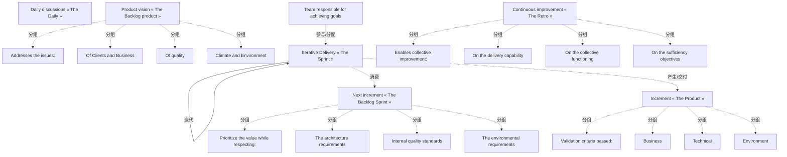

# G242/fig3-8 · 可持续信息系统的交付（来源：The Shift Project，工作组产出）

类型：`process-or-method-model`。说明“节制型”敏捷交付长什么样：在标准 Scrum 的每日站会、冲刺、回顾会、产品待办与增量之上，把气候与环境作为与业务、质量并列的验收与排序标准，让每次迭代都能度量并压低环境足迹。

英文 PDF 物理页：[56]。本页为架构语义分析，原文与原图分别保留。

## 原图与可编辑图


[完整 JSON](fig3-8.json) · [可编辑 Mermaid](fig3-8.mmd) · [仅关系图](fig3-8.relations.mmd) · [层级分解图](fig3-8.hierarchy.mmd)

图形重建表达语义，不复制源图布局。虚线表示解释、矩阵映射或分组关系，不自动表示不确定性的概率。



## 架构分析

先看中央深蓝色粗圆环箭头：它圈住“迭代交付「冲刺」”，表示交付按冲刺反复进行。再看四个角：左上“产品愿景「产品待办列表」”与其下的“下一增量「冲刺待办列表」”是进入冲刺的输入；右上“持续改进「回顾会」”与右下“增量「产品」”是冲刺的产出与复盘。每个色块下方用“回应的问题/排序时尊重/促成改进/验证标准”四个小标题列出该环节要兼顾的维度，绿色那一行就是可持续性新增的要求。顶部“每日讨论「每日站会」”由四个角色图标围绕，绿色粗体“负责达成目标的团队”说明执行主体。图例在下方：青色=仪式、橙色=工件（按图例字面）。

- 本图有 23 个具名或隐含元素、4 条关系和 16 条包含/分组记录。
- 包含/分组树最大深度为 1；根节点为 每日讨论「每日站会」、负责达成目标的团队、产品愿景「产品待办列表」、下一增量「冲刺待办列表」、迭代交付「冲刺」、持续改进「回顾会」、增量「产品」。
- 本图没有可直接确认为人员直属汇报的关系；视觉上下位置、能力分解和治理职责分别读取。
- 包含分组后有 4 个连通分量；分离可能源于图例、并列分类或独立示例，未自动补边。
- 24个文字节点及四个匿名人物图标、中央循环箭头和三种图例逐项核对。
- 唯一实际连接符是冲刺的粗循环箭头；四个角的框没有组成一条画出的Scrum流程。
- 原图青色Rites、橙色Artefacts图例与框内容分类冲突；保留原词，不静默改图例。

### 如何用于项目

- 按阶段/事件/行为关系读取入口、出口、责任和产物；检查循环与例外路径。
- 工作流先后不表示组织管理权；在项目中显式记录条件和完成标准。

### 结构所表达的逻辑

- 绿色条目包括团队负责达成目标、气候环境问题、环境需求、节制目标及环境验收。
- 第55页要求业务单元把环境影响限制纳入验收和优先级，并通过重复交付与公开指标促进持续改进。
- 第56页实施条件包括度量手段、比较基准、架构需求与指南、团队意识和IT高管支持；业务与环境需求之间需要折中。
- 唯一画出的连接是冲刺自循环。四角对象的输入输出理解是解释，不能冒充源图完整流程。
- 原图图例文字青色Rites、橙色Artefacts与待办/产品和Daily/Retro框颜色存在分类冲突。

## 上下级与包含

要点在主题框下方，属于主题分类而非框内组成；四个人物是匿名团队图示。

|父项|子项|层级类型|依据与解释|
|---|---|---|---|
|产品愿景「产品待办列表」|回应的问题：|classified_under|要点列在色块下方，归于该主题，但不被色块视觉包围。|
|产品愿景「产品待办列表」|客户与业务|classified_under|要点列在色块下方，归于该主题，但不被色块视觉包围。|
|产品愿景「产品待办列表」|质量|classified_under|要点列在色块下方，归于该主题，但不被色块视觉包围。|
|产品愿景「产品待办列表」|气候与环境|classified_under|要点列在色块下方，归于该主题，但不被色块视觉包围。|
|下一增量「冲刺待办列表」|排定价值优先级时尊重：|classified_under|要点列在色块下方，归于该主题，但不被色块视觉包围。|
|下一增量「冲刺待办列表」|架构需求|classified_under|要点列在色块下方，归于该主题，但不被色块视觉包围。|
|下一增量「冲刺待办列表」|内部质量标准|classified_under|要点列在色块下方，归于该主题，但不被色块视觉包围。|
|下一增量「冲刺待办列表」|环境需求|classified_under|要点列在色块下方，归于该主题，但不被色块视觉包围。|
|持续改进「回顾会」|促成集体改进：|classified_under|要点列在色块下方，归于该主题，但不被色块视觉包围。|
|持续改进「回顾会」|交付能力|classified_under|要点列在色块下方，归于该主题，但不被色块视觉包围。|
|持续改进「回顾会」|集体运作|classified_under|要点列在色块下方，归于该主题，但不被色块视觉包围。|
|持续改进「回顾会」|节制目标|classified_under|要点列在色块下方，归于该主题，但不被色块视觉包围。|
|增量「产品」|已通过的验证标准：|classified_under|要点列在色块下方，归于该主题，但不被色块视觉包围。|
|增量「产品」|业务|classified_under|要点列在色块下方，归于该主题，但不被色块视觉包围。|
|增量「产品」|技术|classified_under|要点列在色块下方，归于该主题，但不被色块视觉包围。|
|增量「产品」|环境|classified_under|要点列在色块下方，归于该主题，但不被色块视觉包围。|

## 全部元素与角色

|元素ID|原文名称|类型|含义|直接父项|深度|
|---|---|---|---|---|---|
|daily_discussions|Daily discussions « The Daily »|process|流程：每日讨论「每日站会」|—||
|team_responsible|Team responsible for achieving goals|organization_unit|四个人物图标围绕团队目标文字，没有逐人名称、岗位、技能等级或汇报线。|—||
|product_vision|Product vision « The Backlog product »|artifact|制品：产品愿景「产品待办列表」|—||
|hdr_issues|Addresses the issues:|note|说明：回应的问题：|产品愿景「产品待办列表」|1|
|issue_clients|Of Clients and Business|concept|概念：客户与业务|产品愿景「产品待办列表」|1|
|issue_quality|Of quality|concept|概念：质量|产品愿景「产品待办列表」|1|
|issue_climate|Climate and Environment|concept|概念：气候与环境|产品愿景「产品待办列表」|1|
|next_increment|Next increment « The Backlog Sprint »|artifact|制品：下一增量「冲刺待办列表」|—||
|hdr_prioritize|Prioritize the value while respecting:|note|说明：排定价值优先级时尊重：|下一增量「冲刺待办列表」|1|
|prio_arch|The architecture requirements|concept|概念：架构需求|下一增量「冲刺待办列表」|1|
|prio_quality|Internal quality standards|concept|概念：内部质量标准|下一增量「冲刺待办列表」|1|
|prio_environment|The environmental requirements|concept|概念：环境需求|下一增量「冲刺待办列表」|1|
|sprint|Iterative Delivery « The Sprint »|process|流程：迭代交付「冲刺」|—||
|retro|Continuous improvement « The Retro »|process|流程：持续改进「回顾会」|—||
|hdr_improve|Enables collective improvement:|note|说明：促成集体改进：|持续改进「回顾会」|1|
|imp_delivery|On the delivery capability|concept|概念：交付能力|持续改进「回顾会」|1|
|imp_collective|On the collective functioning|concept|概念：集体运作|持续改进「回顾会」|1|
|imp_sufficiency|On the sufficiency objectives|concept|概念：节制目标|持续改进「回顾会」|1|
|increment|Increment « The Product »|artifact|制品：增量「产品」|—||
|hdr_validation|Validation criteria passed:|note|说明：已通过的验证标准：|增量「产品」|1|
|val_business|Business|concept|概念：业务|增量「产品」|1|
|val_technical|Technical|concept|概念：技术|增量「产品」|1|
|val_environment|Environment|concept|概念：环境|增量「产品」|1|

## 全部关系

图中没有连接两个框的直线，唯一的“线”是中央深蓝色粗圆环箭头：首尾相接、箭头指向顺时针前方，表示冲刺周而复始。四个色块之间的先后关系完全由版式（左上→左下→中→右下→右上）暗示，关系清单中标为推断。

|主体|语义关系|客体|显式线/隐式|原文标签|依据|
|---|---|---|---|---|---|
|迭代交付「冲刺」|迭代|迭代交付「冲刺」|显式连线||中央粗圆环箭头的自环，表示迭代交付反复进行|
|迭代交付「冲刺」|消费|下一增量「冲刺待办列表」|implicit||若保留待办作为冲刺输入的解释，消费主体应为Sprint；该关系是术语解释，不是原图画线。|
|迭代交付「冲刺」|产生/交付|增量「产品」|implicit||交付与增量标签支持这一解释，但原图无实体间箭头。|
|负责达成目标的团队|参与/分配|迭代交付「冲刺」|implicit||第55页自主负责团队与图中目标责任文字支持团队作用；并非原图连接。|

## 本轮否定的历史关系

以下旧解释保留用于追溯，不进入当前关系图、层级或知识图谱的有效边。

|旧记录|主体|旧关系|客体|否定依据|
|---|---|---|---|---|
|1|产品愿景「产品待办列表」|sequence|下一增量「冲刺待办列表」|图中没有此连接，邻近正文没有规定这一步骤之间的具体流转；旧解释按一般Scrum知识补造了流程。|
|4|增量「产品」|flow|持续改进「回顾会」|图中没有此连接，邻近正文没有规定这一步骤之间的具体流转；旧解释按一般Scrum知识补造了流程。|
|5|持续改进「回顾会」|iteration|产品愿景「产品待办列表」|图中没有此连接，邻近正文没有规定这一步骤之间的具体流转；旧解释按一般Scrum知识补造了流程。|

## 本轮语义修正

- 图中没有此连接，邻近正文没有规定这一步骤之间的具体流转；旧解释按一般Scrum知识补造了流程。
- 若保留待办作为冲刺输入的解释，消费主体应为Sprint；该关系是术语解释，不是原图画线。
- 交付与增量标签支持这一解释，但原图无实体间箭头。
- 图中没有此连接，邻近正文没有规定这一步骤之间的具体流转；旧解释按一般Scrum知识补造了流程。
- 图中没有此连接，邻近正文没有规定这一步骤之间的具体流转；旧解释按一般Scrum知识补造了流程。
- 第55页自主负责团队与图中目标责任文字支持团队作用；并非原图连接。

## 误读检查

- 不要把图例颜色当作分类依据：图例写“青=仪式、橙=工件”，但青色框实际是产品待办/冲刺待办/产品增量（工件），橙色框是每日站会/回顾会（仪式），两者对调了。
- 中央圆环不是“冲刺→回顾会”的箭头，而是冲刺自身的循环符号；它没有起止点。
- 四个角的色块不是四个顺序阶段，而是围绕冲刺的输入（左上、左下）、输出（右下）与复盘（右上），阅读顺序应按 Scrum 逻辑而非单纯顺时针。
- “绿色”只表示该条被可持续性目标影响，不表示“已完成”或“优先级更高”。
- 中文稿当前引用的重绘 SVG 省略了右下角铅笔装饰并简化了图标，但不影响语义；不能据 SVG 的简化图形判断原图没有这些细节。

## 原文证据

### [PDF 第 55 页](../../../documents/G242.md#page-55)

> Six of these principles seem particularly relevant to develop practical solutions:
> The role of the Business Owner has changed. They are no longer simply making requests outside of the development process. They become co-responsible for deliverables, among other things by explaining the reason for their needs, quantifying their value, prioritizing the functionalities, and measuring the business impact.
### [PDF 第 56 页](../../../documents/G242.md#page-56)

> Figure 3-8: Sustainable Information System Delivery (Source: The Shift Project, Production of the Working
### [PDF 第 57 页](../../../documents/G242.md#page-57)

> DevOps consists of integrating the constraints and non-functional needs resulting from Operations (production and support) in the process of choosing, prioritizing, developing IT, and ensuring the operability of the system before deployment.
> CI/CD being components of a DevOps strategy, they raise a fundamental question. They enable continuous integration of the source code into the Information System, end-to-end environments, and multiple processing chains operating 24/7. They are increasing energy consumption for a more frequent and more qualitative delivery.

## 来源与分析状态

所有元素/关系均有来源定位；未把历史解释重命名为本轮逐线视觉确认。源图与语义图是两种视图，布局不证明汇报或因果。

源 PDF SHA-256：`517339a5e3f509f08699c10b929f5ae14b6bca356b55e76163ffe437d54d5d19`。

源图记录：[原始解释与转录](../../../figures/G242/fig3-8.json)。

```json
{
  "quality": {
    "graph_integrity": "checked",
    "semantic_analysis": "typed-graph-and-context-analysis",
    "visual_review": "source-content-audited",
    "notice_zh": "所有元素/关系均有来源定位；未把历史解释重命名为本轮逐线视觉确认。源图与语义图是两种视图，布局不证明汇报或因果。"
  },
  "source_uncertainty": {
    "confidence": "high",
    "uncertainties_zh": [
      "图例“青=仪式、橙=工件”与框体实际用法相反，判断为原图笔误；已按框体内容解释，未改动原图记录。",
      "四个角框之间的先后顺序是按 Scrum 语义推断的，图中没有箭头连接它们。",
      "右下角浅灰铅笔线稿（疑似灯/人物速写）在原图被裁切掉一部分，只作为装饰记录。"
    ],
    "analyzed_from": [
      "英文 PDF 第 56 页（印刷页 38）原图截图与 2×2 放大分块",
      "英文 PDF 第 56 页正文",
      "中文稿 G242e_环境可持续的信息系统.md 第 903–948 行",
      "figs/zh/g242_fig3-8_zh.svg 源码与 figs/zh/g242_fig3-8_zh.png",
      "figs/g242_fig3-8_en.png"
    ],
    "date": "2026-10-31"
  },
  "source_conflicts": [
    {
      "kind": "legend-content-classification-conflict",
      "literal_legend": {
        "cyan": "Rites",
        "orange": "Artefacts"
      },
      "visible_labels": {
        "cyan": [
          "Backlog product",
          "Backlog Sprint",
          "The Sprint",
          "The Product"
        ],
        "orange": [
          "The Daily",
          "The Retro"
        ]
      },
      "resolution_zh": "保留图例和框标签，不依据图例自动给对象赋仪式/制品类型。"
    }
  ]
}
```
