# G242/fig3-9 · GHG Protocol 的范围与价值链排放概览 [Value Chain]

类型：`process-or-method-model`。为 3.6 节建立共同语言：先分清直接排放（范围 1）、购电相关间接排放（范围 2）和价值链间接排放（范围 3），再说明 ICT 的特点——范围 1 很小、范围 2 与数据中心和办公设备用电密切相关、一半以上碳足迹在范围 3。

英文 PDF 物理页：[60]。本页为架构语义分析，原文与原图分别保留。

## 原图与可编辑图


[完整 JSON](fig3-9.json) · [可编辑 Mermaid](fig3-9.mmd) · [仅关系图](fig3-9.relations.mmd) · [层级分解图](fig3-9.hierarchy.mmd)

图形重建表达语义，不复制源图布局。虚线表示解释、矩阵映射或分组关系，不自动表示不确定性的概率。

```mermaid
flowchart TB
  %% Semantic reconstruction; see original source image for exact layout.
  n0["CO₂, CH₄, N₂O, HFCs, PFCs, SF₆"]
  n1["CO₂"]
  n2["CH₄"]
  n3["N₂O"]
  n4["HFCs"]
  n5["PFCs"]
  n6["SF₆"]
  n7["Scope 2 INDIRECT"]
  n8["Scope 1 DIRECT"]
  n9["Scope 3 INDIRECT"]
  n10["Scope 3 INDIRECT"]
  n11["purchased goods and services"]
  n12["capital goods"]
  n13["fuel and energy related activities"]
  n14["transportation and distribution"]
  n15["waste generated in operations"]
  n16["business travel"]
  n17["employee commuting"]
  n18["leased assets"]
  n19["purchased electricity, steam, heating &amp; cooling for own use"]
  n20["company facilities"]
  n21["company vehicles"]
  n22["transportation and distribution"]
  n23["processing of sold products"]
  n24["use of sold products"]
  n25["end-of-life treatment of sold products"]
  n26["leased assets"]
  n27["franchises"]
  n28["investments"]
  n29["Upstream activities"]
  n30["Reporting company"]
  n31["Downstream activities"]
  n7 -.->|"流动"| n0
  n8 -.->|"流动"| n0
  n9 -.->|"流动"| n0
  n10 -.->|"流动"| n0
  n9 -.-|"关联"| n29
  n8 -.-|"关联"| n30
  n10 -.-|"关联"| n31
  n0 -.->|"分组"| n1
  n0 -.->|"分组"| n2
  n0 -.->|"分组"| n3
  n0 -.->|"分组"| n4
  n0 -.->|"分组"| n5
  n0 -.->|"分组"| n6
  n9 -.->|"分组"| n11
  n9 -.->|"分组"| n12
  n9 -.->|"分组"| n13
  n9 -.->|"分组"| n14
  n9 -.->|"分组"| n15
  n9 -.->|"分组"| n16
  n9 -.->|"分组"| n17
  n9 -.->|"分组"| n18
  n7 -.->|"分组"| n19
  n8 -.->|"分组"| n20
  n8 -.->|"分组"| n21
  n10 -.->|"分组"| n22
  n10 -.->|"分组"| n23
  n10 -.->|"分组"| n24
  n10 -.->|"分组"| n25
  n10 -.->|"分组"| n26
  n10 -.->|"分组"| n27
  n10 -.->|"分组"| n28
```



## 架构分析

从左到右看底部三段：上游活动 → 报告公司 → 下游活动。中间的报告公司只有两类直接排放源（公司设施、公司车辆，青绿色范围 1 箭头）；左侧灰色环形箭头是范围 2，只包含“自用购入的电力、蒸汽、供热与制冷”；其余紫色箭头都是范围 3：左侧上游 8 项活动，右侧下游 7 项活动。每项活动用图标加英文小字标出，顶部云朵里的六个圆是《京都议定书》控制的温室气体。

- 本图有 32 个具名或隐含元素、7 条关系和 24 条包含/分组记录。
- 包含/分组树最大深度为 1；根节点为 六种温室气体（CO₂、CH₄、N₂O、HFCs、PFCs、SF₆）、范围 2 间接排放、范围 1 直接排放、范围 3 间接排放（上游）、范围 3 间接排放（下游）、上游活动、报告公司、下游活动。
- 本图没有可直接确认为人员直属汇报的关系；视觉上下位置、能力分解和治理职责分别读取。
- 六种气体、四条范围色带、范围1两项、范围2一项、上下游范围3的8/7项全部核对。
- 紫色范围3箭头止于各自范围标题下方，并未连接顶部气体云；四条旧范围→气体关系只能作为解释。
- 活动在色带上分类，不是被四个封闭范围容器包围；上下游同名活动保留不同实例。

### 如何用于项目

- 按阶段/事件/行为关系读取入口、出口、责任和产物；检查循环与例外路径。
- 工作流先后不表示组织管理权；在项目中显式记录条件和完成标准。

### 结构所表达的逻辑

- 范围 1 是报告公司自有设施与车辆的直接排放；图中只有“company facilities”和“company vehicles”两项，对应正文所说 ICT 对范围 1 影响较小（空调制冷剂泄漏、应急发电机燃料）。
- 范围 2 只有一项——“purchased electricity, steam, heating & cooling for own use”；对信息系统而言即数据中心与办公硬件用电，这是 ICT 减排最直接的杠杆（购电结构、PUE）。
- 范围 3 分上下游两侧共 15 项活动：上游含采购商品与服务、资本货物、燃料与能源相关活动、运输配送、运营废弃物、商务差旅、员工通勤、租赁资产；下游含运输配送、售出产品加工、使用、报废处理、租赁资产、特许经营、投资。
- 同一名称可同时出现在上下游：图中“transportation and distribution”和“leased assets”各出现两次，分属上游与下游，不是重复错误。
- “purchased goods and services”与“capital goods”是 ICT 硬件制造排放的归属处，也是正文强调的范围 3 主体（设备制造、云服务、外包）。
- 顶部六种气体（CO₂、CH₄、N₂O、HFCs、PFCs、SF₆）说明核算统一折算为 CO₂ 当量，而不仅是 CO₂。
- 三段式（上游/报告公司/下游）提醒：组织的排放责任跨越自身边界，范围 3 由其他利益相关者运营，因而更不透明、受监管更少（正文原话）。

## 上下级与包含

18项排放活动按范围分类：范围1两项、范围2一项、上游范围3八项、下游范围3七项。底部三条带是价值链位置，顶部六气体是另一分类；不是组织或物理容器树。

|父项|子项|层级类型|依据与解释|
|---|---|---|---|
|六种温室气体（CO₂、CH₄、N₂O、HFCs、PFCs、SF₆）|二氧化碳 CO₂|visual_grouping|框、泳道、域或分类组的成员归属；没有额外证据不提升为业务组合或管理关系。|
|六种温室气体（CO₂、CH₄、N₂O、HFCs、PFCs、SF₆）|甲烷 CH₄|visual_grouping|框、泳道、域或分类组的成员归属；没有额外证据不提升为业务组合或管理关系。|
|六种温室气体（CO₂、CH₄、N₂O、HFCs、PFCs、SF₆）|一氧化二氮 N₂O|visual_grouping|框、泳道、域或分类组的成员归属；没有额外证据不提升为业务组合或管理关系。|
|六种温室气体（CO₂、CH₄、N₂O、HFCs、PFCs、SF₆）|氢氟碳化物 HFCs|visual_grouping|框、泳道、域或分类组的成员归属；没有额外证据不提升为业务组合或管理关系。|
|六种温室气体（CO₂、CH₄、N₂O、HFCs、PFCs、SF₆）|全氟碳化物 PFCs|visual_grouping|框、泳道、域或分类组的成员归属；没有额外证据不提升为业务组合或管理关系。|
|六种温室气体（CO₂、CH₄、N₂O、HFCs、PFCs、SF₆）|六氟化硫 SF₆|visual_grouping|框、泳道、域或分类组的成员归属；没有额外证据不提升为业务组合或管理关系。|
|范围 3 间接排放（上游）|采购的商品与服务|classified_under|图标在该范围色带上，以位置和颜色分类；没有封闭的父容器。|
|范围 3 间接排放（上游）|资本货物|classified_under|图标在该范围色带上，以位置和颜色分类；没有封闭的父容器。|
|范围 3 间接排放（上游）|燃料与能源相关活动|classified_under|图标在该范围色带上，以位置和颜色分类；没有封闭的父容器。|
|范围 3 间接排放（上游）|运输与配送（上游）|classified_under|图标在该范围色带上，以位置和颜色分类；没有封闭的父容器。|
|范围 3 间接排放（上游）|运营产生的废弃物|classified_under|图标在该范围色带上，以位置和颜色分类；没有封闭的父容器。|
|范围 3 间接排放（上游）|商务差旅|classified_under|图标在该范围色带上，以位置和颜色分类；没有封闭的父容器。|
|范围 3 间接排放（上游）|员工通勤|classified_under|图标在该范围色带上，以位置和颜色分类；没有封闭的父容器。|
|范围 3 间接排放（上游）|租赁资产（上游）|classified_under|图标在该范围色带上，以位置和颜色分类；没有封闭的父容器。|
|范围 2 间接排放|自用购入的电力、蒸汽、供热与制冷|classified_under|图标在该范围色带上，以位置和颜色分类；没有封闭的父容器。|
|范围 1 直接排放|公司设施|classified_under|图标在该范围色带上，以位置和颜色分类；没有封闭的父容器。|
|范围 1 直接排放|公司车辆|classified_under|图标在该范围色带上，以位置和颜色分类；没有封闭的父容器。|
|范围 3 间接排放（下游）|运输与配送（下游）|classified_under|图标在该范围色带上，以位置和颜色分类；没有封闭的父容器。|
|范围 3 间接排放（下游）|售出产品的加工|classified_under|图标在该范围色带上，以位置和颜色分类；没有封闭的父容器。|
|范围 3 间接排放（下游）|售出产品的使用|classified_under|图标在该范围色带上，以位置和颜色分类；没有封闭的父容器。|
|范围 3 间接排放（下游）|售出产品的报废处理|classified_under|图标在该范围色带上，以位置和颜色分类；没有封闭的父容器。|
|范围 3 间接排放（下游）|租赁资产（下游）|classified_under|图标在该范围色带上，以位置和颜色分类；没有封闭的父容器。|
|范围 3 间接排放（下游）|特许经营|classified_under|图标在该范围色带上，以位置和颜色分类；没有封闭的父容器。|
|范围 3 间接排放（下游）|投资|classified_under|图标在该范围色带上，以位置和颜色分类；没有封闭的父容器。|

## 全部元素与角色

|元素ID|原文名称|类型|含义|直接父项|深度|
|---|---|---|---|---|---|
|ghg_gases|CO₂, CH₄, N₂O, HFCs, PFCs, SF₆|group|分组：六种温室气体（CO₂、CH₄、N₂O、HFCs、PFCs、SF₆）|—||
|gas_co2|CO₂|concept|概念：二氧化碳 CO₂|六种温室气体（CO₂、CH₄、N₂O、HFCs、PFCs、SF₆）|1|
|gas_ch4|CH₄|concept|概念：甲烷 CH₄|六种温室气体（CO₂、CH₄、N₂O、HFCs、PFCs、SF₆）|1|
|gas_n2o|N₂O|concept|概念：一氧化二氮 N₂O|六种温室气体（CO₂、CH₄、N₂O、HFCs、PFCs、SF₆）|1|
|gas_hfcs|HFCs|concept|概念：氢氟碳化物 HFCs|六种温室气体（CO₂、CH₄、N₂O、HFCs、PFCs、SF₆）|1|
|gas_pfcs|PFCs|concept|概念：全氟碳化物 PFCs|六种温室气体（CO₂、CH₄、N₂O、HFCs、PFCs、SF₆）|1|
|gas_sf6|SF₆|concept|概念：六氟化硫 SF₆|六种温室气体（CO₂、CH₄、N₂O、HFCs、PFCs、SF₆）|1|
|scope_2|Scope 2 INDIRECT|group|分组：范围 2 间接排放|—||
|scope_1|Scope 1 DIRECT|group|分组：范围 1 直接排放|—||
|scope_3_upstream|Scope 3 INDIRECT|group|分组：范围 3 间接排放（上游）|—||
|scope_3_downstream|Scope 3 INDIRECT|group|分组：范围 3 间接排放（下游）|—||
|purchased_goods|purchased goods and services|process|流程：采购的商品与服务|范围 3 间接排放（上游）|1|
|capital_goods|capital goods|process|流程：资本货物|范围 3 间接排放（上游）|1|
|fuel_energy|fuel and energy related activities|process|流程：燃料与能源相关活动|范围 3 间接排放（上游）|1|
|transport_up|transportation and distribution|process|流程：运输与配送（上游）|范围 3 间接排放（上游）|1|
|waste_ops|waste generated in operations|process|流程：运营产生的废弃物|范围 3 间接排放（上游）|1|
|business_travel|business travel|process|流程：商务差旅|范围 3 间接排放（上游）|1|
|employee_commuting|employee commuting|process|流程：员工通勤|范围 3 间接排放（上游）|1|
|leased_assets_up|leased assets|process|流程：租赁资产（上游）|范围 3 间接排放（上游）|1|
|purchased_electricity|purchased electricity, steam, heating & cooling for own use|process|流程：自用购入的电力、蒸汽、供热与制冷|范围 2 间接排放|1|
|company_facilities|company facilities|process|流程：公司设施|范围 1 直接排放|1|
|company_vehicles|company vehicles|process|流程：公司车辆|范围 1 直接排放|1|
|transport_down|transportation and distribution|process|流程：运输与配送（下游）|范围 3 间接排放（下游）|1|
|processing_sold|processing of sold products|process|流程：售出产品的加工|范围 3 间接排放（下游）|1|
|use_sold|use of sold products|process|流程：售出产品的使用|范围 3 间接排放（下游）|1|
|end_of_life|end-of-life treatment of sold products|process|流程：售出产品的报废处理|范围 3 间接排放（下游）|1|
|leased_assets_down|leased assets|process|流程：租赁资产（下游）|范围 3 间接排放（下游）|1|
|franchises|franchises|process|流程：特许经营|范围 3 间接排放（下游）|1|
|investments|investments|process|流程：投资|范围 3 间接排放（下游）|1|
|upstream_activities|Upstream activities|group|分组：上游活动|—||
|reporting_company|Reporting company|group|分组：报告公司|—||
|downstream_activities|Downstream activities|group|分组：下游活动|—||

## 全部关系

四条向上的范围色带将活动分类；灰色范围2和青色范围1箭头停在各自标题下，紫色范围3两箭头更低，均无逐气体连线。底部色带说明上游、报告公司与下游，不表达流程。

|主体|语义关系|客体|显式线/隐式|原文标签|依据|
|---|---|---|---|---|---|
|范围 2 间接排放|流动|六种温室气体（CO₂、CH₄、N₂O、HFCs、PFCs、SF₆）|scope-band-direction-annotation|Scope 2 INDIRECT|范围由带箭头色带表示；箭尖停在范围标题下，没有从该标签接到气体云的连接线。范围排放温室气体是全图解释。|
|范围 1 直接排放|流动|六种温室气体（CO₂、CH₄、N₂O、HFCs、PFCs、SF₆）|scope-band-direction-annotation|Scope 1 DIRECT|范围由带箭头色带表示；箭尖停在范围标题下，没有从该标签接到气体云的连接线。范围排放温室气体是全图解释。|
|范围 3 间接排放（上游）|流动|六种温室气体（CO₂、CH₄、N₂O、HFCs、PFCs、SF₆）|scope-band-direction-annotation|Scope 3 INDIRECT|范围由带箭头色带表示；箭尖停在范围标题下，没有从该标签接到气体云的连接线。范围排放温室气体是全图解释。|
|范围 3 间接排放（下游）|流动|六种温室气体（CO₂、CH₄、N₂O、HFCs、PFCs、SF₆）|scope-band-direction-annotation|Scope 3 INDIRECT|范围由带箭头色带表示；箭尖停在范围标题下，没有从该标签接到气体云的连接线。范围排放温室气体是全图解释。|
|范围 3 间接排放（上游）|关联|上游活动|implicit||上游范围位于“Upstream activities”横带之上|
|范围 1 直接排放|关联|报告公司|implicit||范围 1 与范围 2 位于“Reporting company”横带之上|
|范围 3 间接排放（下游）|关联|下游活动|implicit||下游范围位于“Downstream activities”横带之上|

## 本轮语义修正

- 范围由带箭头色带表示；箭尖停在范围标题下，没有从该标签接到气体云的连接线。范围排放温室气体是全图解释。
- 范围由带箭头色带表示；箭尖停在范围标题下，没有从该标签接到气体云的连接线。范围排放温室气体是全图解释。
- 范围由带箭头色带表示；箭尖停在范围标题下，没有从该标签接到气体云的连接线。范围排放温室气体是全图解释。
- 范围由带箭头色带表示；箭尖停在范围标题下，没有从该标签接到气体云的连接线。范围排放温室气体是全图解释。

## 误读检查

- 上游和下游运输配送、租赁资产是不同范围语境中的同名项目，不应合并为同一节点。
- 范围2同时列出电力、蒸汽、供热和制冷，不能只保留电力。
- 第60页关于ICT范围3占比的陈述来自引用研究，不是每个项目的实测结果。
- 中文旧重绘中的其他环境影响并非原图的第四排放范围。

## 原文证据

### [PDF 第 59 页](../../../documents/G242.md#page-59)

> consideration. But in a first step, the experience shows that a complete and science-based carbon footprint calculation including electricity consumption and manufacturing is enough to drive most architecture decisions. As enterprises move ahead on the digital sustainability transformation and depending on their business model, they should check regularly if other indicators should be added. Nevertheless, in a world where time and financial resources are also finite, it is important to keep the measure as simple as possible to provide science-based guidance for decision and to keep said resources to activate levers to reduce the footprint. Indeed, environmental footprint calculation at a very detailed level and covering the full scope can be quite complex.
> Calculating a carbon footprint is by itself complex, and thus requires a pragmatic iterative approach which focuses on trends and orders of magnitude. It should enable the enterprise to initiate effective reduction actions quickly, rather than working on the precision of the reported information.
### [PDF 第 60 页](../../../documents/G242.md#page-60)

> Figure 3-9: Overview of GHG Protocol Scopes and Emissions Across the Value Chain [Value Chain]

## 来源与分析状态

所有元素/关系均有来源定位；未把历史解释重命名为本轮逐线视觉确认。源图与语义图是两种视图，布局不证明汇报或因果。

源 PDF SHA-256：`517339a5e3f509f08699c10b929f5ae14b6bca356b55e76163ffe437d54d5d19`。

源图记录：[原始解释与转录](../../../figures/G242/fig3-9.json)。

```json
{
  "quality": {
    "graph_integrity": "checked",
    "semantic_analysis": "typed-graph-and-context-analysis",
    "visual_review": "source-content-audited",
    "notice_zh": "所有元素/关系均有来源定位；未把历史解释重命名为本轮逐线视觉确认。源图与语义图是两种视图，布局不证明汇报或因果。"
  },
  "source_uncertainty": {
    "confidence": "high",
    "uncertainties_zh": [
      "四个范围色带的“箭头”在严格意义上不是两元素之间的连线，而是范围归类图形；关系清单按“色带向上指向气体云”记录，并已在描述中说明。",
      "原图右下角的浅灰铅笔笔触为 TOGAF 版式装饰，不是文字。",
      "原图未标注作者/版权；图题只写 GHG Protocol，未在图上给出 WRI 标识。"
    ],
    "analyzed_from": [
      "英文 PDF 第 60 页（印刷页 42）原图截图、2×2 放大分块与整页概览",
      "英文 PDF 第 59–60 页正文",
      "中文稿 G242e_环境可持续的信息系统.md 第 996–1014 行",
      "figs/g242_fig3-9.svg 源码"
    ],
    "date": "2026-10-31"
  },
  "source_conflicts": []
}
```
