# G242/fig5-1 · 数字可持续性参考模型（详细版）（来源：The Shift Project Lean-ICT 工作组）

类型：`decomposition-or-organization-model`。把第 3 章散落在 3.3–3.9 节的做法收拢成一张可操作的业务功能地图：组织可以据此盘点自己已做、未做与成熟度，也可作为跨企业比较的框架；每个功能在表 5-1 中有详细说明。

英文 PDF 物理页：[91]。本页为架构语义分析，原文与原图分别保留。

## 原图与可编辑图


[完整 JSON](fig5-1.json) · [可编辑 Mermaid](fig5-1.mmd) · [仅关系图](fig5-1.relations.mmd) · [层级分解图](fig5-1.hierarchy.mmd)

图形重建表达语义，不复制源图布局。虚线表示解释、矩阵映射或分组关系，不自动表示不确定性的概率。

```mermaid
flowchart TB
  %% Semantic reconstruction; see original source image for exact layout.
  n0["Deploying a sustainable Information System policy"]
  n1["Developing &amp; Rolling Out a Sustainable Information System Strategy"]
  n2["Formalize the Risks"]
  n3["Nominate a Sponsor from Executive Management"]
  n4["Align CSR, Business, and ICT Departments"]
  n5["Set Overall and Function-level Goals"]
  n6["Check the Business Model"]
  n7["Build and launch the transformation program"]
  n8["Engaging with Customers, Providers, Partners, and Authorities towards Sustainable Solutions and Services"]
  n9["Ask Service Providers for End-to-End Environmental Footprint Transparency"]
  n10["Adapt the Selection Criteria for Calls for Tenders and Contracts with Suppliers and Partners"]
  n11["Define the Procurement Strategy"]
  n12["Comply and Go Beyond the Regulatory Environmental Reporting Requested by Authorities"]
  n13["Involve Customers in the Goal of Digital Sustainability"]
  n14["Influence the Market, Capitalize on Knowledge by Contributing to Public Papers"]
  n15["Architecting &amp; Building a Sustainable Information System"]
  n16["State the Vision of a Sustainable Information System"]
  n17["A dual use-based an infrastructure-based architecture approach to drive transformation"]
  n18["Reshape Business Architecture"]
  n19["Reshape the Application Architecture"]
  n20["Reshape data architecture to reduce data volume"]
  n21["Reshape technical architecture"]
  n22["Agile methodologies for sustainability"]
  n23["Sustainable software development"]
  n24["Operating a Sustainable Information System"]
  n25["Manage Digital Equipment Inventories"]
  n26["Support the Increase in Usage Period of Digital Equipment"]
  n27["Monitor Digital Consumption"]
  n28["Load shedding for data centers on interruptible demand of electricity operator"]
  n29["Developing a Sustainable Digital Culture"]
  n30["Organize and Manage the Cultural Transformation"]
  n31["Encourage frugal &amp; regenerative innovation"]
  n32["Roll out a communication plan"]
  n33["Develop Digital Sustainability Awareness, Manage Skills, Train People"]
  n34["Measuring the Environmental Impact of the Information System from Cradle to Grave"]
  n35["Build and Share Information System Carbon Footprint Measures from Cradle to Grave"]
  n36["Develop activities to measure the Information System Environmental impact"]
  n37["Provide to involved stakeholders a measure of their environmental impact"]
  n38["Governing the Transition Towards a Sustainable Information System"]
  n39["Define Governance Principles and Organization"]
  n40["Animate Governance Committees"]
  n41["Ensure that objectives are reached, coordinate initiatives and decision-making"]
  n42["Assess the maturity of the capability &quot;Provide a sustainable information system&quot;"]
  n43["Evaluate sustainable ideas"]
  n0 -.->|"visual_containment_only"| n1
  n1 -.->|"functional_decomposition"| n2
  n1 -.->|"functional_decomposition"| n3
  n1 -.->|"functional_decomposition"| n4
  n1 -.->|"functional_decomposition"| n5
  n1 -.->|"functional_decomposition"| n6
  n1 -.->|"functional_decomposition"| n7
  n0 -.->|"visual_containment_only"| n8
  n8 -.->|"functional_decomposition"| n9
  n8 -.->|"functional_decomposition"| n10
  n8 -.->|"functional_decomposition"| n11
  n8 -.->|"functional_decomposition"| n12
  n8 -.->|"functional_decomposition"| n13
  n8 -.->|"functional_decomposition"| n14
  n0 -.->|"visual_containment_only"| n15
  n15 -.->|"functional_decomposition"| n16
  n15 -.->|"functional_decomposition"| n17
  n15 -.->|"functional_decomposition"| n18
  n15 -.->|"functional_decomposition"| n19
  n15 -.->|"functional_decomposition"| n20
  n15 -.->|"functional_decomposition"| n21
  n15 -.->|"functional_decomposition"| n22
  n15 -.->|"functional_decomposition"| n23
  n0 -.->|"visual_containment_only"| n24
  n24 -.->|"functional_decomposition"| n25
  n24 -.->|"functional_decomposition"| n26
  n24 -.->|"functional_decomposition"| n27
  n24 -.->|"functional_decomposition"| n28
  n0 -.->|"visual_containment_only"| n29
  n29 -.->|"functional_decomposition"| n30
  n29 -.->|"functional_decomposition"| n31
  n29 -.->|"functional_decomposition"| n32
  n29 -.->|"functional_decomposition"| n33
  n0 -.->|"visual_containment_only"| n34
  n34 -.->|"functional_decomposition"| n35
  n34 -.->|"functional_decomposition"| n36
  n34 -.->|"functional_decomposition"| n37
  n0 -.->|"visual_containment_only"| n38
  n38 -.->|"functional_decomposition"| n39
  n38 -.->|"functional_decomposition"| n40
  n38 -.->|"functional_decomposition"| n41
  n38 -.->|"functional_decomposition"| n42
  n38 -.->|"functional_decomposition"| n43
```



## 架构分析

从外到内读能力总容器、七类业务功能及其36个子功能。战略在顶部、治理在底部、互动在左、度量在右均为布局；无先后箭头。外框能力图标与内部功能图标须区分。

- 本图有 44 个具名或隐含元素、0 条关系和 43 条包含/分组记录。
- 包含/分组树最大深度为 2；根节点为 部署可持续信息系统政策。
- 本图没有可直接确认为人员直属汇报的关系；视觉上下位置、能力分解和治理职责分别读取。
- 原图靠嵌套表达结构，没有连线；新语义图将包含单独显式化，不补造流程、数据流或依赖。
- 外层1能力、7组业务功能、36个细分功能共44节点；6/6/8/4/4/3/5分组数量与所有标签逐一核对。
- 外框右上阶梯块图标与内部业务功能双折角图标不同；均为记法，不是额外实体。
- 无连线，无从战略到治理的顺序；文化、度量和治理的位置不能自动构造依赖或优先级。
- 图上frugal & regenerative与表5-1的Encourage Frugal Innovation措辞不同，保留图文字及表文本。

### 如何用于项目

- 按父项展开所有直接子项，检查同层粒度、重叠和缺项。
- 保留组成、分类、能力分解与组织汇报的区别；将示例名称替换为已确认的项目对象。

### 结构所表达的逻辑

- 44节点：1能力容器、7功能组、36细分功能；各组细分数量为战略6、生态互动6、架构构建8、运营4、文化4、度量3、治理5。
- 战略含风险、发起人、CSR/业务/ICT对齐、目标、业务模式、转型计划六项。
- 互动含透明度、选择标准、采购战略、监管、客户参与和市场知识六项。
- 架构构建含愿景、双向方法、业务/应用/数据/技术重塑、敏捷与可持续软件八项；这些都直接属于同组。
- 运营的负荷削减明确依电力运营商可中断请求；不能推成无条件停机。
- 文化4项、度量3项、治理5项分别为并列功能，不由版面决定高低优先级。
- 详细说明见表5-1和第3章；用作组织活动盘点与裁剪的参考模型，不是项目现状。

## 上下级与包含

三层：L0“部署可持续信息系统政策”；L1 七个功能组；L2 三十六个业务功能。功能组在版式上分区（顶部/左/中/右/底部），但都直接隶属于 L0，组与组之间是并列关系而非上下级。

|父项|子项|层级类型|依据与解释|
|---|---|---|---|
|部署可持续信息系统政策|制定并推展可持续信息系统战略|visual_containment_only|保存原图解释中的包含；业务关系类型需要图例或正文进一步限定。|
|制定并推展可持续信息系统战略|将风险正式化|functional_decomposition|同类功能/过程/服务的嵌套分解；不推断执行顺序。|
|制定并推展可持续信息系统战略|从高管层任命发起人|functional_decomposition|同类功能/过程/服务的嵌套分解；不推断执行顺序。|
|制定并推展可持续信息系统战略|对齐 CSR、业务与 ICT 部门|functional_decomposition|同类功能/过程/服务的嵌套分解；不推断执行顺序。|
|制定并推展可持续信息系统战略|设定总体与职能级目标|functional_decomposition|同类功能/过程/服务的嵌套分解；不推断执行顺序。|
|制定并推展可持续信息系统战略|检查业务模式|functional_decomposition|同类功能/过程/服务的嵌套分解；不推断执行顺序。|
|制定并推展可持续信息系统战略|构建并启动转型计划|functional_decomposition|同类功能/过程/服务的嵌套分解；不推断执行顺序。|
|部署可持续信息系统政策|与客户、提供方、伙伴及主管部门互动，共同实现可持续的解决方案与服务|visual_containment_only|保存原图解释中的包含；业务关系类型需要图例或正文进一步限定。|
|与客户、提供方、伙伴及主管部门互动，共同实现可持续的解决方案与服务|要求服务提供方提供端到端环境足迹透明度|functional_decomposition|同类功能/过程/服务的嵌套分解；不推断执行顺序。|
|与客户、提供方、伙伴及主管部门互动，共同实现可持续的解决方案与服务|调整招标与合同的选择标准|functional_decomposition|同类功能/过程/服务的嵌套分解；不推断执行顺序。|
|与客户、提供方、伙伴及主管部门互动，共同实现可持续的解决方案与服务|定义采购战略|functional_decomposition|同类功能/过程/服务的嵌套分解；不推断执行顺序。|
|与客户、提供方、伙伴及主管部门互动，共同实现可持续的解决方案与服务|遵守并超越主管部门要求的监管环境报告|functional_decomposition|同类功能/过程/服务的嵌套分解；不推断执行顺序。|
|与客户、提供方、伙伴及主管部门互动，共同实现可持续的解决方案与服务|让客户参与数字可持续目标|functional_decomposition|同类功能/过程/服务的嵌套分解；不推断执行顺序。|
|与客户、提供方、伙伴及主管部门互动，共同实现可持续的解决方案与服务|影响市场，通过贡献公开文章积累知识|functional_decomposition|同类功能/过程/服务的嵌套分解；不推断执行顺序。|
|部署可持续信息系统政策|架构并构建可持续信息系统|visual_containment_only|保存原图解释中的包含；业务关系类型需要图例或正文进一步限定。|
|架构并构建可持续信息系统|陈述可持续信息系统的愿景|functional_decomposition|同类功能/过程/服务的嵌套分解；不推断执行顺序。|
|架构并构建可持续信息系统|以基于用途与基于基础设施的双重架构方法驱动转型|functional_decomposition|同类功能/过程/服务的嵌套分解；不推断执行顺序。|
|架构并构建可持续信息系统|重塑业务架构|functional_decomposition|同类功能/过程/服务的嵌套分解；不推断执行顺序。|
|架构并构建可持续信息系统|重塑应用架构|functional_decomposition|同类功能/过程/服务的嵌套分解；不推断执行顺序。|
|架构并构建可持续信息系统|重塑数据架构以减少数据量|functional_decomposition|同类功能/过程/服务的嵌套分解；不推断执行顺序。|
|架构并构建可持续信息系统|重塑技术架构|functional_decomposition|同类功能/过程/服务的嵌套分解；不推断执行顺序。|
|架构并构建可持续信息系统|面向可持续性的敏捷方法|functional_decomposition|同类功能/过程/服务的嵌套分解；不推断执行顺序。|
|架构并构建可持续信息系统|可持续软件开发|functional_decomposition|同类功能/过程/服务的嵌套分解；不推断执行顺序。|
|部署可持续信息系统政策|运营可持续信息系统|visual_containment_only|保存原图解释中的包含；业务关系类型需要图例或正文进一步限定。|
|运营可持续信息系统|管理数字设备清单|functional_decomposition|同类功能/过程/服务的嵌套分解；不推断执行顺序。|
|运营可持续信息系统|支持延长数字设备使用期限|functional_decomposition|同类功能/过程/服务的嵌套分解；不推断执行顺序。|
|运营可持续信息系统|监控数字消费|functional_decomposition|同类功能/过程/服务的嵌套分解；不推断执行顺序。|
|运营可持续信息系统|应电网运营方要求对数据中心可中断削峰|functional_decomposition|同类功能/过程/服务的嵌套分解；不推断执行顺序。|
|部署可持续信息系统政策|发展可持续数字文化|visual_containment_only|保存原图解释中的包含；业务关系类型需要图例或正文进一步限定。|
|发展可持续数字文化|组织并管理文化转型|functional_decomposition|同类功能/过程/服务的嵌套分解；不推断执行顺序。|
|发展可持续数字文化|鼓励节俭与再生式创新|functional_decomposition|同类功能/过程/服务的嵌套分解；不推断执行顺序。|
|发展可持续数字文化|推展沟通计划|functional_decomposition|同类功能/过程/服务的嵌套分解；不推断执行顺序。|
|发展可持续数字文化|培养数字可持续性意识、管理技能、培训人员|functional_decomposition|同类功能/过程/服务的嵌套分解；不推断执行顺序。|
|部署可持续信息系统政策|从摇篮到坟墓度量信息系统环境影响|visual_containment_only|保存原图解释中的包含；业务关系类型需要图例或正文进一步限定。|
|从摇篮到坟墓度量信息系统环境影响|建立并共享从摇篮到坟墓的信息系统碳足迹度量|functional_decomposition|同类功能/过程/服务的嵌套分解；不推断执行顺序。|
|从摇篮到坟墓度量信息系统环境影响|开展度量信息系统环境影响的活动|functional_decomposition|同类功能/过程/服务的嵌套分解；不推断执行顺序。|
|从摇篮到坟墓度量信息系统环境影响|向各利益相关者提供其环境影响的度量|functional_decomposition|同类功能/过程/服务的嵌套分解；不推断执行顺序。|
|部署可持续信息系统政策|治理向可持续信息系统转型|visual_containment_only|保存原图解释中的包含；业务关系类型需要图例或正文进一步限定。|
|治理向可持续信息系统转型|定义治理原则与组织|functional_decomposition|同类功能/过程/服务的嵌套分解；不推断执行顺序。|
|治理向可持续信息系统转型|推动治理委员会运作|functional_decomposition|同类功能/过程/服务的嵌套分解；不推断执行顺序。|
|治理向可持续信息系统转型|确保目标达成，协调举措与决策|functional_decomposition|同类功能/过程/服务的嵌套分解；不推断执行顺序。|
|治理向可持续信息系统转型|评估“提供可持续信息系统”能力的成熟度|functional_decomposition|同类功能/过程/服务的嵌套分解；不推断执行顺序。|
|治理向可持续信息系统转型|评估可持续想法|functional_decomposition|同类功能/过程/服务的嵌套分解；不推断执行顺序。|

## 全部元素与角色

|元素ID|原文名称|类型|含义|直接父项|深度|
|---|---|---|---|---|---|
|deploy_policy|Deploying a sustainable Information System policy|capability|外层能力容器，右上阶梯块能力图标；内含七类业务功能。|—||
|g_strategy|Developing & Rolling Out a Sustainable Information System Strategy|function|功能：制定并推展可持续信息系统战略|部署可持续信息系统政策|1|
|f_formalize_risks|Formalize the Risks|function|功能：将风险正式化|制定并推展可持续信息系统战略|2|
|f_nominate_sponsor|Nominate a Sponsor from Executive Management|function|功能：从高管层任命发起人|制定并推展可持续信息系统战略|2|
|f_align_csr|Align CSR, Business, and ICT Departments|function|功能：对齐 CSR、业务与 ICT 部门|制定并推展可持续信息系统战略|2|
|f_set_goals|Set Overall and Function-level Goals|function|功能：设定总体与职能级目标|制定并推展可持续信息系统战略|2|
|f_check_model|Check the Business Model|function|功能：检查业务模式|制定并推展可持续信息系统战略|2|
|f_build_program|Build and launch the transformation program|function|功能：构建并启动转型计划|制定并推展可持续信息系统战略|2|
|g_engage|Engaging with Customers, Providers, Partners, and Authorities towards Sustainable Solutions and Services|function|功能：与客户、提供方、伙伴及主管部门互动，共同实现可持续的解决方案与服务|部署可持续信息系统政策|1|
|f_provider_transparency|Ask Service Providers for End-to-End Environmental Footprint Transparency|function|功能：要求服务提供方提供端到端环境足迹透明度|与客户、提供方、伙伴及主管部门互动，共同实现可持续的解决方案与服务|2|
|f_selection_criteria|Adapt the Selection Criteria for Calls for Tenders and Contracts with Suppliers and Partners|function|功能：调整招标与合同的选择标准|与客户、提供方、伙伴及主管部门互动，共同实现可持续的解决方案与服务|2|
|f_procurement|Define the Procurement Strategy|function|功能：定义采购战略|与客户、提供方、伙伴及主管部门互动，共同实现可持续的解决方案与服务|2|
|f_regulatory|Comply and Go Beyond the Regulatory Environmental Reporting Requested by Authorities|function|功能：遵守并超越主管部门要求的监管环境报告|与客户、提供方、伙伴及主管部门互动，共同实现可持续的解决方案与服务|2|
|f_involve_customers|Involve Customers in the Goal of Digital Sustainability|function|功能：让客户参与数字可持续目标|与客户、提供方、伙伴及主管部门互动，共同实现可持续的解决方案与服务|2|
|f_influence_market|Influence the Market, Capitalize on Knowledge by Contributing to Public Papers|function|功能：影响市场，通过贡献公开文章积累知识|与客户、提供方、伙伴及主管部门互动，共同实现可持续的解决方案与服务|2|
|g_architect|Architecting & Building a Sustainable Information System|function|功能：架构并构建可持续信息系统|部署可持续信息系统政策|1|
|f_state_vision|State the Vision of a Sustainable Information System|function|功能：陈述可持续信息系统的愿景|架构并构建可持续信息系统|2|
|f_dual_approach|A dual use-based an infrastructure-based architecture approach to drive transformation|function|图内连接词印为an；按上下文解释为用途与基础设施双向方法，但不静默修订字面。|架构并构建可持续信息系统|2|
|f_business_arch|Reshape Business Architecture|function|功能：重塑业务架构|架构并构建可持续信息系统|2|
|f_app_arch|Reshape the Application Architecture|function|功能：重塑应用架构|架构并构建可持续信息系统|2|
|f_data_arch|Reshape data architecture to reduce data volume|function|功能：重塑数据架构以减少数据量|架构并构建可持续信息系统|2|
|f_tech_arch|Reshape technical architecture|function|功能：重塑技术架构|架构并构建可持续信息系统|2|
|f_agile|Agile methodologies for sustainability|function|功能：面向可持续性的敏捷方法|架构并构建可持续信息系统|2|
|f_sustainable_sw|Sustainable software development|function|功能：可持续软件开发|架构并构建可持续信息系统|2|
|g_operate|Operating a Sustainable Information System|function|功能：运营可持续信息系统|部署可持续信息系统政策|1|
|f_inventories|Manage Digital Equipment Inventories|function|功能：管理数字设备清单|运营可持续信息系统|2|
|f_usage_period|Support the Increase in Usage Period of Digital Equipment|function|功能：支持延长数字设备使用期限|运营可持续信息系统|2|
|f_monitor|Monitor Digital Consumption|function|功能：监控数字消费|运营可持续信息系统|2|
|f_load_shedding|Load shedding for data centers on interruptible demand of electricity operator|function|功能：应电网运营方要求对数据中心可中断削峰|运营可持续信息系统|2|
|g_culture|Developing a Sustainable Digital Culture|function|功能：发展可持续数字文化|部署可持续信息系统政策|1|
|f_cultural_change|Organize and Manage the Cultural Transformation|function|功能：组织并管理文化转型|发展可持续数字文化|2|
|f_frugal|Encourage frugal & regenerative innovation|function|功能：鼓励节俭与再生式创新|发展可持续数字文化|2|
|f_communication|Roll out a communication plan|function|功能：推展沟通计划|发展可持续数字文化|2|
|f_awareness|Develop Digital Sustainability Awareness, Manage Skills, Train People|function|功能：培养数字可持续性意识、管理技能、培训人员|发展可持续数字文化|2|
|g_measure|Measuring the Environmental Impact of the Information System from Cradle to Grave|function|功能：从摇篮到坟墓度量信息系统环境影响|部署可持续信息系统政策|1|
|f_carbon_measure|Build and Share Information System Carbon Footprint Measures from Cradle to Grave|function|功能：建立并共享从摇篮到坟墓的信息系统碳足迹度量|从摇篮到坟墓度量信息系统环境影响|2|
|f_measure_activities|Develop activities to measure the Information System Environmental impact|function|功能：开展度量信息系统环境影响的活动|从摇篮到坟墓度量信息系统环境影响|2|
|f_stakeholder_measure|Provide to involved stakeholders a measure of their environmental impact|function|功能：向各利益相关者提供其环境影响的度量|从摇篮到坟墓度量信息系统环境影响|2|
|g_govern|Governing the Transition Towards a Sustainable Information System|function|功能：治理向可持续信息系统转型|部署可持续信息系统政策|1|
|f_governance_principles|Define Governance Principles and Organization|function|功能：定义治理原则与组织|治理向可持续信息系统转型|2|
|f_animate_committees|Animate Governance Committees|function|功能：推动治理委员会运作|治理向可持续信息系统转型|2|
|f_objectives|Ensure that objectives are reached, coordinate initiatives and decision-making|function|功能：确保目标达成，协调举措与决策|治理向可持续信息系统转型|2|
|f_maturity|Assess the maturity of the capability "Provide a sustainable information system"|function|功能：评估“提供可持续信息系统”能力的成熟度|治理向可持续信息系统转型|2|
|f_evaluate_ideas|Evaluate sustainable ideas|function|功能：评估可持续想法|治理向可持续信息系统转型|2|

## 全部关系

全图没有连线或箭头。层级只由矩形嵌套表达：外框包住七个组框，组框包住功能框。每个框右上角的房屋形图标是“业务功能”的记法标记，不是链接点。

|主体|语义关系|客体|显式线/隐式|原文标签|依据|
|---|---|---|---|---|---|

## 误读检查

- 36个细分功能不是36个执行步骤；战略位置和治理位置不构成流程。
- 外层能力与内部业务功能有不同记法，不把所有框都标成同一种ArchiMate元素。
- 图中的an及regenerative措辞与正文有差异，原图字面与语境解释分开保存。
- 功能图标不是新节点、按钮或关系端点。

## 原文证据

### [PDF 第 91 页](../../../documents/G242.md#page-91)

> Figure 5-1: Digital Sustainability Reference Model (Detailed Version) (Source: The Shift Project Lean-ICT Work
### [PDF 第 92 页](../../../documents/G242.md#page-92)

### [PDF 第 93 页](../../../documents/G242.md#page-93)

### [PDF 第 94 页](../../../documents/G242.md#page-94)

### [PDF 第 95 页](../../../documents/G242.md#page-95)

### [PDF 第 96 页](../../../documents/G242.md#page-96)

### [PDF 第 97 页](../../../documents/G242.md#page-97)


## 来源与分析状态

所有元素/关系均有来源定位；未把历史解释重命名为本轮逐线视觉确认。源图与语义图是两种视图，布局不证明汇报或因果。

源 PDF SHA-256：`517339a5e3f509f08699c10b929f5ae14b6bca356b55e76163ffe437d54d5d19`。

源图记录：[原始解释与转录](../../../figures/G242/fig5-1.json)。

```json
{
  "quality": {
    "graph_integrity": "checked",
    "semantic_analysis": "typed-graph-and-context-analysis",
    "visual_review": "source-content-audited",
    "notice_zh": "所有元素/关系均有来源定位；未把历史解释重命名为本轮逐线视觉确认。源图与语义图是两种视图，布局不证明汇报或因果。"
  },
  "source_uncertainty": {
    "confidence": "high",
    "uncertainties_zh": [
      "框右上角的房屋形小图标的准确含义（业务功能/构建块标记）图中未给图例，按 TOGAF 系列指南的业务功能标记理解。",
      "组内功能的排列顺序未标注编号，按从左到右、从上到下的阅读顺序记录 order。",
      "外框右上角的网格状小图标含义不明（疑为参考模型/矩阵标记），未纳入元素。",
      "原图“Deploying a sustainable Information System policy”中 Information System 首字母大写、其余小写，已按原样记录。"
    ],
    "analyzed_from": [
      "英文 PDF 第 91 页（印刷页 73）原图截图与 3×3 放大分块",
      "英文 PDF 第 91–92 页正文（含表 5-1 开头）",
      "中文稿 G242e_环境可持续的信息系统.md 第 1810–1854 行",
      "figs/zh/g242_fig5-1_zh.svg 源码、figs/zh/g242_fig5-1_zh.png、figs/g242_fig5-1_en.png"
    ],
    "date": "2026-10-31"
  },
  "source_conflicts": []
}
```
