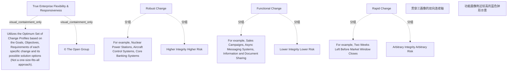

# G248/fig2-1 · 企业变革画像

类型：`analytical-view`。作者用一张图交代全篇的分类框架：企业中的变革不是只有一种做法，而是按目标、目的与需求落在稳健、功能、快速三类画像构成的连续谱上；后文第 3 章的实体分组与构建块选择都按这三类画像展开。

英文 PDF 物理页：[14]。本页为架构语义分析，原文与原图分别保留。

## 原图与可编辑图


[完整 JSON](fig2-1.json) · [可编辑 Mermaid](fig2-1.mmd) · [仅关系图](fig2-1.relations.mmd) · [层级分解图](fig2-1.hierarchy.mmd)

图形重建表达语义，不复制源图布局。虚线表示解释、矩阵映射或分组关系，不自动表示不确定性的概率。



## 架构分析

先读顶部灰框的总标题，它说明要按每次变革的目标、目的、需求选择最优画像组合（不是一刀切）。再从左到右读三列：Robust Change → Functional Change → Rapid Change。每列上半部是典型例子，下半部是对完整性（Integrity）与风险（Risk）的判断。蓝色钟形曲线横跨三列、峰值落在功能画像；最底部的灰色箭头两端都有箭头，是一条没有刻度和标签的连续轴。

- 本图有 14 个具名或隐含元素、0 条关系和 8 条包含/分组记录。
- 包含/分组树最大深度为 1；根节点为 真正的企业灵活性与响应力、稳健变革（Robust）、功能变革（Functional）、快速变革（Rapid）、贯穿三画像的双向连续轴、功能画像附近较高的蓝色钟形示意。
- 本图没有可直接确认为人员直属汇报的关系；视觉上下位置、能力分解和治理职责分别读取。
- 原图靠嵌套表达结构，没有连线；新语义图将包含单独显式化，不补造流程、数据流或依赖。
- 包含分组后有 6 个连通分量；分离可能源于图例、并列分类或独立示例，未自动补边。
- 核对标题、完整说明、三种变革画像及各自示例/完整性/风险文字。
- 底部双向箭头是未命名连续轴，蓝色钟形为示意分布；均无刻度、单位或概率。拒绝把轴当成画像间连接、把左右排列当成执行顺序。

### 如何用于项目

- 围绕作者目的读取本图实体、分组与连线，并用对应原文限定其含义。
- 把参考模型与项目事实分开，实际范围、约束、值和责任须有项目证据。

### 结构所表达的逻辑

- 三类画像是一条连续谱上的位置，不是互斥的标签；左端稳健、右端快速。
- 完整性要求与风险沿谱变化：稳健为 Higher Integrity / Higher Risk，功能为 Lower Integrity / Lower Risk，快速为 Arbitrary Integrity / Arbitrary Risk。
- 蓝色钟形曲线覆盖三列且峰值在 Functional Change 一列，暗示多数变革落在功能画像，稳健与快速是两端的少数情形；曲线没有纵轴或刻度，属于示意而非统计数据。
- 每列给出典型场景：核电站/飞控/核心银行系统（稳健）；销售活动/异步消息/信息与文档共享（功能）；市场窗口关闭前两周（快速）。
- 顶部标题强调“真正的企业灵活性与响应力”来自按每次变革的目标、目的、需求选择最优画像组合，而不是对所有变革采用同一套方法。
- 底部灰色双向箭头把三列串成一条轴，但两端都没有箭头文字、刻度和单位，不能据此读出定量区间。

## 上下级与包含

共两层：顶部的总标题框统摄全图；其下是三列并列的画像（每列含画像名、示例、完整性/风险三块文字）。三列之间没有上下级，只有横向的连续谱关系。

|父项|子项|层级类型|依据与解释|
|---|---|---|---|
|真正的企业灵活性与响应力|根据每次具体变革及其可能解决方案选项的目标、目的与需求，采用最优的变革画像组合（并非一刀切的做法）。|visual_containment_only|保存原图解释中的包含；业务关系类型需要图例或正文进一步限定。|
|真正的企业灵活性与响应力|© The Open Group|visual_containment_only|保存原图解释中的包含；业务关系类型需要图例或正文进一步限定。|
|稳健变革（Robust）|例如：核电站、飞机控制系统、核心银行系统|classified_under|列标题用于分类；没有封闭容器，也不表示业务上下级。|
|稳健变革（Robust）|更高完整性、更高风险|classified_under|列标题用于分类；没有封闭容器，也不表示业务上下级。|
|功能变革（Functional）|例如：销售活动、异步消息系统、信息与文档共享|classified_under|列标题用于分类；没有封闭容器，也不表示业务上下级。|
|功能变革（Functional）|较低完整性、较低风险|classified_under|列标题用于分类；没有封闭容器，也不表示业务上下级。|
|快速变革（Rapid）|例如：距离市场窗口关闭只剩两周|classified_under|列标题用于分类；没有封闭容器，也不表示业务上下级。|
|快速变革（Rapid）|完整性视情境而定、风险视情境而定|classified_under|列标题用于分类；没有封闭容器，也不表示业务上下级。|

## 全部元素与角色

|元素ID|原文名称|类型|含义|直接父项|深度|
|---|---|---|---|---|---|
|header|True Enterprise Flexibility & Responsiveness|note|整张图的总论点，位于带粗黑边框的浅灰横条中。|—||
|header_detail|Utilizes the Optimum Set of Change Profiles based on the Goals, Objectives, Requirements of each specific change and its possible solution options (Not a one-size-fits-all approach).|note|解释为什么需要三类画像而不是单一方法。|真正的企业灵活性与响应力|1|
|copyright|© The Open Group|note|版权标记。|真正的企业灵活性与响应力|1|
|robust_profile|Robust Change|concept|风险与架构驱动的长周期变革画像。|—||
|robust_example|For example, Nuclear Power Stations, Aircraft Control Systems, Core Banking Systems|note|稳健画像的典型场景。|稳健变革（Robust）|1|
|robust_integrity|Higher Integrity Higher Risk|note|稳健画像对完整性与风险的判断。|稳健变革（Robust）|1|
|functional_profile|Functional Change|concept|可实现能力驱动的迭代式变革画像，钟形曲线峰值所在列。|—||
|functional_example|For example, Sales Campaigns, Async Messaging Systems, Information and Document Sharing|note|功能画像的典型场景。|功能变革（Functional）|1|
|functional_integrity|Lower Integrity Lower Risk|note|功能画像对完整性与风险的判断。|功能变革（Functional）|1|
|rapid_profile|Rapid Change|concept|短时间交付驱动的变革画像。|—||
|rapid_example|For example, Two Weeks Left Before Market Window Closes|note|快速画像的典型场景。|快速变革（Rapid）|1|
|rapid_integrity|Arbitrary Integrity Arbitrary Risk|note|快速画像对完整性与风险的判断。|快速变革（Rapid）|1|
|spectrum_axis|贯穿三画像的双向连续轴|annotation|两端箭头，无轴名/单位/刻度，不连接特定画像框。|—||
|illustrative_curve|功能画像附近较高的蓝色钟形示意|annotation|形状示意，不是统计直方图或量化概率分布。|—||

## 全部关系

图内唯一的画线是底部贯穿全宽的灰色粗箭头，两端都有箭头，表示三种画像位于同一连续轴上；它不与任何框相连，也没有标签。蓝色钟形曲线是覆盖在列上的面积图形，不是连接线，不表示实体关系。三列之间的竖线只是分栏线。

|主体|语义关系|客体|显式线/隐式|原文标签|依据|
|---|---|---|---|---|---|

## 本轮否定的历史关系

以下旧解释保留用于追溯，不进入当前关系图、层级或知识图谱的有效边。

|旧记录|主体|旧关系|客体|否定依据|
|---|---|---|---|---|
||稳健变革（Robust）|other|快速变革（Rapid）|源图没有画像间的依赖、序列或实体连接；连续轴和位置另存为注记。|
|1|稳健变革（Robust）|sequence|功能变革（Functional）|源图没有画像间的依赖、序列或实体连接；连续轴和位置另存为注记。|
|2|功能变革（Functional）|sequence|快速变革（Rapid）|源图没有画像间的依赖、序列或实体连接；连续轴和位置另存为注记。|

## 本轮语义修正

- 源图没有画像间的依赖、序列或实体连接；连续轴和位置另存为注记。
- 源图没有画像间的依赖、序列或实体连接；连续轴和位置另存为注记。
- 源图没有画像间的依赖、序列或实体连接；连续轴和位置另存为注记。

## 误读检查

- 不要把钟形曲线当成有数据支撑的概率分布：它没有纵轴、刻度或样本，只是示意“中间多、两端少”。
- 不要把“Arbitrary Integrity / Arbitrary Risk”理解为没有风险，它指快速画像对完整性与风险的取舍是随情境而定的。
- 不要把三类画像读成成熟度阶梯：快速不等于不成熟，稳健也不等于更高级，选择取决于变革性质。
- 底部双向箭头的两端没有标签，不能判断轴的方向（是从稳健到快速还是相反）；左右顺序只由三列的排列给出。
- 中文稿当前引用的 figs/g248_fig2-1.svg 是三张要点卡片，不是本图；不能据它理解曲线与连续谱。

## 原文证据

### [PDF 第 14 页](../../../documents/G248.md#page-14)

> Having identified the nature of the change related to an enterprise’s current context, state, and vision (its mission, drivers, concerns, goals, objectives, and requirements) and change granularity; different more or less appropriate types of change can be identified. Figure 2-1 shows characteristic profiles of change likely to be encountered across a reasonably large enterprise. They reflect the different risk and integrity concerns that must be considered before deciding on change lifecycles and practices.
### [PDF 第 15 页](../../../documents/G248.md#page-15)

> • Functional (implementable capability-driven) – Fast cycles of component delivery for specific bounded functionality and time (e.g., Joint Application Development (JAD), Dynamic System Development Method (DSDM), Agile techniques)
> • Robust (risk and architecture-driven) – Longer term delivery of complex, riskier, larger scale components, often interoperable across different enterprises, the breadth of an enterprise or part of an enterprise (e.g., managed projects or programs using approaches such as COBIT®, SABSA®, Prince 2® or Managing Successful Programs (MSP))

## 来源与分析状态

所有元素/关系均有来源定位；未把历史解释重命名为本轮逐线视觉确认。源图与语义图是两种视图，布局不证明汇报或因果。

源 PDF SHA-256：`810df20478f65d8dfd969089f9c682ec268d0e3a9126e062bda5191c9017e19c`。

源图记录：[原始解释与转录](../../../figures/G248/fig2-1.json)。

```json
{
  "quality": {
    "graph_integrity": "checked",
    "semantic_analysis": "typed-graph-and-context-analysis",
    "visual_review": "source-content-audited",
    "notice_zh": "所有元素/关系均有来源定位；未把历史解释重命名为本轮逐线视觉确认。源图与语义图是两种视图，布局不证明汇报或因果。"
  },
  "source_uncertainty": {
    "confidence": "high",
    "uncertainties_zh": [
      "底部双向轴的箭头两端都没有文字，无法确定作者意图的轴向（文中按三列排列读作“稳健→快速”）。",
      "钟形曲线没有纵轴与刻度，只能作定性理解，不能量化。",
      "原图截图中带蓝色细边框与灰色外框，是 PDF 截取边框，不是图的内容。"
    ],
    "analyzed_from": [
      "英文 PDF 第 14 页图 2-1 截图（220 dpi）及 2×2 放大分块",
      "英文 PDF 第 14 页正文",
      "中文稿 G248e_构建块的选择方法.md 第 86–101 行",
      "figs/g248_fig2-1.svg 源码"
    ],
    "date": "2026-10-31"
  },
  "source_conflicts": []
}
```
