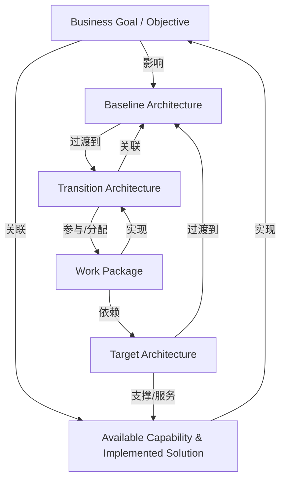

# G248/fig2-2 · TOGAF 过渡架构的实体关系图（ERD）

类型：`architecture-metamodel`。为 2.1 节定义过渡架构在架构全景中的位置：基线架构经变更产生一个或多个过渡架构，过渡架构由工作包实现；目标架构提供可用能力与已实现方案，并在实现后成为下一轮基线。它把正文中“基线—目标—过渡”三个概念及其实现关系一次说清。

英文 PDF 物理页：[16]。本页为架构语义分析，原文与原图分别保留。

## 原图与可编辑图


[完整 JSON](fig2-2.json) · [可编辑 Mermaid](fig2-2.mmd) · [仅关系图](fig2-2.relations.mmd) · [层级分解图](fig2-2.hierarchy.mmd)

图形重建表达语义，不复制源图布局。虚线表示解释、矩阵映射或分组关系，不自动表示不确定性的概率。



## 架构分析

从左上“Business Goal / Objective”读起：向右看它与“Available Capability & Implemented Solution”的双向关系，向下看它对基线架构的影响。再沿左侧“Baseline Architecture → Transition Architecture → Work Package”读实现链，注意每条线两端的 1 或 1..*。最后沿右侧“Target Architecture → Available Capability”以及“Target → Work Package”读目标架构的提供与部署关系，并顺着图框顶部绕行的“becomes the next”回到基线。

- 本图有 6 个具名或隐含元素、10 条关系和 0 条包含/分组记录。
- 本图没有可直接确认为人员直属汇报的关系；视觉上下位置、能力分解和治理职责分别读取。
- 逐一核对全部实体、每条物理连接、关系阅读方向、各端基数。
- 线段本身没有箭头头部；箭头印在关系短语旁用于阅读方向。已分开语义方向与视觉线头，双向读法是同一物理线。
- 全部基数另以端点表保存；未标注一端不臆定为1或多。

### 如何用于项目

- 使用本图的实体类型作为建模词表，建立本地实体ID，再分别填入关系端点与证据。
- 核对主动/被动关系的语义方向和基数；实现、使能、使用、包含及实例化分别建模。

### 结构所表达的逻辑

- 图中共六个实体：业务目标/目的、可用能力与已实现的解决方案、基线架构、目标架构、过渡架构、工作包；没有属性栏，只表达实体与关系。
- 业务目标与可用能力/已实现方案之间是双向的：目标“由……应对”（addressed by），能力/方案“实现”（achieves）目标，两端基数均为 1..*。
- 基线架构与过渡架构是一对多：1 个基线可“变更为”1..* 个过渡架构，反过来过渡架构“演进自”基线。
- 工作包实现过渡架构（implements / implemented by，两端 1..*），并“部署于”目标架构（目标端 1、工作包端 1..*）。
- 目标架构“提供”可用能力与已实现的解决方案（provides，两端 1..*），体现目标态才交付最终能力。
- 顶部绕行的“becomes the next”从目标架构回到基线架构，表示本轮目标实现后成为下一轮的基线；该线未标基数。
- 业务目标/目的“影响”基线架构（impacts，向下箭头，两端 1..*），说明动机层对现状架构的约束。

## 上下级与包含

没有容器或上下级：六个实体平铺，由连线组织。若按语义分层，可读作“动机层（业务目标/目的）—能力层（可用能力与已实现方案）—架构层（基线/目标/过渡）—实施层（工作包）”，但图中没有画出这种分层边界。

|父项|子项|层级类型|依据与解释|
|---|---|---|---|
|—|—|无视觉包含|关系中明确的组成/特化见 JSON semantic_hierarchy。|

## 全部元素与角色

|元素ID|原文名称|类型|含义|直接父项|深度|
|---|---|---|---|---|---|
|business_goal|Business Goal / Objective|goal|动机层的实体，合并表示业务目标与业务目的。|—||
|available_capability|Available Capability & Implemented Solution|capability|已经可获得的能力及其已落地的解决方案。|—||
|baseline_architecture|Baseline Architecture|architecture|当前状态的架构。|—||
|target_architecture|Target Architecture|architecture|期望的最终状态架构。|—||
|transition_architecture|Transition Architecture|architecture|向目标推进的可实施中间状态，可有多个。|—||
|work_package|Work Package|process|实现过渡架构的一组工作，可部署到目标架构。|—||

## 全部关系

所有实体间连接本身无箭头头部；关系词旁的↑↓←→确定词语的阅读方向。一个物理连线可有正反两个读法。基数保存在端点表，点线maps to是无方向概念对应。

|主体|语义关系|客体|显式线/隐式|原文标签|依据|
|---|---|---|---|---|---|
|业务目标／目的|关联|可用能力与已实现的解决方案|显式连线|addressed by →|关系线本身无箭头头部；语义方向由线旁关系短语的印刷箭头明确指定。|
|可用能力与已实现的解决方案|实现|业务目标／目的|显式连线|← achieves|关系线本身无箭头头部；语义方向由线旁关系短语的印刷箭头明确指定。|
|业务目标／目的|影响|基线架构|显式连线|↓ impacts|关系线本身无箭头头部；语义方向由线旁关系短语的印刷箭头明确指定。|
|基线架构|过渡到|过渡架构|显式连线|changed to →|关系线本身无箭头头部；语义方向由线旁关系短语的印刷箭头明确指定。|
|过渡架构|关联|基线架构|显式连线|← evolved from|关系线本身无箭头头部；语义方向由线旁关系短语的印刷箭头明确指定。|
|目标架构|支撑/服务|可用能力与已实现的解决方案|显式连线|provides ↑|关系线本身无箭头头部；语义方向由线旁关系短语的印刷箭头明确指定。|
|工作包|实现|过渡架构|显式连线|↑ implements|关系线本身无箭头头部；语义方向由线旁关系短语的印刷箭头明确指定。|
|过渡架构|参与/分配|工作包|显式连线|implemented by ↓|关系线本身无箭头头部；语义方向由线旁关系短语的印刷箭头明确指定。|
|工作包|依赖|目标架构|显式连线|deployed in ↑|关系线本身无箭头头部；语义方向由线旁关系短语的印刷箭头明确指定。|
|目标架构|过渡到|基线架构|显式连线|← becomes the next|关系线本身无箭头头部；语义方向由线旁关系短语的印刷箭头明确指定。|

### 极性、基数与图文冲突

数值和符号按原图记录；业务解释与原图冲突时分别保存，不静默修正原文。

|关系ID|极性|基数/端点标记|冲突说明|
|---|---|---|---|
|G248/fig2-2#r0001||"1..*:1..*"||
|G248/fig2-2#r0002||"1..*:1..*"||
|G248/fig2-2#r0003||"1..*:1..*"||
|G248/fig2-2#r0004||"1:1..*"||
|G248/fig2-2#r0005||"1..*:1"||
|G248/fig2-2#r0006||"1..*:1..*"||
|G248/fig2-2#r0007||"1..*:1..*"||
|G248/fig2-2#r0008||"1..*:1..*"||
|G248/fig2-2#r0009||"1..*:1"||

## 原图物理连线、双向读法与端点基数

```json
{
  "id": "audit_relationship_cardinalities",
  "title_zh": "原图物理连线、双向读法与端点基数",
  "columns": [
    "端点A",
    "A端基数",
    "端点B",
    "B端基数",
    "关系短语阅读方向"
  ],
  "rows": [
    [
      "Business Goal / Objective",
      "1..*",
      "Available Capability & Implemented Solution",
      "1..*",
      "Goal→Capability: addressed by；Capability→Goal: achieves"
    ],
    [
      "Business Goal / Objective",
      "1..*",
      "Baseline Architecture",
      "1..*",
      "Goal→Baseline: impacts"
    ],
    [
      "Baseline Architecture",
      "1",
      "Transition Architecture",
      "1..*",
      "Baseline→Transition: changed to；Transition→Baseline: evolved from"
    ],
    [
      "Target Architecture",
      "1..*",
      "Available Capability & Implemented Solution",
      "1..*",
      "Target→Capability: provides"
    ],
    [
      "Work Package",
      "1..*",
      "Transition Architecture",
      "1..*",
      "Work→Transition: implements；Transition→Work: implemented by"
    ],
    [
      "Work Package",
      "1..*",
      "Target Architecture",
      "1",
      "Work→Target: deployed in"
    ],
    [
      "Target Architecture",
      "未标注",
      "Baseline Architecture",
      "未标注",
      "Target→Baseline: becomes the next（外绕线）"
    ]
  ],
  "notes_zh": "每行是一条物理连线。两个关系读法不表示两条独立物理箭头。maps to点线没有箭头或基数。"
}
```

## 本轮语义修正

- 关系线本身无箭头头部；语义方向由线旁关系短语的印刷箭头明确指定。
- 关系线本身无箭头头部；语义方向由线旁关系短语的印刷箭头明确指定。
- 关系线本身无箭头头部；语义方向由线旁关系短语的印刷箭头明确指定。
- 关系线本身无箭头头部；语义方向由线旁关系短语的印刷箭头明确指定。
- 关系线本身无箭头头部；语义方向由线旁关系短语的印刷箭头明确指定。
- 关系线本身无箭头头部；语义方向由线旁关系短语的印刷箭头明确指定。
- 关系线本身无箭头头部；语义方向由线旁关系短语的印刷箭头明确指定。
- 关系线本身无箭头头部；语义方向由线旁关系短语的印刷箭头明确指定。
- 关系线本身无箭头头部；语义方向由线旁关系短语的印刷箭头明确指定。
- 关系线本身无箭头头部；语义方向由线旁关系短语的印刷箭头明确指定。

## 误读检查

- “becomes the next”不是目标架构→过渡架构，而是目标架构→基线架构：本轮目标成为下一轮基线。
- “impacts”的箭头向下，应读作业务目标/目的影响基线架构；不要反读成基线架构影响目标。
- “provides”的箭头向上，应读作目标架构提供可用能力与已实现方案，不要读成能力提供目标架构。
- “deployed in”是工作包→目标架构（工作包部署于目标架构），且目标端基数为 1、工作包端为 1..*，不要读成目标架构部署于工作包。
- 图中没有主键、属性或表结构，它不是数据库物理模型，只是概念层 ERD。
- 中文稿当前引用的 PNG 删掉了所有关系箭头，“implemented by”还只剩“in”，不能据它判断方向；应以英文原图为准。

## 原文证据

### [PDF 第 16 页](../../../documents/G248.md#page-16)

> Figure 2-2: Entity Relationship Diagram (ERD) of a TOGAF Transition Architecture
> The TOGAF Standard describes Baseline, Target, and Transition Architectures. These reflect the current state, the desired final state, and the implementable units of intermediate solution components that progress towards an overall target state as shown in Figure 2-2. This describes the relationships between the different architecture viewpoints and their use, to implement new capabilities and solutions in response to an enterprise’s goals and objectives.

## 来源与分析状态

所有元素/关系均有来源定位；未把历史解释重命名为本轮逐线视觉确认。源图与语义图是两种视图，布局不证明汇报或因果。

源 PDF SHA-256：`810df20478f65d8dfd969089f9c682ec268d0e3a9126e062bda5191c9017e19c`。

源图记录：[原始解释与转录](../../../figures/G248/fig2-2.json)。

```json
{
  "quality": {
    "graph_integrity": "checked",
    "semantic_analysis": "typed-graph-and-context-analysis",
    "visual_review": "source-content-audited",
    "notice_zh": "所有元素/关系均有来源定位；未把历史解释重命名为本轮逐线视觉确认。源图与语义图是两种视图，布局不证明汇报或因果。"
  },
  "source_uncertainty": {
    "confidence": "high",
    "uncertainties_zh": [
      "“becomes the next”沿线没有基数标注，只能记录为无基数。",
      "“deployed in”与“implemented by”两条线在工作包附近相邻，基数 1（目标架构端）与 1..*（工作包端）按线的走向归属，判读无误但需注意不要互换。",
      "图右下角有巨大的“copy”水印，是 PDF 防伪标记，不属于图内容。"
    ],
    "analyzed_from": [
      "英文 PDF 第 16 页图 2-2 截图（220 dpi）与 600 dpi 重渲染分块",
      "英文 PDF 第 16 页正文",
      "中文稿 G248e_构建块的选择方法.md 第 104–130 行",
      "figs/zh/g248e_fig2-2_zh.png（中文化 PNG）",
      "figs/g248e_fig2-2_en.png（英文原图 PNG）"
    ],
    "date": "2026-10-31"
  },
  "source_conflicts": []
}
```
