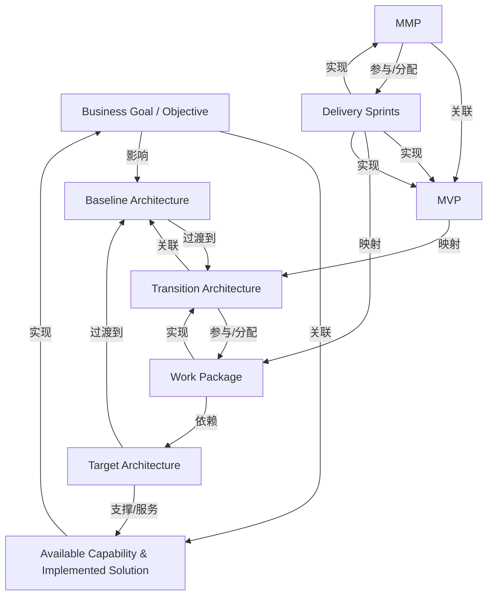

# G248/fig2-3 · 包含 MVP 与 MMP 概念的 TOGAF 过渡架构 ERD

类型：`architecture-metamodel`。把敏捷的 MVP/MMP 概念挂到 TOGAF 的过渡架构模型上：MVP 映射到过渡架构，交付冲刺映射到工作包，MMP 由 MVP 验证假设后形成，并由交付冲刺实现，从而说明敏捷增量交付如何与标准中的架构层级对应。

英文 PDF 物理页：[17]。本页为架构语义分析，原文与原图分别保留。

## 原图与可编辑图


[完整 JSON](fig2-3.json) · [可编辑 Mermaid](fig2-3.mmd) · [仅关系图](fig2-3.relations.mmd) · [层级分解图](fig2-3.hierarchy.mmd)

图形重建表达语义，不复制源图布局。虚线表示解释、矩阵映射或分组关系，不自动表示不确定性的概率。



## 架构分析

先按图 2-2 的方式读蓝色部分的架构 ERD（目标—基线—过渡—工作包）。再看左下角的橙色链：MVP → MMP → Delivery Sprints，注意三条纵向关系及其基数。最后看两条斜体“maps to”虚线：MVP 映射到 Transition Architecture，Delivery Sprints 映射到 Work Package；另有一条从 Delivery Sprints 绕左侧上行的“implements”线直接回到 MVP。

- 本图有 9 个具名或隐含元素、17 条关系和 0 条包含/分组记录。
- 本图没有可直接确认为人员直属汇报的关系；视觉上下位置、能力分解和治理职责分别读取。
- 逐一核对全部实体、每条物理连接、关系阅读方向、各端基数。
- 线段本身没有箭头头部；箭头印在关系短语旁用于阅读方向。已分开语义方向与视觉线头，双向读法是同一物理线。
- 全部基数另以端点表保存；未标注一端不臆定为1或多。

### 如何用于项目

- 使用本图的实体类型作为建模词表，建立本地实体ID，再分别填入关系端点与证据。
- 核对主动/被动关系的语义方向和基数；实现、使能、使用、包含及实例化分别建模。

### 结构所表达的逻辑

- 图 2-2 的六个架构实体全部保留，关系与基数不变；新增的是 MVP、MMP、Delivery Sprints 三个橙色敏捷概念。
- MVP 通过虚线“maps to”对应到过渡架构，说明一个 MVP 是某个过渡架构在交付上的映射物；该虚线没有箭头与基数。
- MMP 与 MVP 之间标注“hypothesis proved MVP ↑”，基数 MVP 端 1、MMP 端 0..1：一个 MVP 最多形成一个 MMP，MMP 用来证明 MVP 的假设成立。
- MMP 与 Delivery Sprints 之间是双向 1..*：交付冲刺实现 MMP，MMP 由交付冲刺实现。
- 另有一条从 Delivery Sprints 左侧绕行、直接指向 MVP 的“implements / implemented by”线，MVP 端标 1，表示交付冲刺也可越过 MMP 直接实现 MVP。
- Delivery Sprints 通过虚线“maps to”对应到 Work Package，把敏捷冲刺与架构侧的工作包对齐；该虚线同样没有箭头与基数。
- 蓝色部分仍表达：目标架构提供可用能力、工作包部署于目标架构、目标架构成为下一轮基线。

## 上下级与包含

没有容器或上下级。蓝色架构实体与橙色敏捷概念分列左右两侧，靠实线（实现/验证）与虚线（映射）相连；可读作“架构侧（目标/基线/过渡/工作包）”与“交付侧（MVP/MMP/冲刺）”两栏，但图中没有画分栏边框。

|父项|子项|层级类型|依据与解释|
|---|---|---|---|
|—|—|无视觉包含|关系中明确的组成/特化见 JSON semantic_hierarchy。|

## 全部元素与角色

|元素ID|原文名称|类型|含义|直接父项|深度|
|---|---|---|---|---|---|
|business_goal|Business Goal / Objective|goal|动机层实体，合并表示业务目标与业务目的。|—||
|available_capability|Available Capability & Implemented Solution|capability|已经可获得的能力及其已落地解决方案。|—||
|baseline_architecture|Baseline Architecture|architecture|当前状态的架构。|—||
|target_architecture|Target Architecture|architecture|期望的最终状态架构。|—||
|transition_architecture|Transition Architecture|architecture|向目标推进的可实施中间状态。|—||
|work_package|Work Package|process|实现过渡架构的一组工作。|—||
|mvp|MVP|product|Minimum Viable Product，用最小范围验证假设的产品增量。|—||
|mmp|MMP|product|Minimum Marketable Product，经客户期望检验、可被市场接受的产品状态。|—||
|delivery_sprints|Delivery Sprints|time|实现 MVP/MMP 的迭代交付冲刺。|—||

## 全部关系

所有实体间连接本身无箭头头部；关系词旁的↑↓←→确定词语的阅读方向。一个物理连线可有正反两个读法。基数保存在端点表，点线maps to是无方向概念对应。

|主体|语义关系|客体|显式线/隐式|原文标签|依据|
|---|---|---|---|---|---|
|业务目标／目的|关联|可用能力与已实现的解决方案|显式连线|addressed by →|关系线本身无箭头头部；语义方向由线旁关系短语的印刷箭头明确指定。|
|可用能力与已实现的解决方案|实现|业务目标／目的|显式连线|← achieves|关系线本身无箭头头部；语义方向由线旁关系短语的印刷箭头明确指定。|
|业务目标／目的|影响|基线架构|显式连线|↓ impacts|关系线本身无箭头头部；语义方向由线旁关系短语的印刷箭头明确指定。|
|基线架构|过渡到|过渡架构|显式连线|changed to →|关系线本身无箭头头部；语义方向由线旁关系短语的印刷箭头明确指定。|
|过渡架构|关联|基线架构|显式连线|← evolved from|关系线本身无箭头头部；语义方向由线旁关系短语的印刷箭头明确指定。|
|目标架构|支撑/服务|可用能力与已实现的解决方案|显式连线|provides ↑|关系线本身无箭头头部；语义方向由线旁关系短语的印刷箭头明确指定。|
|工作包|实现|过渡架构|显式连线|↑ implements|关系线本身无箭头头部；语义方向由线旁关系短语的印刷箭头明确指定。|
|过渡架构|参与/分配|工作包|显式连线|implemented by ↓|关系线本身无箭头头部；语义方向由线旁关系短语的印刷箭头明确指定。|
|工作包|依赖|目标架构|显式连线|deployed in ↑|关系线本身无箭头头部；语义方向由线旁关系短语的印刷箭头明确指定。|
|目标架构|过渡到|基线架构|显式连线|← becomes the next|关系线本身无箭头头部；语义方向由线旁关系短语的印刷箭头明确指定。|
|最小可行产品（MVP）|映射|过渡架构|显式连线|maps to|关系线本身无箭头头部；语义方向由线旁关系短语的印刷箭头明确指定。|
|最小可市场化产品（MMP）|关联|最小可行产品（MVP）|显式连线|hypothesis proved MVP ↑|关系线本身无箭头头部；语义方向由线旁关系短语的印刷箭头明确指定。|
|交付冲刺|实现|最小可市场化产品（MMP）|显式连线|↑ implements|关系线本身无箭头头部；语义方向由线旁关系短语的印刷箭头明确指定。|
|最小可市场化产品（MMP）|参与/分配|交付冲刺|显式连线|implemented by ↓|关系线本身无箭头头部；语义方向由线旁关系短语的印刷箭头明确指定。|
|交付冲刺|实现|最小可行产品（MVP）|显式连线|↑ implements / implemented by ↓|关系线本身无箭头头部；语义方向由线旁关系短语的印刷箭头明确指定。|
|交付冲刺|映射|工作包|显式连线|maps to|关系线本身无箭头头部；语义方向由线旁关系短语的印刷箭头明确指定。|
|交付冲刺|实现|最小可行产品（MVP）|显式连线|implemented by ↓|与外绕implements共用同一物理连接的反向读法；MVP端1，Delivery Sprints端未标。|

### 极性、基数与图文冲突

数值和符号按原图记录；业务解释与原图冲突时分别保存，不静默修正原文。

|关系ID|极性|基数/端点标记|冲突说明|
|---|---|---|---|
|G248/fig2-3#r0001||"1..*:1..*"||
|G248/fig2-3#r0002||"1..*:1..*"||
|G248/fig2-3#r0003||"1..*:1..*"||
|G248/fig2-3#r0004||"1:1..*"||
|G248/fig2-3#r0005||"1..*:1"||
|G248/fig2-3#r0006||"1..*:1..*"||
|G248/fig2-3#r0007||"1..*:1..*"||
|G248/fig2-3#r0008||"1..*:1..*"||
|G248/fig2-3#r0009||"1..*:1"||
|G248/fig2-3#r0012||"0..1:1"||
|G248/fig2-3#r0013||"1..*:1..*"||
|G248/fig2-3#r0014||"1..*:1..*"||
|G248/fig2-3#r0015||"1"||
|G248/fig2-3#r0017||"1:unspecified"||

## 原图物理连线、双向读法与端点基数

```json
{
  "id": "audit_relationship_cardinalities",
  "title_zh": "原图物理连线、双向读法与端点基数",
  "columns": [
    "端点A",
    "A端基数",
    "端点B",
    "B端基数",
    "关系短语阅读方向"
  ],
  "rows": [
    [
      "Business Goal / Objective",
      "1..*",
      "Available Capability & Implemented Solution",
      "1..*",
      "Goal→Capability: addressed by；Capability→Goal: achieves"
    ],
    [
      "Business Goal / Objective",
      "1..*",
      "Baseline Architecture",
      "1..*",
      "Goal→Baseline: impacts"
    ],
    [
      "Baseline Architecture",
      "1",
      "Transition Architecture",
      "1..*",
      "Baseline→Transition: changed to；Transition→Baseline: evolved from"
    ],
    [
      "Target Architecture",
      "1..*",
      "Available Capability & Implemented Solution",
      "1..*",
      "Target→Capability: provides"
    ],
    [
      "Work Package",
      "1..*",
      "Transition Architecture",
      "1..*",
      "Work→Transition: implements；Transition→Work: implemented by"
    ],
    [
      "Work Package",
      "1..*",
      "Target Architecture",
      "1",
      "Work→Target: deployed in"
    ],
    [
      "Target Architecture",
      "未标注",
      "Baseline Architecture",
      "未标注",
      "Target→Baseline: becomes the next（外绕线）"
    ],
    [
      "MVP",
      "未标注",
      "Transition Architecture",
      "未标注",
      "maps to；点线无方向"
    ],
    [
      "MMP",
      "0..1",
      "MVP",
      "1",
      "MMP→MVP: hypothesis proved MVP"
    ],
    [
      "Delivery Sprints",
      "1..*",
      "MMP",
      "1..*",
      "Delivery→MMP: implements；MMP→Delivery: implemented by"
    ],
    [
      "Delivery Sprints",
      "未标注",
      "MVP",
      "1",
      "Delivery→MVP: implements；MVP→Delivery: implemented by（左外绕线）"
    ],
    [
      "Delivery Sprints",
      "未标注",
      "Work Package",
      "未标注",
      "maps to；点线无方向"
    ]
  ],
  "notes_zh": "每行是一条物理连线。两个关系读法不表示两条独立物理箭头。maps to点线没有箭头或基数。"
}
```

## 本轮语义修正

- 关系线本身无箭头头部；语义方向由线旁关系短语的印刷箭头明确指定。
- 关系线本身无箭头头部；语义方向由线旁关系短语的印刷箭头明确指定。
- 关系线本身无箭头头部；语义方向由线旁关系短语的印刷箭头明确指定。
- 关系线本身无箭头头部；语义方向由线旁关系短语的印刷箭头明确指定。
- 关系线本身无箭头头部；语义方向由线旁关系短语的印刷箭头明确指定。
- 关系线本身无箭头头部；语义方向由线旁关系短语的印刷箭头明确指定。
- 关系线本身无箭头头部；语义方向由线旁关系短语的印刷箭头明确指定。
- 关系线本身无箭头头部；语义方向由线旁关系短语的印刷箭头明确指定。
- 关系线本身无箭头头部；语义方向由线旁关系短语的印刷箭头明确指定。
- 关系线本身无箭头头部；语义方向由线旁关系短语的印刷箭头明确指定。
- 关系线本身无箭头头部；语义方向由线旁关系短语的印刷箭头明确指定。
- 关系线本身无箭头头部；语义方向由线旁关系短语的印刷箭头明确指定。
- 关系线本身无箭头头部；语义方向由线旁关系短语的印刷箭头明确指定。
- 关系线本身无箭头头部；语义方向由线旁关系短语的印刷箭头明确指定。
- 关系线本身无箭头头部；语义方向由线旁关系短语的印刷箭头明确指定。
- 关系线本身无箭头头部；语义方向由线旁关系短语的印刷箭头明确指定。
- 与外绕implements共用同一物理连接的反向读法；MVP端1，Delivery Sprints端未标。

## 误读检查

- “maps to”是虚线且无箭头，不能读成实现关系或数据流；它只表示 MVP 与过渡架构、交付冲刺与工作包之间的概念对应。
- “hypothesis proved MVP”的箭头向上，应读作 MMP 证明 MVP 的假设（MMP→MVP），不要反读成 MVP 证明 MMP。
- Delivery Sprints 左侧那条长线不是连接到基线架构，而是绕到 MVP 左缘，表示冲刺直接实现 MVP。
- MMP 端基数是 0..1 而不是 1：一个 MVP 可能尚未形成 MMP。
- 中文稿当前引用的 PNG 删掉了所有箭头，MVP/MMP 主标签缩成几乎不可读的小字，“implemented by”还未翻译，不能据它判断方向或辨认实体。

## 原文证据

### [PDF 第 16 页](../../../documents/G248.md#page-16)

> Among the Agile concepts in support of this incremental delivery approach are Minimum Viable Products (MVP) and Minimum Marketable Product (MMP). Those apply the long-used considerations that it is important to gather feedback rapidly and develop iteratively and incrementally from learning, and it is not always possible to define in detail the target and more distant transition states. These Agile concepts can be aligned to the TOGAF Standard approach, as shown in Figure 2-3.
### [PDF 第 17 页](../../../documents/G248.md#page-17)

> Figure 2-3: ERD of TOGAF Transition Architecture with MVP and MMP Concepts
### [PDF 第 18 页](../../../documents/G248.md#page-18)

> properly selected standards. An MVP may be a temporary step in a product roadmap, balancing between flexibility and speed, and avoiding over-architecting, when appropriate.
> In large change, there may be several parallel MVPs delivered. Delivered MVPs modify an Architecture Landscape and the architect’s role is to assure the landscape is not scattered and evolves towards an effective state. Some of those decisions may be delegated to lower-level teams, but nevertheless the Architecture Landscape should be managed as a whole.

## 来源与分析状态

所有元素/关系均有来源定位；未把历史解释重命名为本轮逐线视觉确认。源图与语义图是两种视图，布局不证明汇报或因果。

源 PDF SHA-256：`810df20478f65d8dfd969089f9c682ec268d0e3a9126e062bda5191c9017e19c`。

源图记录：[原始解释与转录](../../../figures/G248/fig2-3.json)。

```json
{
  "quality": {
    "graph_integrity": "checked",
    "semantic_analysis": "typed-graph-and-context-analysis",
    "visual_review": "source-content-audited",
    "notice_zh": "所有元素/关系均有来源定位；未把历史解释重命名为本轮逐线视觉确认。源图与语义图是两种视图，布局不证明汇报或因果。"
  },
  "source_uncertainty": {
    "confidence": "high",
    "uncertainties_zh": [
      "Delivery Sprints 直接实现 MVP 的旁路线只在 MVP 端标了 1，交付冲刺端没有基数；已按“1（仅 MVP 端）”记录。",
      "两条 maps to 虚线均未标基数与箭头，只能判为无方向的概念映射。",
      "“hypothesis proved MVP”是不完整英语（应为 hypothesis proved by MVP），按图原样转录，语义按“MMP 证明 MVP 假设”理解。",
      "图右下有“copy”水印，不属于图内容。"
    ],
    "analyzed_from": [
      "英文 PDF 第 17 页图 2-3 截图（220 dpi）与 600 dpi 重渲染分块",
      "英文 PDF 第 16–17 页正文",
      "中文稿 G248e_构建块的选择方法.md 第 132–174 行",
      "figs/zh/g248e_fig2-3_zh.png（中文化 PNG）",
      "figs/g248e_fig2-3_en.png（英文原图 PNG）"
    ],
    "date": "2026-10-31"
  },
  "source_conflicts": []
}
```
