# G248/fig3-1 · TOGAF 企业元模型 [C220]

类型：`architecture-metamodel`。第 3 章的基准图：在按变革画像挑选构建块之前，先给出“需要考虑哪些实体类型及其重要关系”。后续表 3-1 按画像把实体分组，图 2-2/2-3/6-1 都是这个元模型在具体场景中的子集。

英文 PDF 物理页：[19]。本页为架构语义分析，原文与原图分别保留。

## 原图与可编辑图


[完整 JSON](fig3-1.json) · [可编辑 Mermaid](fig3-1.mmd) · [仅关系图](fig3-1.relations.mmd) · [层级分解图](fig3-1.hierarchy.mmd)

图形重建表达语义，不复制源图布局。虚线表示解释、矩阵映射或分组关系，不自动表示不确定性的概率。

```mermaid
flowchart TB
  %% Semantic reconstruction; see original source image for exact layout.
  n0["General Entities"]
  n1["Associated with All Objects"]
  n2["BUSINESS ARCHITECTURE"]
  n3["DATA ARCHITECTURE"]
  n4["APPLICATION ARCHITECTURE"]
  n5["TECHNOLOGY ARCHITECTURE"]
  n6["Principle"]
  n7["Constraint"]
  n8["Assumption"]
  n9["Requirement"]
  n10["Location"]
  n11["Gap"]
  n12["Work Package"]
  n13["Capability"]
  n14["Driver"]
  n15["Goal"]
  n16["Objective"]
  n17["Measure"]
  n18["Course of Action"]
  n19["Product"]
  n20["Organization Unit"]
  n21["Business Capability"]
  n22["Value Stream"]
  n23["Business Information"]
  n24["Function"]
  n25["Actor"]
  n26["Process"]
  n27["Role"]
  n28["Event"]
  n29["Service Quality"]
  n30["Contract"]
  n31["Control"]
  n32["Business Service"]
  n33["Data Entity"]
  n34["Logical Data Component"]
  n35["Physical Data Component"]
  n36["Application Service"]
  n37["Logical Application Component"]
  n38["Physical Application Component"]
  n39["Technology Service"]
  n40["Logical Technology Component"]
  n41["Physical Technology Component"]
  n12 -->|"产生/交付"| n13
  n14 -->|"产生/交付"| n15
  n14 -->|"影响"| n20
  n16 -->|"实现"| n15
  n18 -->|"实现"| n15
  n16 -->|"关联"| n17
  n18 -->|"影响"| n19
  n18 -->|"影响"| n20
  n18 -->|"影响"| n21
  n18 -->|"影响"| n22
  n18 -->|"影响"| n23
  n18 -->|"影响"| n24
  n20 -->|"产生/交付"| n19
  n20 -->|"包含组成"| n25
  n20 -->|"治理/监督"| n32
  n32 -->|"受治理于"| n20
  n20 -->|"使能"| n24
  n20 -->|"参与"| n18
  n21 -->|"支撑/服务"| n22
  n26 -->|"落实为行为"| n21
  n26 -->|"落实为行为"| n22
  n25 -->|"参与"| n22
  n23 -->|"使用"| n26
  n23 -->|"产生/交付"| n32
  n26 -->|"交付"| n19
  n24 -->|"支持"| n25
  n26 -->|"实现"| n24
  n25 -->|"执行"| n24
  n32 -->|"提供受治理的访问接口"| n24
  n25 -->|"供应或消费"| n33
  n24 -->|"受约束于"| n32
  n25 -->|"参与/分配"| n20
  n25 -->|"消费"| n32
  n25 -->|"参与/分配"| n27
  n25 -->|"关联"| n26
  n26 -->|"编排与分解"| n32
  n27 -->|"参与/分配"| n26
  n26 -->|"参与/分配"| n27
  n26 -->|"产生/交付"| n28
  n28 -->|"关联"| n26
  n32 -->|"支持"| n26
  n31 -->|"治理/监督"| n26
  n26 -->|"依赖"| n31
  n29 -->|"关联"| n30
  n30 -->|"治理/监督"| n32
  n29 -->|"关联"| n32
  n32 -->|"支撑/服务"| n25
  n33 -->|"实现"| n23
  n32 -->|"消费"| n36
  n34 -->|"封装"| n33
  n35 -->|"实现"| n34
  n33 -->|"通过其访问/更新"| n32
  n37 -->|"使用"| n34
  n38 -->|"使用"| n35
  n37 -->|"实现"| n36
  n38 -->|"实现"| n37
  n39 -->|"支撑/服务"| n36
  n40 -->|"支撑/服务"| n37
  n41 -->|"支撑/服务"| n38
  n32 -->|"实现在其平台上"| n40
  n40 -->|"支撑/服务"| n39
  n41 -->|"实现"| n40
  n40 -->|"为其提供平台"| n32
  n20 -->|"交付"| n21
  n24 -->|"交付"| n21
  n21 -->|"使用"| n23
  n25 -->|"产生/交付"| n28
  n32 -->|"解决"| n28
  n36 -->|"使用"| n33
  n0 -.->|"分组"| n1
  n1 -.->|"分组"| n6
  n1 -.->|"分组"| n7
  n1 -.->|"分组"| n8
  n1 -.->|"分组"| n9
  n1 -.->|"分组"| n10
  n1 -.->|"分组"| n11
  n1 -.->|"分组"| n12
  n0 -.->|"分组"| n13
  n2 -.->|"分组"| n14
  n2 -.->|"分组"| n15
  n2 -.->|"分组"| n16
  n2 -.->|"分组"| n17
  n2 -.->|"分组"| n18
  n2 -.->|"分组"| n19
  n2 -.->|"分组"| n20
  n2 -.->|"分组"| n21
  n2 -.->|"分组"| n22
  n2 -.->|"分组"| n23
  n2 -.->|"分组"| n24
  n2 -.->|"分组"| n25
  n2 -.->|"分组"| n26
  n2 -.->|"分组"| n27
  n2 -.->|"分组"| n28
  n2 -.->|"分组"| n29
  n2 -.->|"分组"| n30
  n2 -.->|"分组"| n31
  n2 -.->|"分组"| n32
  n3 -.->|"分组"| n33
  n3 -.->|"分组"| n34
  n3 -.->|"分组"| n35
  n4 -.->|"分组"| n36
  n4 -.->|"分组"| n37
  n4 -.->|"分组"| n38
  n5 -.->|"分组"| n39
  n5 -.->|"分组"| n40
  n5 -.->|"分组"| n41
```



## 架构分析

从General实体分组读取，再逐对读取Business域的实际连线；中央多条折线穿过其他连接，跳线不产生节点。下方Data Entity实现Business Information，并由Logical Data Component封装；应用服务/逻辑应用/物理应用分别使用数据实体/逻辑数据/物理数据。技术组件服务相应应用组件，Business Service实现在Logical Technology Component的平台上。

- 本图有 42 个具名或隐含元素、69 条关系和 37 条包含/分组记录。
- 包含/分组树最大深度为 2；根节点为 通用实体、业务架构、数据架构、应用架构、技术架构。
- 本图没有可直接确认为人员直属汇报的关系；视觉上下位置、能力分解和治理职责分别读取。
- 治理边回答谁提供约束、指导或监督；它们与岗位汇报边分别存储。
- 包含分组后有 2 个连通分量；分离可能源于图例、并列分类或独立示例，未自动补边。
- 完整核对原生图片及左右/底部放大区域的42个标签、全部实体分区与所有可见关系标签。
- 按原线逐条复核历史修正：Driver—Organization Unit、Organization Unit—Business Service、Function/Process/Actor中央跳线、Business Information—Data Entity跨域长线，以及三层应用/数据/技术组件连接。
- 保留原有29条端点/方向修正、2条拒绝记录与6条补充关系；69条有效语义读法不等于69条物理线。同一物理连接正反读法另存。
- 全部细线没有箭头；跳线小弧不构成连接点；源图没有实体基数或隐藏表格。

### 如何用于项目

- 使用本图的实体类型作为建模词表，建立本地实体ID，再分别填入关系端点与证据。
- 核对主动/被动关系的语义方向和基数；实现、使能、使用、包含及实例化分别建模。

### 结构所表达的逻辑

- 五个域是分类分组，不能转为人事层级。
- Driver驱动Organization Unit；Course of Action分别影响业务对象，Objective与Course of Action实现Goal。
- Organization Unit治理Business Service并包含Actor；Function与Process分别承担能力交付/运营化，勿将中央跳线接到邻近实体。
- Data Entity实现Business Information，Logical Data Component封装Data Entity，Physical Data Component实现Logical Data Component。
- Application Service使用Data Entity；Logical Application Component使用Logical Data Component；Physical Application Component使用Physical Data Component。
- Business Service通过Logical Technology Component实现；Logical Technology Component为该Business Service提供平台。
- 原图文字中部分关系与日常概念习惯不同，保持实际端点和标签，不凭熟悉含义重接连线。

## 上下级与包含

两层“容器”关系：最外层是五个架构域色带（General Entities、BUSINESS ARCHITECTURE、DATA ARCHITECTURE、APPLICATION ARCHITECTURE、TECHNOLOGY ARCHITECTURE）；General 带内又有一个“Associated with All Objects”灰色面板包住 7 个横切实体。实体本身平铺，不表达上下级；Service→Logical→Physical 的层级由关系名（Is realized by / Is realized through）表达，不是框的嵌套。

|父项|子项|层级类型|依据与解释|
|---|---|---|---|
|通用实体|与所有对象关联|visual_grouping|框、泳道、域或分类组的成员归属；没有额外证据不提升为业务组合或管理关系。|
|与所有对象关联|原则|visual_grouping|框、泳道、域或分类组的成员归属；没有额外证据不提升为业务组合或管理关系。|
|与所有对象关联|约束|visual_grouping|框、泳道、域或分类组的成员归属；没有额外证据不提升为业务组合或管理关系。|
|与所有对象关联|假设|visual_grouping|框、泳道、域或分类组的成员归属；没有额外证据不提升为业务组合或管理关系。|
|与所有对象关联|需求|visual_grouping|框、泳道、域或分类组的成员归属；没有额外证据不提升为业务组合或管理关系。|
|与所有对象关联|位置|visual_grouping|框、泳道、域或分类组的成员归属；没有额外证据不提升为业务组合或管理关系。|
|与所有对象关联|差距|visual_grouping|框、泳道、域或分类组的成员归属；没有额外证据不提升为业务组合或管理关系。|
|与所有对象关联|工作包|visual_grouping|框、泳道、域或分类组的成员归属；没有额外证据不提升为业务组合或管理关系。|
|通用实体|能力|visual_grouping|框、泳道、域或分类组的成员归属；没有额外证据不提升为业务组合或管理关系。|
|业务架构|驱动因素|visual_grouping|框、泳道、域或分类组的成员归属；没有额外证据不提升为业务组合或管理关系。|
|业务架构|目标|visual_grouping|框、泳道、域或分类组的成员归属；没有额外证据不提升为业务组合或管理关系。|
|业务架构|目的|visual_grouping|框、泳道、域或分类组的成员归属；没有额外证据不提升为业务组合或管理关系。|
|业务架构|度量|visual_grouping|框、泳道、域或分类组的成员归属；没有额外证据不提升为业务组合或管理关系。|
|业务架构|行动方案|visual_grouping|框、泳道、域或分类组的成员归属；没有额外证据不提升为业务组合或管理关系。|
|业务架构|产品|visual_grouping|框、泳道、域或分类组的成员归属；没有额外证据不提升为业务组合或管理关系。|
|业务架构|组织单元|visual_grouping|框、泳道、域或分类组的成员归属；没有额外证据不提升为业务组合或管理关系。|
|业务架构|业务能力|visual_grouping|框、泳道、域或分类组的成员归属；没有额外证据不提升为业务组合或管理关系。|
|业务架构|价值流|visual_grouping|框、泳道、域或分类组的成员归属；没有额外证据不提升为业务组合或管理关系。|
|业务架构|业务信息|visual_grouping|框、泳道、域或分类组的成员归属；没有额外证据不提升为业务组合或管理关系。|
|业务架构|功能|visual_grouping|框、泳道、域或分类组的成员归属；没有额外证据不提升为业务组合或管理关系。|
|业务架构|参与者|visual_grouping|框、泳道、域或分类组的成员归属；没有额外证据不提升为业务组合或管理关系。|
|业务架构|流程|visual_grouping|框、泳道、域或分类组的成员归属；没有额外证据不提升为业务组合或管理关系。|
|业务架构|角色|visual_grouping|框、泳道、域或分类组的成员归属；没有额外证据不提升为业务组合或管理关系。|
|业务架构|事件|visual_grouping|框、泳道、域或分类组的成员归属；没有额外证据不提升为业务组合或管理关系。|
|业务架构|服务质量|visual_grouping|框、泳道、域或分类组的成员归属；没有额外证据不提升为业务组合或管理关系。|
|业务架构|合同|visual_grouping|框、泳道、域或分类组的成员归属；没有额外证据不提升为业务组合或管理关系。|
|业务架构|控制|visual_grouping|框、泳道、域或分类组的成员归属；没有额外证据不提升为业务组合或管理关系。|
|业务架构|业务服务|visual_grouping|框、泳道、域或分类组的成员归属；没有额外证据不提升为业务组合或管理关系。|
|数据架构|数据实体|visual_grouping|框、泳道、域或分类组的成员归属；没有额外证据不提升为业务组合或管理关系。|
|数据架构|逻辑数据组件|visual_grouping|框、泳道、域或分类组的成员归属；没有额外证据不提升为业务组合或管理关系。|
|数据架构|物理数据组件|visual_grouping|框、泳道、域或分类组的成员归属；没有额外证据不提升为业务组合或管理关系。|
|应用架构|应用服务|visual_grouping|框、泳道、域或分类组的成员归属；没有额外证据不提升为业务组合或管理关系。|
|应用架构|逻辑应用组件|visual_grouping|框、泳道、域或分类组的成员归属；没有额外证据不提升为业务组合或管理关系。|
|应用架构|物理应用组件|visual_grouping|框、泳道、域或分类组的成员归属；没有额外证据不提升为业务组合或管理关系。|
|技术架构|技术服务|visual_grouping|框、泳道、域或分类组的成员归属；没有额外证据不提升为业务组合或管理关系。|
|技术架构|逻辑技术组件|visual_grouping|框、泳道、域或分类组的成员归属；没有额外证据不提升为业务组合或管理关系。|
|技术架构|物理技术组件|visual_grouping|框、泳道、域或分类组的成员归属；没有额外证据不提升为业务组合或管理关系。|

### 业务组成与特化

|父项/范围/类型|子项/责任对象/实例|语义|
|---|---|---|
|组织单元|参与者|composition|
|逻辑数据组件|数据实体|encapsulates|

### 治理范围

|父项/范围/类型|子项/责任对象/实例|语义|
|---|---|---|
|组织单元|业务服务|governs|
|控制|流程|governs|
|合同|业务服务|governs|

存在多个父项的节点：业务服务；保留多重关系，不强行转成单父项树。

## 全部元素与角色

|元素ID|原文名称|类型|含义|直接父项|深度|
|---|---|---|---|---|---|
|general_group|General Entities|group|通用实体分区。|—||
|all_objects_group|Associated with All Objects|group|包住 7 个横切实体；面板标题说明这些实体可与任意对象关联。|通用实体|1|
|business_group|BUSINESS ARCHITECTURE|group|业务架构实体分区。|—||
|data_group|DATA ARCHITECTURE|group|数据架构实体分区。|—||
|application_group|APPLICATION ARCHITECTURE|group|应用架构实体分区。|—||
|technology_group|TECHNOLOGY ARCHITECTURE|group|技术架构实体分区。|—||
|principle|Principle|principle|原则：原则|与所有对象关联|2|
|constraint|Constraint|principle|原则：约束|与所有对象关联|2|
|assumption|Assumption|concept|概念：假设|与所有对象关联|2|
|requirement|Requirement|requirement|需求：需求|与所有对象关联|2|
|location|Location|location|位置：位置|与所有对象关联|2|
|gap|Gap|concept|概念：差距|与所有对象关联|2|
|work_package|Work Package|process|流程：工作包|与所有对象关联|2|
|capability_general|Capability|capability|由工作包交付的通用能力；不在“与所有对象关联”面板内。|通用实体|1|
|driver|Driver|goal|目标/成果：驱动因素|业务架构|1|
|goal|Goal|goal|目标/成果：目标|业务架构|1|
|objective|Objective|goal|目标/成果：目的|业务架构|1|
|measure|Measure|metric|度量：度量|业务架构|1|
|course_of_action|Course of Action|concept|概念：行动方案|业务架构|1|
|product|Product|product|产品：产品|业务架构|1|
|organization_unit|Organization Unit|organization_unit|组织单元：组织单元|业务架构|1|
|business_capability|Business Capability|capability|能力：业务能力|业务架构|1|
|value_stream|Value Stream|value_stream|价值流：价值流|业务架构|1|
|business_information|Business Information|data|信息/数据：业务信息|业务架构|1|
|function|Function|function|功能：功能|业务架构|1|
|actor|Actor|actor|参与者：参与者|业务架构|1|
|process|Process|process|流程：流程|业务架构|1|
|role|Role|role|角色：角色|业务架构|1|
|event|Event|event|事件：事件|业务架构|1|
|service_quality|Service Quality|requirement|需求：服务质量|业务架构|1|
|contract|Contract|artifact|制品：合同|业务架构|1|
|control|Control|risk|控制措施，确保流程正确运行。|业务架构|1|
|business_service|Business Service|service|服务：业务服务|业务架构|1|
|data_entity|Data Entity|data|信息/数据：数据实体|数据架构|1|
|logical_data_component|Logical Data Component|data|信息/数据：逻辑数据组件|数据架构|1|
|physical_data_component|Physical Data Component|data|信息/数据：物理数据组件|数据架构|1|
|application_service|Application Service|service|服务：应用服务|应用架构|1|
|logical_application_component|Logical Application Component|application|应用：逻辑应用组件|应用架构|1|
|physical_application_component|Physical Application Component|application|应用：物理应用组件|应用架构|1|
|technology_service|Technology Service|service|服务：技术服务|技术架构|1|
|logical_technology_component|Logical Technology Component|technology|技术：逻辑技术组件|技术架构|1|
|physical_technology_component|Physical Technology Component|technology|技术：物理技术组件|技术架构|1|

## 全部关系

全部关系为无箭头细实线，靠实体端的标签确定语法方向；同一线可保留主动/反向两种表达，不能按记录条数计算物理线数。跳线小弧跨过其他线而不连接。当前端点已按原生图片逐线核对；原source_relation保留旧端点用于追溯。

|主体|语义关系|客体|显式线/隐式|原文标签|依据|
|---|---|---|---|---|---|
|工作包|产生/交付|能力|显式连线|Delivers / Is delivered by|工作包交付能力；工作包在左，能力在右，反向读作能力由工作包交付。|
|驱动因素|产生/交付|目标|显式连线|Creates / Addresses|驱动因素创建目标；反向读作目标应对驱动因素。|
|驱动因素|影响|组织单元|显式连线|Motivates / Is motivated by|Driver左侧折线沿图左边下降，再转向Organization Unit顶端；不是Course of Action。|
|目的|实现|目标|显式连线|Is made specific / Realizes|Objective旁Realizes为主动标签；语义为目标细化项实现Goal。|
|行动方案|实现|目标|显式连线|Is realized by / Realizes|Is realized by转为实现者→被实现对象。|
|目的|关联|度量|显式连线|Is tracked against / Sets performance criteria for|目的对照度量来跟踪；反向读作度量为目的设定绩效标准。|
|行动方案|影响|产品|显式连线|Influences|行动方案影响产品。|
|行动方案|影响|组织单元|显式连线|Influences|行动方案影响组织单元。|
|行动方案|影响|业务能力|显式连线|Influences|行动方案影响业务能力。|
|行动方案|影响|价值流|显式连线|Influences|行动方案影响价值流。|
|行动方案|影响|业务信息|显式连线|Influences|行动方案影响业务信息。|
|行动方案|影响|功能|显式连线|Influences / Is influenced by|行动方案影响功能；功能一侧标注“受……影响”。|
|组织单元|产生/交付|产品|显式连线|Is produced by / Delivers|产品由组织单元生产；反向读作组织单元交付产品。|
|组织单元|包含组成|参与者|显式连线|Contains|组织单元包含参与者。|
|组织单元|治理/监督|业务服务|显式连线|Owns and governs / Is owned by|Owns and governs从Organization Unit底部沿折线到Business Service；它跨越Function—Actor线而不连接Function。|
|业务服务|受治理于|组织单元|显式连线|Is owned and governed by|Business Service的Is owned and governed by是同一组织治理线的反向读法。|
|组织单元|使能|功能|显式连线|Enables / Is owned by|Organization Unit左下Enables折线终点为Function上边，非Business Capability。|
|组织单元|参与|行动方案|显式连线|Participates in / Influences|Organization Unit顶端Participates in连Course of Action；没有到Process的此标签。|
|业务能力|支撑/服务|价值流|显式连线|Enables / Is enabled by|业务能力使能价值流；反向读作价值流受业务能力使能。|
|流程|落实为行为|业务能力|显式连线|Is operationalized by / Operationalizes|Process上部Operationalizes折线接Business Capability的Is operationalized by。|
|流程|落实为行为|价值流|显式连线|Operationalizes / Is operationalized by|第二条Is operationalized by从Value Stream下边到Process上边；并不连接Business Capability。|
|参与者|参与|价值流|显式连线|Performs a task in / Is triggered by, Involves|Value Stream下方Is triggered by, Involves折线接Actor上边Performs a task in；保留原图成对标签，不补成流程关系。|
|业务信息|使用|流程|显式连线|Uses / Is used by|Business Information底部Uses折线接Process上方Is used by；按标签主语规范为业务信息使用流程，保留源图措辞。|
|业务信息|产生/交付|业务服务|显式连线|Used to derive / Is derived from|业务信息用于派生业务服务；反向读作业务服务派生自业务信息。|
|流程|交付|产品|显式连线|Delivers / Is produced by|Process顶端Delivers长折线终点是Product下边Is produced by，线从Function上方跨过；不是业务服务。|
|功能|支持|参与者|显式连线|Supports / Interacts with, Performs|Function右侧上方Supports水平线直接到Actor左侧Interacts with, Performs，非Business Capability。|
|流程|实现|功能|显式连线|Orchestrates, Decomposes / Supports, Is realized by|Function右侧下方Supports, Is realized by折线上折后接Process左上Orchestrates, Decomposes；实现者是Process。|
|参与者|执行|功能|显式连线|Interacts with, Performs / Supports|Actor与Function之间的水平连线按Interacts with, Performs读为参与者执行功能；原标签另含交互。|
|业务服务|提供受治理的访问接口|功能|显式连线|Provides governed interface to access / Is bounded by|Provides governed interface to access标在Business Service端；Function端是Is bounded by。|
|参与者|供应或消费|数据实体|显式连线|Supplies or consumes / Is supplied or consumed by|Supplies or consumes从Actor下边沿左折线落到Data Entity，图中并非Function→Business Service。|
|功能|受约束于|业务服务|显式连线|Is bounded by / Provides governed interface to access|Function下方Is bounded by直线接Business Service上边，非Course of Action。|
|参与者|参与/分配|组织单元|显式连线|Belongs to|参与者隶属于组织单元（按原图另有一条线与 Contains 分开）。|
|参与者|消费|业务服务|显式连线|Consumes|参与者消费业务服务。|
|参与者|参与/分配|角色|显式连线|Performs task in / Is performed by|Actor右下Performs task in折线终点为Role上边Is performed by，不是Process。|
|参与者|关联|流程|显式连线|Triggers, Participates in|参与者触发并参与流程（与 Performs task in 为不同连线）。|
|流程|编排与分解|业务服务|显式连线|Orchestrates, Decomposes / Supports, Is realized by|Process右下Orchestrates, Decomposes折线向下接Business Service；不是Process自关系。|
|角色|参与/分配|流程|显式连线|Performs, Participates in|角色执行并参与流程。|
|流程|参与/分配|角色|显式连线|Is performed by, Involves|流程由角色执行并涉及角色；与上一条互为反向。|
|流程|产生/交付|事件|显式连线|Generates, Resolves|流程生成并解决事件。|
|事件|关联|流程|显式连线|Is resolved by, Is generated by|事件由流程解决并生成；与上一条互为反向。|
|业务服务|支持|流程|显式连线|Supports, Is realized by / Orchestrates, Decomposes|Business Service上边Supports, Is realized by是与Process的同一连线反向读法；不是Process支持Service。|
|控制|治理/监督|流程|显式连线|Ensures correct operation of|控制确保流程正确运行。|
|流程|依赖|控制|显式连线|Is guided by|流程受控制指导；与上一条互为反向。|
|服务质量|关联|合同|显式连线|Applies to / Meets|服务质量适用于合同，合同满足服务质量。|
|合同|治理/监督|业务服务|显式连线|Governs, measures / Is governed and measured by|合同治理并度量业务服务；反向读作业务服务受合同治理与度量。|
|服务质量|关联|业务服务|显式连线|Applies to / Meets|服务质量适用于业务服务，业务服务满足服务质量。|
|业务服务|支撑/服务|参与者|显式连线|Is provided to|业务服务被提供给参与者。|
|数据实体|实现|业务信息|显式连线|Realizes / Is realized by|Data Entity左端Realizes长线先向左、上、横跨Business Service，再沿右侧上行至Business Information的Is realized by；不连接Business Service边界。|
|业务服务|消费|应用服务|显式连线|Uses / Automates some or all of|业务服务使用应用服务；反向读作应用服务自动化业务服务的部分或全部。|
|逻辑数据组件|封装|数据实体|显式连线|Encapsulates / Resides within|Logical Data Component封装Data Entity，反向Data Entity驻留其中；不能记录Data Entity包含逻辑组件。|
|物理数据组件|实现|逻辑数据组件|显式连线|Is realized by / Realizes|Is realized by转为实现者→被实现对象。|
|数据实体|通过其访问/更新|业务服务|显式连线|Is accessed and updated through|Is accessed and updated through垂直线从Data Entity上边到Business Service下边；非Application Service。|
|逻辑应用组件|使用|逻辑数据组件|显式连线|Uses / Used by|中层Uses水平线连接Logical Application Component与Logical Data Component；不能接Data Entity。|
|物理应用组件|使用|物理数据组件|显式连线|Uses / Used by|底层Uses水平线连接Physical Application Component与Physical Data Component；不能接Data Entity。|
|逻辑应用组件|实现|应用服务|显式连线|Is realized through / Implements|应用服务由逻辑应用组件实现。|
|物理应用组件|实现|逻辑应用组件|显式连线|Is realized by / Realizes|Is realized by转为实现者→被实现对象。|
|技术服务|支撑/服务|应用服务|显式连线|Is served by / Serves|Is served by转为提供服务者→使用者。|
|逻辑技术组件|支撑/服务|逻辑应用组件|显式连线|Is served by / Serves|Is served by转为提供服务者→使用者。|
|物理技术组件|支撑/服务|物理应用组件|显式连线|Is served by / Serves|Is served by转为提供服务者→使用者。|
|业务服务|实现在其平台上|逻辑技术组件|显式连线|Is implemented on / Provides platform for|右侧Is implemented on折线由Business Service下边到Logical Technology Component右边；不连接Application Service或Technology Service。|
|逻辑技术组件|支撑/服务|技术服务|显式连线|Is supplied by / Supplies|技术服务由逻辑技术组件供应；反向读作逻辑技术组件供应技术服务。|
|物理技术组件|实现|逻辑技术组件|显式连线|Is realized by / Realizes|Is realized by转为实现者→被实现对象。|
|逻辑技术组件|为其提供平台|业务服务|显式连线|Provides platform for / Is implemented on|Provides platform for是逻辑技术组件通向Business Service的折线反向标签，非Application Service。|
|组织单元|交付|业务能力|显式连线|Delivers / Is used by|原图Organization Unit与Business Capability之间有直接水平线，组织单元端标Delivers。|
|功能|交付|业务能力|显式连线|Delivers / Is delivered by|Function上边右侧Delivers折线接Business Capability下边左侧Is delivered by。|
|业务能力|使用|业务信息|显式连线|Uses / Is used by|Business Capability下边Uses沿上方水平线接Business Information底边Is used by。|
|参与者|产生/交付|事件|显式连线|Generates, Resolves / Is resolved by, Is generated by|Actor下边Generates, Resolves独立折线接Event左边；与Process—Event为两条不同线。|
|业务服务|解决|事件|显式连线|Resolves / Is resolved by|Business Service上边Resolves折线接Event下边Is resolved by；此处实际语义为解决事件，见label。|
|应用服务|使用|数据实体|显式连线|Uses / Used by|应用层顶行水平线从Application Service的Uses到Data Entity的Used by；此关系旧记录遗漏。|

## 本轮否定的历史关系

以下旧解释保留用于追溯，不进入当前关系图、层级或知识图谱的有效边。

|旧记录|主体|旧关系|客体|否定依据|
|---|---|---|---|---|
|8|行动方案|influence|组织单元|Is motivated by所在折线来源是Driver；原图没有另一路Course of Action→Organization Unit的Motivates线。已由关系2修正并保留，不重复造线。|
|14|功能|produces|产品|Product底部Is produced by折线经过Function上方跳线后接Process的Delivers；没有Function→Product这条独立线。关系26保留真实Process→Product。|

## 本轮语义修正

- Driver左侧折线沿图左边下降，再转向Organization Unit顶端；不是Course of Action。
- Objective旁Realizes为主动标签；语义为目标细化项实现Goal。
- Is realized by转为实现者→被实现对象。
- Is motivated by所在折线来源是Driver；原图没有另一路Course of Action→Organization Unit的Motivates线。已由关系2修正并保留，不重复造线。
- Product底部Is produced by折线经过Function上方跳线后接Process的Delivers；没有Function→Product这条独立线。关系26保留真实Process→Product。
- Owns and governs从Organization Unit底部沿折线到Business Service；它跨越Function—Actor线而不连接Function。
- Business Service的Is owned and governed by是同一组织治理线的反向读法。
- Organization Unit左下Enables折线终点为Function上边，非Business Capability。
- Organization Unit顶端Participates in连Course of Action；没有到Process的此标签。
- Process上部Operationalizes折线接Business Capability的Is operationalized by。
- 第二条Is operationalized by从Value Stream下边到Process上边；并不连接Business Capability。
- Value Stream下方Is triggered by, Involves折线接Actor上边Performs a task in；保留原图成对标签，不补成流程关系。
- Business Information底部Uses折线接Process上方Is used by；按标签主语规范为业务信息使用流程，保留源图措辞。
- Process顶端Delivers长折线终点是Product下边Is produced by，线从Function上方跨过；不是业务服务。
- Function右侧上方Supports水平线直接到Actor左侧Interacts with, Performs，非Business Capability。
- Function右侧下方Supports, Is realized by折线上折后接Process左上Orchestrates, Decomposes；实现者是Process。
- Actor与Function之间的水平连线按Interacts with, Performs读为参与者执行功能；原标签另含交互。
- Provides governed interface to access标在Business Service端；Function端是Is bounded by。
- Supplies or consumes从Actor下边沿左折线落到Data Entity，图中并非Function→Business Service。
- Function下方Is bounded by直线接Business Service上边，非Course of Action。
- Actor右下Performs task in折线终点为Role上边Is performed by，不是Process。
- Process右下Orchestrates, Decomposes折线向下接Business Service；不是Process自关系。
- Business Service上边Supports, Is realized by是与Process的同一连线反向读法；不是Process支持Service。
- Data Entity左端Realizes长线先向左、上、横跨Business Service，再沿右侧上行至Business Information的Is realized by；不连接Business Service边界。
- Logical Data Component封装Data Entity，反向Data Entity驻留其中；不能记录Data Entity包含逻辑组件。
- Is realized by转为实现者→被实现对象。
- Is accessed and updated through垂直线从Data Entity上边到Business Service下边；非Application Service。
- 中层Uses水平线连接Logical Application Component与Logical Data Component；不能接Data Entity。
- 底层Uses水平线连接Physical Application Component与Physical Data Component；不能接Data Entity。
- 应用服务由逻辑应用组件实现。
- Is realized by转为实现者→被实现对象。
- Is served by转为提供服务者→使用者。
- Is served by转为提供服务者→使用者。
- Is served by转为提供服务者→使用者。
- 右侧Is implemented on折线由Business Service下边到Logical Technology Component右边；不连接Application Service或Technology Service。
- Is realized by转为实现者→被实现对象。
- Provides platform for是逻辑技术组件通向Business Service的折线反向标签，非Application Service。
- 原图Organization Unit与Business Capability之间有直接水平线，组织单元端标Delivers。
- Function上边右侧Delivers折线接Business Capability下边左侧Is delivered by。
- Business Capability下边Uses沿上方水平线接Business Information底边Is used by。
- Actor下边Generates, Resolves独立折线接Event左边；与Process—Event为两条不同线。
- Business Service上边Resolves折线接Event下边Is resolved by；此处实际语义为解决事件，见label。
- 应用层顶行水平线从Application Service的Uses到Data Entity的Used by；此关系旧记录遗漏。

## 误读检查

- 原图没有普通方向箭头；规范方向来自成对标签。
- 同一连线的主动和反向标签不是两条不同物理线。
- Business Service是实体而非三域容器；跨过它的Data Entity—Business Information长线不在边界处终止。
- 服务、逻辑组件、物理组件的实现/供应关系不同于组成；数据封装单独使用encapsulates。

## 原文证据

### [PDF 第 19 页](../../../documents/G248.md#page-19)

> The TOGAF Enterprise Metamodel (Figure 3-1) identifies the types of entity (together with some of their important relationships) that you need to consider when generating the logical model, specifying a change (the Architecture Building Blocks (ABBs)) and creating their associated physical/operational implementations (the Solution Building Blocks (SBBs)). In addition, a set of viewpoints that contain these entities and their relationships; and a set of container deliverables managing the building blocks and artifacts during the change activity, will need to be identified. Using those selected viewpoints architects, create appropriate views containing building blocks relevant to the specific problem that the architecture deals with.
### [PDF 第 20 页](../../../documents/G248.md#page-20)

> Table 3-1: Change Profile Groupings of Entities for which Building Blocks are Identified

## 来源与分析状态

所有元素/关系均有来源定位；未把历史解释重命名为本轮逐线视觉确认。源图与语义图是两种视图，布局不证明汇报或因果。

源 PDF SHA-256：`810df20478f65d8dfd969089f9c682ec268d0e3a9126e062bda5191c9017e19c`。

源图记录：[原始解释与转录](../../../figures/G248/fig3-1.json)。

```json
{
  "quality": {
    "graph_integrity": "checked",
    "semantic_analysis": "typed-graph-and-context-analysis",
    "visual_review": "source-content-audited",
    "notice_zh": "所有元素/关系均有来源定位；未把历史解释重命名为本轮逐线视觉确认。源图与语义图是两种视图，布局不证明汇报或因果。"
  },
  "source_uncertainty": {
    "confidence": "medium",
    "uncertainties_zh": [
      "原图共有 36 个实体、约 60 条连线且多处线束交叠，部分中央区域（Product／Organization Unit／Function／Actor／Process）的端点归属按关系名语义与线的走向推断，未能逐条做像素级追踪。",
      "“Enables”“Participates in”“Is operationalized by”“Is triggered by, Involves”“Delivers（Process→Business Service）”等标签位于线束交汇处，端点存在多种可能，已在对应关系的 description_zh 中标注“按语义/走向推断”。",
      "Course of Action 对业务实体的“Influences”共有 5 条同名线（Product、Organization Unit、Business Capability、Value Stream、Business Information）另加 Function 一条，按落点列分别归属。",
      "全图无基数标注，因此所有关系的 cardinality 均未填写。",
      "版权标记 © The Open Group 位于 General Entities 带右上角。"
    ],
    "analyzed_from": [
      "英文 PDF 第 19 页图 3-1 截图（220 dpi）与 3×3 放大分块",
      "英文 PDF 第 19 页原图（600 dpi 重渲染，局部 2 倍放大）",
      "原图内嵌位图（3784×3284）与 tesseract OCR 的全部标签坐标",
      "英文 PDF 第 19 页正文",
      "中文稿 G248e_构建块的选择方法.md 第 186–190、367–383 行"
    ],
    "date": "2026-10-31"
  },
  "source_conflicts": []
}
```
