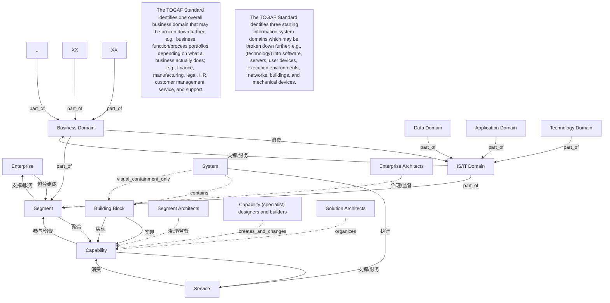

# G248/fig6-1 · 架构层级、角色与域关系的实体关系图

类型：`architecture-metamodel`。第 6 章“建立语境”要说明架构层级、角色与域如何互动：四级实体给出从企业到服务的层级链，四个角色注释说明谁在哪一级工作，域部分说明业务域如何利用 IS/IT 域的能力、又如何继续分解到数据/应用/技术域与构建块。

英文 PDF 物理页：[29]。本页为架构语义分析，原文与原图分别保留。

## 原图与可编辑图


[完整 JSON](fig6-1.json) · [可编辑 Mermaid](fig6-1.mmd) · [仅关系图](fig6-1.relations.mmd) · [层级分解图](fig6-1.hierarchy.mmd)

图形重建表达语义，不复制源图布局。虚线表示解释、矩阵映射或分组关系，不自动表示不确定性的概率。



## 架构分析

先读顶部四段角色文字，按列对应下方的 Enterprise、Segment、Capability、Service。再读中间主链：Enterprise —has→ Segment —offers→ Capability —enables→ Service，每条线下方还有反向读法（< enables、< organized by、< utilizes）。然后读下半部：Business Domain 与 IS/IT Domain 之间的能力供需、两者向上归入 Segment 的箭头、以及各自的向下分解（XX/XX/.. 与 Data/Application/Technology Domain）。最后读右侧 Capability 与 Building Block、Service 与 System 的实现/执行关系。

- 本图有 20 个具名或隐含元素、24 条关系和 1 条包含/分组记录。
- 包含/分组树最大深度为 1；根节点为 企业、分段、能力、服务、业务域、信息系统/IT 域、数据域、应用域、技术域、系统、XX（占位子域一）、XX（占位子域二）、..（省略）、企业架构师、分段架构师、能力（专家）设计与构建者、解决方案架构师、TOGAF 标准识别一个总体业务域，可进一步分解；例如按企业实际业务划分为业务功能/流程组合，如财务、制造、法务、人力资源、客户管理、服务与支持。、TOGAF 标准识别三个起始信息系统域，它们可进一步分解；例如（技术域）可分解为软件、服务器、用户设备、执行环境、网络、建筑与机械设备。。
- 本图没有可直接确认为人员直属汇报的关系；视觉上下位置、能力分解和治理职责分别读取。
- 治理边回答谁提供约束、指导或监督；它们与岗位汇报边分别存储。
- 包含分组后有 3 个连通分量；分离可能源于图例、并列分类或独立示例，未自动补边。
- 核对14实体/域/占位符、4段角色完整句与2段域拆分说明。
- 复核六条命名连接与基数、三组分解分叉及箭头方向。System/Building Block只由嵌套和数量注记表达包含。
- 修正角色按列附会目标的问题：EA跨分段治理、Segment Architects治理分段内能力、Capability specialists构建能力、Solution Architects组织能力形成方案/服务。它们是文字支持的关系，不是显式连线。

### 如何用于项目

- 使用本图的实体类型作为建模词表，建立本地实体ID，再分别填入关系端点与证据。
- 核对主动/被动关系的语义方向和基数；实现、使能、使用、包含及实例化分别建模。

### 结构所表达的逻辑

- 顶层是四级链：Enterprise（1..*）—has→（1..*）Segment（1..*）—offers→（1..*）Capability（1..*）—enables→（1..*）Service；三条线都标了 1..*，并各有反向读法。
- 反向读法表明层级间的支撑关系：Segment < enables Enterprise（分段使能企业）、Capability < organized by Segment（能力由分段组织）、Service < utilizes Capability（服务利用能力）。
- 四个角色与层级对应：企业架构师跨分段治理、分段架构师治理分段内能力、能力（专家）设计与构建者创建/变更构建块中的能力、解决方案架构师把能力组织为交付服务的方案。
- Business Domain（1..*）utilizes capabilities from（0..*）IS/IT Domain；反向是 IS/IT Domain < provides capabilities to Business Domain，即业务域消费、IS/IT 域提供能力。
- Business Domain 与 IS/IT Domain 都通过无标签箭头向上归入 Segment，说明一个分段由业务域与信息系统域共同构成。
- 域可继续分解：Business Domain 下是 XX、XX、..（占位示例）；IS/IT Domain 下固定为 Data Domain、Application Domain、Technology Domain 三个域。
- Capability 由 1..* Building Block 实现（implemented by > / < implements，两端 1..*）。
- Service 由 1..* System 执行（performed by ∨，两端 1..*）；System 内嵌套 Building Block，并标 1..* 与 ∨/∧，表示系统由构建块组成。

## 上下级与包含

Segment按领域分解为Business Domain和IS/IT Domain；业务域继续分解为占位的业务子域，IS/IT Domain分解为Data/Application/Technology Domain。System包含Building Block。四段角色文字描述职责范围，均不是管理汇报树。

|父项|子项|层级类型|依据与解释|
|---|---|---|---|
|系统|构建块|visual_containment_only|保存原图解释中的包含；业务关系类型需要图例或正文进一步限定。|

### 业务组成与特化

|父项/范围/类型|子项/责任对象/实例|语义|
|---|---|---|
|企业|分段|composition|
|分段|能力|aggregation|

### 治理范围

|父项/范围/类型|子项/责任对象/实例|语义|
|---|---|---|
|企业架构师|分段|governs|
|分段架构师|能力|governs|

## 全部元素与角色

|元素ID|原文名称|类型|含义|直接父项|深度|
|---|---|---|---|---|---|
|enterprise|Enterprise|architecture|企业级架构层级。|—||
|segment|Segment|architecture|分段级架构层级，向上使能企业、向下组织能力并统辖业务域与 IS/IT 域。|—||
|capability|Capability|capability|能力级，由构建块实现。|—||
|service|Service|service|对外交付的服务，由系统执行。|—||
|business_domain|Business Domain|architecture|业务架构域，可继续分解为业务功能/流程组合等；图中“Business”为彩色强调。|—||
|is_it_domain|IS/IT Domain|architecture|信息系统域，向上为业务域提供能力。|—||
|data_domain|Data Domain|architecture|IS/IT 域的三个起始域之一；“Data”为粉色强调。|—||
|application_domain|Application Domain|architecture|IS/IT 域的三个起始域之一；“Application”为绿色强调。|—||
|technology_domain|Technology Domain|architecture|IS/IT 域的三个起始域之一；“Technology”为蓝色强调。|—||
|system|System|application|执行服务的系统，框内嵌套构建块。|—||
|building_block|Building Block|building_block|实现能力的构建块，同时是系统的组成部分。|系统|1|
|xx_left|XX|other|占位示例，代表业务域可继续分解出的子域。|—||
|xx_center|XX|other|占位示例，代表业务域可继续分解出的子域。|—||
|ellipsis|..|other|表示还可以有更多子域。|—||
|role_enterprise_architects|Enterprise Architects|role|原文：Enterprise Architects evolve and govern aspects across and between segments to achieve goals and objectives. 中文：演进并治理跨分段及分段之间的事务，以实现目标与目的。|—||
|role_segment_architects|Segment Architects|role|原文：Segment Architects evolve and govern capabilities within segments to achieve goals and objectives. 中文：演进并治理分段内的能力，以实现目标与目的。|—||
|role_capability_designers|Capability (specialist) designers and builders|role|原文：Capability (specialist) designers and builders create and change capability in building blocks to satisfy requirements. 中文：在构建块中创建和变更能力，以满足需求。|—||
|role_solution_architects|Solution Architects|role|原文：Solution Architects organize capabilities into new or changed solutions delivering services to meet requirements. 中文：把能力组织为新的或变更后的解决方案，交付服务以满足需求。|—||
|note_business_domain|The TOGAF Standard identifies one overall business domain that may be broken down further; e.g., business function/process portfolios depending on what a business actually does; e.g., finance, manufacturing, legal, HR, customer management, service, and support.|note|解释 XX/XX/.. 占位框的含义。|—||
|note_is_it_domains|The TOGAF Standard identifies three starting information system domains which may be broken down further; e.g., (technology) into software, servers, user devices, execution environments, networks, buildings, and mechanical devices.|note|解释 Data/Application/Technology 三个起始域。|—||

## 全部关系

实线连接实体，线上用 “has >”“< enables” 这类带 > / < 的文字表示阅读方向（> 向右、< 向左），两端数字为基数；带文字的关系线本身没有箭头，方向只能看文字符号。域分解与归入分段的线是没有文字的细实线，箭头指向“整体”一端（Segment 或上级域）。System 与 Building Block 之间用嵌套框加 ∨ / 1..* / ∧ 表示组成。全图为纯黑白线框加四处彩色强调词。

|主体|语义关系|客体|显式线/隐式|原文标签|依据|
|---|---|---|---|---|---|
|企业|包含组成|分段|显式连线|has >|企业拥有一个或多个分段；箭头向右。|
|分段|支撑/服务|企业|显式连线|< enables|与 has 同一条连线：分段使能企业；箭头向左，两端 1..*。|
|分段|聚合|能力|显式连线|offers >|分段提供一个或多个能力；箭头向右。|
|能力|参与/分配|分段|显式连线|< organized by|与 offers 同一条连线：能力由分段组织；箭头向左，两端 1..*。|
|能力|支撑/服务|服务|显式连线|enables >|能力使能服务；箭头向右，两端 1..*。|
|服务|消费|能力|显式连线|< utilizes|与 enables 同一条连线：服务利用能力；箭头向左，两端 1..*。|
|业务域|消费|信息系统/IT 域|显式连线|utilizes capabilities from >|业务域从 IS/IT 域利用能力；Business Domain 端 1..*、IS/IT Domain 端 0..*。|
|信息系统/IT 域|支撑/服务|业务域|显式连线|< provides capabilities to|与 utilizes capabilities from 同一条连线：IS/IT 域向业务域提供能力；箭头向左。|
|业务域|part_of|分段|显式连线||无标签分解线的箭头指向整体：子域/占位域→父域、业务/IS-IT域→Segment；这不是人员汇报关系。|
|信息系统/IT 域|part_of|分段|显式连线||无标签分解线的箭头指向整体：子域/占位域→父域、业务/IS-IT域→Segment；这不是人员汇报关系。|
|XX（占位子域一）|part_of|业务域|显式连线||无标签分解线的箭头指向整体：子域/占位域→父域、业务/IS-IT域→Segment；这不是人员汇报关系。|
|XX（占位子域二）|part_of|业务域|显式连线||无标签分解线的箭头指向整体：子域/占位域→父域、业务/IS-IT域→Segment；这不是人员汇报关系。|
|..（省略）|part_of|业务域|显式连线||无标签分解线的箭头指向整体：子域/占位域→父域、业务/IS-IT域→Segment；这不是人员汇报关系。|
|数据域|part_of|信息系统/IT 域|显式连线||无标签分解线的箭头指向整体：子域/占位域→父域、业务/IS-IT域→Segment；这不是人员汇报关系。|
|应用域|part_of|信息系统/IT 域|显式连线||无标签分解线的箭头指向整体：子域/占位域→父域、业务/IS-IT域→Segment；这不是人员汇报关系。|
|技术域|part_of|信息系统/IT 域|显式连线||无标签分解线的箭头指向整体：子域/占位域→父域、业务/IS-IT域→Segment；这不是人员汇报关系。|
|构建块|实现|能力|显式连线|implemented by >|被动implemented by转为实现者→被实现对象；原图方向另外保存。|
|构建块|实现|能力|显式连线|< implements|与 implemented by 同一条连线：构建块实现能力；箭头向左。|
|系统|执行|服务|显式连线|performed by ∨|performed by转为执行系统→服务。|
|系统|contains|构建块|implicit|∨ 1..* ∧|System包含Building Block由嵌套框与1..*文字表达，二者间未画双向连接线；∨/∧是文字阅读标记。|
|企业架构师|治理/监督|分段|implicit||关系来自顶部完整角色句子的宾语与范围；角色注释没有连线，不能仅按所在列指向企业/分段/服务。|
|分段架构师|治理/监督|能力|implicit||关系来自顶部完整角色句子的宾语与范围；角色注释没有连线，不能仅按所在列指向企业/分段/服务。|
|能力（专家）设计与构建者|creates_and_changes|能力|implicit||关系来自顶部完整角色句子的宾语与范围；角色注释没有连线，不能仅按所在列指向企业/分段/服务。|
|解决方案架构师|organizes|能力|implicit||关系来自顶部完整角色句子的宾语与范围；角色注释没有连线，不能仅按所在列指向企业/分段/服务。|

### 极性、基数与图文冲突

数值和符号按原图记录；业务解释与原图冲突时分别保存，不静默修正原文。

|关系ID|极性|基数/端点标记|冲突说明|
|---|---|---|---|
|G248/fig6-1#r0001||"1..*:1..*"||
|G248/fig6-1#r0002||"1..*:1..*"||
|G248/fig6-1#r0003||"1..*:1..*"||
|G248/fig6-1#r0004||"1..*:1..*"||
|G248/fig6-1#r0005||"1..*:1..*"||
|G248/fig6-1#r0006||"1..*:1..*"||
|G248/fig6-1#r0007||"1..*:0..*"||
|G248/fig6-1#r0008||"0..*:1..*"||
|G248/fig6-1#r0017||"1..*:1..*"||
|G248/fig6-1#r0018||"1..*:1..*"||
|G248/fig6-1#r0019||"1..*:1..*"||
|G248/fig6-1#r0020||"1..*"||

## 关系两端基数与物理表达

```json
{
  "id": "audit_relation_cardinalities",
  "title_zh": "关系两端基数与物理表达",
  "columns": [
    "A",
    "A端基数",
    "B",
    "B端基数",
    "关系/表达"
  ],
  "rows": [
    [
      "Enterprise",
      "1..*",
      "Segment",
      "1..*",
      "has / enables"
    ],
    [
      "Segment",
      "1..*",
      "Capability",
      "1..*",
      "offers / organized by"
    ],
    [
      "Capability",
      "1..*",
      "Service",
      "1..*",
      "enables / utilizes"
    ],
    [
      "Business Domain",
      "1..*",
      "IS/IT Domain",
      "0..*",
      "utilizes capabilities from / provides capabilities to"
    ],
    [
      "Capability",
      "1..*",
      "Building Block",
      "1..*",
      "implemented by / implements"
    ],
    [
      "Service",
      "1..*",
      "System",
      "1..*",
      "performed by"
    ],
    [
      "System",
      "未标注",
      "Building Block",
      "1..*",
      "嵌套包含，不是独立连接线"
    ]
  ]
}
```

## 本轮语义修正

- 无标签分解线的箭头指向整体：子域/占位域→父域、业务/IS-IT域→Segment；这不是人员汇报关系。
- 无标签分解线的箭头指向整体：子域/占位域→父域、业务/IS-IT域→Segment；这不是人员汇报关系。
- 无标签分解线的箭头指向整体：子域/占位域→父域、业务/IS-IT域→Segment；这不是人员汇报关系。
- 无标签分解线的箭头指向整体：子域/占位域→父域、业务/IS-IT域→Segment；这不是人员汇报关系。
- 无标签分解线的箭头指向整体：子域/占位域→父域、业务/IS-IT域→Segment；这不是人员汇报关系。
- 无标签分解线的箭头指向整体：子域/占位域→父域、业务/IS-IT域→Segment；这不是人员汇报关系。
- 无标签分解线的箭头指向整体：子域/占位域→父域、业务/IS-IT域→Segment；这不是人员汇报关系。
- 无标签分解线的箭头指向整体：子域/占位域→父域、业务/IS-IT域→Segment；这不是人员汇报关系。
- 被动implemented by转为实现者→被实现对象；原图方向另外保存。
- performed by转为执行系统→服务。
- System包含Building Block由嵌套框与1..*文字表达，二者间未画双向连接线；∨/∧是文字阅读标记。
- 关系来自顶部完整角色句子的宾语与范围；角色注释没有连线，不能仅按所在列指向企业/分段/服务。
- 关系来自顶部完整角色句子的宾语与范围；角色注释没有连线，不能仅按所在列指向企业/分段/服务。
- 关系来自顶部完整角色句子的宾语与范围；角色注释没有连线，不能仅按所在列指向企业/分段/服务。
- 关系来自顶部完整角色句子的宾语与范围；角色注释没有连线，不能仅按所在列指向企业/分段/服务。

## 误读检查

- “< enables”应读作 Segment 使能 Enterprise（箭头向左），不要读成 Enterprise 使能 Segment。
- “Business Domain utilizes capabilities from IS/IT Domain”表示业务域从 IS/IT 域获取能力，不是 IS/IT 域从业务域获取能力；反向的“< provides capabilities to”才是 IS/IT 域向业务域提供能力。
- 两个“XX”和一个“..”是占位示例框，不是名为 XX 的实体；底注说明业务域可以继续分解为业务功能/流程组合等。
- Building Block 画在 System 框内，但它同时通过 implemented by / implements 与 Capability 相连；不要把它只理解为 System 的内部零件。
- IS/IT 端的 0..* 表示一个业务域可以利用零个或多个 IS/IT 域，不要读成至少一个。
- 四个彩色词（Business、Data、Application、Technology）只是强调，不是图例分类；中文稿当前引用的 SVG 把整张 ERD 换成了层级/角色/交付物表，不能据它理解本图。

## 原文证据

### [PDF 第 29 页](../../../documents/G248.md#page-29)

> and open, or much more specific and closed, providing the detailed design, build, and operations work that satisfies the architecture. The architecture roles integrate and work with the specialists and bind all of the specialist activity together such that the final executing solutions and services best satisfy their context and concept and deliver the desired outcomes. Figure 6-1 shows how the architecture levels, roles, and domains interact.
> Figure 6-1: An ERD showing the Relationships between Architecture Levels, Roles, and Domains

## 来源与分析状态

所有元素/关系均有来源定位；未把历史解释重命名为本轮逐线视觉确认。源图与语义图是两种视图，布局不证明汇报或因果。

源 PDF SHA-256：`810df20478f65d8dfd969089f9c682ec268d0e3a9126e062bda5191c9017e19c`。

源图记录：[原始解释与转录](../../../figures/G248/fig6-1.json)。

```json
{
  "quality": {
    "graph_integrity": "checked",
    "semantic_analysis": "typed-graph-and-context-analysis",
    "visual_review": "source-content-audited",
    "notice_zh": "所有元素/关系均有来源定位；未把历史解释重命名为本轮逐线视觉确认。源图与语义图是两种视图，布局不证明汇报或因果。"
  },
  "source_uncertainty": {
    "confidence": "medium",
    "uncertainties_zh": [
      "System 与 Building Block 之间的符号是 ∨、1..*、∧ 三个字符，未说明是双向箭头还是逻辑符号；按“系统由 1..* 构建块组成”记录为 composition、双箭头，基数只在 System 端标出。",
      "Business Domain 与 IS/IT Domain 向上归入 Segment 的两条线没有文字与基数，按版式判为组成/归入关系（箭头指向 Segment）。",
      "顶部四个角色注释与下方实体的对应关系由横向位置推断（图中没有连线），标为 implicit。",
      "Business Domain/IS-IT Domain 的“1..*”“0..*”分别标在线两端，按左端 Business Domain、右端 IS/IT Domain 归属。"
    ],
    "analyzed_from": [
      "英文 PDF 第 29 页图 6-1 截图（220 dpi）及 2×2 放大分块",
      "英文 PDF 第 29 页正文",
      "中文稿 G248e_构建块的选择方法.md 第 336–355 行",
      "figs/g248_fig6-1.svg 源码"
    ],
    "date": "2026-10-31"
  },
  "source_conflicts": []
}
```
