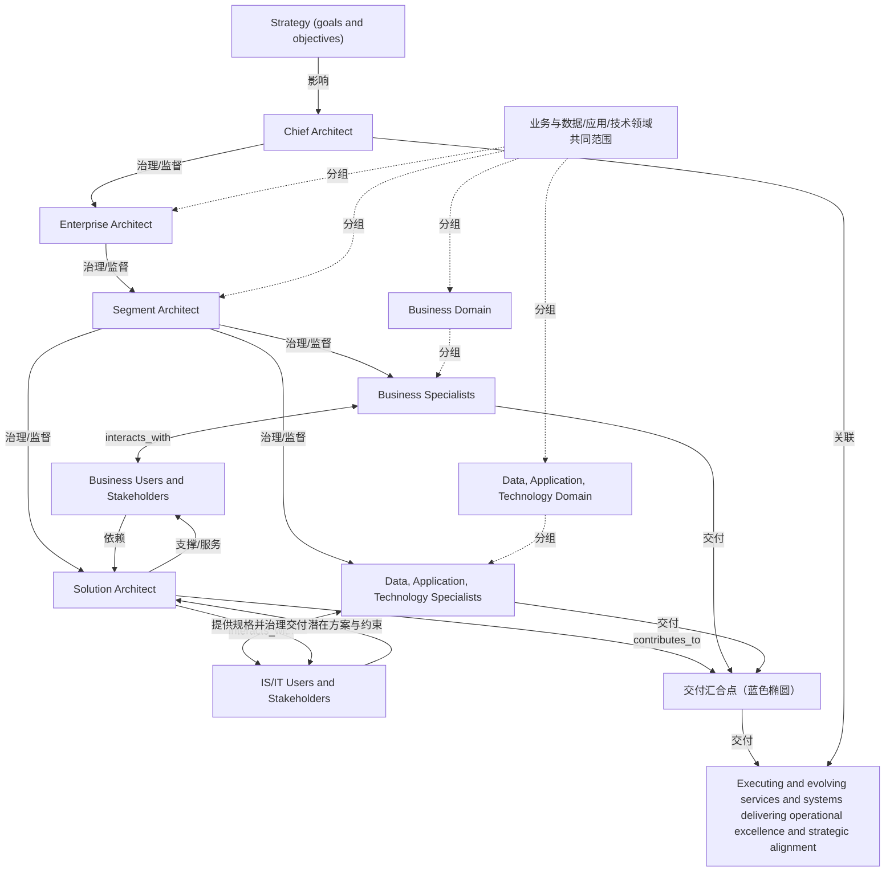

# G249/fig4-1 · 架构角色及其关系

类型：`decomposition-or-organization-model`。第4章用示例角色与协作关系说明架构实践如何支持不同影响范围的决策：Chief Architect是Enterprise Architect的特例；企业、分段与解决方案视角分别治理跨分段、分段内能力和满足需求的解决方案。

英文 PDF 物理页：[16]。本页为架构语义分析，原文与原图分别保留。

## 原图与可编辑图


[完整 JSON](fig4-1.json) · [可编辑 Mermaid](fig4-1.mmd) · [仅关系图](fig4-1.relations.mmd) · [层级分解图](fig4-1.hierarchy.mmd)

图形重建表达语义，不复制源图布局。虚线表示解释、矩阵映射或分组关系，不自动表示不确定性的概率。



## 架构分析

先读中央架构职责链及其上下文、领导、监督与治理标签，再读两侧专家和用户的协作。Business Domain与Data, Application, Technology Domain标签位于一块连续灰色范围内，不是两个独立灰框。专家与用户之间的纵向双向实线没有文字标签；需求、潜在内容及约束、规格与交付治理短语属于Solution Architect的横向交互。最后读蓝色三路交付汇合、绿色工作方案回路与左上运营卓越及战略一致性成果。

- 本图有 14 个具名或隐含元素、17 条关系和 6 条包含/分组记录。
- 包含/分组树最大深度为 2；根节点为 战略（目标与目的）、首席架构师、解决方案架构师、业务用户与利益相关者、IS/IT 用户与利益相关者、业务与数据/应用/技术领域共同范围、交付汇合点（蓝色椭圆）、执行并演进服务与系统，以交付卓越运营及战略一致性。
- 本图没有可直接确认为人员直属汇报的关系；视觉上下位置、能力分解和治理职责分别读取。
- 治理边回答谁提供约束、指导或监督；它们与岗位汇报边分别存储。
- 逐项核对角色、用户、域标签及全部治理/交互文字，补齐原先遗漏的左上绿色运营成果句。
- 核对蓝色三路交付汇合、椭圆节点、绿色工作方案反馈回路与首席架构师向运营成果的黑色虚线。
- 专家↔用户纵线没有需求/规格标签，修正旧记录挪用邻线说明；右侧接收短语保留源图原文。
- 域范围是一块连续灰色矩形；中央职责链不直接等价于人事汇报树。

### 如何用于项目

- 按父项展开所有直接子项，检查同层粒度、重叠和缺项。
- 保留组成、分类、能力分解与组织汇报的区别；将示例名称替换为已确认的项目对象。

### 结构所表达的逻辑

- Chief Architect整合战略与运营语境，向架构实践提供全景能力与解决方案组件的上下文、领导与监督；其角色特例关系不等于额外的人事层级。
- Enterprise Architect跨多个域和情境提供领导与治理；Segment Architect为具体域和情境提供领导与治理，并向Solution Architect提供上下文、领导与监督。
- 连续灰色矩形表示业务与数据/应用/技术领域的共同范围；域标签不是两个人事部门，视觉上下位置不自动形成正式汇报关系。
- Business Specialists与Business Users and Stakeholders、技术专家与IS/IT Users and Stakeholders之间各有一条无标签双向实线；不从邻线借用需求、规格或交付治理标签。
- Solution Architect从业务侧接收需求，从IS/IT侧接收图中逐字写出的potential and constraints；向两侧提供规格并治理解决方案交付。
- 两侧专家的蓝色交付线与Solution Architect的蓝色虚线在椭圆处汇合；绿色工作方案回路关联执行并演进服务与系统的成果，Chief Architect另有黑色虚线关联该成果。

## 上下级与包含

四种架构角色表达职责范围与治理关系；Chief Architect是Enterprise Architect的特例。连续灰色范围及域内专业分组不是固定四级人事汇报树。

|父项|子项|层级类型|依据与解释|
|---|---|---|---|
|业务与数据/应用/技术领域共同范围|企业架构师|visual_grouping|框、泳道、域或分类组的成员归属；没有额外证据不提升为业务组合或管理关系。|
|业务与数据/应用/技术领域共同范围|分段架构师|visual_grouping|框、泳道、域或分类组的成员归属；没有额外证据不提升为业务组合或管理关系。|
|业务与数据/应用/技术领域共同范围|业务域|visual_grouping|框、泳道、域或分类组的成员归属；没有额外证据不提升为业务组合或管理关系。|
|业务与数据/应用/技术领域共同范围|数据、应用、技术域|visual_grouping|框、泳道、域或分类组的成员归属；没有额外证据不提升为业务组合或管理关系。|
|业务域|业务专家|visual_grouping|框、泳道、域或分类组的成员归属；没有额外证据不提升为业务组合或管理关系。|
|数据、应用、技术域|数据、应用、技术专家|visual_grouping|框、泳道、域或分类组的成员归属；没有额外证据不提升为业务组合或管理关系。|

### 治理范围

|父项/范围/类型|子项/责任对象/实例|语义|
|---|---|---|
|首席架构师|企业架构师|governs|
|企业架构师|分段架构师|governs|
|分段架构师|业务专家|governs|
|分段架构师|数据、应用、技术专家|governs|
|分段架构师|解决方案架构师|governs|

## 全部元素与角色

|元素ID|原文名称|类型|含义|直接父项|深度|
|---|---|---|---|---|---|
|strategy|Strategy (goals and objectives)|note|说明：战略（目标与目的）|—||
|chief_arch|Chief Architect|role|角色：首席架构师|—||
|enterprise_arch|Enterprise Architect|role|角色：企业架构师|业务与数据/应用/技术领域共同范围|1|
|segment_arch|Segment Architect|role|角色：分段架构师|业务与数据/应用/技术领域共同范围|1|
|solution_arch|Solution Architect|role|角色：解决方案架构师|—||
|business_domain|Business Domain|group|分组：业务域|业务与数据/应用/技术领域共同范围|1|
|tech_domain|Data, Application, Technology Domain|group|分组：数据、应用、技术域|业务与数据/应用/技术领域共同范围|1|
|business_specialists|Business Specialists|role|角色：业务专家|业务域|2|
|tech_specialists|Data, Application, Technology Specialists|role|角色：数据、应用、技术专家|数据、应用、技术域|2|
|business_users|Business Users and Stakeholders|stakeholder|利益相关者：业务用户与利益相关者|—||
|isit_users|IS/IT Users and Stakeholders|stakeholder|利益相关者：IS/IT 用户与利益相关者|—||
|domain_scope|业务与数据/应用/技术领域共同范围|group|原图是一块连续灰色大矩形；左右域名标注区域，未各画一只独立框。|—||
|delivery_junction|交付汇合点（蓝色椭圆）|junction|业务专家、技术专家、解决方案架构师的蓝色虚线汇入此点，再转为绿色工作方案反馈回路。|—||
|operational_alignment|Executing and evolving services and systems delivering operational excellence and strategic alignment|outcome|左上绿色文字；接收首席架构师上下文侧的黑色虚线以及底部工作方案绿色回路。|—||

## 全部关系

中央和分支治理箭头按各自原文标签读取。专家↔用户的纵向双向实线无标签；Solution Architect横向线旁才有接收需求、接收potential and constraints、提供规格并治理交付的文字。蓝色虚线进入交付汇合点，绿色虚线表达工作方案交付回路；线色、虚实与汇合点分别保留，不将交付线解释为岗位汇报。

|主体|语义关系|客体|显式线/隐式|原文标签|依据|
|---|---|---|---|---|---|
|战略（目标与目的）|影响|首席架构师|显式连线||战略目标与目的构成首席架构师的语境|
|首席架构师|治理/监督|企业架构师|显式连线|Provides context, leadership, and oversight of the capabilities and solution components in the architecture landscape|治理/监督|
|企业架构师|治理/监督|分段架构师|显式连线|Provides leadership and governance across multiple domains and situations|治理/监督|
|分段架构师|治理/监督|业务专家|显式连线|Provides leadership and governance for specific domains and situations|治理/监督|
|分段架构师|治理/监督|数据、应用、技术专家|显式连线|Provides leadership and governance for specific domains and situations|治理/监督|
|分段架构师|治理/监督|解决方案架构师|显式连线|Provides context, leadership, and oversight|治理/监督|
|业务专家|interacts_with|业务用户与利益相关者|显式连线||专家与用户之间是一条无标签双向实线。需求/规格短语位于Solution Architect横线旁，不能移到此纵线。|
|数据、应用、技术专家|interacts_with|IS/IT 用户与利益相关者|显式连线||专家与用户之间是一条无标签双向实线。需求/规格短语位于Solution Architect横线旁，不能移到此纵线。|
|业务用户与利益相关者|依赖|解决方案架构师|显式连线|Receive requirements|依赖|
|解决方案架构师|支撑/服务|业务用户与利益相关者|显式连线|Provide specifications and govern the delivery of solutions|支撑/服务|
|IS/IT 用户与利益相关者|提供潜在方案与约束|解决方案架构师|显式连线|Receive potential and constraints ←|原图粉色短语逐字为Receive potential and constraints，箭头向左指向Solution Architect；不添加图中未印出的solutions一词。|
|解决方案架构师|提供规格并治理交付|IS/IT 用户与利益相关者|显式连线|Provide specifications and govern the delivery of solutions|黑色规格/交付治理短语指向右侧用户。|
|解决方案架构师|contributes_to|交付汇合点（蓝色椭圆）|显式连线||源图蓝色虚线从Solution Architect向下箭头进入蓝色椭圆，不是到复合交付物文字的黑色实线。|
|业务专家|交付|交付汇合点（蓝色椭圆）|显式连线|Deliver actors, working systems, sub-systems, and components|蓝色虚线由对应专家框外侧绕到底部，箭头进入蓝色椭圆。|
|数据、应用、技术专家|交付|交付汇合点（蓝色椭圆）|显式连线|Deliver actors, working systems, sub-systems, and components|蓝色虚线由对应专家框外侧绕到底部，箭头进入蓝色椭圆。|
|交付汇合点（蓝色椭圆）|交付|执行并演进服务与系统，以交付卓越运营及战略一致性|显式连线|Deliver working solutions|椭圆向下蓝色虚线转为向左/向上的绿色虚线回路，最终箭头朝左上运营成果文字。|
|首席架构师|关联|执行并演进服务与系统，以交付卓越运营及战略一致性|显式连线||顶部第二条黑色虚线从首席架构师侧向左指向执行/演进服务系统文字，与上方战略→首席架构师方向相反。|

## 本轮否定的历史元素

源图未出现的旧元素保留供追溯，不进入当前节点、关系或层级。

|旧元素|旧标签|否定依据|
|---|---|---|
|deliverables|Deliver working solutions / Deliver actors, working systems, sub-systems, and components|历史转录将多个交付线标签合并成一个节点；源图没有对应的独立实体框。交付标签、汇合点及工作方案回路已分别记录，汇总节点仅保留在历史中。|

## 本轮否定的历史关系

以下旧解释保留用于追溯，不进入当前关系图、层级或知识图谱的有效边。

|旧记录|主体|旧关系|客体|否定依据|
|---|---|---|---|---|
|7|业务专家|serving|业务用户与利益相关者|这是同一无标签专家↔用户纵线的重复解释，并借用了邻近解决方案架构师横线的文字；双向关系已由另一记录保留。|
|9|数据、应用、技术专家|serving|IS/IT 用户与利益相关者|这是同一无标签专家↔用户纵线的重复解释，并借用了邻近解决方案架构师横线的文字；双向关系已由另一记录保留。|

## 本轮语义修正

- 专家与用户之间是一条无标签双向实线。需求/规格短语位于Solution Architect横线旁，不能移到此纵线。
- 这是同一无标签专家↔用户纵线的重复解释，并借用了邻近解决方案架构师横线的文字；双向关系已由另一记录保留。
- 专家与用户之间是一条无标签双向实线。需求/规格短语位于Solution Architect横线旁，不能移到此纵线。
- 这是同一无标签专家↔用户纵线的重复解释，并借用了邻近解决方案架构师横线的文字；双向关系已由另一记录保留。
- 原图粉色短语逐字为Receive potential and constraints，箭头向左指向Solution Architect；不添加图中未印出的solutions一词。
- 黑色规格/交付治理短语指向右侧用户。
- 源图蓝色虚线从Solution Architect向下箭头进入蓝色椭圆，不是到复合交付物文字的黑色实线。
- 蓝色虚线由对应专家框外侧绕到底部，箭头进入蓝色椭圆。
- 蓝色虚线由对应专家框外侧绕到底部，箭头进入蓝色椭圆。
- 椭圆向下蓝色虚线转为向左/向上的绿色虚线回路，最终箭头朝左上运营成果文字。
- 顶部第二条黑色虚线从首席架构师侧向左指向执行/演进服务系统文字，与上方战略→首席架构师方向相反。

## 误读检查

- Chief Architect是Enterprise Architect的特例；四个名称不意味着必须设置四级岗位或四个AI代理。
- 一块连续灰色范围中的两个域标签不表示两个独立灰色框或组织部门。
- 专家与用户纵线无文字标签，不可将Solution Architect横线的需求/规格短语移到纵线上。
- 接收短语保留potential and constraints原文，不补造图中未出现的solutions一词。
- 角色与治理关系是可裁剪的参考模型，实际授权、人员汇报和项目事实须另有证据。

## 原文证据

### [PDF 第 16 页](../../../documents/G249.md#page-16)

> The TOGAF Standard provides an example set of roles that are valuable in the evolution and governance of the Architecture Landscape of an enterprise. They support effective decision making at different levels of impact and influence. The three main viewpoints of enterprise, segment and solution were introduced earlier. These are shown in Figure 4-1 together with some additional ones that are introduced below.
### [PDF 第 17 页](../../../documents/G249.md#page-17)

> Figure 4-1 shows the three main architecture roles (supplemented by the special case of the Chief Architect) in the central vertical relationship. Moving down from Chief Architect, through Enterprise Architect to Segment Architect (described in more detail below), there is greater detail in the understanding, leadership, and governance of the specific elements in the Architecture Landscape, enabling properly leveled decision-making. Most organizations have a set of management and control levels ranging from three to seven levels. It is common for enterprises to try to minimize the number of these levels. The TOGAF Standard provides a model with the minimum three levels of differentiation from which you can grow your model should you need to address more levels of shaping and governance.
### [PDF 第 18 页](../../../documents/G249.md#page-18)

> accountability for, and oversight of, the Architecture Landscape, its impact on the delivery of business services, and its governance.
> Their prime responsibility is to create the conditions for effective responses to the strategic change desired by an enterprise. They lead Enterprise Architects, Segment Architects, Solution Architects, and various specialists to create, implement, and operate the services and solutions needed to keep an enterprise operating effectively in its evolving marketplace.

## 来源与分析状态

所有元素/关系均有来源定位；未把历史解释重命名为本轮逐线视觉确认。源图与语义图是两种视图，布局不证明汇报或因果。

源 PDF SHA-256：`a21ad2452d4b7f77608254a7b1d0568481c52407277fd742a5430935d08271da`。

源图记录：[原始解释与转录](../../../figures/G249/fig4-1.json)。

```json
{
  "quality": {
    "graph_integrity": "checked",
    "semantic_analysis": "typed-graph-and-context-analysis",
    "visual_review": "source-content-audited",
    "notice_zh": "所有元素/关系均有来源定位；未把历史解释重命名为本轮逐线视觉确认。源图与语义图是两种视图，布局不证明汇报或因果。"
  },
  "source_uncertainty": {
    "status": "current-source-review",
    "uncertainties_zh": [
      "图中参考角色、范围与关系不能单独确定项目人员授权。"
    ],
    "historical_uncertainty": "历史不确定性单独保存在previous_source_uncertainty和原始figure记录中。"
  },
  "source_conflicts": []
}
```
