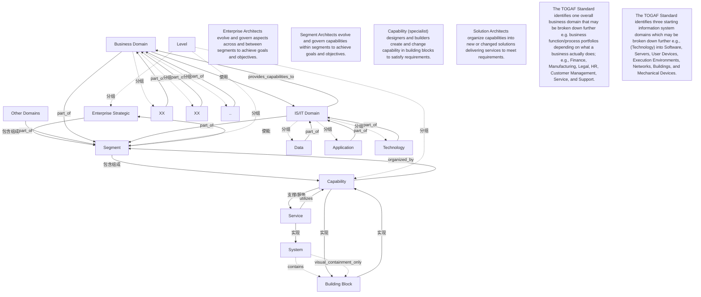

# G249/fig4-2 · 架构层级概念的实体关系图

类型：`architecture-metamodel`。图4-2把企业战略、分段、能力、服务、系统、构建块及域的关系与角色责任联系起来：企业架构师治理跨分段关系，分段架构师治理分段内能力，专家创建或改变构建块中的能力，解决方案架构师组织能力以交付满足需求的服务。

英文 PDF 物理页：[21]。本页为架构语义分析，原文与原图分别保留。

## 原图与可编辑图


[完整 JSON](fig4-2.json) · [可编辑 Mermaid](fig4-2.mmd) · [仅关系图](fig4-2.relations.mmd) · [层级分解图](fig4-2.hierarchy.mmd)

图形重建表达语义，不复制源图布局。虚线表示解释、矩阵映射或分组关系，不自动表示不确定性的概率。



## 架构分析

先读Level框内Enterprise Strategic、Segment、Capability三项，再跨框读Service。逐条读取has/enables、offers/organized by、enables/utilizes、performed by、implemented by/implements与域间能力使用关系的端点和基数。System内嵌Building Block，仅构建块数量标1..*，没有独立连接线或System端基数。再读指向整体域/Segment的分叉箭头以及四段角色责任注记。

- 本图有 22 个具名或隐含元素、21 条关系和 10 条包含/分组记录。
- 包含/分组树最大深度为 1；根节点为 层级、服务、系统、其他域、业务域、IS/IT 域、企业架构师跨分段演进与治理，以达成目标与目的。、分段架构师在分段内演进与治理能力，以达成目标与目的。、能力（专家）设计与构建者创建并变更构建块中的能力，以满足需求。、解决方案架构师把能力组织成新的/变更的解决方案，交付服务以满足需求。、总体业务域可按实际业务拆为功能/流程组合，例如财务、制造、法律、人力资源、客户管理、服务和支持。、三个起始信息系统域可继续细分，例如技术域细分为软件、服务器、用户设备、执行环境、网络、建筑和机械设备。。
- 本图没有可直接确认为人员直属汇报的关系；视觉上下位置、能力分解和治理职责分别读取。
- 包含分组后有 7 个连通分量；分离可能源于图例、并列分类或独立示例，未自动补边。
- 核对Level边界（止于Capability）、全部实体标签、4段角色文字和两段底注；分拆三个业务子域占位实例。
- 补齐Other/Business/IS-IT三域到Segment的分叉箭头，以及未记录的反向关系短语。
- 更正System/Building Block数量：只标构建块1..*，不能补造System端多重性；嵌套框无独立连接线。
- 数据/应用/技术与业务子域箭头均指向整体域；这是架构概念分解，不是人员组织关系。

### 如何用于项目

- 使用本图的实体类型作为建模词表，建立本地实体ID，再分别填入关系端点与证据。
- 核对主动/被动关系的语义方向和基数；实现、使能、使用、包含及实例化分别建模。

### 结构所表达的逻辑

- Level框仅包含Enterprise Strategic、Segment、Capability；Service位于框外。这是架构概念视角，不是人员层级。
- Enterprise Strategic与Segment、Segment与Capability、Capability与Service的显式关系线两端均标1..*；正反关系短语分别是has/enables、offers/organized by、enables/utilizes。
- Service与System通过performed by关联，两端均标1..*。System嵌套包含Building Block，仅Building Block数量标1..*，System端未标，嵌套之间没有独立连接线。
- Capability与Building Block两端均标1..*，正反短语是implemented by/implements；服务由系统执行，能力由构建块实现，两组概念不可混同。
- Business Domain端标1..*、IS/IT Domain端标0..*；业务域utilizes capabilities from信息系统域，反向是provides capabilities to。基数属于线的端点，不能把数字改写成对箭头起点的未经说明的数量要求。
- Other Domains、Business Domain和IS/IT Domain的分叉箭头指向Segment；三个业务占位子域指向Business Domain，Data/Application/Technology指向IS/IT Domain。这些分组归属不构成人事汇报。
- 四段角色注记分别绑定跨分段治理、分段内能力治理、构建块中的能力创建/变更和组织能力交付服务。业务域与信息系统域可以继续按企业实际情况细分。

## 上下级与包含

Level框止于Capability，Service在框外。System框内嵌Building Block。域及子域表达能力分组；指向整体域的箭头与视觉包含分别记录，不能推导人员汇报。

|父项|子项|层级类型|依据与解释|
|---|---|---|---|
|层级|企业战略层|visual_grouping|框、泳道、域或分类组的成员归属；没有额外证据不提升为业务组合或管理关系。|
|层级|分段|visual_grouping|框、泳道、域或分类组的成员归属；没有额外证据不提升为业务组合或管理关系。|
|层级|能力|visual_grouping|框、泳道、域或分类组的成员归属；没有额外证据不提升为业务组合或管理关系。|
|系统|构建块|visual_containment_only|保存原图解释中的包含；业务关系类型需要图例或正文进一步限定。|
|IS/IT 域|数据域|visual_grouping|框、泳道、域或分类组的成员归属；没有额外证据不提升为业务组合或管理关系。|
|IS/IT 域|应用域|visual_grouping|框、泳道、域或分类组的成员归属；没有额外证据不提升为业务组合或管理关系。|
|IS/IT 域|技术域|visual_grouping|框、泳道、域或分类组的成员归属；没有额外证据不提升为业务组合或管理关系。|
|业务域|左侧业务子域占位|visual_grouping|框、泳道、域或分类组的成员归属；没有额外证据不提升为业务组合或管理关系。|
|业务域|中部业务子域占位|visual_grouping|框、泳道、域或分类组的成员归属；没有额外证据不提升为业务组合或管理关系。|
|业务域|更多业务子域占位|visual_grouping|框、泳道、域或分类组的成员归属；没有额外证据不提升为业务组合或管理关系。|

### 业务组成与特化

|父项/范围/类型|子项/责任对象/实例|语义|
|---|---|---|
|企业战略层|分段|composition|
|分段|能力|composition|

## 全部元素与角色

|元素ID|原文名称|类型|含义|直接父项|深度|
|---|---|---|---|---|---|
|level|Level|group|分组：层级|—||
|enterprise_strategic|Enterprise Strategic|architecture|架构：企业战略层|层级|1|
|segment|Segment|architecture|架构：分段|层级|1|
|capability|Capability|capability|能力：能力|层级|1|
|service|Service|service|服务：服务|—||
|system|System|application|应用：系统|—||
|building_block|Building Block|building_block|构建块：构建块|系统|1|
|other_domains|Other Domains|group|分组：其他域|—||
|business_domain|Business Domain|group|分组：业务域|—||
|isit_domain|IS/IT Domain|group|分组：IS/IT 域|—||
|data_domain|Data|architecture|架构：数据域|IS/IT 域|1|
|application_domain|Application|architecture|架构：应用域|IS/IT 域|1|
|technology_domain|Technology|architecture|架构：技术域|IS/IT 域|1|
|note_ea|Enterprise Architects evolve and govern aspects across and between segments to achieve goals and objectives.|note|说明：企业架构师跨分段演进与治理，以达成目标与目的。|—||
|note_segment|Segment Architects evolve and govern capabilities within segments to achieve goals and objectives.|note|说明：分段架构师在分段内演进与治理能力，以达成目标与目的。|—||
|note_capability|Capability (specialist) designers and builders create and change capability in building blocks to satisfy requirements.|note|说明：能力（专家）设计与构建者创建并变更构建块中的能力，以满足需求。|—||
|note_solution|Solution Architects organize capabilities into new or changed solutions delivering services to meet requirements.|note|说明：解决方案架构师把能力组织成新的/变更的解决方案，交付服务以满足需求。|—||
|business_xx_left|XX|group|源图独立业务子域占位框；不是实际命名部门。|业务域|1|
|business_xx_center|XX|group|源图独立业务子域占位框；不是实际命名部门。|业务域|1|
|business_ellipsis|..|group|源图独立业务子域占位框；不是实际命名部门。|业务域|1|
|note_business_domains|The TOGAF Standard identifies one overall business domain that may be broken down further e.g. business function/process portfolios depending on what a business actually does; e.g., Finance, Manufacturing, Legal, HR, Customer Management, Service, and Support.|annotation|图中元素：总体业务域可按实际业务拆为功能/流程组合，例如财务、制造、法律、人力资源、客户管理、服务和支持。|—||
|note_isit_domains|The TOGAF Standard identifies three starting information system domains which may be broken down further e.g., (Technology) into Software, Servers, User Devices, Execution Environments, Networks, Buildings, and Mechanical Devices.|annotation|图中元素：三个起始信息系统域可继续细分，例如技术域细分为软件、服务器、用户设备、执行环境、网络、建筑和机械设备。|—||

## 全部关系

实体间ERD连线本身没有箭头头部，文字中的>、<、v是关系阅读方向标记；基数按实体端点记录。System与Building Block只有嵌套包含，没有独立连接线，System端基数未知。域与子域的分叉箭头指向整体域，域到Segment的分叉箭头指向Segment。反向文字是同一关系的另一个读法，不额外创造一条物理连接线。

|主体|语义关系|客体|显式线/隐式|原文标签|依据|
|---|---|---|---|---|---|
|企业战略层|包含组成|分段|显式连线|has >|实体连线无箭头头部；关系文字后的>或v表达阅读方向。|
|分段|包含组成|能力|显式连线|offers >|实体连线无箭头头部；关系文字后的>或v表达阅读方向。|
|能力|支撑/服务|服务|显式连线|enables >|实体连线无箭头头部；关系文字后的>或v表达阅读方向。|
|服务|实现|系统|显式连线|performed by v|实体连线无箭头头部；关系文字后的>或v表达阅读方向。|
|系统|contains|构建块|implicit||System通过嵌套包含Building Block，只有构建块数量1..*；原图没有System端的1..*或独立连接线。|
|能力|实现|构建块|显式连线|implemented by >|实体连线无箭头头部；关系文字后的>或v表达阅读方向。|
|业务域|使用|IS/IT 域|显式连线|utilizes capabilities from >|实体连线无箭头头部；关系文字后的>或v表达阅读方向。|
|左侧业务子域占位|part_of|业务域|显式连线||三个业务子域框分别连接父域；此条对应左侧XX，箭头指向父域。|
|数据域|part_of|IS/IT 域|显式连线||分叉箭头朝向IS/IT整体域，不是向下指向Data/Application/Technology。|
|应用域|part_of|IS/IT 域|显式连线||分叉箭头朝向IS/IT整体域，不是向下指向Data/Application/Technology。|
|技术域|part_of|IS/IT 域|显式连线||分叉箭头朝向IS/IT整体域，不是向下指向Data/Application/Technology。|
|其他域|part_of|分段|显式连线||源图三条域分支汇合后向上指向Segment。|
|业务域|part_of|分段|显式连线||源图三条域分支汇合后向上指向Segment。|
|IS/IT 域|part_of|分段|显式连线||源图三条域分支汇合后向上指向Segment。|
|中部业务子域占位|part_of|业务域|显式连线||与左侧XX共同组成业务子域分解分叉；箭头指父域。|
|更多业务子域占位|part_of|业务域|显式连线||与左侧XX共同组成业务子域分解分叉；箭头指父域。|
|分段|使能|企业战略层|显式连线|< enables|既有物理连线反向读法；不表示新增一条物理连接。|
|能力|organized_by|分段|显式连线|< organized by|既有物理连线反向读法；不表示新增一条物理连接。|
|服务|utilizes|能力|显式连线|< utilizes|既有物理连线反向读法；不表示新增一条物理连接。|
|构建块|实现|能力|显式连线|< implements|既有物理连线反向读法；不表示新增一条物理连接。|
|IS/IT 域|provides_capabilities_to|业务域|显式连线|< provides capabilities to|既有物理连线反向读法；不表示新增一条物理连接。|

### 极性、基数与图文冲突

数值和符号按原图记录；业务解释与原图冲突时分别保存，不静默修正原文。

|关系ID|极性|基数/端点标记|冲突说明|
|---|---|---|---|
|G249/fig4-2#r0001||{"from": "1..*", "to": "1..*", "basis": "printed-source-endpoint-cardinality"}||
|G249/fig4-2#r0002||{"from": "1..*", "to": "1..*", "basis": "printed-source-endpoint-cardinality"}||
|G249/fig4-2#r0003||{"from": "1..*", "to": "1..*", "basis": "printed-source-endpoint-cardinality"}||
|G249/fig4-2#r0004||{"from": "1..*", "to": "1..*", "basis": "printed-source-endpoint-cardinality"}||
|G249/fig4-2#r0005||{"from": null, "to": "1..*", "basis": "nested-building-block-count-only"}||
|G249/fig4-2#r0006||{"from": "1..*", "to": "1..*", "basis": "printed-source-endpoint-cardinality"}||
|G249/fig4-2#r0007||{"from": "1..*", "to": "0..*", "basis": "printed-source-endpoint-cardinality"}||
|G249/fig4-2#r0017||{"from": "1..*", "to": "1..*", "basis": "same-source-connector-reverse-reading"}||
|G249/fig4-2#r0018||{"from": "1..*", "to": "1..*", "basis": "same-source-connector-reverse-reading"}||
|G249/fig4-2#r0019||{"from": "1..*", "to": "1..*", "basis": "same-source-connector-reverse-reading"}||
|G249/fig4-2#r0020||{"from": "1..*", "to": "1..*", "basis": "same-source-connector-reverse-reading"}||
|G249/fig4-2#r0021||{"from": "0..*", "to": "1..*", "basis": "same-source-connector-reverse-reading"}||

## 本轮否定的历史元素

源图未出现的旧元素保留供追溯，不进入当前节点、关系或层级。

|旧元素|旧标签|否定依据|
|---|---|---|
|business_subdomains|XX, XX, ..|历史转录将三个占位框合并成XX, XX, ..汇总节点；源图实际是三个独立框，已由business_xx_left、business_xx_center、business_ellipsis记录。|

## ERD 关系与基数（按原图转录）

```json
{
  "id": "t_relations",
  "title_zh": "ERD 关系与基数（按原图转录）",
  "columns": [
    "主语",
    "关系",
    "宾语",
    "基数"
  ],
  "rows": [
    [
      "Enterprise Strategic",
      "has（反向 enables）",
      "Segment",
      "1..* → 1..*"
    ],
    [
      "Segment",
      "offers（反向 organized by）",
      "Capability",
      "1..* → 1..*"
    ],
    [
      "Capability",
      "enables（反向 utilizes）",
      "Service",
      "1..* → 1..*"
    ],
    [
      "Service",
      "performed by",
      "System",
      "1..* → 1..*"
    ],
    [
      "System",
      "contains",
      "Building Block",
      "System端未标；Building Block数量1..*"
    ],
    [
      "Capability",
      "implemented by（反向 implements）",
      "Building Block",
      "1..* → 1..*"
    ],
    [
      "Business Domain",
      "utilizes capabilities from（反向 provides capabilities to）",
      "IS/IT Domain",
      "1..* → 0..*"
    ]
  ],
  "notes_zh": "关系线无箭头头部，>和<是文字阅读标记。System/Building Block为嵌套包含，仅有构建块数量；Level框不含Service。"
}
```

## 本轮语义修正

- 实体连线无箭头头部；关系文字后的>或v表达阅读方向。
- 实体连线无箭头头部；关系文字后的>或v表达阅读方向。
- 实体连线无箭头头部；关系文字后的>或v表达阅读方向。
- 实体连线无箭头头部；关系文字后的>或v表达阅读方向。
- System通过嵌套包含Building Block，只有构建块数量1..*；原图没有System端的1..*或独立连接线。
- 实体连线无箭头头部；关系文字后的>或v表达阅读方向。
- 实体连线无箭头头部；关系文字后的>或v表达阅读方向。
- 三个业务子域框分别连接父域；此条对应左侧XX，箭头指向父域。
- 分叉箭头朝向IS/IT整体域，不是向下指向Data/Application/Technology。
- 分叉箭头朝向IS/IT整体域，不是向下指向Data/Application/Technology。
- 分叉箭头朝向IS/IT整体域，不是向下指向Data/Application/Technology。
- 源图三条域分支汇合后向上指向Segment。
- 源图三条域分支汇合后向上指向Segment。
- 源图三条域分支汇合后向上指向Segment。
- 与左侧XX共同组成业务子域分解分叉；箭头指父域。
- 与左侧XX共同组成业务子域分解分叉；箭头指父域。
- 既有物理连线反向读法；不表示新增一条物理连接。
- 既有物理连线反向读法；不表示新增一条物理连接。
- 既有物理连线反向读法；不表示新增一条物理连接。
- 既有物理连线反向读法；不表示新增一条物理连接。
- 既有物理连线反向读法；不表示新增一条物理连接。

## 误读检查

- Service不在Level框中，Level也不是组织层级。
- System端未标基数；Building Block的1..*不能被复制到System端。
- System/Building Block之间没有独立连接线，不把嵌套改绘成源图中存在的箭头。
- 关系文字方向标记与真实箭头头部不同；相反的两个关系短语不能计为两条不同物理连线。
- 顶部四段文字是角色责任注记，不能替代项目任命、授权与实际能力证据。

## 原文证据

### [PDF 第 21 页](../../../documents/G249.md#page-21)

> A segment is a coherent grouping of capabilities for management and control purposes, usually managed as portfolio of capabilities or a specific program of change. The TOGAF Standard also uses the concept of a domain. A domain is used to reflect any useful grouping of capabilities to be managed by an enterprise; with four particular Information Services (IS)/ Internet Technology (IT) related segment- based viewpoints that are useful in managing an Architecture Landscape that includes information systems. These four particular segments are called the business, application, data, and technology domains; see Figure 4-2.
> Figure 4-2: Entity Relationship Diagram for Architecture Level Concepts
### [PDF 第 22 页](../../../documents/G249.md#page-22)

> standards needed to ensure that the components from the segment(s), are effective, efficient, and legal. They collaborate effectively and easily with other architects ensuring that the overall environment can operate in a well-connected manner.
> They operate effectively when the situations encountered are dynamic, evolving, or novel in complexity, scope, or solution compared to those encountered before. They oversee all development of the systems, sub-systems, and components related to a segment(s), ensuring that they are fit for purpose, legal, and follow the required policies and standards.

## 来源与分析状态

所有元素/关系均有来源定位；未把历史解释重命名为本轮逐线视觉确认。源图与语义图是两种视图，布局不证明汇报或因果。

源 PDF SHA-256：`a21ad2452d4b7f77608254a7b1d0568481c52407277fd742a5430935d08271da`。

源图记录：[原始解释与转录](../../../figures/G249/fig4-2.json)。

```json
{
  "quality": {
    "graph_integrity": "checked",
    "semantic_analysis": "typed-graph-and-context-analysis",
    "visual_review": "source-content-audited",
    "notice_zh": "所有元素/关系均有来源定位；未把历史解释重命名为本轮逐线视觉确认。源图与语义图是两种视图，布局不证明汇报或因果。"
  },
  "source_uncertainty": {
    "status": "current-source-review",
    "uncertainties_zh": [
      "System端基数未标；不从嵌套或另一端的1..*推定。"
    ],
    "historical_uncertainty": "历史不确定性单独保存在previous_source_uncertainty和原始figure记录中。"
  },
  "source_conflicts": []
}
```
