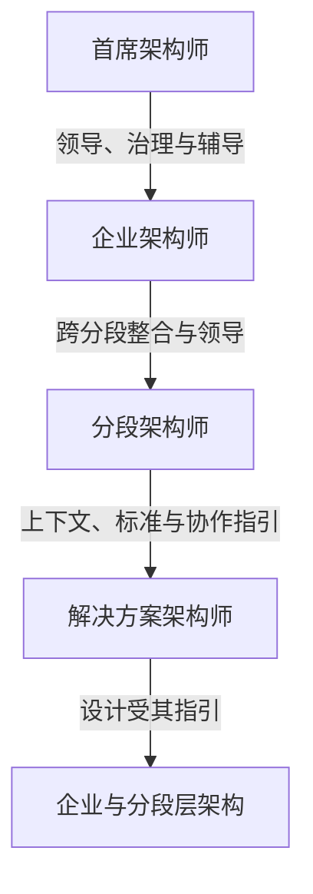

# 架构角色、职责与能力分析

明确回答每个角色负责什么、在哪个范围决策、与谁协作、输入输出是什么、需要哪些技能及多少深度。依据G249/G198及相关指南，保留原文页码和逐格证据。

[框架差异](comparison.md) · [完整技能数据](skills.json) · [上下级与协作关系](relationships.json) · [全26指南角色证据](mentions.md) · [逐角色族覆盖](coverage.md) · [数值验证](validation.json)

## 角色目录

|角色|来源|完整技能数|JSON|
|---|---|---:|---|
|[首席架构师](G249-chief-architect.md)|G249|0|[结构数据](G249-chief-architect.json)|
|[企业架构师](G249-enterprise-architect.md)|G249|71|[结构数据](G249-enterprise-architect.json)|
|[分段架构师（业务与技术）](G249-segment-architect.md)|G249|0|[结构数据](G249-segment-architect.json)|
|[解决方案架构师](G249-solution-architect.md)|G249|71|[结构数据](G249-solution-architect.json)|
|[业务域架构师](G249-business-domain-architect.md)|G249|71|[结构数据](G249-business-domain-architect.json)|
|[数据域架构师](G249-data-domain-architect.md)|G249|71|[结构数据](G249-data-domain-architect.json)|
|[应用域架构师](G249-application-domain-architect.md)|G249|71|[结构数据](G249-application-domain-architect.json)|
|[技术域架构师](G249-technology-domain-architect.md)|G249|71|[结构数据](G249-technology-domain-architect.json)|
|[架构委员会成员](G198-architecture-board-member.md)|G198|79|[结构数据](G198-architecture-board-member.json)|
|[架构赞助人](G198-architecture-sponsor.md)|G198|79|[结构数据](G198-architecture-sponsor.json)|
|[企业架构经理](G198-enterprise-architecture-manager.md)|G198|79|[结构数据](G198-enterprise-architecture-manager.json)|
|[技术架构师](G198-technology-architect.md)|G198|79|[结构数据](G198-technology-architect.json)|
|[数据架构师](G198-data-architect.md)|G198|79|[结构数据](G198-data-architect.json)|
|[应用架构师](G198-application-architect.md)|G198|79|[结构数据](G198-application-architect.json)|
|[业务架构师](G198-business-architect.md)|G198|79|[结构数据](G198-business-architect.json)|
|[项目群/项目经理](G198-program-project-manager.md)|G198|79|[结构数据](G198-program-project-manager.json)|
|[IT设计师](G198-it-designer.md)|G198|79|[结构数据](G198-it-designer.json)|
|[解决方案架构师](G198-solution-architect.md)|G198|79|[结构数据](G198-solution-architect.json)|
|[企业架构师](G198-enterprise-architect.md)|G198|0|[结构数据](G198-enterprise-architect.json)|
|[分段架构师](G198-segment-architect.md)|G198|0|[结构数据](G198-segment-architect.json)|
|[利益相关者（本指南治理语境）](G186-stakeholder.md)|G186|0|[结构数据](G186-stakeholder.json)|
|[利益相关者代理](G186-stakeholder-agent.md)|G186|0|[结构数据](G186-stakeholder-agent.json)|
|[领域专家](G186-subject-matter-expert.md)|G186|0|[结构数据](G186-subject-matter-expert.json)|
|[实施者](G186-implementer.md)|G186|0|[结构数据](G186-implementer.json)|
|[架构师（治理职责）](G186-architect-governance.md)|G186|0|[结构数据](G186-architect-governance.json)|
|[审计者/同行评审者](G186-auditor.md)|G186|0|[结构数据](G186-auditor.json)|
|[变更决策者](G186-decision-maker.md)|G186|0|[结构数据](G186-decision-maker.json)|
|[EA治理委员会](G184-ea-governance-board.md)|G184|0|[结构数据](G184-ea-governance-board.json)|
|[架构项目Executive/赞助人](G188-executive.md)|G188|0|[结构数据](G188-executive.json)|
|[产品负责人](G20F-product-owner.md)|G20F|0|[结构数据](G20F-product-owner.json)|
|[安全架构师](G152-security-architect.md)|G152|0|[结构数据](G152-security-architect.json)|
|[客户数据所有者高管](G21B-customer-data-owner.md)|G21B|0|[结构数据](G21B-customer-data-owner.json)|
|[数据管家（元数据治理语境）](G234-data-steward.md)|G234|0|[结构数据](G234-data-steward.json)|
|[架构项目经理](G188-project-manager.md)|G188|0|[结构数据](G188-project-manager.json)|
|[项目群／组合经理](G186-program-portfolio-manager.md)|G186|0|[结构数据](G186-program-portfolio-manager.json)|
|[产品经理](G21H-product-manager.md)|G21H|0|[结构数据](G21H-product-manager.json)|
|[业务所有者](G242-business-owner.md)|G242|0|[结构数据](G242-business-owner.json)|
|[业务分析师](G152-business-analyst.md)|G152|0|[结构数据](G152-business-analyst.json)|
|[首席信息官（可持续IT实施）](G242-cio.md)|G242|0|[结构数据](G242-cio.json)|
|[首席执行官](G184-ceo.md)|G184|0|[结构数据](G184-ceo.json)|
|[高级业务领导](G186-senior-leader.md)|G186|0|[结构数据](G186-senior-leader.json)|
|[系统运营者（安全运行）](G152-operator.md)|G152|0|[结构数据](G152-operator.json)|
|[EA能力负责人](G184-ea-capability-leader.md)|G184|0|[结构数据](G184-ea-capability-leader.json)|
|[业务数据所有者](G234-business-data-owner.md)|G234|0|[结构数据](G234-business-data-owner.json)|
|[数据隐私负责人](G234-data-privacy-officer.md)|G234|0|[结构数据](G234-data-privacy-officer.json)|
|[数据保管者](G234-data-custodian.md)|G234|0|[结构数据](G234-data-custodian.json)|
|[数据管理办公室](G234-data-management-office.md)|G234|0|[结构数据](G234-data-management-office.json)|
|[业务需求所有者](G186-business-requirements-owner.md)|G186|0|[结构数据](G186-business-requirements-owner.json)|
|[风险所有者（利益相关者分类）](G186-risk-owner.md)|G186|0|[结构数据](G186-risk-owner.json)|
|[业务伙伴](G186-business-partner.md)|G186|0|[结构数据](G186-business-partner.json)|
|[客户（架构利益相关者）](G186-customer.md)|G186|0|[结构数据](G186-customer.json)|
|[信息用户](G217-information-user.md)|G217|0|[结构数据](G217-information-user.json)|
|[数字实践者](G217-digital-practitioner.md)|G217|0|[结构数据](G217-digital-practitioner.json)|
|[数字产品团队](G217-product-team.md)|G217|0|[结构数据](G217-product-team.json)|
|[架构实践者](G186-architecture-practitioner.md)|G186|0|[结构数据](G186-architecture-practitioner.json)|
|[数据受托人](G217-data-trustee.md)|G217|0|[结构数据](G217-data-trustee.json)|

## 关系判读

图示依据G249 p17–24，表示架构责任范围与领导治理，不声明人事直属汇报。首席是企业架构师的特殊角色；业务/数据/应用/技术域与企业/分段/解决方案范围是不同分类轴。

## 数值完整性

G249逐PDF源格独立读出71技能×6列=426值；G198逐图色块独立重算79技能×10列=790值，共1216个参考等级。G249各列合计、等级数量及71项计数与印刷汇总一致。

无数值列不等于无技能要求：Chief、Segment、G198文本EA等保存原文职责/要求，明确无对应独立列。没有个人能力数据时不生成能力达标结论，也不虚构学历、年限、认证或签字权。
