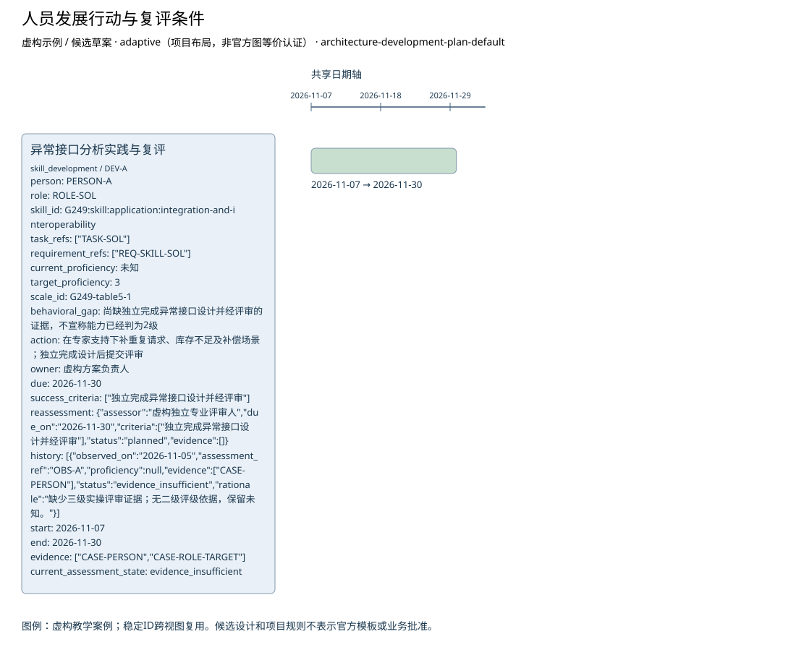

# 人员发展行动与复评条件

**虚构验收案例，不代表真实企业事实。**

制品：架构人员发展计划（Architecture Development Plan） · 模型 1 · 视图 `development-plan`

语境：`{"domains": ["business", "data", "application", "technology"], "landscape": "segment", "purpose": "project", "abstraction": "logical", "evolution": "target"}`

依据虚构材料表达候选设计；证据不足的结论保留缺口。

| ID | 类型 | 名称 | 属性 |
| --- | --- | --- | --- |
| DEV-A | skill_development | 异常接口分析实践与复评 | {"person": "PERSON-A", "role": "ROLE-SOL", "skill_id": "G249:skill:application:integration-and-interoperability", "task_refs": ["TASK-SOL"], "requirement_refs": ["REQ-SKILL-SOL"], "current_proficiency": null, "target_proficiency": 3, "scale_id": "G249-table5-1", "behavioral_gap": "尚缺独立完成异常接口设计并经评审的证据，不宣称能力已经判为2级", "action": "在专家支持下补重复请求、库存不足及补偿场景；独立完成设计后提交评审", "owner": "虚构方案负责人", "due": "2026-11-30", "success_criteria": ["独立完成异常接口设计并经评审"], "reassessment": {"assessor": "虚构独立专业评审人", "due_on": "2026-11-30", "criteria": ["独立完成异常接口设计并经评审"], "status": "planned", "evidence": []}, "history": [{"observed_on": "2026-11-05", "assessment_ref": "OBS-A", "proficiency": null, "evidence": ["CASE-PERSON"], "status": "evidence_insufficient", "rationale": "缺少三级实操评审证据；无二级评级依据，保留未知。"}], "start": "2026-11-07", "end": "2026-11-30", "evidence": ["CASE-PERSON", "CASE-ROLE-TARGET"], "current_assessment_state": "evidence_insufficient"} |

独立图片：[development-plan.png](development-plan.png)。可编辑源与模型见同目录。

图例／解释：虚构教学案例；稳定ID跨视图复用。候选设计和项目规则不表示官方模板或业务批准。

证据与缺口：

| 对象 | 来源 | 确定性 |
| --- | --- | --- |
| DEV-A | CASE-PERSON, CASE-ROLE-TARGET | assumed |

- 库存一致性、承诺和恢复目标未明确，方案不能定优；影响：接口、风险及试点进入条件未定；需要：业务接受标准与服务水平。

- 门店在线销售与中央库存的当前交互尚未调查；影响：不能由线上订单接口推断门店在线行为；需要：门店在线流程、接口与失败处理材料。

- 已确认订单交给物流的具体接口和责任未提供；影响：只明确确认前不进入物流，交接规格待定；需要：物流接收契约与责任方。

- 原教学输入称专家4级但现有行为证据不足，当前等级保持未评价；影响：不能仅凭专家头衔确认支持能力；需要：任务相关的广泛经验、实际应用与评审证据。

方法检查：

- 每项发展行动绑定技能、任务要求和量表，目标与当前证据分开。
- 完成培训不自动提升评级；复评完成须引用实测评价和行为证据。
- 历史证据不覆盖；目标不随观察值变化；未证明高级不自动降为低级。

这些检查是评审问题，生成文件不自动表示已通过业务评审。

表达完整性见 [development-plan.coverage.json](development-plan.coverage.json)。来源结构模板的核实状态见布局文件；生成不改变该状态。
