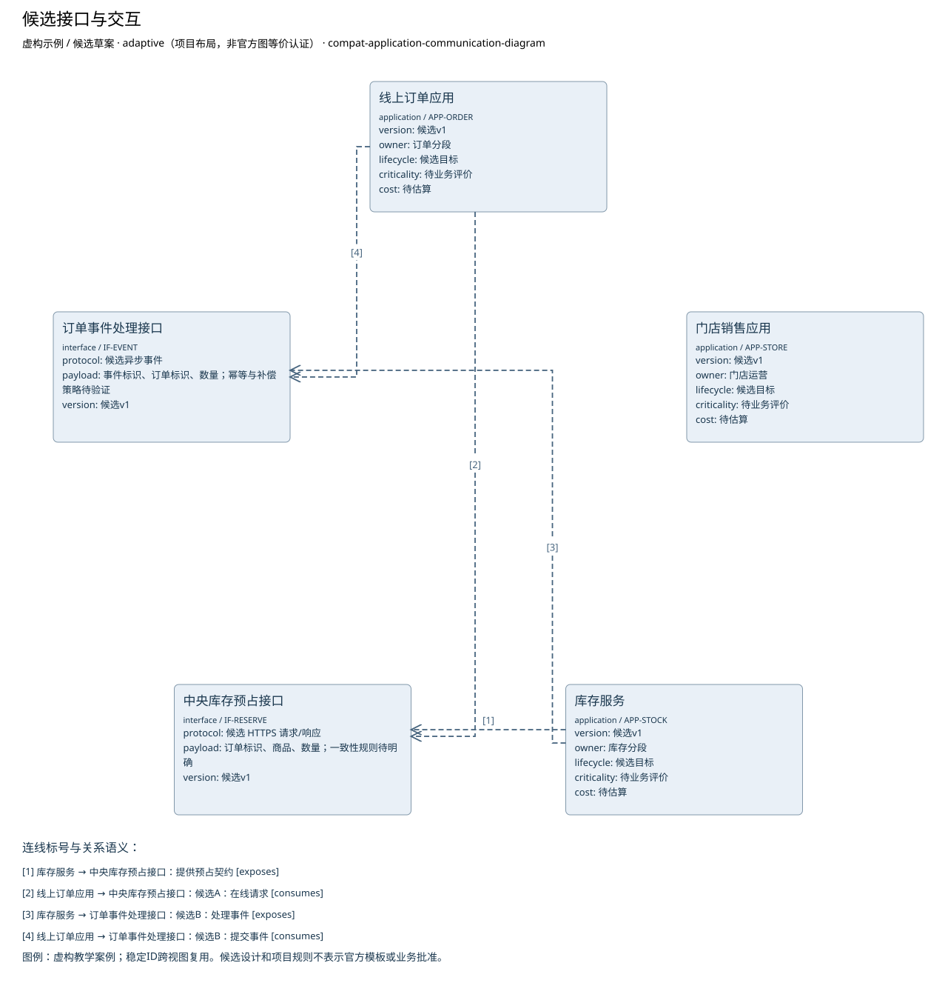

# 候选接口与交互

**虚构验收案例，不代表真实企业事实。**

制品：应用通信图（Application Communication Diagram） · 模型 1 · 视图 `interface-network`

语境：`{"domains": ["business", "data", "application", "technology"], "landscape": "segment", "purpose": "project", "abstraction": "logical", "evolution": "target"}`

A同步预占与B异步处理均为候选。一致性要求不足，不能排名。缺少超卖、承诺及恢复标准。

| ID | 类型 | 名称 | 属性 |
| --- | --- | --- | --- |
| APP-ORDER | application | 线上订单应用 | {"version": "候选v1", "owner": "订单分段", "lifecycle": "候选目标", "criticality": "待业务评价", "cost": "待估算"} |
| APP-STORE | application | 门店销售应用 | {"version": "候选v1", "owner": "门店运营", "lifecycle": "候选目标", "criticality": "待业务评价", "cost": "待估算"} |
| APP-STOCK | application | 库存服务 | {"version": "候选v1", "owner": "库存分段", "lifecycle": "候选目标", "criticality": "待业务评价", "cost": "待估算"} |
| IF-RESERVE | interface | 中央库存预占接口 | {"protocol": "候选 HTTPS 请求/响应", "payload": "订单标识、商品、数量；一致性规则待明确", "version": "候选v1"} |
| IF-EVENT | interface | 订单事件处理接口 | {"protocol": "候选异步事件", "payload": "事件标识、订单标识、数量；幂等与补偿策略待验证", "version": "候选v1"} |

独立图片：[interface-network.png](interface-network.png)。可编辑源与模型见同目录。

图例／解释：虚构教学案例；稳定ID跨视图复用。候选设计和项目规则不表示官方模板或业务批准。

| 关系 ID | 起点 | 语义 | 终点 | 说明 | 属性／代码／端基数 | 证据／确定性 |
| --- | --- | --- | --- | --- | --- | --- |
| EX-RESERVE | APP-STOCK | exposes | IF-RESERVE | 提供预占契约 | {"attributes": {}} | CASE-REVIEW / assumed |
| USE-RESERVE | APP-ORDER | consumes | IF-RESERVE | 候选A：在线请求 | {"attributes": {}} | CASE-REVIEW / assumed |
| EX-EVENT | APP-STOCK | exposes | IF-EVENT | 候选B：处理事件 | {"attributes": {}} | CASE-REVIEW / assumed |
| USE-EVENT | APP-ORDER | consumes | IF-EVENT | 候选B：提交事件 | {"attributes": {}} | CASE-REVIEW / assumed |

证据与缺口：

| 对象 | 来源 | 确定性 |
| --- | --- | --- |
| APP-ORDER | CASE-REVIEW | assumed |
| APP-STORE | CASE-REVIEW | assumed |
| APP-STOCK | CASE-REVIEW | assumed |
| IF-RESERVE | CASE-REVIEW | assumed |
| IF-EVENT | CASE-REVIEW | assumed |

- 库存一致性、承诺和恢复目标未明确，方案不能定优；影响：接口、风险及试点进入条件未定；需要：业务接受标准与服务水平。

- 门店在线销售与中央库存的当前交互尚未调查；影响：不能由线上订单接口推断门店在线行为；需要：门店在线流程、接口与失败处理材料。

- 已确认订单交给物流的具体接口和责任未提供；影响：只明确确认前不进入物流，交接规格待定；需要：物流接收契约与责任方。

- 原教学输入称专家4级但现有行为证据不足，当前等级保持未评价；影响：不能仅凭专家头衔确认支持能力；需要：任务相关的广泛经验、实际应用与评审证据。

方法检查：

- 此图不是时间序列。
- 通信方向不代表数据权威来源。

这些检查是评审问题，生成文件不自动表示已通过业务评审。

表达完整性见 [interface-network.coverage.json](interface-network.coverage.json)。来源结构模板的核实状态见布局文件；生成不改变该状态。
