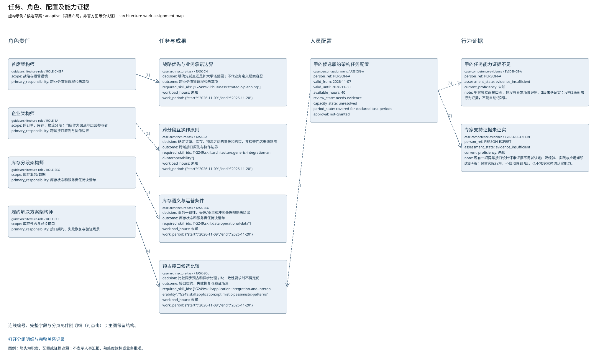

# 任务、角色、配置及能力证据

当前模型中的任务、角色、配置及能力证据。配置为候选；未知不默认转换为最低等级。

由当前绑定的任务和观察显式投影；角色、容量、期间和能力分别审查。

|ID|名称|完整属性|
|---|---|---|
|ROLE-CHIEF|首席架构师|{"tier": "chief", "scope": "战略与运营语境", "primary_responsibility": "跨业务决策议程和未决项", "definition": "本次任务角色：战略优先与业务承诺边界"}|
|ROLE-EA|企业架构师|{"tier": "enterprise", "scope": "跨订单、库存、物流分段；门店作为渠道与运营参与者", "primary_responsibility": "跨域接口原则与协作边界", "definition": "本次任务角色：跨分段互操作原则"}|
|ROLE-SEG|库存分段架构师|{"tier": "segment", "scope": "库存业务/数据", "primary_responsibility": "库存状态和服务责任待决清单", "definition": "本次任务角色：库存语义与运营条件"}|
|ROLE-SOL|履约解决方案架构师|{"tier": "solution", "scope": "库存预占与异步接口", "primary_responsibility": "接口契约、失败恢复与验证场景", "definition": "本次任务角色：预占接口候选比较"}|
|TASK-CH|战略优先与业务承诺边界|{"scope": "战略优先与业务承诺边界", "decision": "明确先试点还是扩大承诺范围；不代业务定义超卖容忍", "outcome": "跨业务决策议程和未决项", "role_refs": ["ROLE-CHIEF"], "requirement_refs": ["REQ-SKILL-CH"], "required_skill_ids": ["G249:skill:business:strategic-planning"], "workload_hours": null, "configuration_status": "人员未配置；期间与容量待明确", "assignment_refs": [], "id": "TASK-CH", "method_ids": ["architecture-backlog-trace-review"], "artifact_ids": ["business-capability-map", "transition-architecture-model", "solution-delivery-notebook"], "evidence": ["CASE-BASELINE", "CASE-REVIEW"], "work_period": {"start": "2026-11-09", "end": "2026-11-20"}, "model_object_refs": ["CAP-FULFIL", "CAP-ORDER", "CAP-RESERVE", "CAP-LOGISTICS", "TRANS-ONLINE", "RISK-STOCK", "ROLE-CHIEF", "SKILL-1", "SKILL-2", "SKILL-3", "SKILL-4", "DEV-A", "ORDER-PENDING", "ORDER-CONFIRMED", "ORDER-EXCEPTION", "ORDER-FULFIL", "DELIVERY-NOTE", "TASK-CH"], "output_tailoring_reason": "本轮以实际需求、接口候选和运营过渡支持决策；来源映射的其他候选视图未选，不能声称其已完成。"}|
|TASK-EA|跨分段互操作原则|{"scope": "跨分段互操作原则", "decision": "确定订单、库存、物流之间的责任和约束，并检查门店渠道影响", "outcome": "跨域接口原则与协作边界", "role_refs": ["ROLE-EA"], "requirement_refs": ["REQ-SKILL-EA"], "required_skill_ids": ["G249:skill:architecture:generic-integration-and-interoperability"], "workload_hours": null, "configuration_status": "人员未配置；期间与容量待明确", "assignment_refs": [], "id": "TASK-EA", "method_ids": ["domain-architecture-alignment-review"], "artifact_ids": ["business-capability-map", "application-portfolio-catalog", "solution-delivery-notebook"], "evidence": ["CASE-BASELINE", "CASE-REVIEW"], "work_period": {"start": "2026-11-09", "end": "2026-11-20"}, "model_object_refs": ["CAP-FULFIL", "CAP-ORDER", "CAP-RESERVE", "CAP-LOGISTICS", "APP-ORDER", "APP-STORE", "APP-STOCK", "IF-RESERVE", "IF-EVENT", "REQ-CONSISTENCY", "ROLE-EA", "SKILL-1", "SKILL-2", "SKILL-3", "SKILL-4", "DEV-A", "ORDER-PENDING", "ORDER-CONFIRMED", "ORDER-EXCEPTION", "ORDER-FULFIL", "DELIVERY-NOTE", "TASK-EA"], "output_tailoring_reason": "本轮以实际需求、接口候选和运营过渡支持决策；来源映射的其他候选视图未选，不能声称其已完成。"}|
|TASK-SEG|库存语义与运营条件|{"scope": "库存语义与运营条件", "decision": "业务一致性、受理/承诺和冲突处理规则未给出", "outcome": "库存状态和服务责任待决清单", "role_refs": ["ROLE-SEG"], "requirement_refs": ["REQ-SKILL-SEG"], "required_skill_ids": ["G249:skill:data:operational-data"], "workload_hours": null, "configuration_status": "人员未配置；期间与容量待明确", "assignment_refs": [], "id": "TASK-SEG", "method_ids": ["msa-data-distribution-conditions-method"], "artifact_ids": ["requirements-catalog", "data-lifecycle-diagram", "solution-delivery-notebook"], "evidence": ["CASE-BASELINE", "CASE-REVIEW"], "work_period": {"start": "2026-11-09", "end": "2026-11-20"}, "model_object_refs": ["CAP-FULFIL", "CAP-ORDER", "CAP-RESERVE", "CAP-LOGISTICS", "IF-RESERVE", "IF-EVENT", "REQ-CONSISTENCY", "RISK-STOCK", "ROLE-SEG", "SKILL-1", "SKILL-2", "SKILL-3", "SKILL-4", "DEV-A", "ORDER-PENDING", "ORDER-CONFIRMED", "ORDER-EXCEPTION", "ORDER-FULFIL", "DELIVERY-NOTE", "TASK-SEG"], "output_tailoring_reason": "本轮以实际需求、接口候选和运营过渡支持决策；来源映射的其他候选视图未选，不能声称其已完成。"}|
|TASK-SOL|预占接口候选比较|{"scope": "预占接口候选比较", "decision": "比较同步预占和异步处理；缺一致性要求时不得定优", "outcome": "接口契约、失败恢复与验证场景", "role_refs": ["ROLE-SOL"], "requirement_refs": ["REQ-SKILL-SOL"], "required_skill_ids": ["G249:skill:application:integration-and-interoperability", "G249:skill:application:optimistic-pessimistic-patterns"], "workload_hours": null, "configuration_status": "候选配置需补能力、容量与授权证据", "assignment_refs": ["ASSIGN-A"], "id": "TASK-SOL", "method_ids": ["msa-contract-consumer-evidence-method"], "artifact_ids": ["application-communication-diagram", "transition-architecture-model", "risk-mitigation-plan", "solution-delivery-notebook"], "evidence": ["CASE-BASELINE", "CASE-REVIEW"], "work_period": {"start": "2026-11-09", "end": "2026-11-20"}, "model_object_refs": ["APP-ORDER", "APP-STORE", "APP-STOCK", "IF-RESERVE", "IF-EVENT", "REQ-CONSISTENCY", "WP-ONLINE", "TRANS-ONLINE", "RISK-STOCK", "ROLE-SOL", "SKILL-1", "SKILL-2", "SKILL-3", "SKILL-4", "DEV-A", "ORDER-PENDING", "ORDER-CONFIRMED", "ORDER-EXCEPTION", "ORDER-FULFIL", "DELIVERY-NOTE", "TASK-SOL", "ASSIGN-A", "EVIDENCE-A", "EVIDENCE-EXPERT"], "output_tailoring_reason": "本轮以实际需求、接口候选和运营过渡支持决策；来源映射的其他候选视图未选，不能声称其已完成。"}|
|EVIDENCE-A|甲的任务能力证据不足|{"person_ref": "PERSON-A", "observation_ref": "OBS-A", "state": "evidence_insufficient", "current_proficiency": null, "observed_on": "2026-11-05", "behavioral_evidence": [{"criterion": "独立完成异常接口设计并经评审", "demonstrated": false, "evidence": ["CASE-PERSON"]}], "note": "甲曾独立画接口图，但没有异常场景评审。3级未获证实；没有2级所需行为证据，不能自动记2级。", "id": "OBS-A", "skill_id": "G249:skill:application:integration-and-interoperability", "assessment_kind": "observed_assessment", "assessment_state": "evidence_insufficient", "proficiency": null, "scale_id": "G249-table5-1", "task_refs": ["TASK-SOL"], "evidence": ["CASE-PERSON"]}|
|EVIDENCE-EXPERT|专家支持证据未证实|{"person_ref": "PERSON-EXPERT", "observation_ref": "OBS-EXPERT", "state": "evidence_insufficient", "current_proficiency": null, "observed_on": "2026-11-06", "behavioral_evidence": [{"criterion": "独立完成异常接口设计并经评审", "demonstrated": true, "evidence": ["CASE-EXPERT"]}], "note": "现有一项异常接口设计评审证据不足以认定广泛经验、实践与应用知识达到4级；保留实际行为，不自动降到3级，也不凭专家称谓认定能力。", "prior_claim": {"proficiency": 4, "status": "not-substantiated-by-available-evidence", "source": "只读旧教学输入中的等级声明"}, "id": "OBS-EXPERT", "skill_id": "G249:skill:application:integration-and-interoperability", "assessment_kind": "observed_assessment", "assessment_state": "evidence_insufficient", "proficiency": null, "scale_id": "G249-table5-1", "task_refs": ["TASK-SOL"], "assessor": "虚构专业评审人", "evidence": ["CASE-EXPERT"]}|
|ASSIGN-A|甲的候选履约架构任务配置|{"person_ref": "PERSON-A", "role_ref": "ROLE-SOL", "task_refs": ["TASK-SOL"], "requirement_refs": ["REQ-SKILL-SOL"], "assessment_refs": ["OBS-A"], "authority": "虚构方案负责人；仅提出候选配置", "valid_from": "2026-11-07", "valid_until": "2026-11-30", "available_hours": 40, "workload_hours": null, "capacity_state": "unresolved", "competence_state": "needs-evidence", "approval": "not-granted", "support": {"provider": "PERSON-EXPERT", "mode": "共同评审异常场景及接口契约，不替代甲的能力证据", "requirement_refs": ["REQ-SKILL-SOL"], "assessment_refs": ["OBS-EXPERT"], "available_hours": 8, "evidence": ["CASE-EXPERT"]}, "period_gap": "本次工作量未知，不能认定容量充分", "id": "ASSIGN-A", "mandate_ref": "MANDATE-STOCK", "evidence": ["CASE-MANDATE", "CASE-PERSON"], "review_state": "needs-evidence", "period_state": "covered-for-declared-task-periods"}|

|关系ID|起点|含义|终点|
|---|---|---|---|
|CONFIG-TASK-CH|ROLE-CHIEF|本次工作职责|TASK-CH|
|CONFIG-TASK-EA|ROLE-EA|本次工作职责|TASK-EA|
|CONFIG-TASK-SEG|ROLE-SEG|本次工作职责|TASK-SEG|
|CONFIG-TASK-SOL|ROLE-SOL|本次工作职责|TASK-SOL|
|CONFIG-ASSIGN-TASK|ASSIGN-A|候选承担；未批准|TASK-SOL|
|CONFIG-EVIDENCE-A|ASSIGN-A|任职能力待举证|EVIDENCE-A|
|CONFIG-EVIDENCE-EXPERT|ASSIGN-A|支持者证据待审|EVIDENCE-EXPERT|

[可编辑SVG](role-assignment.svg) · [Mermaid](role-assignment.mmd) · [PNG](role-assignment.png)

图例：箭头为职责、配置或证据追溯；不表示人事汇报、熟练度达标或业务批准。

[分组明细与完整关系记录](role-assignment.details.html)

表达完整性见 [role-assignment.coverage.json](role-assignment.coverage.json)。来源结构模板的核实状态见布局文件；生成不改变该状态。
