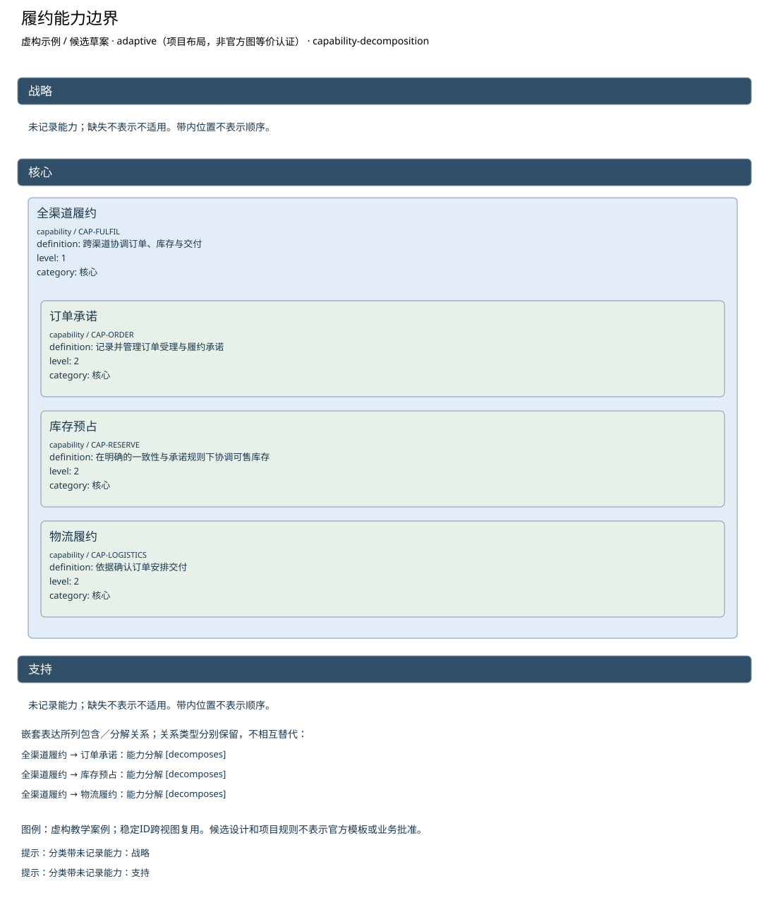

# 履约能力边界

**虚构验收案例，不代表真实企业事实。**

制品：业务能力地图（Business Capability Map） · 模型 2 · 视图 `capability-map`

语境：`{"domains": ["business", "data", "application", "technology"], "landscape": "segment", "purpose": "project", "abstraction": "logical", "evolution": "target"}`

依据虚构材料表达候选设计；证据不足的结论保留缺口。

| ID | 类型 | 名称 | 属性 |
| --- | --- | --- | --- |
| CAP-FULFIL | capability | 全渠道履约 | {"definition": "跨渠道协调订单、库存与交付", "level": 1, "category": "核心"} |
| CAP-ORDER | capability | 订单承诺 | {"definition": "记录并管理订单受理与履约承诺", "level": 2, "category": "核心"} |
| CAP-RESERVE | capability | 库存预占 | {"definition": "在明确的一致性与承诺规则下协调可售库存", "level": 2, "category": "核心"} |
| CAP-LOGISTICS | capability | 物流履约 | {"definition": "依据确认订单安排交付", "level": 2, "category": "核心"} |

独立图片：[capability-map.png](capability-map.png)。可编辑源与模型见同目录。

图例／解释：虚构教学案例；稳定ID跨视图复用。候选设计和项目规则不表示官方模板或业务批准。

| 关系 ID | 起点 | 语义 | 终点 | 说明 | 属性／代码／端基数 | 证据／确定性 |
| --- | --- | --- | --- | --- | --- | --- |
| CAP-PART-CAP-ORDER | CAP-FULFIL | decomposes | CAP-ORDER | 能力分解 | {"attributes": {}} | CASE-REVIEW / assumed |
| CAP-PART-CAP-RESERVE | CAP-FULFIL | decomposes | CAP-RESERVE | 能力分解 | {"attributes": {}} | CASE-REVIEW / assumed |
| CAP-PART-CAP-LOGISTICS | CAP-FULFIL | decomposes | CAP-LOGISTICS | 能力分解 | {"attributes": {}} | CASE-REVIEW / assumed |

证据与缺口：

| 对象 | 来源 | 确定性 |
| --- | --- | --- |
| CAP-FULFIL | CASE-REVIEW | assumed |
| CAP-ORDER | CASE-REVIEW | assumed |
| CAP-RESERVE | CASE-REVIEW | assumed |
| CAP-LOGISTICS | CASE-REVIEW | assumed |

- 库存一致性、承诺和恢复目标未明确，方案不能定优；影响：接口、风险及试点进入条件未定；需要：业务接受标准与服务水平。

- 门店在线销售与中央库存的当前交互尚未调查；影响：不能由线上订单接口推断门店在线行为；需要：门店在线流程、接口与失败处理材料。

- 已确认订单交给物流的具体接口和责任未提供；影响：只明确确认前不进入物流，交接规格待定；需要：物流接收契约与责任方。

- 最大断连时间未知；影响：阻断离线候选方案接受与运营状态进入；需要：断连上限与存储容量依据。

- 可容忍的数据丢失窗口未知；影响：阻断离线候选方案接受与运营状态进入；需要：持久成功标准、故障演练与数据丢失容忍。

- 恢复和对账服务目标未知；影响：阻断离线候选方案接受与运营状态进入；需要：恢复时限与未对账告警规则。

- 本地额度与超卖政策未定；影响：阻断离线候选方案接受与运营状态进入；需要：业务承诺、额度与冲突接受决定。

- 冲突、补偿与回退责任待确认；影响：阻断离线候选方案接受与运营状态进入；需要：业务与运营责任人的交接接受记录。

- ASSIGN-A只覆盖至2026-11-30，离线工作包候选结束2026-12-04；后半段配置未确定；影响：不能认定完整交付期有人员覆盖；工时与专家支持也未证明充分；需要：续任/替代人员、可用容量和工作量。

- 原教学输入称专家4级但现有行为证据不足，当前等级保持未评价；影响：不能仅凭专家头衔确认支持能力；需要：任务相关的广泛经验、实际应用与评审证据。

方法检查：

- 颜色须有量尺及证据。
- 能力实例不能画成子能力。

这些检查是评审问题，生成文件不自动表示已通过业务评审。

表达完整性见 [capability-map.coverage.json](capability-map.coverage.json)。来源结构模板的核实状态见布局文件；生成不改变该状态。
