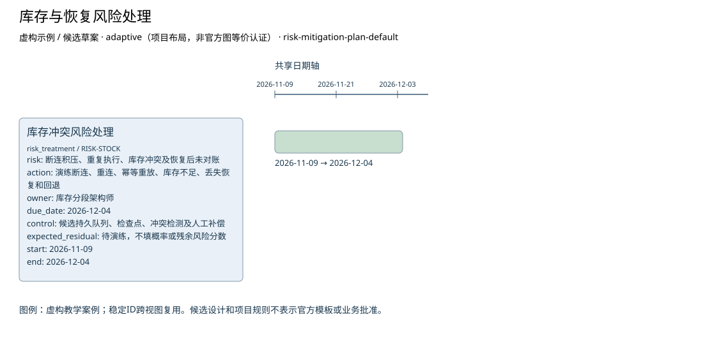

# 库存与恢复风险处理

**虚构验收案例，不代表真实企业事实。**

制品：风险缓解计划（Risk Mitigation Plan） · 模型 2 · 视图 `risk-treatment`

语境：`{"domains": ["business", "data", "application", "technology"], "landscape": "segment", "purpose": "project", "abstraction": "logical", "evolution": "target"}`

依据虚构材料表达候选设计；证据不足的结论保留缺口。

| ID | 类型 | 名称 | 属性 |
| --- | --- | --- | --- |
| RISK-STOCK | risk_treatment | 库存冲突风险处理 | {"risk": "断连积压、重复执行、库存冲突及恢复后未对账", "action": "演练断连、重连、幂等重放、库存不足、丢失恢复和回退", "owner": "库存分段架构师", "due_date": "2026-12-04", "control": "候选持久队列、检查点、冲突检测及人工补偿", "expected_residual": "待演练，不填概率或残余风险分数", "start": "2026-11-09", "end": "2026-12-04"} |

独立图片：[risk-treatment.png](risk-treatment.png)。可编辑源与模型见同目录。

图例／解释：虚构教学案例；稳定ID跨视图复用。候选设计和项目规则不表示官方模板或业务批准。

证据与缺口：

| 对象 | 来源 | 确定性 |
| --- | --- | --- |
| RISK-STOCK | CASE-REVIEW, CASE-CHANGE | assumed |

- 库存一致性、承诺和恢复目标未明确，方案不能定优；影响：接口、风险及试点进入条件未定；需要：业务接受标准与服务水平。

- 门店在线销售与中央库存的当前交互尚未调查；影响：不能由线上订单接口推断门店在线行为；需要：门店在线流程、接口与失败处理材料。

- 已确认订单交给物流的具体接口和责任未提供；影响：只明确确认前不进入物流，交接规格待定；需要：物流接收契约与责任方。

- 最大断连时间未知；影响：阻断离线候选方案接受与运营状态进入；需要：断连上限与存储容量依据。

- 可容忍的数据丢失窗口未知；影响：阻断离线候选方案接受与运营状态进入；需要：持久成功标准、故障演练与数据丢失容忍。

- 恢复和对账服务目标未知；影响：阻断离线候选方案接受与运营状态进入；需要：恢复时限与未对账告警规则。

- 本地额度与超卖政策未定；影响：阻断离线候选方案接受与运营状态进入；需要：业务承诺、额度与冲突接受决定。

- 冲突、补偿与回退责任待确认；影响：阻断离线候选方案接受与运营状态进入；需要：业务与运营责任人的交接接受记录。

- ASSIGN-A只覆盖至2026-11-30，离线工作包候选结束2026-12-04；后半段配置未确定；影响：不能认定完整交付期有人员覆盖；工时与专家支持也未证明充分；需要：续任/替代人员、可用容量和工作量。

- 原教学输入称专家4级但现有行为证据不足，当前等级保持未评价；影响：不能仅凭专家头衔确认支持能力；需要：任务相关的广泛经验、实际应用与评审证据。

方法检查：

- 计划中的控制不能被写成已经有效运行。
- 必需属性具有明确值或被登记为阻断缺口。
- 来源与项目事实、参考内容、假设保持可区分。
- 结论回应本规范的决策问题并可追溯。

这些检查是评审问题，生成文件不自动表示已通过业务评审。

表达完整性见 [risk-treatment.coverage.json](risk-treatment.coverage.json)。来源结构模板的核实状态见布局文件；生成不改变该状态。
