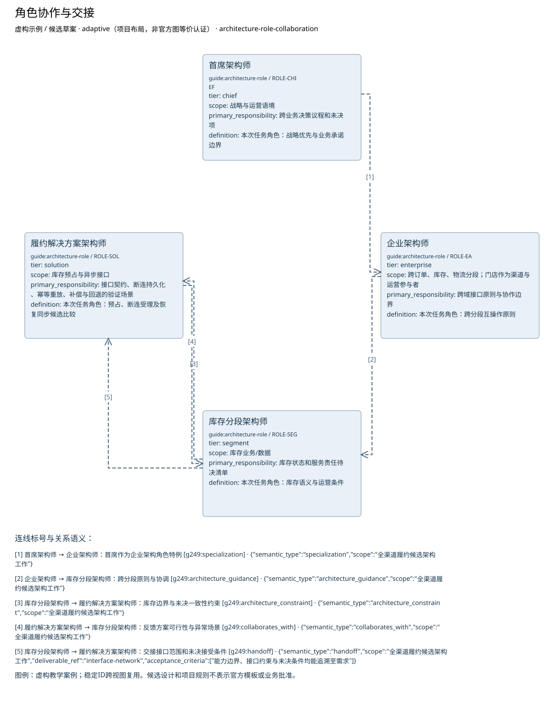

# 角色协作与交接

**虚构验收案例，不代表真实企业事实。**

制品：架构角色定义目录（Architecture Role Definition Catalog） · 模型 2 · 视图 `role-collaboration`

语境：`{"domains": ["business", "data", "application", "technology"], "landscape": "segment", "purpose": "project", "abstraction": "logical", "evolution": "target"}`

依据虚构材料表达候选设计；证据不足的结论保留缺口。

| ID | 类型 | 名称 | tier | scope | primary_responsibility | segment_scope | activities | key_stakeholders | kpis | leads | relationships | assignments |
| --- | --- | --- | --- | --- | --- | --- | --- | --- | --- | --- | --- | --- |
| ROLE-CHIEF | guide:architecture-role | 首席架构师 | "chief" | "战略与运营语境" | "跨业务决策议程和未决项" | "待补" | "待补" | "待补" | "待补" | "待补" | "待补" | "待补" |
| ROLE-EA | guide:architecture-role | 企业架构师 | "enterprise" | "跨订单、库存、物流分段；门店作为渠道与运营参与者" | "跨域接口原则与协作边界" | "待补" | "待补" | "待补" | "待补" | "待补" | "待补" | "待补" |
| ROLE-SEG | guide:architecture-role | 库存分段架构师 | "segment" | "库存业务/数据" | "库存状态和服务责任待决清单" | "待补" | "待补" | "待补" | "待补" | "待补" | "待补" | "待补" |
| ROLE-SOL | guide:architecture-role | 履约解决方案架构师 | "solution" | "库存预占与异步接口" | "接口契约、断连持久化、幂等重放、补偿与回退的验证场景" | "待补" | "待补" | "待补" | "待补" | "待补" | "待补" | "待补" |

独立图片：[role-collaboration.png](role-collaboration.png)。可编辑源与模型见同目录。

图例／解释：虚构教学案例；稳定ID跨视图复用。候选设计和项目规则不表示官方模板或业务批准。

| 关系 ID | 起点 | 语义 | 终点 | 说明 | 属性／代码／端基数 | 证据／确定性 |
| --- | --- | --- | --- | --- | --- | --- |
| SPECIAL-CH | ROLE-CHIEF | g249:specialization | ROLE-EA | 首席作为企业架构角色特例 | {"attributes": {"semantic_type": "specialization", "scope": "全渠道履约候选架构工作"}} | CASE-REVIEW / assumed |
| GUIDE-EA | ROLE-EA | g249:architecture_guidance | ROLE-SEG | 跨分段原则与协调 | {"attributes": {"semantic_type": "architecture_guidance", "scope": "全渠道履约候选架构工作"}} | CASE-REVIEW / assumed |
| CONSTRAINT-SEG | ROLE-SEG | g249:architecture_constraint | ROLE-SOL | 库存边界与未决一致性约束 | {"attributes": {"semantic_type": "architecture_constraint", "scope": "全渠道履约候选架构工作"}} | CASE-REVIEW / assumed |
| COOPERATE-SOL | ROLE-SOL | g249:collaborates_with | ROLE-SEG | 反馈方案可行性与异常场景 | {"attributes": {"semantic_type": "collaborates_with", "scope": "全渠道履约候选架构工作"}} | CASE-REVIEW / assumed |
| HANDOFF-IF | ROLE-SEG | g249:handoff | ROLE-SOL | 交接接口范围和未决接受条件 | {"attributes": {"semantic_type": "handoff", "scope": "全渠道履约候选架构工作", "deliverable_ref": "interface-network", "acceptance_criteria": ["能力边界、接口约束与未决条件均能追溯至需求"]}} | CASE-REVIEW / assumed |

证据与缺口：

| 对象 | 来源 | 确定性 |
| --- | --- | --- |
| ROLE-CHIEF | CASE-MANDATE | assumed |
| ROLE-EA | CASE-MANDATE | assumed |
| ROLE-SEG | CASE-MANDATE | assumed |
| ROLE-SOL | CASE-MANDATE | assumed |

- 库存一致性、承诺和恢复目标未明确，方案不能定优；影响：接口、风险及试点进入条件未定；需要：业务接受标准与服务水平。

- 门店在线销售与中央库存的当前交互尚未调查；影响：不能由线上订单接口推断门店在线行为；需要：门店在线流程、接口与失败处理材料。

- 已确认订单交给物流的具体接口和责任未提供；影响：只明确确认前不进入物流，交接规格待定；需要：物流接收契约与责任方。

- 最大断连时间未知；影响：阻断离线候选方案接受与运营状态进入；需要：断连上限与存储容量依据。

- 可容忍的数据丢失窗口未知；影响：阻断离线候选方案接受与运营状态进入；需要：持久成功标准、故障演练与数据丢失容忍。

- 恢复和对账服务目标未知；影响：阻断离线候选方案接受与运营状态进入；需要：恢复时限与未对账告警规则。

- 本地额度与超卖政策未定；影响：阻断离线候选方案接受与运营状态进入；需要：业务承诺、额度与冲突接受决定。

- 冲突、补偿与回退责任待确认；影响：阻断离线候选方案接受与运营状态进入；需要：业务与运营责任人的交接接受记录。

- ASSIGN-A只覆盖至2026-11-30，离线工作包候选结束2026-12-04；后半段配置未确定；影响：不能认定完整交付期有人员覆盖；工时与专家支持也未证明充分；需要：续任/替代人员、可用容量和工作量。

- 原教学输入称专家4级但现有行为证据不足，当前等级保持未评价；影响：不能仅凭专家头衔确认支持能力；需要：任务相关的广泛经验、实际应用与评审证据。

方法检查：

- 首席架构师是企业架构师的特例，不是另一个并列层级。
- KPI中的3/5与（xxx）四分位是来源示例，不是企业目标。
- 岗位、角色、任务不同；一人可担任多角色。
- 角色定义不评价任何人员的能力或绩效。

这些检查是评审问题，生成文件不自动表示已通过业务评审。

表达完整性见 [role-collaboration.coverage.json](role-collaboration.coverage.json)。来源结构模板的核实状态见布局文件；生成不改变该状态。
