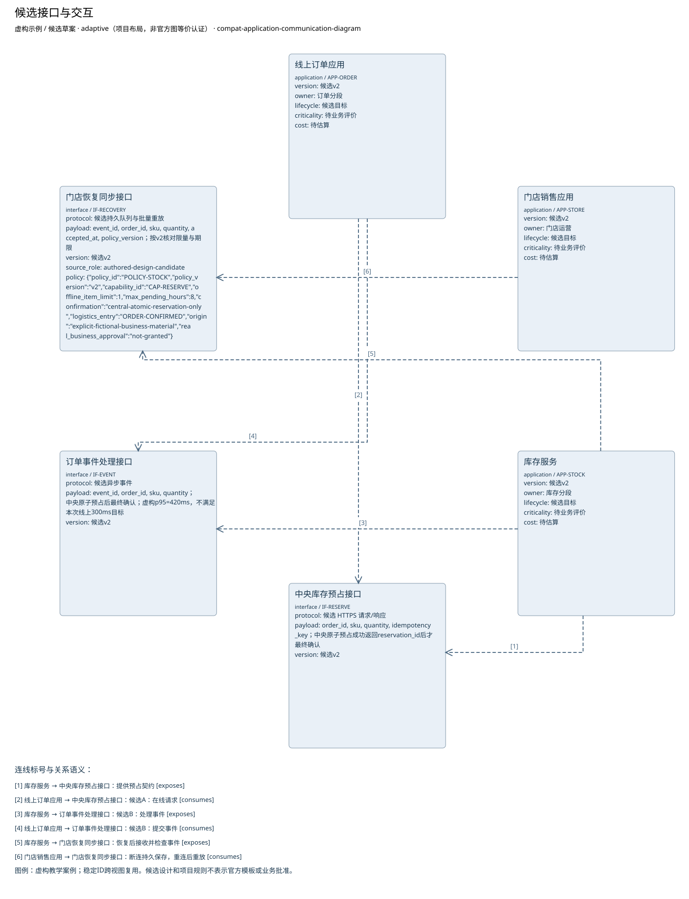

# 候选接口与交互

**虚构验收案例，不代表真实企业事实。**

制品：应用通信图（Application Communication Diagram） · 模型 fictional-v2 · 视图 `interface-network`

语境：`{"domains": ["business", "data", "application", "technology"], "landscape": "segment", "purpose": "project", "abstraction": "logical", "evolution": "target"}`

A同步预占与B异步处理均为候选。一致性要求不足，不能排名。纯同步方案不能单独覆盖断连受理；增加持久记录、恢复同步及补偿待决项。

| ID | 类型 | 名称 | 属性 |
| --- | --- | --- | --- |
| APP-ORDER | application | 线上订单应用 | {"version": "候选v2", "owner": "订单分段", "lifecycle": "候选目标", "criticality": "待业务评价", "cost": "待估算"} |
| APP-STORE | application | 门店销售应用 | {"version": "候选v2", "owner": "门店运营", "lifecycle": "候选目标", "criticality": "待业务评价", "cost": "待估算"} |
| APP-STOCK | application | 库存服务 | {"version": "候选v2", "owner": "库存分段", "lifecycle": "候选目标", "criticality": "待业务评价", "cost": "待估算"} |
| IF-RESERVE | interface | 中央库存预占接口 | {"protocol": "候选 HTTPS 请求/响应", "payload": "order_id, sku, quantity, idempotency_key；中央原子预占成功返回reservation_id后才最终确认", "version": "候选v2"} |
| IF-EVENT | interface | 订单事件处理接口 | {"protocol": "候选异步事件", "payload": "event_id, order_id, sku, quantity；中央原子预占后最终确认；虚构p95=420ms，不满足本次线上300ms目标", "version": "候选v2"} |
| IF-RECOVERY | interface | 门店恢复同步接口 | {"protocol": "候选持久队列与批量重放", "payload": "event_id, order_id, sku, quantity, accepted_at, policy_version；按v2核对限量与期限", "version": "候选v2", "source_role": "authored-design-candidate", "policy": {"policy_id": "POLICY-STOCK", "policy_version": "v2", "capability_id": "CAP-RESERVE", "offline_item_limit": 1, "max_pending_hours": 8, "confirmation": "central-atomic-reservation-only", "logistics_entry": "ORDER-CONFIRMED", "origin": "explicit-fictional-business-material", "real_business_approval": "not-granted"}} |

独立图片：[interface-network.png](interface-network.png)。可编辑源与模型见同目录。

图例／解释：虚构教学案例；稳定ID跨视图复用。候选设计和项目规则不表示官方模板或业务批准。

| 关系 ID | 起点 | 语义 | 终点 | 说明 | 属性／代码／端基数 | 证据／确定性 |
| --- | --- | --- | --- | --- | --- | --- |
| EX-RESERVE | APP-STOCK | exposes | IF-RESERVE | 提供预占契约 | {"attributes": {}} | CASE-REVIEW / assumed |
| USE-RESERVE | APP-ORDER | consumes | IF-RESERVE | 候选A：在线请求 | {"attributes": {}} | CASE-REVIEW / assumed |
| EX-EVENT | APP-STOCK | exposes | IF-EVENT | 候选B：处理事件 | {"attributes": {}} | CASE-REVIEW / assumed |
| USE-EVENT | APP-ORDER | consumes | IF-EVENT | 候选B：提交事件 | {"attributes": {}} | CASE-REVIEW / assumed |
| EX-RECOVERY | APP-STOCK | exposes | IF-RECOVERY | 恢复后接收并检查事件 | {"attributes": {}} | CASE-CHANGE, CASE-REVIEW / assumed |
| USE-RECOVERY | APP-STORE | consumes | IF-RECOVERY | 断连持久保存，重连后重放 | {"attributes": {}} | CASE-CHANGE, CASE-REVIEW / assumed |

证据与缺口：

| 对象 | 来源 | 确定性 |
| --- | --- | --- |
| APP-ORDER | CASE-REVIEW | assumed |
| APP-STORE | CASE-REVIEW | assumed |
| APP-STOCK | CASE-REVIEW | assumed |
| IF-RESERVE | CASE-REVIEW | assumed |
| IF-EVENT | CASE-REVIEW | assumed |
| IF-RECOVERY | CASE-CHANGE, CASE-REVIEW | assumed |

- 门店在线销售与中央库存的当前交互尚未调查；影响：不能由线上订单接口推断门店在线行为；需要：门店在线流程、接口与失败处理材料。

- 已确认订单交给物流的具体接口和责任未提供；影响：只明确确认前不进入物流，交接规格待定；需要：物流接收契约与责任方。

- 最大断连时间未知；影响：阻断离线候选方案接受与运营状态进入；需要：断连上限与存储容量依据。

- 可容忍的数据丢失窗口未知；影响：阻断离线候选方案接受与运营状态进入；需要：持久成功标准、故障演练与数据丢失容忍。

- 冲突、补偿与回退责任待确认；影响：阻断离线候选方案接受与运营状态进入；需要：业务与运营责任人的交接接受记录。

方法检查：

- 此图不是时间序列。
- 通信方向不代表数据权威来源。

这些检查是评审问题，生成文件不自动表示已通过业务评审。

表达完整性见 [interface-network.coverage.json](interface-network.coverage.json)。来源结构模板的核实状态见布局文件；生成不改变该状态。
