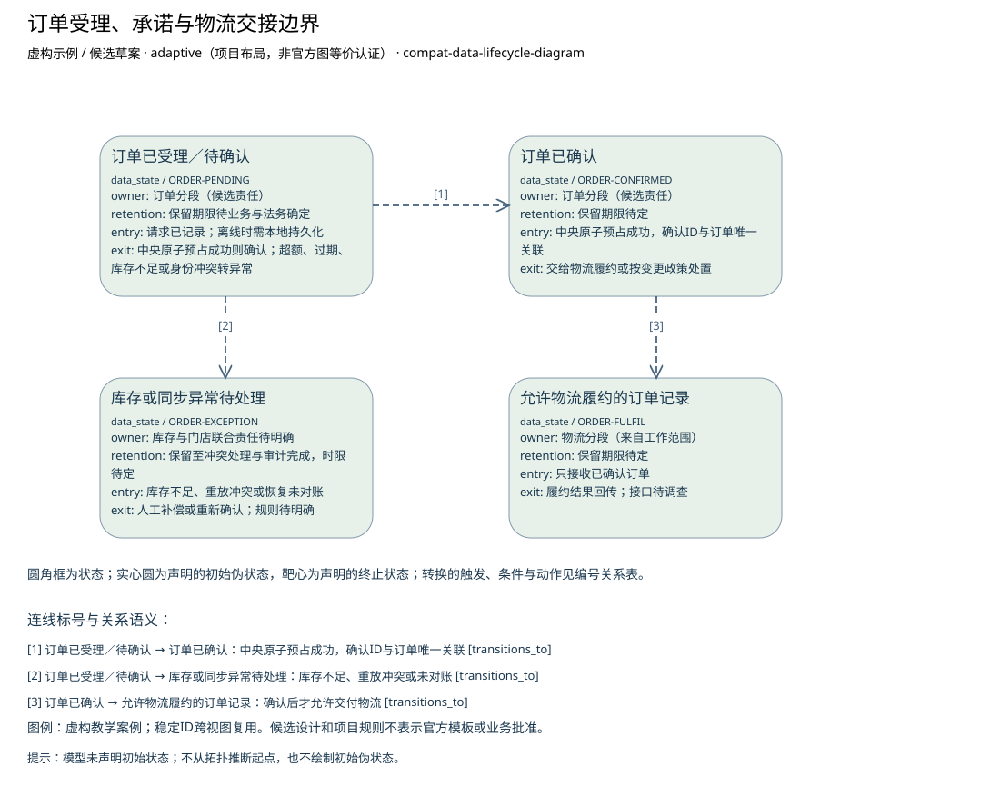

# 订单受理、承诺与物流交接边界

**虚构验收案例，不代表真实企业事实。**

制品：数据生命周期图（Data Lifecycle Diagram） · 模型 fictional-v2 · 视图 `order-states`

语境：`{"domains": ["business", "data", "application", "technology"], "landscape": "segment", "purpose": "project", "abstraction": "logical", "evolution": "target"}`

业务给定物流只接收已确认订单。中间状态和异常处理为候选；确认条件、保留期限及物流接口尚待明确。

| ID | 类型 | 名称 | 属性 |
| --- | --- | --- | --- |
| ORDER-PENDING | data_state | 订单已受理／待确认 | {"owner": "订单分段（候选责任）", "retention": "保留期限待业务与法务确定", "entry": "请求已记录；离线时需本地持久化", "exit": "中央原子预占成功则确认；超额、过期、库存不足或身份冲突转异常"} |
| ORDER-CONFIRMED | data_state | 订单已确认 | {"owner": "订单分段（候选责任）", "retention": "保留期限待定", "entry": "中央原子预占成功，确认ID与订单唯一关联", "exit": "交给物流履约或按变更政策处置"} |
| ORDER-EXCEPTION | data_state | 库存或同步异常待处理 | {"owner": "库存与门店联合责任待明确", "retention": "保留至冲突处理与审计完成，时限待定", "entry": "库存不足、重放冲突或恢复未对账", "exit": "人工补偿或重新确认；规则待明确"} |
| ORDER-FULFIL | data_state | 允许物流履约的订单记录 | {"owner": "物流分段（来自工作范围）", "retention": "保留期限待定", "entry": "只接收已确认订单", "exit": "履约结果回传；接口待调查"} |

独立图片：[order-states.png](order-states.png)。可编辑源与模型见同目录。

图例／解释：虚构教学案例；稳定ID跨视图复用。候选设计和项目规则不表示官方模板或业务批准。

| 关系 ID | 起点 | 语义 | 终点 | 说明 | 属性／代码／端基数 | 证据／确定性 |
| --- | --- | --- | --- | --- | --- | --- |
| ORDER-CONFIRM | ORDER-PENDING | transitions_to | ORDER-CONFIRMED | 中央原子预占成功，确认ID与订单唯一关联 | {"attributes": {}} | CASE-REVIEW / assumed |
| ORDER-EXCEPT | ORDER-PENDING | transitions_to | ORDER-EXCEPTION | 库存不足、重放冲突或未对账 | {"attributes": {}} | CASE-REVIEW / assumed |
| ORDER-TO-FULFIL | ORDER-CONFIRMED | transitions_to | ORDER-FULFIL | 确认后才允许交付物流 | {"attributes": {}} | CASE-REVIEW / assumed |

证据与缺口：

| 对象 | 来源 | 确定性 |
| --- | --- | --- |
| ORDER-PENDING | CASE-REVIEW | assumed |
| ORDER-CONFIRMED | CASE-REVIEW | assumed |
| ORDER-EXCEPTION | CASE-REVIEW | assumed |
| ORDER-FULFIL | CASE-REVIEW | assumed |

- 门店在线销售与中央库存的当前交互尚未调查；影响：不能由线上订单接口推断门店在线行为；需要：门店在线流程、接口与失败处理材料。

- 已确认订单交给物流的具体接口和责任未提供；影响：只明确确认前不进入物流，交接规格待定；需要：物流接收契约与责任方。

- 最大断连时间未知；影响：阻断离线候选方案接受与运营状态进入；需要：断连上限与存储容量依据。

- 可容忍的数据丢失窗口未知；影响：阻断离线候选方案接受与运营状态进入；需要：持久成功标准、故障演练与数据丢失容忍。

- 冲突、补偿与回退责任待确认；影响：阻断离线候选方案接受与运营状态进入；需要：业务与运营责任人的交接接受记录。

方法检查：

- 保留期须有业务或法规依据。
- 生命周期不等于 CRUD 操作清单。

这些检查是评审问题，生成文件不自动表示已通过业务评审。

表达完整性见 [order-states.coverage.json](order-states.coverage.json)。来源结构模板的核实状态见布局文件；生成不改变该状态。
