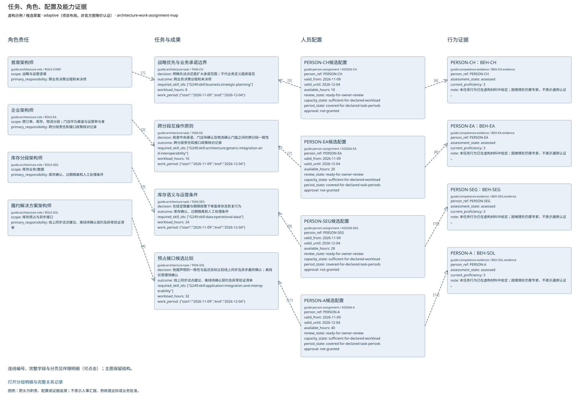

# 任务、角色、配置及能力证据

当前模型中的任务、角色、配置及能力证据。配置为候选；未知不默认转换为最低等级。

由当前绑定的任务和观察显式投影；角色、容量、期间和能力分别审查。

|ID|名称|完整属性|
|---|---|---|
|ROLE-CHIEF|首席架构师|{"tier": "chief", "scope": "战略与运营语境", "primary_responsibility": "跨业务决策议程和未决项", "definition": "本次任务角色：战略优先与业务承诺边界"}|
|ROLE-EA|企业架构师|{"tier": "enterprise", "scope": "跨订单、库存、物流分段；门店作为渠道与运营参与者", "primary_responsibility": "跨分段责任和接口政策核对记录", "definition": "本次任务角色：跨分段互操作原则"}|
|ROLE-SEG|库存分段架构师|{"tier": "segment", "scope": "库存业务/数据", "primary_responsibility": "库存确认、过期隔离和人工处理条件", "definition": "本次任务角色：库存语义与运营条件"}|
|ROLE-SOL|履约解决方案架构师|{"tier": "solution", "scope": "库存预占与异步接口", "primary_responsibility": "线上同步试点建议、离线待确认契约及异常验证清单", "definition": "本次任务角色：预占接口候选比较"}|
|TASK-CH|战略优先与业务承诺边界|{"id": "TASK-CH", "scope": "战略优先与业务承诺边界", "decision": "明确先试点还是扩大承诺范围；不代业务定义超卖容忍", "outcome": "跨业务决策议程和未决项", "role_refs": ["ROLE-CHIEF"], "required_skill_ids": ["G249:skill:business:strategic-planning"], "method_ids": ["architecture-backlog-trace-review"], "artifact_ids": ["business-capability-map", "transition-architecture-model", "solution-delivery-notebook"], "evidence": ["CASE-BASELINE", "CASE-REVIEW", "FICTIONAL-POLICY", "FICTIONAL-CAPACITY"], "workload_hours": 8, "work_period": {"start": "2026-11-09", "end": "2026-12-04"}, "model_object_refs": ["CAP-FULFIL", "CAP-ORDER", "CAP-RESERVE", "CAP-LOGISTICS", "TRANS-ONLINE", "RISK-STOCK", "TRANS-OFFLINE", "ROLE-CHIEF", "SKILL-1", "SKILL-2", "SKILL-3", "SKILL-4", "DEV-A", "ORDER-PENDING", "ORDER-CONFIRMED", "ORDER-EXCEPTION", "ORDER-FULFIL", "LOCAL-ORDER-RECORD", "CENTRAL-ORDER-RECORD", "DELIVERY-NOTE", "TASK-CH", "ASSIGN-CH", "BEH-CH.evidence"], "output_tailoring_reason": "本轮以实际需求、接口候选和运营过渡支持决策；来源映射的其他候选视图未选，不能声称其已完成。", "requirement_refs": ["REQ-SKILL-CH"], "configuration_status": "declared workload and behavioral evidence present; owner review pending"}|
|TASK-EA|跨分段互操作原则|{"id": "TASK-EA", "scope": "跨分段互操作原则", "decision": "核查中央承诺、门店待确认及物流确认门槛之间的跨分段一致性", "outcome": "跨分段责任和接口政策核对记录", "role_refs": ["ROLE-EA"], "required_skill_ids": ["G249:skill:architecture:generic-integration-and-interoperability"], "method_ids": ["domain-architecture-alignment-review"], "artifact_ids": ["business-capability-map", "application-portfolio-catalog", "solution-delivery-notebook"], "evidence": ["CASE-BASELINE", "CASE-REVIEW", "FICTIONAL-POLICY", "FICTIONAL-CAPACITY"], "workload_hours": 16, "work_period": {"start": "2026-11-09", "end": "2026-12-04"}, "model_object_refs": ["CAP-FULFIL", "CAP-ORDER", "CAP-RESERVE", "CAP-LOGISTICS", "APP-ORDER", "APP-STORE", "APP-STOCK", "IF-RESERVE", "IF-EVENT", "REQ-CONSISTENCY", "REQ-OFFLINE", "IF-RECOVERY", "ROLE-EA", "SKILL-1", "SKILL-2", "SKILL-3", "SKILL-4", "DEV-A", "ORDER-PENDING", "ORDER-CONFIRMED", "ORDER-EXCEPTION", "ORDER-FULFIL", "LOCAL-ORDER-RECORD", "CENTRAL-ORDER-RECORD", "DELIVERY-NOTE", "TASK-EA", "ASSIGN-EA", "BEH-EA.evidence"], "output_tailoring_reason": "本轮以实际需求、接口候选和运营过渡支持决策；来源映射的其他候选视图未选，不能声称其已完成。", "requirement_refs": ["REQ-SKILL-EA"], "configuration_status": "declared workload and behavioral evidence present; owner review pending"}|
|TASK-SEG|库存语义与运营条件|{"id": "TASK-SEG", "scope": "库存语义与运营条件", "decision": "在给定限量与期限政策下审查库存及恢复行为", "outcome": "库存确认、过期隔离和人工处理条件", "role_refs": ["ROLE-SEG"], "required_skill_ids": ["G249:skill:data:operational-data"], "method_ids": ["msa-data-distribution-conditions-method"], "artifact_ids": ["requirements-catalog", "data-lifecycle-diagram", "solution-delivery-notebook"], "evidence": ["CASE-BASELINE", "CASE-REVIEW", "FICTIONAL-POLICY", "FICTIONAL-CAPACITY"], "workload_hours": 24, "work_period": {"start": "2026-11-09", "end": "2026-12-04"}, "model_object_refs": ["CAP-FULFIL", "CAP-ORDER", "CAP-RESERVE", "CAP-LOGISTICS", "IF-RESERVE", "IF-EVENT", "REQ-CONSISTENCY", "RISK-STOCK", "REQ-OFFLINE", "IF-RECOVERY", "ROLE-SEG", "SKILL-1", "SKILL-2", "SKILL-3", "SKILL-4", "DEV-A", "ORDER-PENDING", "ORDER-CONFIRMED", "ORDER-EXCEPTION", "ORDER-FULFIL", "LOCAL-ORDER-RECORD", "CENTRAL-ORDER-RECORD", "DELIVERY-NOTE", "TASK-SEG", "ASSIGN-SEG", "BEH-SEG.evidence"], "output_tailoring_reason": "本轮以实际需求、接口候选和运营过渡支持决策；来源映射的其他候选视图未选，不能声称其已完成。", "requirement_refs": ["REQ-SKILL-SEG"], "configuration_status": "declared workload and behavioral evidence present; owner review pending"}|
|TASK-SOL|预占接口候选比较|{"id": "TASK-SOL", "scope": "预占接口候选比较", "decision": "依据声明的一致性与延迟目标比较线上同步及异步最终确认；离线仅受理待确认", "outcome": "线上同步试点建议、离线待确认契约及异常验证清单", "role_refs": ["ROLE-SOL"], "required_skill_ids": ["G249:skill:application:integration-and-interoperability"], "method_ids": ["msa-contract-consumer-evidence-method"], "artifact_ids": ["application-communication-diagram", "transition-architecture-model", "risk-mitigation-plan", "solution-delivery-notebook"], "evidence": ["CASE-BASELINE", "CASE-REVIEW", "FICTIONAL-POLICY", "FICTIONAL-CAPACITY"], "workload_hours": 32, "work_period": {"start": "2026-11-09", "end": "2026-12-04"}, "model_object_refs": ["APP-ORDER", "APP-STORE", "APP-STOCK", "IF-RESERVE", "IF-EVENT", "REQ-CONSISTENCY", "WP-ONLINE", "TRANS-ONLINE", "RISK-STOCK", "REQ-OFFLINE", "IF-RECOVERY", "WP-OFFLINE", "TRANS-OFFLINE", "ROLE-SOL", "SKILL-1", "SKILL-2", "SKILL-3", "SKILL-4", "DEV-A", "ORDER-PENDING", "ORDER-CONFIRMED", "ORDER-EXCEPTION", "ORDER-FULFIL", "LOCAL-ORDER-RECORD", "CENTRAL-ORDER-RECORD", "DELIVERY-NOTE", "TASK-SOL", "ASSIGN-A", "BEH-SOL.evidence"], "output_tailoring_reason": "本轮以实际需求、接口候选和运营过渡支持决策；来源映射的其他候选视图未选，不能声称其已完成。", "requirement_refs": ["REQ-SKILL-SOL"], "configuration_status": "declared workload and behavioral evidence present; owner review pending"}|
|BEH-CH.evidence|PERSON-CH：BEH-CH|{"id": "BEH-CH", "person_ref": "PERSON-CH", "skill_id": "G249:skill:business:strategic-planning", "assessment_kind": "observed_assessment", "assessment_state": "assessed", "proficiency": 3, "scale_id": "G249-table5-1", "task_refs": ["TASK-CH"], "observed_on": "2026-12-02", "assessor": "FICTIONAL-PEER-REVIEW", "evidence": ["FICTIONAL-BEHAVIOR"], "behavioral_evidence": [{"criterion": "把战略约束转成可复议决定", "demonstrated": true, "evidence_kind": "reviewed-work-product", "evidence": ["FICTIONAL-BEHAVIOR"]}], "note": "本任务行为已在虚构材料中给定；困难情形仍需专家，不表示通用认证。", "observation_ref": "BEH-CH", "current_proficiency": 3}|
|BEH-EA.evidence|PERSON-EA：BEH-EA|{"id": "BEH-EA", "person_ref": "PERSON-EA", "skill_id": "G249:skill:architecture:generic-integration-and-interoperability", "assessment_kind": "observed_assessment", "assessment_state": "assessed", "proficiency": 3, "scale_id": "G249-table5-1", "task_refs": ["TASK-EA"], "observed_on": "2026-12-02", "assessor": "FICTIONAL-PEER-REVIEW", "evidence": ["FICTIONAL-BEHAVIOR"], "behavioral_evidence": [{"criterion": "解释跨分段接口语义及风险", "demonstrated": true, "evidence_kind": "reviewed-work-product", "evidence": ["FICTIONAL-BEHAVIOR"]}], "note": "本任务行为已在虚构材料中给定；困难情形仍需专家，不表示通用认证。", "observation_ref": "BEH-EA", "current_proficiency": 3}|
|BEH-SEG.evidence|PERSON-SEG：BEH-SEG|{"id": "BEH-SEG", "person_ref": "PERSON-SEG", "skill_id": "G249:skill:data:operational-data", "assessment_kind": "observed_assessment", "assessment_state": "assessed", "proficiency": 3, "scale_id": "G249-table5-1", "task_refs": ["TASK-SEG"], "observed_on": "2026-12-02", "assessor": "FICTIONAL-PEER-REVIEW", "evidence": ["FICTIONAL-BEHAVIOR"], "behavioral_evidence": [{"criterion": "核对运行数据的一致性与恢复证据", "demonstrated": true, "evidence_kind": "reviewed-work-product", "evidence": ["FICTIONAL-BEHAVIOR"]}], "note": "本任务行为已在虚构材料中给定；困难情形仍需专家，不表示通用认证。", "observation_ref": "BEH-SEG", "current_proficiency": 3}|
|BEH-SOL.evidence|PERSON-A：BEH-SOL|{"id": "BEH-SOL", "person_ref": "PERSON-A", "skill_id": "G249:skill:application:integration-and-interoperability", "assessment_kind": "observed_assessment", "assessment_state": "assessed", "proficiency": 3, "scale_id": "G249-table5-1", "task_refs": ["TASK-SOL"], "observed_on": "2026-12-02", "assessor": "FICTIONAL-PEER-REVIEW", "evidence": ["FICTIONAL-BEHAVIOR"], "behavioral_evidence": [{"criterion": "独立完成异常接口设计并经评审", "demonstrated": true, "evidence_kind": "reviewed-work-product", "evidence": ["FICTIONAL-BEHAVIOR"]}], "note": "本任务行为已在虚构材料中给定；困难情形仍需专家，不表示通用认证。", "observation_ref": "BEH-SOL", "current_proficiency": 3}|
|ASSIGN-CH|PERSON-CH候选配置|{"id": "ASSIGN-CH", "person_ref": "PERSON-CH", "role_ref": "ROLE-CHIEF", "task_refs": ["TASK-CH"], "requirement_refs": ["REQ-SKILL-CH"], "assessment_refs": ["BEH-CH"], "mandate_ref": "MANDATE-STOCK", "authority": "虚构候选配置；真实批准未授予", "valid_from": "2026-11-09", "valid_until": "2026-12-04", "available_hours": 10, "evidence": ["FICTIONAL-CAPACITY", "CASE-MANDATE"], "review_state": "ready-for-owner-review", "capacity_state": "sufficient-for-declared-workload", "period_state": "covered-for-declared-task-periods", "approval": "not-granted", "competence_state": "evidenced-for-declared-task", "period_gap": "declared task period covered; real approval not-granted", "workload_hours": 8}|
|ASSIGN-EA|PERSON-EA候选配置|{"id": "ASSIGN-EA", "person_ref": "PERSON-EA", "role_ref": "ROLE-EA", "task_refs": ["TASK-EA"], "requirement_refs": ["REQ-SKILL-EA"], "assessment_refs": ["BEH-EA"], "mandate_ref": "MANDATE-STOCK", "authority": "虚构候选配置；真实批准未授予", "valid_from": "2026-11-09", "valid_until": "2026-12-04", "available_hours": 20, "evidence": ["FICTIONAL-CAPACITY", "CASE-MANDATE"], "review_state": "ready-for-owner-review", "capacity_state": "sufficient-for-declared-workload", "period_state": "covered-for-declared-task-periods", "approval": "not-granted", "competence_state": "evidenced-for-declared-task", "period_gap": "declared task period covered; real approval not-granted", "workload_hours": 16}|
|ASSIGN-SEG|PERSON-SEG候选配置|{"id": "ASSIGN-SEG", "person_ref": "PERSON-SEG", "role_ref": "ROLE-SEG", "task_refs": ["TASK-SEG"], "requirement_refs": ["REQ-SKILL-SEG"], "assessment_refs": ["BEH-SEG"], "mandate_ref": "MANDATE-STOCK", "authority": "虚构候选配置；真实批准未授予", "valid_from": "2026-11-09", "valid_until": "2026-12-04", "available_hours": 28, "evidence": ["FICTIONAL-CAPACITY", "CASE-MANDATE"], "review_state": "ready-for-owner-review", "capacity_state": "sufficient-for-declared-workload", "period_state": "covered-for-declared-task-periods", "approval": "not-granted", "competence_state": "evidenced-for-declared-task", "period_gap": "declared task period covered; real approval not-granted", "workload_hours": 24}|
|ASSIGN-A|PERSON-A候选配置|{"id": "ASSIGN-A", "person_ref": "PERSON-A", "role_ref": "ROLE-SOL", "task_refs": ["TASK-SOL"], "requirement_refs": ["REQ-SKILL-SOL"], "assessment_refs": ["BEH-SOL"], "mandate_ref": "MANDATE-STOCK", "authority": "虚构候选配置；真实批准未授予", "valid_from": "2026-11-09", "valid_until": "2026-12-04", "available_hours": 40, "evidence": ["FICTIONAL-CAPACITY", "CASE-MANDATE"], "review_state": "ready-for-owner-review", "capacity_state": "sufficient-for-declared-workload", "period_state": "covered-for-declared-task-periods", "approval": "not-granted", "competence_state": "evidenced-for-declared-task", "period_gap": "declared task period covered; real approval not-granted", "workload_hours": 32}|

|关系ID|起点|含义|终点|
|---|---|---|---|
|work-projection.6bb0140bc708e4bbb096|ROLE-CHIEF|本次任务职责；不是人事汇报|TASK-CH|
|work-projection.5aa5498d92502bf7da41|ROLE-EA|本次任务职责；不是人事汇报|TASK-EA|
|work-projection.4eb7c710941c2fc9bd50|ROLE-SEG|本次任务职责；不是人事汇报|TASK-SEG|
|work-projection.db99e6eb17404474021f|ROLE-SOL|本次任务职责；不是人事汇报|TASK-SOL|
|work-projection.0c4fe3f44093d9f50fec|ASSIGN-CH|候选承担；未批准|TASK-CH|
|work-projection.9216799023b9b1fffcd4|ASSIGN-CH|配置依赖的人员/支持证据|BEH-CH.evidence|
|work-projection.06a88de2ec5a26c2fca0|ASSIGN-EA|候选承担；未批准|TASK-EA|
|work-projection.440b9262d69aeaa8953a|ASSIGN-EA|配置依赖的人员/支持证据|BEH-EA.evidence|
|work-projection.ae03e8809cb9bfce5fa0|ASSIGN-SEG|候选承担；未批准|TASK-SEG|
|work-projection.710d6c5a67f4b472155f|ASSIGN-SEG|配置依赖的人员/支持证据|BEH-SEG.evidence|
|work-projection.554aee97e4fbf2c66416|ASSIGN-A|候选承担；未批准|TASK-SOL|
|work-projection.221f533dc7d14014d128|ASSIGN-A|配置依赖的人员/支持证据|BEH-SOL.evidence|

[可编辑SVG](role-assignment.svg) · [Mermaid](role-assignment.mmd) · [PNG](role-assignment.png)

图例：箭头为职责、配置或证据追溯；不表示人事汇报、熟练度达标或业务批准。

[分组明细与完整关系记录](role-assignment.details.html)

表达完整性见 [role-assignment.coverage.json](role-assignment.coverage.json)。来源结构模板的核实状态见布局文件；生成不改变该状态。
