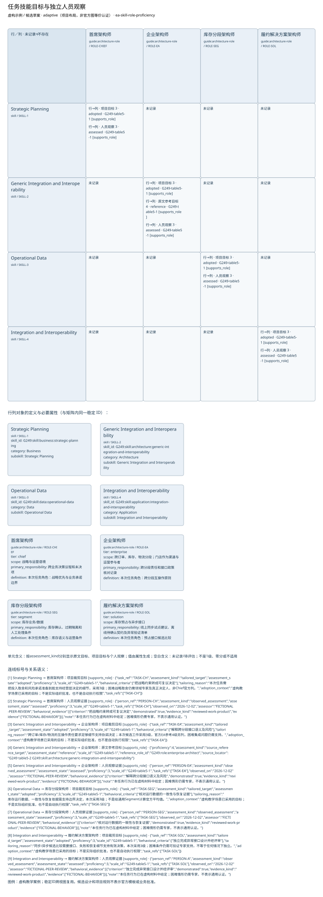

# 任务技能目标与独立人员观察

**虚构验收案例，不代表真实企业事实。**

制品：架构技能／角色矩阵（Architecture Skill Role Matrix） · 模型 fictional-v2 · 视图 `skill-matrix`

语境：`{"domains": ["business", "data", "application", "technology"], "landscape": "segment", "purpose": "project", "abstraction": "logical", "evolution": "target"}`

依据虚构材料表达候选设计；证据不足的结论保留缺口。

| ID | 类型 | 名称 | 属性 |
| --- | --- | --- | --- |
| SKILL-1 | skill | Strategic Planning | {"skill_id": "G249:skill:business:strategic-planning", "category": "Business", "subskill": "Strategic Planning"} |
| SKILL-2 | skill | Generic Integration and Interoperability | {"skill_id": "G249:skill:architecture:generic-integration-and-interoperability", "category": "Architecture", "subskill": "Generic Integration and Interoperability"} |
| SKILL-3 | skill | Operational Data | {"skill_id": "G249:skill:data:operational-data", "category": "Data", "subskill": "Operational Data"} |
| SKILL-4 | skill | Integration and Interoperability | {"skill_id": "G249:skill:application:integration-and-interoperability", "category": "Application", "subskill": "Integration and Interoperability"} |
| ROLE-CHIEF | guide:architecture-role | 首席架构师 | {"tier": "chief", "scope": "战略与运营语境", "primary_responsibility": "跨业务决策议程和未决项", "definition": "本次任务角色：战略优先与业务承诺边界"} |
| ROLE-EA | guide:architecture-role | 企业架构师 | {"tier": "enterprise", "scope": "跨订单、库存、物流分段；门店作为渠道与运营参与者", "primary_responsibility": "跨分段责任和接口政策核对记录", "definition": "本次任务角色：跨分段互操作原则"} |
| ROLE-SEG | guide:architecture-role | 库存分段架构师 | {"tier": "segment", "scope": "库存业务/数据", "primary_responsibility": "库存确认、过期隔离和人工处理条件", "definition": "本次任务角色：库存语义与运营条件"} |
| ROLE-SOL | guide:architecture-role | 履约解决方案架构师 | {"tier": "solution", "scope": "库存预占与异步接口", "primary_responsibility": "线上同步试点建议、离线待确认契约及异常验证清单", "definition": "本次任务角色：预占接口候选比较"} |

独立图片：[skill-matrix.png](skill-matrix.png)。可编辑源与模型见同目录。

图例／解释：虚构教学案例；稳定ID跨视图复用。候选设计和项目规则不表示官方模板或业务批准。

| 关系 ID | 起点 | 语义 | 终点 | 说明 | 属性／代码／端基数 | 证据／确定性 |
| --- | --- | --- | --- | --- | --- | --- |
| REQ-SKILL-CH | SKILL-1 | supports_role | ROLE-CHIEF | 项目裁剪目标 | {"attributes": {"task_ref": "TASK-CH", "assessment_kind": "tailored_target", "assessment_state": "adopted", "proficiency": 3, "scale_id": "G249-table5-1", "behavioral_criteria": ["把战略约束转成可复议决定"], "tailoring_reason": "本次任务需把投入取舍和风险承诺准备到能支持经营层决定的细节，采用3级；困难战略取舍仍需领域专家及真正决定人，非Chief官方列。", "adoption_context": "虚构教学场景已采用的目标；不是实际组织批准，也不是自动执行权限", "task_refs": ["TASK-CH"]}} | CASE-ROLE-TARGET / assumed |
| REQ-SKILL-EA | SKILL-2 | supports_role | ROLE-EA | 项目裁剪目标 | {"attributes": {"task_ref": "TASK-EA", "assessment_kind": "tailored_target", "assessment_state": "adopted", "proficiency": 3, "scale_id": "G249-table5-1", "behavioral_criteria": ["解释跨分段接口语义及风险"], "tailoring_reason": "跨订单/库存/物流的互操作责任要求足够细节支持协调决定；本次候选工作采用3级，官方EA参考4级另列，困难集成问题仍需支持。", "adoption_context": "虚构教学场景已采用的目标；不是实际组织批准，也不是自动执行权限", "task_refs": ["TASK-EA"]}} | CASE-ROLE-TARGET / assumed |
| REF-REQ-SKILL-EA | SKILL-2 | supports_role | ROLE-EA | 原文参考目标 | {"attributes": {"proficiency": 4, "assessment_kind": "source_reference_target", "assessment_state": "reference", "scale_id": "G249-table5-1", "reference_role_id": "G249:role:enterprise-architect", "source_locator": "G249 table5-2 G249:skill:architecture:generic-integration-and-interoperability"}} | g249-table-source / assumed |
| REQ-SKILL-SEG | SKILL-3 | supports_role | ROLE-SEG | 项目裁剪目标 | {"attributes": {"task_ref": "TASK-SEG", "assessment_kind": "tailored_target", "assessment_state": "adopted", "proficiency": 3, "scale_id": "G249-table5-1", "behavioral_criteria": ["核对运行数据的一致性与恢复证据"], "tailoring_reason": "库存运行数据、一致性与恢复依据需支持边界决定，本次采用3级；不是给通用Segment计算官方平均值。", "adoption_context": "虚构教学场景已采用的目标；不是实际组织批准，也不是自动执行权限", "task_refs": ["TASK-SEG"]}} | CASE-ROLE-TARGET / assumed |
| REQ-SKILL-SOL | SKILL-4 | supports_role | ROLE-SOL | 项目裁剪目标 | {"attributes": {"task_ref": "TASK-SOL", "assessment_kind": "tailored_target", "assessment_state": "adopted", "proficiency": 3, "scale_id": "G249-table5-1", "behavioral_criteria": ["独立完成异常接口设计并经评审"], "tailoring_reason": "同步/异步候选比较需要接口、失败和恢复细节支持有效决策，本次采用3级；困难条件仍需可验证专家支持，不等于任何情况下独立。", "adoption_context": "虚构教学场景已采用的目标；不是实际组织批准，也不是自动执行权限", "task_refs": ["TASK-SOL"]}} | CASE-ROLE-TARGET / assumed |
| BEH-CH | SKILL-1 | supports_role | ROLE-CHIEF | 人员观察证据 | {"attributes": {"person_ref": "PERSON-CH", "assessment_kind": "observed_assessment", "assessment_state": "assessed", "proficiency": 3, "scale_id": "G249-table5-1", "task_refs": ["TASK-CH"], "observed_on": "2026-12-02", "assessor": "FICTIONAL-PEER-REVIEW", "behavioral_evidence": [{"criterion": "把战略约束转成可复议决定", "demonstrated": true, "evidence_kind": "reviewed-work-product", "evidence": ["FICTIONAL-BEHAVIOR"]}], "note": "本任务行为已在虚构材料中给定；困难情形仍需专家，不表示通用认证。"}} | FICTIONAL-BEHAVIOR / assumed |
| BEH-EA | SKILL-2 | supports_role | ROLE-EA | 人员观察证据 | {"attributes": {"person_ref": "PERSON-EA", "assessment_kind": "observed_assessment", "assessment_state": "assessed", "proficiency": 3, "scale_id": "G249-table5-1", "task_refs": ["TASK-EA"], "observed_on": "2026-12-02", "assessor": "FICTIONAL-PEER-REVIEW", "behavioral_evidence": [{"criterion": "解释跨分段接口语义及风险", "demonstrated": true, "evidence_kind": "reviewed-work-product", "evidence": ["FICTIONAL-BEHAVIOR"]}], "note": "本任务行为已在虚构材料中给定；困难情形仍需专家，不表示通用认证。"}} | FICTIONAL-BEHAVIOR / assumed |
| BEH-SEG | SKILL-3 | supports_role | ROLE-SEG | 人员观察证据 | {"attributes": {"person_ref": "PERSON-SEG", "assessment_kind": "observed_assessment", "assessment_state": "assessed", "proficiency": 3, "scale_id": "G249-table5-1", "task_refs": ["TASK-SEG"], "observed_on": "2026-12-02", "assessor": "FICTIONAL-PEER-REVIEW", "behavioral_evidence": [{"criterion": "核对运行数据的一致性与恢复证据", "demonstrated": true, "evidence_kind": "reviewed-work-product", "evidence": ["FICTIONAL-BEHAVIOR"]}], "note": "本任务行为已在虚构材料中给定；困难情形仍需专家，不表示通用认证。"}} | FICTIONAL-BEHAVIOR / assumed |
| BEH-SOL | SKILL-4 | supports_role | ROLE-SOL | 人员观察证据 | {"attributes": {"person_ref": "PERSON-A", "assessment_kind": "observed_assessment", "assessment_state": "assessed", "proficiency": 3, "scale_id": "G249-table5-1", "task_refs": ["TASK-SOL"], "observed_on": "2026-12-02", "assessor": "FICTIONAL-PEER-REVIEW", "behavioral_evidence": [{"criterion": "独立完成异常接口设计并经评审", "demonstrated": true, "evidence_kind": "reviewed-work-product", "evidence": ["FICTIONAL-BEHAVIOR"]}], "note": "本任务行为已在虚构材料中给定；困难情形仍需专家，不表示通用认证。"}} | FICTIONAL-BEHAVIOR / assumed |

证据与缺口：

| 对象 | 来源 | 确定性 |
| --- | --- | --- |
| SKILL-1 | CASE-REVIEW | assumed |
| SKILL-2 | CASE-REVIEW | assumed |
| SKILL-3 | CASE-REVIEW | assumed |
| SKILL-4 | CASE-REVIEW | assumed |
| ROLE-CHIEF | CASE-MANDATE | assumed |
| ROLE-EA | CASE-MANDATE | assumed |
| ROLE-SEG | CASE-MANDATE | assumed |
| ROLE-SOL | CASE-MANDATE | assumed |

- 门店在线销售与中央库存的当前交互尚未调查；影响：不能由线上订单接口推断门店在线行为；需要：门店在线流程、接口与失败处理材料。

- 已确认订单交给物流的具体接口和责任未提供；影响：只明确确认前不进入物流，交接规格待定；需要：物流接收契约与责任方。

- 最大断连时间未知；影响：阻断离线候选方案接受与运营状态进入；需要：断连上限与存储容量依据。

- 可容忍的数据丢失窗口未知；影响：阻断离线候选方案接受与运营状态进入；需要：持久成功标准、故障演练与数据丢失容忍。

- 冲突、补偿与回退责任待确认；影响：阻断离线候选方案接受与运营状态进入；需要：业务与运营责任人的交接接受记录。

方法检查：

- 原文参考目标绑定原始技能与六个角色列；Chief和通用Segment不得伪造列。
- 评级必须绑定量表和语义；未评价保留null，非法等级报错。
- 项目目标保留任务和裁剪理由；个人观察保留正向行为证据与时点。

这些检查是评审问题，生成文件不自动表示已通过业务评审。

表达完整性见 [skill-matrix.coverage.json](skill-matrix.coverage.json)。来源结构模板的核实状态见布局文件；生成不改变该状态。
