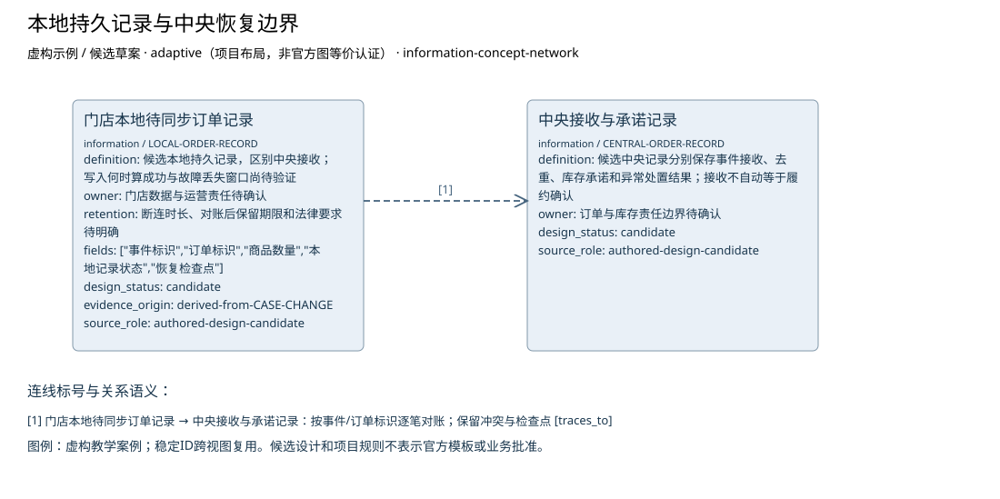

# 本地持久记录与中央恢复边界

**虚构验收案例，不代表真实企业事实。**

制品：信息地图（Information Map） · 模型 fictional-v1 · 视图 `offline-data-boundary`

语境：`{"domains": ["business", "data", "application", "technology"], "landscape": "segment", "purpose": "project", "abstraction": "logical", "evolution": "target"}`

两个记录边界分别承担离线保存与中央恢复接收；持久成功、丢失容忍、重试和对账目标待确定。

| ID | 类型 | 名称 | 属性 |
| --- | --- | --- | --- |
| LOCAL-ORDER-RECORD | information | 门店本地待同步订单记录 | {"definition": "候选本地持久记录，区别中央接收；写入何时算成功与故障丢失窗口尚待验证", "owner": "门店数据与运营责任待确认", "retention": "断连时长、对账后保留期限和法律要求待明确", "fields": ["事件标识", "订单标识", "商品数量", "本地记录状态", "恢复检查点"], "design_status": "candidate", "evidence_origin": "derived-from-CASE-CHANGE", "source_role": "authored-design-candidate"} |
| CENTRAL-ORDER-RECORD | information | 中央接收与承诺记录 | {"definition": "候选中央记录分别保存事件接收、去重、库存承诺和异常处置结果；接收不自动等于履约确认", "owner": "订单与库存责任边界待确认", "design_status": "candidate", "source_role": "authored-design-candidate"} |

独立图片：[offline-data-boundary.png](offline-data-boundary.png)。可编辑源与模型见同目录。

图例／解释：虚构教学案例；稳定ID跨视图复用。候选设计和项目规则不表示官方模板或业务批准。

| 关系 ID | 起点 | 语义 | 终点 | 说明 | 属性／代码／端基数 | 证据／确定性 |
| --- | --- | --- | --- | --- | --- | --- |
| RECONCILE-RECORDS | LOCAL-ORDER-RECORD | traces_to | CENTRAL-ORDER-RECORD | 按事件/订单标识逐笔对账；保留冲突与检查点 | {"attributes": {}} | CASE-CHANGE, CASE-REVIEW / assumed |

证据与缺口：

| 对象 | 来源 | 确定性 |
| --- | --- | --- |
| LOCAL-ORDER-RECORD | CASE-CHANGE, CASE-REVIEW | assumed |
| CENTRAL-ORDER-RECORD | CASE-CHANGE, CASE-REVIEW | assumed |

- 门店在线销售与中央库存的当前交互尚未调查；影响：不能由线上订单接口推断门店在线行为；需要：门店在线流程、接口与失败处理材料。

- 已确认订单交给物流的具体接口和责任未提供；影响：只明确确认前不进入物流，交接规格待定；需要：物流接收契约与责任方。

- 最大断连时间未知；影响：阻断离线候选方案接受与运营状态进入；需要：断连上限与存储容量依据。

- 可容忍的数据丢失窗口未知；影响：阻断离线候选方案接受与运营状态进入；需要：持久成功标准、故障演练与数据丢失容忍。

- 冲突、补偿与回退责任待确认；影响：阻断离线候选方案接受与运营状态进入；需要：业务与运营责任人的交接接受记录。

方法检查：

- 信息地图不是 ER 表结构。
- 主题分组不能臆造继承关系。

这些检查是评审问题，生成文件不自动表示已通过业务评审。

表达完整性见 [offline-data-boundary.coverage.json](offline-data-boundary.coverage.json)。来源结构模板的核实状态见布局文件；生成不改变该状态。
