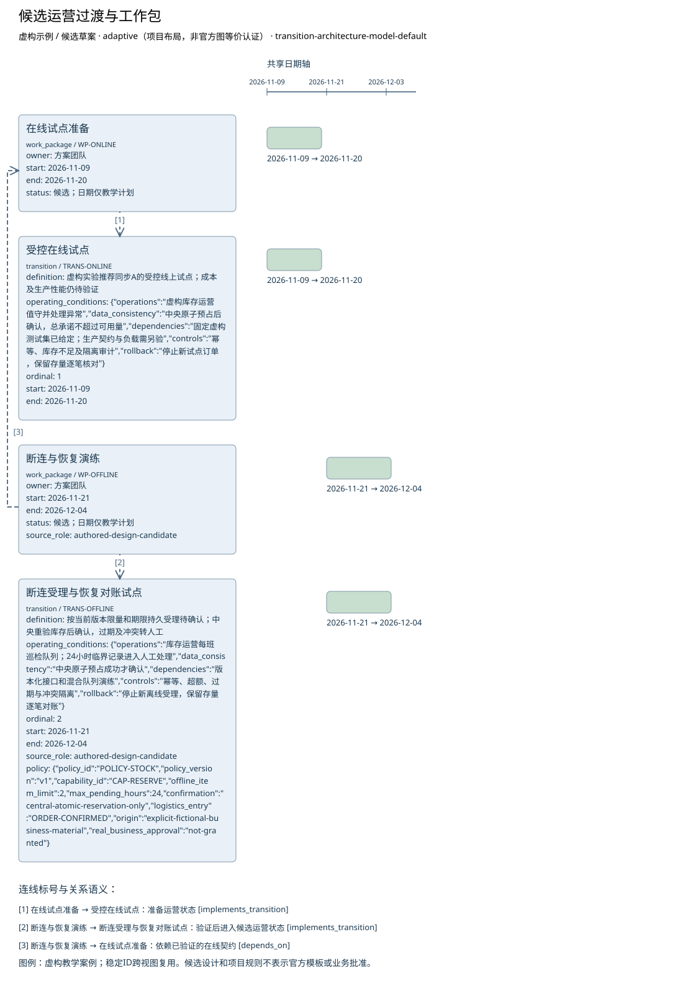

# 候选运营过渡与工作包

**虚构验收案例，不代表真实企业事实。**

制品：过渡架构模型（Transition Architecture Model） · 模型 fictional-v1 · 视图 `transition-roadmap`

语境：`{"domains": ["business", "data", "application", "technology"], "landscape": "segment", "purpose": "project", "abstraction": "logical", "evolution": "target"}`

依据虚构材料表达候选设计；证据不足的结论保留缺口。

| ID | 类型 | 名称 | 属性 |
| --- | --- | --- | --- |
| WP-ONLINE | work_package | 在线试点准备 | {"owner": "方案团队", "start": "2026-11-09", "end": "2026-11-20", "status": "候选；日期仅教学计划"} |
| TRANS-ONLINE | transition | 受控在线试点 | {"definition": "虚构实验推荐同步A的受控线上试点；成本及生产性能仍待验证", "operating_conditions": {"operations": "虚构库存运营值守并处理异常", "data_consistency": "中央原子预占后确认，总承诺不超过可用量", "dependencies": "固定虚构测试集已给定；生产契约与负载需另验", "controls": "幂等、库存不足及隔离审计", "rollback": "停止新试点订单，保留存量逐笔核对"}, "ordinal": 1, "start": "2026-11-09", "end": "2026-11-20"} |
| WP-OFFLINE | work_package | 断连与恢复演练 | {"owner": "方案团队", "start": "2026-11-21", "end": "2026-12-04", "status": "候选；日期仅教学计划", "source_role": "authored-design-candidate"} |
| TRANS-OFFLINE | transition | 断连受理与恢复对账试点 | {"definition": "按当前版本限量和期限持久受理待确认；中央重验库存后确认，过期及冲突转人工", "operating_conditions": {"operations": "库存运营每班巡检队列；24小时临界记录进入人工处理", "data_consistency": "中央原子预占成功才确认", "dependencies": "版本化接口和混合队列演练", "controls": "幂等、超额、过期与冲突隔离", "rollback": "停止新离线受理，保留存量逐笔对账"}, "ordinal": 2, "start": "2026-11-21", "end": "2026-12-04", "source_role": "authored-design-candidate", "policy": {"policy_id": "POLICY-STOCK", "policy_version": "v1", "capability_id": "CAP-RESERVE", "offline_item_limit": 2, "max_pending_hours": 24, "confirmation": "central-atomic-reservation-only", "logistics_entry": "ORDER-CONFIRMED", "origin": "explicit-fictional-business-material", "real_business_approval": "not-granted"}} |

独立图片：[transition-roadmap.png](transition-roadmap.png)。可编辑源与模型见同目录。

图例／解释：虚构教学案例；稳定ID跨视图复用。候选设计和项目规则不表示官方模板或业务批准。

| 关系 ID | 起点 | 语义 | 终点 | 说明 | 属性／代码／端基数 | 证据／确定性 |
| --- | --- | --- | --- | --- | --- | --- |
| WP-TO-ONLINE | WP-ONLINE | implements_transition | TRANS-ONLINE | 准备运营状态 | {"attributes": {}} | CASE-REVIEW / assumed |
| WP-TO-OFFLINE | WP-OFFLINE | implements_transition | TRANS-OFFLINE | 验证后进入候选运营状态 | {"attributes": {}} | CASE-CHANGE, CASE-REVIEW / assumed |
| WP-DEP | WP-OFFLINE | depends_on | WP-ONLINE | 依赖已验证的在线契约 | {"attributes": {}} | CASE-CHANGE, CASE-REVIEW / assumed |

证据与缺口：

| 对象 | 来源 | 确定性 |
| --- | --- | --- |
| WP-ONLINE | CASE-REVIEW | assumed |
| TRANS-ONLINE | CASE-REVIEW | assumed |
| WP-OFFLINE | CASE-CHANGE, CASE-REVIEW | assumed |
| TRANS-OFFLINE | CASE-CHANGE, CASE-REVIEW | assumed |

- 门店在线销售与中央库存的当前交互尚未调查；影响：不能由线上订单接口推断门店在线行为；需要：门店在线流程、接口与失败处理材料。

- 已确认订单交给物流的具体接口和责任未提供；影响：只明确确认前不进入物流，交接规格待定；需要：物流接收契约与责任方。

- 最大断连时间未知；影响：阻断离线候选方案接受与运营状态进入；需要：断连上限与存储容量依据。

- 可容忍的数据丢失窗口未知；影响：阻断离线候选方案接受与运营状态进入；需要：持久成功标准、故障演练与数据丢失容忍。

- 冲突、补偿与回退责任待确认；影响：阻断离线候选方案接受与运营状态进入；需要：业务与运营责任人的交接接受记录。

方法检查：

- 过渡架构不是仅有交付日期的里程碑。
- 必需属性具有明确值或被登记为阻断缺口。
- 来源与项目事实、参考内容、假设保持可区分。
- 结论回应本规范的决策问题并可追溯。

这些检查是评审问题，生成文件不自动表示已通过业务评审。

表达完整性见 [transition-roadmap.coverage.json](transition-roadmap.coverage.json)。来源结构模板的核实状态见布局文件；生成不改变该状态。
