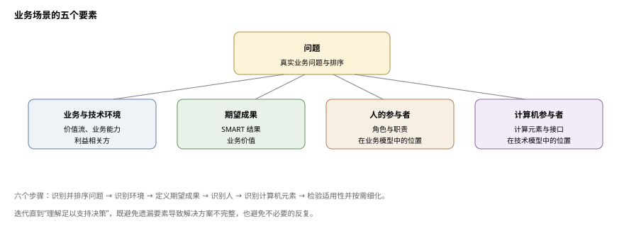
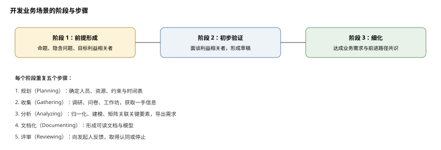
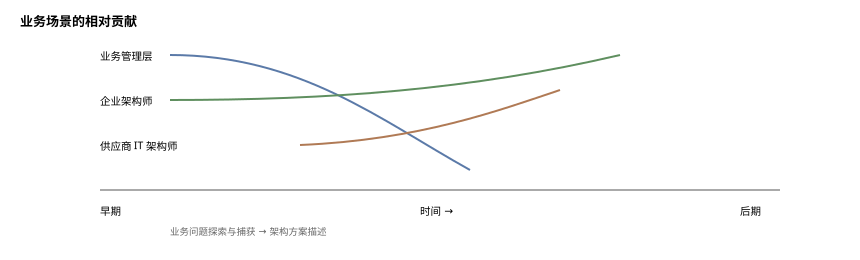

# 业务场景

**The Open Group TOGAF® 系列指南**

文档编号：G176

> 中文译本说明：本文档依据 The Open Group《Business Scenarios》（G176）逐节翻译。术语：Business Scenario=业务场景；Stakeholder=利益相关者；Value Stream=价值流；Business Capability=业务能力。

---

## 前言

The Open Group 是一个全球性联盟，通过技术标准与开源倡议帮助各组织实现业务目标；其使命是推动实现**无边界信息流**（Boundaryless Information Flow™）。TOGAF 标准是一套经过实践检验的企业方法论与框架。本文档是 TOGAF® 系列指南之一，主题为业务场景。

## 关于作者

（请注意：以下所属机构为批准时的信息。）

**Terence（Terry）Blevins，The Open Group 会士；Enterprise Wise LLC 所有者**

Terence Blevins 是 The Open Group 会士、Enterprise Wise LLC 所有者，也是一位半退休的企业架构师。他目前担任 The Open Group 理事会（Governing Board）理事。

自 20 世纪 80 年代起，他长期从事架构学科相关工作，大部分时间是在 NCR Corporation 担任战略架构总监期间。Terence 自 1996 年首次接触架构论坛（Architecture Forum）起便参与 The Open Group 的工作。他曾任架构论坛联合主席，并经常为 TOGAF® 标准贡献内容，其中包括业务场景方法。

Terence 曾任 The Open Group 副总裁兼首席信息官（CIO），为 The Open Group 的“无边界信息流”愿景（Boundaryless Information Flow™）作出了贡献。

他拥有 Youngstown State University 的数学学士与硕士学位，并持有 TOGAF® 8 认证。

**Mike Lambert，The Open Group 会士**

Mike 是 TOGAF® 标准的先驱之一。作为 The Open Group 的首席技术官，他在 20 世纪 80 年代末担任 IEEE 1003.0 架构标准的技术编辑，并在 TOGAF 8 标准发布之前负责与 The Open Group 共同推进 TOGAF 标准的开发。Mike 于 1984 年从 ICL 加入 X/Open Company Limited（The Open Group 的前身之一）。在 ICL 期间，他历任多个职务，最终担任 OMAC 29 的首席架构师——OMAC 29 是 ICL 面向制造业的旗舰产品——并担任 ICL 所有垂直应用产品的设计权威（Design Authority）。在 X/Open 与 The Open Group 担任首席技术官期间，Mike 负责技术战略，并主持了 UNIX® 操作系统的初始标准化工作。

2003 年 4 月离开 The Open Group 之际，Mike 被任命为 The Open Group 首位会士，以表彰他对开放系统与架构发展所作的广泛贡献。2003 年至 2005 年间，Mike 继续与 The Open Group 紧密合作，担任消息论坛（Messaging Forum）的论坛总监，并为架构论坛提供秘书处服务。2005 年至 2015 年间，Mike 担任 Architecting-the-Enterprise Ltd. 的首席技术官兼首席讲师，具体负责 Architecting-the-Enterprise TOGAF 培训业务的开发、交付与质量。2004 年至 2011 年间，Mike 在 University of Reading 担任信息系统与企业架构方向的本科及研究生讲师。

2005 年，Mike 获 University of Reading 颁发的卓越教学奖。

2012 年，Mike 获 The Open Group 颁发的终身成就奖。

## 致谢

（请注意：以下所属机构为批准时的信息。）

The Open Group 衷心感谢本文档的作者 Terry Blevins 与 Mike Lambert，以及 The Open Group 架构论坛（Architecture Forum）过去与现在的成员，感谢他们对本文档开发所作的贡献。

## 商标

ArchiMate、TOGAF、The Open Group 等名称与标识归其各自所有者；Boundaryless Information Flow 为 The Open Group 商标。

## 参考文档

| 编号 | 文档 |
|---|---|
| [C220] | 《TOGAF® 标准》第 10 版 |
| [G178] | 《TOGAF® 系列指南：价值流》 |
| [G18A] | 《TOGAF® 系列指南：业务模型》 |
| [G211] | 《TOGAF® 系列指南：业务能力》 |

---

## 1. 引言

企业架构成功的一个关键因素，是它与业务需求的关联程度，以及它能否可证明地支持并使能企业实现业务目标。任何架构工作都必须从“解决方案需要满足的需求”的基线视图开始。试想在不了解“为何需要仓库”的情况下指导建造仓库：可能建成一座适合存放大型机械部件的优秀仓库，但实际需求是存放家庭用品。在不理解“为什么”的情况下创建架构，通常会导致解决方案与需求错配。

**业务场景方法**是一种通过理解并记录业务场景关键要素、在连续迭代中验证、细化或改变架构工作前提的技术。其中：

- 每次迭代都需要规划、数据收集、分析、文档化与评审；
- 每次迭代应改进一个或多个关键要素；
- 迭代重复进行，直到理解程度足以支持“继续推进”的决策。

不审视业务场景的全部要素，存在产出不完整解决方案的风险；但也必须注意避免不必要的反复。

业务场景方法可用于企业架构开发的多个阶段——主要是预备阶段、架构愿景与业务架构阶段，必要时也可用于其他架构阶段——以直接从业务高层需求推导架构特征。该技术用于帮助识别、理解并记录业务需求，从而导出架构开发必须处理的业务需求，并以**业务场景**文档记录。

业务场景是对以下内容的统一描述：

- 真实业务问题；
- 问题发生的业务与技术环境；
- 由业务能力 [G211] 使能的价值流 [G178]；
- 正确执行后的期望成果；
- 提供这些能力的人与计算组件（“参与者”）。



良好的业务场景还应是“SMART”的：

- **具体**（Specific）：明确业务中需要做什么；
- **可度量**（Measurable）：通过清晰的成功度量指标；
- **可行动**（Actionable）：清晰切分问题，并为确定解决方案要素与计划提供基础；
- **现实**（Realistic）：问题可在物理现实、时间与成本约束内解决；
- **有时限**（Time-bound）：明确说明解决方案机会何时失效。

第 9 章给出应考虑成果的详细示例。无论采用何种成果，关键都是使其 SMART。

关于业务场景与业务场景方法的进一步说明：

- **业务场景不只关乎 IT**，尽管其起源如此。业务场景同样关乎理解业务价值、价值流与业务成果，以及改进价值流、达成成果、交付业务价值通常需要哪些资源。
- **业务场景不限于 IT 行业**，该技术可应用于医疗、交通、油气、彩票等任何行业的需求理解。
- **业务场景不只适用于大问题领域**，既可应用于国家彩票标准等非常广泛的问题，也可应用于零售 POS 升级等非常聚焦的小问题。
- **业务场景与架构一样不是终点**——终点是达成期望的业务成果。因此，必须有下游路径用业务场景驱动架构工作，并忠实驱动解决方案实施。
- **业务场景是特定时点的陈述**，应随重大变化更新。

业务场景**不是**：

- 用例（如 OMG、Rational 软件中的用例）——用例通常用于软件开发项目；
- 业务模型、商业论证或业务场景计划——但业务场景可由公司业务模型启发，SMART 业务场景也可为商业论证/业务模型/计划提供输入；
- SPIN（情境、问题、暗示、需求满足的销售策略）——SPIN 是可用于为业务场景收集信息的销售技术，业务场景可为 SPIN 提供相关语境；
- 任何典型工程规格（如 IEEE 规格）的替代品——后者更详细、更面向材料，并更贴近科学。

---

## 2. 业务场景的收益

业务场景本质上是对业务问题的完整描述——既从业务角度、也从架构角度——使各项需求能够在整体问题的语境中相互关联地审视。缺少这样的完整描述作为语境：

- 架构有基于不完整需求集的风险，这些需求不能构成完整的问题描述，从而误导架构工作；
- 解决问题的业务价值不清晰；
- 潜在解决方案的相关性不清晰。

此外，由于该技术要求业务线管理者与其他利益相关者在架构项目早期参与，它在赢得这些关键人员对项目及最终产物（企业架构）的认同方面也发挥重要作用。

业务场景的另一个优势是**与供应商沟通**。当今多数架构通过最大限度利用商用现成品（COTS）软件实现，这些软件常来自多个供应商并在公开市场采购。客户使用业务场景可帮助供应商交付恰当解决方案：供应商需确保其解决方案组件为开放解决方案增值并具有市场性；业务场景提供了供应商社区把客户问题与解决方案联系起来的语言。它不仅说明需要什么、为什么需要，还使供应商能够利用开放标准、借助彼此技能来最优地解决问题。

创建业务场景需要时间与精力；若做得对，这项投资会有回报，回报汇总如下。若不开展，或做得不对，解决方案开发人员与实际业务之间将持续存在更多同类问题：

- **更好的解决方案**：通过理解真实需求及解决这些需求对业务的价值，可带来与业务清晰对齐、并实现新能力的解决方案。与业务领导者会面并把更好的解决方案摆上桌面，可形成可重复的关系，带来引入新能力的良性循环。
- **更快实现能力**：通过理解真实需求及相关时间要求，解决方案可按时间序列交付，而非一次性“大爆炸”式交付，从而更快实现与业务需求对齐的增量价值，这也与敏捷和 DevOps 方法一致。
- **更低成本**：通过理解真实业务需求并增量处理，最终节省成本——既节约成本，也避免成本。节约成本的例子包括只实现所需内容、消除冗余；避免成本的例子包括消除失败实施的代价、降低集成与互操作成本。

---

## 3. 创建业务场景

### 3.1 总体过程

创建业务场景包括完成六个步骤，覆盖图 3-1 的五个要素：

1. 识别、记录并排序驱动该场景的问题；
2. 识别场景的业务与技术环境，并在场景模型（含价值流与业务能力）中记录；
3. 识别并记录期望成果（成功处理问题的结果），使其 SMART；
4. 识别人的参与者及其在业务模型中的位置；
5. 识别计算机参与者（计算元素）及其在技术模型中的位置；
6. 检验“适用性”，仅在必要时细化。

关键术语说明：

- **成果**：项目或组织所提供之物带来的变化、收益、学习或其他效果。
- **能力**：组织、人或系统拥有的本领。开发业务场景时，指在已知环境中通过价值流中的人力/物力资源达成成果的能力。
- **业务能力**：企业为达成特定目的或成果而可能拥有或交换的特定能力或才能 [G211]。
- **价值流**：为客户、利益相关者或最终用户创造整体结果的端到端增值活动集合的表示 [G178]。开发业务场景时，指特定行业企业为市场交付有价值产品或服务而执行的一组活动。
- **价值主张**：对客户购买并使用你的产品和/或服务将获得的具体结果的清晰陈述，聚焦成果，以客户易于理解和记住的简明方式表达，并应缓解其痛点。业务场景并不显式记录价值主张，但对解决方案提供方而言，理解客户业务场景的重要性怎么强调都不为过。

业务场景通过若干阶段开发，以形成、验证并细化驱动架构工作的业务需求前提。每个阶段由规划、收集信息、分析信息、记录结果与评审结果等步骤组成（图 3-2）。每个阶段中，业务场景各要素依次改进；细化阶段决定是认为场景已完成并进入 TOGAF ADM 下一阶段，还是需要进一步细化——判断标准是“当前业务场景是否适合把需求传递到架构过程下游”。



### 3.2 步骤

由于各步骤在每个阶段重复，先统一描述。

#### 3.2.1 规划步骤

规划步骤用于确保每次迭代作为小型项目得到良好编排、让合适的人员与资源参与并做好准备。活动包括：

- 识别买方与客户方参与人；
- 决定最佳数据收集机制（问卷、工作坊等）；
- 设定项目约束——时间、人员、资金，并记录于项目计划；
- 按姓名识别发起人；
- 配置团队；
- 识别角色所需人员（项目经理、业务场景顾问、业务场景分析师、业务场景编辑等）；
- 按姓名识别目标买方代表；
- 按姓名识别目标供方代表；
- 接触买卖双方并确保其参与；
- 在计划中增加后勤任务；
- 为每个步骤设定现实的目标日期与时间线；
- 召开团队会议统一认识；
- 更新项目计划（含备注、依赖关系等）。

#### 3.2.2 收集步骤

收集步骤针对图 3-1 各领域收集信息，目标是获得有效数据以塑造、确认和/或否定驱动工作的前提。若组织已有信息收集程序与实践（如为战略规划收集信息），应酌情使用，可在业务场景工作坊中或替代工作坊。

可采用多种技术：信息研究、定性分析、定量分析、问卷、信息请求等。在面对面工作坊之前，应尽可能“离线”收集并预处理信息。例如，信息请求可包括索取战略与运营计划；此类文档通常极具洞察力，但所含信息通常需要大量预处理。若可能，可用这些信息在工作坊前生成业务场景初稿，以增进架构师的理解与信心，并提升工作坊对参与者的价值。

收集信息的一个非常有用的方式是举办**业务场景工作坊**：由业务场景顾问引导一小群精选的业务代表回答一系列问题，以引出与架构工作所处理问题相关的信息。与会者必须从组织业务与技术高层中精心挑选，重要的是能且愿意坦诚开放地提供信息。若已有业务场景草案（例如通过本步骤预处理信息形成），工作坊也可用于评审草案状态。

有时需要多次工作坊：有时把业务侧信息收集与技术侧分开，有时只是为了从更多人处获得更多信息。

收集信息时，架构师可通过获取“真实世界案例”大大增强业务场景；引用真实案例时，应注意保持相关方匿名，避免指责。

收集步骤的活动包括：

- 拟定应回答的问题；
- 收集公开可用数据或开展早期问卷；
- 预处理公开数据（注意耗时）；
- 基于公开数据形成关键要素的“稻草人”理解；
- 针对缺口更新问题；
- 准备引导收集机制的全部材料；
- 实施所选信息收集机制；
- 举办一次或多次工作坊（若选择工作坊方式）：
  - 就问题主题与范围取得利益相关者总体一致；
  - 从利益相关者中取得支持者，并请其提供代表名单；
  - 工作坊前向受邀者发送邀请与问题；
  - 确定引导者与记录员；
  - 制定议程；
  - 制作工作坊材料（含“稻草人”业务场景）；
  - 布置场地（白板纸、U 形桌、白板、会议接入等）；
  - 举办工作坊并以电子方式记录全部信息。

#### 3.2.3 分析步骤

分析步骤是真正开展大量业务架构工作之处，目标是形成业务场景关键要素的统一视图：处理并记录所收集信息，并创建（通常为可视化的）模型来表现信息。

分析步骤利用业务场景顾问的知识与经验，借助过往工作形成描绘所捕获信息所需的模型。注意：产出的模型与文档未必逐字复述访谈内容，而是按真实底层需求进行过滤与转译。

分析步骤中重要的是保持业务场景关键要素之间的联系。一种有助于保持联系的技术是创建矩阵，把业务流程与以下各项关联：

- 利益相关方群体；
- 人的参与者；
- 计算机参与者；
- 问题；
- 目标。

如此，业务流程成为绑定焦点——这在多数情况下很合理，因为所追求的通常是业务流程改进。

分析步骤的活动包括：

- 把所有原始数据集中一处并锁定为只读；
- 为每个关键要素建立单独电子表格收集相关数据；
- 把原始数据复制到相应电子表格的原始数据列；
- 对文本数据进行迭代转换与归一化（语义处理）：
  - 把复合陈述拆为单点；
  - 通过亲和分析、综合与抽象，把原始数据转换为归一化清单；
  - 进一步亲和分析，为清单创建类别；
  - 记录每一步转换；
- 对可计算数据建立汇总机制——进行计算；
- 新建电子表格，建立关联全部关键要素的矩阵；
- 开展业务与能力分析，生成一组业务与技术需求；
- 对每个关键要素的答案评估完整性与正确性；
- 酌情起草数据模型。

#### 3.2.4 文档化步骤

文档化步骤记录结果，并从普通读者视角编辑文档以提升可读性，同时开发支撑文本的模型，目标是形成可参考的记录。活动包括：

- 起草文档并以图形纳入模型；
- 开展非正式内部内容评审；
- 更新草稿与模型；
- 校对并编辑文档。

#### 3.2.5 评审步骤

评审步骤把结果反馈给项目发起人，确保对问题完整范围及技术影响潜在深度形成共同理解，目标是取得认同或停止。建议与发起人及相关方举行多次业务场景工作坊或“宣读”会议；会议应开放、互动，建议在议程中设置练习，以检验与会者的理解与兴趣，并检验架构师自身的假设与结果。该步骤极其重要——缺乏共同预期在许多情况下正是项目失败的根本原因。

活动包括：

- 审核模型与文档；
- 考虑召开宣读会；
- 记录结果；
- 更新文档与模型；
- 按姓名识别内外部评审人；
- 为特定评审人分配特定章节；
- 制定评审指南；
- 通知评审人；
- 开展正式内容评审；
- 最终更新文档与模型；
- 就“基于文档继续推进”征询利益相关者意见。

### 3.3 阶段

上述步骤在以下阶段中重复，从形成前提直至业务领导者批准业务场景。业务场景文档随后放入**需求存储库**，作为驱动下游架构工作的高层需求陈述，并用于验证架构质量。

#### 3.3.1 前提形成阶段

每项工作都始于某种问题概念及处理该问题的方法。例如，企业可能有系统割裂、无法通信的问题，并认为可通过实施 ERP 系统解决。这一主张就是前提。该前提实质上预设了一个未明说问题的答案——ERP 真能减少我所有系统无法互操作的问题吗？有时该前提与未明说的问题未被审视，这可能是关键错误。本阶段试图理解前提及需审视的未明说问题，确保架构项目切中要害。

- **目标**：记录正在考虑的工作背后的主张，以及可细化或验证该主张的目标利益相关者。
- **方法**：考虑并记录工作背后的动机、可能的利益相关者、其未明说的问题，并激发其参与业务场景过程以描述问题的兴趣。
- **输入**：驱动工作的可能是一个完整记录的项目，也可能只是一个想法或概念，还可能是“缺少某些东西”，例如：对业务需求缺乏清晰理解；问题在找解决方案；解决方案在找问题；技术话语主导；目标市场未识别；“我们就是不知道如何开始”。
- **输出**：前提、验证前提需回答的关键问题，以及愿意帮助验证和细化前提的利益相关者清单，供下一阶段规划、管理与执行验证阶段。

#### 3.3.2 初步验证阶段

利益相关者的参与是任何重大变革的关键成功因素，且参与越早，成功机会越大——这在敏捷、DevOps 等最新开发方法趋势中均有体现。本阶段以当前前提、关键问题与目标利益相关者为输入，接触这些利益相关者，以验证和/或改进对真实问题及项目成功所需解决的真实问题的理解。

- **目标**：基于真实利益相关者的输入，形成一份草稿性、尚不完整的业务场景（未必代表整个细分市场）。
- **方法**：与各类利益相关者面对面，考察其真实业务问题；最好从不同组织抽取样本利益相关者，以理解哪些业务问题是共通的。
- **输出**：业务场景草稿文档及下一步建议。

#### 3.3.3 细化阶段

忠实捕获利益相关者需求很重要，但不能以停滞不前为代价（避免“分析瘫痪”）。本阶段帮助形成“足够好”的业务需求陈述。

- **目标**：在业务场景中记录经同意的业务需求陈述，以及经同意的前进路径，包括承诺按架构中记录的标准进行开发并优先采用这些标准。
- **方法**：迭代细化理解，直至就按文档建议推进达成一致。
- **输出**：发布的业务场景文档及下一步建议，输入架构过程。

---

## 4. 业务场景的内容

业务场景文档应包含场景的全部重要细节：捕获并排序处理情境的关键步骤与参与者交互；声明所有参与者的相关信息，特别是各参与者的不同职责、系统正常运作前必须满足的关键前提条件，以及服务达到可接受质量的技术要求。

内容主要有两类：图形（模型）与描述性文本。二者各司其职：

- 业务场景**模型**以图形捕获业务与技术视图，帮助理解；具体关联参与者与交互，并为确认具体需求提供起点；
- 业务场景**文档**以文本记录细节。典型目录如下：

```
版本历史
目录
前言（总体背景与为何使用业务场景方法）
1. 执行摘要
   1.1 “那又怎样？”——为什么需要本业务场景？
   1.2 谁将使用本业务场景？“以便……”——如何使用？
2. 文档路线图
3. 业务场景
   3.1 场景背景
   3.2 场景目的
   3.3 术语定义
   3.4 业务场景的开发
4. 业务环境
   4.1 利益相关方群体
   4.2 业务驱动因素
   4.3 业务流程（即价值流）
   4.4 人的参与者与角色
   4.5 与流程的关系
5. 技术环境
   5.1 技术流程（即价值流）
   5.2 计算机参与者与角色
   5.3 与流程的关系
6. 业务场景分析
   6.1 问题摘要
   6.2 问题/痛点
   6.3 期望成果
   6.4 信息流
   6.5 需求
   6.6 原则与约束
   6.7 导出的架构模型
7. 标准化的优先领域
   7.1 按流程领域的优先级
   7.2 建议的起点
8. 小结与下一步
附录 A  补充信息
附录 B  参考文档
附录 C  工作坊记录
附录 D  致谢
```

---

## 5. 业务场景的贡献

必须认识到，业务场景的创建并非架构师的专属领域。如前所述，业务线管理者与其他利益相关者要参与，以确保准确捕获业务目标；此外，视组织与 IT 供应商的关系，供应商也可参与，以确保准确捕获技术解决方案的角色，并确保与供应商的沟通。

通常，业务管理层的参与在早期探索与捕获业务问题时最大；架构师的参与在后期描述架构解决方案时最大。同样，若供应商参与业务场景过程，客户方（业务管理层与企业架构师）的参与在早期最大，供应商的参与在后期探索与捕获具体技术方案角色时最大。该概念如图 5-1 所示。

供应商的 IT 架构师可协助企业 IT 架构师把供应商产品集成到企业架构中；这种协助很可能落在图 5-1 时间线的中部。



## 6. 业务场景与 TOGAF ADM

业务场景在 TOGAF ADM 循环的初始阶段——**阶段 A：架构愿景** [C220]——最为突出：此时业务场景用于定义相关业务需求，并与业务管理层及其他利益相关者建立共识。业务场景也用于**业务架构阶段**，以直接从业务的高层需求推导架构特征。

业务需求在整个 ADM 生命周期的所有阶段都会被引用。

若需要推导需求，业务场景也可用于任何 ADM 阶段。例如，可用于预备阶段，以定义建立企业架构能力所需的需求。

由于业务需求在 ADM 循环的所有阶段都很重要，业务场景技术通过确保业务需求本身完整、正确，在 TOGAF ADM 中扮演重要角色。

---

## 7. 开发业务场景

### 7.1 一般指南

利益相关者（如业务管理者、最终用户）会告诉你他们想要什么，但作为架构师，你仍必须自行理解业务，因此必须了解系统中最重要的参与者。如果利益相关者并不清楚自己想要什么：

- 花时间观察并记录他们今天的工作方式；
- 以日后可用的方式组织信息；
- 从领域专家处发掘关键业务规则；
- 始终聚焦于需要达成什么，以及如何达成。

这项工作为从业务需求到技术解决方案的推理链提供锚点。开始时勤勉、批判，日后会有回报。

### 7.2 各领域应提的问题

收集步骤中提到的业务场景工作坊，实质是结构化访谈。尽管不存在适用于所有情境的唯一一组问题，以下内容仍可为业务场景顾问提出好问题提供一些指导。

#### 7.2.1 识别、记录并排序问题

问题是否被描述为“需要完成什么”（像流程中的步骤），而非“如何做”（技术“推动”）？

如果问题过于具体或本身就是一个“如何”：

- 亮起红旗；
- 追问“为什么需要那样做？”

如果问题过于模糊或不可行动：

- 亮起红旗；
- 追问“你需要做什么，或者问题解决后你将能做什么？”

提出有助于识别问题存在于何处、何时的问题：

- 你在哪里遇到这个特定问题？在哪个业务流程中？
- 你何时遇到这些问题？流程开始、中间还是结束？

提出有助于识别问题成本的问题：

- 你是否核算了与该问题相关的成本？如果是，有哪些？
- 是否存在隐性成本？如果有，是什么？
- 该问题的成本是否被计入其他事物的成本？如果是，是哪个、多少？
- 该问题是否表现为质量不佳，或让人感觉组织效率低下？

#### 7.2.2 识别业务与技术环境并记录在模型中

关于业务环境的问题：

- 哪个关键流程受这些问题困扰？需要处理的主要步骤是什么？
- 内部业务部门的位置/规模如何？
- 外部业务伙伴的位置/规模如何？
- 是否存在与该情境相关的特定业务规则与法规？

关于当前技术环境的问题：

- 哪些技术组件已被预设与该问题相关？
- 是否存在技术约束？
- 是否有适用的技术原则？

#### 7.2.3 识别并记录目标

“做什么”是否有充分的“为什么”理由支撑？如果没有，请就以下方面索要可度量的理由：

- 投资回报；
- 可扩展性；
- 性能需求；
- 对标准的符合性；
- 易用性度量。

#### 7.2.4 识别人的参与者及其在业务模型中的位置

参与者（actor）代表任何与系统交互或在系统内交互的事物，可以是人、机器或计算机程序。参与者发起与系统的活动；例如：

- 计算机用户与计算机；
- 电话用户与电话；
- 工资核算员与工资系统；
- 互联网订户与 Web 浏览器。

参与者代表用户所扮演的角色；即用户是使用系统时扮演某个角色的人（例如，John（用户）是调度员（参与者））。每个参与者以不同方式使用系统（否则他们应是同一参与者）。从不同视角询问将涉及的人，例如：

- 开发人员；
- 维护人员；
- 操作人员；
- 管理员；
- 用户。

#### 7.2.5 识别计算机参与者及其在技术模型中的位置

同样从不同视角询问可能涉及的计算机组件。它们必须做什么？

#### 7.2.6 记录角色、职责、成功度量与所需脚本

定义角色时，可提出如下问题：

- 该参与者的主要任务是什么？
- 该参与者是否需要读取/写入/更改任何信息？
- 该参与者是否需要把外部变化告知系统？
- 该参与者是否希望被告知意外变化？

#### 7.2.7 检查适用性并在必要时细化

是否有足够信息识别谁/什么可以满足该需求？如果没有，进一步深入探询。

是否描述了该需求需要在何时、以何种频率得到处理？如果没有，询问时间安排。

---

## 8. 业务场景文档

### 8.1 文本文档

有效的业务场景文档需要在“确保细节可获取”与“防止细节喧宾夺主、压垮读者”之间取得平衡。为此，业务场景文档应把主要发现放在正文，把细节放在附录。

在附录中：

- 捕获业务场景的全部重要细节：
  - 情境描述与理由；
  - 所有度量；
  - 所有参与者角色与子度量；
  - 所有所需服务；
- 捕获处理该情境的参与者之间的关键步骤，并对交互排序；
- 声明所有参与者的相关信息：
  - 划分参与者的职责；
  - 列出系统正常运作前必须满足的前提条件；
  - 提供服务达到可接受质量的技术要求。

在业务场景正文中：

- 对附录中的细节进行概括，提炼所有相关数据。

### 8.2 业务场景模型

记住使用模型的目的是：

- 帮助理解；
- 为确认需求提供起点；
- 关联参与者与交互。

保持图清晰、整洁：

- 不要在一张图中放太多内容；
- 图越简单越容易理解。

为便于引用而给图编号：

- 维护编号目录，避免重复。

---

## 9. 目标与目的指南

### 9.1 目标的重要性

架构开发的首批步骤之一，是定义开发的总体目标与目的。目的应源自组织的业务目标，以及 IT 被认为对达成这些目标所作贡献的方式。

每个组织在这方面的表现不同：有的把 IT 视为企业的驱动力，有的把 IT 视为支持角色，只是把已有业务流程自动化。关键在于，架构目标应与组织的业务目标与目的紧密对齐。

### 9.2 SMART 目标的重要性

目标不仅要以一般性措辞陈述，还需附加具体度量，使其如前述那样成为 SMART。

为此投入的精力将使架构演进周期的发起人获得更大的清晰度。它会在循环的每一步把拟议解决方案更紧密地引向目标，从而带来回报。对组织内不同利益相关者以及供应商和顾问而言，有一把衡量适用性的清晰标尺极为有益。若做得好，可用 ADM 把具体决策追溯到标准，从而给出其正当性依据。

下文目标改编自以往版本 TOGAF 标准中的目标。它们是目标的类别，每类附有一组可能的目的。每个目的都应以针对具体任务的度量与指标使其 SMART。然而，由于实际工作取决于具体的架构项目，不可能提供适用于任何项目的通用 SMART 目的清单。

因此，这里只提供一些 SMART 目的示例。

#### 9.2.1 使目标 SMART 的示例

在下文“提高用户生产率”这一总目标标题下，有一个提供“一致的用户界面”的目的，其描述如下：

“一致的用户界面将确保所有用户可访问的功能与服务，无论应用或站点，都以相似、可预测的方式呈现和运行。这将带来更高的效率与更少的用户错误，进而可能降低恢复成本。”

要使该目的 SMART，我们依次询问它是否具体、可度量、可行动、现实、有时限，然后对该目的作相应补充。

以下是对该目的按这些标准所作的分析：

- **具体**：提供“一致的用户界面，确保所有用户可访问的功能与服务无论应用或站点都以相似、可预测的方式呈现和运行”这一目的相当具体；但第二句所列的度量可以更具体。
- **可度量**：如上所述，该目的可度量，但可以更具体；第二句可修改为（例如）：“这将使用户效率提高 10%、订单录入用户错误减少 20%，进而可能使订单录入成本降低 5%。”
- **可行动**：该目的看起来确实可行动；显然必须提供用户界面的一致性，而这可以由负责向用户设备提供用户界面的人来处理。
- **现实**：提供“一致的用户界面，确保所有用户可访问的功能与服务无论应用或站点都以相似、可预测的方式呈现和运行”这一目的可能并不现实；考虑到当今用户端使用 PDA 的情况，我们可能需要补充该目的，以确保下游开发人员不会不适当地设计出妨碍使用新技术的方案——该目的可改写为“跨越提供类似功能的用户界面设备的一致用户界面，确保……”
- **有时限**：所述目的没有时限；要有时限，该目的可改写为“到第三季度末，提供一致的用户界面……”

上述分析得出一个更接近如下的 SMART 目的（再次提醒，这只是示例）：

“到第三季度末，在提供类似功能的各类用户界面设备上提供一致的用户界面，确保所有用户可访问的功能与服务在使用这些设备时，无论应用或站点，都以相似、可预测的方式呈现和运行。这将使用户效率提高 10%、订单录入用户错误减少 20%，进而可能使订单录入成本降低 5%。”

### 9.3 目标与目的的类别

尽管每个组织都会有自己的目标集合，一些示例可能有助于制定组织特定的清单。下文给出的是目标的类别，每类附有一组可能的目的，改编自以往版本 TOGAF 标准中的目标。

下文每个目的都应以针对相关任务的具体度量与指标使其 SMART，如上述示例所示。然而，实际工作取决于具体的架构项目，不可能提供适用于任何项目的通用 SMART 目的清单。

#### 9.3.1 目标：改善业务流程绩效

业务流程改进可通过以下目的实现：

- 提高流程吞吐量；
- 一致的输出质量；
- 可预测的流程成本；
- 提高现有流程的复用；
- 缩短业务信息从一个流程发送到另一个流程的时间。

#### 9.3.2 目标：降低成本

成本改进可通过以下目的实现：

- 降低全企业资产的冗余与重复程度；
- 减少对集成与定制的外部 IT 服务提供商的依赖；
- 降低维护成本。

#### 9.3.3 目标：改善业务运营

业务运营改进可通过以下目的实现：

- 增加可用于新业务特性的预算；
- 降低业务运行成本；
- 缩短产品或服务的上市时间；
- 提高对客户的服务质量；
- 改善业务信息质量。

#### 9.3.4 目标：提高管理效能

管理效能改进可通过以下目的实现：

- 提高业务灵活性；
- 缩短决策时间；
- 更高质量的决策。

#### 9.3.5 目标：降低风险

风险改进可通过以下目的实现：

- 易于实施新流程；
- 减少因复杂、有缺陷的系统而引入业务流程的错误；
- 减少现实世界中的安全隐患（包括导致生命损失的危险）。

#### 9.3.6 目标：提高 IT 组织的有效性

IT 组织有效性可通过以下目的实现：

- 增加新项目的上线数量；
- 缩短新项目上线时间；
- 降低新项目上线成本；
- 减少新项目上线时的服务连续性损失；
- **通用开发**：多个业务领域共用的应用只开发或采购一次并复用，而非由各业务领域分别开发；
- **开放系统环境**：建立基于标准的通用运行环境，可在全组织范围内接纳新标准、新技术与新应用；该基于标准的环境将为通用应用开发提供基础，并促进软件复用；
- **产品使用**：尽可能使用硬件无关的现成产品来满足需求，以减少对定制开发的依赖，并降低开发与维护成本；
- **软件复用**：对于必须定制开发的应用，开发可移植应用将减少软件开发量，并增加可供其他系统复用的软件库存；
- **资源共享**：数据处理资源（硬件、软件与数据）将由所有需要这些资源服务的用户共享——资源共享将在安全与运营考虑的语境下实现。

#### 9.3.7 目标：提高用户生产率

用户生产率改进可通过以下目的实现：

- **一致的用户界面**：一致的用户界面将确保所有用户可访问的功能与服务，无论应用或站点，都以相似、可预测的方式呈现和运行；这将带来更高的效率与更少的用户错误，进而可能降低恢复成本；
- **集成应用**：用户可用的应用将在各用户环境中以逻辑一致的方式运行，从而带来与一致用户界面相同的收益；
- **数据共享**：数据库将在安全与运营考虑的语境下在全组织共享，从而提高对所需数据的访问便利性。

#### 9.3.8 目标：提高可移植性与可扩展性

应用的可移植性与可扩展性将通过以下目的实现：

- **可移植性**：遵循开放系统标准的应用将具有可移植性，从而更易于在异构计算平台间迁移——可移植应用可使站点在技术改进出现时升级平台，而对运营影响最小；
- **可扩展性**：符合该模型的应用将可配置，从而能够在所需的全部平台上运行。

#### 9.3.9 目标：提高互操作性

跨应用与业务领域的互操作性改进可通过以下目的实现：

- **通用基础设施**：架构应促进基于开放系统与系统透明性的通信与计算基础设施，包括但不限于操作系统、数据库管理、数据交换、网络服务、网络管理与用户界面；
- **标准化**：通过实施基于标准的平台，将为应用提供并使其能够使用一组通用服务，从而提高互操作机会。

#### 9.3.10 目标：提高供应商独立性

供应商独立性将通过以下目的提高：

- **可互换组件**：只选择具有基于标准接口的硬件与软件，使升级或引入新产品对用户环境的干扰最小；
- **非专有规格**：能力将以支持充分开放竞争、可供任何供应商用于开发商业产品的非专有规格来定义。

#### 9.3.11 目标：降低生命周期成本

生命周期成本可通过上述多数目的降低。此外，以下目的直接针对生命周期成本的降低：

- **减少重复**：以互联开放系统取代孤立系统与自动化孤岛，将减少重叠功能、数据重复与不必要的冗余，因为开放系统可以共享数据与其他资源；
- **降低软件维护成本**：减少组织所用软件的数量与种类，将降低软件维护的工作量与成本——使用标准现成软件将进一步降低成本，因为此类软件的供应商把产品维护成本分摊到更大的用户群；
- **增量替换**：共享基础设施组件的通用接口允许分阶段替换或升级，而对运营的干扰最小；
- **降低培训成本**：通用系统与一致的人机接口（HCI）将降低培训成本。

#### 9.3.12 目标：提高安全性

组织信息的安全性可通过以下目的提高：

- **一致的应用安全接口**：一致的安全接口与程序将减少开发应用时的错误并提高应用可移植性；并非所有应用都需要同一套安全特性，但所使用的任何特性都应在各应用间保持一致；
- **一致的用户安全接口**：安全特性的通用用户界面将减少在系统间切换时的学习时间；
- **安全独立性**：如果架构具有良好的分层，应用部署可以使用适合特定环境的安全策略与机制；
- 与安全问题相关的服务台呼叫减少 25%；
- 网络中检测到的“误报”减少 20%（误报是指看似可采取行动的安全事件、但实际上是虚惊一场的事件）。

#### 9.3.13 目标：提高可管理性

管理改进可通过以下目的实现：

- **一致的管理接口**：一致的管理实践与程序将促进对所有应用及其底层支撑结构的管理；一致的接口可以简化管理负担，从而提高用户效率；
- **降低运营、管理与维护成本**：通过获得改进的管理产品以及提高被管理对象的标准化程度，可降低运营、管理与维护成本。

---

## 10. 角色

开发业务场景需要填补多个角色。有些角色可由同一人担任，因此角色数量之和并不意味着需要那么多人。人员配置应在规划步骤中完成：

- **项目经理**（Project Manager）：规划、执行并监控项目，使业务场景在规定时间与预算内形成文档并经过评审；
- **业务场景顾问**（Business Scenario Consultant）：引导项目朝正确方向推进，以产出高质量的业务场景；
- **业务场景分析师**（Business Scenario Analyst）：运用数据收集与分析技术，形成对业务场景各要素的共识视图；
- **业务场景作者**（Business Scenario Author）：对业务场景作出忠实、客观的叙述性描述；
- **业务场景编辑**（Business Scenario Editor）：把草稿加工成配得上 The Open Group 品牌标识的高质量可发布文档；
- **业务场景引导者**（Business Scenario Facilitator）：主持编排良好的会议与工作坊，使与会者满意且有所收获；
- **领域专家贡献者**（SME Contributors）：就拟议前提相关的特定主题提供专家建议与内容；
- **领域专家评审者**（SME Reviewers）：评审业务场景文档并提出客观、建设性的建议；
- **东道主**（Host）：为参与者提供受欢迎的环境，体现该项工作的推动力，让与会者放心开放；
- **发起人**（Sponsor）：代表高管层“买方”，说明推进该项工作的重要性，让与会者放心其将支持这项工作及后续跟进；
- **工作坊主问者与次问者**（Workshop Primary and Secondary Questioner）：提出有计划的探询性问题与追问，引出与主题相关的信息；
- **工作坊记录员**（Workshop Recorders）：忠实记录工作坊与会议的问题答案与笔记。

---

## 11. 检查清单

### 11.1 检查清单——前提形成

☐ 有一个简单的前提

☐ 有初始的顶点问题（capstone question）

☐ 有候选发起人

☐ 存在一个或多个触发因素：

- ☐ 对业务需求缺乏清晰理解
- ☐ 问题在找解决方案
- ☐ 解决方案在找问题
- ☐ 技术话语主导
- ☐ 目标市场未识别
- ☐ “我们就是不知道如何开始”

☐ 已识别目标买方参与者

☐ 已识别目标客户方参与者

☐ 已接触目标供方参与者

☐ 已接触目标客户方参与者

### 11.2 检查清单——规划

☐ 已指定项目经理

☐ 已指定业务场景顾问

☐ 已选择数据收集机制

☐ 已设定项目约束：

- ☐ 时间
- ☐ 人员
- ☐ 资金

☐ 参与活动已配置资源

☐ 后勤活动已配置资源

☐ 其他角色已配置资源

☐ 已召开首次团队会议

☐ 已建立依赖关系

☐ 已建立合理的时间线

☐ 已记录在项目计划中

☐ 后勤活动已配置资源：

- ☐ 会议与工作坊后勤
- ☐ 演练会议
- ☐ 场地布置
- ☐ 应急安排
- ☐ 后续跟进
- ☐ 润滑协调
- ☐ 感谢信

### 11.3 检查清单——收集

☐ 问题已拟定

☐ 已收集公开可用数据

☐ 已预处理公开可用数据

☐ 已形成关键要素的“稻草人”

☐ 数据收集材料已准备

☐ 参与者已确定

☐ 参与者已参与

☐ 已采取措施保持期望的匿名性

☐ 已考虑：

- ☐ 工作坊
- ☐ 问卷
- ☐ 访谈
- ☐ 焦点小组
- ☐ 市场研究等

若采用工作坊：

☐ 有议程

☐ 工作坊已编写脚本并演练：

- ☐ 引导者与东道主
- ☐ 问者与记录员

☐ 场地已准备（视情况）：

- ☐ 白板纸
- ☐ U 形桌
- ☐ 白板
- ☐ 会议接入

☐ 邀请与说明已发送给领域专家

☐ 已准备以电子方式记录全部信息

☐ 已考虑分设两场工作坊（买方与供方）

### 11.4 检查清单——分析

☐ 所有数据已集中一处并锁定为只读

☐ 已为每个要素准备分析文本的工作表

☐ 已为每个要素准备分析可计算数据的工作表

☐ 工作表已填入原始数据

☐ 已将文本转换为归一化、分类的清单

☐ 已完成计算

☐ 已准备统一矩阵以连接全部关键要素

☐ 已评估完整性与正确性：

- ☐ 每个痛点至少应有一个成果

☐ 已生成一组业务与技术能力

☐ 已起草所收集数据的模型

☐ 已起草结果文本

### 11.5 检查清单——文档化

☐ 已指定主作者：

- ☐ 本应在规划步骤完成

☐ 已指定编辑：

- ☐ 本应在规划步骤完成

☐ 已起草文档

☐ 文档中已以图形纳入模型

☐ 已以文本形式描述模型

☐ 图已编号

☐ 使用了建模语言：

- ☐ ArchiMate® 建模语言

☐ 已阐明业务导向的问题与期望成果

☐ 有“那又怎样”（so what）

☐ 有“以便”（so that）

☐ 已开展非正式内部内容评审

☐ 已更新草稿与模型

☐ 已从业务人员视角校对并编辑

### 11.6 检查清单——评审

☐ 已指定内部评审人

☐ 已指定外部评审人

☐ 已为特定评审人分配特定章节

☐ 已向评审人提供正式说明

☐ 已正式管理变更请求

☐ 已就前进路径征询利益相关者意见

☐ 已为发布更新文档与模型

☐ 已将文档送入发布流程

☐ 已向参与者发送发布状态与感谢信

---

## 12. 技巧与提示

以下提示与技巧可用于工作坊与分析中的各种情境：

- 使用真实案例；
- 用练习解决真实且相关的问题；
- 使用圆桌讨论，并确保征求每个人的意见；
- 使用主动倾听与反思性倾听；
- 在会议中使用头脑风暴与亲和分析；
- 使用“介绍你的邻座”技巧；
- 使用“我们相信”练习；
- 使用金钱或“信用”投票进行优先级排序；
- 考虑使用多轮投票和/或排序；
- 考虑使用角色扮演；
- 考虑使用备选方案分析与决策矩阵；
- 对照检查清单。

### 12.1 关于主动倾听与反思性倾听

- 当你希望确保某人被听到——不仅被你，而是被所有人听到时使用。
- 主动倾听（据 Wikipedia®）：
  - 一种用于咨询、培训与冲突解决的沟通技巧，要求倾听者把听到的内容反馈给说话者，即用自己的话重述或复述所听内容，以确认听到的内容，并进一步确认双方的理解。
- 反思性倾听（据 Wikipedia）：
  - 一种包含两个关键步骤的沟通策略：先设法理解说话者的想法，再把该想法回馈给说话者，以确认已正确理解；它试图“重构客户的所思所感，并转达这种理解”。

### 12.2 关于头脑风暴与亲和分析

- 当你希望让整个团队提出想法时使用。
- 头脑风暴：
  - 一种收集所有参与者想法的结构化技术——它不是自由放任的混战；
  - 描述练习主题；
  - 说明头脑风暴规则；
  - 请每个人写下自己对主题的想法（设定一些限制，如“用一句话”）；
  - 以圆桌方式逐一获取每位参与者的想法，并记录在便利贴上；
  - 张贴便利贴；
  - 对想法进行亲和分析。
- 亲和分析：
  - 一种识别并归组相似或相关想法的手段；
  - 有助于把许多想法忠实合并为可管理的清单。

### 12.3 介绍你的邻座

- 当你需要从彼此不太了解的群体中建立团队时使用。
- 两人配对，例如 Al 和 Betty。
- 让他们交谈几分钟并互相介绍：
  - 最多五分钟；
  - 请他们聊姓名、居住地、业务、爱好等。
- 然后绕房间一周，让他们互相介绍：
  - Al 介绍 Betty，Betty 介绍 Al；
  - 让所有参与者都被介绍；
  - 若参与者为奇数，由引导者配对。

### 12.4 我们相信

- 当团队无法收敛，或争论方式缺乏建设性时使用。
- 退后一步，回到最初的前提。
- 问“我们相信这一点吗？”
  - 如果不信，那么“我们相信什么”？
- 维护一份“我们相信”清单。
- 将清单限制在重要信念上。
- 这些“我们相信”可以成为原则，或导向原则。

### 12.5 关于金钱或信用投票优先级排序

- 当你想了解人们真正愿意把资源投入何处时使用。
- 使用假钱或“信用”。
- 给每人一个预算：
  - 不能超预算花费；
  - 可投给一项或多项；
  - 如有其他规则，应事先宣布。
- 请参与者把预算分配到一份清单上：
  - 可匿名进行（首选）；
  - 使其真实：请每个人准备好为自己的分配辩护，就像向老板辩护一样。
- 汇总预算。
- 公布结果并讨论。

### 12.6 关于多轮投票与排序优先级

- 当你希望就清单事项的优先级达成共识时使用。
- 多轮投票：
  - 一种结构化制度，分步投票，每一步都缩减清单，最终缩至三到五项。
- 排序：
  - 将清单事项按 1 到 n 排序，所有排序的平均值形成集体视图。

### 12.7 关于角色扮演

- 当你希望拓展人们的视角，尤其是考虑另一种视角时使用：
  - 若你想让两个人或两个群体思考另一个人或另一个群体的观点，通常很有用。
- 描述一个情境，并把两种观点摆上桌面：
  - 让供应商处在买方位置；
  - 让买方处在供应商位置；
  - 让患者扮演医生；
  - 让医生扮演患者。

### 12.8 关于备选方案分析与决策矩阵

- 当桌上的方案太少，或看起来可能对某个既定方案有偏向时使用。
- 对备选方案进行头脑风暴，形成归一化清单。
- 把清单事项放入矩阵，并增加以下列：
  - 成本
  - 所需资源
  - 对问题的贡献
  - 可行性
  - 计算排序
- 请人们为每个单元格打分，1（最差）到 5（最佳）。
- 必要时加权重并计算。

| 备选方案 | 成本（权重=1） | 资源（权重=1） | 贡献（权重=1） | 可行性（权重=1） | 计算排序 |
|---|---|---|---|---|---|
| 方案 1 | | | | | |
| 方案 2 … | | | | | |

---

## 13. 小结

业务场景有助于解决高管面临的一个最常见问题：使重大转型（例如由 IT 变革支撑的转型）与业务对齐。

任何重大项目的成功，都以它与业务需求的关联程度、以及它能否可证明地支持并使能企业达成业务成果来衡量。业务场景方法是一项重要技术，可用于定义企业架构的多个阶段，或支持任何其他重大项目，以直接从业务的高层需求推导架构特征。业务场景用于帮助识别并理解业务需求，从而导出架构开发乃至最终解决方案必须处理的业务需求。

然而，重要的是记住：**业务场景只是工具，不是目的**。它们是更大范围的架构与下游开发过程的一部分，并为该过程提供使能。架构师应使用它们，但不应迷失其中。关键是保持聚焦——警惕“功能蔓延”（feature creep），处理那些往往能带来最大价值的最重要问题。

---

*译本依据：The Open Group, TOGAF® Series Guide: Business Scenarios, Document No. G176.*

---

## 索引

> 原文为页码索引；中文版重新排版后页码不适用，以下按章节号定位。

| 中文术语 | 英文 | 章节 |
|---|---|---|
| 主动倾听 | active listening | 12 |
| 亲和分析 | affinity analysis | 3.2.3 |
| 分析步骤 | Analyzing step | 3.2.3 |
| 头脑风暴 | brainstorming | 12 |
| 预算 | budget | 9.3.3 |
| 业务能力 | business capability | 1 |
| 业务场景 | Business Scenario | 1 |
| 业务场景文档 | Business Scenario document | 3.3 |
| 业务场景模型 | Business Scenario model | 8.2 |
| 业务场景工作坊 | Business Scenario workshop | 3.2.2 |
| 能力 | capability | 1 |
| COTS | COTS | 2 |
| 决策矩阵 | decision matrix | 12 |
| 文档化步骤 | Documenting step | 3.2.4 |
| 收集步骤 | Gathering step | 3.2.2 |
| 目标与目的 | goals and objectives | 9 |
| 初步验证阶段 | Initial Verification phase | 3.3.2 |
| 多轮投票 | multi-voting | 12 |
| 成果 | outcomes | 1 |
| 阶段 | phases | 1 |
| 规划步骤 | Planning step | 3.2.1 |
| 前提形成阶段 | Premise Formulation Phase | 3.3.1 |
| 排序 | rank ordering | 3.1 |
| 细化阶段 | Refinement Phase | 3.1 |
| 反思性倾听 | reflective listening | 12 |
| 评审步骤 | Reviewing step | 3.2.5 |
| 角色扮演 | role play | 12 |
| TOGAF ADM | TOGAF ADM | 3.1 |
| 价值主张 | value proposition | 3.1 |
| 价值流 | value stream | 1 |
