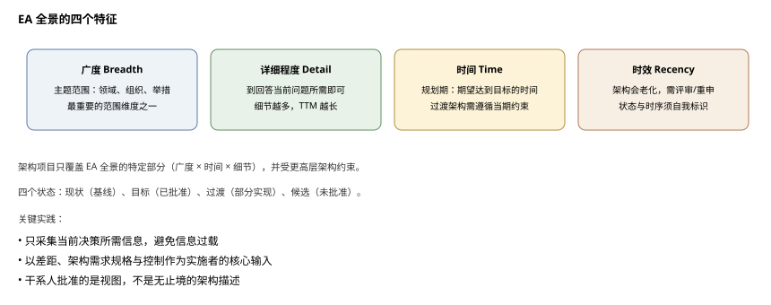
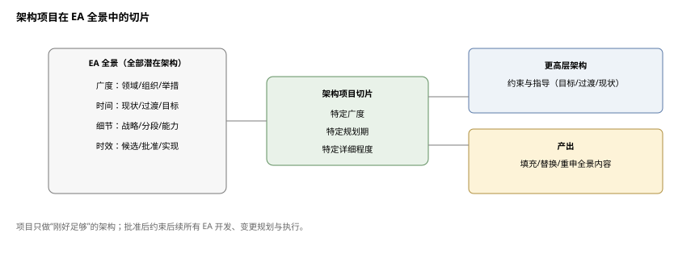
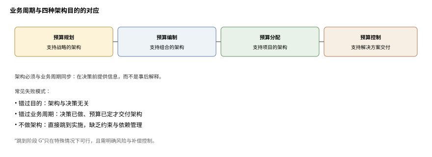
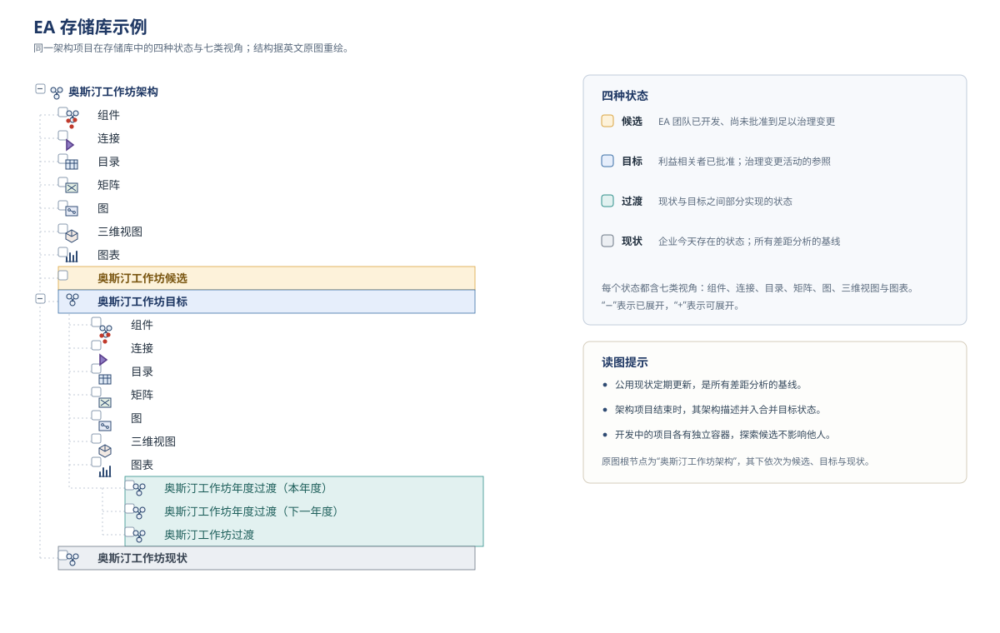
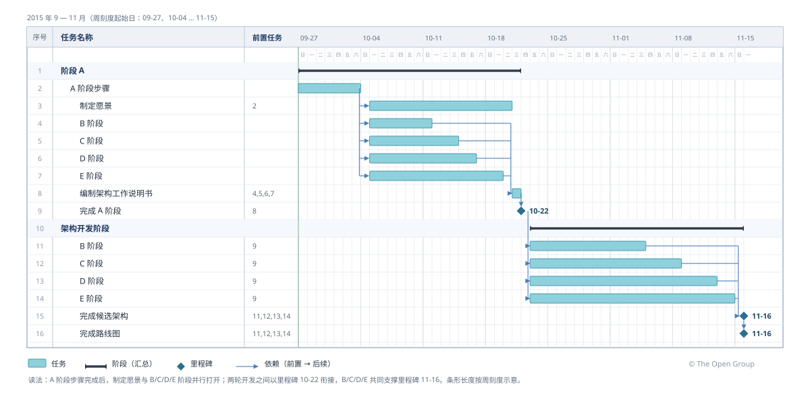
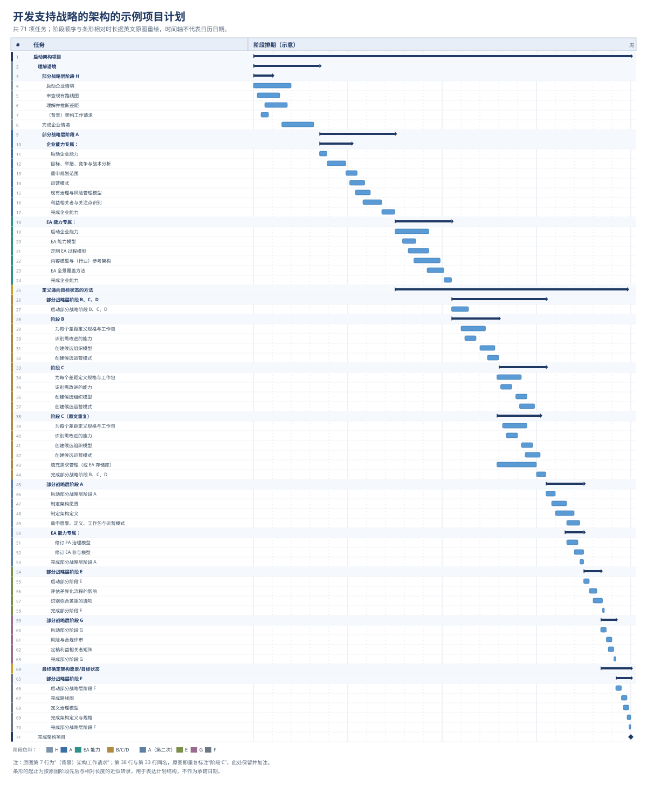
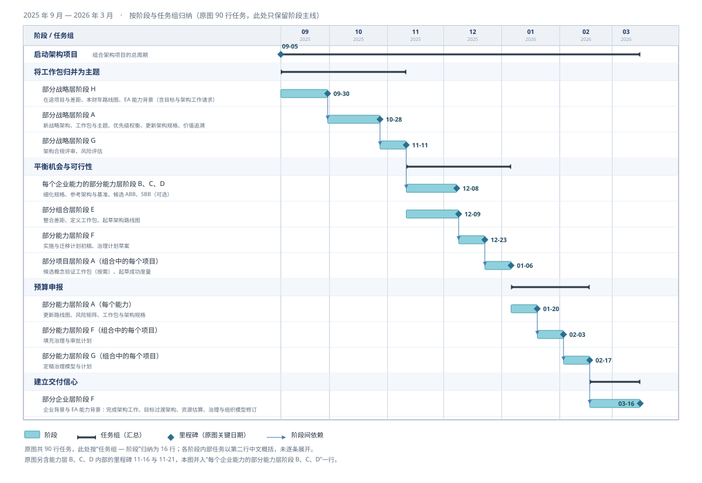
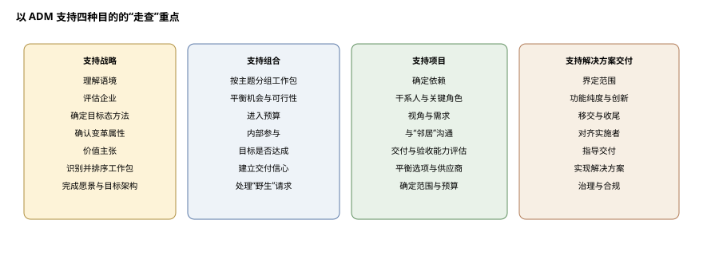
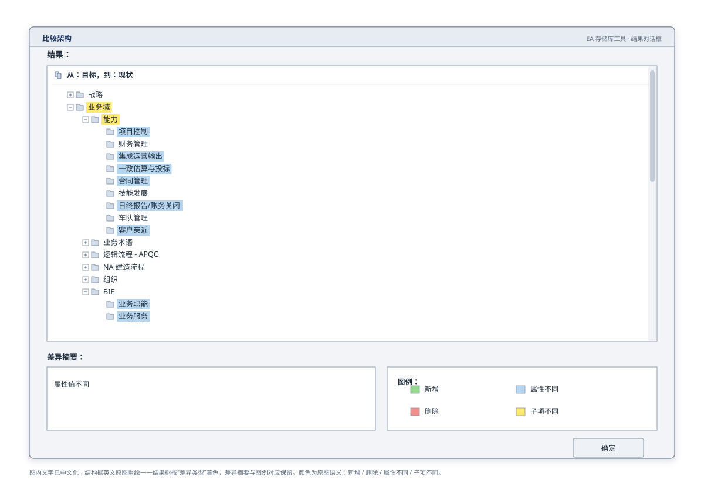
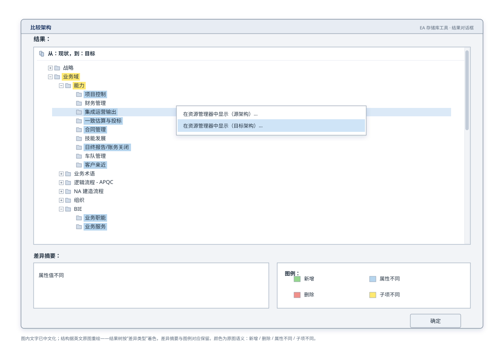

# 实践者方法：按 TOGAF® ADM 开发企业架构

**The Open Group TOGAF® 系列指南**

文档编号：G186（中文译本·修订版）

> 中文译本说明：本文档依据 The Open Group《A Practitioners' Approach to Developing Enterprise Architecture Following the TOGAF® ADM》（G186）翻译。术语：Practitioner=实践者；Enterprise Architecture=企业架构；EA Landscape=EA 全景；Repository=存储库；Business Cycle=业务周期；Time-To-Market（TTM）=上市时间；Stakeholder=利益相关者。本稿已译出正文第 1–15 章及附录 A–F。原书中部分插图为截图或位图，本稿未附 SVG，已在相应位置嵌入英文原图并注明原文图号；附录 B 的表 B-1 在原书中为矩阵图，附录 C 的表 C-1 在原书中只列关注点、其余列为空，本稿均保留其结构并注明。

---

## 前言

The Open Group 是一个全球性联盟，通过技术标准与开源倡议帮助各组织实现业务目标；其使命是推动实现**无边界信息流**（Boundaryless Information Flow™）。TOGAF 标准是一套经过实践检验的企业方法论与框架。本文档是 TOGAF® 系列指南之一，主题为实践者如何按 TOGAF ADM 开发、维护并使用企业架构。

## 关于作者

（请注意：以下所属机构为批准时的信息。）

**Dave Hornford，Conexiam**

Dave Hornford 是 Conexiam 的管理合伙人，领导 Conexiam 的波士顿业务部（Boston practice）。Dave 担任 The SABSA Institute 董事会（board of trustees）成员。他曾任 The Open Group 架构论坛主席，是 TOGAF® 9 标准的重要贡献者。他常驻北美，服务于金融服务、石油与天然气、技术以及资本密集型产业等多个行业，通常帮助客户制定并执行转型路线图。

**Nathan Hornford，Conexiam**

Nathan Hornford 是一名管理咨询顾问，也是 ABACUS 认证架构师与设计师，常驻加拿大。Nathan 与 Conexiam 的各业务部合作，提供一致的架构方法与工具，以满足客户的变革需求。

**Sriram Sabesan，Conexiam**

Sriram Sabesan 是经 The Open Group 认证的杰出架构师（Certified Distinguished Architect）。他常驻北美，专长于技术、制造、电信与金融服务行业。Sriram 帮助客户制定并执行应对数字化或经济颠覆的战略。他积极参与 The Open Group 多项标准的制定。

**Sadie Scotch，Conexiam**

Sadie Scotch 是一名企业架构师，常驻美国，是 Conexiam 波士顿业务部成员。Sadie 专长于治理、方案分析与路线图开发。她帮助客户制定并治理变革计划，以应对企业当前的优先事项。

**Ken Street，Conexiam**

Ken Street 是一名企业架构师，常驻加拿大，领导 Conexiam 的治理与 IT4IT™ 计划。他目前担任 The Open Group 大数据项目副主席，并活跃于 The Open Group IT4IT™ 与 Open Platform 3.0 论坛。他主要服务于金融服务以及石油与天然气行业，帮助客户建设其 EA 能力、改进 IT 组织并执行架构驱动的变革计划。

**Samantha Toder，Conexiam**

Samantha Toder 是一名管理咨询顾问，也是 ABACUS 认证架构师与设计师。Sam 常驻美国，帮助客户建设内部 EA 能力，并在金融服务行业执行复杂的转型计划。

## 致谢

The Open Group 衷心感谢各位作者，以及 The Open Group 架构论坛（Architecture Forum）过去与现在的成员，感谢他们为本指南的开发所作的贡献。

## 商标

ArchiMate、TOGAF、The Open Group 等名称与标识归其各自所有者；Boundaryless Information Flow 为 The Open Group 商标；ISO/IEC/IEEE 42010 为 ISO/IEC/IEEE 标准。

---

# 第一部分 引言与概念

## 1. 引言

### 1.1 概述

本文档为使用 TOGAF 框架开发、维护并使用企业架构（EA）提供指导，是 TOGAF 框架的伴侣，旨在把框架中的概念与通用构造“落地”。文档提出一种开发、维护并使用 EA 的方法，使 EA 与利益相关者的需求与期望对齐，并实现可预测的价值创造。

文档意在展示：每位实践者如何用**同一概念**（而非同一技术、模板或流程）（a）为企业交付有用的 EA，（b）改进 EA 能力。这一点很重要：同一概念。例如，实践证据表明，没有一个 EA 团队不使用存储库——无论存储库是一个文件文件夹，还是完整的建模分析软件。若你在这一点上感到困扰，请停下来想一想你带进这场讨论的先入之见。例如，阅读时若你产生类似“但真正的存储库应包括……”的反应，请自问这是否普遍成立。**存储库的概念是普遍的，实现方式各异。**

TOGAF 框架的基本脚手架是**概念**；框架中的其他内容要么是示例，要么是帮助你起步的初始集。若不喜欢某个示例，可利用框架的模块化结构替换它——领先的实践者与用户常这样做。本文档就是建议实践者让 TOGAF 框架的通用结构发挥作用。

本文档面向**实践者**——被委派开发、维护并使用 EA 的人。“实践者”一词有意反映角色，而非企业中众多职位头衔之一。

文档结构提供实践者可随时查阅的语境、内容与决策理由。若有效使用，经过深思熟虑开发的 EA 将基于开放标准与全球互操作，优化企业内外部的**无边界信息流**。

本文档明确关于开发、维护，最重要的是**使用** EA。潜在企业与目的的范围之广，需要这样长度的指南来指明方向。遵循《世界级企业架构》白皮书 [W102] 的方法，TOGAF 标准通常用于开发支持战略制定、组合管理、项目规划与执行、解决方案开发的架构。集体经验表明：不存在唯一正确的 EA 交付物、模型、视图、工作产品或技术；正确方法取决于架构开发举措的目的。任何声称存在单一正确方法的人，都不能为你提供成功所需的正确建议。本文档帮助实践者识别适合特定目的的方法。

开发、维护并使用 EA 需要与战略制定、预算、收益实现、组合管理、项目群与项目管理、运营单元等专业职能深度互动。本文档将：

- 介绍关键关注主题；
- 描述与该主题相关的 TOGAF 标准概念；
- 展示其与开发、维护并使用 EA 的关系；
- 讨论实践者需要知道什么；
- 描述实践者应如何运用这些知识。

文档虽有逻辑结构，但并非简单任务清单；步骤深度与细节取决于目的并且是迭代的，唯一变量是每一步投入的时间。与所有变革工作一样，列出需要知道什么，不等于规定文档详细程度。

企业的关键决策按**业务周期**做出；架构应为决策提供信息并使能决策。只要把架构交付与企业的业务周期、以及架构开发举措的目的对齐即可。价值是在架构被使用时才交付的，道理就这么简单。

本文档分为六个部分：

- **第一部分 引言与概念**：包含本篇引言与一组定义。
- **第二部分 企业架构的指导**：涉及企业架构是什么、用于什么；跨 EA 全景协调 EA 开发；使 EA 开发与业务周期协调。
- **第三部分 开发企业架构的指导**：涉及使用 ADM；开发支持战略的架构；开发支持组合的架构；开发支持项目的架构；开发支持解决方案交付的架构；特殊情况。
- **第四部分 使用企业架构的指导**：涉及深陷解决方案交付时该做什么；架构在行动（敏捷企业、应对事件等）。
- **第五部分 维护企业架构的指导**：涉及管理多个同时进行的路线图；深陷解决方案交付时该做什么。
- **第六部分 附录**：给出与框架、参考模型等相关的有用表格清单。

### 1.2 如何结合 TOGAF 框架使用本文档

TOGAF 框架提供了一套基本的、通用的脚手架，适用于多种组织、行业与架构风格。本文档旨在填补 TOGAF 框架未明确涉及的部分，并提供一种解读该标准的方法。这并不意味着 TOGAF 框架有缺陷。TOGAF 框架的设计本就需要解读或定制，它必须提供通用的脚手架。在“企业”定义所给出的种种不同示例之间，共同且普遍的东西是什么？是以**概念**形式表达的必备脚手架。

看待 TOGAF 框架的一种方式是：它是为**专家型理论家**写的——即为思考 EA 的结构与实践的人而写。而《TOGAF® 系列指南：TOGAF® 领导者指南——建立并演进 EA 能力》[G184] 则是为受命建立或演进 EA 能力的人而写。

本文档直接面向**做实际工作的人**：开发、维护并使用 EA 的人；不担心理论、也不担心如何构建或维护 EA 能力的人；开发、使用并维护良好 EA 的人。

本文档虽不假定读者具备 TOGAF 框架的详细知识，但会探讨 TOGAF 标准的核心概念，并把这些概念放在“用它们来开发、维护并使用 EA”的语境中。内容包括：关于迭代的指导、EA 存储库、为支持战略/组合/项目/解决方案交付四种目的而执行 ADM，以及对 EA 实践的开发与使用进行有效治理。

本文档采取的方法是：在“使用”的语境中探讨概念结构。本文档假定你已建立 EA 能力，并已针对本企业定制了 TOGAF 框架。

本文档是 TOGAF 库的组成部分。TOGAF 库中的其他文档包括《TOGAF® 领导者指南——建立并演进 EA 能力》。TOGAF 库提供了对 TOGAF 标准的完整解读，用以建立 EA 能力、发展 EA 能力团队，并交付有用的架构来指导变革、治理企业变革举措。

### 1.3 参考技术

本文档对关键文献及其技术的引用仅作示例。本文档并不认为所引用的工具、技术与文献具有权威性；其他工具、技术与文献可以随时替换。

## 2. 定义

为形成清晰共识，有几个术语需要与英语的日常用法区分开来。下列术语在本文档中有明确定义，并且无论出现在何处均首字母大写；它们只表示这些定义，不表示别的含义。

### 2.1 企业（Enterprise）

**企业：用于识别 EA 与 EA 能力所涵盖边界的、对组织的最高描述层级。**

> 注：该定义有意保持灵活，不与组织的法律边界或职能边界绑定。它必须同时覆盖单一制组织，以及由使命或供应链连接起来的多个独立组织所构成的扩展型组织，也必须覆盖组织内部的各个运营实体。设想一家把制造、物流与支持外包给合作伙伴的组织；一支多国维和部队；一家《财富》50 强公司中规模数十亿美元的事业部——它们都是企业。

### 2.2 企业架构（EA）

由于本文档的重点是解释 TOGAF 框架与企业架构概念，最好对这个概念作较为详细的界定；过分简洁的定义往往需要专门知识才能体会其中的细微差别。关于 EA 的讨论见第 3 章。

可以采用的简洁定义有两个，分别来自 Gartner 与 DoDAF。Gartner 把企业架构定义为：“把业务愿景与战略转化为有效企业变革的过程，其方式是创建、沟通并改进描述企业未来状态、并使企业得以演进的关键原则与模型。”DoDAF 把架构定义为：“一组抽象与模型，用于简化和沟通复杂的结构、流程、规则与约束，以改进理解、实施、预测与资源安排。”

EA 业界许多人认为区分“架构”（architecture）与“架构描述”（architecture description）这两个术语很有用，但**本文档不作这种区分**。

### 2.3 实践者（Practitioner）

**实践者：被委派开发、维护并使用企业架构的人，不论头衔。**

> 注：该术语反映的是角色，而不是可能适用的众多职位头衔中的某一个。

---

# 第二部分 企业架构的指导

## 3. 企业架构的目的

快速浏览相关文献就会很快发现：对于企业架构（EA）是什么样子、如何使用 EA，人们并没有一致的理解。那些试图简洁定义 EA 的说法，往往谈论系统的基本概念、要素、关系与属性；这类尝试通常带有很高的专业门槛，对非专业人士常常没有意义。进一步说，可以认为这正是许多评论者只聚焦于自己所开发的架构、并隐含假定人人都该照做所导致的结果。**理解源自目的。**

EA 是一种战略工具：它提供一种方法，用来识别并处理“愿景与现实”之间的差距——无论差距由什么驱动。它加速企业实现既定目标的能力。这一工具自带使用它的方法、支撑方向分类的**分类法**（taxonomy），以及从使用该工具中获益所需的资源。

本章将回答以下问题：

- 为什么开发企业架构很重要？
- 什么是企业架构？
- 如何使用企业架构？

### 3.1 为什么开发企业架构很重要？

开发 EA 的原因非常简单：**引导有效变革**。

所有企业都在寻求改进。无论是公共企业、私营企业还是社会企业，都需要有意识、有效的变革来实现改进。对私营企业，改进可能是股东价值或敏捷性；对公共企业，可能是基于法定授权的价值主张或效率；对社会企业，可能只是使命的改进。

关于有效变革的指导，将在实现已批准 EA 的活动中发挥。在实施过程中，EA 被利益相关者用来**治理变革**。治理的第一部分是**引导**变革活动——使变革与实现预期价值的最优路径对齐；治理的第二部分是**控制**变革活动——确保变革始终停留在最优路径上。

改进的范围驱动着所做的一切。一套方法用于同时验证目标与变革，确保二者可行、能交付期望价值，并且成本有效。**架构化的方法**提供了一套严谨的规划与变革治理方法。

用最简单的话说，EA 必须描述企业的**未来状态**与**现状**。对未来的描述使合适的人理解：在企业所处的语境中，为达成企业的目标、目的、使命与愿景必须做什么。现状与未来状态之间的差距，凸显出**必须改变什么**。好的 EA 促进有效的治理、管理、风险管理，并促成机会的利用。一份差距清单让“必须改变什么、这种改变意味着什么”变得显而易见：拟议项目是否与所需一致？是否与优先级一致？是否与完整的目标与目的集一致？

上文的论述凸显了 EA 的概念范围。这一范围常导致一种假定：EA 只用于回答**大问题**。事实绝非如此。同样的概念、方法、技术与框架，完全可以用于处理大大小小问题的终态、偏好权衡与价值实现。本质差别不在于你做什么，而在于**记录下来的架构长什么样**。系统的范围会变，对要素与属性的详细描述会变，但所有概念保持不变。

### 3.2 什么是企业架构？

简言之，EA 提供了实现企业战略的**最有效路径**。好的 EA 采用整体化方法，运用适当的分析、规划、设计与实施方法，把战略转化为定义良好的执行路径。

EA 的目的在于：通过规划、设计、部署与交付变革的循环，使企业能够最有效地达成使命、业务战略与目标。架构化的方法提供一套严谨的规划方法，验证业务目标，确保目标可行、能交付期望的业务价值，并且其达成是成本有效的。

实现这一目的，来自对**企业、语境、变革范围以及将要实现的价值**的理解。使用 EA 有助于这种理解：企业以一致的术语被描述，凸显出基本组成部分及其相互作用方式。一致的术语使同类比较成为可能；针对期望终态与偏好，探讨对基本组成部分的潜在变更。这种理解与分析，使企业能够在相互竞争的偏好之间、在不同成本与不同收益的潜在变更之间进行权衡。

简言之，好的 EA 使利益相关者能够**有意识地**在一组相互竞争的偏好之间取得恰当平衡。它让各业务单元在追求业务价值交付时可以安全地创新，同时确保组织对整合战略的需求得到满足，使扩展型企业获得尽可能紧密的协同。

#### 3.2.1 EA 全景简介

TOGAF 框架用 **EA 全景**（EA Landscape）指代 EA 的完整描述集合。本文档区分 EA 全景与 EA，因为一个完整 EA 全景中不会只有单一描述：任一时刻，典型企业可能有许多架构描述——有的针对非常具体的需求，有的更通用；有的关注细节，有的提供大局；有的针对同一主题的不同状态（现状、目标、过渡）或不同时期。

TOGAF 标准提供组织 EA 全景的框架；EA 全景识别所有潜在架构的边界及相关约束与指导。

许多特征可用于组织 EA 全景。必须认识的关键概念是：**任何开发与维护 EA 的举措都只填充 EA 全景的一部分**；随着时间推移、经过多次行动，EA 全景被填充与刷新。TOGAF 中关于迭代的许多论述正是为此。

与其把迭代理解为 ADM 的重排与循环，不如把 TOGAF 的**架构项目**概念与 **EA 全景**概念结合：每个架构项目都有意识地只开发“刚好足够”的 EA 全景，以服务当前需要；开发在先前架构的语境中进行，先前架构指导或约束当前工作；每个架构项目都会创建、细化并可能改变 EA 全景中的组件。

当 EA 全景被填充后，其中包含可用的描述、约束或指导。若不进行重复的信息收集、分析、评审与批准，实践者无法有信心地推进；现有决策、指导与约束为当前架构开发提供信息。最佳实践把信息收集与分析限制在解决当前问题所需的最低限度。EA 的努力只有在 EA 被使用时才回报最高；而架构师“完成”之前，EA 无法被使用。所有架构开发都必须以**上市时间（TTM）**评估。只填充 EA 全景所需部分，并遵循已有约束与指导，可加速 TTM。

四个常见的独立特征界定 EA 全景：

- **广度**（Breadth）：架构项目覆盖的主题范围。广度容易混淆，因为它可指广泛主题；以领域、组织、举措为例。广度可以是具体主题领域的层级，例如组织可按组织层级分解；主题是灵活的：处理特定举措会包含所有受影响组织，而组织会涉及所有受影响举措。广度是最重要的范围维度之一，为实践者提供分析语境。
- **详细程度**（Level of Detail）：不言自明。很容易在领域、组织或举措范围内不断探索与细化；随着架构开发，细化到回答当前问题所需的程度即可。足以支持决策或方向性指导的“足够好”答案即可推进。始终开发到满足架构项目目的所需的最低详细程度；始终牢记，更详细的架构工作受更不详细或更高层架构的指导与约束。最后，所需细节越多，TTM 越长——细节需要时间收集、分析、描述与获批。
- **时间**（Time）：每个架构开发项目都有规划期，即期望达到目标架构的时间点。时间带来挑战，因为未来在变动；通常规划期越长，架构越不详细（这常成立但非普遍规律）。最后，在达到规划期之前存在一个或多个过渡架构时需谨慎：更详细的架构必须仔细遵循该时点有效的指导与约束，而指导与约束会随不同过渡状态变化，这可能是挑战。
- **时效性**（Recency）：每份架构描述、规格与视图都在某一时点创建；它们总是为特定目的而建，并以最小的信息收集与分析解决当前问题。所有 EA 都会老化，或优雅或突然。时效性提示：先前 EA 可能需要评审，并重申或替换。良好的存储库能区分“开发中的架构、已批准的架构、已实现的架构、已重申的架构”；开发期间架构可能非常新，但可能尚不适合治理；未经批准应仅视为提示。时效性也可作为历史架构的组织因素。

关键点是：EA 全景内容只在需要时开发；一旦获批，它约束所有后续 EA 开发与 EA 使用。关于时间、顺序与业务周期的更广泛讨论，参见 5.3 节。

EA 全景的维度帮助我们思考 EA；但多数情况下，容易构建出“无效的简化”。架构项目不是图 3-2 所示那样的整齐立方体；真实表示更像海胆——有整合的中心，但尖刺伸向四面八方。

从图 3-2 看，要点在于：架构项目覆盖 EA 全景的特定部分——由广度、规划期与细节界定的部分；范围内可能已有先前工作。示例不覆盖最粗或最细的层，也不覆盖所有时期或主题；它处理全景的特定部分，将填充或刷新 EA 全景的一部分。由于存在更高层工作，架构项目中的所有工作都受更高层架构约束；示例停在某一详细程度，实践者需约束细节水平；示例处于企业总规划期内，受规划期内可与必须完成的事项约束。

更复杂的是，更高层架构可能以“未实现的目标、未实现的过渡、已实现的现状”存在；必须牢记：若更高层架构没有显式变更，现状很可能仍然有效。最后，该架构项目只是 EA 全景潜在广度的一个子集。**TTM 是有用架构的关键特征**；实践者必须坚持被要求的范围（广度、时间、细节）。范围之外的工作可能有趣、甚至未来需要，但不属于本次架构举措的范围。

当 EA 团队试图参与每场对话、做太多事时，其能量与效能会被稀释。TOGAF 的**架构工作请求**作为阶段 A 入口，正是为了界定当前架构项目：它告诉 EA 团队，在现有 EA 全景语境中，企业寻求一个目标架构，处理特定主题集合、达到必要详细程度，并能在特定规划期内完成。架构项目的实质产出是填充、替换或重申 EA 全景内容；当利益相关者接受目标后，所有后续 EA 工作、变更规划与变更执行都受已批准架构治理。

#### 3.2.2 目的简介

基于目的的 EA 能力模型识别四种目的，它们通常界定架构项目的规划期、深度与广度，以及 EA 存储库的内容。本文档采用的基于目的的 EA 能力模型由《世界级企业架构》白皮书 [W102] 引入，并在《TOGAF® 系列指南：TOGAF® 领导者指南——建立并演进 EA 能力》[G184] 中细化。

> 图 3-3：企业架构的目的。图内文字已中文化；原图见英文原文 Figure 3-3。

**图内标签对照**

| 图内英文 | 中文 |
|---|---|
| Architecture to Support Strategy | 支持战略的架构 |
| Architecture to Support Portfolio | 支持组合的架构 |
| Architecture to Support Project | 支持项目的架构 |
| Architecture to Support Solution Delivery | 支持解决方案交付的架构 |

通常，EA 能力有四种宽泛的目的：

- **支持战略的 EA**：交付 EA，提供端到端的目标架构，并开发 3 至 10 年期的变革路线图。
  这一目的的架构通常跨多个变革项目群或组合。在此语境中，架构用于识别变革举措及支撑其的组合与项目群，设定职权范围，识别协同点，并通过组合与项目群治理战略的执行。
- **支持组合的 EA**：交付 EA，支持跨职能、多阶段、多项目的变革举措。
  这一目的的架构通常跨单个组合。在此语境中，架构用于识别项目、设定其职权范围、对齐其方法、识别协同点，并治理项目的执行。
- **支持项目的 EA**：交付 EA，支持企业的项目交付方法。
  这一目的的架构通常跨单个项目。在此语境中，架构用于澄清项目的目的与价值，识别为处理协同与未来依赖所需的需求，确保符合架构治理，并支持项目之间的集成与对齐。
- **支持解决方案交付的 EA**：交付用于支持解决方案部署的 EA。
  这一目的的架构通常是单个项目或项目的重要部分。在此语境中，架构用于界定变革将如何被设计与交付，识别对设计的约束、控制与架构需求，并最终充当变革的治理框架。

不同目的的架构通常会在 EA 全景中产生不同内容，其特征组合也不同。表 3-1 汇总了这些典型特征。表 3-1 描述的是这样一个场景：战略规划者用同一套概念、方法、技术与框架开发 EA，以制定支持企业方向的路线图。其架构项目将从战略逐层下探，直至创建一个通过支持解决方案交付来实现未来状态的组合。该表展示了战略规划者或架构实践者的工作如何对应 EA 全景的四个维度。

表 3-1：目的与 EA 全景特征

| 目的 | 广度 | 详细程度 | 时间 | 时效性 |
|---|---|---|---|---|
| 支持战略的架构 | 无固定模式。有些战略影响广泛，有些战略只覆盖狭窄主题。 | 不很详细。可能包含“当价值依赖于严格控制时非常详细”的**点约束**（point constraint）。通常指导多于约束。 | 目标通常面向 3 至 10 年。支持战略的现状架构有效期往往较短。 | 通常，更新并保持该架构最新的需求高度可变。 |
| 支持组合的架构 | 覆盖单一主题（即该组合）。 | 通常不很详细。当价值依赖于严格控制时，可能包含“非常详细”的离散约束。 | 目标通常在 2 至 5 年内有效。支持组合的现状架构应被视为已过最佳使用期——没有未来视角的组合毫无意义。 | 通常，更新并保持该架构最新的需求高度可变。 |
| 支持项目的架构 | 广度狭窄，通常是组合内的离散项目。 | 通常较详细。会包含详细约束，而这些约束可能并未被详细的架构描述完全支撑。通常约束多于指导。 | 作为目标通常有效期不足 2 年。作为现状（实现之后）会有很长的存续期。若没有新的架构项目，该架构及其相关约束与指导将无限期延续。 | 通常，在从目标转为现状之后，仍会在 EA 全景中长期保留。 |
| 支持解决方案交付的架构 | 通常广度非常狭窄。 | 最详细的 EA。会包含最详细的约束。通常只开发约束，因为指导会从上层架构承继而来。 | 作为目标通常有效期不足 2 年。作为现状（实现之后）会有很长的存续期。若没有新的架构项目，该架构及其相关约束与指导将无限期延续。 | 通常，在从目标转为现状之后，仍会在 EA 全景中长期保留。 |

#### 3.2.3 企业架构看起来像什么

EA 存在的目的是指导并约束变革的规划与执行变革的工作。架构工作请求中所含的工作范围，应识别出 EA 全景的适用特征。随着时间推移、经过多个架构项目，EA 全景被逐步填充。但这仍未告诉我们实际写下来的到底是什么、究竟产出了什么。

简言之，实践者需要记录三类东西：

1. **模型**，位于 EA 全景中；
2. 由 EA 全景派生的**视图**；
3. **其他有用之物**。

简言之，架构就是一组模型、组件及其关系，它们构成当前所考虑的 EA 全景范围。这些模型一致地描述现状与目标架构。在理论世界里会产出单一的统一模型；通常则产出一组模型。这些离散模型之间，要么是临时拼凑的链接，要么依赖使用模型者的专业经验在其间跳跃。模型的形式化程度可以不同：有的严格遵循语义受约束的结构，有的则相当灵活。

模型的首要目的是帮助架构师理解所考察的系统：理解它今天如何运作，理解它如何能被最有效地改变以达成利益相关者的期望，并理解这种改变的含义与影响。

次要目的是**复用**。重新描述企业纯属低效。一致性的效率，要与“描述超出所需的内容”以及“培训描述者与阅读描述者掌握形式化建模”所付出的额外精力相权衡。EA 团队的规模、地理分布与目的，会显著影响所需的一致性与形式化程度。形式化模型比非形式化模型可复用性高得多，也更容易在工作团队之间扩展；代价是形式化模型要求语义精确——例如，无论现实中的应用结构如何，它都必须以符合形式化定义的方式表示。只要模型定义良好，这种表示是可行的。

架构项目可能有其独特之处。实践者通常在标准表示中会失去处理“架构项目特定考虑”的能力；反过来也成立：直接支持某项分析的灵活定义，无法与 EA 团队中其他人共享或沟通，甚至常常连作者自己都不再记得。实践者必须在复用与最佳适配之间权衡，并应确保自己是在为**整个 EA 团队**优化，而不是为个人偏好优化。

每个被产出与维护的模型都要付出工作量代价。当付出的努力超过价值时，代价将由企业执行有效变革的能力来承担。不必要的模型与分析，是从“引导有效变革”中偷取资源。每一种建模方法都是为了照亮企业的某一个或多个侧面。通常，狭窄的专用模型便于详细分析，宽泛的模型便于包容性分析。所有建模方法——形式化/非形式化、宽泛/狭窄——都是权衡。

所有支持广泛目的的 EA 全景，都由一组模型构成。这组模型可以是连续的，也可以是离散的，面向分析或面向沟通。一个核心的统一模型可以为离散模型之间提供公共桥梁。模型越专用，对某项分析就越重要；模型对分析越重要，跨模型链接的必要性与清晰性就越重要。需要仔细思考对跨模型链接的长期需求。多数分析会在相当长的时间里、为不同目的反复进行。与非形式化模型一样，临时拼凑或依赖专家经验的链接只是短期答案，会妨碍有效复用。

模型对架构师非常有用：它们构成对必须理解与分析的世界的某部分的一致表示。简写式沟通与一致的分析能缩短 TTM。然而，由于模型只是整体的部分表示，通常用需要经验才能读懂的有限语言描述，且常常受制于为展示关系而设计的约束，模型在“有效沟通”方面往往并不好用。试想资产负债表：它是一个极好的模型，勾勒出组织财务状况的一部分；它需要技巧才能读懂，且对新产品的成功、利润率或生命周期完全沉默。**不要急于交付模型——不要早于必要的时点。**

模型是糟糕的通用沟通工具。好的模型被精心约束，以恰好讲述故事的一部分；它们会精心控制可用的组件与可用的关系，会强制某些属性；它们把复杂环境仔细地呈现为某种可以理解、优化与比较的形式。它们往往需要专业知识，并且常常以随意消费者不会认同的方式，精心约束常用术语。

最好的沟通归结为**视图**与“其他有用之物”。视图在沟通架构方面有专门作用，将在 3.3.1 节讨论。“其他有用之物”这一说法是有意开放的。例如，常见情形是：很大一部分有用的沟通，是在强调目标状态的价值、确认预期变革的范围，或澄清价值期望实现的日期。关于架构的大多数有效沟通，都会落在“其他有用之物”里。

### 3.3 如何使用企业架构？

开发 EA 的原因很简单：**引导有效变革**。实践者用模型对复杂系统做一致分析；模型提供高效的长期表示，使“是什么、曾是什么、可能是什么”可同类比较，从而支持在不同成本与收益的潜在变更之间权衡。模型为理解其语言、结构与局限的人提供理解。

引导有效变革取决于**谁在使用架构**。三类广泛群体使用 EA：**利益相关者、决策者、实施者**；每类群体的使用方式不同。

谈论沟通时，术语问题是第一障碍。“利益相关者”是有用术语，多种框架与方法都使用它；注意不要把一个框架的隐含含义带入另一个。本文档遵循 ISO/IEC/IEEE 42010:2022 对利益相关者的指导，聚焦“其关注点对架构根本重要或架构上重要”的人。

> **定义利益相关者**：正式定义必须足够宽泛以包含所有合理可想象的利益相关者，这本身带来问题。本文档在正式定义无法提供务实指导时，会迅速转向务实指导，把语义纯粹性讨论留给他人。
>
> TOGAF 标准定义与 ISO/IEC/IEEE 42010:2022 一致：“对系统拥有利益的个人、团队、组织或其类别”。PMI 的定义是：“可能影响、受决策/活动/项目成果影响，或自认为受其影响的个人、群体或组织”。

促进有效沟通要求区分其他对架构感兴趣的群体：**利益相关者**对目标与实施拥有批准权；**实施者**需要指导与约束；**决策者**对变更拥有执行权。建议实践者开发回应利益相关者关注点的视图；架构的成功取决于所产视图的清晰与聚焦，其唯一目的是沟通“目标架构最能满足企业复杂需求集”。实践者最好区分“拥有批准权的利益相关者”与“需要最新数据点以创建适当视图者”；若不澄清角色区别，会复杂化 EA 与变更项目的治理。

#### 3.3.1 与利益相关者沟通（关注点与视图）

本文档为实践者使用 TOGAF 框架提供务实建议。利益相关者的关注点与视图，正是 TOGAF 标准中“理论构造正确、但不能直接转为用法”的一个领域。TOGAF 标准采用形式化建模方法来理解利益相关者、关注点与视图；这使一些人将其解读为“所有架构表示都是为任何可想象利益准备的视图”。该解读是正确的，只是考虑到有用性与 TTM 并无助益。本文档强调：“**只做足够支持当下关键决策的事**”。获取更多数据、提供更多细节听起来诱人；架构师唯一没有的就是时间。以最佳详细程度做正确的事，去“推销”架构，让人们使用架构。如果还有时间，再在必要且可能时创建其余视图与细化内容。

进一步说，人们常常针对“单一架构”来解释利益相关者、视图与关注点。请想想 EA 全景实际会包含什么：多个离散架构，按目的、详细程度、广度、时间与时效性相互区分；此外还有架构状态：现状、过渡（可能多个）与目标。架构师的第一要务，是确保架构回应企业的偏好。当实践者保留“利益相关者的关注点、用于与该利益相关者沟通的视图、以及架构将如何回应其关注点”这三者时，一种可用于治理该义务的东西就自然浮现出来。

从务实角度看，应考虑：

- **利益相关者**：对当前架构项目正在探索的目标架构拥有批准权，并随后对实施的适宜性拥有决定权的人；
- **关注点**：一组一致的主题（subject），捕捉利益相关者的利益，并起到归并需求的作用；
- **视图**：EA 全景中回应某组利益相关者关注点的表示；它要么描述架构如何回应这些关注点，要么证明相关需求如何被满足。

TOGAF 的**架构项目**概念，为新架构的开发与实现它的变革同时提供语境。通过务实地区分使用“利益相关者”一词、只将其用于拥有批准权者，实践者使治理成为可能，更重要的是使**有语境的治理**成为可能。

本文档把关注点约束到某一主题上，并针对该主题处理利益相关者的权力、利益与需求。这种方法浮现出基于主题的决策权，并提供在相互竞争的需求之间进行权衡的能力。讨论不同目的下 ADM 走查的各章将进一步展开关注点的用法。务实地说，多数需求会聚集在 6 至 9 个源自企业战略的主题领域内。事实上，多数关注点在不同架构项目之间是稳定的——它们围绕企业试图处理的核心挑战聚集，例如敏捷性、效率、IT 复杂性或客户旅程。

一组与企业优先级对齐的核心关注点，有助于聚焦优先级。每个架构项目都会把企业优先级摆到台前，并有机会展示本举措如何回应这些优先级。进一步说，实践者能够确认同一关注点内、以及同一利益相关者身上需求的一致性。确认一致性（或缺乏一致性），会增强实践者辨识企业所追求的那组偏好的能力。

表 3-2 提供了一个扩展的 TOGAF 利益相关者图，包含关注点与需求。某个关注点内缺失需求，要么是信息收集的缺口，要么表明利益相关者在说“这不要紧”。了解需求（或偏好缺失）与权力、利益的关系，直接有助于权衡。权衡在关注点内部、以及关注点之间进行。

表 3-2：利益相关者图示例

| | 关注点 1 | | | 关注点 2 | | |
|---|---|---|---|---|---|---|
| | 权力 | 利益 | 需求 | 权力 | 利益 | 需求 |
| 利益相关者 1 | 高 | 低 | | 低 | 高 | |
| 利益相关者 2 | 高 | 高 | | 低 | 低 | |
| 利益相关者 N | 低 | 高 | | 高 | 低 | |

视图回应的是利益相关者针对某个特定架构的关注点。在完美的世界里，实践者可以直接使用单一模型；那只是神话中的乐土，对于敏捷性或成本这样的关键议题，永远不可能做到。

视图就是回应利益相关者对某架构的关注点。该架构常常是潜在架构，视图的作用是帮助利益相关者把握潜在目标及相关变革，使利益相关者能够把事物放入语境，并对目标与变革保有信心。

当利益相关者理解了架构、变革与权衡时，实施治理才成为可能。若做不到，就等着问题不断出现吧——在规划与执行周期中，会不断冒出只强调某一潜在收益、却没有任何补偿性权衡的“点答案”。

建立 EA 能力时，很可能已经识别出常见的利益相关者类别；若已完成这一步，也很可能识别出了关键关注点。这些关注点代表 EA 能力被期望回答的问题，可被视为强制性要求。成功、高效的 EA 团队会维护一个**视角库**（见附录 C），用于回应他们被期望给出答案的那些问题。每个视角都应标明：关注点、利益相关者、视图应如何构建，以及回应问题所需的信息。

视角是面向利益相关者的专门沟通，明确针对某一关注点。请记住，相关需求未必已被架构满足。视图并不是在证明“利益相关者应当高兴”，而是在展示架构如何回应关注点。

#### 3.3.2 与实施者沟通（差距、规格与控制）

实施者通常得到的支持很差。常见情形是：把一组表示架构的图交给实施者，然后期望他们自己弄明白应填补哪些差距、必须遵循哪些架构规格、必须落实哪些控制。更好的做法是明确向实施者提供**语境、差距、架构规格与控制**。

TOGAF 标准识别出一个非常有用的概念，用于与任何实施架构的人沟通：**架构契约**。架构契约定明实施团队对目标架构利益相关者所承担的责任。对实施者最关键的条目是：

- **实施项目语境**：该项目在路线图中处于什么位置？项目将提供什么价值，或什么价值依赖？
- **范围**：实施项目负责哪些工作包与差距？与项目范围相关的架构组件中，哪些差距**不**由该项目负责？
- **符合性**：实施项目将依据哪一组具体架构规格与控制接受评估？

最本质的组成部分，是落实 TOGAF 架构契约的目的：就语境、所需工作与符合性测试，把实施项目与目标连接起来。最关键的是：不要再让实施者自己去猜期望是什么、项目设计与实施将如何被评估——那是在给他们设套。

John Carver 的政策治理方法 [Carver, 2006] 是实践者最值得遵循的方法之一。其中有两项必须遵循的做法。第一，规格应是**排除式的**：强调被禁止的是什么，而不是规定被允许的是什么。第二，规格符合性应通过“**由通情达理之人做出的合理解释测试**”来评估。

把规格写成排除式，可减少架构开发期间对“无所不知”的要求，并在实施期间提供最大的创造空间——无论这种创造力来自设计团队的创新思维、新技术、新第三方服务还是新流程。理解了“什么被禁止”，就意味着其余一切都被允许。关键概念是：**如果架构既未约束也未禁止某个选择，该选择就是被允许的。**

既然鼓励创造力，实践者就不能指望实施团队能读心、并按设想的方式实现。这就迫使符合性评估必须成为**合理解释测试**。最佳实践始终是把规格链接到需求。这样，设计或实施就可以依据“需求/规格”配对来评估。规格处于“是什么促成了该规格”的语境中。遵循这一做法，每一项规格都为交付某物而存在，实施也就可以做价值测试。

当实践者很好地服务实施团队时，利益相关者也得到支持。实践者提供大局图，隐式地把项目导向价值产出；提供“需求/规格”配对，显式地把项目导向价值。两种情形下，所产出的价值都可直接追溯。

#### 3.3.3 与决策者沟通（其他有用之物）

最后一个必须沟通的群体是决策者。通常，决策者与利益相关者有很大重叠。之所以必须作这种区分，是为了确保“利益相关者/关注点/视图”这一构造被限定在目标批准上。对目标与批准进行清晰治理的能力太重要了，不能靠模糊界线、把其他沟通也塞进来。

与和实施者沟通类似，与决策者的沟通常常属于“其他有用之物”这一类。架构路线图或战略架构本质上是经验性的；它们依托围绕“动机陈述”的对话来支撑——展示变革范围如何与目标对齐（包括为何每一步都不可或缺）、某些实施项目的基础性地位、为支持决策而采用的适当合规报告等。这类对话都属于“其他有用之物”。为支持这些沟通，可能无法构建出合适的模型。

决策者沟通通常与以下方面对齐：

- 时机
- 权衡决策
- 状态
- 预算
- 合规
- 信心

关于**时机**的沟通，通常取自律图、实施与迁移计划，或阶段 G。时机回答的是：决策者可以预期活动何时开始、何时改变某物、何时完成某物、何时开始获得价值。

利益相关者之间的**权衡决策**需要向企业内其他人传达——他们通常并未参与权衡。关于权衡决策的沟通通常是教育性的，用于解释该权衡决策。关于先前架构与上层架构的关键权衡对话，会在阶段 F、G、H 中进行，为决策者提供信息。

**状态**对话围绕架构项目本身。最重要的状态对话，涉及阶段 A 中收敛到架构愿景、阶段 B/C/D 中解决复杂权衡，以及阶段 E 中关于路线图工作包的价值、工作量与依赖结论。价值实现状态对话发生在阶段 H。视价值状态而定，可能还会就架构变更请求、或启动新的架构项目展开进一步对话。

决策者对**预算**有深切兴趣。在阶段 F 的规划活动中，会做出一些最复杂的权衡决策。架构与路线图开发期间与利益相关者的对话，围绕价值、工作量与风险展开；到阶段 F，支出被摆到台前。此外，在阶段 G 中，预算控制与可用性会影响所有实施项目。

最佳实践是由利益相关者做出**不符合**决定。他们需要批准“强制目标、给予豁免或变更架构”的建议。关于合规的沟通与权衡对话非常相似。此外，给予豁免时，还应就路线图或实施计划的更新排期展开进一步对话。

与决策者最关键的一些对话，是关于**信心**的：他们应对路线图与实施及迁移计划、对完成变革、对实现价值保有多大信心。所有架构都是近似；任何实践者都不能低估信心的重要性。

### 3.4 结论

为了引导有效变革，实践者必须理解复杂系统，并针对一组通常相互矛盾的偏好，分析改进该复杂系统的可能方式。为了理解和分析复杂系统，优秀的实践者会用一组模型来表示系统。这些模型就是架构——以组件及其关系来描述系统。随着时间推移、经过多个架构项目，EA 全景被逐步填充。

使用架构，需要把模型转译成对非专业人士有用的形式。实践者不应指望利益相关者、实施者、决策者或其他人能理解模型的专业语言、结构与局限。

实践者需要与三类广泛群体沟通：利益相关者、决策者与实施者。每类群体使用架构的方式不同。

向利益相关者呈现的是回应其关注点的视图。这使利益相关者能够理解架构、参与权衡决策，并最终批准目标架构。

实施者需要理解自己的项目：第一，项目在路线图中的位置，及其在产出价值中的角色；第二，自己负责哪些工作包与差距，以及哪些相关差距不归自己负责；第三，符合性将如何被评估。

决策者的沟通常常属于“其他有用之物”一类，实践者在此沟通变革与价值的时机、先前决策、状态、预算与信心。所有实践者都应牢记：在模型、架构、视图、路线图、规格或合规建议范围之外的**非正式沟通**，才是将要进行的最重要的沟通。

一个被有效沟通的架构，是能给人信心的架构。信心的重要性不可低估——对“架构及相关变革路线图正是企业应遵循的指导”的信心。有了信心，企业领导层才会用 EA 来引导并治理有效变革。

## 4. 业务周期

所有组织都有既有的变革流程。EA 团队需要与组织的规划、预算、运营与变革流程对齐。实践者必须理解：不能指望出现一个“EA 团队参与所有变革”的理论完美世界。实践中，EA 团队的范围会限定在某些目的上，或只参与某些变革。TOGAF 标准说，需要配置 ADM 使之与你的业务对齐。这常被解读为：把 ADM 当作端到端流程，作为既有业务流程的附属物来适配。实际情况并非如此：**架构开发流程需要为既有变革流程提供输入并支撑它们**。这意味着，ADM 被用来交付对其它流程有用的工作产品，并且只使用“刚好足够”的 ADM 来向其它企业流程交付。

### 4.1 预算周期

对多数组织而言，预算周期控制着组织中的变革。务实地说，EA 团队将与预算周期对齐。图 4-1 给出时间线视图，描绘业务周期中的关键决策与各目的架构之间的对齐关系。支持战略、组合与项目的 EA，需要在预算决策的关键里程碑之前完成；支持解决方案交付的 EA，则是围绕预算控制的持续运作。核心结论是：**架构先于决策**。如果你正陷入“决策之后再补架构”的困境，参见 11.2.1 节。

图 4-1 提供了一个简化的预算周期，用来说明其中普遍存在的结构：

- **预算规划**（Budget Planning）识别需要什么、将启动哪些新举措；
- **预算编制**（Budget Preparation）通常是自上而下与自下而上相结合的活动——高层给出关于期望与举措的指导，各部门编制自己的支出申请；
- 所提供的**预算**成为进一步决策的对象。
  分配预算资金是执行变革的关键一步。好的预算，是组织在当前预算周期内优先级的财务体现。在分配给某个实施项目之前，一切都只是想法。
- **预算控制**（Budget Control）是实施项目持续的财务与收益实现。

请记住，这个简单的单向模型让我们看到关键决策里程碑之间的相互作用。本文档刻意使用“**支持……的架构**”（Architecture to Support）这一说法。变革过程无论有没有一个运转良好的 EA 团队都会发生。务实的问题是：EA 团队能做什么来引导有效变革。

如本文档前文所述，最好把一切绑定到预算周期上。好的 EA 在引导与约束变革决策方面的重要性，自然会因此被注意并凸显。如果在组织必须做出的决策之前，没有来自优秀 EA 团队的务实输入，决策仍然会做出；它甚至可能是个好选择，但那是一个**信息更少**的选择。

请记住，在一切 EA 中，利益相关者、决策者与实施者都需要在决策之前得到有效支持。**为决策提供信息的良好架构，其价值远超跟在决策与执行之后的完美架构。**

#### 4.1.1 预算规划与支持战略的架构

预算规划与支持战略的架构之间的联系是一种天然契合，但正如许多联想一样，它并不总是正确。部分挑战在于“战略”一词的使用：这个词常被隐含地与企业战略关联，然后又会毫无预警地被用于远为具体的东西，比如员工薪酬战略。在最基本的层面上，战略就是“关于如何达成目标的、核心的、整合的、面向外部的概念”[Hambrick & Fredrickson, 2001]。

和“利益相关者”一样，好的定义会覆盖广泛的潜在情形，却无法收窄为有效指导。从 EA 的角度看，当实践者在探索较长期目标、且其工作将被用来识别一组变革举措时，就是在支持战略。要引导这些举措的职权范围，使组织能够通过一个工作组合来引导与控制执行。通常，这类工作会与预算规划对齐——组织在预算规划中计划把钱花在新举措或新识别的事项上。表 3-1 指出，这类工作通常只详细到足以在 3 至 10 年期内提供指导，且其指导只在较短时期内有效。这正是组织切换优先级的时刻——要认识到的关键要素是：**长期目标很少变动，变动的是优先级被放在哪里**。

优秀的实践者知道，当优先级的钟摆放缓、当组织能够在两股或更多相互竞争的冲动之间取得平衡时，他们就在支持战略。有效的指导帮助组织理解：为满足其完整的需求集，究竟需要什么。

#### 4.1.2 预算编制与支持组合的架构

预算编制与支持组合的架构之间的联系，是现有联系中最强的一种。给定一组变革目标，组织正在着手回答：什么是好方法？哪些工作必须获得资金？哪些工作可以推迟？哪些工作应当推迟？EA 团队能提供的最有力的有效变革指导之一，就是支持组合规划与投资决策。

提供支持组合的架构，要求在企业的规划与执行周期**之外**工作。当其他人都在执行今年的预算时，EA 团队必须为明年的预算工作；他们必须在预算编制过程开始时就备好路线图。

每个组合与预算流程都在苦苦挣扎的关键问题是**优先级**。多数组合与预算周期都被噪音和摇旗呐喊淹没。它们迫切需要知道：哪些领域中的哪些工作必须推进，以及为什么？哪些工作可以安全推迟？哪些工作必须作为一个整体包推进？

实践者能提供的一些最高价值的工作，就是支持组合与预算编制。

然而，这要求路线图在初始预算材料编制时就已可用，并在预算讨论期间的权衡中持续更新。TOGAF 阶段 E 与阶段 F 直接对应“支持组合的架构”的这一用途：阶段 E 为预算过程准备架构路线图；在预算编制中与所有决策者协作，最终确定目标架构以及实施与迁移计划。

EA 的一项关键用途，是维持一个经过深思熟虑的目标。预算与变革能力决定实际计划实现什么。

#### 4.1.3 预算分配与支持项目的架构

支持项目的架构，是你第一次能看到“实现变革的工作即将开始”的地方。在资金释放给实施项目之前，什么变革都不会发生。这一目的在阶段 F 的经典对应物，是编制实施项目的业务论证（business case）或项目章程。

架构工作促进组织就“资金与其他稀缺变革资源的使用”做出最终决策。实施团队倾向于只关注创造战术性业务价值，这需要与路线图的目的、以及相对于目标的价值相平衡。常见情形是：实施团队牺牲实质性的组织价值，去为其实施者所对接的运营团队提供可被视为“装饰性”的功能。

把自下而上的变革需求与更广泛举措的需求相平衡，是一项重要职责。组织的优先级与价值观，会由某个特定的实施项目来实现吗？如果是，组织的预算分配流程就应释放资金；如果不是，那就是部门本位利益在俘获稀缺的组织改进资源。确保价值交付，是开展“支持项目的架构”最重要的理由之一。如果自下而上的业务论证本身就能构建端到端效率、敏捷性，或消除对转型项目的需要，那就没人需要 EA 这个专业了。

另一项职责是确保**完整性**。太多项目建的是比喻意义上的“半座桥”：把一切都建好了，只差跨越障碍的最后一块。理由通常是“先取得进展”。直白地说，当组织启动一项自己不会完成的变革时，并没有取得进展，只是在浪费资源。

> 图 4-2：半座桥。图内文字已中文化；原图见英文原文 Figure 4-2。

**图内标签对照**

（图为一座未建成的石桥照片，画面内无英文标签；该图仅用于直观说明“半座桥”的比喻，故不列对照表。）

TOGAF 的**架构契约**概念，通过目标在价值与实施之间建立了联系。架构契约就语境、所需完成的全部工作以及符合性测试提供可追溯性。把注意力集中在“什么将产生价值”上，并促成受架构支持的治理，是“支持项目的架构”的主要成果。

#### 4.1.4 预算控制与支持解决方案交付的架构

支持解决方案交付的架构，直接对齐于实现有效变革的工作。在业务周期中，预算控制提供持续的财务控制与收益实现；支持解决方案交付的架构则直接对齐于实施项目的治理。使支出与收益实现能够直接关联，就是它对预算周期的贡献。

支持解决方案交付的架构依赖于贯穿 EA 全景的可追溯性。为设计与实施界定可接受的边界，为设计与交付界定边界，有助于采购与第三方合同签订。

与支持项目的架构类似，支持解决方案交付的架构也会使用 TOGAF 的架构契约概念，把设计与实施选择紧紧约束到价值上。

多数支持解决方案交付的架构将在 TOGAF ADM 阶段 G 中完成。当已经存在一个上层架构、并且它已开发出目标轮廓、利益相关者、路线图与实施计划时，还要完整迭代 ADM 就没有多少意义。如果你没有得到价值，那就是在制造无用功，并在 ADM 上自我困惑。

### 4.2 业务周期结论

业务周期是 EA 团队必须对齐的核心业务活动之一。它提供了一个共同参照点，而该参照点处于组织如何规划、授权与执行变革的核心。开展流程对齐、以及与其他企业框架对齐，是建立 EA 能力的核心活动之一。关于其他对齐的更广泛讨论，参见《TOGAF® 系列指南：TOGAF® 领导者指南——建立并演进 EA 能力》[G184]。本文档用业务周期来简化 EA 团队所支撑的众多业务活动，以契合实践者实际的工作要求。

## 5. EA 全景与 EA 团队的协调

本章将回答以下问题：

- 运行良好的架构存储库与 EA 全景应具备什么？
- ADM 迭代在实践中如何实现？
- 如何在上层架构的语境中工作？
- 如何管理多种状态（候选、现状、过渡与目标）？

### 5.1 运行良好的架构存储库与 EA 全景应具备什么

> 注：为了给出在存储库中工作的具体示例，本文档使用建模工具截取了几张屏幕截图。这些截图代表了应对 EA 全景管理挑战的一种方式。如 1.3 节所述，本文档并不认为所引用的工具、技术与文献具有权威性。这些示例意在说明 TOGAF 概念。其他工具与技术同样可用。

TOGAF 标准识别架构存储库中的广泛材料（如图 5-1 所示）。作为实践者，你直接关心 **架构全景、参考库、标准库、架构需求库**以及**治理存储库中的合规评估**。通常由建模分析工具与文件存储库实现。

> 图 5-1：TOGAF 架构存储库。图内文字已中文化；原图见英文原文 Figure 5-1。

**图内标签对照**

（图内标签以英文原图为准，以下为主要标签对照，未逐一列出各库之间的箭头说明）

| 图内英文 | 中文 |
|---|---|
| Enterprise Repository | 企业存储库 |
| Architecture Repository | 架构存储库 |
| Architecture Metamodel | 架构元模型 |
| Architecture Method | 架构方法 |
| Enterprise Metamodel | 企业元模型 |
| Solutions Landscape | 解决方案全景 |
| Solution Building Blocks | 解决方案构建块 |
| Architecture Landscape | 架构全景 |
| Strategic Architectures | 战略架构 |
| Segment Architectures | 分段架构 |
| Capability Architectures | 能力架构 |
| Reference Library | 参考库 |
| Organization Reference Materials | 组织参考材料 |
| Standards Library | 标准库 |
| Business / Data / Application / Technology Standards | 业务标准/数据标准/应用标准/技术标准 |
| Architecture Requirements Repository | 架构需求库 |
| Strategic Requirements | 战略需求 |
| Segment Requirements | 分段需求 |
| Capability Requirements | 能力需求 |
| Governance Repository | 治理存储库 |
| Decision Log | 决策日志 |
| Compliance Assessments | 合规评估 |
| Capability Assessments | 能力评估 |
| Architecture Capability | 架构能力 |
| Skills Repository | 技能库 |
| Organization Structure | 组织架构 |
| Architecture Charter | 架构章程 |
| External Reference Models | 外部参考模型 |
| External Standards | 外部标准 |
| Architecture Board | 架构委员会 |

高效 EA 团队离不开建模与分析软件。有些实践者随手画草图作为理解或解释系统的初始步骤，但维护一堆草图并不实际；无论用马克笔和 11×17 纸，还是在绘图软件里连对象，这些草图都不是建模，对 EA 全景没有实质贡献；随意草图固有的缺口与错误使其不能被视为模型。

不要把“管理 EA 全景与存储库”的指导与“有效沟通”混为一谈。EA 能力需要表达的大多数事物都很复杂；为实践者、利益相关者及其他需要沟通者可视化复杂情境至关重要。手绘草图是实践者可用的最强沟通工具之一；但除构思之外，把考虑不周的可视化呈现给利益相关者与决策者是严重错误。本文档强烈建议 EA 团队纳入**信息可视化技能**，以满足决策者、实施者与利益相关者的不同需求。建设高效 EA 团队的最大挑战之一，是克服糟糕的信息管理与信息呈现实践。

运行良好、可持续的 EA 存储库，一个重要因素是**无情地最小化**所收集与维护的信息：任何当前架构项目不需要、或仅支持最低可追溯性的信息都不应采集。EA 团队常因采集与维护无关信息而淹没在信息过载中——这些信息通常只对更详细的架构分析或实施有用。优秀实践者不会把“无情最小化”与“跳过必要工作”混淆：所有利益相关者的关注点都必须处理。领先实践者会理解：利益相关者管理是必要的，而对非关键利益相关者的关注很少处于关键路径上。

EA 存储库最强大的三个组件是**架构需求规格、控制、差距**。当不为构建完整的端到端模型而建模，而是保持其完整性、避免在细节不足处做不完整分析时，跨详细程度的过渡管理会大大简化。当细节足以指导与约束时，实践者的工作就完成了。

**充分性的检验是适用性（fitness for purpose）的函数。** 最佳实践治理要求架构师证明：为利益相关者产生的视图、以及任何约束与指导，均源自架构；利益相关者批准的是**视图**，不是架构描述。

更多细节总是可以采集并在架构模型中表示：更多模型种类、更多细化。当实践者为建模而建模时，没有终点。成功的检验是：利益相关者的关注点能否被回应。例如，企业试图提升敏捷性——视图能否让利益相关者满意地证明该目标架构及所有相关变更交付了敏捷性？当收集并分析了足够信息以证明敏捷性时，实践者就完成了；当能向实施者提供待填补差距清单、架构需求规格与必须遵循的控制时，实践者就完成了。**不要做决策之后的工作，也不要做你正在架构支持的活动之后的工作。**

产出物要么是被积极消费的工作产品，要么是实践者为产出所请求的工作产品而需要的中间工作产品。表 5-1 汇总了被企业关键流程积极消费的工作产品。

表 5-1：工作产品与关键流程对齐的部分清单

| 实践支持 | 支持战略的架构 | 支持组合的架构 | 支持项目的架构 | 支持解决方案交付的架构 |
|---|---|---|---|---|
| 阶段 A 工作产品：愿景 | 关键交付物。在战略规划会议定框之前完成；在项目群预算启动之前刷新。 | 关键交付物。在预算规划开始之前完成。 | 通常不使用。产出愿景的活动与组合/项目群候选架构及路线图重叠；该技术在业务论证启动时可能被使用。 | 有限使用。主要用途是在实施周期早期（通过内部提供方或执行伙伴）。 |
| 阶段 E 工作产品：候选架构 | 在战略规划会议期间使用；在项目群预算中按需刷新。 | 关键交付物。在预算规划开始之前完成。主要用途是让利益相关者接受目标并定义差距。 | 在项目启动、业务论证定稿之前使用。主要用途是创建架构需求规格。 | 在接洽执行伙伴（含内部提供方）之前使用。主要用途是创建架构需求规格。 |
| 路线图 | 在战略规划会议期间使用；在项目群预算中按需刷新。 | 在预算规划开始之前完成；为支持预算编制与项目群管理按需刷新。 | 有限使用。可作为有多项交互式变更的项目的输入。 | 在接洽执行伙伴（含内部提供方）之前使用。主要用途是识别所需变更、以及执行变更的偏好方式，以管理解决方案交付伙伴的选择与接洽。 |
| 阶段 F 工作产品：架构契约与架构需求规格 | 可能不使用。 | 有限使用。 | 关键交付物。在项目启动完成之前提供。 | 关键交付物。在接洽与签约之前提供。 |
| 实施与迁移计划 | 可能不使用。 | 在组合预算期间使用；为支持预算编制与项目群管理按需刷新。 | 关键交付物。在项目开始之前提供。 | 关键交付物。在接洽与签约之前提供。 |
| 阶段 G 工作产品：合规评估 | 可能不使用。 | 可能不使用。 | 关键交付物。在项目中允许向利益相关者报告、并就不符合取得决策的关键时点提供。 | 关键交付物。在项目中允许向利益相关者报告、并就不符合取得决策的关键时点提供。 |
| 阶段 H 工作产品：价值评估 | 在治理评审、战略规划会议与项目群预算定框之前使用。 | 关键交付物。在治理评审与项目群预算之前完成；为支持项目群管理按需刷新。 | 有限使用。重大架构变更与价值的范围，往往不能干净地与项目对齐。 | 有限使用。重大架构变更与价值的范围，往往不能干净地与解决方案部署对齐。 |

成功的实践者会严格遵循架构开发阶段（阶段 B、C、D）的第一步，即“选择合适的视角”。为了选择视角，实践者需要知道利益相关者与关注点；由此，回应“利益相关者/关注点”配对的视角将识别出回应利益相关者关注点所需的信息。任何不是回应利益相关者关注点所必需的信息，都不应被采集与分析。多余的信息毫无意义。

当实践者聚焦于与利益相关者、实施者、决策者的有效沟通时，无意义的活动就被消除了。

#### 5.1.1 运行良好的存储库：EA 全景

运行良好存储库最具挑战的方面之一，是管理随时间发生的状态转换。最简单的表述：每个架构最多存在四种状态：

- **现状**（Current）：企业今天存在的状态；为所有变更提供基线参照；
- **目标**（Target）：利益相关者已批准的状态；为治理所有变更活动提供参照；
- **过渡**（Transition）：现状与目标之间部分实现的目标状态；
- **候选**（Candidate）：EA 团队已开发、但尚未批准到足以治理变更的状态。

实践中，过渡与候选状态在 EA 存储库中制造最多复杂性。概念上探索差距很容易：只看现状与目标之间变化了什么；但把 EA 全景的四个特征（广度、深度、时间、时效）混合、再把多个状态混合、再把时间推进导致架构变化混合、再把不同架构项目在不同时间以不同详细程度处理同一主题混合——**变异性是信息管理问题的核心**。为看到最佳所需变更集，实践者必须无情最小化所维护信息，并最大化利用**决策记录**。

> 图 5-2：EA 存储库示例。图内文字已中文化；结构据英文原图重绘。

**图内标签对照**

| 图内英文 | 中文 |
|---|---|
| Austin Workshop Architecture | 奥斯汀工作坊架构 |
| Austin Workshop Candidate | 奥斯汀工作坊候选 |
| Austin Workshop Target | 奥斯汀工作坊目标 |
| Austin Workshop Annual Transition (Current Year) | 奥斯汀工作坊年度过渡（本年度） |
| Austin Workshop Annual Transition (Next Year) | 奥斯汀工作坊年度过渡（下一年度） |
| Austin Workshop Transition | 奥斯汀工作坊过渡 |
| Austin Workshop Current | 奥斯汀工作坊现状 |
| Components | 组件 |
| Connections | 连接 |
| Catalogues | 目录 |
| Matrices | 矩阵 |
| Diagrams | 图 |
| 3D Views | 三维视图 |
| Charts | 图表 |

图 5-2 是一张 EA 存储库的截图。存储库中维护着一份公用的现状架构描述；这份公用现状会被定期更新，并作为所有差距分析的基础。治理上的检验标准是：现状是否合理地代表了“实际存在的东西”。存储库中还包含一份合并的目标状态以及若干过渡状态。当架构项目结束时，其架构描述会被移入合并的目标状态。与现状一样，合并目标被用于所有差距分析。尽管合并目标中的各过渡状态之间存在差异，实践者仍能据此评估当前项目是否正朝着企业的偏好推进。

正在开发中的架构会带来额外的信息管理挑战。应为每个架构项目在 EA 存储库中创建一个独立容器。该容器使实践者可以自由探索候选目标状态的各种选项、不同权衡决策及其影响，而不影响任何其他实践者的工作。运行良好的 EA 全景只进行支持当前决策/问题所需的建模与分析，不多做；实践者理解并执行“更详细的工作将来自另一个架构周期（决策之后讨论实施）”的理念。图 5-3 为分别探索组合、项目与解决方案交付的三个架构项目给出了相互独立的架构。

> 图 5-3：多个候选架构。图内文字已中文化；原图见英文原文 Figure 5-3。

**图内标签对照**

| 图内英文 | 中文 |
|---|---|
| Austin Workshop Candidate | 奥斯汀工作坊候选 |
| Austin Portfolio Candidate | 奥斯汀组合候选 |
| Austin Workshop Project Controls Candidate (Project) | 奥斯汀工作坊项目控制候选（项目） |
| Austin Workshop Field Data Capture Candidate (Solution Delivery) | 奥斯汀工作坊现场数据采集候选（解决方案交付） |
| Components | 组件 |
| Connections | 连接 |
| Catalogues | 目录 |
| Matrices | 矩阵 |
| Diagrams | 图 |
| 3D Views | 三维视图 |
| Charts | 图表 |

图 5-2 与图 5-3 提供了一个示例。不同的 EA 建模与分析软件，甚至同一工具中的不同方法，截图都会不同。本质要素是：确保 EA 存储库支持不同状态，并为架构师提供灵活空间，使其能探索潜在未来而不影响任何其他架构师的工作。

维护的支持性文档必须清楚标识其状态；否则实践者无法务实判断所看文档是否相关、有效或有用。文档必须便于判断时效性；实践中，候选、目标或较远的已实现现状架构都可能有用，但有用性以“状态与时间线的自我标识”为前提；没有这些标记，每份支持文档都只是噪音。

#### 5.1.2 运行良好的存储库：参考库

参考库提供指南、模板、模式及其他形式的参考材料，可被利用来加速企业新架构的创建。

运行良好的 EA 存储库，其参考库中充满**加速器**。加速器缩短上市时间。本文档反复出现的主题是：确保产出足够的架构工作以支持关于企业变革活动的决策与行动。变革活动中最宝贵的资源是时间。

实践者使用的参考材料范围很广。大体上可分两类，区别在于它们是**直接用于架构开发**，还是提供**背景材料**。第一类是用于 EA 全景之中的材料，包括参考模型、参考架构与模式。这些参考材料提供经过验证的方法。经过验证的方法就是加速器，因为它们无需像全新方法那样被同等严谨地探索。例如 IT4IT 参考架构与 APQC 的流程分类框架。这两种情况下都无需再发明一套新流程。这类参考材料提供完整的起步集，简化沟通，并使 EA 团队内部可以复用——每位实践者都用相同的术语描述问题。图 5-4 给出了 EA 存储库中可用于改进架构开发的参考材料示例。

> 图 5-4：建模与分析工具中的参考材料。图内文字已中文化；原图见英文原文 Figure 5-4。

**图内标签对照**

| 图内英文 | 中文 |
|---|---|
| Reference Architecture | 参考架构 |
| IT4IT Reference Atlas | IT4IT 参考图谱 |
| APQC Cross-Industry Reference Atlas | APQC 跨行业参考图谱 |
| APQC Upstream Reference Atlas | APQC 上游参考图谱 |
| APQC Downstream Reference Atlas | APQC 下游参考图谱 |
| Navigate: Information, Application & APQC Reference Atlas | Navigate：信息、应用与 APQC 参考图谱 |
| Navigate Logical Application Reference Atlas | Navigate 逻辑应用参考图谱 |
| Navigate: Information Reference Atlas | Navigate：信息参考图谱 |
| BPMN Training Atlas | BPMN 培训图谱 |
| Components | 组件 |
| Connections | 连接 |
| Catalogues | 目录 |
| Matrices | 矩阵 |
| Diagrams | 图 |
| 3D Views | 三维视图 |
| Charts | 图表 |

模式及其他**架构构建块**（ABB），在实践者看来通常与 EA 全景中的其他参考材料难以区分。无论来自参考来源还是组织内部创建，它们都提供一种一致且已知的处理问题的方式。

第二类是**文档型参考材料**，可能包括白皮书、关于 EA 全景参考材料的讨论、模板、素材库与指南。同样，参考材料是加速器。当实践者能够获得一致的背景思路时，实践者之间的沟通会改善；与 EA 团队之外的沟通，也会因一致性而改善。

图 5-4 是一张截图，展示了以离散架构形式存在的不同参考架构与参考模型。把参考架构作为离散架构维护，使架构师能够把“参考架构在当前候选或目标中的使用方式”与基础参考材料进行比较。在存续较久的存储库中，常见多个相互重叠的参考架构。设想一家以 APQC 流程分类框架为基础参考模型的组织：若其实施主流 ERP，很可能还会产生基于 ERP 厂商流程分类与系统集成商流程分类的工作成果；后来同一组织采用 IT4IT 参考架构时，又会有另一套流程分类。

在建模与分析软件中为上述每一套维护清晰的引用，将使未来的架构师能够理解架构开发与实施治理期间所做的决策，尤其是在只有部分参考被引入架构开发并保留在架构中时。本文档承认有必要把架构工具与支持规划、解决方案交付、解决方案验证等的工具集成。实践者有时可能需要查阅此类工具中的文档，或提供适当的可追溯性。工具族及其集成超出本文档范围。

参考架构、规划数据、分析数据等，通常由文档管理系统中管理的详细文档支撑。关心“为何完整或部分使用此类数据”的实践者，会去查找支撑文档，以便恰当地用于建模或分析。在建立到文档管理系统的链接时，不要被“实践者是否真的会去读”这种想法左右。

#### 5.1.3 运行良好的存储库：标准库

在运行良好的 EA 存储库中，标准库承担两项职能。第一，它存放**架构必须遵守的标准**；第二，它存放**架构施加于所有实施的标准**。这一区分至关重要：前者用于**测试架构**，后者用于**测试实施**。

在实践中，这两组标准必须分开。PCI 标准就是一个简单例子。使用信用卡的企业受 PCI 标准约束。任何拥有良好 EA 的企业，都不会简单地把 PCI 标准放进存储库让实施去遵守——“如何合规”这个问题对实施团队并不合适。对 PCI 的合规可能简单到：由 EA 派生出一项标准，要求使用第三方支付处理商，从而确保 PCI 所涉信息不落在企业手中。后者才是由 EA 派生的标准。

通常还会扩展标准库，把选定的产品与第三方服务纳入其中。这是一种务实的选择：当除架构需求规格或控制之外还存在符合要求的产品或服务时，它可以简化实施项目的治理。仍以上述例子说明：与其让架构需求规格要求使用第三方支付处理商，不如把一个具体的第三方支付处理商放进标准库。

把具体产品与服务放入标准库时，最佳实践是把这些选择直接追溯到催生它们的架构需求规格或控制。缺少对架构的追溯，产品或服务的选择就会被视为任意决定。通过产品与服务标准来做架构，其陷阱之一正是缺少对需求或风险的追溯。如果只是把某个产品或服务规格当作任意选择，治理流程会变得极其复杂，因为备选产品或服务可以依据其他标准来考量，而不是依据导致架构支持决策的那些标准。

#### 5.1.4 运行良好的存储库：架构需求库

管理整个 EA 全景的需求，是实践者面临的最复杂活动之一。第一项挑战是细节的广度；第二项是跨 EA 管理需求时的重叠性质；第三项是长期维护存储库；第四项可能是与其他存储库集成。

有一点必须考虑：需求会因架构目的与详细程度不同而显得截然不同。一个极端的例子是，具备解决方案交付架构与实施经验的实践者，可能不把支持战略的架构所开发的需求当作需求。习惯于实施的实践者往往在寻找非常细粒度的需求，以表达需求陈述；而“要敏捷、要高效、要整合新事业部、要保护市场领先的差异化能力”同样是支持战略与支持组合的架构的关键需求。

领先实践发现，支持组合与支持项目的架构需求，很大一部分通常以**评分**形式捕获：请利益相关者评估某流程、应用、服务或能力所需的效率、成熟度与自动化程度；给应用所需的业务契合度或技术契合度打分；给基础设施的首选寿命打分。最佳实践是采用 1 至 5 分制记录这些评估。所有这些评分都是需求——它们明确表达了利益相关者的偏好。

任何需求库中的一个重要问题是：这些是架构需求还是实施需求。区别可能很细微，但差异巨大。可用于区分架构与实施设计的一项测试是：该描述只能以一种方式完成，还是可以用多种方式实现？前者倾向于架构，后者是实施设计。当架构存储库与实施需求库集成时，应使用适当的集成选项来保持可追溯性与完整性。

许多架构需求的生命周期特别长，尤其是表达企业差异化特征的需求。以客户体验领先的市场领导者，什么时候会愿意放松“一流客户体验”这一需求？实践者真正的挑战，是把市场领先的客户体验转化为适用于架构组件的清晰架构规格。为不同目的做架构时的心智挑战之一就在这里：**需求与规格之间的界线，可能取决于由谁提出**。面向市场领先客户体验的组合架构需求，可能形成一项架构规格，要求“客户偏好”这一信息对象成为 CRM、客户门户与服务台的公共信息对象；而对支持新 CRM 解决方案交付的架构师来说，这项规格读起来就像一项需求。

来自组织更高层的需求也往往用不同名称讨论，常见的是“目标”与“指令”，并被赋予特殊的尊崇。同样，功能需求与非功能需求、业务需求与技术需求之间的区分也被看得很重。归根结底，无论一项需求是指令、非功能需求还是业务需求，从实践者的角度看，它都是一项需求陈述，将在上层架构以及所有利益相关者提供的目标集合的语境中处理。

实践者通常不太愿意做的一项核心活动，是**评估需求的有效性**。当实践者拥有描述良好的战略、识别了差距的组合以及填补差距的工作包时，就很容易审视注入项目或解决方案交付架构的需求，判断它是否符合企业优先级，或是否与上层架构冲突。设想一个聚焦提升客户体验敏捷性的组合举措：该组合会识别一组明确设计用于改善客户体验某方面、并提升企业变革能力的项目。随着时间接近执行，与项目目的不一致的需求常常被注入流程。需求管理的核心要素是良好的治理——实践者是价值陈述的守护者。

当实践者拥有良好的架构，识别了目标及沿途的过渡步骤时，需求与架构规格可能随时间变化，在目标架构与过渡架构中有所不同。设想一个组合路线图，在第一个过渡中刻意牺牲客户体验以换取敏捷性；到第二个过渡，优先级翻转，牺牲敏捷性以换取客户体验。针对架构需求的符合性测试以及优先级指导随之切换。本文档刻意使用“牺牲”一词，因为需求库的内在要求就是明确先后次序与优先级。缺少清晰的先后次序与优先级时，指导周期早期权衡的数据就不存在，进展受阻；而把先后次序与优先级的评估转移到其他偏好已明确、且更接近最适合做选择的组织的决策上，则更为可行。

把架构规格显式链接到需求，再把需求追溯到“利益相关者/关注点”对，以跟踪价值与偏好。这种可追溯性用于治理，评估设计与实施选择在多大程度上回应了利益相关者的价值偏好。

最佳实践的 EA 存储库会在架构的每一步促进对企业方向与优先级的追溯。实践者在参与需求管理与权衡时，交付的是最高价值的一部分工作。所有聪明的利益相关者都想要全部、想要更多、还想免费；所有聪明的利益相关者也都知道不可能全都要，也不可能免费。利益相关者不知道、而实践者的职责正在于帮助他们理解：为了实现不同的偏好组合，他们必须放弃什么。

拥有运行良好 EA 存储库的实践者，能够维护一套有语境的需求全集。有语境的需求使实践者能够积极为利益相关者的偏好工作，而不是只针对利益相关者偏好的一个子集做架构；更糟的是，针对实践者个人偏好的那套偏好做架构。

#### 5.1.5 运行良好的存储库：合规评估

多数 EA 存储库缺少合规评估中最重要的组成部分：差距、架构需求规格、控制，以及回应利益相关者所关注问题的视图。运行良好的 EA 存储库既包含有效开展合规评估所需的全部组件，也包含合规评估本身。

合规评估的第一步，是明确**依据什么**评估合规。最佳实践的合规评估与 TOGAF 的架构契约概念紧密关联。架构契约识别实施项目应交付什么，以及项目运行所受的一组约束。没有清晰记录的期望与约束，实践者就辜负了实施团队。

运行良好的 EA 存储库会为每个实施项目保存一份相当于架构契约的文件；架构契约示例见附录 D。期望与约束清晰之后，才能评估合规。

TOGAF 阶段 G 识别了两个评估合规的领域：第一是项目范围；第二是实际实施，无论指设计还是绩效变化。阶段 H 还包含一项基于价值的合规评估。

阶段 G 的第一项评估，是把实施项目的范围与预期填补的差距（或工作包）相比较。工作包识别将填补哪些差距；工作包的唯一目的，是澄清处理架构差距所需的工作。作为支持组合的架构项目的一部分而开发的良好路线图，会容纳描述良好的工作包。描述良好的工作包会明确所填补的差距，以及处理差距的实施策略或方法。若某处没有架构意义，优秀的实践者不会通过实施策略用不必要的指导或约束去限制实施项目；若处理差距的方法具有架构意义，优秀的实践者总会提供适当的指导或约束。

开展范围与实施方法的合规评估，是保护价值的第一步。良好的 EA 会清晰指出为企业实现价值最大化的最佳路径。通常，企业价值最大化不会与实施项目赞助人或实施团队的局部偏好一致。坦率地说，如果一致，就不需要 EA 团队了。因此，评估实施项目的范围是保护价值的第一处关口。等到项目已获资金并启动才评估，与“决策之后再做架构”并无区别；见第 15 章。

阶段 G 的第二项合规评估，确认具体的架构需求规格是否被遵循。TOGAF 的架构需求规格概念识别什么必须存在、什么必须做、什么被禁止；它提供了一组约束，作用于更详细的架构开发、设计与实施。

阶段 H 的合规评估基于价值实现。通常，实施项目宣告成功之后，预期价值要在相当长一段时间后才会实现。利用架构契约提供的链接，可以反复开展价值实现评估。保持从规格到利益相关者期望的链接，有助于一致的评审。

尽管运行良好的 EA 存储库会聚焦于价值实现的证明，传统上大部分注意力仍放在“遵守规则”式的合规上。遵守规则固然重要，但除非假定遵守规则的价值不言自明，它往往难以一致地证明价值。“遵守规则”式评估常见于架构需求规格消除了所有设计与实施选择的情形；把评估聚焦于遵守规则，也最可能与“豁免请求”相伴，因为规则的总成本与可获价值不匹配；见第 15 章。

最佳实践不止于对条文的合规，还包括**对意图的合规**。目的仍是保护目标架构的预期价值。当一项约束与利益相关者需求相连时，合规评估就能评估设计与实施选择在多大程度上交付预期价值。表明实施将无法实现预期价值的合规评估，是后续架构开发的关键输入。

### 5.2 ADM 迭代在实践中如何实现？

TOGAF 框架中常被误解的一个要素是 ADM 与迭代概念。TOGAF ADM 图是一种程式化的表示，常被误读为线性的瀑布式过程模型，由此产生了许多令人困惑的图和解释。TOGAF ADM 是一种逻辑方法，它把关键活动步骤放在一起，目的是理解活动之间的关系、澄清信息流。经典的 TOGAF “麦田圈”图是一条程式化路径，用来展示关键信息流。

不应把 TOGAF ADM 理解为过程模型。ADM 图是展示关键信息流的程式化表示，不是活动顺序的表示。

要认识到的要点是：EA 团队在 ADM 范围内开展任何活动时，都是在执行某个阶段，并在开发 EA 全景的内容。例如，实践者做路线图开发时，就是在执行 TOGAF ADM 阶段 E（机会与解决方案）的步骤，需要消费强制输入并产生强制输出。所有 ADM 阶段皆然。

首先应认识到，开发目标架构具有相互依赖的性质：必须同时考虑整个架构、由此产生的差距，以及消除差距所需的工作。实践者不能只考虑某一项变更，而不考虑它对所有其他领域的影响、由此产生的差距集合，以及消除差距的工作集合。

不幸的是，描述这种程度的交互并不现实。为应对复杂性，TOGAF 框架为每项关键输出提供一个 ADM 阶段。最佳实践确保实践者使用有效的信息输入并产生有用的输出。

实践者被要求开发的内容不同，其工作计划的架构路径也不同。考虑下列请求会用到 ADM 的哪些阶段：

1. 在组织设计、客户界面与流程保持不变的前提下，还有哪些变更可以实现“迁移到云”？
2. 从 50 多个各自追逐小项目的独立组织，转变为一家能够组织并控制比当前平均规模大 100 倍的建设项目的一体化公司，需要哪些变更？
3. 核心理赔平台需要哪些变更，才能支撑客户与交易量增长 300%，并支持保单条款的持续变更？
4. 在保留 ERP 与现行财务和人力资源流程的前提下，支持把人工分配到资本项目所需的最小变更是什么？
5. 如何以最小变更完成并购整合，同时保持现有高效率流程与并购带来的独特能力？
6. 如何在客户亲密度项目上支持第三方开发者的敏捷方法与微服务？
7. 如何在不影响 IT 之外任何人的前提下实现某个平台的现代化？

这些请求都曾用 TOGAF 框架与技术解决。每个请求都始于不同的目的，各自走过一条不同的路径，使用了不同配置的 TOGAF ADM。

唯一的例外是阶段 A：实践者必须从阶段 A 开始。架构项目必须被启动。

#### 5.2.1 阶段 A：起点

所有架构开发都必须从阶段 A 开始。缺少阶段 A 固有的设置，实践者可以预期工作会偏离航道，无法交付有用的架构。

阶段 A 的设置要点是：

- **确定架构项目的范围。**
  你在解决什么问题？就 EA 全景（广度与规划期）和目的而言——目的往往会确认所需的详细程度。要彻底清楚该架构将在业务周期的哪个位置使用。

- **识别利益相关者、关注点及相关需求。**
  在 EA 存储库中查找上层架构的约束与指导；完成利益相关者地图；彻底清楚必须服务哪些利益相关者、他们担心什么。

- **评估 EA 团队的能力。**
  严格审视 EA 团队，确认团队交付本架构开发项目的能力。好的 EA 团队能弥补经验、技能与偏见上的缺口，交付有用的架构，克服少数成员的弱点。

阶段 A 的完成要点是：

- **关键利益相关者就目标摘要以及达成目标的工作达成一致。**
  在所有领域开展足够的架构开发，使你能够向关键利益相关者沟通：被指派的问题可以如何解决，以及达到他们所述偏好所需变更的范围。要清楚目标、目标的价值以及变更工作。

坦率地说，阶段 A 经常被跳过或草草了事。优秀的实践者知道，在开展任何详细工作之前，关键利益相关者已就摘要目标、价值与变更工作量达成一致。如果关键利益相关者一开始就不同意，那么在实践者做了大量工作、详细说明他们不想要什么、交付了不足的价值、或者不愿同意变更之后，他们也不太可能同意。

完成阶段 A 的输出需要探索所有领域——无论探索是为了理解应该改变什么，还是在不能改变的地方确定保留现状架构的影响。

如果在初步探索之后出现多个潜在目标，实践者不必惊讶。对关键利益相关者而言，有不止一种解决问题的方法是可以接受的，这有助于在更详细分析时进行更好的权衡。请记住：在目标最终确定之前，实践者是在探索最好的潜在未来，而不是在推销某个特定未来。

#### 5.2.2 关键的 ADM 输出与知识

表 5-2 汇总了关键成果与输出。请记住，关键输出是利益相关者、赞助人以及老板的老板的老板想要的东西。没有人想要一份架构；他们想要的是关于规划和执行有效变革的指导。实践者用架构化的方法，提供关于有效变革的最佳可用指导。关键成果与输出源自阶段目标——即说明实践者为何要开展这项活动。

企业所看重和消费的，通常不同于实践者所生产的。实践者交付一项关键输出，以视图、路线图、架构规格、控制及其他有用之物的形式提供。架构被开发出来，EA 全景被填充。为此，实践者需要一套关键知识；企业消费的是关于变革的有效指导，以及治理变革的能力。

请结合表 5-1 阅读表 5-2，以确认对于特定目的而言，某阶段的输出是已经存在、需要创建，还是与当前架构项目无关。优秀的实践者会据此调整工作。表 5-2 只列出关键输出与成果；完整清单请参阅 TOGAF 标准。为实现这些成果，实践者可能需要开展比下表更多的活动，或创建更多交付物。其意图是让关注点保持在“追求什么”，而不是“做了什么”。

表 5-2：关键的 ADM 输出、成果与知识

| 阶段 | 输出与成果 | 关键知识 |
|---|---|---|
| 阶段 A：架构愿景 | 足以获得继续推进许可的文档。获得许可去开发目标架构，以验证摘要目标。 | 所解决问题范围。对问题根本重要的利益相关者（利益相关者与关注点）。利益相关者可接受的摘要答案（架构愿景）。利益相关者优先级与偏好。摘要答案提供什么价值。 |
| 阶段 B、C、D | 一组针对所解决问题的领域架构，经利益相关者批准，并附差距及消除差距的工作，且利益相关者理解这些内容。 | 当前企业为何未能满足利益相关者偏好。必须改变什么（差距）。实现变更所需工作，且与所创造的价值一致（工作包）。利益相关者优先级与偏好如何随价值、工作量和风险调整（利益相关者需求）。 |
| 阶段 E：机会与解决方案 | 一组处理差距的工作包，标明产生的价值与所需工作量，以及工作包之间的依赖关系，以达到调整后的目标。 | 变更集合之间的依赖（工作包与差距依赖）。每项变更与工作包的价值、工作量和风险。利益相关者优先级与偏好如何调整。 |
| 阶段 F：实施与迁移规划 | 一组经批准的项目，包含目标及必要约束、所需资源、开始与结束日期。 | 可用于开展变革的资源。利益相关者优先级与偏好如何调整（利益相关者需求）。 |
| 阶段 G：实施治理 | 完成实施必要变更的项目，达到调整后的目标状态。 | 实施团队的目的与约束（差距、架构需求规格、控制）。利益相关者优先级与偏好如何随成功、价值、工作量和风险调整（利益相关者需求）。 |
| 阶段 H：架构变更管理 | 继续推进的方向，并开始开发目标架构，以处理企业相对于利益相关者偏好的已感知、真实或预期不足。 | 已批准目标或偏好与先前工作实现之间的差距（价值实现）。偏好或优先级的变化（利益相关者需求）。 |

#### 5.2.3 迭代

ADM 提供了一种活动模型：通过产生一个或多个工作产品来支持产生关键输出。核心问题决定某个架构项目是否需要某阶段的关键目的。如果需要，你将在某个时点进入该阶段；如果不需要或已经处理过，则该架构项目不进入该阶段。

TOGAF 标准中关于 ADM 迭代的多数论述，都是为了说明一点：如果实践者手边没有 EA 全景中的信息，就必须把信息生产出来。这些论述谈的是活动而不是输出。与其从“重排和循环 ADM”的角度理解迭代，实践者应当探索 EA 全景：如果所需信息（就主题、详细程度、时间和时效性而言）已经具备，就继续推进；如果没有，就生产所需材料。生产材料，就是在执行某个 TOGAF ADM 阶段。

例如，参见图 5-5 的程式化甘特图。该图提供了执行 ADM 的流程视角。甘特图表明，EA 的相互依赖性质要求：所有开发候选架构并测试其可接受性的 ADM 阶段必须同时打开。这些阶段保持打开以满足所需信息；信息一旦提供，阶段就关闭。此外，无论实践者处于什么时间点、什么目的或哪个架构项目，只要在开发业务架构，就是在执行阶段 B。执行阶段 B 就是：从业务架构领域的视角处理利益相关者关注点，识别业务架构中的差距，并审视对整个 EA 全景的影响。该图强调，ADM 阶段中的许多步骤可以同时执行。优秀的实践者会探索整个架构的影响，并处理利益相关者关注点。

> 图 5-5：程式化的架构开发甘特图。图内文字已中文化；结构据英文原图重绘。

**图内标签对照**

| 图内英文 | 中文 |
|---|---|
| Task Name | 任务名称 |
| Predecessor | 前置任务 |
| Phase A | A 阶段 |
| Phase A Steps | A 阶段步骤 |
| Develop the Vision | 制定愿景 |
| Phase B / Phase C / Phase D / Phase E | B 阶段/C 阶段/D 阶段/E 阶段 |
| Develop Statement of Architecture Work | 编制架构工作说明书 |
| Complete Phase A | 完成 A 阶段 |
| Architecture Development Phases | 架构开发阶段 |
| Complete Candidate Architecture | 完成候选架构 |
| Complete Roadmap | 完成路线图 |

考虑不同目的以及随时间级联的情形，如图 4-1 所示。把图 5-5 的程式化甘特计划应用到每个目的上，就会清楚看到：实践者会在适当的详细程度上不断重访所需阶段。

大多数常规的问题解决模型提供带步骤关卡的线性方法。线性方法有助于我们理解过程，也可能代表业务周期的阶段关卡；但它们并不代表人实际解决问题的过程。图 5-6 源自 Jeff Conklin《Dialog Mapping 中的棘手问题与社会复杂性》（2005），勾勒了标准的线性问题解决进程，以及专业人员通常如何应对问题。交互式地测试概念与潜在实现是最佳实践：反复考虑高层方向在执行上是否合理，以及执行在高层方向上是否合理。

> 图 5-6：问题解决方法（源自 Conklin 的棘手问题）。图内文字已中文化；原图见英文原文 Figure 5-6。

**图内标签对照**

| 图内英文 | 中文 |
|---|---|
| Problem | 问题 |
| Solution | 解决方案 |
| Time | 时间 |
| Gather data | 收集数据 |
| Analyze data | 分析数据 |
| Formulate solution | 形成解决方案 |
| Implement solution | 实施解决方案 |
| Linear method | 线性方法 |
| Designer/subject process | 设计者/主体过程 |

所有迭代都由当前项目的信息需求驱动。所形成的流程并不取决于 EA 能力承担的工作，而取决于完成的时点。关键问题是 EA 能力必须在何时交付特定的工作产品。表 5-1 汇总了被企业关键流程积极消费的工作产品。

#### 5.2.4 支持战略的架构的 ADM 计划

开发支持战略的架构，其路径是穿越 ADM 的一次配置化旅程。这条路径遵循：

- 理解语境——评估能力
- 开展评估与分析
- 确定达成目标状态的方法
- 最终确定架构愿景/目标状态

这些过程在 ADM 中迭代，交付的架构澄清 3 至 10 年期的目标架构变革路线图。路线图将识别变革举措，并支持组合与项目群；它为举措设定职权范围，并识别协同效应。一个关键用途是通过组合与项目群治理战略的执行。

图 5-7 给出了开发支持战略的架构的示例项目计划；第 7 章将展开该计划。

> 图 5-7：开发支持战略的架构的示例项目计划。图内文字已中文化；结构据英文原图重绘。

**图内标签对照**

（甘特图任务行众多，以下为主要阶段与分组对照，未逐一列出各阶段内部任务）

| 图内英文 | 中文 |
|---|---|
| Start Architecture Project | 启动架构项目 |
| Understand Context | 理解语境 |
| Partial Strategic Level Phase H | 部分战略层阶段 H |
| (Background) Request for Architecture Work | （背景）架构工作请求 |
| Partial Strategic Level Phase A | 部分战略层阶段 A |
| Specific for the Enterprise Capability | 企业能力专属 |
| Specific for the EA Capability | EA 能力专属 |
| Define Approach to Target State | 定义通向目标状态的方法 |
| Partial Strategic Level Phases B, C, and D | 部分战略层阶段 B、C、D |
| Phase B / Phase C / Phase D | B 阶段/C 阶段/D 阶段 |
| Partial Strategy Level Phase A | 部分战略层阶段 A |
| Partial Strategic Level Phase E | 部分战略层阶段 E |
| Partial Strategic Level Phase G | 部分战略层阶段 G |
| Finalize Architecture Vision/Target State | 最终确定架构愿景/目标状态 |
| Partial Strategic Level Phase F | 部分战略层阶段 F |
| Complete Architecture Project | 完成架构项目 |

#### 5.2.5 支持组合的架构的 ADM 计划

开发支持组合的架构，其路径是穿越 ADM 的一次配置化旅程。这条路径遵循：

- 把工作包分组到主题
- 平衡机会与可行性
- 进入预算
- 建立交付信心

这些过程在 ADM 中迭代，交付指向单一组合的架构。组合的边界与目的源自上层架构。架构将识别构成组合的项目，确定项目的职权范围与方法。一个关键用途是治理组合内项目的执行。

图 5-8 给出了开发支持组合的架构的示例项目计划；第 8 章将展开该计划。

> 图 5-8：开发支持组合的架构的示例项目计划。图内文字已中文化；结构据英文原图重绘。

**图内标签对照**

（甘特图任务行众多，以下为主要阶段与分组对照，未逐一列出各阶段内部任务）

| 图内英文 | 中文 |
|---|---|
| Start Architecture Project | 启动架构项目 |
| Group Work Packages to Themes | 将工作包归并为主题 |
| Partial Strategic Level Phase H | 部分战略层阶段 H |
| Partial Strategic Level Phase A | 部分战略层阶段 A |
| Balance Opportunity and Viability | 平衡机会与可行性 |
| Partial Capability Level Phases B, C, and D for each Enterprise Capability | 每个企业能力的部分能力层阶段 B、C、D |
| Partial Portfolio Level Phase E | 部分组合层阶段 E |
| Partial Capability Phase F | 部分能力层阶段 F |
| Partial Project Level Phase A (for each Project in Portfolio) | 部分项目层阶段 A（组合中的每个项目） |
| Run Up to Budget | 预算申报 |
| Partial Capability Level Phase A (for each Capability) | 部分能力层阶段 A（每个能力） |
| Partial Capability Level Phase F (for each Project in Portfolio) | 部分能力层阶段 F（组合中的每个项目） |
| Partial Capability Level Phase G (for each Project in Portfolio) | 部分能力层阶段 G（组合中的每个项目） |
| Drive Confidence of Delivery | 建立交付信心 |
| Partial Enterprise Level Phase F | 部分企业层阶段 F |

#### 5.2.6 支持项目的架构的 ADM 计划

开发支持项目的架构，其路径是穿越 ADM 的一次配置化旅程。这条路径遵循：

- 确定依赖
- 平衡选项与供应商
- 最终确定范围与预算
- 准备解决方案交付治理

这些过程在 ADM 中迭代，交付指向单一项目的架构。项目的边界与目的源自上层架构。EA 将识别已打包进项目的离散差距与工作包，该项目在架构路线图上交付可度量的价值；此外还提供架构合规的度量。此目的的架构将创建架构契约。一个关键用途是确保实施项目的价值实现。

图 5-9 给出了开发支持项目的架构的示例项目计划；第 9 章将展开该计划。

> 图 5-9：开发支持项目的架构的示例项目计划。图内文字已中文化；原图见英文原文 Figure 5-9。

**图内标签对照**

（甘特图任务行众多，以下为主要阶段与分组对照，未逐一列出各阶段内部任务）

| 图内英文 | 中文 |
|---|---|
| Start Architecture Project | 启动架构项目 |
| Ascertain Dependencies | 确定依赖关系 |
| Partial Capability Level Phase A | 部分能力层阶段 A |
| Partial Capability Level Phases B, C, and D | 部分能力层阶段 B、C、D |
| Balance Options and Suppliers | 平衡选项与供应商 |
| Partial Capability Level Phase E | 部分能力层阶段 E |
| Finalize Scope and Budget | 最终确定范围与预算 |
| Partial Capability Level Phase F | 部分能力层阶段 F |
| Partial Capability Level Phase G | 部分能力层阶段 G |
| Phase A | A 阶段 |
| Guide Solution Delivery | 指导解决方案交付 |
| Partial Program Level Phase F | 部分项目群层阶段 F |
| Complete Architecture Project | 完成架构项目 |

#### 5.2.7 支持解决方案交付的架构的 ADM 计划

开发支持解决方案交付的架构，其路径是穿越 ADM 的一次配置化旅程。这条路径遵循：

- 对齐实施者
- 指导交付
- 实现解决方案

这些过程在 ADM 中迭代，交付促进解决方案交付的架构（关于企业架构与解决方案架构区别的讨论，见 4.1.4）。该架构用于约束变更如何被设计和交付：它澄清目的、差距与预期价值，以约束所有设计与实施；它提供用于测试符合性的控制与架构需求；它直接促进价值实现语境下的实施与运营变更治理。

图 5-10 给出了开发支持解决方案交付的架构的示例项目计划；第 10 章将展开该计划。

> 图 5-10：开发支持解决方案交付的架构的示例项目计划。图内文字已中文化；原图见英文原文 Figure 5-10。

**图内标签对照**

（甘特图任务行众多，以下为主要阶段与分组对照，未逐一列出各阶段内部任务）

| 图内英文 | 中文 |
|---|---|
| Start Architecture Project | 启动架构项目 |
| Partial Capability Phase A | 部分能力层阶段 A |
| Partial Capability Level Phase B, C, D | 部分能力层阶段 B、C、D |
| Partial Project Level Phase G | 部分项目层阶段 G |
| Guide Delivery | 指导交付 |
| Partial Project Level Phases B, C, and D | 部分项目层阶段 B、C、D |
| EA Capability Partial Capability Level Phases B, C, and D | EA 能力部分能力层阶段 B、C、D |
| Distribute resources | 分配资源 |
| Partial Capability Level Phase E | 部分能力层阶段 E |
| Partial Capability Level Phase G | 部分能力层阶段 G |
| Realizing the Solution | 实现解决方案 |
| Partial Project Level Phase H | 部分项目层阶段 H |
| Partial Project Level Phase F | 部分项目层阶段 F |
| Partial Enterprise Level Phase H | 部分企业层阶段 H |

#### 5.2.8 迭代结论

在本章开头，本文档提出许多实践者把 TOGAF ADM 理解为过程模型。如果你曾这样理解并仍然持此观念，请停下来想一想。经典的 TOGAF ADM 图不是活动图。TOGAF ADM 是一种逻辑方法，把关键活动步骤放在一起，以便把活动与信息流连接起来产生特定输出。

要认识到的要点是：实践者在 ADM 范围内开展任何活动，都是在开发 EA 全景的内容，都是通过迭代开发 EA 全景；所执行的阶段就是相应的领域。如果你仍执意把 ADM 排成一次性线性顺序，就会画出怪异的循环阶段图。把步骤当作检查清单。

### 5.3 在上层架构的语境中运行

上层架构始终指导并约束更详细架构的开发。简而言之，上层架构是在广度上与之重叠的、较不详细的已批准目标。这一简明概括会因上层架构在 EA 全景中实际所处的不同状态而变得复杂。

上层架构可能无法在详细程度、广度、规划期与时效性上完全对齐。此外，上层架构可能处于现状、过渡与目标状态的某种混合之中。

实践者必须把上层架构视为当前架构开发的指导与约束。利益相关者已经批准了 EA 全景中的上层架构；除非发生实质性变化，实践者应把先前工作当作基石，在其上构建当前工作。

若发生实质性变化，当前架构项目以及对上层架构的变更，都必须通过治理流程获得适当批准并发布。

### 5.4 管理多种状态（候选、现状、过渡与目标）

实践者必须沿两个特征跟踪过渡状态：其一是时间，其二是符合性测试。理论上，用过渡来跟踪价值驻留点与符合性变化可能更好。良好实践是架构到**价值驻留状态**——即如果所有变革活动暂停，企业仍能获得价值的状态。然而，预算周期的压力迫使我们把时间作为务实的过渡标记。跟踪符合性变化有助于实施项目与运营变革治理。应尽可能减少过渡状态。

考虑过渡状态时，实践者需要记住架构需求规格与已实现系统之间的区别。把 EA 存储库当作 CMDB，会混淆实施记录与架构。实践者必须记住，许多实施或运营变更并不具有架构意义。关于开发和使用架构所涉及的不同角色，见第 15 章。

### 5.5 ABB 在哪里？

TOGAF 的架构构建块（ABB）概念是高效实践者的朋友。好的 ABB 有助于上市时间与完整性。与大多数 TOGAF 定义一样，知道 ABB 是“描述整体模型某一方面的架构模型的组成部分”，并不能立即告诉我们它在 EA 存储库中长什么样。

ABB 的外观取决于它必须是什么，才能描述整体架构的某一部分——试图仔细定义这一概念的内容与结构，会在 EA 全景可描述内容的可变性与范围面前失败。构建块是更大整体的一部分，它加速对候选架构的有效描述。

在某些情况下，它是对架构某一部分的可复用描述；再次使用它，实践者就能直接采用已知成功的方式来解决问题。此时 ABB 在所有方面都是完整的，提供完整描述以及处理重复需求的约束。在另一些情况下，它没有预定义的约束与规格；此时描述的组成部分是完整的，但细节会随需求而变化。

---

# 第三部分 开发企业架构的指导

## 6. ADM 方法

TOGAF 架构开发方法（ADM）是 TOGAF 标准的核心。这一方法使 TOGAF 框架区别于其他所有 EA 框架，因为它包含了“**如何做**”。

围绕 ADM 各阶段、为不同目的开发架构的路径，既不简单也不线性。每个架构的详细程度与具体程度都不同。例如，要开发支持战略的架构，只需在战略层面上沿阶段 A 到阶段 D 走一遍；并非所有步骤都会执行，但驱动业务架构、应用架构与技术架构的逻辑实体都会被捕获并定义。支持战略的架构提供企业的端到端视图，以及实现目标状态的候选路线图。随后利用《TOGAF® 系列指南：TOGAF® 领导者指南——建立并演进 EA 能力》[G184] 所阐述的治理模型，追溯其余架构及其与目标状态的对齐。

### 6.1 关键活动

所有架构开发都有一组一致的关键活动，它们在不同目的下基本不变。

#### 6.1.1 利益相关者参与与需求管理

TOGAF 框架把需求管理与利益相关者参与置于架构开发的核心。实践者按照本组织利益相关者的偏好与优先级开发 EA。**架构从不向利益相关者“推销”，利益相关者的偏好也从不被操纵。**

利益相关者拥有架构，也拥有架构被期望使之实现的价值偏好与优先级。实践者必须彻底放下自己的偏好、偏见与优先级。实践者必须**为**其利益相关者行事。

这是实践者必须执行的最困难的活动之一。优秀的实践者热忱投入组织的未来，同时也参与定义并实现目标状态。实践者通常扮演多个角色：除开发架构之外，他们还充当主题专家（SME）与利益相关者的代理人——关于角色的讨论见第 15 章。作为 SME，实践者是专家建议的来源；作为代理人，实践者可以代表利益相关者发言。为成功扮演这些角色，优秀的实践者必须清楚自己何时处于不同角色，并相应地调整行为。

有效的需求管理依赖于：从组织的愿景、使命、业务模型与战略，一直到最细粒度的需求陈述，都有清晰的可追溯性。为此，实践者必须仔细区分“直接有效的支撑”与“松散关联”。不能最好地促成完整利益相关者偏好集的东西，都是对主要机会的干扰。

与利益相关者互动时，实践者必须维护**每一位**利益相关者偏好的完整集合，以及这些偏好的含义。成功要求放弃“绝对最优”，进入**满意化**（satisficing）的领域。直白地说：如果存在单一显而易见的最佳答案，组织的利益相关者就不需要架构。

有效的互动基于有效的沟通；有效的沟通基于视图与视角的概念。不同利益相关者对架构有不同关注点。这些关注点必须被有效回应并向利益相关者表达，才能使利益相关者批准目标架构；参见表 3-2。

#### 6.1.2 权衡

实践者在架构开发期间能执行的最有价值活动之一，是促成利益相关者的**权衡决策**。促成权衡往往比最终确定一份架构描述更有价值。好的架构处理复杂问题，而复杂问题没有清晰、无歧义的最佳答案，只有合理的折衷。

权衡要求在同一位利益相关者的偏好之间、以及不同利益相关者的偏好之间做有意识的选择。有效的权衡需要理解价值偏好与优先级，以及实现目标所需的变革范围。

通常，当权衡超出利益相关者的控制范围或兴趣范围时，其表现会不佳。特别是当权衡涉及不同利益相关者的偏好时，利益相关者往往表现不佳：他们会过度强调自己所在组织部分的制度性角色与偏好。

实践者最有价值的作用，是**在利益相关者之间、跨组织边界**促成权衡。这种促成使不同利益相关者能够有效衡量他们凭直觉无法理解的偏好、优先级与成本。最佳实践的 EA 会在相互竞争的偏好、优先级与价值之间找到最佳契合。在促成权衡讨论时，要追查所有影响，并想透终局需求；与企业风险管理流程协作，浮现必要的维度；想透所有过渡状态；利用架构工具处理 EA 全景的复杂性并加速过程。

实践者不应低估组织从“跨组织边界促成权衡”中获得的价值。

### 6.2 权衡决策

对“权衡”（trade-off）最常见的两种理解是：“在两个合意但互不兼容的特性之间取得的平衡；一种折衷”，以及“牺牲某物的某一质量、方面或数量，以换取另一质量、方面或数量”。在开发企业架构时，权衡从来不是寻求中间地带的折衷。权衡要求理解全体利益相关者偏好的完整集合及其相互作用。权衡评估一组复杂的收益与成本，以找到最优价值点：在该点上，所有最低收益都得到满足，同时在可接受的成本下达到最高的总价值。利益相关者关注点在评估潜在收益与成本时至关重要。当企业所处的语境或目标分析不充分时，某些选择会显得显而易见或低成本；草率地把这些选择当作可行候选，将导致目标达成次优，或使举措彻底失败。

例如，当实践者探索候选目标架构时，若发现某个看似显而易见的改进却**没有拥护者**，那很可能是在跳向一个基于糟糕分析的决策。面对这种情况，实践者应寻找**隐藏价值**。隐藏价值永远不会以显而易见的成本节约形式被描述出来。

### 6.3 阶段 B、C、D——开发架构

实践者常常感到惊讶：TOGAF 标准中阶段 B、C、D 用于开发架构的步骤竟然完全相同。步骤相同，是因为“开发架构、确认所开发的工作产品适配、确认批准”这三者所采用的方法相同。这些步骤也是**强制性的**。步骤可以跳过，但最终结果可能因此面临风险。

从一种目的到另一种目的、从一个领域到另一个领域、从一个项目到另一个项目、从一个 EA 团队到另一个 EA 团队，变化的只是详细程度、精确程度与形式化程度。所有实践者都应把这些步骤当作**检查清单**使用。

#### 6.3.1 选择参考模型、视角与工具

避免返工。实践者用以下问题来检验：

- 给定一组利益相关者与关注点，为回应其关注点，你需要了解所考察系统的哪些信息？
- 给定一组信息，你将如何建模、表示、捕获并分析它？
- 是否存在可让你直接进入收集与分析、而不必从头发明的参考模型？
- 当前 EA 全景中缺少什么信息？

#### 6.3.2 开发目标、基线与差距

**刚好足够满足目的。** 如果现状已被接受，描述基线的唯一理由就是推导差距。若利益相关者或 SME 对现状有争议——尤其是对“现状是否适合目标”有争议——那么描述现状以取得共识是有用的；否则再强调一次：只在确定差距所必需的程度上描述。

请考虑“把描述限制在有差距之处”这一做法的局限。如果 EA 全景的某部分不会发生变化，也不用于可追溯性，实践者花时间去描述它有什么有用的理由？

一个反复出现的问题是：如何描述现状。坦率地说，使用与候选架构**完全相同**的技术。用同样的技术、同样的详细程度来描述，才能识别差距。**差距就是一切发生变化的东西。**

#### 6.3.3 考虑成本与价值，识别达成目标的工作

如果不理解达成目标所需的工作，利益相关者就会批准不可能的事。如果读心头盔和自制造产品既免费又容易，他们凭什么不想要？

实践者对**守护价值**负有责任。目标带来价值的提升，代价是变革成本。如果你不了解达成目标所需的工作，实践者又如何能向利益相关者说明“任何目标都是好主意、且回应了组织的偏好”？

#### 6.3.4 解决影响

在整个 EA 全景中解决影响，是管理 EA 全景最重要的步骤之一。实践者要探索其候选架构对以下各方面的影响：其他候选架构、过渡状态、目标状态，以及正在进行的实施项目。实践者还要与企业风险管理流程协作，评估对企业风险的影响。总的来说，这是投入程度高、运转良好的 EA 团队最复杂的活动之一。它需要可用的 EA 存储库，以及扎实的分析与报告软件。每个组织都是一组持续变化、相互连接的部分；所有架构描述都是近似。

务实地说，EA 全景越复杂，解决影响就越困难，也越必要。试图在没有有效建模与分析工具的情况下管理 EA 全景的实践者，将难以解决影响。所有影响都必须以**价值期望**来衡量并解决，而价值期望基于一条清晰的可追溯链：从实现目标架构所需的工作，经差距，到预期价值。

若不小心谨慎地处理架构全景在所有状态下的影响，实践者就无法确信其候选架构最服务于企业。

要把信息量压到最低，并持续追踪那组能在关键利益相关者眼中明显支撑价值的最小关注点集。

#### 6.3.5 批准

没有利益相关者的批准，就不可能有实施治理，也不可能有对更详细架构的治理。没有批准，实践者手里只是一份有记录的**意见**；而利益相关者、SME、实施者与决策者也都有意见。

真正的批准是复杂的；真正的批准**应当**复杂。实践者是在协助组织，在一组随时间相互竞争的偏好中选出最可能的路径。他们花时间探索了选项与影响。

有了已批准的目标架构，未来就被定义，到目标的可追溯性就可用，权衡也已完成。好的架构权衡会探索选项、成本与收益，以达成对组织而言的最优答案——通常也是相互竞争利益之间的折衷。

#### 6.3.6 最小必要与查阅 EA 存储库

实践者从 EA 存储库的内容开始，也以其内容结束。

无论何时需要分析或报告，第一站都是 EA 存储库。实践者应运用以下检验：

- 回应当前问题所需的信息是否已经存在？
- 是否存在指导并约束当前任务的上层架构？
- 为弥补 EA 存储库的缺口，最少需要哪些信息？

无论 EA 存储库是一个结构良好的建模分析工具，还是一堆演示文稿，都无所谓——**从 EA 存储库开始**。收集并分析回应当前问题所需的最低限度信息。那些与“理解系统以回应利益相关者关注点”没有清晰视线的问题，都是离题的。优秀的实践者不会因为“还可以做很多分析”而瘫痪；他们只做必须做的分析。

### 6.4 ADM 结论

TOGAF ADM 使 TOGAF 框架区别于其他所有 EA 框架，因为它包含了如何开发并使用有效 EA。围绕 ADM 各阶段、为不同目的开发架构的路径，既不简单也不线性；但它充满了**强制性的任务**。再次强调：跳过任务就要承担风险。

## 7. 走查：支持战略的架构

### 7.1 引言

该架构的目标是定义端到端的目标架构，以及在规划期（通常为 3 至 10 年）约束下实现它的路线图。该架构将驱动多项有针对性的变革举措的产生，界定治理的边界条件，并确定价值报告的验收标准。开发该架构的活动至少要迭代 ADM 一次（企业层面），并为 EA 能力再迭代一次。

多数情况下，EA 举措是在业务周期中途触发的，而且很可能由一家已运营多年的企业发起。开始架构工作的一个合理起点，是理解开展 EA 工作的理由。表 7-1 汇总了各 ADM 阶段如何执行、达到什么结果；本章其余部分将详细讨论表中的内容。

表 7-1：汇总表——ADM 阶段与支持战略的架构

| 主题 | 对应的 TOGAF ADM 阶段 |
|---|---|
| 理解语境 | 部分战略层阶段 H。 企业语境：审查现有路线图；理解/推断差距；（背景）架构工作请求。 部分战略层阶段 A。 企业语境：目标、目的、举措、竞争与战术分析；重申规划期；运营模型；现有治理与风险管理模型；利益相关者与关注点识别。 EA 能力特有的语境：EA 能力模型；定制的 EA 过程模型；内容模型与（行业）参考架构；覆盖 EA 全景的方法。 |
| 开展评估与分析 | 部分战略层阶段 B、C、D。 企业语境：评估流程、业务术语、信息系统（应用、数据、技术等）与能力的当前及目标运营水平；评估企业与扩展语境的当前及目标水平（针对本企业）；识别候选 ABB（可选）；记录并定义当前与目标之间的鸿沟。 部分能力层阶段 B、C、D。 企业语境：评估当前及目标运营挑战、与伙伴和供应商的互动；组织结构与利益相关者矩阵；重申企业的价值主张。 EA 能力特有的语境：修订 EA 内容模型；修订 EA 存储库。 部分战略层阶段 A。 企业语境：识别并分析差距；识别视角。 部分战略层阶段 G。 企业语境：合规审查；完整性与置信度评估。 |
| 确定达成目标状态的方法 | 部分战略层阶段 B、C、D。 企业语境：为每个差距定义规格与工作包；识别需要改进的能力；创建候选组织模型；创建候选运营模型；填充需求管理（或 EA 存储库）。 部分战略层阶段 A。 企业语境：开发架构愿景；开发架构定义；重申愿景、定义、工作包、运营模型与组织模型的相关性。 EA 能力特有的语境：修订 EA 治理模型；修订 EA 参与模型。 部分战略层阶段 E。 企业语境：评估差异化流程的影响；识别缩小差距的选项。 部分战略层阶段 G。 企业语境：风险与合规审查；最终确定利益相关者矩阵。 |
| 最终确定架构愿景/目标状态 | 部分战略层阶段 F。 企业语境：完成路线图；定义治理模型；完成架构定义与规格。 |

### 7.2 理解语境

企业一直在用隐式的路线图与方向来执行当年的举措，其中多数意在处理某个差距。很可能是进展或影响方面的关注触发了架构工作的需要。把这些关注与举措记录为架构工作请求的草稿——这些关注很可能至今仍然成立。

在着手支持战略的架构时，实现架构愿景阶段的目标可以说最为重要：它既关系到后续 ADM 阶段能否正确铺开，也为后续架构奠定成功基础。开发战略架构的一个隐含约束是规划期的长度；目标架构应当与企业展望未来、竞争与投资实力等能力相称。另一个方面是现有的治理与风险管理模型，它可能没有被明确界定或陈述；而明确它，是让工作起步的最快路径。如果 EA 能力尚未记录该模型，就花时间把它做出来。

战略架构的范围通常广度大、深度浅、时间跨度长。为界定基线与目标架构工作在范围内外的内容，必须定义：

- 架构全景的广度、深度与时间跨度
- 各架构域要覆盖的详细程度
- 架构的分区特征
- 已知约束
- 可利用的架构资产，例如业界可得的框架、系统模型等

始终把握什么为企业创造价值——也就是让架构与眼前的问题匹配。范围应把架构限定在达成目标正好所需的部分，不多做。

这一步的一项关键交付物是创建**利益相关者地图**，它应清楚说明利益相关者的关注点、需求与视角，以及他们的分类与参与程度。理解利益相关者还能带来另一类输入：文化因素，它有助于 EA 团队理解如何呈现和沟通所提议的架构。

这一步对战略架构非常重要，因为清楚理解利益相关者的需求、利益与愿景，将决定赞助人如何理解战略架构，并引导 EA 团队据此行动。

从战略角度看，重要的是追问：业务语境是否与使命一致？能力是否匹配项目范围？我们是否背着上一个项目的包袱，或公司其他部门的包袱，而它们并不在架构的边界之内？了解工作的语境，有助于微调战略架构的愿景。

最后，验证 EA 能力所指定的、用于分析流程、与利益相关者互动以及交付架构的模型，是否相关且最新。

### 7.3 评估企业

这是交付支持战略的架构所需工作的核心。跨企业的广度，尽可能清晰地识别、定义并表述运营状态。该分析覆盖能力、业务流程、信息系统、技术、业务术语、安全、服务提供商、客户满意度等。对每一项，收集使企业能够实现其大部分或全部目标所需的目标运营状态。

完成评估可能需要使用战略地图或五力分析等技术。这类练习的结果将改变战略陈述与目标。当初步分析未能给出利益相关者所期望的增长放大效果时，就用这些技术引导利益相关者探索参与市场的新方式。所交付的架构是在驱动变革，但分析只是识别应该引入何种正确变革的路径；开发架构时产生的部分或全部工作产品，可能不会进入架构存储库，也不会成为交付物。

评估应围绕利益相关者的关键关注点开展。如果企业追求敏捷性，就评估当前与期望的敏捷水平；如果追求运营稳定性，就评估当前与期望的稳定性；如果需要能轻松更换供应商，就评估这一点。完全可以声明，一项或多项能力、信息系统或流程在目标状态中并不需要；同样，也可以把某项能力或服务从“与竞争对手的差异化”调整为“与竞争对手相当”。这些都是企业计划采取方向的间接陈述。要验证价值主张、目标与目标状态的评估值彼此一致。

企业追求什么，已在语境与架构工作请求中定义。利益相关者可能会提出新的关注点要求评估。评估之后，细化并最终确定架构工作请求。记住，目标是采集刚好足够识别差距的数据：每个流程、应用、服务或能力的结果相对于关注点的度量，足以完成评估；追问应用由谁开发、数据中心部署的是哪个版本，属于噪音，应当避免。

现状与期望状态之间的鸿沟，就是企业为实现目标必须跨越的鸿沟。这条鸿沟必须得到所有利益相关者的承认与认可。

为了沟通评估了哪些关注点、覆盖了哪些能力、流程与信息系统等，要识别适当的视角。验证开展评估的团队遵循了已记录的 EA 流程，并咨询了必要且相关的主题专家与利益相关者。

为了向利益相关者证明分析的完整性以及由此形成的目标状态与路线图的可靠性，要有详细的人员咨询记录。可采用访谈、问卷、检查等标准技术收集现状与目标状态信息；对每种技术，都有经过充分研究的关于应咨询多少利益相关者与主题专家的指标。评估的完整性与置信度，是这一架构的**阿喀琉斯之踵**。

### 7.4 确定达成目标状态的方法

数据齐备之后，审视整体图景：企业想去哪里，作用于企业的外部与内部力量，企业拥有的资源，以及最终所需的结构性与行为性变革。每一项都提供新的规格，每一项都细化对差距的看法。有些需求可能尚未针对目标状态进行审查；只要不违反目标状态与目标，它就是需要记录的候选。

架构师最大的价值在于把事实关联起来，并识别企业应当投资和改进的潜在新运营模型、组织模型与能力。

#### 7.4.1 确认企业变革属性

这一步考察如何在实施架构时考虑组织文化：从转型能力与技能组合的角度评估各业务单元与整个企业。这些评估应记录在**实施因素目录**中，作为决策档案与记录。文化对战略架构非常重要，因为战略是长期的，而文化往往也是长期形成的；让二者同步，是构建成功架构的关键。这一步与战略架构相关的其他内容包括：评估塑造战略需求的语境，以及对架构愿景与候选架构做差距分析。

#### 7.4.2 制定价值主张

重要的是，不仅战略架构的价值主张要被利益相关者理解，所需的工作量也要被完整接受。这种认可与理解应体现在一张简单的**解决方案概念图**中，说明解决方案的主要组件，以及解决方案将如何正面影响业务。由于价值主张特定于利益相关者的利益与关注点，这一步需要格外留意：定义良好的价值主张是战略架构成功的关键。对任何架构而言，子步骤包括：

- **风险评估**——借助风险管理流程，确定与愿景相称的风险水平
- **确定价值**——把价值链接到与利益相关者或利益相关者群体相关的工作包
- **确定关键绩效指标（KPI）**——可关联到关注点、风险评估与价值

在战略架构中，确定 KPI 对治理是必要的。

确定价值主张及其与各类利益相关者和交付物的链接，有助于从多个视角形成基线与目标环境的高层定义。战略全是高层概念，但就这些概念达成一致，是成功形成并坚持愿景的关键。

#### 7.4.3 识别并排序工作包

把各项活动按逻辑归组为工作包。这样就能评估缺失的业务能力，并在解决方案栏中为差距提出候选解决方案，对可能指向新开发的活动提出建议。这一步为解决方案交付做准备，因为新开发可能已经暗示要使用外部服务提供商。

完成排序并筛选出相关的架构需求之后，候选路线图与候选目标架构就绪，可以构建架构愿景。通过整合前几步的工作包来创建路线图初版，同时记住该路线图将链接到后续阶段。

在最宽泛的层面上，路线图应定义业务想去哪里、如何到达、通过什么手段到达。始终关注该路线图得以实施所需的充分详细程度，应能防止架构滑向不同的结果。

### 7.5 最终确定架构愿景与目标架构

收拾工作包与能力之间的所有松散环节或不匹配；解决对候选架构的影响，并通过利益相关者关注点权衡分析，解决跨目标架构的影响。路线图应在广度上足以呈现清晰成果，在深度上足够浅，以便勾勒工作包而不过度细化。过渡与迁移计划同样必须展示实现路线图所需的最小活动集。制定实施计划时必须考虑企业语境，因为不同业务会有不同的方法需要考虑。

针对上述两点，应遵循的子步骤包括：

- **语境评估**——在能力、价值与风险评估的语境中评估路线图组件与工作包
- **描述候选过渡架构**——若目标架构沿路线图存在重大变更点，就创建支持新模型的过渡架构，识别过渡中将使用的构建块，识别回应利益相关者关注点的视图，并识别规格
- **解决跨架构的影响**——确定影响，并与风险管理互动，制定过渡计划
- **执行权衡分析**——与需求管理流程互动以更新需求，与风险管理互动以根据权衡更新风险
- **由适当的利益相关者批准目标状态**——在组织签约承诺开展这项工作之前，你并没有路线图；没有对所需工作的同意，你只有变革的意向

### 7.6 结论

沟通架构愿景，并与利益相关者、评审周期和目标一起填充治理模型与流程。确保利益相关者与决策者理解、同意并授予继续填充 EA 全景的许可。这一针对既定愿景、目标架构与路线图的推进许可，将约束并指导所有后续架构工作。当支持战略的架构就绪时，价值链、价值流、组织地图、战略地图或平衡计分卡的创建才能有意义地完成。

需要合理化处理的重复工作清单，以及保持与改进能力的图表，会被填充到路线图中。利益相关者已成功指导架构的创建，并填充了治理细节，以便进一步细化和实施架构。这就是**上层架构**，它将指导和引领支持组合的架构。

成功的衡量标准是：在目标状态上达成一致，且决策者与利益相关者清楚理解实现目标状态所需的工作量。

## 8. 走查：支持组合的架构

### 8.1 引言

几乎所有的 EA 工作——无论是外部顾问还是内部 EA 团队——都是为一家已经存在了一段时间的企业启动的。无论是否被明确发起或承认，架构已经存在，解决方案正在依据该架构交付。即使是第一次创建支持战略的架构，也已有正在进行的努力及其影响需要纳入考虑。

支持组合的架构的首要目标，是识别项目、识别依赖与协同、并对项目进行优先级排序和启动。从这个角度看，似乎全部工作都限于阶段 F，以完成架构工作并转入解决方案交付工作。

企业的解决方案是在一个连续谱上交付的。该连续谱分为四个阶段，都聚焦于实现既定目标：

- 在给定能力上与其他市场参与者保持同等水平
- 保持某项能力对其他参与者的领先优势
- 在能力上创造新的差异化
- 创造新市场与收入流

一旦实现了新能力或能力差异化，就必须维持这一增量优势。

支持组合的架构必须考虑现有的隐式或显式目标架构，以及在建项目带来的影响。因此，真正意义上的这项工作始于 ADM 的阶段 H。当约束支持项目的架构的所有规格都已定义、被理解并签署确认时，工作才算完成；换言之，组合所触发的解决方案交付项目所需的阶段 A 工作已经完成。

在此过程中，架构提供一种数据驱动的方法，降低某一组决策者因过去的惯性而攫取大部分可用预算的可能性。实现方式是开发适当的模型、同类比较，以及对 EA 全景的增量探索，以评估影响与依赖。

支持组合的架构必须在预算编制前至少 30 天结束。最佳实践是把这项工作与企业的业务周期错开至少一个季度（三个月）。

这项工作回答的问题是：

- 架构是否足够新、足够贴近现状，可以指导决策？
- 所分配的预算推动企业接近目标状态的可信度有多高？
- 针对风险的控制是否足以触发并指导可行的替代行动？
- 解决方案交付的频率如何，能否通过抽查保证方向总体正确？
- 当任何权衡标准受到影响时，如何识别并启动变更？

从项目群与项目管理的概念看，组合可以包含没有明确结束日期的运营改进工作。当 EA 全景中相互关联、彼此衔接的部分得到改进时，企业的内在价值会提升。从 EA 的角度看，组合关注的是提升内在价值、降低风险因素。

表 8-1 汇总了相关活动以及 ADM 阶段中适当步骤的使用；本章其余部分将详细讨论表中内容。

表 8-1：汇总表——ADM 阶段与支持组合的架构

| 主题 | 对应的 TOGAF ADM 阶段 |
|---|---|
| 把工作包分组到主题（8.2 节） | 部分战略层阶段 H。 企业语境：在建项目与差距；本财年路线图。 EA 能力特有的语境：目标；架构工作请求。 部分战略层阶段 A。 企业语境：更新后的战略架构；更新后的路线图。 EA 能力特有的语境：工作包与主题；利益相关者优先级权衡；更新后的架构规格；价值主张的可追溯矩阵。 部分战略层阶段 G。 企业语境：开展架构合规审查；风险评估。 |
| 平衡机会与可行性（8.3 节） | 部分能力层阶段 B、C、D。 对组合中的每项能力或项目：细化规格以估算工作量规模；识别参考架构与市场基准；识别候选 ABB；识别解决方案构建块（SBB，可选）。 部分能力层阶段 E。 对组合中的每个项目：识别解决方案提供商；就绪度评估；收集估算；评估解决方案选项的可行性与适配性。 部分能力层阶段 F。 对组合中的每项能力：初版/草稿实施与迁移计划；草稿治理计划。 部分项目层阶段 A。 对组合中的每个项目：候选概念验证工作包（按需）；草稿成功度量。 |
| 进入预算（8.4 节） | 部分能力层阶段 A。 对组合中的每项能力或项目：更新路线图；更新风险矩阵；更新工作包与架构规格。 部分能力层阶段 F。 对组合中的每个项目：填充治理与批准计划。 部分能力层阶段 G。 对组合中的每个项目：最终确定治理模型与计划。 |
| 建立交付信心（8.5 节） | 部分企业层阶段 F。 企业语境：启动架构工作的完成；定义目标过渡架构；最终确定工作量与资源估算；在项目特定治理模型中定义偏差度量；更新风险矩阵。 EA 能力特有的语境：修订 EA 治理；修订 EA 参与模型；修订 EA 组织模型。 |

### 8.2 把工作包分组到主题

> **术语说明**
>
> “举措”“组合”“项目群”这类术语带有组织特定的含义，常常使我们偏离要传达的信息。多数定义源自投资管理概念，其本质是把组合视为与目标匹配、在风险与绩效之间取得平衡的资产组合。
>
> 项目管理协会（PMI）的定义是：“组合是作为一组管理的项目群、项目和/或运营。组合的组成部分未必相互依赖甚至未必相关，但它们作为一组共同管理以实现战略目标。”以及：“项目群是以协调方式管理的一组相关项目，以获得单独管理它们所无法获得的收益。”
>
> 按 Robert G. Cooper 的说法：“组合是新产品或服务开发工作的动态集合，用于响应动态机会、多重目标与战略考量、项目间的相互依赖以及多个决策者与地点，对资源进行分配、降低优先级或重新分组。”
>
> 这些定义都没有明确处理企业语境下工作的连续性与关联性。为避免这类局限，本文档改用“主题”，表示工作包应按某种方式分组，以便填充 EA 全景中相邻的部分。一个主题可能填充运营卓越能力全景，另一个主题可能填充财务控制能力。

启动这项工作所需的最小数据集是：

- 本财年路线图（在可获范围内）
- 在建项目清单及其与目标的关系
- 下一财年的战略架构（差距、工作包与候选路线图），来自支持战略的架构
- 利益相关者、决策者与实施者目录
- 风险目录

> 注：本财年的待办事项不必担心，因为支持战略的架构已经处理了它们。

结合企业所处的语境与 EA 项目，从上层架构（支持战略的架构）创建的现状架构出发，开发**基线架构**。基线架构不是一件实体物品，而是时间上的一个参照点，定义用于价值报告的度量与测度。基线是一种集体视图，为在建项目所增加的价值记功。所有价值评估与权衡都应针对基线进行。

基线架构把在建项目对照目标架构中定义的新目标进行归组。在建项目可能无法与目标架构整齐对齐。当一个项目对齐多个目标时，把该工作的功劳分配给所有目标以创建基线，不会影响价值报告；现状与目标架构之间差距的影响通常会更大。

以架构愿景为参照、以工作包清单为基础，开发一组主题（如果先前的架构工作——支持战略的架构——尚未定义主题）。可能需要创建多个基线，每个主题一个。主题通过分解当前与目标的组织结构、生产力、差异化与扩展目标来定义。组织结构阐明了利益相关者、决策者与实施者及其利益与关注点。当工作包在主题之间移动时，评估对利益相关者、决策者与实施者的影响。由于依赖尚未完成的组织变革，工作包的分组结果可能不是最优的。

首次在企业中开展 EA 活动时，可以安全地假定：当年创建项目时并没有使用目标过渡架构。目标架构与差距是由推动预算编制和预算分配的人推断出来的。许多在建项目的目标完成日期可能超出未来几个业务周期。改变这些举措的进程需要时间，因此第一轮架构工作的成果可能不是最优的。重新审视架构项目创建的差距清单与工作包，并因在建项目和本财年任何推断出的路线图而做适当调整。确定这一清单的优先级、进行估算并排序，就是支持组合的架构的工作范围。

为识别工作的优先级，构建表 8-2。填充该表构成进一步细化 EA 全景的基础；表中任何没有数据的单元格都表明架构尚不完整。

表 8-2：工作包分组

| 组合主题 | 工作包名称 | 所需工作包 | 重要性 | 影响实现时间线 | 所需工作量 | 投资规模 |
|---|---|---|---|---|---|---|

工作包的重要性从战略架构继承而来。后三列将随着架构进一步开发而填充。如前所述，工作包与“主题”的关联，是借助提升企业内在价值、填充 EA 全景中相互衔接部分的视角来建立的。

分析组合主题与利益相关者关注点之间的映射，可以识别每个组合需要参与的那部分利益相关者。对每个组合，重申催生该工作包的内部与外部力量没有变化。识别所需资源，并跟踪跨组织边界的资源；多数组织通常需要繁琐的流程才能调动资源，识别出这种需要会改变工作包的依赖与优先级。

利用先前架构工作中的利益相关者关注点以及工作包的新分组，执行权衡分析，量化差距的变化以及对实现目标状态时间的级联影响。识别新风险并制定适当的控制。利用表 8-2 以及通过差距建立的工作包到目标的映射，重申组合所交付的价值主张与目标一致。

工作包带有一个属性，标明它是新工作还是本财年工作的延续。从此刻起，决定是否投资的是工作包在缩短通往目标状态路径上的价值；当前工作的延续可以被纳入考虑，但不是决定因素。此时，每个主题（进而每个组合）都有了一个合理的候选架构愿景。

### 8.3 平衡机会与可行性

到目前为止，分析与架构开发严重偏向“由内而外”的方法。现在该向企业外部寻求帮助了。对于正在推动的这类变革，市场上可能存在可以加速的解决方案——无论是否在同一行业垂直领域。技术发展与外部环境变化可能为满足工作包需求提供新选项。考虑供应商、合作伙伴与企业的业务周期，现在就开始识别实施者可能是明智的。实施者不是决策者，也不是利益相关者；把他们纳入利益相关者矩阵不是好做法。

把业务、信息系统与技术架构规格开发到足以在市场上寻找选项的程度。重点更多是识别解决方案背后的动机，而不是确定某个解决方案。如果目的是以数字方式传输信息，就要识别影像方式是否不可接受；这仍为在解决方案交付阶段按需创新留下空间。与此相关的问题是：数据传输是用于记录保存，还是用于交易管理？这种动机识别出构建块的属性，以及在企业中已使用解决方案的潜在复用。评估解决方案选项时，更多应从排除的角度出发，而不是收窄到“那个解决方案”。

在细化架构时，会出现新的风险与依赖，也应制定适当的控制。开发选项、风险与控制矩阵，以支持可行性分析并与利益相关者权衡。持续用这些细化产生的数据填充需求管理职能。识别可作为限制条件加以利用或施加于解决方案的标准与参考架构清单；识别这些标准与架构，会放大并提升来自上层架构的（约束性）架构规格的具体性，也可能提供加速通往解决方案的路径。捕获所有可能的属性，以支撑权衡分析。

此时应深入 EA 存储库，寻找视角、视图、适当的构建块与参考架构，以开发处理差距的方法。视角应为利益相关者与决策者提供与其相关的 EA 全景参照点。持续验证主题内所有工作包的规格都得到同等细化——在决定优先级与资源需求所必需且可能的范围内。

识别可能必须发明解决方案的局部领域。在这种情况下，创建新工作包，在规模化推广之前开展概念验证。要明白概念验证工作实际上是实施，不是架构；架构工作是识别所需的占位符，以分配适当资金并缓解未知因素。支持组合的架构的主要焦点，是最大化利用可用资源所获得的“里程”；第二目标是识别在何种条件下可实现的里程增益；第三是识别达成目标的障碍，并构建工作以减少这些障碍的影响；最终目标是保证投资回报比不被改变。填充实现这四个目标所需的项目清单。

收集所有工作包的工作量与资源估算；重新审视工作包之间的依赖；识别工作包的重要性与影响。验证持票人身份的能力会随语境而变化：企业可能对不止一个场景或组合有同样需求；又如登机，可能涉及多个机构。这类工作包具有高重要性与高影响，需要在整体改进周期中提前投资。

结合可行的解决方案选项开展机会分析。记住，焦点是形成基线估算，并保证目标的可实现性。组合与权衡的验证，聚焦于按主题分组、相关影响与重要性评估。这里做出的决策会影响有限资源在投资连续谱上的分配。

### 8.4 进入预算

#### 8.4.1 内部参与

除业务线负责人之外，财务总监办公室与项目管理办公室（PMO）的人员是推动预算的关键。这两个团队的目标根本不同，但每年会汇聚一次——即预算编制之时；汇聚点是预算偏差的趋势。企业基于统计数据制定关于年度资金与预算趋势的指导，却不附带任何关于所交付价值的限定。交付或执行团队通常会申请超过所需，或在需求不足的情况下维持同样的申请额度，唯恐失去资金。

另一个可能出现的因素是：服务消费者（例如销售团队）与服务提供者（例如许可与定价团队）在敏捷性期望上的差距引发冲突。这种冲突会以不同目标或工作名义，造成能力与服务的重复。为预算做准备时，EA 团队利用差距与工作包，努力消除来自过去这些“意见”或“重复”的偏差。

上层架构也很可能建议组织变革。此时，人力资源（HR）团队在预算编制中的作用将比以往更关键。推动决策不是 EA 团队的职责或职能；EA 必须框定对话与方向，以识别领导和推动变革的合适资源。所有相关内部团队——主要是 HR、PMO 与财务——的参与，对成功交付支持组合的架构至关重要。

#### 8.4.2 目标是否已经达成？

在建立信心、减少预算的人为偏差来源之后，接下来要处理估算的准确性。当变革需要合理数量的概念验证工作，或需要使用专门服务时，估算的准确性会受到质疑。为提高置信度，似乎需要更多时间、更多分析或更多迭代。除时间之外，下面这份简短检查清单可以表明何时应停止迭代：

1. 对每个“主题”，工作包是否已按能力连续谱分类（一个工作包不能同时处理“保持”与“改进”）？
2. 工作包的依赖与级联影响是否得到决策者与实施者的认可？
3. 对 EA 全景的细化与探索是否连续？
4. 风险（未知事件）的缓解与控制是否已加入组合？
5. 每个主题内是否兼顾运营卓越与适用性？
6. 是否存在时效性方面的担忧？
7. 是否已有粗略估算与应急系数（用于应对市场与外部趋势的缓冲百分比）？
8. 架构规格覆盖广度的增长与覆盖深度的增长之比，在迭代之间是否递减？
9. 当前迭代与上一迭代之间的估算差异是否小于应急系数？
10. 这些工作中有多少是支持转型的一次性执行？

当上述第 8 或第 9 项得到肯定回答时，就达到了收益递减点。多数情况下，在启动架构驱动规划周期后的头两三年，EA 团队会在满足第 8 或第 9 项之前用完时间；应计划建议设立一个可自由支配的支出池。

为完成架构工作，按所需与必要的程度更新架构路线图、风险矩阵、架构定义与规格。按需咨询主题专家与利益相关者并开展评审，以验证方向。对每个主题，定义利益相关者与决策者可接受的治理计划与模型。

### 8.5 建立交付信心

有用的架构驱动变革并简化决策。预算编制的目标是建立对估算的信心、对按路线图交付的信心，并争取推动变革所需的资源。按主题分组、可追溯到目标的已排序工作包集合，建立对“为什么”和“做什么”的回答的信心；有偏差控制支撑的估算集合，建立对“如何做”和“做多少”的回答的信心；建立一套降低执行决策延误目标状态实现概率的项目治理，服务于该架构的最终目标——平衡创新与审慎的控制。

开发刚好足以支撑预算申请的视图、模型与规格。这些文档由一张矩阵支撑，列明对交付负责的各方，以及对验收、使用和签署负责的各方。成功度量以价值术语表述；控制以成本术语表述；风险与结果以价值术语表述。

启动完成架构工作的活动。这包括填充适当的项目愿景文档、项目架构定义、项目利益相关者清单、沟通计划以及支配权衡的条件。若项目获批执行，填充监控系统所需的各项目数据；按每个项目与“主题”的边界填充依赖矩阵。在支持项目的架构交付之前，架构项目不能算完成。在这一阶段启动工作，传达了战略层面的决策，而这些决策未来可以重新审视。最后一项验证，是确认运营模型（恢复驱动型，还是参与与连续性驱动型）与业务模型对齐。

### 8.6 源自“野外”随机想法的架构工作请求

在运行良好、富有创造力的组织中，许多好想法并非来自架构中识别出的差距。在这类组织中，架构工作请求来自某个对改进组织有好想法的人。

面对来自“野外”的请求，实践者通常会与一位强有力的倡导者合作，并识别 EA 全景中的空白。此时几乎不必担心与其他已识别的差距和工作包发生冲突。然而，倡导者对利益相关者偏好与关注点的看法往往有限，甚至狭隘。

实践者必须注意，要依靠企业的使命、愿景与战略，把开发保持在“野外”架构的语境之内。来自野外的请求理应挑战现状；其内在的创造力会受到优秀实践者的欢迎。由于缺少来自战略或组合的指导来约束架构开发，实践者必须确保完成正确利益相关者的识别，并确保关注点反映利益相关者的偏好与优先级——见 5.2.1 节。并非所有倡导者都是利益相关者，而且所有架构项目都受上层架构约束。

需要批判性地思考：为响应来自野外的架构工作请求而开发的架构，应如何准备，才能在企业路线图或实施计划的工作序列中插入最优时点。执行得当，组织就能在创造力与创新，同清晰理解依赖关系所带来的价值实现收益之间取得平衡。

虽然多数来自野外的架构工作请求针对的是支持项目的架构与支持解决方案交付的架构，但强有力的倡导者会推动一项组合举措。

### 8.7 结论

定期开展价值评估与报告，沟通经验教训，以及所创建组合是在交付有机变革、激进创新，还是维持现状。实施项目在项目关闭后数个季度才交付价值；跟踪并报告价值是组合管理者的责任。向组合中加入一个明确的待办事项，以监控和报告已实现的价值。

如果该架构正在支持并购、收购或剥离活动，应包含明确建议，处理技术对简化业务运营、资产与风险核算的影响。

成功的衡量标准是：决策者在多个并行工作流、规划期内所需的总资源以及权衡标准上达成一致。

## 9. 走查：支持项目的架构

在此语境中，架构用于澄清项目的目的与价值，识别处理协同与未来依赖的需求，确保符合架构治理，并支持项目之间的集成与对齐。

本章描述为组合中的一个项目开发架构。工作从识别语境、识别界定愿景、范围与项目应交付价值的上层架构开始。若不对项目在 EA 全景中的位置做初步探索，支持项目的架构就处于易变状态。架构项目中的实践者有责任收集项目未覆盖障碍的线索。项目位于路线图中某个工作包序列的线性位置上；仅凭路线图就有许多线索，可以指出前方危险所在，以及该向谁询问未知的警示信号。

本章的目的是突出 ADM 周期各阶段中开发 EA 的详细程度、时间与广度，聚焦于对项目架构与治理的支持。大部分工作发生在阶段 F 的语境中。

表 9-1 汇总了相关活动以及 ADM 阶段中适当步骤的使用；本章其余部分将详细讨论表中内容。

表 9-1：汇总表——ADM 阶段与支持项目的架构

| 主题 | 对应的 TOGAF ADM 阶段 |
|---|---|
| 确定依赖 | 部分能力层阶段 A。 项目群语境：验证时效性；验证利益相关者、成果、时间线；在 EA 全景中定义项目语境。 部分能力层阶段 B、C、D。 企业语境：评估企业吸收所提议解决方案的就绪度；评估解决方案提供商交付解决方案的能力；确定实施项目的变更范围。 项目群语境：细化架构定义；细化架构规格；定义最小化依赖的方法；定义风险控制。 |
| 平衡选项与供应商 | 部分能力层阶段 B、C、D。 对每项能力：定义解决方案边界与集成条件；验证 EA 全景中的连续性；创建领域特定工作包。 部分能力层阶段 E。 对组合中的每个项目：识别候选 ABB 与 SBB；收集估算；制定项目时间线；与上层架构权衡影响；更新路线图；更新风险矩阵；更新工作包与架构规格。 |
| 最终确定范围与预算 | 部分能力层阶段 F。 对组合中的每个项目：最终确定估算与时间线；更新企业路线图；填充治理与批准计划。 部分能力层阶段 G。 对组合中的每个项目：开展架构评审；确认利益相关者批准。 能力层阶段 A。 对组合中的每个项目：候选概念验证工作包（按需）；候选工作说明书；最终确定利益相关者清单；草稿成功度量。 |
| 准备解决方案交付治理 | 部分项目群层阶段 F。 项目群语境：启动架构工作的完成；定义目标解决方案架构；最终确定工作量与资源估算；在项目特定治理模型中定义偏差度量；更新风险矩阵。 |

对支持项目的架构而言，关键聚焦点是：

- **范围界定：**
  - 收到架构工作请求的起因是什么？
  - 我会在哪里发生重叠？我的“邻居”是谁（EA 全景）？
  - 我该在哪里查找（EA 全景：深度、广度、详细程度）？
  - 我的利益相关者/组合指导是否仍然相关（时效性）？

- **领域特定的利益相关者关注点与架构细化：**
  - 视角/利益相关者地图
  - 我需要知道/解决什么？
  - 解决跨架构的影响

- **最终确定目标过渡架构及其价值：**
  - 创建需求与规格
  - 为解决方案交付架构争取架构工作请求

### 9.1 确定依赖

在整个 ADM 过程中，建议密切关注 EA 全景中的上层架构。上层架构的实践者可能已经指定了一系列内容，后续架构的实践者可以直接拉取下来，作为架构描述的新增片段。

当项目目的已在路线图中指定时，没有太大必要再去探索做架构的理由。实践者可能发现，从组合架构已完成的工作中已经获得了足够的架构愿景。然而，实践者必须采取负责任的行动，确认架构愿景以及若干组合层目标架构组件，以评估时效性的影响（见 3.2.1 节）。

评估时效性是架构项目的脉搏。这涉及从“自下而上”审视 EA 全景中的当前工作，评估时效性对先前 EA 的影响。查看支持组合的架构所产生的一组架构愿景。下列问题可指导评估时效性对先前 EA 工作在使用方面的影响：

- 哪些 EA 正在并行开发？
- 哪些目标正在实现过程中？
- 哪些目标已获批准？
- 时效性对先前 EA 有什么影响？

在先前的 EA 工作经过评审、重申或替换之后，时效性的影响被重置，架构项目的风险显著降低。

#### 9.1.1 项目不是替换利益相关者的“魔法之地”

跨架构的完整利益相关者集合是谁？组合层面的利益相关者需要得到重申。

常见的情况是：组织领导者在一个架构项目开始时，强烈希望把上层架构中识别的利益相关者，替换为那些有足够权力阻止或推进**项目**、但并不影响**架构**的利益相关者；参见《TOGAF 标准——ADM 技术》（利益相关者立场分类）。

这会向架构中引入新的项目特定关注点。必须强调：要牢牢把握“在架构项目中拥有高权力的利益相关者”与“仅在实施项目中拥有高权力的利益相关者”之间的区别。归根结底，实践者要处理的是那些掌握架构项目成功钥匙的授权利益相关者的关注点，因为他们有权塑造任何实施项目，使其符合已批准的目标。如果能同时解决两者并顺带获得一些额外收益，识别项目特定利益相关者的关注点可能是有用的；解决实施项目特定的关注点，只能算“锦上添花”。

#### 9.1.2 利益相关者与关键参与者

查看组合先前生成的利益相关者地图，评估时效性，把架构项目的完整利益相关者集合对照其已知关注点进行映射。

不要把实施项目特定的利益相关者集合（也就是架构项目的“关键参与者”）纳入利益相关者地图。如有需要，可把这些关键参与者与任何额外的实施项目特定关注点单独映射。拥有不止一套关键利益相关者，会完全阻碍开展权衡的能力。

#### 9.1.3 视角与需求

在做任何工作之前最重要的一步，是知道自己需要知道什么。一旦拥有描述利益相关者关注点的完整视图集合，你就确切知道自己需要做什么，或者至少知道该去哪里查找需要完成的工作。

从视角库中选择视角或开发新视角时，要问：该视角是否代表了架构项目的完整利益相关者关注点集合？所有利益相关者类别是否都代表了那些拥有目标架构批准权与实施项目决策权的类别？关注点是否被整合并限定为由企业战略派生的主题领域，从而在各架构项目之间保持一致？该视角是否为你需要知道的内容以及应在 EA 全景中查找的位置提供了参照点？

一旦实践者知道需要什么信息、在哪里能找到，就可以安全地继续工作，而不必担心踩到隐喻中的地雷。

查阅架构存储库中的资源，尤其是上层架构的架构规格、需求与工作包，以处理架构项目的利益相关者关注点。

#### 9.1.4 与“邻居”交谈

在开发候选架构时，成功的关键是了解架构项目在 EA 全景中的邻居，并评估“邻里”的时效性。在可能发生重叠或与另一个架构项目碰撞之前，架构项目还有多少空间？何时必须与邻里对话，并评估其工作的时效性？

更复杂的是：相邻架构当前处于什么状态？相邻架构项目是已批准、处于过渡中，还是正在实现？在其中一个进入过渡状态之前，你可能不必担心与相邻架构项目发生摩擦。

定期与邻居进行必要的对话，使解决跨架构项目影响的过程更容易。与“邻居”的对话越晚，实践者越可能不得不做出本可轻易避免的艰难决策，例如缩小范围（de-scoping）。实践者必须检查候选架构的灵活性，以承受与其他处于多个过渡状态的架构项目共享的易变环境。

#### 9.1.5 交付与验收能力评估

此时是评估组织是否真正准备好开始执行和实现变革的好时机。这涉及识别工作包是否覆盖了业务流程、操作规程、培训等必要变更，以及解决方案交付后必须发生的一切。该评估范围很窄，用于检验邻居本应搭建好的“脚手架”。第二组评估是解决方案交付团队（内部或外部）按架构规格要求交付的能力。项目经理与产品负责人应充分了解保持价值的权衡标准，了解邻居对本项工作的依赖以及本项目对其他工作的依赖，并了解缓解这些风险的控制。

### 9.2 平衡选项与供应商

支持项目的架构是在一个“盒子”里回答一组问题，答案应留在盒子之内。实践者必须把所有领域架构细化到刚好足以保证架构覆盖全部工作。在证明项目将成功之前，项目不能向前推进。收集交付项目所需全部资源的估算——要建整座桥，而不只是桥的一部分。记住，焦点是澄清并确认项目的目的与价值；桥的一部分既不服务于任何目的，也不增加任何价值。

有利之处在于：参与实施项目的实践者戴着眼罩，只能看到从脚下到地平线的距离。地平线就是实施开始前所需完成的工作。在实施项目的语境中，实践者的视线始终落在地平线上，包括到达那里的距离。站在地平线上时“成功”是什么样子，已经心知肚明；问题是：带我们到达那里需要做哪些工作？

#### 9.2.1 执行权衡

俗话说“人不能两次踏入同一条河流”，水总在变化、总在流动。如果在最终确定之前不先探明候选目标架构在 EA 全景中的位置，就很难引导项目避开瀑布与悬崖。

只有实践者“向下游”观察，才有条件执行权衡、解决跨目标架构的影响，并选择最平稳的航道。对 EA 全景做持续侦察，能让实践者看清项目在河流下游何处可以避开灾难。

为此，实践者要追查阻碍价值交付与实现的障碍。此时定义解决方案交付架构为时过早，这里绝对不是定义和设计解决方案的地方。实施不是架构；架构是保证对风险的韧性，并为实施者提供指导。任何为加速价值实现、提升符合性而推荐的 ABB 与 SBB，都应被识别并纳入架构规格。

如果发现实施项目的候选目标架构正在影响、或将会受到另一个在建项目已最终确定的目标架构影响，始终要评估时效性、加以确认，并做权衡分析。请记住，在做权衡分析、解决跨目标架构影响时，实施项目已受到严重约束，可能需要绕过那些已获批准、已在河岸扎根的其他项目，在河中开辟一条路径。随后，根据对实施项目的任何新发现，为实施项目创建架构规格，以确保避免重叠与冲突。

#### 9.2.2 管理当前实施变革的方法

影响解决之后，创建必要的视图，向利益相关者传达：他们的关注点已通过解决方案交付启动之前制定的必要约束与指导得到处理，从而使交付能够成功。

实践者对目标架构的分析不可能评估所有情形或所有可能的变更选项。关于架构项目，总有无限多的事情可以发现。实践者的工作是表明：经过充分程度的审视，产生了架构项目的交付物，使解决方案交付架构能够成功。实践者只应评估到避开重大悬崖的程度；一旦开始为架构项目评估所有细微的颠簸，就已经超出了充分审视的程度，在浪费宝贵资源。

向利益相关者证明：当架构项目被解决方案交付架构消费时，他们的需求已得到满足，企业的变更将得到有效指导与约束。识别并争取批准必要资源，以便开始为解决方案交付架构分配预算。

当收到解决方案交付的架构工作请求时，实践者就知道架构项目成功了。

### 9.3 最终确定范围与预算

实施规划（阶段 F）是为实施项目走查 ADM 时最关键的一环。实践者必须为其架构项目合理说明需要哪些资源。

把项目的架构规格打包，其中包含缓解已识别实施项目风险的后续控制。该包随后移交给实施实践者。为实施实践者配备成功实施项目所需的一切，是架构项目实践者的责任。

如果有一个或多个工作包尚未分配给实施项目，就进行分配并寻求批准。要熟悉这些工作包填补哪些差距，以及它们在路线图中排序的目的；也可能需要熟悉项目不会填补的工作包。识别工作包内以及实施项目内的风险。

为实施项目的目的而“架构”这个包。创建架构规格，其程度应足以让架构项目不会脱轨；另一方面，铁路也不能被轻易磨平或约束到僵化的地步，以致无法适应 EA 全景的易变环境。让实施项目留在轨道上，同时维护架构项目的铁路。

实践者应在组合架构愿景的光照下、在利益相关者地图评审中、在 EA 全景的承诺中，把原则、需求与控制一并打包进架构规格。

在企业可接受的偏差范围内，细化项目的估算与时间线；把项目范围、权衡与时间线的更新级联到企业路线图。咨询必要的主题专家与利益相关者，完成架构评审。为解决方案交付工作填充治理与批准计划。

### 9.4 准备解决方案交付治理

在这一步，架构实践者向企业交付最大价值。范围与预算最终确定之后，要确保项目的待办信息完整；面向产品负责人、产品经理、Scrum Master 或项目经理（无论角色与头衔如何）以及实施实践者的权衡与决策标准已充分定义并被理解；决策者与组织领导者充分了解他们必须努力消除的障碍。

此时任何尚未完成的概念验证工作，都应限于理解解决方案的方法，而不是架构。提供充分的度量标准、偏差预警指标、升级机制、主题专家部署以及实施治理。

启动关闭架构项目的步骤。架构项目的范围限于变更管理与治理；从这个意义上说，项目不会“完成”。这也是架构团队与多数实践者退居幕后、把接力棒交给实施实践者的时刻。为实施实践者提供所需支持，以便在预算分配期间为项目辩护。在预算分配完成、实施项目章程签署之前，工作不算完成。

### 9.5 源自“野外”的项目架构工作请求

最常见的来自野外的架构工作请求，是针对支持项目的架构。实践者的核心问题是识别所提议项目与预期价值的一致性，以及组织的机会成本。讨论见 8.6 节。

## 10. 走查：支持解决方案交付的架构

### 10.1 引言

该架构及其成果能否成功，取决于架构实践者与实施实践者之间的协调程度。架构实践者把一个受到良好约束、但仍留有充分创造与创新空间的“盒子”交给实施实践者。实施实践者的职责是不破坏这个盒子，也不改变其形状或外观；架构实践者的职责是在 EA 全景中界定这个盒子的语境，定义所有推拉力量。此时，候选架构项目就是目标架构。

请注意，表 10-1 对阶段 G 的讨论很少；所有这些活动都发生在阶段 G 的语境中。该表说明其他阶段的活动如何促成解决方案交付，并推动架构项目收尾。实际收尾由阶段 H 触发——要么识别新的工作，要么宣告目标状态已达成。

表 10-1 汇总了相关活动以及 ADM 阶段中适当步骤的使用；本章其余部分将详细讨论表中内容。

表 10-1：汇总表——ADM 阶段与支持解决方案交付的架构

| 主题 | 对应的 TOGAF ADM 阶段 |
|---|---|
| 对齐实施者 | 部分能力层阶段 A。 项目语境：验证时效性；重申利益相关者、成果、时间线；沟通价值主张。 部分能力层阶段 B、C、D。 项目群语境：细化架构规格；重申风险控制；沟通 SBB。 部分项目层阶段 G。 项目群语境：启动项目治理。 |
| 指导交付 | 部分项目层阶段 B、C、D。 项目语境：持续更新 EA 全景；细化 SBB 与解决方案边界；监控控制。 EA 能力特定语境：更新 EA 存储库（内容与模型）；更新标准与参考架构；分配资源。 部分能力层阶段 E。 项目语境：分析与上层架构权衡的影响；更新风险矩阵。 部分能力层阶段 G。 项目语境：开展利益相关者评审；获得架构批准；验证解决方案与愿景的一致性。 |
| 实现解决方案 | 部分项目层阶段 H。 项目群语境：评估解决方案的差距；评估风险关闭；更新企业路线图。 部分项目层阶段 F。 项目语境：基线化过渡状态架构；完成经验教训；关闭架构工作。 部分企业层阶段 H。 项目群语境：评估对企业路线图的变更；按需为架构工作创建待办。 EA 能力特定语境：参与利益相关者；更新 EA 路线图。 |

给实施实践者的简单指导是：盯住上层架构的目标。要绝对清楚架构试图优化什么、被要求交付什么。人们很容易想消除当前交付周期中的所有次优化选项，请克制这种冲动。要验证次优化是有意为之，未来的工作会处理这些关注点。一个糟糕的司机就足以扰乱数英里的交通。要明白，解决方案架构只是企业中众多同时运动的部件之一。

开发和交付该架构时最主要的关注点，见以下各节。

#### 10.1.1 范围界定

- 在什么条件下可以触发架构工作的变更？
- 识别了邻居及其交互之后，交互与集成的频率如何？
- 什么可以让步，什么不能让步？
- 利益相关者与组合指导是否仍然相关（时效性）？

#### 10.1.2 功能纯度与解决方案创新

- 本项目是否有多个解决方案提供商？谁提供什么解决方案？
- 视角中需要何种详细程度，才能对齐解决方案提供商与上层架构？
- 如何推动跨 SBB 的集成？
- 如何选择与整体运营模型一致的最佳解决方案（定制自建、定制托管服务、标准化托管服务、标准化自建）？
- 在此语境中，治理意味着什么？

#### 10.1.3 移交与收尾

- 参与何时结束？
- 适当的价值报告是什么？
- 有哪些经验教训，对 EA 中的差距有何影响？

### 10.2 对齐实施者

架构实践者与实施实践者必须验证：架构的自下而上视图在“时效性”度量上良好对齐。下一步是验证横向架构集合的时效性度量。架构项目界定边界条件，以限制对整体架构的影响，并考虑实施架构师会做出的所有权衡选择。这并不意味着每个解决方案与其他解决方案的交互方式不能改变；这种影响并不需要重印所有培训手册、重排解决方案用户的培训计划。

多数情况下会有不止一个参与者：解决方案提供者与解决方案消费者。业务的动态性质可能要求在推进中途变更所提议的解决方案。架构项目以及解决方案架构要清楚定义可能触发变更、利益相关者评审与架构批准的条件。相当一部分项目会涉及不止一个解决方案实施者。开发架构，以识别、澄清、约束每个解决方案实施者，并使其不受其他实施者的束缚。解决方案架构阐明整体解决方案的集成与验收条件。

内部或第三方解决方案实施者依据该架构交付。由第三方提供时，验证、集成与验收解决方案的责任仍在内部团队。归根结底，消费者与最终用户并不关心是谁提供了解决方案；他们的问题是：“这是否满足我的期望，是否说到做到，是否如声明和定义的那样可用？”确保架构、治理计划与实施者在价值主张、权衡条件与利益相关者矩阵上完全对齐。

如果解决方案交付项目是在验证某个概念，其主要成果是挖掘所有失败点，次要成果是该想法的可行性，第三成果是该想法满足使用需求的可扩展性。如果解决方案交付项目是在建一座桥，其主要目标是使交通在多数环境条件下得以通行，次要目标是设定使用条款。解决方案交付项目之间的差异如此之大，本文档无法提供足够的示例来强调与邻居对齐以及完成自下而上视图的重要性。

阶段 A 中完成的工作最少，它只关乎确认范围、利益相关者、时效性与价值主张。

### 10.3 指导交付

解决方案供应商交付的任何 SBB，都必须与企业生态系统的其余部分集成。在解决方案交付并对照未来工作（过渡架构 n+1）评估之前，无法确定当前某些工作是否会成为 SBB。不要为了创建构建块而工作；等解决方案交付并投入使用后再评估和细化。

就撰写时可用的架构风格与模式而言，可以把每个微服务，或微服务的聚合（SOA 服务），视为一个 SBB。

当上层架构表明存在可用的 ABB 与 SBB 时，深入企业存储库，以复用并符合架构。当 ABB 指向企业外部的实现时，引导行业协作与语境特定的权衡，以指导企业特定 SBB 的开发与交付。

架构成功的关键，是保留企业内部对解决方案块集成的所有权。把责任委托给任何其他方，都会导致项目管理与治理问题，最终使架构失败。

支持解决方案交付的架构，是所有实现与监管合规需求得到满足的地方。因此，企业下一个关键的长期成功因素，是识别应保留在内部的核心信息与数据。上层架构应定义企业的“核心”；所有其他数据集不必由企业保留、做主数据管理或控制。这一选择会驱动运营模型中的其他决策点：解决方案应作为企业的黑盒（托管服务）处理，还是内部专门化，或雇用专家团队？上层架构不必解决这一选择；解决方案提供商的选择是在开发和交付解决方案时做出的。某些解决方案提供商的选择可能受企业限制供应商数量的偏好约束；实践者不应仅因存在约束就觉得必须使用某个解决方案提供商。优先考虑的是交付适配性与加速上市时间。

集成方式的选择、“核心”信息的定义，以及托管服务与自建的决策，决定描述架构所需的粒度。

持续填充 EA 全景：随着每项决策做出，架构的粒度得以确定，跨解决方案块的交互得以定义。量化和记录每个解决方案块所需资源，可能不是实施实践者或架构实践者的直接关注点；采购成本、交付成本、运营成本等属性是企业规划组织所需的。把这些属性捕获在 EA 工具中是合理的选择；每个解决方案交付项目的财务投资数据，有助于减少完成权衡分析、预算汇总与分解等工作的时间。

本文档并不建议由 EA 工具主数据管理解决方案交付项目的资源分配数据，也不建议由 EA 团队承担这一责任。本文档指出的是能让实践者高效且有目的工作的一组数据。资源分配的事实来源应由实践者依据企业设定的指导来确定。良好的内容模型与 EA 工具通常能够在最低粒度上捕获这一数据点，并支持汇总与权衡分析。本文档的立场是：使用 EA 工具完成那些为权衡分析提供信息并影响权衡分析的计算，而不是用其他方法来加快为权衡提供信息的速度。

影响该架构的另一组权衡与约束，是企业中解决方案族的存在。数据托管服务或 ERP 包的供应商或技术选择，会约束项目中、有时是整个企业中可以使用的其他构建块。从上层架构评估这些解决方案族；若上层架构没有，实施实践者与架构实践者应花时间识别、分析并上报这些选择对大型职能领域（如企业资源管理与规划）的影响。

尽管架构项目定义了边界与接口，变更仍然必然发生。需要架构实践者与实施实践者持续互动，以主动缓解障碍。

目标是开发架构到治理所交付解决方案所需的程度，不要觉得必须连解决方案也一并定义。定义并运用必要的视角来沟通、指导和治理解决方案架构。监控实施风险以及为应对企业风险所实施的控制。每项权衡与实施选择都会影响、并可能修改目标架构。治理这些选择会影响目标架构中的差距、路线图，进而影响下一财年的支持组合的架构。

交付解决方案所做的工作主要跨越阶段 B、C、D、E。所考虑和采用的创新、研究与备选方案遵循阶段 E 的步骤，只是它们不经过严格的架构控制；备选方案受架构规格约束。因此，问题在于在约束内运作的能力，而不在于控制选择。按阶段 B、C、D 的步骤创建的规格，保证适当的选择。

### 10.4 实现解决方案

从合同角度看，这是上线后的保修期。取决于企业采用的解决方案交付方法，它可能与“指导交付”并行。这是把解决方案交到受益者（客户、最终用户、支持人员、合作伙伴等）手中的时期。架构实践者的参与只有在解决方案投入使用后才结束或换挡。取决于企业的风险偏好，成功使用可定义为最初的 30、60 或 90 天。

在这一时期结束时，架构实践者启动已实现架构与用于解决方案交付的基线架构之间的差距分析。只有在这项分析结束时，才能决定是否释放关键资源——项目经理、实施架构师、供应商代表、为开发解决方案保留的技术资源等。实施实践者接受上层架构后，架构项目即告关闭；但架构实践者提供的监督会保留到解决方案交付完成标准得到满足。

利用架构项目提供的基础，不时报告已实现的价值。记录经验教训，主要是交付解决方案架构期间所填补的上层架构描述中的差距；记录加速解决方案整体交付的控制与约束。更新项目对 EA 全景与路线图的级联影响。按需验证、关闭并更新企业待办。

### 10.5 源自“野外”的项目架构工作请求

针对支持解决方案交付的架构，来自野外的架构工作请求通常不会发生。相反，会出现一个已完全成型、附带拟议解决方案的实施项目。此时实践者必须对照上层架构评估这个完全成型的解决方案；这更像适配性分析，并带有自己的政治含义。更广泛的讨论与评估报告示例见 8.6 节与表 15-3。

### 10.6 结论

许多架构实践者在支持解决方案交付时失职。把他们的角色与主题专家、审计员、利益相关者，以及企业利益相关者与决策者的代理相混淆，是很常见的。请回顾第 11 章与 15.2 节。已实现的解决方案就是新的基线，是演进和分析通往目标架构路线图的基础。企业中以及行业中所有被挡在解决方案交付影响之外的发展，都会被加入评估集。这项评估是架构实践者接下来要开展的关键活动；正是这项工作，为关闭当前架构项目、实施项目与资源提供了理由，也为实现目标过渡状态（n+1）的下一组举措的架构工作请求提供了理由。让所有利益相关者、决策者与实施者参与完成评估，并获得关闭这项工作的签署确认。

---

# 第四部分 使用企业架构的指导

## 11. 跳到阶段 G

许多实践者会经常面对组织“跳到 G”的情况。许多组织依据“能把事情办成”的能力来选择领导者，这造成了一种行动偏好。使能有效变革，需要在可预测的计划性变革与创新、创造力之间取得平衡。

跳到阶段 G 的组织，要么是出于组织对可见行动的偏好，要么是因为 EA 团队执行失败。两种情况下，优秀的实践者都会对组织文化或自身失败做出回应。讨论有效参与和企业流程超出了本指南的范围；参见《TOGAF® 系列指南：TOGAF 领导者指南——建立并演进 EA 能力》[G184]。

本章将讨论经典的失败模式：

- 错过目的
- 错过业务周期
- 不做架构

本章还将说明实践者如何应对由创新、创造力与情境带来的不可预测变革。

开发 EA 的原因非常简单：**引导有效变革**。引导有效变革意味着服务决策者与实施者。支持战略、组合与项目的架构聚焦于支持决策者，并直接与业务周期的规划阶段挂钩；支持解决方案交付的架构主要面向实施者。当实践者未能及时为战略、组合与项目提供支持时，组织就会用做决策当天手头的信息继续做决策。

如果没有良好的支持战略、组合与项目的目标架构，组织就已经跳到了阶段 G。通常有两个原因：错位，以及错过目的。

真正的错位不在本文档范围之内。关于 EA 对齐的建议，参见《TOGAF® 系列指南：TOGAF 领导者指南——建立并演进 EA 能力》[G184]。

业界多数所谓的错位案例，实际上是实践者错过了解决方案部署之外的其他目的。

### 11.1 失败模式：错过目的

如本文档前文所明确，不同目的需要不同的架构。为了向变革领导者展示候选架构如何回应敏捷性，支持战略目的所需的工作产品与分析项目，与支持解决方案部署目的所需的工作产品截然不同。实践者必须让基本结构与概念适配不同目的。过多的建议会用“高层”“愿景式”“概念式”或“逻辑式”等术语掩盖本质差异。优秀的实践者知道如何区分支持战略的高层工作与支持解决方案交付的高层工作。

每个利益相关者、每个关注点，都要在每个目的中得到处理。

实践者在对广度、深度与时间跨度讲故事时，就错过了目的。如 3.2.1 节所述，关于广度、详细程度与规划期有一组粗略指导。此外，无论某个架构开发项目必须处理 EA 全景的哪些具体部分，实践者都会发现自己面对的边缘并不干净。

支持某一目的的架构通常对齐业务周期的不同时点，并被要求为不同决策提供信息，因为所有工作都必须与当前目的对齐。这可能改变关键工作产品的本质目的，但不太可能实质性改变架构中必须分析哪些组件。

### 11.2 失败模式：错过业务周期

多数领导者有兴趣获得关于复杂决策的有效建议。通常，实践者却在等待一份永远不会到来的规划流程邀请。领导者身边可能围满了只想推销自己钟爱项目的局部利益倡导者；作为回应，他们会主动减少让参与规划流程的人，只留下那些提供有用、平衡建议的人，以及那些他们希望为变革负责的人。

交付支持业务周期的架构，要求走在决策之前。实践者在规划周期之前工作（见图 4-1）。对许多实践者而言，走在规划周期之前是一种令人不适的处境：他们必须专注于准备别人都还没在想的活动。

例如，支持组合的架构为采用年度预算流程的组织促进预算过程。在这种周期下，预算定稿可能在第三季度末完成；这要求预算规划在第二季度末完成；这又要求候选目标架构与候选路线图的初稿在第二季度可用。利益相关者与决策者随后就能利用候选架构与候选路线图，规划和准备自己的预算申请，并在由此产生的预算谈判中为自己的申请辩护。实践者随后需要理解：自己的候选材料会在整个预算编制与谈判过程中被使用、拉伸和修改。简言之，实践者在第二、三季度持续迭代阶段 E 与阶段 F。

不熟悉多数组织规划流程中“有来有往”的实践者，会等待清晰性或决策；而这两者只在规划流程结束时才出现，不在中途。结果，实践者错过了自己在业务周期中的位置。

#### 11.2.1 决策之后的架构

本文档旨在帮助实践者交付有用的架构。决策之后才产生的架构不仅迟到，还可能引发冲突。最好的情况是，架构验证了该决策；既然决策已由有权做决策的领导者做出，验证毫无意义。最坏的情况是，架构证明领导者做错了决策。获得这种知识并进行纠偏在技术上有用，但它对 EA 团队造成的损害，以及决策之后执行下一步所浪费的时间与精力，不太可能由一个更好的决策来补偿。

擅长确立价值的实践者会敏锐意识到时间对几乎所有价值计算的影响。最后，擅长估算变革成本的实践者会敏锐意识到，误射对组织执行有效变革的能力有多么昂贵。

实践者能做的活动中，很少有比“决策之后再做架构”更危险的了。

### 11.3 失败模式：不做架构

实践者在架构开发与变革过程中常常承担多个角色。第 15 章把利益相关者、主题专家、架构师、实施者与审计员识别为架构开发中的基本角色。实践者通常充当利益相关者的代理，通过自己对利益相关者偏好集合的理解代为决策。许多实践者沿着成长路径，在特定领域拥有专家知识；他们往往会以主题专家的身份向利益相关者、其他架构师与实施者提供建议与指导。某些企业的结构可能要求实践者充当实施者。实施者通常关注产品选型、配置挑战、保证质量与可重复性等细节；这些任务往往耗时甚多，以致实践者没有时间做架构。

许多 EA 团队落入“隐式架构”的陷阱：实践者忙于充当利益相关者代理、主题专家与实施者，架构却从未被描述、也从未得到利益相关者批准。作为“架构项目”的最终成果，交付的其实是实施设计、实施规格与标准定义的工作产品。这些是最终成果——但它们不是架构。

第 15 章将讨论深入评审那些缺少架构描述、视图与架构规格支撑的实施工作产品的必要性。直白地说，实践者能提供什么证据，证明实施符合架构、提供了处理利益相关者偏好以及组织使命、愿景、价值主张与目标的最佳可用方法？唯一的选择是“以断言代替合规”。

“以断言代替合规”充斥着个人偏见与“游客式仪表盘决策”。

实践者交付价值，不是靠碰巧做对实施，而是靠促进完整利益相关者集合理解其偏好在企业使命、愿景、价值主张与目标语境中的影响。无论这是通过准备回应关注点的视图这条容易的路，还是通过促进相互竞争的决策之间权衡来完成，都无关紧要。缺少理解，意味着架构及其所使能的价值是脆弱的。实践者一旦不再参与全景，就不能指望运营团队和未来的实施团队维持价值——他们对偏好、优先级或价值可追溯性一无所知。

没有架构，企业别无选择，只能跳到阶段 G——完全无准备，没有能力实施治理。

不为决策者与实施者做架构，是实践者能实施的最有害的做法。

### 11.4 管理创新、创造力与情境

自上而下的方向与规划，为敏捷组织提供了部分答案：它提供做出战术决策所需的指南、约束与清晰度。有时，正确的决策就是开展计划外的变革。

无论实践者是因为失败、还是因为一个良好的审慎决策，而在变革实施时准备不足，实践者仍需要为变革活动提供有用的支持。只是利益相关者对项目以预期成本、在预期时间内交付预期价值的信心必然降低；未知因素的范围使高置信度无法成立。

这种信心缺失只意味着：架构在实现组织目标方面带有更多不确定性或风险。此时，实践者必须把所有精力集中在**风险缓解**上。

务实地看，实践者将不断履行风险管理职能。实践者不应深入实施细节，而应发现并揭示与目标相关的不确定性，以提供战术性治理支持。每个项目都有某种形式的收益陈述，每个组织都有某种形式的战略；实践者只需在没有中间踏脚石的情况下把点连起来。这里的重要区别是：实践者不应被指望纠正项目的收益陈述与实现计划，而应被指望缓解“实现项目所述收益”的不确定性。

TOGAF 阶段 G 为这项活动提供了一个步骤，实践者在此向实施项目提供指导。实践者必须在“指导”与“亲自实施”之间走一条细线；关于实践者可能扮演的不同角色，见 11.3 节与 15.2 节。实施者被期望在项目约束内行事，实践者被期望审视项目的语境。当组织跳到阶段 G 时，最有价值的行动与应对敏捷等快速实施方法时相同：实践者必须聚焦实施项目的范围，在**企业**收益实现（而非项目收益实现）的语境中促进良好决策，并确保利益相关者与实施者理解其选择对企业收益的影响——但不是驱使他们做出不同选择。这是一个非常细微的区别，也是对“不纠正项目，而是确保利益相关者与实施团队诚实理解价值与收益”的重申。

组织跳到阶段 G 时，创新与创造力处于前台。原本应在所需详细程度上提供指导与约束的深思熟虑的架构开发将会缺失。当实践者所在组织急于求成时，组织关注的是通过差异化与实验获得价值。通常，不澄清依赖关系，就无法实现持续的效率提升。实践者应预期，急于求成的组织通常充分意识到跨时间和规模化维持实验的困难。因此，实践者必须聚焦价值实现。直白地说，这与更深思熟虑的方法并无不同：利益相关者的偏好与优先级驱动架构开发。

就 TOGAF ADM 阶段而言，实践者将不断进行微观迭代，把离散的价值陈述一路探索到实施，目的是澄清预期价值，以及实施中哪些因素造成不确定性。为此，实践者必须把全部注意力集中在价值实现关键路径上的一组狭窄关注点上。

当组织跳到阶段 G 时，实践者通常需要充当利益相关者的代理。实践者必须敏锐意识到同时充当架构师与利益相关者代理的危险；必须防范隧道视野、个人偏见与“游客式仪表盘决策”。针对关键路径上狭窄关注点以及实施项目的专门报告，构成一种控制，用以缓解准备不足与职责未分离的问题。

## 12. 特殊情况

### 12.1 敏捷企业中的架构

关于与敏捷实施方法对齐，已有大量讨论；为了把 ADM 各阶段与这些开发方法对齐，不知耗费了多少笔墨。所有这些讨论都模糊了实施与架构之间的界线。TOGAF 标准在阶段 G 与敏捷开发对齐。仅此而已。

良好的支持组合的架构或支持项目的架构，会识别企业需要哪些产品、产品的边界，以及产品负责人受到哪些约束。简言之，良好的架构定义企业的待办事项。

支持项目的架构与支持解决方案交付的架构会有一组约束，限制敏捷团队的选择。这些约束正是单个产品必须服从企业问题之处，产品负责人的局部偏好在此不成立。

然后是阶段 G，实施治理：实践者服务于守护使命、愿景、目标与投资路线图的利益相关者。简言之，守护企业价值。

### 12.2 领域架构

一条常见的失败路径是：领域架构师按不同的目的工作，或假装自己与团队其他成员在做不同的架构项目。领域必须融入 EA 的整体；同样，EA 的其余部分也必须与领域相契合。否则就是“游客式仪表盘决策”（见 6.2 节）。

安全是一个特殊的领域。安全架构只有在参照其他领域时才存在，最好把它视为一个关注点。实践者始终要处理利益相关者的安全与风险关注点。

### 12.3 应对事件时的架构

某件事发生了，组织的回应就是把它修好。

作为起点，实践者应把风险理解为不确定性对达成目标的影响，并理解风险偏好与风险容忍度。实现所有目标都具有不确定性，企业的回应由风险容忍度与风险偏好驱动。

风险偏好为“为实现预期成果而承担多少风险”提供平衡指导。风险偏好通常表达为风险/业务影响与可能性网格上的边界，或定性度量。例如：企业今年愿为 y 美元回报承担 x 美元风险，或对生命损失零容忍。清晰理解的风险偏好，既定义了组织愿意接受的风险水平，也定义了确定该水平的策略。

对于高于可接受水平的风险，风险偏好定义了所用的缓解策略；超出风险偏好的风险，其策略通常是转移或规避。

风险容忍度处理的是与预期之间的偏差。简言之，当企业的不确定性被突破时该怎么办。不确定性的最常见表现是未能达成期望；此时，企业已确定无法实现其目标。

事件会改变利益相关者对风险的偏好。这是一项需求变更，架构必须调整。实践者的核心作用，是就目标应做哪些变更提供可靠建议，以及为达成变更所需的相关工作，使实现利益相关者目标达到可接受的确定性。当几乎没有变更具有可接受成本、利益相关者面临“取消目标还是取消变更”的选择时，实践者不应感到意外。

---

# 第五部分 维护企业架构的指导

## 13. 过渡架构：管理复杂路线图

至此，本文档大多用线性时间尺度描述概念，使努力与过程显得简单。它给人的印象是：创建一组由业务周期与规划期导向的良好对齐工作包，就能得到潜在的过渡状态与近乎线性的路线图。回想第 5 章在 EA 存储库语境中的那句简单陈述：“基线为所有变更提供参照。目标状态是利益相关者已批准的状态。过渡状态是现状与目标状态之间部分实现的目标。把 EA 全景的四个特征混合起来：广度、深度、时间与时效性。再把可能在不同时间、以不同详细程度处理同一主题的不同架构项目混合起来。”这就是提示现实世界复杂性的唯一线索。

除这些特征之外，增加复杂性的其他组织因素还有：

- 企业外部的进步与变化
- 共享服务
- 与供应商和合作伙伴的协作，包括组合所有权模型
- 难以穿透的依赖
- 多重地缘政治边界（财年日历、监管、文化）
- 团队成熟度与成长速度的差异
- EA 团队模型（联邦式、集中式等）
- 多种解决方案的可用性，或在用产品宣布停止服务（end-of-life）

这就是现实。一份企业路线图会被分解为分部、组合或地域。企业会同时追求不止一个目标，例如效率与重构。每个业务周期，路线图都会被重新审视，以自下而上、有时自上而下的方式做调整。这是一个清晰的用例，说明为什么需要良好的 EA 存储库：它维护现状与目标状态的完整性，同时允许创建变体。

### 13.1 路线图分组

从支持初始战略的一个版本开始，把存储库从战略层填充到项目层。组合获得接受后，按需创建版本；候选版本获得接受后，为现状与目标架构建立基线。为当前过渡状态创建多个基线。为每个变量、关注点或一组相关变量创建架构副本。

使用相同的规划期来展示影响与结果。规划期一旦改变，分析就会变复杂，并使多数决策失去连续性。

每条不同的父路线图——例如欧洲联盟运营与澳大利亚运营各有路线图——都要如此命名和标识。对那些为 what-if 分析而创建的派生路线图，采用适当的命名与版本化概念，并让人能直观识别已被弃用的备选方案。

### 13.2 比较架构

创建独立路线图的意义，在于对齐每个架构项目的范围。当企业具有本章前面提到的任一特征或组织因素时，创建独立的架构项目与路线图来处理这种复杂性就是合理的。

为流程、业务术语、应用等采用标准参考架构，可以支持跨项目、跨路线图的分析。使用标准模型提供了必要的灵活性，以便跨解决方案供应商的实施模型进行映射；它也有助于评估潜在供应商的投标与报价。这也是 ABB 派上用场的地方：跨项目对 ABB 的实施与使用可以轻松分析。

把所有架构建立在与实施无关的参考模型之上，就能轻松识别对某个特定架构的修改所带来的影响。如图 13-1 所示，EA 存储库工具可以支持识别变更，无论变更针对的是某个架构组件的属性，还是组件目录的修改。在与联邦式团队协作时，使用此类工具和公共参考模型，可以极大地协调和沟通架构变更的影响。在路线图内，最好保持分析模式一致。

> 图 13-1：使用存储库管理路线图——识别变更。图内文字已中文化；结构据英文原图重绘。

**图内标签对照**

| 图内英文 | 中文 |
|---|---|
| Results | 结果 |
| From: Target, To: Baseline | 从：目标，到：现状 |
| Strategy | 战略 |
| Business Domain | 业务域 |
| Capability | 能力 |
| Project Controls | 项目控制 |
| Financial Management | 财务管理 |
| Integrated Operations Outputs | 集成运营输出 |
| Consistent Estimation & Bidding | 一致估算与投标 |
| Contract Management | 合同管理 |
| Skills Development | 技能发展 |
| EOD Reporting / Book Closure | 日终报告/账务关闭 |
| Fleet Management | 车队管理 |
| Customer Intimacy | 客户亲近 |
| Business Term | 业务术语 |
| Logical Process - APQC | 逻辑流程 - APQC |
| NA Construction Process | NA 建造流程 |
| Organization | 组织 |
| BIE | BIE |
| Business Function | 业务职能 |
| Differences Summary | 差异摘要 |
| Property Values Different | 属性值不同 |
| Legend | 图例 |
| Added | 新增 |
| Deleted | 删除 |
| Different Attributes | 属性不同 |
| Different Children | 子项不同 |
| OK | 确定 |

比较架构的同一概念，也可用于创建和分析架构的逐年修改。在图 13-2 中，所用的 EA 存储库工具允许实践者把变更追溯到基线或修订版本。

> 图 13-2：架构的影响分析。图内文字已中文化；结构据英文原图重绘。

**图内标签对照**

| 图内英文 | 中文 |
|---|---|
| Results | 结果 |
| From: Baseline, To: Target | 从：现状，到：目标 |
| Show In Explorer (From Architecture)... | 在资源管理器中显示（源架构）…… |
| Show In Explorer (To Architecture)... | 在资源管理器中显示（目标架构）…… |
| Strategy | 战略 |
| Business Domain | 业务域 |
| Capability | 能力 |
| Project Controls | 项目控制 |
| Financial Management | 财务管理 |
| Integrated Operations Outputs | 集成运营输出 |
| Consistent Estimation & Bidding | 一致估算与投标 |
| Contract Management | 合同管理 |
| Skills Development | 技能发展 |
| EOD Reporting / Book Closure | 日终报告/账务关闭 |
| Fleet Management | 车队管理 |
| Customer Intimacy | 客户亲近 |
| Business Term | 业务术语 |
| Logical Process - APQC | 逻辑流程 - APQC |
| NA Construction Process | NA 建造流程 |
| Organization | 组织 |
| BIE | BIE |
| Business Function | 业务职能 |
| Differences Summary | 差异摘要 |
| Property Values Different | 属性值不同 |
| Legend | 图例 |
| Added | 新增 |
| Deleted | 删除 |
| Different Attributes | 属性不同 |
| Different Children | 子项不同 |
| OK | 确定 |

创建路线图时，要注意变更的影响。任何变更在引入时都会损害效率与整体吞吐量，有时还会导致重复投资。这类短期负面影响会掩盖对路线图的偏离。注入适当的标记，以识别任何非预期的次优化或路线图偏离。价值与成果地图应呈现实现价值的时间，以及规划期末的收益/损失。

### 13.3 一般指导

与不止一个架构项目或变革工作相交的工作包或架构规格，也会引入复杂性。每个企业的环境都高度动态，迫使人们不时进行权衡并运用专家判断。实施项目总是与外部环境发展带来的所有影响相隔绝。复杂性之所以出现，是因为每个过渡状态对企业而言都是功能完整、可运营的状态。架构与路线图不断演进，以跟上或领先这些外部变化。

从头开始时，实践者可能受益于只掌握关于全景的有限信息。随着全景被持续的架构项目填充，要始终注意对细节的无情抽象。把自己的偏见与包袱放在一边，把利益相关者偏好放在一边；一切只关乎指导选择所需的最少、绝对必要的信息。保持数据集一致；在分析架构时消除噪音与失真。

创建路线图时的常见陷阱包括范围界定不当。架构项目可能把某些职能排除在范围之外。本文档前文明确警告，不要偏离架构项目的章程。细则在于：如果你识别出一项需求或差距，就把它指出来——不要去开发那份架构。实践者有责任指出依赖关系，并记录其存在以及该差距在路线图中的处置方式。这类推迟的事项将成为它自己的路线图。日后为该差距开发架构时，要确保你在固定的**时间区间**内工作（与相关路线图有相同的结束日期），而不是固定的**时长**（例如每份路线图都三年）。

## 14. 阶段 H（协调与业务周期在行动）

开发 EA 的原因非常简单：**引导有效变革**。变革只有在获得充分资源支持时才能实现。每个企业都有规划并分配资源的业务周期，通常为一个财年。财年日期不可变通，决策将依据可获得的数据与合理判断做出。

如果企业请求建立 EA 能力，这就是在承认：驱动投资与变革的“隐式”架构及其判断，并未交付企业想要的结果。EA 工作很可能是在本业务周期预算分配之后才启动的，或者能影响本业务周期决策的时间非常有限。不要在本周期浪费时间；坦然接受这种“隐式承认”，把重点放在为下一周期构建数据上。尽管没有明说，赞助人是指望用 EA 来保护“未来”的决策。实践者一旦意识到自己已赶不上下一个周期，就应把时间投入转向重塑整个团队的资历（见 11.2 节）。

阶段 H 要求实践者识别自下而上的变革驱动因素——因可用技术进步、或因控制企业运营或环境的条件变化而产生的变革——并为下一个目标过渡状态启动架构工作（自上而下的驱动因素）。这并不意味着实践者需要把 EA 能力章程或预算覆盖的一切都细化出来。

前几章反复强调“刚好足够的架构”以及 EA 全景的特征。要了解团队界定工作范围的能力与容量。记住，“企业”的定义是可伸缩的，用来控制分析范围。如果这是开发支持战略的架构的第一轮，就据此界定工作范围。按企业的能力与就绪度，按比例定义并分配工作包。所有这些都指向一件事——影响并争取下一个周期的资源。

把一切与预算周期挂钩，只是凸显了良好 EA 在指导和约束变革决策方面的重要性。当决策做出之前没有来自良好 EA 团队的实用输入时，决策仍然会做出；它甚至可能是个好选择，但那是一个信息更少的选择。

一旦意识到数据本可获得却姗姗来迟，无论所做决策质量如何，EA 团队都失去了相关性。这是一个双输场景，会导致人们质疑 EA 团队的价值与目的。

取决于企业规模（与 EA 工作范围无关），预算编制可能在财年开始前两到四个月启动。实践者、实施项目架构师与实施项目经理需要扮演主题专家，至少在预算编制开始日期前两到四周评估实施团队完成所有工作包的能力。

除 EA 团队运行的第一年之外，多数后续架构工作都从阶段 H 启动。阶段 H 提供对价值实现的持续评审与对变革的监控；变革以及未能实现价值，都为 ADM 提供入口。绝不要迟到——预算规划开始前四周就已经太晚。EA 团队需要与组织的规划、预算、运营与变革流程对齐。图 14-1 给出时间线视图，描绘业务周期中关键决策与各目的架构的对齐关系。

> 图 14-1：业务周期与按目的划分的架构。图内文字已中文化；原图见英文原文 Figure 14-1。

**图内标签对照**

| 图内英文 | 中文 |
|---|---|
| Architecture to Support Strategy | 支持战略的架构 |
| Architecture to Support Portfolio | 支持组合的架构 |
| Architecture to Support Project | 支持项目的架构 |
| Architecture to Support Solution Delivery | 支持解决方案交付的架构 |
| Budget Planning | 预算规划 |
| Budget Preparation | 预算编制 |
| Budget Allocation | 预算分配 |
| Budget Control | 预算控制 |

实践者的沟通一旦为预算规划提供信息并产生影响，前进路径就确定了。此后，这一上层架构治理并约束其余活动。

第二重要的活动是支持预算控制。架构项目的架构师是实施团队眼中利益相关者的代理，同时也是组合管理者用于验证已获进展与价值对应关系的主题专家。常见的情形是，实践者在预算控制阶段被角色的双重性绊住，从而失去对预算规划活动的专注。永远不要忘记，实践者的唯一目的是影响和引导变革，而不是深入实施细节。

EA 团队对每项工作都保持有意识，无论它叫什么名字——流程改进、运营、保持运行（KTLO）、增长、转型等。每项工作与想法都对目标架构有贡献。即使上层架构约束着支持组合与支持项目的架构，在资源（预算）分配之前，没有任何事项会被承诺并接受为下一个过渡状态。来自野外的随机想法（见 8.6 节）会设法进入流程。实践者要像鹰一样盯着，识别这类有趣的工作包，并触发对“新”组合的评审、权衡与治理。除非对组织的“行为”模式有足够洞察，否则很难把伪装成“自下而上”工作的“钟爱项目”和“随机想法”，与真正填补差距的合法举措区分开来。做一个简单的嗅探测试——这份架构规格是否试图同时完成不止一件事？再做利益相关者权衡——这些关注点是真的对齐了，还是因为没时间分析而被接受？创建变更请求，并留下线索，以便在下一周期重新审视并稳定架构。

要了解企业如何使用可自由支配资金，并明智地使用它们。一种务实做法是：引导把这类可自由支配资金用于探索性工作包，直到其与路线图的一致性得以合理化并纳入组合。接受这类请求，就是对目标架构的显式变更；应尽可能避免。遵循变更管理流程，没有例外。实践者在这一阶段扮演的角色，更像是运用架构知识的中介者与谈判者。归根结底，实践者对架构的稳定性与完整性负有责任与问责。

在资金分配最终确定时，良好的架构本身就会说话，实践者不必在场指导决策。分配发生时，决策者是在验证项目经理、组合管理者与实施架构师充分理解并同意按架构交付成果。决策者已经确信项目的必要性及其成果。如果实践者进入一个需要变更架构的场景，那就已经太晚了——基础有缺陷，架构项目与实施项目都无法继续。回到架构规格与利益相关者关注点；准备好面对工作不完整的后果。

如果实践者已经遵循本文档直到第 12 章的全部内容，那么本章提到的一切都应当显得陌生。否则，请从本文档重新开始。

## 15. 架构治理

ISO/IEC 38500:2015 把治理定义为：“指导和控制当前与未来状态的体系。”提供指导与控制的过程应体现关注的平等性与透明度，保护组织的权利与利益。

治理是一个决策过程，具有明确的关系结构，用以指导和控制企业以达成既定目标。治理与管理的关键区别，建立在受托责任与可持续责任的基石之上。

多数关于治理的讨论混淆了管理与治理。John Carver 的《政策治理》（Policy Governance）是为公共机构而写，那里往往存在相互竞争的优先事项，且付费者与受益者之间有鲜明区分；它是实践者能获得的最好指导之一。最后，John 的工作清楚区分了治理与管理，其与 EA 治理的相似之处令人瞩目。

EA 的开发与使用必须受到治理。为定义一个定制的治理方法，先来界定以下问题：

- 治理什么？
- 为什么某事物应受治理？
- 何时、由谁对推荐的备选方案做出决定？

### 15.1 治理什么、为什么

有两件不同的事物必须受到治理：第一，目标架构的开发；第二，目标架构范围内的所有变更。没有前者，实践者就无法支持组织领导者指导和控制系统变革；没有后者，开发一个提供组织最佳可行前进路线的良好目标就毫无意义。

治理定义的核心是“指导与控制”。通常，实践者与实施者受到指导，二者都受利益相关者控制。本章将聚焦使用“指导”与“控制”这两个术语。

#### 15.1.1 目标架构

TOGAF 标准为治理目标架构提供了一个关键概念：**架构项目**。

架构项目用于指导和控制 EA 团队处理企业中的问题。架构项目始于架构工作请求；主要控制手段是使用架构工作说明书的架构项目管理。关于控制目标架构开发的更广泛讨论，见《架构项目管理》白皮书。

简言之，实践者被指导在一个受控范围内开发架构。在该受控范围内，实践者被指导朝向利益相关者的偏好；偏好以目标、优先级与规格的形式表达。最佳实践的需求管理把目标与优先级作为基线来追逐。治理测试将追问：实践者是否在处理利益相关者的关注点？

#### 15.1.2 实施项目与其他变更

TOGAF 标准为治理实施项目与其他变更提供了两个关键概念：**架构契约**与**架构需求规格**。

架构契约用于指导和控制实施团队，朝着一个深思熟虑的未来努力。无论架构契约在实践者组织中采取何种文档结构，它都包含相同的方向性要素，并提供测试合规的手段。

架构需求规格用于指导和控制实施团队的创造力。每一份架构需求规格都使实施团队处于可控状态；设计、实施及其他变更选择都可以对照架构需求规格进行测试。

简言之，实施团队被指导去创造具有有意价值成果的变更。最佳实践的治理使组织能够控制价值实现。

### 15.2 角色、职责与决策权

关于目标架构、豁免与强制执行的决策权，始终归于架构的利益相关者。最常见的失败模式是混淆角色。

每个角色都参与开发和使用架构的治理，但问责与决策权不同。这些角色是：

- **利益相关者（Stakeholder）**：架构的所有者。
  提供优先级、偏好与方向。关于目标架构的所有决策权，以及对目标给予豁免或强制执行的所有决策权，都归于利益相关者。

- **利益相关者代理（Stakeholder Agent）**：利益相关者的代表。

- **主题专家（Subject Matter Expert）**：拥有关于企业某方面、或其运营环境某方面的专门知识。
  提供知识、建议以及对解释的验证。

- **实施者（Implementer）**：负责执行所有变更活动。
  变更范围无关紧要：变革性资本项目与增量运营变更，都是由实施者执行的变更。关于拟议实施选择（如设计、产品选型与变更顺序）的所有决策权，都归于实施者。

- **架构师（Architect）**：目标架构的开发者。
  在确定不符合目标时提供建议。

- **审计员（Auditor）**：对目标与实施二者开展系统性评审。
  最好在多个阶段开展，以便在纠错成本超过潜在价值实现之前捕获错误。在架构开发与实施期间，关于合规的所有决策权都归于实施者。审计可以在正式结构中开展，例如架构治理机构，或由同行评审者开展；审计也可以自我开展，但个人必须清楚自己正在履行的角色，并确保行为符合该角色。

在许多组织中，实践者会同时充当利益相关者代理、主题专家与实施者。这通常发生在组织不用架构来指导和约束变革的时候；相反，组织试图用有技能、有思考的个人来做战术决策。其价值是虚幻的。

治理流程不必是沉重的官僚体系。它只是建立在展示充分可追溯性之上，使组织能够相信目标是实现企业偏好的最佳路径。有了这种信心，企业就会在有意识的变革活动中强制执行目标。

#### 15.2.1 目标检查清单

使用表 15-1 中的检查清单执行架构治理。优秀的实践者明白，只有利益相关者才能批准架构。良好的治理流程会要求实践者在评估目标架构时证明以下各项。

表 15-1：目标检查清单

| # | 检查项 | 是/否 | 判定与后续动作 |
|---|---|---|---|
| 1 | 是否正确识别了利益相关者？ | 是/否 | 是则继续。否则指导架构师与适合所开发架构范围的利益相关者接触。 |
| 2 | 是否考虑了来自上层架构的约束与指导？ | 是/否 | 是则继续。否则指导实践者履行职责，考虑上层架构的指导与约束。若实践者识别出冲突，应就是给予上层架构豁免、还是强制执行上层架构取得建议；该决定必须由上层架构的利益相关者做出。 |
| 3 | 适当的主题专家是否同意架构中的事实及对事实的解释？ | 是/否 | 是则继续。否则实践者必须履行职责，与主题专家接触。若实践者识别出与主题专家、或主题专家之间存在冲突，应向利益相关者提出建议，说明他们应在置信度上保有哪些限制。 |
| 4 | 所产出的任何约束或指导，是否反映了为利益相关者产出的视图，以及任何支撑性的架构模型与分析？ | 是/否 | 是则继续。否则实践者需要履行职责，开发与分析一致的适当视图。 |
| 5 | 为利益相关者产出的视图，是否反映了他们的关注点，并反映了任何支撑性的架构模型与分析？ | 是/否 | 是则继续。否则实践者需要履行职责，开发适当的视图。 |
| 6 | 利益相关者是否理解达到目标状态所提供的价值，以及实现该价值的任何不确定性？ | 是/否 | 是则继续。否则实践者需要履行职责，开发适当的视图及其他工作产品，然后回到利益相关者处。 |
| 7 | 利益相关者是否理解达到目标状态所需的工作，以及成功完成该工作的任何不确定性（风险）？ | 是/否 | 是则继续。否则实践者需要履行职责，开发适当的工作产品并回到利益相关者处。 |
| 8 | 利益相关者是否理解他们应对目标架构保有的任何置信度限制？ | 是/否 | 是则继续。否则实践者需要履行职责，就置信度限制制定适当指导，并回到利益相关者处。 |
| 9 | 利益相关者是否批准了这些视图？ | 是/否 | 是则治理流程完成；架构、相关视图、架构规格、控制与工作包可作为已批准的目标架构发布到 EA 存储库。否则需决定是让实践者重做架构，还是取消架构项目。重做通常要求实践者最终接受利益相关者的偏好；重做可能需要更高级的权衡。 |

#### 15.2.2 实施与其他变更检查清单

当架构被使用时，企业的变更受到指导与约束。有两个因素影响变更治理。第一，组织运行在动态环境中，目标架构分析不可能评估所有情形或所有可能的变更选项。第二，目标是为某个目的产出的，可能未达到当前使用所需的详细程度。治理流程需要灵活性。当识别出不符合时，企业必须选择：变更架构、给予临时豁免，或强制执行架构。如果豁免不是临时的，企业就选择了最糟糕的选项：不做分析和批准就变更目标。

实践者常履行两种治理角色：审计员与架构师。合规评估是审计员角色。识别出不符合时，架构师需要产出影响评估以及如何处理建议。建议将有三个选项：第一，强制执行合规；第二，给予临时豁免；第三，变更目标架构。

建议中的选择由影响评估驱动。实践者必须按照与开发目标时相同的口径评估影响；按其他口径评估会使评估与建议失效。

实施治理评估合规。合规评估必须足够早地完成，使纠偏可行。如各走查章所述，针对价值与运营变更的合规评估，与针对项目驱动变更的评估同等重要。

表 15-2 中的检查清单旨在帮助实践者理解：在处理不符合报告时，治理流程中必须证明什么。

表 15-2：处理不符合报告

| # | 检查项 | 是/否 | 判定与后续动作 |
|---|---|---|---|
| 1 | 开展变更的组织是否合理解释了目标架构的指导与约束？ | 是/否 | 是则其解释应被接受为合规，任何问题通过变更架构处理。这是关键点：良好的架构可以有多种实施选择，实施者不必遵从某人的意见；如果实施选择是一种合理解释，就应判定为合规。否则继续。 |
| 2 | 适当的主题专家是否同意影响评估中的事实及对事实的解释？ | 是/否 | 是则继续。否则实践者必须履行职责并与主题专家接触。若识别出与主题专家、或主题专家之间存在冲突，应向利益相关者提交报告，说明他们应对影响评估保有哪些置信度限制。 |
| 3 | 适当的主题专家是否同意“强制执行目标、给予有时限的豁免或变更架构”的建议？ | 是/否 | 是则继续。否则实践者必须履行职责并与主题专家接触。若识别出冲突，应提交报告，说明利益相关者应对合规建议保有哪些置信度限制。 |
| 4 | 为利益相关者产出的视图及其他材料，是否反映了影响评估，并反映了任何支撑性的架构模型与分析？ | 是/否 | 是则提交利益相关者批准。否则实践者必须履行职责。 |
| 5 | 利益相关者是否理解他们应对影响评估保有的任何置信度限制？ | 是/否 | 是则继续。否则实践者必须履行职责，提供适当工作产品以突出置信度限制的影响，并回到利益相关者处。 |
| 6 | 利益相关者是否理解对先前预期价值的影响，以及实现目标状态所提供价值在确定性上的任何变化？ | 是/否 | 是则继续。否则实践者必须履行职责，提供适当工作产品以突出对预期价值的影响，以及对实现预期价值的不确定性的影响，并回到利益相关者处。 |
| 7 | 利益相关者是否批准了“强制执行目标、给予豁免或变更架构”的建议？ | 是/否 | 是则组织应落实建议；落实方式因语境与组织而异。强制执行合规时，治理流程应寻找实施项目已纠偏的证据。给予豁免时，实践者应确保未来开展合规评估与报告，以审查有时限的豁免；缺少这一步，企业就只是同意变更目标架构，却省去了批准的手续。否则，利益相关者已经表态。实践者可以选择通过向利益相关者提供更充分的信息来说服对方。常见错误之一是：实践者要么切换了评估口径（不同于开发目标时所用），要么在开发影响评估时未能接受利益相关者的偏好。 |

#### 15.2.3 长期合规报告

讨论支持战略、组合与项目的架构走查的各章，都包含对在建变更的评估，并考虑使用具有高视觉冲击力的摘要报告。下面是一个针对约束、预期价值与已知差距进行报告的示例。所有情况下，评估结果要么是“不适用”，要么是“符合”，要么是“不符合”。优秀的实践者会尽可能寻找二元测试：合规与不合规（红/绿）。无法二元测试时，1 至 3 级量表（红/黄/绿）应能提供足够的范围来形成摘要报告。

表 15-3：治理摘要报告示例

| 评估对象 | 约束（架构原则、架构需求规格或控制） | 价值（最好以企业的强制性关注点表述） | 差距 |
|---|---|---|---|
| 现状：评估企业拥有什么 | 符合 | 未能交付 | 不适用 |
| 实施项目：评估项目、设计与实施 | 违反 | 不适用 | 正在填补 |
| 路线图、组合或项目群：评估计划与方向 | 不适用 | 交付 | 留待处理 |

### 15.3 结论

无论利益相关者在组织中受雇于何处，实践者都服务于企业的利益相关者。这要求实践者认同并守护利益相关者的偏好。优秀的实践者利用自己身处决策之前、变革项目之外的位置来守护价值。在实践中，很大一部分治理是非正式的：实践者像利益相关者代理那样思考，并决定何时推动合规。对每一项变革举措而言，理解并守护企业的预期价值，是架构治理最重要、也可以说是唯一的工作。

---

# 第六部分 附录

## 附录 A：建模方法的部分清单

表 A-1 给出了一份建模方法清单。这些示例作为起点，供需要一致地描述企业某一部分的实践者使用。

EA 社群中充满了关于语言、记号法、模型种类与模型类型之间区别的繁琐讨论。这类细粒度区分通常没有用；有用的是**一致地描述某物**。

这些方法可能具有形式化或非形式化的元模型、记号法或支撑方法。

表 A-1：有用建模方法清单

| 参考模型与参考架构 | 用途 |
|---|---|
| 4+1 架构视图模型 [Kruchten, 1995] | 可用于支持解决方案交付的架构。该模型的四个视图是逻辑视图、开发视图、进程视图、物理视图，外加用例。它提供了一份简洁的“需要知道与描述什么”的清单。 |
| ArchiMate 标准 | 非常适合支持解决方案交付的架构；较适合支持项目的架构。 |
| 业务模型画布（Business Model Canvas） | 用途完全由价值主张的范围驱动。常用于支持组合的架构与支持项目的架构。 |
| 业务动机模型（BMM） | 简化版对支持项目的架构有用；可用于支持组合的架构中的业务模型画布（BMC）。 |
| 业务流程模型与记号法（BPMN） | 可用于支持解决方案交付的架构；对架构所需的分析适配性有限。 |
| 卡普兰战略地图（Kaplan Strategy Map）[Kaplan & Norton] | 适合表示最终战略。 |
| 组织图（Organigraphic） | 在考察企业治理模型时非常有用；用途由所描述的范围驱动。常用于支持组合的架构与支持项目的架构。 |
| A3 思维（A3 Thinking） | 适合用于汇总支持项目的架构。 |
| 统一建模语言（UML） | 较适合支持解决方案交付的架构；尤其在提供可视化系统设计的标准方式方面有用。 |

## 附录 B：利益相关者/关注点矩阵

我们建议为每一种架构目的维护一组标准化的利益相关者类别、关注点类别及相关视角。这遵循“使 EA 能力与预期要回答的问题对齐”这一建议。本附录给出常见利益相关者、关注点及其对齐关系的部分清单。这些示例作为起点，供需要处理常见问题的实践者使用。

表 B-1 展示了单一架构目的下，利益相关者类别与关注点之间的关系。

> 表 B-1：利益相关者职责（组合）——原表为矩阵图，暂缺，见英文原文 Table B-1。

### B.1 常见利益相关者类别

- **高层领导**：负责管理与监督的人员。
  其职责包括批准并调整战略举措、跟踪项目组合、确保转型收益实现，以及达成运营业务目标。
- **项目群/组合经理**：负责战略举措的管理与监督的人员。
  其职责包括批准并调整项目、跟踪项目进展、确保项目收益实现。
- **业务需求负责人**：负责识别并表达业务需求的人员。
  通常，这类利益相关者负责业务运营的某个方面。
- **实施者**：负责开发、集成与部署解决方案的人员。
- **风险责任人**：关心风险的人员。
- **业务伙伴**：受雇提供维持客户价值主张所需服务的人员。
  注：架构可能不会提供给业务伙伴，但必须从他们的视角进行评估。
- **客户**：消费产品与服务的人员。
  注：架构可能不会提供给客户，但必须从他们的视角进行评估。

### B.2 常见关注点类别

- **敏捷性**：架构适应未来未预期变化的能力如何？
- **效率**：架构的某个方面如何促进运营效率？
- **差异化**：架构的某个方面如何促成差异化？
- **价值**：架构的价值是什么？
- **价值主张**：架构的某个方面如何回应价值主张？
- **变更成本**：对架构的变更在变更成本方面的影响是什么？
- **变更影响**：对架构的变更影响或范围是什么？
- **对齐**：架构在多大程度上与优先级对齐？
- **可行性**：架构被实现并持续维持的概率有多高？
- **可靠性**：架构将如何持续交付价值并安全运行？
- **控制**：我们将如何保护架构中的资产？
- **规格**：需要构建什么？
- **安全**：架构能否持续处理运营中蕴含的风险与机会？
- **信心**：可以对目标寄予多大信心？
- **客户亲密度**：企业是否在交付客户想要的产品与服务？有多大信心认为客户会喜欢新产品或服务？
- **可扩展性**：架构与企业能否应对各种需求范围与增长周期？
- **业务连续性**：架构是否提供了与企业需求相适应的连续性水平？

对每一个交叉点，都会创建一个视角，用以识别回应相应关注点所需的信息与沟通方式（见附录 C）。

## 附录 C：视角库示例

我们建议维护一个**视角库**，用于识别标准关注点、利益相关者以及回应问题所需的信息。信息通常取自一个或多个模型；视图应如何构建则取决于具体目的。

表 C-1 展示了利益相关者类别与关注点之间的关系：

表 C-1：视角库（组合）

| 关注点 | 利益相关者 | 视图构建方式 | 所需信息 |
|---|---|---|---|
| 敏捷性 | | | |
| 效率 | | | |
| 价值 | | | |
| 价值主张 | | | |
| 变更成本 | | | |
| 变更影响 | | | |
| 对齐 | | | |
| 可行性 | | | |
| 可靠性 | | | |
| 控制 | | | |
| 规格 | | | |
| 安全 | | | |
| 信心 | | | |

## 附录 D：架构契约模板

维护本模板，是为了标准化从架构团队到解决方案交付团队的沟通。

表 D-1 展示了本笔记本各章节的结构与用途（原文标题为“Solution Delivery Notebook”，即解决方案交付笔记本）。

表 D-1：解决方案交付笔记本

| 章节 | 部分 | 用途 |
|---|---|---|
| 解决方案摘要 | | 本章节提供解决方案的摘要。核心是：解决方案处理架构中的哪些差距？利益相关者是谁，相关的入向需求与回应这些需求的相关规格是什么？风险有哪些，回应这些风险的相关控制是什么？ |
| | 解决方案概念图 | 描述核心问题，以及解决方案如何回应问题。 |
| | 利益相关者目录 | 识别关键利益相关者、其需求，以及约束设计与实施的任何相关架构规格。这样，任何设计与实施都可以通过“架构规格—需求”的追溯，依据利益相关者需求接受测试。 |
| | 风险目录 | 识别适用于该解决方案的风险及缓解控制。这样，设计与实施可以通过缓解控制，依据风险接受测试。 |
| | 差距目录 | 列出本工作包所处理的差距。这识别出项目范围内与范围外的内容。请记住，通常还会有项目未处理的其他差距，需要被明确标识为如此。 |
| 规格摘要 | | 本章节提供“依据架构测试设计与实施”的摘要，并为架构治理提供基础。规格符合性将依据以下配对测试：需求/规格配对；风险/控制配对。 |
| | 实施策略 | 识别处理差距或工作包的首选方法——在存在首选方法能改善价值实现时使用。 |
| | 架构规格 | 识别回应某项需求的所有规格。规格可以有很多不同类型。注意，规格可适用于架构中的任何事物，但始终追溯到某项需求。 |
| | 控制 | 识别缓解某项风险的所有控制。注意，控制可适用于架构中的任何事物，但始终追溯到某项风险。 |
| 架构描述摘要 | | 本章节使用适当的图、目录与矩阵，提供目标架构的摘要；本章节仅供参考。 |
| | 业务架构 | |
| | 信息架构 | |
| | 应用架构 | |
| | 基础设施架构 | |
| | 安全架构 | |
| | 其他专业领域架构（视具体组织需要） | |

## 附录 E：另一条 ADM 旅程——领导者指南中基于能力的规划旅程

本文档聚焦于把 TOGAF 标准的使用对齐到驱动 EA 开发的四种主要目的。第 7、8、9、10 章描述的旅程，是面向特定目的的旅程。

实践者将面对许多穿越 ADM 的旅程。

表 E-1 取自《TOGAF® 领导者指南——建立并演进 EA 能力》[G184]。它勾勒出一条针对 EA 能力优化的定制化 TOGAF ADM 旅程；该旅程也容易适配其他基于能力的规划架构项目。

一如既往，实践者识别为回答当前问题所需了解的信息；这些答案要么为下一个问题提供输入，要么支持某项决策。ADM 的有效迭代不是线性的。

表 E-1：EA 能力开发与 ADM 阶段的映射

| 主题 | 对应 TOGAF ADM 阶段 |
|---|---|
| 企业语境与 EA 语境 | 部分战略层阶段 B。企业语境：目标、目的、举措、竞争与战术分析；运营模型（伙伴、供应商）；探索假设情景与记分卡。EA 能力特有的 EA 语境：目标。 |
| EA 能力的业务目标 | 能力层阶段 A。对 EA 能力：提供初始目标与目的；选择参考 EA 能力与成熟度模型；候选 EA 能力；候选运营模型；EA 能力差距与优先级路线图。 |
| 架构治理 | 部分分段/能力层阶段 B。对企业：企业风险管理模型；治理模型。对 EA 能力：风险管理模型；治理模型；扩展候选运营模型以纳入 EA 治理；初始架构分区模型；追溯到 EA 能力目标。 |
| 与其他框架的对齐 | 部分能力层阶段 B 与部分阶段 C（数据）。对企业：关键框架的参考模型；关键框架的能力评估。对 EA 能力：框架接触点；扩展候选运营模型以纳入其他框架；扩展 EA 治理与 EA 风险管理；与其他框架及 EA 治理对齐的初始 EA 内容框架；候选架构分区模型；追溯到 EA 能力目标；EA 能力与关键框架的差距及优先级路线图。 |
| 架构内容与元模型的定制 | 能力层阶段 C（数据）。对 EA 能力：EA 内容框架；EA 内容元模型；视角库；架构存储库模型；追溯到 EA 能力目标；初始 EA 内容框架与架构存储库差距。 |
| EA 团队的组织模型 | 部分能力层阶段 B。对 EA 能力：EA 组织模型；选择参考 EA 技能框架；与企业职位名称与角色的初始对齐；EA 内容框架与初始架构存储库的初始责任矩阵；组织差距与优先级路线图。 |
| 流程模型 | 部分能力层阶段 B；能力层阶段 C（应用）与能力层阶段 D。对企业：突出 EA 能力与其所支撑的企业流程之间接触点的流程模型；关键流程与组织的绩效矩阵；EA 内容框架与组织的责任矩阵。对 EA 能力：流程模型；架构存储库应用模型；EA 内容框架与架构存储库应用的矩阵；流程与架构存储库差距及优先级路线图。 |
| 创建 EA 能力 | 能力层阶段 E。创建路线图，通过以下方面的变革来突出 EA 能力的开发：组织模型；流程模型；EA 内容框架；架构存储库。对 EA 能力：把路线图追溯到 EA 能力目标。 |
| 建立并演进 EA 能力 | 能力层阶段 F 与能力层阶段 G。对企业：把 EA 能力路线图转为实施与迁移计划。对 EA 能力：执行实施与迁移计划，以构建企业期望的 EA 能力。 |

## 附录 F：不断演进的领域架构清单

随着企业所处生态系统与信息技术的发展，专业领域架构也会演进。表 F-1 记录了一份领域架构的部分清单，以及关于该领域的简短说明。该清单或说明不应被视为权威或全面的。

表 F-1：领域架构部分清单

| 领域架构 | 关于该领域架构的简短说明 |
|---|---|
| 业务架构 | 聚焦业务动机与业务运营，连接客户、产品、服务、财务、供应商与伙伴。这些连接、关系与运营方面，借助企业的目标、目的、战略、业务流程与能力，连同其规则与控制来展开。 |
| 安全架构 | 一种清晰处理特定场景或环境中必要性与潜在风险的方法。它还规定何时、何地施加控制，以消除或缓解达成目标（包括业务可持续性与连续性）的障碍。 |
| 服务架构 | 一种描述“为买方/用户取得成果”的交互目的与方法的方法。包括清晰阐明服务可用性、位置、访问控制、响应期望与使用方式。 |
| 人机交互架构 | 一种研究并优化人与机器及应用协同工作所需付出与所需理解的方法。 |
| 信息系统架构 | 这是描述被自动化流程的逻辑分组。描述包括被访问与产生的信息、用于托管自动化流程的应用、跨应用通信或存储信息的基础设施。它由全部信息架构、数据架构、应用架构、基础设施架构、通信架构与集成架构组成。 |
| 　信息架构（属信息系统架构） | 一种结构化设计与方法，帮助用户（人与机器）理解数据（文本、音频、视频、二进制）在哪里、如何找到、可以期待什么，以及如何用它改进决策质量。 |
| 　数据架构（属信息系统架构） | 描述治理“采集哪些数据、如何存储、编排、集成与使用”的政策、规则或标准。数据的组织通常以模型表达。 |
| 　应用架构（属信息系统架构） | 描述为解决业务问题而应用的解决方案（自动化或人工）的行为、该解决方案如何与其他同类解决方案及其用户交互；也描述这些解决方案如何被组织，包括其结构与行为要素。 |
| 　基础设施架构（属信息系统架构） | 描述核心业务运营离开它就无法进行的那些要素。在一般意义上，包括建筑与停车空间、供电、暖通空调系统、就餐区与卫生间（换言之，设施）。在信息技术语境中，覆盖服务器、路由器、交换机、磁盘等裸机计算设备。 |
| 　通信架构（属信息系统架构） | 连接组织各分离组件的人与机器网络。该架构的主要焦点是使信息能够在组织内部及与外部世界流动。通常包括电话、视频会议与自动应答系统。 |
| 　集成架构（属信息系统架构） | 描述为使应用之间能够借助适当的通信与基础设施架构相互交互而采用的工具与技术。其焦点是在应用之间设定交互规则，包括协议与方法，并符合风险与安全架构。 |

---

*译本依据：The Open Group, TOGAF® Series Guide: A Practitioners' Approach to Developing Enterprise Architecture Following the TOGAF® ADM, Document No. G186.*

---

## 索引

> 原文为页码索引；中文版重新排版后页码不适用，以下按章节号定位。

| 中文术语 | 英文 | 章节 |
|---|---|---|
| ADM 周期各阶段 | ADM cycle phases | 9 |
| 架构师 | Architect | 3.2.1 |
| 架构构建块 | Architecture Building Block | 5.1.2 |
| 架构契约 | Architecture Contract | 3.3.2 |
| 支持战略的架构 | Architecture for Strategy | 3.2.2 |
| 架构项目 | Architecture Project | 3.2.1 |
| 架构存储库 | Architecture Repository | 5.1 |
| 架构需求规格 | Architecture Requirements Specification | 5.1 |
| 架构愿景阶段 | Architecture Vision phase | 7.2 |
| 审计员 | Auditor | 10.6 |
| 候选架构 | candidate architecture | 5.1 |
| 候选过渡架构 | Candidate Transition Architecture | 7.5 |
| 完整性 | completeness | 4.1.3 |
| 合规评估 | compliance assessment | 5.1 |
| 符合性测试 | conformance tests | 3.3.2 |
| 语境评估 | Context Assessment | 7.5 |
| 文化 | culture | 7.2 |
| 文档型参考材料 | documentary reference materials | 5.1.2 |
| EA 能力模型 | EA Capability model | 3.2.2 |
| EA 全景 | EA Landscape | 3.2.1 |
| EA 存储库 | EA Repository | 1.2 |
| 企业 | Enterprise | 1.1 |
| 企业架构 | Enterprise Architecture | 1.1 |
| 人力资源 | Human Resources | 5.2 |
| 实施与迁移计划 | Implementation & Migration Plan | 3.3.3 |
| 实施规划 | Implementation planning | 9.3 |
| 实施者 | Implementer | 3.3 |
| 在建项目 | in-flight project | 8.1 |
| 关键绩效指标 | Key Performance Indicators | 7.4.2 |
| 模式 | patterns | 3.2.2 |
| 组合主题 | portfolio themes | 8.2 |
| 实践者 | Practitioner | 1.1 |
| 项目管理办公室 | Project Management Office | 8.4.1 |
| 时效性 | Recency | 3.2.1 |
| 参考架构 | reference architectures | 5.1.2 |
| 参考模型 | reference models | 5.1 |
| 架构工作请求 | Request for Architecture Work | 3.2.1 |
| 风险 | risk | 3.1 |
| 风险偏好 | risk appetite | 10.4 |
| 风险容忍度 | risk tolerance | 12.3 |
| 路线图 | roadmap | 3.2.2 |
| 牺牲 | sacrifice | 4.1.3 |
| 范围 | scope | 1.1 |
| 利益相关者 | Stakeholder | 1.1 |
| 利益相关者代理 | Stakeholder Agent | 11.3 |
| 利益相关者关注点 | stakeholder concerns | 3.3 |
| 利益相关者地图 | Stakeholder Map | 5.2.1 |
| 主题专家 | Subject Matter Expert | 6.1.1 |
| 上层架构 | superior architecture | 3.2.2 |
| 目标架构 | Target Architecture | 3.2.1 |
| 时间 | Time | 1.1 |
| 上市时间 | Time-To-Market | 3.2.1 |
| TOGAF ADM | TOGAF ADM | 4.1.4 |
| 权衡 | trade-off | 3.1 |
| 权衡分析 | Trade-off Analysis | 7.5 |
| 价值主张 | value proposition | 3.1 |
| 工作包 | work packages | 3.3.2 |

---

## 尾注

原文尾注按编号整理如下；正文引用编号以英文原版为准。原文各章尾注单独编号，故以下按章分组。

### 第 1 章 引言

[1] 参见第 2 章中“企业”的定义。需要牢记的重要概念是：“企业”一词在此用作分析的边界。

[2] 如需帮助定制 TOGAF 框架，参见《TOGAF® 领导者指南：建立并演进 EA 能力》[G184]，该指南对执行 TOGAF ADM 的预备阶段提供了深入评述与指导。

[3] TOGAF 库可通过 publications.opengroup.org/togaf-library 获取。

### 第 2 章 定义

[1] 参见：psu.instructure.com/courses/1783235/files/77571925/download，2008 年 8 月 12 日。

### 第 3 章 企业架构的目的

[1] 一个常见陷阱是试图通过换用另一个同义词来修正术语。人们往往在给某个词附加了含义或特殊条件之后才会这样做。“实施”指“使决策或计划生效的过程”。如果 transformation、change、program execution 或 deployment 等词更符合你的偏好，尽可替换使用。

[2] 进一步讨论参见 Mintzberg 等（2005）以及 Hambrick 与 Fredrickson（2001）。就本文件而言，Hambrick 的立场最为适用。他关注战略的用途，并将其定义为企业如何实现其目标的、核心的、整合的、面向外部的概念——这是一个架构能够支撑的定义。

[3] “上层架构”一词指为更广范围与目的而创建的架构。对支持组合的架构而言，支持战略的架构就是上层架构。在穿越过渡状态时，再次确认的目标架构就是上层架构。

[4] 运行良好的 EA 全景会在组件的整个生命周期内维护这些组件及其相关指导与约束。典型生命周期是：作为候选引入，经治理批准为目标，随后在实施项目完成后转为现状。

[5] 参见《TOGAF® 领导者指南：建立并演进 EA 能力》[G184] 中的“管理企业仓储”一节。

[6] “哦，那个流程啊，它是 P3M，不用操心。”

[7] 例如，“战略”一词被广泛使用，尤其是在 OMG 的业务动机模型（BMM）中。使用 BMM 的人中有很大比例会被“战略”一词绊住。它在模型中是一个从属元素，其定义并不立即与日常英语产生共鸣。BMM 对战略的定义是：“代表实现目的（特别是目标）所必需的行动路线；在给定的环境约束与风险下，它被视为实现其目标的正确方法。”

[8] 去告诉育空地区白马市的居民，他们住在加拿大南部。这在技术上没错，但对任何与自知住在北方的人的交谈都毫无帮助。

[9] 参见《TOGAF® 领导者指南：建立并演进 EA 能力》[G184] 中的“架构内容与元模型的定制”，以及附录 B。

[10] 就控制而言，出于同样的理由，它始终与风险相关联。

### 第 4 章 业务周期

[1] 参见 TOGAF 系列指南《TOGAF® 领导者指南：建立并演进 EA 能力》[G184] 中的“流程模型”。

[2] 图片来源：www.piqsels.com，依 CC0 公共领域许可免版税使用。

[3] 本文件注意到，人们一再试图区分“企业架构”与“解决方案架构”，这似乎源于某些把 EA 与宏大构想、宏大举措联系起来的尝试。在实践中，这一区分并不会改变高效 EA 团队的组织方式与方法。本文件将其视为没有实际差别的区分。

### 第 5 章 EA 全景与 EA 团队的协调

[1] 本文件以及同一批作者的其他文章在若干处给出了关于有效架构实践的非常明确的论断。这些论断源自作者与评审者的经验。收集、维护并分析毫无意义的信息，与为错误目的建立 EA 团队并无二致。最终，这将对 EA 团队造成致命后果。

[2] 本文件此前使用了“终态”（end state）一词。现实中，除非企业终止运营，否则企业不存在终态。本指南还使用“未来状态”（future state）来表示实现并体验改进所需经过的时间。自此之后，本文件将使用“目标状态”（target state），以表明它是企业努力实现的可预见的最佳情形。一旦实现，同样的权衡概念与方法可应用于新的场景，或对其进行微调。

[3] 美国生产力与质量中心（APQC）；参见：www.apqc.org。

[4] 架构需求规格可以按不同详细程度并以多种方式交付。为清晰起见，本文件区分了用于满足利益相关者需求的架构规格与用于应对风险的控制。这种语义区分用于评估价值。通常，利益相关者需求带来上行收益，而风险带来下行损失。本文件通常将架构规格分为四类：原则（Principle），用于就如何看待该决策提供指导；模式（Pattern），用于提供可复用的决策方法；标准（Standard），用于规定解决问题的正确方法；规则（Rule），用于规定唯一正确答案并消除任何决策空间。所需的约束程度决定实践者采用哪一类型。

[5] 不要执着于“项目”一词的定义或项目的本质。它只是为达成某个明确结果而组织工作的一种努力。你组织内部对项目的定义及所用标签，很可能与任何其他组织都不一致。我的助理把预订一趟航班也称为一个项目。

[6] 这并不意味着由一个人完成所有工作。开发 EA 是一项团队运动，设有各类专业岗位。沿用这个比喻，团队必须在同一时间打同一场比赛。

[7] 为便于讨论，本文件用“组合”指为共同结果而工作的一组项目。实践者所在组织使用“举措”“组合”“项目群”还是某种组合，取决于该组织的变革方式、其 PMO 的结构以及企业战略的结构。探讨这些术语恰当用法之间的理论差异不在本文件范围内。

### 第 6 章 ADM 方法

[1] 参见 Jeff Conklin 的《Wicked Problems & Social Complexity》中关于对话映射（Dialog Mapping）的内容（见 Conklin，2005）。

### 第 7 章 走查：支持战略的架构

[1] 使用“期望的”（desired）一词是有意为之，意在表明人很难预见并考虑未来的变化参数。在关键决策者达成共识之前，评估期间收集的数据只是一种意见或愿望。一旦确认，它就成为候选目标状态；一旦获得资金或获批，它就成为目标状态。

[2] 上层架构是指在架构工作请求范围内约束、引导并指导 EA 全景内容填充的架构。支持战略的架构是支持组合的架构的上层架构；支持组合的架构是架构项目的上层架构；架构项目是支持解决方案交付的架构的上层架构。

### 第 9 章 走查：支持项目的架构

[1] 该架构项目是位于 EA 全景的莫哈韦沙漠中，还是位于阿布扎比？

### 第 12 章 特殊情况

[1] 参见附录 F。

[2] 详细讨论请阅读所引用的 Open Group 指南《将风险与安全融入 TOGAF® 企业架构》。

### 第 15 章 架构治理

[1] ISO/IEC 38500:2015：信息技术——组织的 IT 治理。

[2] 《架构项目管理：如何使用 TOGAF 框架与主流项目管理方法管理架构项目》（见 W16B）。

### 附录 A 尾注

[1] 参见：https://www.strategyzer.com/library/the-business-model-canvas

[2] 参见：www.omg.org/spec/BMM/Current/。

[3] 参见：www.omg.org/spec/BPMN/2.0/。

[4] 参见：sloanreview.mit.edu/article/toyotas-secret-the-a3-report/。

[5] 参见：www.omg.org/spec/UML/2.5。

### 附录 B 尾注

[1] 参见《TOGAF® 领导者指南：建立并演进 EA 能力》（见 G184）中的“架构内容与元模型的定制”。
