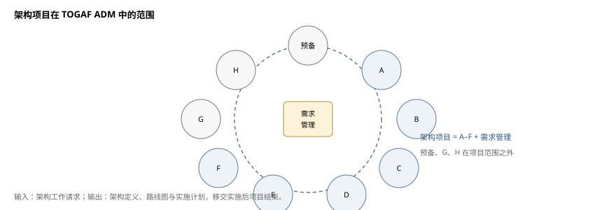
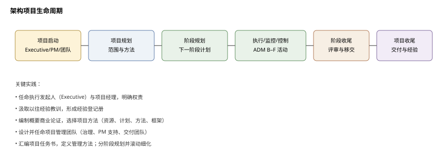
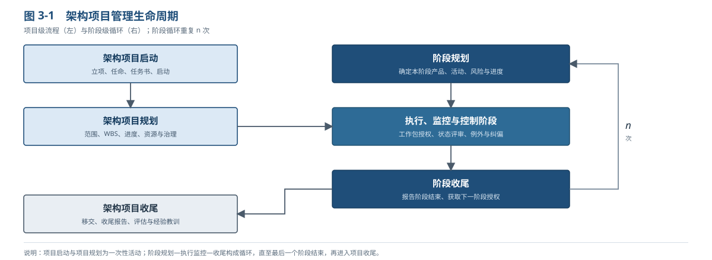
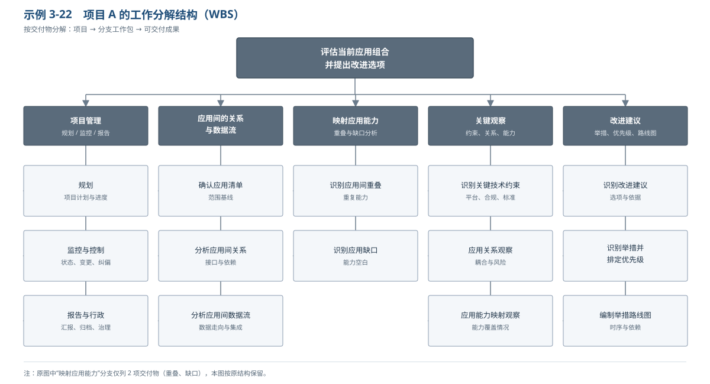
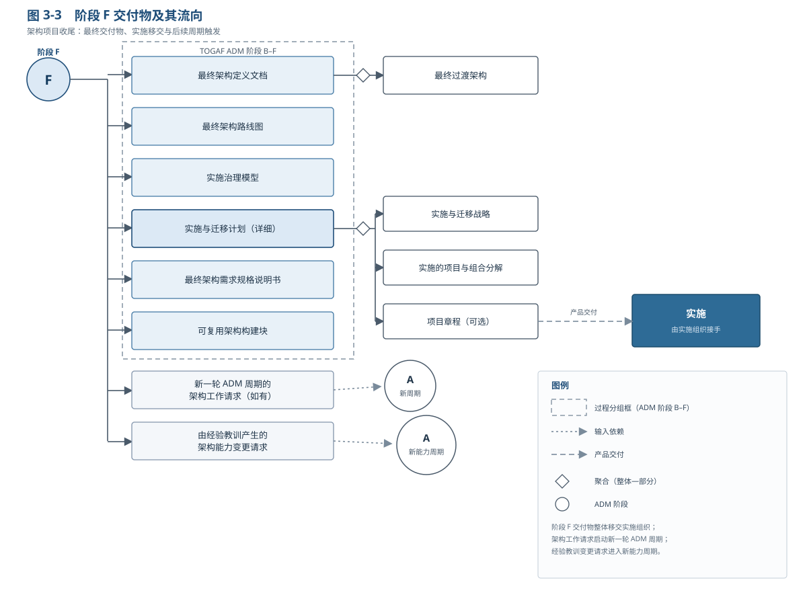
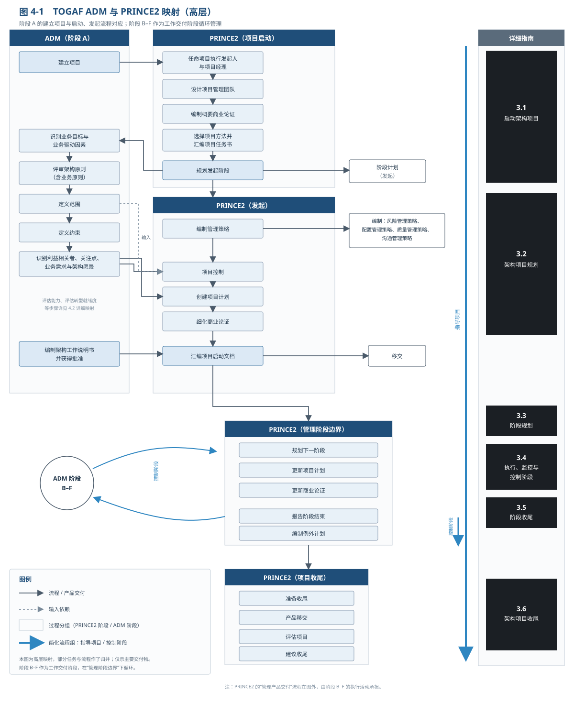
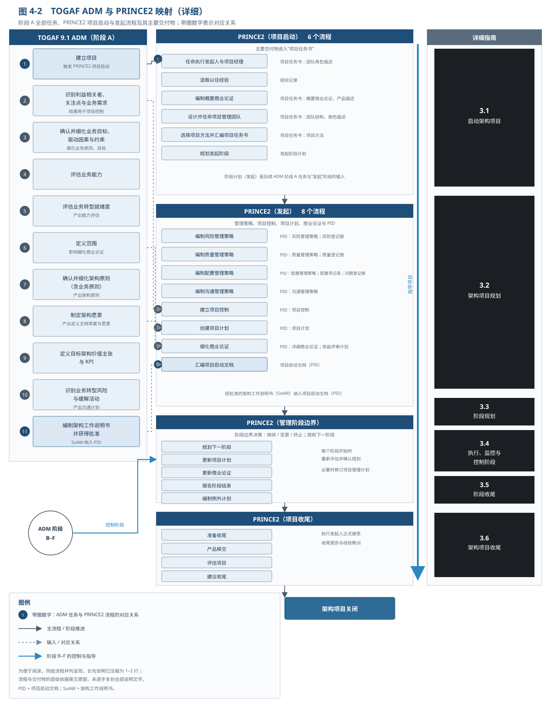
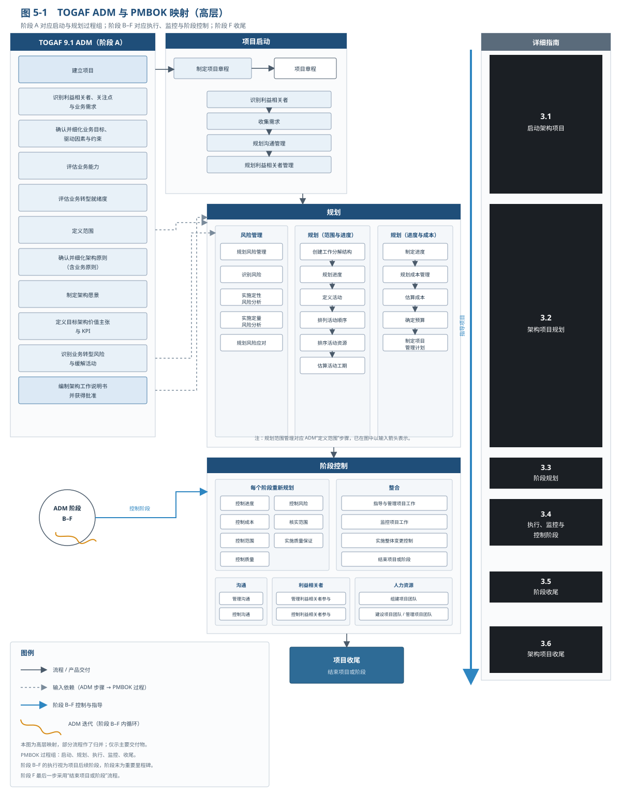

# 架构项目管理

**The Open Group TOGAF® 系列指南**

文档编号：G188

> 中文译本说明：本文档依据 The Open Group《Architecture Project Management》（G188）逐节翻译；正文各节与表 2-2、表 2-3 及附录 A 均已译出，原文示例框已译出；部分插图从略。术语：Architecture Project=架构项目；Statement of Architecture Work=架构工作说明书；PRINCE2®、PMBOK® 为各自所有者的注册商标。

---

## 前言

The Open Group 是一个全球性联盟，通过技术标准与开源倡议帮助各组织实现业务目标；其使命是推动实现**无边界信息流**（Boundaryless Information Flow™）。TOGAF 标准是一套经过实践检验的企业方法论与框架。本文档是 TOGAF® 系列指南之一，主题为架构项目管理。

## 关于作者

本指南的作者兼具企业架构与项目管理背景。

（请注意：以下所属机构为批准时的信息。）

**Jacek Presz**

Jacek Presz（linkedin.com/in/jacekpresz）是一位经验丰富的企业架构师，专注于规划并支持技术驱动的业务转型。他曾在银行、科技以及电力与公用事业公司担任首席企业架构师。在一家领先咨询公司任职期间，他为不同行业的客户交付了战略层面与业务板块层面的架构项目。他积极参与 TOGAF® 标准的制定。

**Łukasz Wrześniewski，The Open Group 受邀专家**

Łukasz Wrześniewski（linkedin.com/in/lukaszwrzesniewski）是一名敏捷转型与企业架构顾问，专长于敏捷企业架构与敏捷项目管理（Agile Program Management）。他也是一名活跃的培训师，讲授 TOGAF®、ArchiMate®、IT4IT™ 与 Scaled Agile 课程。他以受邀专家（invited expert）身份参与敏捷企业架构团队，以及架构、IT4IT、ArchiMate 协调项目（Harmonization Project）。

**Łukasz Drążek，PMP**

Łukasz Drążek，PMP（linkedin.com/in/lukaszdrazek）是一名经理，在银行、公共部门、能源、电力与公用事业以及快速消费品（FMCG）行业的大型 IT 项目方面拥有经验。他专长于项目与项目群管理（project and program management）、项目群挽救（program recovery）、技术驱动的转型以及变革管理。他负责 EY 波兰 Digital & Technology Enablement Advisory Group 的 IT 交付管理（IT Delivery Management）业务。

**Maciej Iwaniuk，PMP**

Maciej Iwaniuk，PMP（linkedin.com/in/maciekiwaniuk）是一名认证项目经理，也是经验丰富的项目审计师，拥有本地及国际项目的规划、执行与管理经验。他参与项目管理方法的设计、开发与实施。他是 EY EMEIA Advisory Center 的集成负责人（Integration Leader）。

**Bartłomiej Rafał，EY**

Bartłomiej Rafał（linkedin.com/in/bartlomiejrafal）是 TOGAF 认证从业者，也是 EY 波兰 Digital & Technology Enablement Advisory Group 的高级分析师。在 EY 任职期间，他参与了面向全球领先组织的一些规模最大的架构转型项目。目前，他致力于提升自身的企业架构技能（尤其是数据与应用领域），并将其用于支持有意开展数字化转型的组织。

**Filip Szymański，EY**

Filip Szymański（linkedin.com/in/szymanskifilip）是 TOGAF 认证从业者，也是一名经理，在领导以企业架构为核心的战略性与战术性变革管理项目方面拥有经验。他专长于设计企业架构，以及旨在使能业务价值交付的信息系统架构。他负责 EY 波兰 Digital & Technology Enablement Advisory Group 的 IT 架构（IT Architecture）业务。

**Piotr Papros**

Piotr Papros（linkedin.com/in/papros）是一名 IT 经理，在领导面向全球性机构的复杂 IT 项目、项目群与服务方面拥有经验。他是精益敏捷（Lean-Agile）项目顾问，曾在组织层面的转型工作中担任精益敏捷教练。他热衷于游戏化、企业变革管理与体育运动。

## 致谢

The Open Group 衷心感谢各位作者，以及 The Open Group 架构论坛（Architecture Forum）过去与现在的成员，感谢他们为本指南的开发所作的贡献。

作者谨此感谢以下关键贡献者与评审人，没有他们，最初的白皮书将无从谈起：

- Atila Belloquim，Gnosis
- Sonia Gonzalez，The Open Group
- Kirk Hansen，Kirk Hansen Consulting

（请注意：以下所属机构为批准时的信息。）

## 商标

PRINCE2 为 PeopleCert/AXELOS 的注册商标；PMBOK 为 Project Management Institute（PMI）的注册商标；TOGAF、The Open Group 等归其各自所有者。

## 参考文档

| 编号 | 文档 |
|---|---|
| [C220] | 《TOGAF® 标准》第 10 版 |
| [G198] | 《TOGAF® 系列指南：架构技能框架》 |
| [PRINCE2] | PRINCE2 项目管理方法 |
| [PMBOK] | 《项目管理知识体系指南》（PMBOK® Guide） |

---

## 1. 引言

### 1.1 概述

架构项目本质上通常很复杂，需要恰当的项目管理才能保持正轨并兑现承诺。本文档面向负责规划与管理架构项目的人员，说明如何用 PRINCE2 或 PMBOK 等事实标准补充 TOGAF 架构开发方法（ADM），以强化项目管理、提高架构项目成功概率。

本文档为架构项目团队提供总体视图与详细指导：哪些 PRINCE2 或 PMBOK 的流程、工具与技术可与 TOGAF ADM 配合用于项目规划、监控与控制；并给出 TOGAF 框架流程与交付物同 PRINCE2、PMBOK 的详细映射，以可视化这些概念如何结合。

本文档并非项目管理方法教科书：它说明架构项目应采用哪些项目管理工具与技术，具体技术细节以 PRINCE2 与 PMBOK 出版物为准。

我们希望把项目管理技术引入架构项目，以成熟、专业的方式提高交付价值与解决方案的成功概率，支持 The Open Group 的“无边界信息流”愿景。

### 1.2 背景

按 TOGAF 标准，企业架构是企业组件的结构、组件间相互关系，以及治理其设计与随时间演进的原则与指南。企业是组织的最高描述层级，通常覆盖所有使命与职能，可跨越多个组织。

TOGAF 标准包含架构开发方法（ADM），旨在成为开发与实施企业架构的行业标准方法；该方法聚焦架构产品的交付。在 TOGAF 标准中，架构产品通过执行 ADM 所述任务交付；任务分组为相互关联的阶段，每阶段包含若干步骤。完成一个 ADM 周期可能很复杂，因此架构产品交付常以项目形式执行。

“架构项目”并非 TOGAF 标准定义的术语，但常用于指为定义并描述待实施企业架构而开展的项目。本文档中，“架构项目”涵盖阶段 A 至 F 及需求管理中的所有活动。

阶段 A–F 的关键成果是**架构定义文档**，描述将在阶段 G 实施、阶段 H 维护的企业架构。因此，阶段 F 结束时，待实施的企业架构已被定义与描述——按本文定义，架构项目即告完成。

**预备阶段、阶段 G、阶段 H 不在架构项目范围内**：预备阶段关注确保组织的企业架构能力；阶段 G 的目标是治理企业架构的实施，通常作为独立工作（一个项目或一组项目）运行；阶段 H 的目标是维护已实施的企业架构，属于运营业务（或流程）而非项目管理。

### 1.3 为什么需要架构项目管理指南？

TOGAF ADM 详细说明了企业架构开发各阶段的目标、方法、输入、步骤与输出，但对“如何管理一个架构项目”并未作具体规定，而是把这一问题留给聚焦项目管理的方法[1]。

项目管理是对项目各方面的计划、授权、监控与控制，并激励相关人员，以便在时间、成本、质量、范围、收益与风险的预期绩效目标内实现项目目标[2]。业界领先的项目管理方法包括 PRINCE2 与 PMBOK，它们可用于提高架构项目的成功概率。

并非所有 TOGAF 实践者都熟悉项目管理方法；即便是熟悉这些方法的实践者，也缺乏关于如何将 TOGAF 框架与这些方法结合使用的指导。

本文档旨在为 TOGAF 架构师提供如何管理架构项目的指南。我们建议以选定的项目管理技术补充 TOGAF ADM，其目标是通过更好的计划、监控与沟通提高架构项目的成功概率。

### 1.4 文档范围与结构

本文档按以下章节组织，各章均有明确的读者对象：

- **第 2 章**描述开发企业架构的高层项目管理方法。

  本章读者为希望理解 TOGAF 标准与项目管理领域之间关键关系的企业架构师、项目管理专业人士以及架构项目利益相关者。

- **第 3 章**描述开发企业架构的详细项目管理方法。

  本章包含架构项目启动、规划、监控与收尾的分步指南。读者为熟悉 TOGAF 标准并领导架构项目的企业架构师。

- **第 4 章与第 5 章**分别给出 TOGAF ADM 各阶段与 PRINCE2、PMBOK 流程之间的详细映射。

  这两章提供了本指南所述指导赖以建立的基础，供读者参考。

### 1.5 约束

本文档探讨项目管理方法如何在架构项目交付中补充 TOGAF ADM，重点讨论项目管理领域已被验证的实践——PRINCE2 与 PMBOK。

敏捷项目管理方法不在本文档的范围内。根据我们的经验，TOGAF 框架可以裁剪以采用敏捷方式，这种裁剪能够带来重要收益；但本文档不探讨这一主题。

**注释**

[1] TOGAF 标准——架构开发方法：阶段 A：架构愿景（建立架构项目）：“ADM 的每个周期通常都应作为项目，在企业既定的项目管理框架内实施。”

[2] 此处采用 PRINCE2 的定义。按更通用的 PMBOK 定义，项目管理是把知识、技能、工具与技术应用于项目活动，以满足项目的要求。

---

## 2. 管理架构项目

本章描述开发企业架构的一般性、高层项目管理方法。本章读者为希望理解 TOGAF 标准 [C220] 与项目管理领域之间关键关系的企业架构师、项目管理专业人士与架构项目利益相关者。

### 2.1 架构项目定义

架构项目是为定义并描述待实施企业架构而开展的工作。按 TOGAF 术语，它涵盖 ADM 阶段 A 至 F 及需求管理中的所有活动；实践中可以是独立项目，也可以是更大工作（如项目群）的一部分。

> 图 2-1：英文原图，见英文原文 Figure 2-1。

**图内标签对照**

| 图内英文 | 中文 |
|---|---|
| Breadth | 广度 |
| Time | 时间 |
| Level | 层级 |
| Enterprise Strategic Architecture | 企业战略架构 |
| Segment Architecture | 分段架构 |
| Capability Architecture | 能力架构 |

> 架构项目**不包含** ADM 的预备阶段、阶段 G 或阶段 H。预备阶段聚焦建立架构能力而非交付架构定义，必要时可发起架构项目（其输出，尤其“架构工作请求”，作为架构项目输入）。阶段 G（实施治理）关乎实施而非定义架构，可作为独立项目或项目群。阶段 H（变更管理）是维护架构并在必要时发起架构项目的持续过程，应作为运营活动对待。

架构项目以**架构工作请求**开始（按 TOGAF ADM，该请求是启动阶段 A 的输入），交付**架构定义、路线图与实施计划**；当这些输出移交实施时项目结束。

架构项目可涉及一个或多个架构域：TOGAF 定义业务、数据、应用、技术四个域，项目通常覆盖其中若干或全部。

架构项目可涉及不同架构层级：TOGAF 定义三个层级，项目通常恰好覆盖其一：

- **战略层**：覆盖整个企业，定义整个企业架构的高层愿景、原则与战略方向；
- **分段层**：定义企业某分段（业务域）的企业架构；
- **能力层**：定义单个业务能力的企业架构，最详细，直接导向能力实施。

战略层架构项目通常作为分段层项目的输入；分段层项目又为能力层项目提供输入。

架构项目可作为独立工作或更大工作的一部分：

- **独立架构项目**通常作为单独项目执行（符合企业项目管理规定），有自身可独立实现的目标（架构定义而非其实施），常见于战略与分段层；
- **作为更大工作的一部分**：架构项目是项目或项目群的一部分，通常是工作流或一组任务，关键目标是为更大工作中的实施开发架构；常见于能力层，有时也在战略/分段层。此类架构工作不必按企业项目管理法规被认定为项目，更常见的是工作流或任务组。本指南的方法对两者均适用。

**表 2-1：架构项目示例**

| 总体目标 | 架构项目概述 |
|---|---|
| （A）评估现有应用组合并提出改进选项 | 描述应用全景并识别 IT 改进选项。约 50 个不同规模应用（多为定制）。关键关注：确定应用间关系与数据流；映射应用能力（重叠与缺口）；识别应用开发的关键技术约束。所需视图待定；改进选项应包含带优先级的举措；周期最长为 22 周。 |
| （B）改进物流流程效率、缩短订单周期 | 对目标物流流程改进进行建模与规划：提供包裹位置、资源使用与流程瓶颈的实时信息；通过更准确的计划优化资源使用；通过更快资源分配与预分配资源缩短订单到交付时间。物流是运输公司的核心业务流程之一，三个大型业务单元起关键作用，每个又分约五个子单元。团队除业务分析师与企业架构师外，还包括已了解部分流程的主题专家。 |
| （C）整合近期合并企业的 IT 环境 | 定义目标 IT 架构及三年整合路线图。电力与公用事业控股公司含八个近期合并的业务单元，从事能源分销与销售，地域不同；业务相似但各有流程与 IT 应用，彼此不共享。架构项目目标是形成整合路线图，包含共性业务服务、IT 应用与基础设施；方法含现状分析、目标建模与路线图三阶段，须满足既定预算与时间约束。 |
| （D）为零售销售区新运营模式定义客户信息系统的解决方案架构 | 分析某电力公司零售销售区运营模式变化及其对解决方案架构的需求；识别现有 IT 系统阻碍新运营模式实施的问题；开发客户信息系统解决方案架构，并绘制其与环境内其他 IT 解决方案的数据交换图；编写包含解决方案架构描述的招标文件。 |
| （E）新建弹性管理信息系统以满足银行报告需求 | 定义并实施新的弹性管理信息系统，满足不断扩大的银行报告需求并缩短信息延迟。范围包括：分析现状（旧数据仓库入/出接口、数据处理逻辑与报表类型）；定义目标架构（含把废弃功能迁移到其他方案）；准备高层设计文档。 |

示例覆盖的架构层级（战略 A/C、分段 B/D、能力 E）、架构域（业务 B/C/D/E，数据 B/C/D/E，应用 A/B/C/D/E，技术 C/D/E）与项目关系（独立 A/B/D、项目群一部分 C/E）各不相同。

### 2.2 架构项目生命周期

架构项目可作为单个预先规划的阶段执行，但通常分为若干阶段：分阶段允许更灵活的方式，每个阶段通常在其开始前才详细规划（而非在项目开始时）。TOGAF 标准倡导迭代执行架构项目——此时每次迭代可视为一个独立阶段。

架构项目包含以下可分组排序的管理活动：

- **项目启动**：任命执行发起人与项目经理、项目管理团队，汲取以往经验，选择项目方法，汇编项目任务书，规划下一阶段；
- **项目规划**：基于项目管理方法描述项目范围界定与规划活动；
- **阶段规划**：描述如何把架构项目划分为阶段，并按总体项目计划规划某阶段；
- **执行、监控与控制阶段**：描述如何用项目管理方法监控与控制 ADM 阶段 B–F 的架构开发活动；
- **阶段收尾**：描述阶段结束时执行的关键步骤；
- **项目收尾**（及架构交付物移交实施）：描述项目收尾活动、把架构项目产品移交给实施项目群/项目，以及经验教训记录方法。

上述序列构成架构项目生命周期，本文档以其为基本结构讨论架构项目管理。该生命周期映射到 TOGAF ADM（描述架构开发阶段与步骤），见图 2-2。

> 为简化，图中假定架构项目按类似 ADM 阶段的方式划分（每阶段对应一个 ADM 阶段）。实际情况通常并非如此，多数情况下也不应如此；TOGAF 标准推荐迭代方法，一个项目阶段可以覆盖若干 ADM 阶段，并可重复执行。

表 2-2 给出架构项目生命周期与 TOGAF ADM 阶段及项目管理方法的高层映射。请注意：TOGAF 标准聚焦架构项目中的架构开发活动，而项目管理方法聚焦如何管理这项工作的成功执行。

**表 2-2：架构项目生命周期映射到 TOGAF ADM 与项目管理方法**

| 架构项目生命周期 | TOGAF ADM 阶段 | PRINCE2 | PMBOK |
|---|---|---|---|
| 架构项目启动 | 阶段 A（架构愿景）——建立架构项目步骤 | 项目启动流程（Starting up a Project）——全部步骤 | 启动过程组：§4.1 制定项目章程；§13.1 识别利益相关者 |
| 架构项目规划 | 阶段 A（架构愿景）——制定架构工作说明书（Statement of Architecture Work）步骤及此前各步骤 | 发起流程（Initiation）——创建项目计划、汇编项目启动文档（Project Initiation Documentation） | 各过程组的规划过程——制定并汇总项目管理计划 |
| 阶段规划 | 无直接映射，但可视为前一阶段的收尾步骤 | PRINCE2 比 PMBOK 更强调项目阶段的概念。本文档所述概念主要基于 PRINCE2 流程，但也与 PMBOK 一致。（原表 PRINCE2 与 PMBOK 两列在此行合并为一个单元格） | 同左（合并单元格） |
| 执行、监控与控制阶段 | 阶段 B–F 各阶段 | 本节（执行、监控与控制阶段）映射到 PMBOK 所定义的执行、监控与控制过程组。（原表此说明横跨 PRINCE2 与 PMBOK 两列，并同时覆盖下一行“阶段收尾”） | 同左（合并单元格） |
| 阶段收尾 | 无直接映射，但可视为前一阶段的收尾步骤 | 同上（合并单元格） | 同上（合并单元格） |
| 架构移交 | 阶段 F（迁移规划）——收尾步骤 | 项目收尾流程（Closing a Project）——移交产品 | 项目收尾部分 |

（来源：改编自 TOGAF 标准、PRINCE2 与 PMBOK® 指南第 5 版）

### 2.3 架构项目管理概念

每种方法或框架都会定义自己的一套核心概念与定义。它们有时重叠；重叠概念的含义有时相近，有时并不相同——对于从一个专业领域转到另一个领域的人来说，这类词可称为“假朋友”（false friends）。

TOGAF 标准使用了 PRINCE2 与 PMBOK 定义的部分术语和概念，但若干关键定义的含义存在显著差异。表 2-3 列出从架构项目管理角度看至为关键的 TOGAF 与项目管理概念，讨论 TOGAF 标准、PRINCE2 与 PMBOK 中的定义，并说明本文档如何使用各术语。

两个最容易被误用的“假朋友”如下：

- **Phase / Stage**：本文档用“phase（阶段）”专指 TOGAF ADM 的各阶段；对 PMBOK 所说的 project phase 与 PRINCE2 所说的 stage，本文档统一用“stage（项目阶段）”表示。因此，“阶段规划（Planning a Stage）”规划的是项目阶段，而非某个 ADM 阶段。TOGAF 标准中的 phase 是 ADM 内逻辑相关工作（含若干步骤）的集合，如阶段 A——架构愿景；PRINCE2 对 phase 无特殊含义；PMBOK 第 5 版把 project phase 定义为“以完成一个或多个交付物告终的一组逻辑相关的项目活动”。一个项目阶段可以覆盖若干 ADM 阶段，并可重复执行。
- **Work Package / Project Work Package**：TOGAF 标准中的 work package（工作包）指将在企业中实施的变革举措，通常是较大的任务组（甚至可涵盖整个项目群）；项目管理方法中的 work package 指需要项目经理授权后团队才能开始的最细粒度工作。两者含义差别极大。本文档用“Project Work Package（项目工作包）”指项目任务（与 PRINCE2 用法及 PMBOK 定义一致），用“work package（工作包）”指架构项目识别出的变革举措（与 TOGAF 定义一致）。

**表 2-3：本文档涉及的 TOGAF 标准、PRINCE2 与 PMBOK 关键概念**

| 概念 | 讨论与定义 |
|---|---|
| 架构项目（Architecture Project） | 如本文档前文所述，架构项目是为定义并描述待实施的企业架构而开展的工作。按 TOGAF 术语，它涵盖 ADM 阶段 A 至 F 内的全部活动，以及这些阶段的需求管理。实践中它可以是独立项目，也可以是更大工作（如项目群）的一部分。TOGAF 标准未明确定义该术语，但框架中数处使用；项目管理方法中没有对应定义。 |
| 交付物（Deliverables） | 交付物是为完成项目或项目特定阶段而需要准备的、独特且可验证的产品、结果或输出。交付物可以是最终产品、辅助产品或项目管理产品的一部分。该术语在 TOGAF 标准（更具体，定义了更多特征、验收流程等）与项目管理方法（更通用）中含义相近，故以 TOGAF 定义为主，但项目管理方法的定义同样适用。TOGAF：“一种架构工作产品，通过合同规定，并由利益相关者正式评审、同意并签署。注：交付物代表项目的输出；以文档形式存在的交付物通常在项目完成时归档，或作为参考模型、标准或某一时点架构全景的快照转入架构库。” PRINCE2：与“输出（Output）”同义，即“移交给用户的专业产品”。PMBOK 第 5 版：“为完成某一过程、阶段或项目而必须产出的任何独特且可验证的产品、结果或能力。” |
| 执行发起人（Executive） | 执行发起人是业务目标的所有者，负责预期收益的实现与项目的最终成功。其角色可与 PMBOK 的 Sponsor、TOGAF 标准的 Executive（在技能框架中可视为 Architecture Sponsor）相比，但 PMBOK 中 Sponsor 的参与程度更为有限。为清晰起见，本文档无论指哪种方法，均用“Executive（执行发起人）”表示这一使能角色。TOGAF：无明确定义，但把关键关注点表述为“按时、按预算交付变革举措，为组织实现预期收益”。PRINCE2：“对确保项目达成目标并交付预期收益负总体责任的单一个人。此人应确保项目保持业务聚焦、具有明确授权，并对工作（包括风险）进行积极管理。”PMBOK 第 5 版：（Sponsor）“为项目、项目群或项目组合提供资源与支持，并对促成其成功负责的个人或团体。” |
| 阶段（Phase） | 本文档用“phase（阶段）”指 TOGAF ADM 阶段，这与 PMBOK 通篇使用的“project phase”不同——对项目阶段本文档用“stage”（见下）。TOGAF：广泛用于描述 ADM 内被划分为若干指定阶段的逻辑相关工作集合，如阶段 A——架构愿景。PRINCE2：无特殊含义。PMBOK 第 5 版：“项目可划分为任意数量的阶段。项目阶段是一组逻辑相关的项目活动，以一个或多个交付物的完成告终。” |
| 项目经理（Project Manager） | 本文档用“项目经理”指负责确保项目（此处即架构项目）交付满足利益相关者需要的所需产品的人。这是两种项目管理方法定义的共同部分。TOGAF 标准未明确定义项目经理，故有必要沿用项目管理方法的术语。请注意，项目经理一职可由企业架构师或项目管理专业人士担任，详见 3.1.2 节。TOGAF：无特殊含义。PRINCE2：“被授予权责，在与项目委员会（Project Board）商定的约束内日常管理项目以交付所需产品的人。”PMBOK 第 5 版：“由执行组织指派、领导团队实现项目目标的个人。” |
| 风险（Risk） | 项目风险管理是项目管理的重要方面。按 PRINCE2 与 PMBOK，风险管理是项目经理必须具备能力的关键知识领域之一。PRINCE2 将项目风险定义为“一组一旦发生便会影响项目目标实现的事件”；PMBOK 定义为“一种不确定的事件或条件，一旦发生会对项目目标产生正面或负面影响”。须注意，风险对项目的影响可为负面（应采取的行动重在降低影响或发生概率），也可为正面（此时希望提高影响或发生概率）。风险与合规是任何业务活动或转型的固有部分，因此 TOGAF 标准要求在整个 ADM 中妥善考虑，详见架构能力框架。关键差异在于：TOGAF 标准把风险理解为转型对技术环境与合规的潜在威胁，而 PRINCE2 与 PMBOK 还把风险视为可能影响项目本身（进度、预算、质量等）的事件。 |
| 范围（Scope） | 本文档采用项目管理方法中的“scope（范围）”含义。它比 TOGAF ADM 阶段 A 中“定义范围（Define Scope）”步骤所述更宽，指为实现项目目标而要执行的工作范围；相比之下，TOGAF 标准把该词限定为待定义架构的范围。TOGAF：阶段 A 的定义范围步骤把范围限定为架构范围——“基线架构与目标架构工作范围内外的内容”。PRINCE2：“计划的范围是其产品的总和及其需求的程度，由该计划的产品分解结构及相关产品描述来表述。”PMBOK 第 5 版：“作为项目提供之产品、服务与结果的总和。” |
| 项目阶段（Stage） | 本文档用“stage（项目阶段）”指 PRINCE2 的 stage 或 PMBOK 的 project phase。本文档不使用“project phase”一词，以保留给 TOGAF ADM 阶段（见上）。TOGAF：无定义含义。PRINCE2：“项目的一个区段。”PMBOK 第 5 版：无定义含义。 |
| 利益相关者（Stakeholder） | 利益相关者在 TOGAF 标准与项目管理方法中的含义大体相同。作为架构生命周期标准，TOGAF 强调利益相关者关注架构的成果。TOGAF：“对系统有利益关系的个人、团队、组织或其类别。”PRINCE2：“能够影响、受其影响或自认为受某项举措（项目群、项目、活动、风险）影响的任何个人、群体或组织。”PMBOK 第 5 版：“可能影响、受其影响或自认为受项目决策、活动或结果影响的个人、群体或组织。” |
| 工作包（Work Package） | TOGAF 标准用该词描述将在企业中实施的变革举措，通常是较大的任务组（可能涵盖整个项目群）。项目管理方法用该词描述要执行的低层工作——需项目经理授权后团队才能开始的最细粒度工作。两者含义差别极大。本文档用“Project Work Package（项目工作包）”指项目任务（与 PRINCE2 用法及 PMBOK 定义一致），用“work package（工作包）”指架构项目识别的变革举措（与 TOGAF 定义一致）。TOGAF：“为实现一个或多个业务目标而识别的一组行动。工作包可以是项目的一部分、一个完整项目或一个项目群。”PRINCE2：“可预先描述、创建并测试的输入或输出，无论有形或无形。”PMBOK 第 5 版：“在工作分解结构最低层定义的工作，其成本与工期可估算并可管理。” |

（来源：改编自 TOGAF 标准、PRINCE2、PMBOK® 指南第 5 版）

本文档同时使用企业架构（TOGAF 标准）与项目管理（PRINCE2、PMBOK）两个学科的概念。由于本文档主要面向架构师，出现冲突时我们通常遵循 TOGAF 的定义。若读者背景不同，请留意表 2-3（原文此处写作表 2-2）。

### 2.4 项目管理文档

项目管理的本质是沟通。项目经理负责向项目利益相关者——项目发起人（Project Sponsor）、指导委员会（Steering Committee）及其他利益相关者——沟通项目计划、状态与风险。这可以正式或非正式地进行，形式多样，例如电话、会议、演示或书面报告，具体取决于项目规模、组织文化与利益相关者要求等因素。

本文档经常提到可以或应当形成文档的计划、报告及其他工件。这并不意味着每件工件都要成为独立文档。在较小的项目与更敏捷的组织中，可能几乎不需要文档。不过，我们仍建议把项目管理工件以书面形式记录下来，哪怕只是一封电子邮件——这样可以回溯计划、重要决策与项目里程碑；如有必要，还可在此基础上编制更正式的文档。

---

## 3. 详细指导

本章描述开发企业架构时可用的详细项目管理方法。本章读者为已熟悉 TOGAF 标准并领导架构项目的企业架构师。

本章各小节分别描述以下工作的方法：

- **架构项目启动**：包含 ADM 阶段 A 的项目管理活动，以及项目管理方法的项目启动与“发起（Initiation）”活动；
- **架构项目规划**：包含基于项目管理方法的项目规划活动；
- **阶段规划**：描述如何运用项目管理方法规划架构项目的一个阶段；
- **执行、监控与控制阶段**：描述如何运用项目管理方法监控与控制 ADM 阶段 B–F 的架构开发活动；
- **阶段收尾**：描述在架构项目阶段结束时如何运用项目管理方法；
- **架构项目收尾**：包含项目管理方法的项目收尾活动与 ADM 阶段 F，包括把架构交付物移交给实施。

> 图 3-1：图内文字已中文化；结构据英文原图重绘。

**图内标签对照**

| 图内英文 | 中文 |
|---|---|
| Architecture Project start-up | 架构项目启动 |
| Architecture Project planning | 架构项目规划 |
| Planning a stage | 阶段规划 |
| Execute, monitor, and control a stage | 执行、监控与控制阶段 |
| Ending a stage | 阶段收尾 |
| Architecture Project closing | 架构项目收尾 |
| n | n（重复次数） |

在适当之处，本指南引用一个或多个真实示例，以灰底框呈现，取自表 2-1 的示例项目清单。以下示例按原文顺序译出。

> 本文档的方法覆盖了架构项目的大部分项目管理职责；但有些领域——如进度管理、采购管理、成本管理等——并未覆盖。我们假定本文档的目的不是完整讲解项目管理方法，而是就如何在架构项目的现实与特点中应用这些方法提供指导。由于采购、成本等领域与其他项目并无不同，本文档不予详述。

### 3.1 架构项目启动

ADM 周期的第一步在 TOGAF 标准“阶段 A：建立架构项目”中定义。该章非常简洁，把读者引向其他资料，指出“ADM 周期的执行应在企业的项目管理框架内进行”。它未详述架构项目最开始应执行的步骤，而是留给项目经理与企业内其他机构，依据其经验与一套组织标准决定要做哪些工作。

按第 4 章，ADM 步骤“建立架构项目”可映射到 PRINCE2 的“项目启动（Starting up a Project）”流程。PMBOK 因其性质不同，未提供如此详尽的系统性流程，但其“制定项目章程（Develop Project Charter）”流程同样可映射到该 TOGAF 步骤（见第 5 章）。

因此，启动项目需要以下活动：

- 任命执行发起人与项目经理
- 汲取以往经验（Capture Previous Lessons）
- 编制概要商业论证（Outline Business Case）
- 选择项目方法（Select the Project Approach）
- 设计并任命项目管理团队
- 汇编项目任务书（Project Brief）
- 定义管理方法（Define the Management Approach）

上述活动构成本章以下各小节的基础。

#### 3.1.1 任命执行发起人（Executive）

项目应是对已识别业务需要的响应，因为其执行与组织有形且通常可量化的成本相关，例如现金支出、员工工时，甚至正常运营的中断。只有在提供必要资源时项目才能执行，而提供资源通常以项目将实现某种业务目标并带来充分回报（如业务收益、维持运营的能力等）为假设。

执行发起人是项目业务目标的所有者，因而是组织对该举措支持的化身，负责预期收益的实现。视组织（尤其是其项目管理框架）与项目本身（类型）不同，执行发起人可有不同名称与结构。该术语最初取自 PRINCE2 方法，在那里它是代表“客户（Customer）”的角色名称，客户是项目的最终资源提供者[1]。PMBOK 中的“Sponsor（发起人）”扮演非常相似但更受限的角色。TOGAF 标准亦然：执行发起人负责确保“按时、按预算交付变革举措，为组织实现预期收益”；参见 TOGAF 标准——ADM 技术：利益相关者管理（模板利益相关者图）。

TOGAF 标准未对执行发起人着墨太多。它把其列为一种利益相关者组织角色，可由发起人或项目群经理等担任；在技能框架中定义了所需技能（见 TOGAF® 系列指南：架构技能框架 [G198]（目标/理由））；说明了初始企业架构工作的赞助情况（通常由 CIO 或其他高管赞助），列出了架构的赞助者（架构委员会），以及“赞助者的赞助者”（公司最高层的执行赞助人）。

如前所述，没有执行发起人就没有项目：执行发起人提供项目执行所需的资源，并代表需要被满足的业务需要。执行发起人任命项目经理，并在运营层面把架构项目的执行任务交给项目经理。

> **示例 3-1：架构项目的多种收益**
>
> 架构项目可能带来多种收益，例如：
>
> - 更高效的运营
> - 现有投资获得更好的回报
> - 降低未来投资的风险
> - 更快、更简单、更便宜的采购
> - 通过设计新的业务模式、识别新的业务线，提高应对情境分析中所识别的威胁与机会以及竞争对手压力的能力
> - 通过不同渠道改善客户体验
>
> 这些都源于拥有良好、经过周密规划的企业架构（或至少得益于它），或源于开展架构工作。在其他情况下，架构项目是其他举措、项目与项目群的使能者，本身并不直接交付价值，或者只是必然地以外部因素（如满足监管合规要求）为依据。

> **示例 3-2：示例项目的执行发起人**
>
> | 总体目标 | 架构项目目标 | 架构项目执行发起人 |
> |---|---|---|
> | （B）改进物流流程效率、缩短订单周期 | 确定并设计物流领域业务流程的可能改进 | CIO |
> | （E）实施新的数据仓库与管理信息系统，以满足不断扩大的银行报告需求 | 使该解决方案能够高效、成功地实施 | 项目群经理，负责管理信息系统转型项目群 |

#### 3.1.2 任命项目经理

如上述“任命执行发起人”步骤所述，项目经理由执行发起人任命，在运营层面领导架构项目。

项目经理是负责确保项目交付满足利益相关者需要的所需产品的人。因此，项目经理必须具备很强的领导、沟通与谈判能力，才能引领利益相关者走向项目成功的结果。

按 PRINCE2，项目经理是被授予权责、日常管理项目以在与项目委员会商定的约束内交付所需产品的人。项目经理的首要职责是确保项目在规定的时间、成本、质量、范围、风险与收益容差内产出所需产品；同时负责使项目交付能够实现商业论证所述收益的结果 [PRINCE2, §C.5（Project Manager）]。

按 PMBOK，项目经理是由执行组织指派、领导团队实现项目目标的个人。一般而言，项目经理有责任满足任务需要、团队需要与个人需要 [PMBOK, §1.7（Role of the Project Manager）]。

一个常见问题是：谁应担任架构项目的项目经理？项目管理方法主张把这一角色交给项目管理专业人士。

TOGAF 标准未回答该问题，但 TOGAF® 系列指南：架构技能框架 [G198] 对交付成功企业架构所需技能给出了评估。按该框架，企业架构师负责确保架构的完备性（completeness，即适用性 fitness-for-purpose），充分覆盖利益相关者所有相关关注点；以及架构的统合性（integrity），即把各种视图相互连接、令人满意地调和不同利益相关者的冲突关注点，并展示所作权衡。因此，对多数架构项目而言，企业架构师一职即满足项目经理的定义。此外，企业架构师所需的与利益相关者的出色沟通能力，降低了对 IT 项目通常所需的专职项目经理的需求。

但在某些情况下，可能需要把架构项目的管理与控制委托给专职项目经理。是否在架构项目中设置专职项目经理，取决于组织采用的项目管理规则与原则、架构项目的规模、所涉内部单位与外部供应商的数量、项目工作流的数量及其时间框架等。你可能会发现架构项目过于复杂，以致企业架构师与项目经理的角色合并后不再有效——因为按组织项目管理规则管理与控制项目的工作量，会限制企业架构师专注于核心架构工作。

本文档余下部分用“项目经理”指负责架构项目执行的角色。如上所述，该角色可由企业架构师或项目管理专业人士担任。

> **示例 3-3：由企业架构师还是专职项目经理担任项目经理**
>
> 在项目 B 中，由一名企业架构师担任项目经理。这之所以可行，是因为项目复杂度较低——它只覆盖一个业务域，涉及来自三个业务单元的人员和五到十个 IT 系统。此外，组织采用的项目管理规则与原则只关注报告与在既定时间与成本容差内交付项目相关的问题与风险。
>
> 在项目 D 中，由于项目复杂，需要设置专职项目经理——该项目由五个工作流组成（架构是其中之一），各工作流的产品相互依赖，覆盖 25 个以上 IT 系统，涉及来自不同业务单元的 50 多人。企业架构师负责管理架构工作流中的工作，并向项目经理报告其状态；项目经理的职责之一，是汇总所有工作流的状态报告，并每周向利益相关者呈报项目总体状态。

#### 3.1.3 汲取以往经验

按 PRINCE2 方法，项目经理获任命后首先要做的事情之一，是编制经验记录（Lessons Log）[2]。该文档应作为当前项目知识的非正式仓库。项目伊始，就应填入有关类似项目的全部可得相关信息，包括以往项目经验记录（或经验报告，如有）中的关键信息、其他相关文档、参与此类工作的人的经验，以及一切其他潜在知识来源（对架构项目而言，输入还应包括阶段 F 所记录的经验教训[3]）。这使项目经理能更好地洞察项目性质，并通过避免他人已犯的错误、利用已积累的专有知识，更好地准备与执行项目。

该文档应定期更新，补充新获得的信息以及形成的良好实践与最佳实践，以支持项目经理在本项目及其他项目中的工作。

该文档的详细程度应与项目要求（规模与复杂度）相称，并符合特定组织的内部规定。小型项目无需编制复杂的经验记录；某些情况下，一份包含最重要观察的要点清单即可。

> **示例 3-4：项目 E 的经验记录**
>
> 项目经理受命管理一个聚焦于新数据仓库与管理信息系统（项目 E）架构设计与实施的项目。作为第一步，项目经理收集了有关当前项目的信息，并访谈了发起人。
>
> 为确保潜在有用信息的完整性、完备性与持续可用性，他建立了经验记录（Lessons Log），打算一开始把所有他认为有用的信息放进去，并在项目执行期间把获得的所有洞见补充进去。结果发现，公司里还有另一个项目，其范围与预算与当前项目相似，但因未能在估算时间内完成而以失败告终。记录在案的原因是：让首席架构师承担项目管理职责，而在这类项目类型与组织安排下，这对一个人来说负担过重。项目经理在经验记录中写下这样一条：“在此类范围的项目中，项目管理与企业架构职责应分开；否则，由于工作量过大，这两项职能都有无法妥善执行的风险。”

#### 3.1.4 编制概要商业论证

同时，PRINCE2 方法要求编制概要商业论证，它将成为项目任务书的组成部分，提供项目预期成本、风险与收益的信息。概要商业论证试图对项目作定量与定性评估，使决策者（执行发起人或类似机构）能够更知情地判断项目是否可行且有益，以及在全部项目构想组合中它是否最值得开展。

该文档由执行发起人负责，但这不意味着必须由其亲自编制，该任务可委托给业务分析师或项目经理等。

随着后续规划工作的开展，该文档应逐步细化，并应定期核实、持续维护，以提供关于可能影响项目结果的各种因素的最新认识。它构成关于项目的战略决策的基础，包括判断继续进行中的项目是否仍然有益、可行且必要（见 3.4 节）。项目完成后还应确认商业论证，检验关于收益的预测是否正确（见 3.6 节）。

> **示例 3-5：项目 C 的概要商业论证**
>
> 项目经理受命为项目 C（整合近期合并企业的 IT 环境）编制商业论证。新建的 IT 环境在很大程度上是冗余的，通过应用与基础设施整合可显著降低 IT 成本。预计每年可节省 2000 万至 5000 万欧元。用于定义目标模型与整合路线图的架构项目，估计需要四名全职企业架构师与八名全职其他人员投入六个月（总成本 50 万欧元，含预期风险实际发生的成本）。路线图实施预计耗资 4000 万至 1 亿欧元。
>
> 项目经理把这些初步结论记录在概要商业论证中，并告知执行发起人，同时说明这些结论还需进一步分析；但他认为项目看起来很有前景，应当继续——至少应继续到能够基于架构项目成果编制更精确的成本效益分析之时。

#### 3.1.5 选择项目方法

PRINCE2 期望项目经理选择项目执行的方法。PRINCE2 方法提及的决策包括：使用何种资源（内部或外部）、是从零构建解决方案还是修改现有方案、是基于商用现货（COTS）方案还是定制开发。

对架构项目而言，只有第一项决策直接相关。但从架构项目管理的角度看，“方法”应作更宽的理解：用什么方法与框架管理架构项目，以及如何规划项目。

架构项目管理所用方法与框架的选择，应源于项目所要解决问题的特征，并与所采用的规划方式相联系。由于架构项目管理是项目管理与企业架构两个领域的复合，应分别就这两个领域所用的工具作出决策。

**1. 选择所用资源**

根据我们的经验，决定使用内部还是外部资源时，至少应考虑：

- 项目的估计复杂度与所需工作量；
- 时间与预算约束；
- 所需技能——注意，对现有架构的了解可能高度相关；若使用外部顾问，应仔细考虑获取这些知识（即现状分析）的成本；
- 组织内部可用的资源；
- 以往经验与组织导则。

> **示例 3-6：项目 E 选择外部资源**
>
> 负责管理项目 E 的项目经理得出结论：由于估计范围广、复杂度高、难度大，加之银行法定义务带来的严格时间约束，项目需要多名在数据域具有高能力的架构师。现有资源经评估不足，既无法及时招聘更多人员，也无法把现有架构师培训到足够技能水平。
>
> 项目经理决定采用外部资源开展项目，聘请某咨询公司的一组架构师；该银行与该咨询公司有长期、良好的合作关系，并曾成功完成其他项目。

**2. 选择规划方式**

规划方式与方法/框架的决策相互依存，彼此影响。TOGAF 标准倡导迭代方式，反复迭代直至产品达到预期的质量与一致性——许多人把这与敏捷方式和方法等同起来。事实并非如此：所建议的方式与瀑布方法之间并无根本矛盾。不过，这可能需要裁剪 TOGAF 框架，以适配项目管理方法与具体项目的约束。关于如何规划项目、特别是如何把项目划分为阶段，参见 3.2 节与 3.3 节。

**3. 选择方法**

在选择针对特定问题的最佳途径（从项目管理方法角度看）时，Cynefin 框架可能有用。它把所谓问题域分为四大类：复杂（complex）、繁杂（complicated）、明显/简单（obvious/simple）与混乱（chaotic）[4]。依问题类别不同，推荐的方法也不同，因为各方法在不同情形下各有优势与不足。根据我们的经验，对各问题类别推荐如下：

- **复杂**——SCRUM 方法，专为应对高度易变与不确定性而设计；
- **繁杂**——如看板（Kanban）与 SCRUM 方法，因为该类别涵盖需要仔细分析、高度专家知识才能解决，且因不存在唯一最优解而需一定探索的问题；
- **明显（简单）**——各类瀑布方法，因为该类别涵盖已知问题且已有最佳实践，可采用精心预先规划的方式；
- **混乱**——不推荐任何方法，因为系统行为完全不可预测。

企业架构领域的问题往往符合简单与繁杂类别的判据，尤其在组织已有架构时，因为其目标是提高秩序与可预测性。因果关系存在且可辨识；问题可能变为复杂或混乱的唯一情形，是环境高度易变（通常还伴随对本组织及其外部环境缺乏了解）。特定问题属于哪个域，取决于组织的专业能力、架构成熟度、项目范围以及所受的额外约束等。判定问题类别是项目经理的任务。

**4. 选择企业架构框架**

在企业架构领域，需在不同架构框架之间作出选择。至少有几个主要框架为企业架构师提供工具与资源（包括 Zachman 企业架构框架™ 与联邦企业架构（FEA））。但并非所有框架都适用于架构项目管理，这是各框架关注点不同所致。由于架构项目管理实际上是创建架构的过程，只应考虑那些提供架构创建方法的框架。在这方面，TOGAF 框架凭借对 ADM 的详细描述而优于其他框架。

> **示例 3-7：项目 A 的繁杂问题与项目 E 的简单问题**
>
> 在项目 A 中，项目经理并不清楚实现项目目标需要哪些视图，这使其成为一个繁杂（complicated）问题。因此他决定在开始时设置一个“概览”阶段，以便确定范围，从而使项目能在既定时间框架与既定资源下完成。在该阶段对两个应用作了深入分析之后，他与执行发起人确认了后续阶段可做哪些工作，并将满足执行发起人现有的业务需要。此后，项目经理决定采用迭代方式，把所使用的 50 个应用分成每组八个，在每两周一次的迭代中评估一组。
>
> 在项目 E 中，项目经理必须在确定日期交付精确描述的工件与产品；在具备必要资源的前提下，这使其成为一个简单问题。若未能做到，将导致项目出现代价高昂的延误，包括因未满足监管要求而被罚款，因为架构工作流处于关键路径上。因此，项目经理采用了预先规划的方式，设置带缓冲的时间限定阶段，并最初聚焦于基线（基线优先方式）。该计划已被参与项目的外部咨询专家评估为可行，这些专家过去参与过类似项目。尽管如此，风险仍被评估并沟通，其重要部分通过合同中的附加条款转移给了咨询公司。

本文档假定架构项目按 TOGAF 框架开展，并辅以源自最流行项目管理方法的实践。

#### 3.1.6 设计并任命项目管理团队

架构项目的项目经理并非在真空中运作，也不是单枪匹马交付产品。他们借助企业内其他机构提供的支持，并受这些机构约束，以确保组织目标得以实现。他们是团队的一部分，共同交付产品、为组织实现收益。

在 PRINCE2 中，他们是一个项目管理团队（Project Management Team）的成员，该团队为其提供监督与支持。这些项目管理团队构成完整的项目管理结构，包括负责治理、管理与支持的机构[5]。PMBOK 中也有项目管理团队，但与 PRINCE2 相比，其范围限于项目管理与领导活动，不包含治理机构（仅与治理机构协作）。

**1. 架构项目中的治理**

负责产品成功交付的机构，理应最关心“确保业务得到妥善开展”（这也是 TOGAF 标准中对治理最一般的定义）。实际情况正是如此：PMBOK 中的治理机构是发起人（Sponsor）；PRINCE2 中是指导委员会（Steering Committee），由执行发起人领导——执行发起人是最终决策者，用户与供应商的代表只是可选顾问；TOGAF 标准中是架构委员会（Architecture Board），即企业内架构的赞助者。

但须牢记，架构委员会提供的治理（即架构治理，Architecture Governance）与上述另外两个机构提供的治理（即项目治理，Project Governance）类型不同。架构治理是在企业范围内管理与控制企业架构及其他架构的实践与导向；而项目治理（按 PMBOK）是一种“与组织治理模型相一致、贯穿项目生命周期的监督职能……提供全面、一致的控制项目并确保其成功的方法”。因此，架构项目应同时接受两类治理：前者使其与战略架构及子架构保持一致，后者确保项目在质量、预算与时间方面交付预期结果。

这是否意味着架构项目的项目经理应受两个不同机构监督？往往如此。但这取决于项目管理与企业架构的组织安排：组织是否已设立架构治理机构（如架构委员会）？若已设立，该架构治理机构能否同时承担项目治理角色？若未设立，且该项目是组织的首次企业架构工作，指导委员会能否在项目完成后转变为架构委员会？可能性很多，具体做法应视项目与组织特征而定。

> **示例 3-8：项目 B——架构委员会兼担项目治理**
>
> 项目经理受命管理项目 B（改进物流流程）。该项目由公司 CIO 赞助；业务方要求 CIO 提供实时信息，以便更好地规划与分配资源，最终缩短订单到交付的时间。CIO 主持架构委员会，委员会成员还包括参与公司物流流程的一些业务单元负责人。
>
> CIO 决定无需再设立额外机构提供项目治理，因为多数关键利益相关者已经是提供架构治理的机构成员。目前不存在相互依赖关系或计划中的后续工作，所有决策都将基于其结果作出。
>
> 因此，项目经理转向架构委员会、尤其是 CIO，请其不仅提供架构治理，还作为项目发起人提供项目治理，并在可能的情况下把其余受影响的业务负责人纳入委员会。

> **示例 3-9：项目 E——项目群管理与架构委员会双重负责**
>
> 项目经理受命领导项目 E，目标是在一家银行设计目标架构，其中包括新的数据仓库与管理信息系统。该架构项目是新解决方案实施这一更大项目群的一部分，架构工作只是多个工作流之一，这些工作流彼此密切相关、相互依赖。对架构项目而言尤其如此，因为它起着后续工作的使能作用。项目由整个信息系统转型举措的项目群管理层发起，该管理层与架构委员会没有任何关联。项目受预算、时间框架与范围的严格约束，要求严格遵循计划与要求。
>
> 在此情况下，项目经理向项目群管理层负责，同时必须遵守组织中架构委员会施加的规则与约束。视问题类型而定——是与架构相关，还是与项目管理及执行相关——他必须遵循不同的上报路径。

**2. 架构项目中项目经理的支持**

有时架构项目规模过大、过于复杂，单个项目经理即便有企业领导层支持也难以承担与管理；此外，某些项目可能需要项目经理本人不具备的特定技能与能力。这就需要架构委员会或其他治理机构之外的人员，他们最终成为项目管理团队的核心。

TOGAF 标准在 TOGAF® 系列指南：架构技能框架 [G198] 中描述了通常属于“架构团队”的角色：企业架构角色与技能类别，以及企业架构角色与技能定义。这些角色既包括负责治理架构与支持项目的角色，也包括负责运营管理与交付的角色（各域架构师与解决方案设计师）。这些角色属于架构能力框架，与项目管理团队的结构相互独立。TOGAF 标准未描述支持项目的项目管理团队应如何配备或组织，但项目管理方法提供了一些提示。

PMBOK 在第 2.3 节提供了关于项目团队的一般信息[6]，关于项目管理团队（项目团队中负责项目管理与领导活动的子集）的信息则几乎没有。它指出，项目团队唯一不变的是项目经理作为团队领导者的角色，这给了项目经理很大自由。在构思项目团队结构时应考虑的因素，PMBOK 提及文化、范围、地点与组织结构；除给出项目团队中某些可能角色的信息（详见 PMBOK 指南 §2.3）与支持项目经理决策及管理流程的工具（见 PMBOK 指南 §9）外，它未就如何组织团队提供指南。

PRINCE2 更为具体，指出团队经理（team managers）——由项目经理指派、负责交付产品的人，其产品在项目工作包（Project Work Package）中定义（关于项目工作包与工作包，见 2.3 节）；以及项目支持（Project Support）人员（通常属于项目管理办公室），其职责限于行政与运营支持，并就项目管理工具与技术提供指导。

是否设置团队经理、如何界定其角色与职责，完全由项目经理决定（但该决定应经提供项目治理的机构批准），不过不应草率决定，因为它影响项目中工作的划分方式。应考虑的因素包括：

- 项目的估计范围，涉及项目将影响的所有域与分段；
- 项目约束，尤其是时间框架；
- 所涉团队的规模。

基于我们对架构项目的了解以及对项目管理方法的一般知识，至少可以提出两种选择团队经理的方式：

- **按架构域**：各团队经理分别是对业务、数据、应用或技术架构负责的架构师；
- **按企业连续统一体层级**：各团队经理分别是对项目所影响的不同分段或解决方案负责的架构师（但我们建议架构项目的范围清晰限定在战略、分段或能力层级之一）。

> **示例 3-10：项目 E 的架构工作流复用 PMO 支持**
>
> 在项目 E 中，架构只是大型项目的一个工作流。架构工作流可以使用通用的项目支持团队（PMO）处理会议安排或管理工作流存储库等行政事务。因此，架构工作流负责人认为不需要单独的支持人员。

团队结构在项目启动阶段确立。但在项目初期阶段之后，应对项目团队结构进行评审，并可按变化的需要进行调整。

**3. 架构项目中的交付团队**

最后一组人员（但重要性不亚于前述各组）是从事运营性执行、承担项目交付物工作的人。他们按团队组织，由项目经理直接管理或由团队级经理管理，视具体项目的项目管理结构而定。

参与项目的人员选择对项目成功至关重要，主要取决于架构项目的目标与范围以及可用资源。TOGAF® 系列指南：架构技能框架 [G198] 有助于规划与选择交付团队成员；该领域更通用的技术见 PMBOK 指南 [PMBOK, §9]。

> **示例 3-11：项目 B 的交付团队构成**
>
> 在项目 B 中，交付团队从可用资源中挑选。目标是确保团队技能足够强，能以一次工作坊覆盖每个业务子单元。这需要周密规划，并在团队内形成技能与关于当前信息流及系统的知识的恰当组合。
>
> 交付团队由以下人员组成：
>
> - **企业架构师**——同时担任项目经理；负责项目规划、吸引利益相关者参与、准备模板、评审工作产品与准备最终交付物；还会积极参与业务工作坊，以确保其适用（fit-for-purpose）
> - **业务流程分析师**——负责主持业务工作坊，并按与企业架构师共同制定的方法记录工作坊结果
> - **物流信息系统架构师**——积极参与业务工作坊，提供关于当前 IT 系统能力及其发展潜力的知识

#### 3.1.7 汇编项目任务书

按 PRINCE2 与 PMBOK，当汇总项目假设的文档编制完成并获得批准时，项目即获得授权。该文档至少应界定项目的高层边界。

按 PRINCE2，项目任务书（Project Brief）是描述项目目的、成本、时间与绩效要求以及约束的陈述。

按 PMBOK，项目章程（Project Charter）获批时项目即获授权。项目章程记录业务需要、假设、约束、对客户需要的理解与高层要求，以及拟由项目满足的新产品、服务或结果。

该文档由执行发起人发布，正式授权项目存在，并授予项目经理动用组织资源开展项目活动的权力。建议项目经理参与项目章程的编制，以获得对项目要求的基础性理解；这种理解有助于更有效地把资源分配到项目活动。

文档中的信息对项目经理规划关键里程碑、详细进度以及规划阶段执行特定任务所需的关键资源具有价值；在项目结束时，这些信息对核实项目是否在规定的时间、成本、质量与范围容差内交付预期结果也很重要。文档所含信息可随规划阶段工作的进展而更新。

架构项目开始时所需信息的类型与范围，以及这些信息将纳入哪些文档，取决于开展项目的组织所采用的项目管理规则与原则。

> **示例 3-12：项目 D 用项目任务书启动项目**
>
> 在项目 D 中，项目经理利用项目任务书中的信息编制了启动演示，并召开会议，向架构项目的关键利益相关者说明项目范围、要解决的业务需要以及所受约束。此外，项目经理还利用这些信息规划关键里程碑，并编制架构项目的详细进度。

#### 3.1.8 定义管理方法

在完成初步的项目启动——选择项目方法并任命项目管理团队——之后，项目经理确定项目将如何被管理。在 PRINCE2 中，这称为编制管理策略（Management Strategy）；在 PMBOK 中，它是制定项目章程流程的一部分。“定义管理方法”步骤包括确定以下方面的做法：

- 风险管理
- 质量管理
- 利益相关者与沟通管理
- 项目控制

**1. 风险管理方法**

作为项目启动的一部分，项目经理确定风险管理方法，并与项目治理机构确认。风险管理方法通常包括以下步骤：

- 风险识别与分类；
- 风险分析（定性及定量）；
- 风险缓解与应对策略设计；
- 风险监控。

项目经理还在项目开始时进行初始风险评估，包括风险识别、分类、分析与应对设计。该活动的关键成果是风险日志（risk log），记录已识别风险及其特征以及设计的应对措施。风险日志将在整个项目中用于监控与管理风险；详见 3.4 节。关于项目风险管理技术的更多信息，参见 PMBOK 指南 §11。

> **示例 3-13：项目 E 的分层初始风险评估**
>
> 在项目 E 中，初始风险评估先在工作流层面进行，然后在项目层面进行（项目由若干工作流组成）。在架构工作流中，初始风险评估先在交付物层面进行，然后汇总并在工作流层面扩展。
>
> 风险日志示例参见 3.4.5 节的示例。

> 从项目管理角度看，风险管理关注的是影响项目目标实现的风险。请注意，架构项目还必须处理另一类关键风险——与架构愿景及其实现相关的企业风险。这类风险可称为“架构风险”（architecture risk），必须加以管理与缓解。管理架构风险的技术与项目风险类似，见 TOGAF 标准——ADM 技术：风险管理。

**2. 质量管理方法**

作为项目启动的一部分，项目经理确定质量管理方法，并与项目治理机构确认。质量管理方法应与组织的质量管理体系相容。它通常应确立：

- 项目交付物的关键质量特性——交付物移交时用于评估符合性的条件；
- 文档要求——这些质量特性如何被记录，以便进行符合性检查；
- 质量保证流程——这些质量特性如何被检查是否符合（交付物移交前与移交时）。

质量管理方法将在整个项目中应用。所确立的准则对阶段收尾与项目收尾活动至关重要（见 3.5 节与 3.6 节）。关于项目质量管理技术的更多信息，参见 PMBOK 指南 §8。

> **示例 3-14：项目 E 的交付物章程与验收流程**
>
> 在项目 E 中，每项项目交付物都用一份交付物章程（Deliverable Charter）来描述。交付物章程界定交付物名称、范围、所需输入、验收标准与验收流程。设计了两类验收流程——一类用于文档交付物（分析、架构等），一类用于软件交付物，后者包含系统测试方法。
>
> 文档验收流程包括五个步骤：交付物初次移交、初次交付物评审（两周）、评审会议（一天）、交付物修订（两周）、最终交付物评审（一周）。假定最终交付物评审确认交付物符合质量要求。
>
> 验收流程与交付物章程由项目治理机构讨论并接受。

**3. 利益相关者与沟通管理方法**

TOGAF ADM 阶段 A 包括利益相关者识别以及确定利益相关者沟通方法。这是项目经理在架构项目启动期间必须确保的核心活动之一。

具体而言，项目经理应：

- 识别所有利益相关者及其对最终企业架构的关注点；
- 确定利益相关者沟通管理方法；
- 确定利益相关者参与交付物；
- 把上述信息记录为利益相关者图（stakeholder map）与沟通计划。

TOGAF 的利益相关者管理技术能满足妥善管理利益相关者方法的需要，该技术见 TOGAF 标准——ADM 技术：利益相关者管理。PMBOK 采用类似方法，见项目利益相关者管理（§13）。

输出交付物——利益相关者图与沟通计划——由项目经理在项目执行与控制期间使用。利益相关者图也是参与项目的企业架构师了解参与交付物（目录、矩阵、图）的重要知识来源。

> **示例 3-15：项目 A 的利益相关者管理**
>
> 在项目 A 中，在项目启动与 ADM 阶段 A 期间，项目经理采用 TOGAF 标准所述方法来管理利益相关者。他首先识别利益相关者，然后把关注点相同的利益相关者归入利益相关者群体（如 C 级管理层、IT 运营），再使用权力—利益矩阵定义利益相关者沟通方法。他为四个群体分别定义了项目团队与每个群体沟通的方式与频率（例如，利益水平低且权力低的利益相关者只通过电子邮件收到每周项目简报）。
>
> 最后，项目经理定义了利益相关者参与交付物，并创建了利益相关者图矩阵，将其加入项目沟通计划。

**4. 项目控制方法**

项目控制界定为确保项目妥善执行与项目管理有效性所需的控制程度。项目控制应在项目启动期间界定。

PRINCE2 把项目控制界定为：

- 各项目管理层级之间沟通的频率与形式；
- 阶段数量，因而也是阶段末评估的次数；
- 捕获与分析问题及变更的机制；
- 上报例外（exception）的机制；
- 授权委托的容差；
- 如何监控从一管理层级向另一管理层级的授权委托。

项目控制应作为管理方法的一部分加以界定，并在整个项目中执行（见 3.4 节）。

> **示例 3-16：项目 A 的项目控制**
>
> 在项目 A 启动期间，项目经理定义了几项项目控制：
>
> - 为架构项目团队设立每周状态报告会议。
> - 决定把被分析的应用划分为三个包，并为每个包指派负责的应用架构师。
> - 规定所有问题都登记在共享问题日志中，所有变更都登记在共享变更日志中，形式为项目内网存储库中的 Excel 电子表格。

### 3.2 架构项目规划

项目规划是把项目范围界定并拆分为可管理任务，并为这些任务确定进度与质量标准。可以说，这是项目经理在项目开始时最重要的工作。按 PRINCE2，要有计划才能控制任何事情——就架构项目而言我们同意这一观点。

TOGAF ADM 阶段 A 以编制并批准架构工作说明书（Statement of Architecture Work）结束，其中包含“项目计划与进度”。TOGAF 标准未深入细节，也未描述规划技术。本文档建议按以下活动顺序编制进度，并将其纳入架构工作说明书。

我们建议按以下活动顺序编制架构项目进度与架构工作说明书：

- 定义架构项目范围；
- 定义架构项目的最终产品及其验收标准；
- 定义项目交付物；
- 定义项目排除项、约束与假设；
- 细化架构项目范围；
- 创建工作分解结构（WBS）；
- 编制架构项目计划与进度（排列活动顺序、估算活动资源与工期、制定进度）；
- 汇总架构工作说明书并获得批准。

这些活动将在以下各小节描述。

在 TOGAF 标准中，阶段 A 全程会交付不少重要的（非管理类）工作产品。这些工作产品可能对架构项目范围产生重大影响，应在编制工作分解结构与项目计划之前完成，包括：

- **评估能力与评估业务转型就绪度**——项目规划应基于对变革复杂度与变革就绪度的这一初步评估；
- **确认并细化架构原则（包括业务原则）**——项目规划应考虑架构原则；
- **制定架构愿景**——项目规划应基于架构愿景所勾勒的基线与目标架构；
- **定义目标架构价值主张与 KPI，并识别业务转型风险与缓解活动**——这些虽与项目范围无直接关系，但部分价值主张与业务转型风险缓解活动可能影响项目范围，应在项目规划中予以考虑。

上述工作产品可能对架构项目范围产生重大影响，应在编制工作分解结构与项目计划之前完成。这些工作产品范围宽泛，但通常只需在高层次产出，以便刚好提供规划后续工作、进入更详细层级所需的信息。

#### 3.2.1 定义架构项目范围

定义架构项目及其范围是最重要的活动，应极为谨慎并保持清醒地开展。该活动的输出将对项目目标的理解与实现产生重大影响。

> 请注意，架构项目范围的定义比 TOGAF ADM 阶段 A 中“定义范围”步骤所述更宽。“定义范围”ADM 步骤描述的是基线架构与目标架构工作范围内外的内容；而架构项目范围按项目管理方法的含义，指为实现项目目标而要执行的工作范围。当然，执行“定义范围”ADM 步骤是理解和界定架构项目范围的关键初始任务。

架构项目的范围应运用 ADM 的范围定义活动以及阶段 A 的其他重要输出（如架构愿景）来界定（见 3.2 节开头的清单）。按 TOGAF 标准，关键在于界定将覆盖的架构全景层级、广度与时间范围（如原文图 2-1 所示）；另见 TOGAF 标准——架构开发方法阶段 A：架构愿景（定义范围）以及 TOGAF 标准——应用 ADM：跨越架构全景应用 ADM。

项目管理方法提供的工具与技术同样可用于界定详细的项目范围与项目计划；其中最重要的在以下各小节介绍。

作为范围定义的一部分，应编制一份架构项目概述（Architecture Project Description），即对项目下将开展的工作及项目目标的简要概括。上述 ADM 任务的全部输出应汇总并一并分析，以编制项目范围说明书（Project Scope Statement）——对范围、主要交付物、假设与约束的描述。

> **示例 3-17：项目 A 的架构项目描述**
>
> 在项目 A 中，完成 ADM 阶段 A 的关键任务后，项目经理已具备足够知识来编制架构项目描述。他决定先定义项目的主要目标，得出：“评估现有应用组合并提出改进选项。”
>
> 在定义主要目标之后，他编制了更详细的架构项目描述：
>
> 描述应用全景并识别 IT 改进选项。约有 50 个不同规模的应用（精确数量在项目执行期间确定），多为定制开发。关键关注点：
>
> - 确定应用之间的关系与数据流
> - 映射应用能力（重叠与缺口）
> - 识别应用开发的关键技术约束
>
> 所需视图待定。改进选项应包含带优先级的举措。

#### 3.2.2 定义架构项目的最终产品及其验收标准

架构项目的最终产品是项目实现期间全部工作产生的主要输出。视项目目标不同，它可能是一份文档或一组相关文档，描述企业架构的现状、分析结果、建议、目标架构与路线图等。

> **示例 3-18：项目 A 的最终产品**
>
> 在项目 A 中，项目经理确定他所管理的架构项目的最终产品是：总结当前应用组合分析及关键观察与改进建议的报告。

验收标准是架构项目最终产品被接受之前必须满足的一组条件。务必让所有项目利益相关者参与验收标准的定义，以避免项目结束时出现意外或被不当管理的期望。

> **示例 3-19：项目 A 的最终产品验收标准**
>
> 在项目 A 中，项目经理在审阅全部文档、并与项目发起人及其他利益相关者协商后，编制了最终产品为获得验收应满足的条件清单。他决定既纳入最终产品内容的基本标准，也纳入报告本身的技术细节。
>
> 最终产品的主要验收标准如下：
>
> - 报告应以波兰语撰写，并按公司模板编制
> - 将要分析的应用的精确数量在项目执行期间确定（最初为 50 个），但不得少于 45 个
> - 应用之间的关系与数据流应采用通用记法表示，例如使用 ArchiMate 建模语言
> - 改进建议应包含路线图，列出全部举措及其优先级、估算成本与时间框架

#### 3.2.3 定义项目交付物

交付物是为完成项目或项目特定阶段而需要准备的、独特且可验证的产品、结果 [PMBOK] 与输出。交付物可以是最终产品、辅助产品或项目管理产品的一部分。定义交付物清单的目的，是更好地规划工作，并在各交付物完成后立即获得验收，而不是等到项目结束。这种方式（验收较小交付物）是降低项目结束时未达期望之风险的最佳途径。在此活动中，还应确定需交付哪些 TOGAF 文档，例如架构定义文档、架构需求规格说明书、实施与迁移计划、架构路线图等。

> **示例 3-20：项目 A 的交付物清单**
>
> 在项目 A 中，项目经理编制了项目执行期间将准备的交付物清单。他决定把最终产品拆分为更小的交付物，并纳入了一些需要在项目执行期间达成一致的附加交付物。此外，他还纳入了状态报告等管理类交付物。
>
> 项目基本交付物：
>
> - 经商定的、将作为分析对象的应用清单
> - 经商定的、将准备的所需视图清单
> - 应用之间的关系与数据流
> - 应用能力映射（重叠与缺口）
> - 应用开发关键技术约束的识别
> - 分析的关键观察
> - 改进建议
>
> 项目管理产品：
>
> - 报告要点
> - 阶段末报告
> - 风险日志
> - 问题日志
> - 变更日志
>
> 项目最终报告

#### 3.2.4 定义项目排除项、约束与假设

**项目排除项（Project exclusion）**是说明哪些内容不在项目范围内的陈述，用于确认并使利益相关者知悉被排除在项目之外的内容。

**约束（Constraint）**是关于项目限制、会影响项目执行的陈述。

**假设（Assumption）**是关于被视为事实的情况的陈述。

> **示例 3-21：项目 A 的排除项、约束与假设**
>
> 在项目 A 中，项目经理基于此前分析的结果编制了排除项、约束与假设清单。示例如下。
>
> 排除项：
>
> - 改进建议将只包含带估算成本的举措
>
>   不会开展 RFI 流程以获取更可靠的成本数据。
>
> - 项目目标是分析当前应用组合及关键观察与改进建议
>
>   目标 IT 架构不在项目范围内。
>
> - 应用开发关键约束的识别将从技术视角进行
>
>   其他视角——如知识能力、人力资源、组织约束——不在项目范围内。
>
> 约束：
>
> - 项目主要由内部资源执行，但最多可为本项目投入五名全职人员（FTE）
> - 由于预算有限，无法把工作分包给组织外部
> - 最终工作产品应在 22 周内完成
>
> 假设：
>
> - 交付物将在完成后五个工作日内获得验收
> - 任何影响项目范围、预算或资源的变更请求，均由项目指导委员会批准
> - 管理层与具备相应知识的员工将投入足够时间，以收集适当信息并作出必要决策

#### 3.2.5 细化架构项目范围

项目管理方法提供的工具与技术可用于界定详细的项目范围与项目计划。

#### 3.2.6 创建工作分解结构

这是把项目交付物与项目工作细分为更小、更易管理组成部分的过程 [PMBOK]。

在创建工作分解结构之前，应确定要开发哪些架构域、达到何种详细程度、构建哪些架构视图；该任务的结果应作为工作分解结构的输入。

在此任务中，还应执行以下 TOGAF ADM 活动：

- 对照业务绩效要求集合评估需产出的工作产品，确保绩效度量内建于工作产品，且与特定绩效相关的工作产品可用；
- 识别需要变更的新工作产品；
- 就哪些现有工作产品需要变更提供指导。

创建 WBS 有两种常用工具：

- **分解（Decomposition）**：用于把项目范围与项目交付物划分、细分为更小、更易管理部分的技术 [PMBOK]；
- **专家判断（Expert Judgment）**：常用于分析将项目交付物分解为更小组成部分所需的信息，以创建有效的 WBS [PMBOK]。

WBS 常以图解形式呈现，直观展示工作产品的分解。

> **示例 3-22：项目 A 的工作分解结构**
>
> 在项目 A 中，项目经理使用分解技术编制了项目的 WBS。由于他此前已编制详细的项目交付物清单，他决定将其作为输入。项目经理编制的 WBS 图如下（WBS 图见下，中文重绘）。

> 示例 3-22 的 WBS 图：图内文字已中文化；结构据英文原图重绘。

**图内标签对照**

| 图内英文 | 中文 |
|---|---|
| Assessment of current application portfolio and recommend improvement options | 评估当前应用组合并提出改进选项 |
| Project management | 项目管理 |
| Relationships and data flows between applications | 应用间的关系与数据流 |
| Mapping application capabilities | 映射应用能力 |
| Key observations | 关键观察 |
| Improvement recommendations | 改进建议 |
| Planning | 规划 |
| Monitoring & controlling | 监控与控制 |
| Reporting & Administration | 报告与行政 |
| Agree list of applications | 确认应用清单 |
| Analysis of relationships between applications | 分析应用间关系 |
| Analysis of data flow between applications | 分析应用间数据流 |
| Identification of overlaps between applications | 识别应用间重叠 |
| Identification of application gaps | 识别应用缺口 |
| Identification of key technological constraints | 识别关键技术约束 |
| Observations from application relationship | 应用关系观察 |
| Observations from mapping application capabilities | 应用能力映射观察 |
| Identification of improvement recommendations | 识别改进建议 |
| Identification of initiatives along with prioritization | 识别举措并排定优先级 |
| Preparation of initiatives roadmap | 编制举措路线图 |

#### 3.2.7 编制架构项目计划与进度

详细范围确定后，可使用以下项目管理工具与技术来界定项目计划。此阶段建议编制进度；各阶段的详细进度应在“阶段规划”活动中编制（见 3.3 节）。

**1. 定义活动**

该活动用于识别为产出交付物而需执行的特定任务。

该流程的关键益处是把工作包分解为活动，为项目的估算、排程、执行、监控与控制提供基础 [PMBOK]。

在此流程中，项目经理应使用已编制的 WBS（它把交付物分解到更低层级，即工作包）。工作包在此流程中被分解为称为“活动”的更小组成部分，随后对活动排序与估算。

须说明，按项目管理方法，“工作包（work packages）”的定义与 TOGAF 标准（如 ADM 阶段 E）中的含义不同。为避免歧义，本章后文所用“工作包”均指上一段所述的项目管理含义。

> **示例 3-23：项目 A 的活动清单**
>
> 在项目 A 中，项目经理使用工作分解结构中已定义的工作包，并将其分解为活动。“应用之间的关系与数据流”这一交付物的结果如下。
>
> | ID | 活动名称 |
> |---|---|
> | 1 | 项目启动 |
> | 2 | 应用之间的关系与数据流 |
> | 2.1 | 就应用清单达成一致 |
> | 2.1.1 | 与架构团队召开工作坊，获取初始清单 |
> | 2.1.2 | 汇总与架构团队的工作坊（初始应用清单） |
> | 2.1.3 | 与利益相关者召开工作坊，讨论应用清单 |
> | 2.1.4 | 编制最终应用清单 |
> | 2.1.5 | 取得清单批准 |
> | 2.2 | 分析应用之间的关系 |
> | 2.2.1 | 关系的总体分析 |
> | 2.2.2 | 应用的详细分析 |
> | 2.2.2.1 | 第 1 批应用 |
> | 2.2.2.2 | 第 2 批应用 |
> | 2.2.2.3 | 第 3 批应用 |
> | 2.3 | 分析应用之间的数据流 |
> | 2.3.1 | 数据流的总体分析 |
> | 2.3.2 | 应用的详细分析 |
> | 2.3.2.1 | 第 1 批应用 |
> | 2.3.2.2 | 第 2 批应用 |
> | 2.3.2.3 | 第 3 批应用 |
> | 2.4 | 编制分析最终报告 |
> | 2.5 | 批准分析结果 |

**2. 排列活动顺序**

该活动用于界定项目活动之间的全部关系。

该流程的关键益处是确定工作的逻辑顺序，从而在全部项目约束下获得最高效率 [PMBOK]。

请参考项目评估与审查技术（PERT），这是一种常用的、基于网络图的排序支持技术。

> **示例 3-24：项目 A 的活动排序**
>
> 在项目 A 中，项目经理使用前导图法（Precedence Diagramming Method）为所有已定义活动排序。为此，项目经理使用了一款排程工具，以便轻松完成排序。对于最低层级的每项活动，项目经理都定义了前置活动，使所有任务都具有明确的依赖关系，从而能够构建进度。“应用之间的关系与数据流”这一交付物的结果如下。
>
> | ID | 活动名称 | 前置活动 |
> |---|---|---|
> | 1 | 项目启动 | |
> | 2 | 应用之间的关系与数据流 | |
> | 2.1 | 就应用清单达成一致 | |
> | 2.1.1 | 与架构团队召开工作坊，获取初始清单 | 1 |
> | 2.1.2 | 汇总与架构团队的工作坊（初始应用清单） | 2.1.1 |
> | 2.1.3 | 与利益相关者召开工作坊，讨论应用清单 | 2.1.2 |
> | 2.1.4 | 编制最终应用清单 | 2.1.3 |
> | 2.1.5 | 取得清单批准 | 2.1.4 |
> | 2.2 | 分析应用之间的关系 | |
> | 2.2.1 | 关系的总体分析 | 2.1.5 |
> | 2.2.2 | 应用的详细分析 | |
> | 2.2.2.1 | 第 1 批应用 | 2.2.1 |
> | 2.2.2.2 | 第 2 批应用 | 2.2.1 |
> | 2.2.2.3 | 第 3 批应用 | 2.2.1 |
> | 2.3 | 分析应用之间的数据流 | |
> | 2.3.1 | 数据流的总体分析 | 2.2.1 |
> | 2.3.2 | 应用的详细分析 | |
> | 2.3.2.1 | 第 1 批应用 | 2.3.1;2.2.2.1 |
> | 2.3.2.2 | 第 2 批应用 | 2.3.1;2.2.2.2 |
> | 2.3.2.3 | 第 3 批应用 | 2.3.1;2.2.2.3 |
> | 2.4 | 编制分析最终报告 | 2.2[FF];2.3[FF] |
> | 2.5 | 批准分析结果 | 2.4 |

**3. 估算活动资源与工期**

每个已识别活动都应就所需资源（如人力资源、设备）与工期（以估算资源完成该活动所需时间）进行估算。

关于以下常用工期估算技术，请参阅 PMBOK [PMBOK]：

- 专家判断；
- 类比估算；
- 参数估算；
- 三点估算；
- 群体决策技术；
- 储备分析。

> **示例 3-25：项目 A 的活动资源与工期估算**
>
> 在项目 A 中，项目经理估算了每项活动所需的资源与工期。他还使用一种常见做法让里程碑凸显出来——把里程碑的工期标记为 0 天。
>
> | ID | 活动名称 | 资源名称 | 工期 |
> |---|---|---|---|
> | 1 | 项目启动 | PM | 0 天 |
> | 2 | 应用之间的关系与数据流 | | 25 天 |
> | 2.1 | 就应用清单达成一致 | | 10 天 |
> | 2.1.1 | 与架构团队召开工作坊，获取初始清单 | PM、IT 架构师 | 1 天 |
> | 2.1.2 | 汇总与架构团队的工作坊（初始应用清单） | PM；IT 架构师 | 4 天 |
> | 2.1.3 | 与利益相关者召开工作坊，讨论应用清单 | PM；利益相关者 | 2 天 |
> | 2.1.4 | 编制最终应用清单 | PM；IT 架构师 | 3 天 |
> | 2.1.5 | 取得清单批准 | PM；利益相关者 | 0 天 |
> | 2.2 | 分析应用之间的关系 | | 10 天 |
> | 2.2.1 | 关系的总体分析 | IT 架构师 | 5 天 |
> | 2.2.2 | 应用的详细分析 | | 5 天 |
> | 2.2.2.1 | 第 1 批应用 | IT 架构师 | 5 天 |
> | 2.2.2.2 | 第 2 批应用 | IT 架构师 | 5 天 |
> | 2.2.2.3 | 第 3 批应用 | IT 架构师 | 5 天 |
> | 2.3 | 分析应用之间的数据流 | | 10 天 |
> | 2.3.1 | 数据流的总体分析 | IT 架构师 | 5 天 |
> | 2.3.2 | 应用的详细分析 | | 5 天 |
> | 2.3.2.1 | 第 1 批应用 | IT 架构师 | 5 天 |
> | 2.3.2.2 | 第 2 批应用 | IT 架构师 | 5 天 |
> | 2.3.2.3 | 第 3 批应用 | IT 架构师 | 5 天 |
> | 2.4 | 编制分析最终报告 | IT 架构师 | 5 天 |
> | 2.5 | 批准分析结果 | PM；利益相关者 | 0 天 |

**4. 制定进度**

该活动是分析活动顺序、工期、资源需求与进度约束，以创建项目进度模型的过程 [PMBOK]。建议使用可用的排程工具之一，以便容易地构建进度。

请参考关键路径法（CPM），这是一种常用的、支持任务排程的技术。

> **示例 3-26：项目 A 的进度计划**
>
> 在项目 A 中，项目经理使用排程工具编制了进度。他与项目发起人商定从 2022-01-04 开始。他为“项目启动”活动设定了开始日期，并把排程工具的属性设置为根据所需资源与所有活动的工期自动排定全部任务。制定进度的结果如下。
>
> | ID | 活动名称 | 前置活动 | 资源名称 | 工期 | 开始 | 完成 |
> |---|---|---|---|---|---|---|
> | 1 | 项目启动 | | PM | 0 天 | 2022-01-04 | 2022-01-04 |
> | 2 | 应用之间的关系与数据流 | | | 25 天 | 2022-01-04 | 2022-02-05 |
> | 2.1 | 就应用清单达成一致 | | | 10 天 | 2022-01-04 | 2022-01-15 |
> | 2.1.1 | 与架构团队召开工作坊，获取初始清单 | 1 | PM；IT 架构师 | 1 天 | 2022-01-04 | 2022-01-04 |
> | 2.1.2 | 汇总与架构团队的工作坊（初始应用清单） | 2.1.1 | PM；IT 架构师 | 4 天 | 2022-01-05 | 2022-01-08 |
> | 2.1.3 | 与利益相关者召开工作坊，讨论应用清单 | 2.1.2 | PM；利益相关者 | 2 天 | 2022-01-11 | 2022-01-12 |
> | 2.1.4 | 编制最终应用清单 | 2.1.3 | PM；IT 架构师 | 3 天 | 2022-01-13 | 2022-01-15 |
> | 2.1.5 | 取得清单批准 | 2.1.4 | PM；利益相关者 | 0 天 | 2022-01-15 | 2022-01-15 |
> | 2.2 | 分析应用之间的关系 | | | 10 天 | 2022-01-18 | 2022-01-29 |
> | 2.2.1 | 关系的总体分析 | 2.1.5 | IT 架构师 | 5 天 | 2022-01-18 | 2022-01-22 |
> | 2.2.2 | 应用的详细分析 | | | 5 天 | 2022-01-25 | 2022-01-29 |
> | 2.2.2.1 | 第 1 批应用 | 2.2.1 | IT 架构师 | 5 天 | 2022-01-25 | 2022-01-29 |
> | 2.2.2.2 | 第 2 批应用 | 2.2.1 | IT 架构师 | 5 天 | 2022-01-25 | 2022-01-29 |
> | 2.2.2.3 | 第 3 批应用 | 2.2.1 | IT 架构师 | 5 天 | 2022-01-25 | 2022-01-29 |
> | 2.3 | 分析应用之间的数据流 | | | 10 天 | 2022-01-25 | 2022-02-05 |
> | 2.3.1 | 数据流的总体分析 | 2.2.1 | IT 架构师 | 5 天 | 2022-01-25 | 2022-01-29 |
> | 2.3.2 | 应用的详细分析 | | | 5 天 | 2022-02-01 | 2022-02-05 |
> | 2.3.2.1 | 第 1 批应用 | 2.3.1;2.2.2.1 | IT 架构师 | 5 天 | 2022-02-01 | 2022-02-05 |
> | 2.3.2.2 | 第 2 批应用 | 2.3.1;2.2.2.2 | IT 架构师 | 5 天 | 2022-02-01 | 2022-02-05 |
> | 2.3.2.3 | 第 3 批应用 | 2.3.1;2.2.2.3 | IT 架构师 | 5 天 | 2022-02-01 | 2022-02-05 |
> | 2.4 | 编制分析最终报告 | 2.2[FF];2.3[FF] | IT 架构师 | 5 天 | 2022-02-01 | 2022-02-05 |
> | 2.5 | 批准分析结果 | 2.4 | PM；利益相关者 | 0 天 | 2022-02-05 | 2022-02-05 |

#### 3.2.8 汇总架构工作说明书并获得批准

上述活动形成的进度，连同在 ADM 阶段 A 各步骤中编制的要素，应纳入架构工作说明书（Statement of Architecture Work）。为完成 ADM 阶段 A，项目经理需取得发起人对该说明书的批准。详情参见 TOGAF 标准——架构开发方法：阶段 A：架构愿景（编制架构工作说明书；获得批准）以及 TOGAF 标准——架构内容：架构交付物（架构工作说明书）。

### 3.3 阶段规划

#### 3.3.1 什么是阶段？——把架构项目划分为阶段

PRINCE2 倡导把项目划分为可管理、可控制的阶段。PMBOK 指出，阶段可按“职能或部分目标、中间结果或交付物、整体工作范围内的特定里程碑，或资金可用性”来划分[7]。阶段通常有时间界限，并有开始点与结束点或控制点。

架构项目应划分为哪些阶段？TOGAF 标准推荐在 ADM 中采用迭代方式[8]，建议使用在阶段 B–F 之间循环的架构开发迭代来交付架构。此时，每次架构开发迭代都作为一个独立阶段执行。

一般而言，视项目目标不同，可考虑几种划分架构项目阶段的方式。以下是几种常用做法：

- 把基线架构定义、目标架构定义与过渡规划拆分为不同阶段（注意 TOGAF 标准依情境同时倡导基线优先与目标优先两种方式[9]）；
- 按详细程度划分为迭代（如第一次迭代交付高层纲要，在后续迭代中细化）；
- 按征询程度划分为迭代（如第一次迭代交付内部企业架构草案，在后续迭代中通过与利益相关者群体征询而细化）；
- 采用 ADM 阶段序列，每个阶段包含单个阶段或多个阶段（如架构愿景、业务/信息系统/技术架构、机会与解决方案/迁移规划）；
- 单阶段方式，即整个架构项目作为一个阶段执行；
- 上述方式的混合。

选择方式时应谨慎，确保符合架构项目目标以及时间、预算等约束。TOGAF 关于选择合适方式的建议见 TOGAF 标准——应用 ADM：对 ADM 应用迭代。

> **示例 3-27：项目 B 的阶段划分**
>
> 在项目 B 中，需要分析并优化一个复杂的业务流程。流程范围尚未完全清楚，但已知有三个业务单元在该流程中起关键作用，每个业务单元平均又分为五个子单元。分析流程后，团队将对流程的目标状态建模；然后定义并排定各项举措的优先级，以推动公司向目标状态迈进。
>
> 领导该项目的架构师决定采用把基线架构定义、目标架构定义与过渡规划相分离的方式。他还决定迭代地开展基线工作，第一次迭代的目标是理解整个流程并规划详细工作。他的计划包括以下阶段：
>
> 1. 流程概览（2 周）——基于现有文档并与业务单元负责人会谈，进行初步分析并定义总体业务流程视图；基于流程概览确认方式与进度。
> 2. 流程分析（5 周）——与每个子单元召开深入工作坊，定义详细流程视图，包括与其他部门及外部组织的协作以及 IT 系统支持（15 次工作坊；每周 5 次）；与业务单元负责人召开总结会议；与子单元评审流程模型。
> 3. 流程建模（4 周）——目标流程建模；定义新增与变更的逻辑 IT 组件；与子单元及业务单元负责人评审目标模型。
> 4. 过渡规划（3 周）——举措定义、优先级排序与路线图编制。
>
> 请注意，阶段 1 可映射到 ADM 阶段 A，阶段 2 与阶段 3 覆盖 ADM 阶段 B 和 C 的活动，阶段 4 包含 ADM 阶段 E 和 F 的活动。

#### 3.3.2 规划一个阶段

按 PRINCE2，阶段应在其开始前规划，即在前一阶段结束时规划。这样可以在阶段规划中利用项目早期成果、风险与经验教训，也使任务从阶段开始即可执行与监控。通常，阶段边界已在项目计划中设定（见 3.1 节），因此在规划阶段时我们已知：

- 该阶段要交付哪些产品，即哪些视图；
- 期望达到何种详细程度；
- 哪些架构要素在范围内，如分段架构的流程和/或应用清单；
- 时间框架；
- 要完成的关键任务；
- 分配的资源。

若上述内容不清晰，使用 3.2 节所述技术加以确定。

视总体项目计划的详细程度，阶段计划可能已包含其中（即详细程度足以开展工作），也可能需要为该阶段编制更详细的计划。

PRINCE2 建议逐阶段规划工作（见 PRINCE2, §2.4）。在我们看来，这种方式适用于多数架构项目。实用的做法是有一份总体项目计划，清晰界定各阶段及其边界，但不必过深——它只应勾勒各阶段内的主要活动及其时间框架；因此，每个阶段开始前都须编制详细的阶段计划。

编制阶段计划可遵循 3.2 节关于项目计划的指南。方法相同——定义活动、排序、估算工作量、排程；但工作量与进度应保持在项目计划设定的阶段边界之内。

> **示例 3-28：项目 B 的流程分析阶段计划**
>
> 在项目 B 中，流程概览阶段之后，项目经理编制了下一阶段（流程分析）的计划。
>
> 项目经理的工作基于此前编制的项目计划，该计划勾勒了阶段进度：
>
> - 三（3）周用于与子单元召开工作坊
> - 一（1）周用于分析汇总与内部评审
> - 一（1）周用于子单元评审分析
> - 一（1）周用于处理评审中发现的问题
>
> 上一阶段（流程概览）还收集了以下附加信息：
>
> - 有 13 个子单元在物流流程执行中发挥重要作用，另有 3 个子单元起支持作用
> - 已为每个子单元确定联系人
>
> 基于这些输入，项目经理把阶段计划细化到天：
>
> - 将召开 13 次工作坊，参与流程的每个子单元各一次，其中三次工作坊包含支持性单元
> - 每次工作坊安排一整天（共 13 天）；工作坊由业务分析师主持，物流系统架构师提供支持（每次工作坊投入 16 小时工作量）；每个工作坊日的产出是会上达成一致的 BPMN 流程模型，以及一份流程说明工作表，其中包含 IT 系统在各流程步骤中的作用
> - 安排两（2）天用于工作坊排期、模板及其他材料准备
> - 安排两（2）天供业务分析师汇总全部材料，三（3）天供首席架构师评审
>
>   这些活动的产出是细化后的流程模型与说明。
>
> - 安排一（1）周用于子单元评审，评审并行进行（评审期间项目团队为支持子单元投入 16 小时工作量）
> - 安排四（4）天用于处理问题
> - 安排一（1）天召开子单元工作坊，讨论问题处理情况，并沟通下一阶段（流程建模）的计划
>
> 该阶段计划记录在一份专门的工作表中，列出活动、执行这些活动的资源、时间框架与工作产品。之后又补充了工作坊细节——日期、地点与子单元代表。

#### 3.3.3 调整项目计划

理想情况下，规划阶段之后项目计划无需变更，即阶段计划与项目计划所隐含的进度、范围与预算限制相匹配。但如有需要，应更新项目计划以反映阶段计划。

项目仍须满足其时间/预算/范围边界——否则该变更须按例外处理。关于如何管理此类例外，参见 3.4 节。

阶段规划活动在 PRINCE2 中属于“管理阶段边界（Managing Stage Boundaries）”流程的一部分。PMBOK 建议在分阶段方式下，于每个阶段开始时执行其启动（Initiating）流程。更多信息参见第 4 章与第 5 章的映射以及项目管理方法本身。

> **示例 3-29：项目 B 调整项目计划**
>
> 在项目 B 中，流程概览阶段之后发现还有另一个业务单元参与物流流程执行。项目经理评估认为，流程分析阶段需要额外一周用于附加工作坊。项目经理还指出，流程建模阶段的进度非常紧张，额外的评审可能导致无法在四周内结束该阶段。
>
> 项目 B 由架构委员会治理，其发起人是 CIO。完成流程概览阶段后，项目经理向发起人与架构委员会报告阶段结束，呈报阶段成果，并请求变更项目进度（增加两（2）周）与预算（增加 120 小时），以反映所需的额外工作量。
>
> 经讨论，治理机构同意在流程分析阶段增加一（1）周（及 60 小时）。流程建模阶段时间不足的风险被登记，将在流程分析阶段之后重新评估。此外，各方同意每个子单元在流程建模阶段的评审中只派一名代表，以降低上述风险。

### 3.4 执行、监控与控制阶段

> PRINCE2 与 PMBOK 都区分对阶段的监控与控制同对工作的指导或执行。这两组流程目的不同、关注的具体流程不同；但在日常项目管理惯例中，它们并行执行。出于实用考虑，本文档把两组内容——指导（PRINCE2）或执行（PMBOK）以及监控与控制——合为一章呈现。

> 更多细节请参阅 PRINCE2 与 PMBOK 方法。

执行、监控与控制阶段是项目经理在项目每个阶段的核心活动。这意味着确保工作被妥善分派、跟踪工作进展、对未曾预见的情况作出反应，并确保把恰当的信息分发给需要的相关方。

PRINCE2 方法为该流程指派的活动不多。从 PMBOK 角度看，这些活动属于监控与控制（Monitor & Control），只是缩小到项目的特定阶段。由于多数行动在整个阶段持续进行，难以设定次序或描述先后。

#### 3.4.1 授权项目工作包

按关键规则，未经项目经理明确授权，不得开展任何项目工作包的工作。其目的是防止在所有前提条件完成并经过适当审批之前就着手某些交付物或任务，从而使项目偏离正轨；否则，返工或交付不符合质量要求产品的风险很高。

开始工作的授权应由项目经理明确给出，并附以下信息：

- 项目工作包应交付什么、范围与预期产品；
- 交付产品工作的成本与时间及其容差——容差常来自进度的自由浮动时间或其他约束，需由项目经理识别并沟通；
- 本流程所需的质量要求与配置管理的具体信息；
- 所需报告与信息分发的具体信息，以支持对进展的控制与监控。

还应向团队明确沟通：在开始任何与项目工作包相关的活动之前，必须获得授权。即便团队认为所有前提条件均已完成，仍可能存在（且常常存在）需要先解决的其他问题，之后工作才能继续、与产品相关的所有细节才能被恰当界定。

#### 3.4.2 审查项目工作包状态

按项目计划与项目工作包授权步骤的界定，承担工作的团队应按约定的固定间隔向项目经理提交报告（检查点报告，checkpoint reports），以便持续控制进展，并识别与项目工作包按时完成相关的风险。

团队提供的输入是项目经理向利益相关者报告进展、就进度、预算及其他相关预测作出必要调整决策的基础。这也是识别可能影响既定截止日期、质量或成本基线的风险与问题的关键环节。

实践中，项目工作包状态审查以状态会议形式进行，参加者为项目管理团队与负责该工作包的项目工作包团队。强烈建议在书面形式之外再以会议形式进行状态审查，因为这样可以获得更多信息与细节，并讨论任何不清楚之处。

审查项目工作包状态还可识别项目或产品中工作未按原计划推进的领域。这可能由多种内部与外部因素造成，例如低估完成工作所需的时间与工作量，或项目范围、进度、工作量（预算）发生其他变化。任何变更都应遵循正式变更控制程序。

变更控制程序从项目管理角度看极为重要：它确保作为项目产品、进度或成本基线而商定交付的内容处于受控状态，只能以正式方式变更。该程序因项目与组织而异：有时项目经理拥有一定权限就项目变更作出决定（例如不超过某一成本阈值），有时只有项目指导委员会才能批准所请求的变更。非常重要的一点是：变更在获批之前不得纳入项目。

#### 3.4.3 审查已完成的项目工作包

一旦项目工作包的工作完成、该工作包的最终产品就绪并获批，项目经理即把该工作包标记为完成，相关的后续项目工作包便可按“授权项目工作包”任务所述获得授权。

#### 3.4.4 审查阶段状态

项目经理必须审查阶段的总体状态，以确保对进展的控制。为有效做到这一点，项目经理应审查所有管理产品，如检查点报告、当前阶段计划、各类登记册与日志（质量登记册、问题登记册、风险登记册与每日日志），以及收益评审计划。基于这些输入，估计并记录项目总体状态（例如使用 MS Project® 工具），以向利益相关者呈现阶段或项目的总体状态。

#### 3.4.5 捕获并审查问题与风险

在项目执行与控制阶段，风险管理变得更为关键。项目经理应定期进行风险评估，尤其应注意生产切换（production cutover）之前的风险。

按照项目启动期间确立的策略、流程与程序，项目经理必须确保所有项目问题都被仔细、准确地记录、排定优先级并指派关闭责任人。此外，项目经理有责任推动未决问题关闭，且关闭须满足要求。

项目经理应定期进行风险评估，应执行以下步骤：

- 重新审视风险日志中已定义的风险，并酌情纳入新风险；
- 对每个风险进行分类、评估并分析其概率与严重程度；
- 确定可表明风险可能正在发生的征兆；
- 为每个风险编制缓解与应对计划；
- 报告风险评估结果。

> **示例 3-30：每周状态会议及其议程**
>
> 项目经理决定每周召开状态会议，以跟踪阶段进展并控制过程。由于项目时间跨度达数月，他决定每周一次会议已足够。若进度更激进，更频繁的会议可能更好，以便加快信息流动、缩短对任何计划外情况的反应时间。每周会议并不取代日常沟通与信息交换，但它是确保向团队统一传达信息并收集反馈的最佳工具。
>
> 项目经理围绕一个通用框架为会议准备议程：
>
> - **回顾迄今进展**——这使项目经理能够收集并讨论阶段状态信息、项目工作包完成情况的某些细节，并识别与讨论可能影响既定工作计划的风险。
>
>   同时，确认已完成的项目工作包，项目经理确保项目工作包的最终版本已提交审批流程。
>
> - **确认下一时期（通常为一周）的计划**——这属于状态控制的一部分，即确认下周要开展的任务。
>
>   对于延续当前项目工作包的任务，这提供了该时期预期取得何种进展的信息。若项目计划规定下一时期启动新的项目工作包，则需向团队明确传达；说明是否已“放行”开始工作，或在放行前还需要完成什么。
>
> - **识别并审查风险与问题**——多数风险与问题来自团队成员。他们能识别多数可能影响项目的潜在情况（输入数据缺失、额外工作、误解与期望管理不当等）；项目经理也基于其信息来源分享来自项目周边环境的信息，作为潜在风险或问题加以讨论。风险或问题（问题是已实际发生的风险）一经识别，即由项目经理记录在简单电子表格中，以便后续跟踪。
>
> - **项目经理决定下一步需要做什么**——通常他会与受该风险或问题影响的所有相关方召开简短会议，进一步审查并规划缓解措施。

#### 3.4.6 报告要点（Highlight Report）

基于收集的信息，项目经理应构建恰当且有针对性的信息，向项目利益相关者沟通。这涉及编制按时间驱动的要点报告（Highlight Report），呈现项目当前成果与实际进展，描述项目经理可能打算采取的纠正措施，以及对阶段剩余部分与项目剩余的预测。

向利益相关者提供的详细程度因项目及具体利益相关者而异，应视具体情况并考虑每位利益相关者的实际要求与偏好而定。实践中，最低限度的细节应包括：

- 上一报告期的成果与已完成任务，说明做了什么及其与原项目进度和计划的关系；
- 下一时期计划的关键活动——重要的是，把上一期作为计划任务呈现的同一份成果清单延续下来，以保持两点一体、便于跟踪进展；
- 已识别的关键风险与问题，尤其是需要利益相关者关注或上报的；
- 报告往往还包含对已批准与未批准变更（通过正式变更控制流程引入）的跟踪、未决问题，或需利益相关者作出的决策。

> **示例 3-31：分层状态报告**
>
> 基于每周状态会议收集的信息，项目经理按沟通计划的规定，为管理层与利益相关者编制状态报告。报告的形式与内容取决于报告对象的期望与偏好。有些人偏好简单的一页纸进展摘要，包含下一时期的关键活动、关键风险与问题；另一些利益相关者则期望详细的演示，深入讨论风险与已交付项目工作包的内容。
>
> 对本项目，项目经理与关键利益相关者讨论了期望：他需要编制一页纸的每周报告，突出关键活动与风险，并在每周简报会上用 15 分钟与利益相关者讨论。项目经理决定每个方面列出三条：迄今成果、下一时期计划、三到四项最重要的风险与问题，以及需由利益相关者作出的最重要决策。
>
> 每月编制一次更详细的报告，并在项目指导委员会的 45 分钟会议上呈报。报告呈现更多讨论与细节，包括下一时期（此处为一个月）与公司其他员工召开团队互动会议的安排，以与决策者确认进度、确保其知情与支持，以及关于风险与问题的更多细节，特别是在需要上报时。

#### 3.4.7 上报问题与风险

当处理某项风险或问题超出项目经理权限时，须上报项目委员会/指导委员会；当风险或问题超出分配给它的容差时尤须如此。PRINCE2 把这定义为例外（exception），并触发例外报告（Exception Report）——由项目经理编写并提交指导委员会以采取进一步行动。

> **示例 3-32：项目 E 的风险上报**
>
> 与关键利益相关者及指导委员会举行的 15 分钟状态会议，是把需在指挥链中处理的风险或问题上上报的绝佳场合。当然，这些事项多数已在风险识别后由项目经理在会前与利益相关者讨论过；但这些会议提供了进一步讨论的机会，或许还能获得管理层团队或指导委员会中其他人的参与与支持。对于未被认定超出项目经理权限、但仍可能严重影响项目的风险与问题，项目经理决定同时分享其缓解计划以沟通此类情况；而且——往往如此——他会得到指导委员会的支持，使缓解过程更为顺利。
>
> 在项目 E 中，架构师发现某些数据仓库计算应使用银行已有的商用现货（COTS）计算引擎方案完成。然而，业务分析师团队对该方案一无所知。存在一种风险：他们可能无法充分按照计算引擎的能力对计算过程建模。因此，架构师与项目经理协作描述该风险，并记录在风险日志中。

#### 3.4.8 采取纠正措施

在此阶段，项目工作包会对照现有计划进行修订，风险评估、问题以及计划与项目工作包之间的差异在此审查中完成。阶段状态审查常以如下结论结束：需要采取某些行动使项目重回正轨。这些就是纠正措施，应成为项目计划与进度的组成部分。目标是处理已经或预计会对计划与进度产生负面影响的所有情况。

> **示例 3-33：项目 E 的纠正措施**
>
> 基于对风险或问题的评估以及与指导委员会或利益相关者的讨论，制定一项计划，以确保风险或问题对项目的负面影响最小（或正面影响最大）。项目经理把这些任务加入受影响的项目工作包所对应的项目计划中。任务也被放入时间线，并像项目其他任务一样指派任务负责人。纠正措施成为项目的组成部分，并从此时起按计划中任何其他任务同样的方式被跟踪、报告与控制。
>
> 接上例，项目 E 的项目经理与架构师及业务分析负责人协作设计风险缓解措施。他们建议对两名业务分析师进行计算引擎方案能力培训；随后，他们将运用这些知识指导计算过程分析，以充分利用计算引擎的能力。
>
> 之后，项目经理与管理层团队协作，正式接受该缓解措施并予以推进。

### 3.5 阶段收尾

当阶段交付物完成并通常完成移交与批准时，阶段即结束。按 PMBOK，阶段末是一个自然的里程碑，可借此重新评估正在进行的工作并作出必要变更，甚至在需要时终止项目 [PMBOK, §2.4.2]。PRINCE2 对此更为具体——它定义了“管理阶段边界（Managing a Stage Boundary）”流程，其目的是审查已完成的阶段并批准下一阶段计划，确保项目仍然合理且可行 [PRINCE2, §17]。

#### 3.5.1 阶段交付物移交与批准

在阶段末，项目经理确保所有阶段交付物都得到妥善移交与批准。这可能包括项目团队内部评审（例如将把交付物作为后续项目执行输入的人员）、外部方评审（如业务用户），以及利益相关者批准（如项目发起人或指导委员会成员）。

若每项交付物此前已分别获批，阶段移交与批准活动可能非常有限。

> **示例 3-34：项目 B 的阶段交付物移交**
>
> 在项目 B 中，完成工作坊与流程分析交付物（流程模型与说明）的内部评审后，项目经理把这些交付物送交业务单元评审，设定一周的期限征求意见与变更建议。此后，项目团队评估并处理收到的评审意见，召开会议讨论主要问题。然后，交付物被呈报项目发起人作最终批准（见下一示例）。

#### 3.5.2 管理阶段边界

当阶段退出准则满足时，项目经理应向架构项目监督机构（Architecture Project Oversight，即架构委员会或项目发起人；见 3.1 节）报告阶段结束。报告通常应包括：

- **已完成阶段的总结**——应说明所有阶段产品如何交付，以及阶段在时间、成本、质量、范围、风险与收益目标方面的绩效；
- **对项目的影响**——如项目计划是否需要更新；
- **下一阶段的计划**——阶段规划参见 3.2 节。

> **示例 3-35：项目 B 的阶段边界报告**
>
> 在项目 B 中，完成与业务单元的评审并处理其意见后，交付物被呈报项目发起人作最终批准。该会议同时也旨在结束流程分析阶段。因此，项目经理报告该阶段按时交付，呈报流程建模阶段计划并建议执行；该建议获得项目发起人批准。

所识别的任何问题应按 3.4.7 节所述处理。

架构项目监督机构决定项目的后续执行——继续、变更或终止。它可考虑项目内部因素（如及时性与成本）与外部因素（如企业目标与优先级的变动）。

> **示例 3-36：项目 E 的阶段边界决策**
>
> 在项目 E 中，高层架构阶段之后，交付物被呈报项目发起人作最终批准。但项目经理注意到，详细业务分析工作流识别出的缺口需要大量额外工作，且可能影响高层架构。他呈报了相关的项目风险，并建议调整项目计划，其中包括在两个月后详细业务分析全部完成后重新审视高层架构阶段。指导委员会接受了所提解决方案。

### 3.6 架构项目收尾

架构项目收尾包括正式关闭项目的全部活动。当所有迭代或阶段完成、所有项目产品或项目工作包完成并经执行发起人批准后，项目经理开始收尾。若项目商业论证不再成立且项目治理决定关闭项目，也可启动收尾。

架构项目收尾包括以下活动：

- 产品移交；
- 准备并建议收尾；
- 评估项目并记录经验教训。

#### 3.6.1 产品移交

架构项目交付待实施架构的定义。通向该架构实施的最后一步，是把交付物移交给负责实施的机构。

在阶段 F 结束时，架构项目交付若干共同构成最终产品的交付物。这些交付物——包括架构定义文档、实施与迁移计划以及架构路线图——应作为项目群与项目管理活动的输入，这些活动通常由另一组织单位执行（并受 ADM 阶段 G 治理）。

项目交付物应移交给将实施架构的组织单位（如 PMO 或实施工作的业务负责人）。根据我们的经验，确保这些交付物足以立即启动实施项目（或项目群）至关重要。常见问题是架构已完成，但实施启动因还需某些额外文档而延迟，战略层与分段层项目尤其如此。

该问题可通过细致的质量管理加以缓解，其依据是与将实施架构的组织单位商定的质量标准（质量管理规划见 3.1 节“定义管理方法”步骤）。TOGAF 标准还强调，实施与迁移计划须与组织内的管理框架协调[10]。

架构项目交付物还可包括新的架构工作请求（将启动新的架构项目）和/或架构能力的变更请求。

架构项目产品的详细映射见原文图 3-3。

> 图 3-3：图内文字已中文化；结构据英文原图重绘。

**图内标签对照**

| 图内英文 | 中文 |
|---|---|
| F | 阶段 F |
| Finalized Architecture Definition Document | 最终架构定义文档 |
| Finalized Transition Architectures | 最终过渡架构 |
| Finalized Architecture Roadmap | 最终架构路线图 |
| Implementation Governance Model | 实施治理模型 |
| Implementation and Migration Plan (Detailed) | 实施与迁移计划（详细） |
| Implementation and Migration Strategy | 实施与迁移战略 |
| Project and Portfolio Breakdown of the Implementation | 实施的项目与组合分解 |
| Project Charters (Optional) | 项目章程（可选） |
| Implementation | 实施 |
| Finalized Architecture Requirements Specification | 最终架构需求规格说明书 |
| Re-Usable Architecture Building Blocks | 可复用架构构建块 |
| Requests for Architecture Work for a New Iteration of the ADM Cycle (If Any) | 新一轮 ADM 周期的架构工作请求（如有） |
| A (New Cycle) | 阶段 A（新周期） |
| CR for the Architecture Capability Arising from Lessons Learned | 由经验教训产生的架构能力变更请求 |
| A (New Capability Cycle) | 阶段 A（新能力周期） |
| Legend | 图例 |
| Process Grouping Box | 过程分组框 |
| Process Name | 过程名称 |
| Process Deliverable | 过程交付物 |
| Process Flow Dependency | 流程依赖 |
| Input Dependency | 输入依赖 |
| Product Delivery | 产品交付 |
| Simplified Process Group | 简化流程组 |
| TOGAF ADM Phases B to F | TOGAF ADM 阶段 B–F |

#### 3.6.2 准备并建议收尾

为正式关闭项目，项目经理须编制收尾报告，并向项目治理机构建议关闭项目。

项目收尾报告应包含在项目各阶段收集的信息，并应总结 [PMBOK]：

- 架构项目交付的产品；
- 工作绩效——项目在时间、成本、质量、范围与收益目标方面的绩效；
- 风险与问题摘要，以及如何缓解；
- 架构能力绩效信息。

报告应提交项目治理机构。

关闭项目需要执行发起人的正式接受，通常在提交项目收尾报告后取得。项目经理还应与执行发起人及利益相关者确认，所有架构项目交付物均已由其评审并接受。

#### 3.6.3 评估项目并记录经验教训

架构项目的最后一步应是项目评估。团队应记录经验教训，供后续架构项目使用，并提出架构能力改进建议。

从知识管理与架构实践持续改进的角度看，这一步非常重要。经验教训文档应始终被视为后续架构项目的输入。

经验教训应记录关于产品质量与项目绩效数据（如时间与成本）的项目假设，并与项目结果比较。若有偏差，经验教训应包含对影响偏差的因素的分析，以及如何改进架构项目管理实践的推论。

基于经验教训，项目团队可提出架构能力改进建议。按 TOGAF 标准，这些建议应包含将在 ADM 阶段 H（架构变更管理）处理的变更请求。

> **示例 3-37：项目 A 的项目评估与经验教训**
>
> 在项目 A 中，项目经理与团队召开了项目评估会议。会上他推荐采用事后回顾（After Action Review, AAR）方法评估项目。会议期间收集了全部与项目绩效相关的信息。
>
> 会议有结构化的议程——在项目经理作开场介绍、说明会议目标之后，团队讨论并回答了以下问题：
>
> - 项目结束时我们本应实现什么？
> - 我们实际实现了什么？
> - 为什么存在差异？
> - 我们学到了什么，未来项目可以改进什么？
>
> 他们使用以下经验教训模板记录了会议结果：
>
> | 序号 | 问题名称 | 问题描述 | 对项目的影响 | 建议 |
> |---|---|---|---|---|
> | | 应用清单的确认耗时超过计划 | 我们在与利益相关者就应用清单达成一致时遇到了问题。耗时一个月，而非 10 天。我们发现这项工作缺乏正式化、系统化的方法。 | 我们必须调整进度并增派资源，以赶上项目截止日期。 | 我们需要为利益相关者准备一套通用模板，以提高其工作效率。 |
> | | CFO 表示其对应用成本的关注未得到妥善处理 | CFO 表示，他希望把应用组合优化可能带来的财务节省作为决策因素加以了解。 | 我们必须修改受 CFO 关注影响的某些视图。 | 我们建议把应用许可费用与维护成本加入应用功能矩阵。 |

**注释**

[1] 当然，两者可以是同一个人。

[2] 本文档中，经验记录（Lessons Log）指项目期间持续填充的仓库，区别于项目结束时编制、仅含最重要信息的经验教训（Lessons Learned）或经验报告（Lessons Report）。

[3] 见 TOGAF 标准——架构开发方法：阶段 F：迁移规划（完成架构开发周期并记录经验教训）以及 TOGAF 标准——架构开发方法：阶段 H：架构变更管理（变革驱动因素）。

[4] 互联网上关于该框架的资源很多，涵盖不同应用；我们未推荐特定资源。

[5] 由于讨论的是架构项目管理，项目治理是双重的——架构治理与项目治理均适用。

[6] 该术语在 PMBOK 中用于描述“项目经理以及共同执行项目工作以实现项目目标的一组人员”。如前所述，该术语与 PRINCE2 的项目管理团队不同：它不包含提供监督的机构（此处称为 Project Owner），而包含全部运营人员——这是另一方法未涵盖的。

[7] PMBOK 使用“phase”一词。本文档在指 PRINCE2 的 “stage” 与 PMBOK 的 “phase” 时使用 “stage” 一词；而 “phase” 按 TOGAF 定义使用（ADM 由若干阶段构成，这些阶段不一定等同于架构项目阶段）。

[8] 关于对 ADM 应用迭代的更多信息，参见 TOGAF 标准——应用 ADM：对 ADM 应用迭代（迭代考虑因素）。

[9] 关于架构开发方式的更多信息，参见 TOGAF 标准——应用 ADM：对 ADM 应用迭代（架构开发方式）。

[10] 见 TOGAF 标准——架构开发方法：阶段 F：迁移规划（步骤）。

---

## 4. PRINCE2 到 ADM 的映射

本节旨在给出 TOGAF ADM [C220] 与 PRINCE2 [PRINCE2] 的映射。本节提供的是关于映射的一般信息，而非 TOGAF ADM 阶段与 PRINCE2 流程的详细信息，因此标准术语直接使用，不作解释。更详细的信息请参阅 TOGAF 标准与《Managing Successful Projects with PRINCE2》。

一般而言，TOGAF ADM 阶段 A（架构愿景）可映射到 PRINCE2 的“项目启动（Starting up the project）”与“发起（Initiation）”流程。TOGAF ADM 阶段 B（业务架构）、阶段 C（信息系统架构）、阶段 D（技术架构）、阶段 E（机会与解决方案）、阶段 F（迁移规划）可归为一组，视为实质性的架构项目阶段——按 PRINCE2，应视为工作交付阶段（work delivery stages）。

把 TOGAF ADM 阶段 B–F 划分为 PRINCE2 工作交付阶段，取决于架构项目的规模与约束。

### 4.1 高层映射说明

图 4-1 呈现 TOGAF ADM 映射到 PRINCE2 项目管理流程的高层结果。为确保清晰理解映射，部分任务与流程作了归并和简化；此外只呈现主要交付物。（原文图 4-1“TOGAF ADM 与 PRINCE2 映射（高层）”。）

> 图 4-1：图内文字已中文化；结构据英文原图重绘。

**图内标签对照**

| 图内英文 | 中文 |
|---|---|
| ADM (A) | ADM 阶段 A |
| PRINCE2 (Starting Up the Project) | PRINCE2（项目启动） |
| PRINCE2 (Initiation) | PRINCE2（发起） |
| PRINCE2 (Managing the Stage Boundary) | PRINCE2（管理阶段边界） |
| PRINCE2 (Closing the Project) | PRINCE2（项目收尾） |
| Detailed Guidance | 详细指南 |
| Directing the Project | 指导项目 |
| Controlling the Stage | 控制阶段 |
| Establish the Project | 建立项目 |
| Appoint Project Executives and Project Manager | 任命项目执行发起人与项目经理 |
| Design a Project Management Team | 设计项目管理团队 |
| Prepare Outline Business Case | 编制概要商业论证 |
| Prepare Project Approach and Assemble Project Brief | 选择项目方法并汇编项目任务书 |
| Plan the Initiation Stage | 规划发起阶段 |
| Identify Business Goals & Business Drivers | 识别业务目标与业务驱动因素 |
| Review Architecture Principles inc. Business Principles | 评审架构原则（含业务原则） |
| Define Scope | 定义范围 |
| Identify Stakeholders & Concerns, Bus. Reqs & Arch Vision | 识别利益相关者、关注点、业务需求与架构愿景 |
| Define Statement of Architecture Work and Secure Approval | 编制架构工作说明书并获得批准 |
| Prepare Management Strategy | 编制管理策略 |
| Create Project Plan | 创建项目计划 |
| Refine the Business Case | 细化商业论证 |
| Assemble the Project Initiation Document | 汇编项目启动文档 |
| Plan the Next Stage | 规划下一阶段 |
| Report Stage End | 报告阶段结束 |
| Produce Exception Plan | 编制例外计划 |
| Prepare Closure | 准备收尾 |
| Product Handover | 产品移交 |
| Evaluate the Project | 评估项目 |
| Recommend Closure | 建议收尾 |

#### 4.1.1 TOGAF ADM 阶段 A（架构愿景）

图 4-1 应自上而下阅读，从阶段 A 的第一个 ADM 任务“建立架构项目”开始。在该 TOGAF 任务中，架构活动应使用企业公认的实践来规划与管理。

为了在“建立架构项目”期间用 PRINCE2 方法管理架构项目，建议执行 PRINCE2“项目启动”阶段的以下任务：

- 任命项目执行发起人与项目经理；
- 设计项目管理团队；
- 编制概要商业论证；
- 选择项目方法并汇编项目任务书；
- 规划发起阶段。

阶段计划（发起阶段）是“项目启动”阶段的成果，并视为后续 TOGAF ADM 阶段 A 任务与 PRINCE2“发起”阶段的输入，二者应并行开展。以下 ADM 阶段 A 任务：

- 识别利益相关者、关注点与业务需求；
- 确认并细化业务目标、业务驱动因素与约束；
- 评估能力；
- 评估业务转型就绪度；
- 定义范围；
- 确认并细化架构原则（含业务原则）；
- 制定架构愿景；
- 定义目标架构价值主张与 KPI；
- 识别业务转型风险与缓解活动；
- 编制架构工作说明书；获得批准

应与 PRINCE2“发起”阶段的以下任务并行执行：

- 编制管理策略、商业论证与项目控制；
- 创建项目计划；
- 细化商业论证。

请注意，部分 TOGAF ADM 阶段 A 任务产出项目管理交付物，这些交付物在图 4-1 中以虚线表示用于 PRINCE2 流程。ADM 阶段 A 的最后一个任务是架构工作说明书的定义与批准；该说明书连同交付物应纳入项目启动文档（Project Initiation Document），后者是 PRINCE2“发起”阶段的主要交付物，在最后一个流程（汇编项目启动文档）中形成。

#### 4.1.2 TOGAF ADM 阶段 B–F

TOGAF ADM 阶段 B、C、D、E、F 视为 PRINCE2 工作交付阶段，应在 PRINCE2“管理阶段边界”下规划，在“控制阶段（Controlling the Stage）”下控制，在“管理产品交付（Managing Product Delivery）”下交付。

### 4.2 详细映射说明

图 4-2 呈现 TOGAF ADM 映射到 PRINCE2 项目管理流程的详细结果。该图的目的是给出详细映射，包括 TOGAF ADM 阶段 A 的全部任务以及 PRINCE2“项目启动”与“发起”阶段的全部任务连同交付物。本节描述详细映射中相对于高层映射新增或变更的要素，因此应与高层映射说明一并阅读。（原文图 4-2“TOGAF ADM 与 PRINCE2 映射（详细）”。）

> 图 4-2：图内文字已中文化；结构据英文原图重绘。

**图内标签对照**

| 图内英文 | 中文 |
|---|---|
| TOGAF 9.1 ADM (A) | TOGAF 9.1 ADM（阶段 A） |
| PRINCE2 (Starting Up the Project) | PRINCE2（项目启动） |
| PRINCE2 (Initiation) | PRINCE2（发起） |
| PRINCE2 (Managing the Stage Boundary) | PRINCE2（管理阶段边界） |
| PRINCE2 (Closing the Project) | PRINCE2（项目收尾） |
| Detailed Guidance | 详细指南 |
| Directing the Project | 指导项目 |
| Controlling the Stage | 控制阶段 |
| Establish the Project | 建立项目 |
| Appoint the Executive and Project Manager | 任命执行发起人与项目经理 |
| Prepare the Outline Business Case | 编制概要商业论证 |
| Capture Previous Lessons | 汲取以往经验 |
| Design and Appoint the Project Management Team | 设计并任命项目管理团队 |
| Select the Project Approach and Assemble the Project Brief | 选择项目方法并汇编项目任务书 |
| Plan the Initiation Stage | 规划发起阶段 |
| Identify Stakeholders, Concerns, and Bus Reqs | 识别利益相关者、关注点与业务需求 |
| Confirm and Elaborate Bus. Goals, Drivers, and Constraints | 确认并细化业务目标、驱动因素与约束 |
| Evaluate Business Capabilities | 评估业务能力 |
| Assess Readiness for Business Transformation | 评估业务转型就绪度 |
| Define Scope | 定义范围 |
| Confirm and Elaborate Arch. Principles inc. Bus. Principles | 确认并细化架构原则（含业务原则） |
| Develop Architecture Vision | 制定架构愿景 |
| Define Target Arch. Value Propositions and KPIs | 定义目标架构价值主张与 KPI |
| Identify Bus. Transformation Risks and Mitigation Activities | 识别业务转型风险与缓解活动 |
| Develop Statement of Architecture Work; Secure Approval | 编制架构工作说明书；获得批准 |
| Prepare the Risk Management Strategy | 编制风险管理策略 |
| Prepare the Quality Management Strategy | 编制质量管理策略 |
| Prepare the Configuration Management Strategy | 编制配置管理策略 |
| Prepare the Communication Management Strategy | 编制沟通管理策略 |
| Assemble the Project Initiation Documentation | 汇编项目启动文档 |

#### 4.2.1 TOGAF ADM 阶段 A（架构愿景）

以下流程/阶段经过细化，以精确反映 TOGAF ADM 与 PRINCE2。

ADM 阶段 A 的全部任务连同主要交付物均纳入详细映射：

- **建立架构项目**——作为 PRINCE2“项目启动”阶段的输入；
- **识别利益相关者、关注点与业务需求**——该任务的结果应在 PRINCE2“建立项目控制”流程中使用；
- **确认并细化业务目标、业务驱动因素与约束**——产出细化的业务原则、目标与驱动因素陈述；
- **评估能力**；
- **评估业务转型就绪度**——产出能力评估（Capability Assessment）；
- **定义范围**——影响 PRINCE2“细化商业论证”流程；
- **确认并细化架构原则（含业务原则）**——产出架构原则；
- **制定架构愿景**——产出架构定义文档草案与架构愿景，二者是 PRINCE2“创建项目计划”流程的输入；
- **定义目标架构价值主张与 KPI**；
- **识别业务转型风险与缓解活动**——产出沟通计划；
- **编制架构工作说明书；获得批准**——产出经批准的架构工作说明书，应成为 PRINCE2 项目启动文档的一部分，后者在 PRINCE2“汇编项目启动文档”流程中完成。

PRINCE2“项目启动”阶段的全部流程连同全部交付物均纳入详细映射：

- **任命执行发起人与项目经理**——应在 ADM“建立架构项目”任务之后开始，产出项目管理团队角色描述（项目任务书的一部分）；
- **汲取以往经验**——产出经验记录（Lessons Log）；
- **编制概要商业论证**——产出概要商业论证与项目产品描述（均为项目任务书的一部分）；
- **设计并任命项目管理团队**——产出项目管理团队结构与更新的团队角色描述（均为项目任务书的一部分）；
- **选择项目方法并汇编项目任务书**——产出项目方法（项目任务书的一部分）；
- **规划发起阶段**——产出发起阶段计划。

PRINCE2“发起”阶段的全部流程连同全部交付物均纳入详细映射。

项目管理策略的编制（可并行执行）：

- **编制风险管理策略**——产出风险管理策略（项目启动文档的一部分）与风险登记册；
- **编制质量管理策略**——产出质量管理策略（项目启动文档的一部分）与质量登记册；
- **编制配置管理策略**——产出配置管理策略（项目启动文档的一部分）、配置项记录与问题登记册；
- **编制沟通管理策略**——产出沟通管理策略（项目启动文档的一部分）。

项目计划与项目控制的编制（可在项目管理策略完成后并行执行）：

- **建立项目控制**——产出项目控制（项目启动文档的一部分）。ADM 步骤“识别利益相关者、关注点与业务需求”的结果应在该流程中使用，以确保项目控制机制的完整性；
- **创建项目计划**——产出项目计划（项目启动文档的一部分）。在“制定架构愿景”中编制的架构定义文档草案应视为架构项目全部活动规划的输入。

在先前“发起”阶段各流程完成后，应按顺序执行以下任务：

- **细化商业论证**——产出详细商业论证（项目启动文档的一部分）与收益评审计划。在此流程中应考虑 ADM 步骤“定义范围”的结果；
- **汇编项目启动文档**——产出项目启动文档。经批准的架构工作说明书（来自 ADM 步骤“编制架构工作说明书；获得批准”）应纳入项目启动文档。

#### 4.2.2 TOGAF ADM 阶段 B–F

如第 2.3 节所述（原文如此；就阶段定位而言亦见 4.1.2），TOGAF ADM 阶段 B–F 视为 PRINCE2 工作交付阶段，应在 PRINCE2“管理阶段边界”下规划，在“控制阶段”下控制，在“管理产品交付”下交付。阶段 B–F 未规定任何项目管理活动，因此应按 PRINCE2 方法管理。

## 5. PMBOK 到 ADM 的映射

本节旨在给出 TOGAF ADM [C220] 与 PMBOK 流程 [PMBOK] 的映射。本节意在提供关于映射的一般信息，而非 TOGAF ADM 阶段与 PMBOK 流程的详细信息；因此标准术语直接使用，不作解释。详细说明见 TOGAF 标准与 PMBOK® 指南第 5 版。

一般而言，TOGAF ADM 阶段 A（架构愿景）可映射到 PMBOK 的启动与规划过程组。TOGAF ADM 阶段 B（业务架构）、阶段 C（信息系统架构）、阶段 D（技术架构）、阶段 E（机会与解决方案）与阶段 F（迁移规划）可归为一组，视为交付阶段。项目收尾应视为阶段 F 的最后一步。

TOGAF 标准提供的 ADM 定义了企业架构生命周期。ADM 中不同阶段又划分为步骤，描述与架构规划、开发、实施及架构变更管理相关的流程。

PMBOK 把流程划分为知识领域与过程组。知识领域包括：整合管理、范围管理、时间管理、成本管理、质量管理、人力资源管理、沟通管理、风险管理、采购管理与利益相关者管理。过程组分为：启动、规划、执行、监控与收尾。

TOGAF 标准建议把 ADM 周期作为项目来管理，并为此使用企业已实施的项目管理框架。基于 ADM 阶段与项目管理过程组，我们可以初步把 PMBOK 项目管理流程映射到 TOGAF ADM。

以下给出项目管理流程映射到 ADM 步骤的详细说明。流程活动在 TOGAF ADM 步骤中被全部或部分覆盖；有些流程 TOGAF 标准未涵盖，我们将其作为附加的项目管理流程讨论。

图 5-1 呈现 TOGAF ADM 与 PMBOK 流程的高层映射。为确保清晰理解，部分任务与流程作了归并和简化。（原文图 5-1“TOGAF ADM 与 PMBOK 映射（高层）”。）

> 图 5-1：图内文字已中文化；结构据英文原图重绘。

**图内标签对照**

| 图内英文 | 中文 |
|---|---|
| TOGAF 9.1 ADM (A) | TOGAF 9.1 ADM（阶段 A） |
| Project Initiation | 项目启动 |
| Planning | 规划 |
| Risk Management | 风险管理 |
| Phase Control | 阶段控制 |
| Closing the Project | 项目收尾 |
| Detailed Guidance | 详细指南 |
| Directing the Project | 指导项目 |
| Controlling the Stage | 控制阶段 |
| Develop Project Charter | 制定项目章程 |
| Project Charter | 项目章程 |
| Identify Stakeholders | 识别利益相关者 |
| Collect Requirements | 收集需求 |
| Plan Communication Management | 规划沟通管理 |
| Plan Stakeholder Management | 规划利益相关者管理 |
| Define the Scope | 定义范围 |
| Create Work Breakdown Structure | 创建工作分解结构 |
| Plan Schedule | 规划进度 |
| Define Activities | 定义活动 |
| Develop Schedule | 制定进度计划 |
| Estimate Costs | 估算成本 |
| Determine Budget | 确定预算 |
| Develop Project Management Plan | 制定项目管理计划 |
| Plan Risk Management | 规划风险管理 |
| Identify Risks | 识别风险 |
| Perform Qualitative Risk Analysis | 实施定性风险分析 |
| Plan Risk Responses | 规划风险应对 |
| Perform Integrated Change Control | 实施整体变更控制 |
| Re-Plan at Each Phase | 每个阶段重新规划 |
| Close Project or Phase | 结束项目或阶段 |

### 5.1 阶段 A：架构项目启动与规划

本节以下部分详细描述 PMBOK 流程到 TOGAF ADM 周期的映射。首先评估阶段 A，把每个步骤映射到 PMBOK 流程；然后评估阶段 B–F；最后呈现架构项目的收尾部分。映射包括解释为何以及如何把特定流程映射到各步骤。

#### 5.1.1 建立架构项目

此步骤应考虑使用以下 PMBOK 流程：

- 制定项目章程（Develop Project Charter）。

按 TOGAF 标准，我们必须把项目管理框架应用于 ADM 的执行。我们必须选择项目经理——可以是来自 PMO 的外部项目经理，也可以是负责 ADM 周期执行的首席架构师。

然后须确定公司文化与现有流程和程序，并理解项目的商业论证。此步骤应编制项目章程，回应架构工作请求中表达的利益相关者关注点。

#### 5.1.2 识别利益相关者、关注点与业务需求

此步骤应考虑使用以下 PMBOK 流程：

- 识别利益相关者（Identify Stakeholders）；
- 收集需求（Collect Requirements）；
- 规划沟通管理（Plan Communication Management）；
- 规划利益相关者管理（Plan Stakeholder Management）。

按 PMBOK，须识别利益相关者并制定利益相关者管理策略。TOGAF 标准也以利益相关者管理技术涵盖该方法。TOGAF 利益相关者管理技术界定如何按沟通需要识别、分类与归类利益相关者，形式为利益相关者图（Stakeholder Map），应在本步骤编制。

TOGAF 方法在此满足利益相关者管理的全部需要。利益相关者图还应作为沟通计划（Communication Plan）的输入。

TOGAF 标准还建议使用业务场景（business scenario）技术收集利益相关者需求。

#### 5.1.3 确认并细化业务目标、业务驱动因素与约束

此步骤应考虑使用以下 PMBOK 流程：

- 定义范围（Define the Scope）。

此步骤将影响项目范围的愿景。

#### 5.1.4 评估能力

此步骤应考虑使用以下 PMBOK 流程：

- 定义范围（Define the Scope）。

此步骤将影响项目产品范围的愿景。识别当前与所需业务能力有助于架构师制定架构愿景。

架构愿景定义的目标架构可视为项目产品范围。

#### 5.1.5 评估业务转型就绪度

业务转型就绪度评估未被 PMBOK 流程涵盖，但该技术有助于识别项目风险。

#### 5.1.6 定义范围

此步骤应考虑使用以下 PMBOK 流程：

- 规划范围管理（Plan Scope Management）。

TOGAF 标准建议从企业覆盖广度、详细程度、所涉架构域与时间范围来确定范围。在 PMBOK 中，此类活动由范围管理计划涵盖。

#### 5.1.7 确认并细化架构原则（含业务原则）

本步骤与项目管理流程无直接关系，但原则将影响架构项目的范围。在架构愿景文档中定义目标架构时应考虑原则。

#### 5.1.8 制定架构愿景

此步骤应考虑使用以下 PMBOK 流程：

- 定义范围（Define the Scope）。

架构愿景描述架构的高层目标状态，故可视为项目产品范围。

#### 5.1.9 定义目标架构价值主张与 KPI

此步骤应考虑使用以下 PMBOK 流程：

- 定义范围（Define the Scope）。

此步骤定义项目产品的质量度量。

#### 5.1.10 识别业务转型风险与缓解活动

此步骤应考虑使用以下 PMBOK 流程：

- 规划风险管理（Plan Risk Management）；
- 识别风险（Identify Risks）；
- 实施定性风险分析（Perform Qualitative Risk Analysis）；
- 实施定量风险分析（Perform Quantitative Risk Analysis）；
- 规划风险应对（Plan Risk Responses）。

TOGAF 标准中的风险管理方法与 PMBOK 推荐的方法类似。

#### 5.1.11 编制架构工作说明书；获得批准

此步骤应考虑使用以下 PMBOK 流程：

- 制定项目管理计划（Develop Project Management Plan）；
- 创建工作分解结构（Create Work Breakdown Structure）；
- 规划进度（Plan Schedule）；
- 定义活动（Define Activities）；
- 排列活动顺序（Sequence Activities）；
- 排序活动资源（Sequence Activity Resources；原文如此，PMBOK 第 5 版对应流程为“估算活动资源”Estimate Activity Resources）；
- 估算活动工期（Estimate Activity Durations）；
- 制定进度（Develop Schedule）；
- 规划成本管理（Plan Costs Management）；
- 估算成本（Estimate Costs）；
- 确定预算（Determine Budget）。

架构工作说明书是经利益相关者接受的架构工作计划，其组成部分包括工作计划。为编制该文档，应执行项目时间管理知识领域的流程，以帮助完成重要的规划活动。

TOGAF 标准未涉及成本管理，因此在项目规划之后应估算成本并确定预算。

### 5.2 阶段 B–F：架构项目执行与监控

总体而言，TOGAF ADM 阶段 B、C、D、E、F 的主要目标是准备工作包，并附以实现目标架构的迁移计划。前三个阶段 B、C、D 通过考察业务、应用与技术层并细化基线与目标架构解决方案，归属于分解解决方案；阶段 E 集中于如何交付架构，它考虑所有架构域中基线与目标架构之间的完整差距，并把变更逻辑地归组为企业各组合中的工作包；阶段 F 最终确定架构路线图及配套的实施与迁移计划。每个阶段开始时，都会重新评估并重新确认其规划是否恰当；必要时修订项目管理计划。下一阶段的规划应非常详细，尤其是活动与风险评估；再往后的阶段可保持较粗。只对最近的阶段作详细规划，可确保业务价值、工作包成本与过渡架构既最优，又被关键利益相关者理解。

从项目角度看，可把阶段 B–F 的行动视为项目的后续阶段，每个阶段的结束可理解为一个交付重要功能的里程碑。应考虑以下 PMBOK 流程：

- 指导与管理项目工作（Direct and Manage Project Work）；
- 实施整体变更控制（Perform Integrated Change Control）；
- 结束项目或阶段（Close Project or Phase）；
- 核实范围（Validate Scope）；
- 控制范围（Control Scope）；
- 控制质量（Control Quality）；
- 实施质量保证（Perform Quality Assurance）；
- 管理沟通（Manage Communication）；
- 管理利益相关者参与（Manage Stakeholder Engagement）。

为更好地理解这一点，应考察执行与监控的整个知识领域，其中可见来自各领域的流程。

**整合管理（4.3、4.4、4.5）**

- 指导与管理项目执行，是项目经理（或工作负责人）为达成项目目标而执行特定工作的流程。

**范围管理（5.4、5.5）**

**时间管理（6.4）**

- 使计划与既定里程碑保持同步。

**成本管理（7.3）**

- TOGAF 标准未提供控制成本的方法，但成本是每个项目必不可少的组成部分。

**质量管理（8.1、8.2、8.3）**

- 设定并控制质量标准，同时确保以适当的详细程度完成了预期工作。

**人力资源管理（9.2、9.3、9.4）**

- 在涉及企业架构这样宽泛的主题时，与团队协作至关重要。很可能每个阶段的团队都会变化，因为每个阶段需要不同的能力组合。

**沟通管理（10.3、10.4、10.5）**

- 面对多样的利益相关者及其关注点，我们不仅需要知道向谁、何时通报，还要确定直至项目结束需维持的信息层级。

**风险管理（11.5）**

- 风险可能严重损害架构项目，项目经理应有识别与缓解风险的手段；风险监控流程可提供帮助。

**利益相关者管理**

- 管理利益相关者期望是与利益相关者沟通合作、满足其需要并管理其未来关注点的过程；
- 这些活动与 ADM 步骤“开展正式利益相关者评审（Conduct Formal Stakeholder Review）”密切相关。

### 5.3 阶段 F：架构项目收尾

完成架构开发周期并记录经验教训（Complete the Architecture Development Cycle and Document Lessons Learned）。

结束项目或阶段（Close Project or Phase，4.6）。

阶段 F 的最后一步与 PMBOK 的“结束项目或阶段”流程相关，建议采用 PMBOK 的方法。

## 附录 A：术语表

另见 2.3 节，其中列有理解本文档至为关键的架构项目管理概念。

**架构（Architecture）**：组件结构、组件间相互关系，以及治理其设计与随时间演进的原则与指南。[来源：TOGAF 标准 [C220]；其给出的两个定义之一]

**企业（Enterprise）**：对组织的最高（通常）层级描述，通常覆盖全部使命与职能。企业往往跨越多个组织。[来源：TOGAF 标准 [C220]]

**项目（Project）**：为创造独特产品、服务或结果而开展的临时性工作。[来源：PMBOK 指南 [PMBOK]]

**项目管理（Project Management）**：把知识、技能、工具与技术应用于项目活动，以满足项目的要求。[来源：PMBOK 指南 [PMBOK]]

---

*译本依据：The Open Group, TOGAF® Series Guide: Architecture Project Management, Document No. G188.*

---

## 索引

> 原文为页码索引；中文版重新排版后页码不适用，以下按章节号定位。

| 中文术语 | 英文 | 章节 |
|---|---|---|
| 活动 | activities | 1.2 |
| 敏捷方式 | Agile approach | 1.5 |
| 架构委员会 | Architecture Board | 3.1.1 |
| 架构能力框架 | Architecture Capability Framework | 2.3 |
| 架构定义 | Architecture Definition | 1.2 |
| 架构定义文档 | Architecture Definition Document | 1.2 |
| 架构开发方法 | Architecture Development Method | 1.1 |
| 架构域 | architecture domain | 2.1 |
| 架构治理 | Architecture Governance | 3.1.6 |
| 架构项目 | Architecture Project | 1.1 |
| 架构项目生命周期 | Architecture Project lifecycle | 2.2 |
| 架构风险 | architecture risk | 3.1.8 |
| 架构技能框架 | Architecture Skills Framework | 3.1.1 |
| 假设 | Assumption | 3.1.1 |
| 基线优先方式 | baseline-first approach | 3.1.5 |
| 能力层 | Capability Level | 2.1 |
| 约束 | Constraint | 1.5 |
| CPM | CPM | 3.2.7 |
| 关键路径法 | Critical Path Method | 3.2.7 |
| 客户信息系统 | Customer Information System | 2.1 |
| Cynefin 框架 | Cynefin Framework | 3.1.5 |
| 分解 | Decomposition | 2.3 |
| 交付物章程 | Deliverable Charter | 3.1.8 |
| 交付物 | deliverables | 1.1 |
| 制定项目章程 | Develop Project Charter | 2.2 |
| 企业架构 | Enterprise Architecture | 1.2 |
| 企业连续统一体层级 | enterprise continuum level | 3.1.6 |
| 执行发起人 | Executive | 2.2 |
| 专家判断 | Expert Judgment | 3.2.6 |
| FEA | FEA | 3.1.5 |
| 联邦企业架构 | Federal Enterprise Architecture | 3.1.5 |
| 要点报告 | Highlight Report | 3.4.6 |
| 实施计划 | Implementation Plan | 2.1 |
| 初始风险评估 | initial risk assessment | 3.1.8 |
| 迭代方法 | iterative approach | 2.2 |
| 看板 | Kanban method | 3.1.5 |
| 经验记录 | Lessons Log | 3.1.3 |
| 工作的逻辑顺序 | logical sequence of work | 3.2.7 |
| 管理策略 | Management Strategy | 3.1.8 |
| 里程碑 | milestones | 2.4 |
| 项目评估与审查技术（PERT） | Project Evaluation and Review Technique (PERT) | 3.2.7 |
| 规划方式 | planning approach | 3.1.5 |
| 前导图法 | Precedence Diagramming Method | 3.2.7 |
| 项目章程 | Project Charter | 2.2 |
| 项目控制方法 | project controls approach | 3.1.8 |
| 项目排除项 | Project exclusion | 3.2 |
| 项目目标 | project goal | 1.3 |
| 项目治理 | Project Governance | 3.1.6 |
| 项目管理 | Project Management | 1.1 |
| 项目管理方法 | Project Management methods | 1.1 |
| 项目经理 | Project Manager | 2.2 |
| 项目工作包 | Project Work Package | 2.3 |
| 质量管理方法 | quality management approach | 3.1.8 |
| 架构工作请求 | Request for Architecture Work | 2.1 |
| 资源 | resources | 2.1 |
| 风险与合规 | risk and compliance | 2.3 |
| 风险日志 | risk log | 3.1.8 |
| 风险管理 | risk management | 2.3 |
| 风险管理方法 | risk management approach | 3.1.8 |
| 路线图 | Roadmap | 2.1 |
| 排程工具 | scheduling tool | 3.2.7 |
| SCRUM 方法 | SCRUM method | 3.1.5 |
| 分段层 | Segment Level | 2.1 |
| 阶段边界 | stage boundary | 3.3.2 |
| 阶段交付物移交与批准 | stage deliverable approval | 3.5.1 |
| 阶段交付物移交 | stage deliverable hand-off | 3.5.1 |
| 阶段计划 | Stage Plan | 3.3.2 |
| 阶段 | stages | 1.2 |
| 利益相关者沟通方法 | stakeholder communication approach | 3.1.8 |
| 利益相关者群体 | stakeholder group | 3.1.8 |
| 利益相关者图 | stakeholder map | 3.1.1 |
| 架构工作说明书 | Statement of Architecture Work | 2.2 |
| 战略层 | Strategic Level | 2.1 |
| 目标优先 | target-first approach | 3.3.1 |
| 瀑布方法 | waterfall approach | 3.1.5 |
| 工作分解结构 | Work Breakdown Structure | 2.3 |
| 工作包 | work packages | 2.3 |
| Zachman 企业架构框架 | Zachman Framework for Enterprise Architecture | 3.1.5 |
