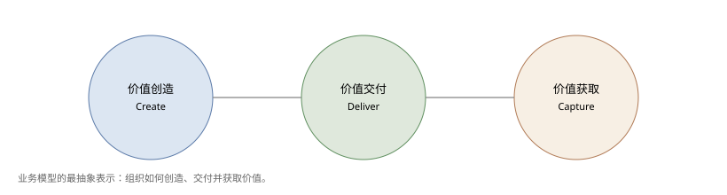
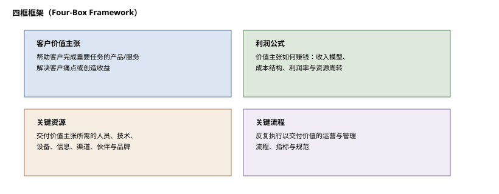
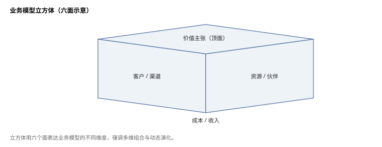
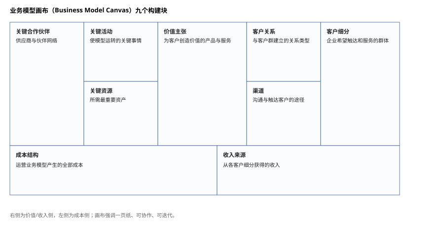
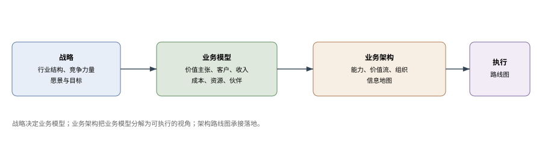

# 业务模型

**The Open Group TOGAF® 系列指南**

文档编号：G18A（2025 年更新版）

> 中文译本说明：本文档依据 The Open Group《Business Models》（G18A，2022 年 4 月发布、2025 年 5 月编辑更新）逐节翻译。术语：Business Model=业务模型；Business Architecture=业务架构；Business Model Canvas=业务模型画布；Value Proposition=价值主张。

---

## 前言

### The Open Group

The Open Group 是一个全球性联盟，拥有 900 多家成员组织，通过技术标准与开源倡议，帮助各组织实现业务目标。其成员涵盖客户、系统与解决方案供应商、工具厂商、集成商、学术界与咨询顾问。The Open Group 的使命是推动实现**无边界信息流**（Boundaryless Information Flow™）。

### TOGAF® 标准与本文档

TOGAF 标准是一套经过实践检验的企业方法论与框架，为全球领先组织所使用，用以提升业务效率。本文档是 TOGAF® 系列指南之一，主题为业务模型，由 The Open Group 开发并批准。本版本取代 2018 年 6 月发布的上一版本。

### 关于 TOGAF® 系列指南

TOGAF® 系列指南提供关于如何使用 TOGAF 标准以及如何调整标准以满足特定需求的指导，是标准中发展最快的“指导”部分。TOGAF 基础内容长期稳定；关于标准使用的指导则可因行业、架构风格、用途与问题而异。TOGAF 基础内容始终是跨行业、领域与架构风格的基本支架。

---

## 致谢

The Open Group 谨向以下人士与组织表示感谢，感谢他们为本文档的开发所作出的贡献：

（请注意：所属机构为批准时的情况。）

- 作者与评审人——Steve DuPont、J. Bryan Lail、Stephen Marshall、Chalon Mullins、Alec Blair 与 Mats Gejnevall
- The Open Group 架构论坛过去与现在的成员
- Business Architecture Guild，感谢其许可重用图形

关于 Business Model Canvas 的引用，遵循 strategyzer.com 发布的用法约定。

---

## 商标

ArchiMate、TOGAF、The Open Group 等名称与标识归其各自所有者；Boundaryless Information Flow、IT4IT 为 The Open Group 商标。Business Model Canvas 相关权利归其作者；BIZBOK 为 Business Architecture Guild 注册商标。

---

## 1. 引言

本 TOGAF® 系列指南为业务模型提供基础，帮助企业架构师理解并使用业务模型——业务模型描述组织如何创造、交付并获取价值的逻辑[1]。业务模型提供了一个强有力的构造，帮助组织围绕其战略愿景与执行进行聚焦与对齐。本文档涵盖从概念到实践示例的不同业务模型形式与建模方法。

这些模型所承载的业务创新，与通过企业架构实施该创新的方法之间存在直接关系。我们通过价值流与业务能力等业务架构方法来探讨这一关系，并给出一个正在开展数字化转型的通用零售企业示例。附录进一步剖析架构师最常用的一种业务模型框架的结构，供希望与业务领导者共同执行战略的架构师参考。

### 1.1 概述

全球顶尖的高管都清楚，有效管理与利用信息是企业成功的关键因素，对建立并保持竞争优势至关重要。企业架构通过为技术演进提供战略语境，以应对不断变化的业务环境需求，从而支撑这一目标。

正如《TOGAF 标准——引言与核心概念》[C220] 所述，企业架构的一个关键目标是创造或促成业务运营与整体业务方向（愿景与战略）之间的对齐。此外：

> “……良好的企业架构使你能够在业务转型与持续运营效率之间取得恰当平衡；让各业务单元在追求不断演进的业务目标与竞争优势时能够安全创新；同时，企业架构使组织的需求能够通过整合战略得到满足，从而在企业内外实现尽可能紧密的协同。”

为实现这种对齐，架构师必须从根本上理解构成业务的核心要素，以及这些要素与业务创造、获取、交付价值的方式之间的关系。然而，业务方向是什么、业务打算如何为客户与利益相关者创造、获取并交付价值，并不总是清晰的。如果我们不能充分理解企业做什么、打算做什么、为何存在、如何为利益相关者产出有价值的东西（同时在这个过程中赚钱），架构师又如何设计出实现业务目标的恰当目标态环境？

### 1.2 目标

实现组织战略目标与目标态架构对齐的一种有效方法，是运用**业务模型**概念。业务模型制品用于：

- 就组织今天是什么、看起来怎样形成共同理解；
- 描绘组织未来打算成为什么；
- 在业务战略与企业架构所需蓝图（定义业务需要转型成什么）以及描述如何转型的计划之间，建立关键联系。

本文档其余部分说明什么是业务模型、业务模型制品如何构建；其目的与收益；如何使用建模框架创建业务模型制品并开展业务模型创新；以及在企业架构与 TOGAF 架构开发方法（ADM）中应在何处应用它们。

本文档的目标是：

- 使架构师熟悉业务模型的概念与目的；
- 通过详细考察一种创建与利用业务模型制品的特定技术——**业务模型画布**（Business Model Canvas™）[Osterwalder & Pigneur, 2010]——来说明该概念与目的；
- 解释业务模型如何与 TOGAF ADM 相关联并影响 ADM。

目标是让从业者能够用业务模型来框定、界定其架构工作的边界，特别是与 ADM 中**阶段 B：业务架构**的现状与目标态创建相关的工作。为实现这一目标，我们采用的一项重要实践是遵循 Business Architecture Guild® 最佳实践中关于业务架构的各项原则（如为本文件奠定基础的 Guild 白皮书 [BAG, 2015]）。

**尾注**

[1] 参见《Business Model Generation》第 14 页。

---

## 2. 什么是业务模型？

业务模型描述组织如何创造、交付并获取价值的逻辑。它可能只是存在于领导者头脑中的抽象概念；也可以更具体——业务模型制品提供业务模型实例的具体视图，定义业务模型的结构要素及各要素之间的关系。

业务模型可以有不同表示方式。图 2-1 所示的三要素框架以最抽象的形式描述业务模型的结构。

其他著名框架示例包括四框框架（图 2-2）与业务模型立方体（图 2-3）。

支持不同业务模型表示的理论争论已持续多年，但真正让**业务模型画布**（图 2-4）流行、并使其成为业务模型创新基线的，是 Alexander Osterwalder 与 Yves Pigneur 在《Business Model Generation》中提出的简单易用方法与工具。我们采用这一形式展示战略与业务架构之间的业务模型对齐，并在附录 A 中深入讨论。请注意，此类业务模型已在 The Open Group IT4IT 论坛的早期工作中引入[1]。

**尾注**

[1] 《定义 IT 运营模型》，The Open Group 白皮书，2017 年 9 月 [W17B]。

---

## 3. 业务模型的影响与收益

业务与 IT 领导者可以把业务模型制品与其他战略规划制品、业务架构视图及组织变革方法结合使用，以加速战略执行与对齐。业务模型制品突出构成业务各要素之间的关键关系，其方式：

- 是其他方法或技术未完全覆盖的，因而有助于更完整地考察成本、收入及其他业务视角；
- 或虽被其他方法覆盖，但通过不同方法或视角呈现——此时业务建模有助于交叉核对其他信息与假设。

业务模型改善业务高管之间的沟通，因为它为组织的核心业务逻辑提供了共同视角，帮助高管“达成一致”。拥有这种共同视角、结构与理解，可以实现更有效的业务设计[1]，并使组织目标态企业架构得以成功部署。本质上，业务模型以不同于传统战略规划方法的视角带来思路的清晰，并能激发创新所需的更高层次思考。

**尾注**

[1] 参见 Rotman DesignWorks（多伦多大学罗特曼管理学院）《What is Business Design?》，2015 年 [Rotman, 2015]。

---

## 4. 业务模型与业务架构的关系

业务模型提供业务现状和/或未来态设计的高层可视化表达，描述组织如何为其各类内外部利益相关者创造、获取并交付价值的逻辑。

业务模型还为“如何描述与改造业务以追求新的战略选择”建立共同理解的基础。在这个意义上，业务模型是围绕业务创新与资源配置战略规划展开讨论的起点。

业务模型的开发最初在相对抽象或概念层面进行。保持这种概要视图，可以鼓励并支持支撑创新的创造性思维过程；也有助于以适合引发跨学科讨论、促进认同的层次，向广泛受众传达关于愿景与战略的关键想法。

通常，草案业务模型中的信息刚好足以让相关方探讨整体可行性并支持战略决策；另一方面，草图视图通常不包含足够信息来开展风险评估或制定执行既定战略的计划。

业务模型为达成业务战略创造对齐，而**业务架构**则阐明业务模型的不同视角与影响。业务架构把业务模型分解为描述业务如何运作的核心功能要素，包括为交付预期业务结果所需的业务能力、价值流、组织结构与信息对象。该过程还能识别用于创建业务模型的思路与假设中的缺口与冲突，从而把讨论回馈到对业务模型所需的更改或改进上。

在 TOGAF 标准中，**阶段 B：业务架构**正是架构师把高层业务模型制品发展为详细架构蓝图（代表提案的不同视角）的地方，以支持更深入的规划、投资与方案分析（见图 4-1）。这些详细视角对规划团队、业务分析师与业务单元经理理解并评估拟议业务模型对运营的整体影响，是有用且必要的。

> 图片来源说明：（左上）改编自 Michael E. Porter《塑造战略的五种竞争力量》（2008）；业务架构蓝图改编自《BIZBOK® 指南》6.5 版（2018）。

---

## 5. 在 TOGAF 标准中使用业务模型

构建业务模型制品的实际过程，为架构师把企业的战略视角带入战略制定与业务规划活动提供了绝佳机会。此时，架构师及其创建的模型弥合了战略与架构之间的鸿沟，有助于：

- 改善企业架构与战略的对齐；
- 提升架构的整体质量；
- 增强架构师对组织的知识价值与贡献。

业务模型可以成为 TOGAF ADM **阶段 B：业务架构**的关键输入，因而通常与企业架构开发的**架构愿景**阶段相关联。业务模型在让领导团队围绕新战略或不同业务方向达成一致方面非常有效；业务架构则更有效地让企业其余部分就“在运营与组织层面需要做什么（以及如何做）”达成一致：

- **首先**，规划者与架构师用业务模型识别变革中的关键伙伴（利益相关者）。分析业务模型，以洞察更多利益相关者及其关注点、目标与关键业务需求。
- **其次**，用业务模型验证组织的业务目标、战略驱动因素与约束。任何不一致或缺口都作为反馈提交给架构工作说明书的发起人以求澄清。
- **然后**，架构师分析业务模型，并用能力映射识别实现目标业务模型所需的新能力（或对现有能力的增强）。架构师还用价值流映射识别为产出业务模型价值主张所述价值项而必须开发的新价值流（或现有价值流中的缺口）。
- **评估能力差距与未来需求后**，可用目标业务模型更详细地界定架构工作说明书的范围。它们提供关于架构工作广度与深度的洞察。在此范围界定步骤中，架构被划分并与组织业务模型对齐，以确保架构与战略和价值对齐。
- **业务模型有助于制定架构原则与业务原则。** 例如，转向更需要统筹客户体验的模型的组织，可受益于建立以客户为中心管理解决方案、并在不同触点处理客户信息的业务原则。
- **业务模型为架构项目价值主张的开发提供锚点。** 一个与业务模型价值主张紧密对齐的架构项目价值主张，能为项目提供强有力的商业论证。
- **最后**，业务模型促进详细工作说明书与架构项目的批准。该分析更好地理解手头的业务问题，并提供关于架构项目性质、范围与所需工作量的洞察。

业务模型是架构愿景输入业务架构阶段的一部分，用于帮助描述业务问题与阶段工作范围，为业务架构目标描述提供业务价值语境，并提供使业务架构与战略和价值对齐的手段：

- 规划者与架构师用业务模型理解根本业务问题及拟议变革的愿景；
- 业务模型帮助确定业务架构工作说明书以及所需业务架构模型/制品类型。例如，一家设想通过新交付渠道向新客户扩展现有产品供给的企业，可能不需要更新现有产品目录或产品生命周期图；
- 业务架构师以业务模型为语境与起点，开展基线与目标业务架构开发；
- 若有过渡业务模型，它们是创建过渡业务架构与业务路线图的宝贵输入。

在 TOGAF ADM 其余阶段，业务模型帮助举措始终聚焦组织的价值生产逻辑。在信息系统架构与技术架构阶段，它们帮助规划者与架构师保持架构工作面向组织价值创造与交换愿景的方向。在机会与解决方案、迁移规划阶段，业务模型（业务架构阶段产出的业务路线图的伙伴）为架构路线图及实施与迁移计划提供语境。

最后，由于业务模型使用业务语言并经过早期验证，它们是沟通架构与解决方案同组织战略之间可追溯性的有效工具，极大促进利益相关者参与。

---

## 6. 业务模型创新的结构化方法

为了在持续变化中引导业务方向，或有意颠覆市场，业务战略家开始用业务模型识别新的创新机会。与其他架构学科一样，一个有助于领导者在收入流、成本、客户细分与价值主张的重大转变上达成一致的设计结构，将提高任何新战略制定的成功概率。

传统上，业务创新聚焦产品开发或流程优化。企业日益认识到，企业的其他方面也提供更有利可图的改进机会。例如：收入流（把客户从一次性购买转向订阅模式）、价值主张（强调服务而不只是实体产品）、成本结构（精简供应链）或渠道（转向线上渠道、减少实体足迹）。业务模型分析通过明确指出业务中可能存在更大改进机会的其他方面，使这类创新成为可能。

业务模型创新是指按照整体业务战略，把拟议的一个或多个业务模型从构想到实施。采用设计导向方法，业务模型创新者首先构建关于环境及组织在环境中定位的观察，包括对现状业务模型的描述；然后使用备选未来态业务模型提出并检验一组假设，可能设计业务模型的工作原型来检验并验证假设。

最重要的是，业务模型创新者用检验结果确认或否定假设，并据此调整或迭代业务模型原型。最后，他们选择最优业务模型（或按需选择多个模型，以应对单一业务内不同客户群与价值主张），并通过企业架构充分详细地描述，以支持规划、开发与部署。

构想新业务模型可能相对容易，实施并持续调整却不那么容易。然而在当前持续快速变化的环境中，实施与调整恰恰是成功组织必须擅长的。建立业务模型后止步不前是不够的；企业必须不断重新评估并重新定义基本前提，包括：

- 公司目前做什么；
- 公司如何做；
- 公司能做什么；
- 公司能如何做；
- 公司应与谁一起做；
- 每一部分如何与公司商业生态系统的其他部分及整个世界互动[1]。

最后一点尤为重要。构建业务模型时，组织应确保针对敏捷性来设计并构建业务模型的所有要素，使业务能够在持续变动中蓬勃发展。

**尾注**

[1] 摘自 Phil Simon《The Age of the Platform》，2011。

---

## 7. 业务模型框架示例

下面使用一种特定类型的业务模型框架——业务模型画布——给出用例。附录 A 对画布结构要素及解读方式作了更深入定义。在画布中构建模型的起点取决于组织及描述业务价值的期望用途。本用例将走查一家零售企业，与前文《TOGAF® 系列指南：业务能力》[G211] 和《价值流》[G178] 中的示例相呼应。

图 7-1 是一家零售企业**现状**业务模型的通用表示，即过去数年该企业交付价值的方式。理解该模型的一种方式是从客户视角从右向左阅读：企业既服务大众零售市场，又提供一定的区域专业化；既提供人工协助，也提供保修服务；既提供实体零售店面，也让购物者可以通过基于网络的库存信息提前查找库存。企业意图通过低价、个性化帮助以及更好的产品组合，提供高于竞争对手的价值。为实现这一点，企业必须具备强大的客户分析能力、维护品牌声誉与房地产，并保持强有力的伙伴关系，通过合适的供应商提供合适的产品以满足客户需求。

按画布九个构建块，图 7-1 的标签为：**客户细分**——Mass Market（大众市场）、Regional Specialization（区域专业化）；**价值主张**——Low Prices（低价）、Personal Touch（个性化接触）、Availability for Common and Regional Needs（满足通用与区域需求的可获得性）；**渠道**——Retail Shopfronts（零售店面）、Web-based Inventory Info（基于网络的库存信息）；**客户关系**——Personal Assistance（人工协助）、Warranty Service（保修服务）；**收入来源**——Profit on Sales（销售利润）、Warranty Service（保修服务）、Manufacture Rebates（制造商返利）；**关键资源**——Brand Reputation（品牌声誉）、Real Estate（房地产）；**关键活动**——Customer Analysis（客户分析）、Supplier Management（供应商管理）；**关键合作伙伴**——Product Manufacturers（产品制造商）、National Suppliers（全国供应商）、Regional Suppliers（区域供应商）；**成本结构**——Facilities and Transport（设施与运输）、Employees and Supply（员工与供应）、Scale Across Nation（全国规模扩张）。

> 图 7-1：零售商业务模型画布——现状。图内文字已中文化；原图见英文原文 Figure 7-1。

**图内标签对照**

| 图内英文 | 中文 |
|---|---|
| Key Partners | 关键合作伙伴 |
| Product Manufacturers | 产品制造商 |
| National Suppliers | 全国供应商 |
| Regional Suppliers | 区域供应商 |
| Key Activities | 关键活动 |
| Customer Analysis | 客户分析 |
| Supplier Management | 供应商管理 |
| Value Propositions | 价值主张 |
| Low Prices | 低价 |
| Personal Touch | 个性化接触 |
| Availability for Common and Regional Needs | 满足通用与区域需求的可获得性 |
| Customer Relationships | 客户关系 |
| Personal Assistance | 人工协助 |
| Warranty Service | 保修服务 |
| Customer Segments | 客户细分 |
| Mass Market | 大众市场 |
| Regional Specialization | 区域专业化 |
| Key Resources | 关键资源 |
| Brand Reputation | 品牌声誉 |
| Real Estate | 房地产 |
| Channels | 渠道 |
| Retail Shopfronts | 零售店面 |
| Web-based Inventory Info | 基于网络的库存信息 |
| Cost Structure | 成本结构 |
| Facilities and Transport | 设施与运输 |
| Employees and Supply | 员工与供应 |
| Scale Across Nation | 全国规模扩张 |
| Revenue Streams | 收入来源 |
| Profit on Sales | 销售利润 |
| Manufacture Rebates | 制造商返利 |

接下来考察可能导致业务模型变化的情形。企业可能因市场压力、销售下滑或成本上升而需要重大调整，也可能希望推出新产品或服务以满足未满足的客户需求。一条常用准则是：真正的新业务模型来自**客户细分与价值主张的联合转变**；范围更窄或规模更小的变化只是对现有业务模型的调整。

在**未来态**模型（图 7-2）中，画布的收入侧（针对特定客户的更强专业化、更多线上与数字存在、以尽可能低的成本提供有针对性的价值）与成本侧（数字技术成为关键成本驱动、需要新的伙伴关系、伙伴关系与成本受全球影响）都发生了变化；关键活动与收入来源等部分保持不变。形成这样的新业务模型是非常以人为本的过程，最好基于良好的市场、产品与成本数据，并由领导者在“未来业务如何交付最大价值”上达成一致。

按画布九个构建块，图 7-2 的标签为：**客户细分**——Mass Market（大众市场）、Consumer-specific Specialization（面向特定消费者的专业化）；**价值主张**——Lowest Prices（最低价格）、Convenience Anywhere（随处便利）、Availability for Common and Specific Needs（满足通用与特定需求的可获得性）；**渠道**——Limited Shopfronts（有限店面）、Web-based Shopping Apps（基于网络的购物应用）；**客户关系**——Automated AI Services（自动化 AI 服务）、Web Shopping Self-service（网络购物自助服务）；**收入来源**——Profit on Sales（销售利润）、Warranty Service（保修服务）、Manufacture Rebates（制造商返利）；**关键资源**——Brand Reputation（品牌声誉）、Cloud Hosting & App Support（云托管与应用支持）；**关键活动**——Customer Analysis（客户分析）、Supplier Management（供应商管理）；**关键合作伙伴**——Product Manufacturers（产品制造商）、Global Suppliers（全球供应商）、Internet and App Providers（互联网与应用提供商）；**成本结构**——Infrastructure & Transport（基础设施与运输）、Employees and Supply（员工与供应）、Scale Across Globe（全球规模扩张）。

> 图 7-2：零售商业务模型画布——未来态。图内文字已中文化；原图见英文原文 Figure 7-2。

**图内标签对照**

| 图内英文 | 中文 |
|---|---|
| Key Partners | 关键合作伙伴 |
| Product Manufacturers | 产品制造商 |
| Global Suppliers | 全球供应商 |
| Internet and App Providers | 互联网与应用提供商 |
| Key Activities | 关键活动 |
| Customer Analysis | 客户分析 |
| Supplier Management | 供应商管理 |
| Value Propositions | 价值主张 |
| Lowest Prices | 最低价格 |
| Convenience Anywhere | 随处便利 |
| Availability for Common and Specific Needs | 满足通用与特定需求的可获得性 |
| Customer Relationships | 客户关系 |
| Automated AI Services | 自动化 AI 服务 |
| Web Shopping Self-service | 网络购物自助服务 |
| Customer Segments | 客户细分 |
| Mass Market | 大众市场 |
| Consumer-specific Specialization | 面向特定消费者的专业化 |
| Key Resources | 关键资源 |
| Brand Reputation | 品牌声誉 |
| Cloud Hosting & App Support | 云托管与应用支持 |
| Channels | 渠道 |
| Limited Shopfronts | 有限店面 |
| Web-based Shopping Apps | 基于网络的购物应用 |
| Cost Structure | 成本结构 |
| Infrastructure & Transport | 基础设施与运输 |
| Employees and Supply | 员工与供应 |
| Scale Across Globe | 全球规模扩张 |
| Revenue Streams | 收入来源 |
| Profit on Sales | 销售利润 |
| Warranty Service | 保修服务 |
| Manufacture Rebates | 制造商返利 |

让我们聚焦架构师的潜在角色，以及业务架构方法在帮助领导层完成这一旅程中的作用。零售商已基于合理的市场趋势与竞争要求（画布右侧收入侧）决定追求新业务模型，但尚不清楚价值究竟如何交付给利益相关者。价值流可以帮助建立这种确切理解，进而识别关键业务能力差距，这些差距又定义了成本侧（画布左侧）所需的变化。

这些关系的示例如下：

- 业务模型方向的转变，驱动对“获取零售产品”价值流（见《TOGAF® 系列指南：价值流》§4.1 [G178]）的重新评估：价值阶段可能保持不变，但部分利益相关者、标准与价值项会受影响；
- 当客户分布在世界任何地方（包括寻找适合本地需求的专业产品）时，价值可能由全部五个价值阶段交付给客户；
- 内部资源与伙伴关系的变化（数字技术成为关键成本与新的伙伴关系来源）可能导致支撑价值交付的关键业务能力差距（见《TOGAF® 系列指南：业务能力》§5.2 [G211]）；例如，产品营销可能存在差距，必须加以解决以支撑包含线上与移动购物的数字化存在，以及因追求更大全球规模与伙伴关系而产生的其他新需求。

---

## 8. 结论

企业越来越多地把业务模型作为战略设计与创新过程的关键组成部分。然而，业务模型本身并不提供组织构建详细计划以实现战略所需的足够粒度；这正是业务架构发挥关键作用之处——阐明并使业务模型所引发的设计得以实现。

本文档表明，业务模型创新与业务架构相结合，为规划团队提供了从战略走向可执行部署的更成熟选项集。由此也凸显了业务模型在有效执行业务战略中的关键作用，同时指出了一些提高其作为日常业务工具之使用率与有效性的机会。

---

## 附录 A：业务模型画布概述

业务模型画布的创建者有意把它设计成一页纸的优雅业务模型表示，使其能够：

- 提供对组织业务模型的共同视角与理解；
- 支持业务高管就业务问题与必要变革展开知情讨论；
- 培养设计导向的方法，识别企业可以如何不同地做事，以最大化市场参与者之间的价值交换；
- 支持现状与未来态业务模型选项的协作与共创；
- 聚焦支撑特定客户细分既定价值主张的关键收入与成本组件。

业务模型画布包含九个构建块（图 A-1）：

- **客户细分**（Customer Segments）——企业希望触达并服务的不同人群或组织；
- **价值主张**（Value Propositions）——客户可从产品与服务中期望获得的收益；
- **渠道**（Channels）——公司如何沟通并触达客户细分以交付价值主张；
- **客户关系**（Customer Relationships）——公司与特定客户细分建立的关系类型；
- **收入来源**（Revenue Streams）——公司从每个客户细分获得的收入；
- **关键资源**（Key Resources）——使业务模型运转所需的最重要资产；
- **关键活动**（Key Activities）——公司为使业务模型运转必须做的最重要事情；
- **关键合作伙伴**（Key Partnerships）——使业务模型运转的供应商与伙伴网络；
- **成本结构**（Cost Structures）——运营业务模型产生的全部成本。

业务模型画布是理解企业如何处理收入与成本的关键决定因素、进入市场的价值主张、所服务的客户以及执行所需资源的特别有用的工具。这些要素在以下方面发挥关键作用：

- 形成推进项目的商业论证；
- 界定针对具体应用、信息与技术解决方案的剩余工作；
- 实现业务战略与部署计划之间的对齐。

识别并使用清晰阐述、支撑组织目标与目的的业务模型，是从战略构想到部署执行的关键成功因素。业务模型画布有助于揭示拟议业务模型中存在的能力差距，帮助战略家规划必要的行动路线。

---

## 参考文档

| 编号 | 文档 |
|---|---|
| [BAG, 2015] | 《Linking Business Models with Business Architecture to Drive Innovation》，白皮书，Business Architecture Guild，2015 年 8 月 |
| [BIZBOK Guide] | 《A Guide to the Business Architecture Body of Knowledge》（BIZBOK® Guide），6.5 版，Business Architecture Guild，2018 年 |
| [C220] | 《TOGAF® 标准》第 10 版（C220），The Open Group，2022 年 4 月；www.opengroup.org/library/c220 |
| [G178] | 《TOGAF® 系列指南：价值流》（G178），The Open Group，2022 年 4 月；www.opengroup.org/library/g178 |
| [G211] | 《TOGAF® 系列指南：业务能力》，第 2 版（G211），The Open Group，2022 年 4 月；www.opengroup.org/library/g211 |
| [Johnson, 2010] | Mark W. Johnson，《Seizing the White Space: Business Model Innovation for Growth and Renewal》，Harvard Business Review Press，2010 年 |
| [Kaplan, 2012] | Saul Kaplan，《The Business Model Innovation Factory: How to Stay Relevant when the World is Changing》，2012 年 |
| [Lindgren & Rasmussen, 2013] | Peter Lindgren、Ole Horn Rasmussen，《The Business Model Cube》，Aalborg University 机械与制造工程系，Journal of Multi Business Model Innovation and Technology，第 135–182 页，River Publishers；www.riverpublishers.com/journal/journal_articles/RP_Journal_2245-456X_131.pdf |
| [Osterwalder & Pigneur, 2010] | Alexander Osterwalder、Yves Pigneur，《Business Model Generation: A Handbook for Visionaries, Game Changers, and Challengers》，John Wiley & Sons，2010 年 |
| [Porter, 2008] | Michael E. Porter，《The Five Competitive Forces that Shape Strategy》，Harvard Business Review Press，2008 年 |
| [Rotman, 2015] | 《What is Business Design?》，Rotman DesignWorks，多伦多大学罗特曼管理学院，2015 年 |
| [Simon, 2011] | Phil Simon，《The Age of the Platform: How Amazon, Apple, Facebook, and Google have Redefined Business》，Motion Publishing，2011 年 |
| [W17B] | 《Defining the IT Operating Model》，The Open Group 白皮书（W17B），2017 年 9 月；www.opengroup.org/library/w17b |

---

## 索引

> 原文为页码索引；中文版重新排版后页码不适用，以下按章节号定位。

| 中文术语 | 英文 | 章节 |
|---|---|---|
| 敏捷性 | agility | 6 |
| 现状业务模型 | baseline (current-state) business model | 6 |
| 业务架构 | Business Architecture | 1 |
| 业务架构蓝图 | Business Architecture blueprint | 4 |
| 业务能力 | business capability | 1 |
| 业务设计 | business design | 3 |
| 业务方向 | business direction | 1.1 |
| 业务创新 | business innovation | 1 |
| 业务模型 | business model | 1 |
| 业务模型画布 | Business Model Canvas | 1.2 |
| 业务模型立方体 | Business Model Cube | 2 |
| 业务模型创新 | business model innovation | 1.2 |
| 业务价值 | business value | 5 |
| 能力差距 | capability gap | 5 |
| 能力映射 | capability mapping | 5 |
| 渠道 | channels | 5 |
| 成本结构 | cost structure | 6 |
| 客户关系 | customer relationships | 7 |
| 客户细分 | customer segments | 6 |
| 四框框架 | Four-Box Framework | 2 |
| 关键活动 | key activities | 7 |
| 关键合作伙伴 | key partnerships | 7 |
| 关键资源 | key resources | 7 |
| 零售业务模型 | retail business model | 7 |
| 收入来源 | revenue streams | 7 |
| 架构工作说明书 | Statement of Architecture Work | 5 |
| 战略视角 | strategic perspectives | 5 |
| 未来态业务模型 | target (future-state) business model | 6 |
| 三要素框架 | three-element framework | 2 |
| TOGAF 架构开发方法（ADM） | TOGAF ADM | 1.2 |
| 过渡业务模型 | transition business model | 5 |
| 价值主张 | value propositions | 5 |
| 价值流 | value stream | 1 |
| 价值流映射 | value stream mapping | 5 |

---

*译本依据：The Open Group, TOGAF® Series Guide: Business Models, Document No. G18A, April 2022 (updated May 2025).*
