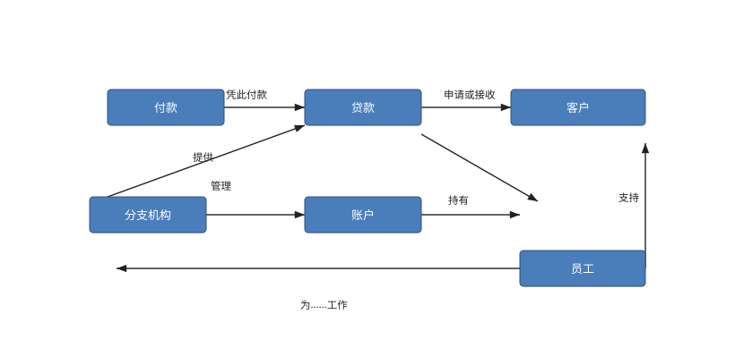
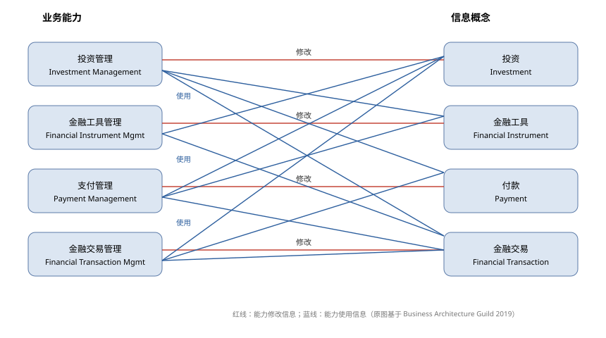
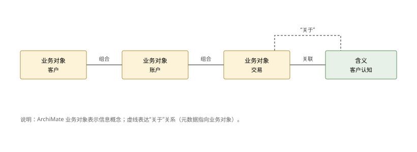
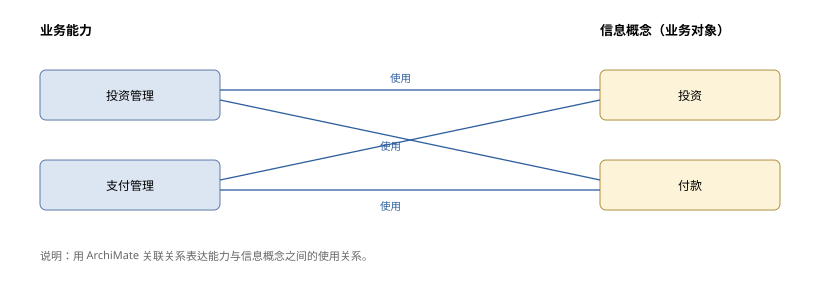
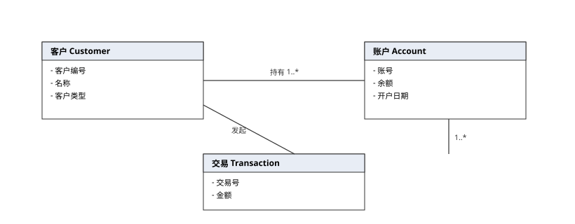
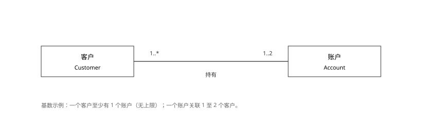
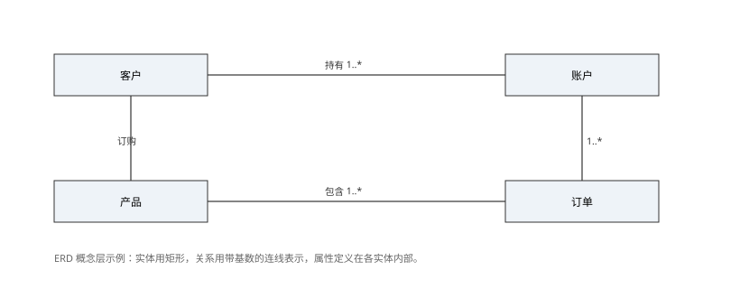

# 信息映射

**The Open Group TOGAF® 系列指南**

文档编号：G190

> 中文译本说明：本文档依据 The Open Group《Information Mapping》（G190）逐节翻译。术语：Information Map=信息地图；Information Concept=信息概念；Information Mapping=信息映射；Business Capability=业务能力；Value Stream=价值流。

---

## 前言

### The Open Group

The Open Group 是一个全球性联盟，拥有 900 多家成员组织，通过技术标准与开源倡议，帮助各组织实现业务目标，其成员涵盖客户、系统与解决方案供应商、工具厂商、集成商、学术界与咨询顾问。The Open Group 的使命是推动实现**无边界信息流**（Boundaryless Information Flow™）。

### TOGAF® 标准

TOGAF 标准是一套经过实践检验的企业方法论与框架，世界领先的组织用它来提升业务效率。

### 本文档

本文档是 TOGAF® 系列指南之一，主题为信息映射，由 The Open Group 开发并批准。

### 关于 TOGAF® 系列指南

TOGAF® 系列指南提供关于如何使用 TOGAF 标准以及如何调整标准以满足特定需求的指导，是标准中发展最快的“指导”部分。TOGAF 基础内容长期稳定；关于标准使用的指导则可因行业、架构风格、用途与问题而异。

### 目标读者

本指南面向各类架构师、业务领导及 TOGAF 框架的一般用户。

---

## 关于作者

（请注意：所属机构为批准时的情况。）

**Steve DuPont——波音公司副技术院士（Associate Technical Fellow）**

Steve 自 2009 年起参与 The Open Group 标准制定，是认证业务架构师（CBA®）。他是波音公司（The Boeing Company）的副技术院士兼高级企业架构师，为战略航空航天计划提供企业架构领导，例如新商用飞机项目、全球业务发展计划以及并购。

**J. Bryan Lail——雷神公司业务架构院士（Business Architect Fellow）**

Bryan 是 The Open Group 的 Master Certified Architect、Business Architecture Guild 的认证业务架构师（CBA®），也是 Raytheon 认证架构师，在国防行业应用战略性业务架构方法。其职业生涯横跨物理研究、为美国海军与 Raytheon 从事工程工作、担任首席架构师职务，并发表多篇关于架构应用于业务战略的著作。

**Stephen Marshall——IBM 战略顾问**

Stephen 是 The Open Group 的 Master Certified Architect、认证业务架构师（CBA®），以及 IBM 商业价值研究院（IBM Institute for Business Value，IBV）的高级管理顾问。他目前领导 IBV 亚太区全球 C-suite 研究项目，并合著多篇思想领导力文章。

## 致谢

（请注意：所属机构为批准时的情况。）

The Open Group 谨向以下人士表示感谢，感谢他们为本文档的开发所作出的贡献：

- 作者：Steve DuPont、J. Bryan Lail 与 Stephen Marshall
- 主要评审人：Alec Blair、Mats Gejnevall、Chalon Mullins、William Ulrich
- 关键推动者：Sonia Gonzalez、Mike Lambert
- 评审人：Samuel Biller、Dave Gilmour、Sonia Gonzalez、Andrew Josey

以及 The Open Group 架构论坛过去与现在的成员。

## 商标

ArchiMate、TOGAF、The Open Group、UML 等名称与标识归其各自所有者；Boundaryless Information Flow 为 The Open Group 商标。BIZBOK 与 Business Architecture Guild 为 Business Architecture Guild 的注册商标。

## 参考文档

| 编号 | 文档 |
|---|---|
| [C220] | 《TOGAF® 标准》第 10 版（C220），2022 年 4 月 |
| [C226] | 《ArchiMate® 规范》第 3.2 版（C226） |
| [G178] | 《TOGAF® 系列指南：价值流》（G178） |
| [G211] | 《TOGAF® 系列指南：业务能力》（G211） |
| [BIZBOK Guide] | 《业务架构知识体系指南》（BIZBOK®），Business Architecture Guild |

---

## 1. 引言

在成功的企业与机构中，信息的作用日益重要。准确、及时、相关的信息对于良好决策与创新至关重要。**知识**源于以特定方式运用信息来解决问题或创造价值的能力。因此，架构师在开发或提出解决方案之前，必须理解哪些信息对业务最为重要。**信息地图**（Information Map）提供了一个促成这种理解的框架。

企业在运营过程中获取、使用、存储并处理多种类型的信息。随着企业愈发把信息当作战略资源，理解“将要处理哪些信息”变得至关重要。

在业务架构语境中，信息被视为现实世界中事物的一种无形、概念化的表示。“**信息概念**”（information concepts）是使这些无形事物显性化的架构要素的基础。信息概念用于对**业务**建模，而不是对 IT 系统建模。定义支撑特定企业的核心信息概念，构成业务架构中信息映射视图的核心，从而使信息与业务能力 [G211]、价值流 [G178] 等其他业务架构概念之间关系的分析成为可能。

信息映射为架构师提供了阐明、刻画并可视化表达业务关键信息的手段，并以能够支持更深入分析的方式塑造其表达——分析业务今天如何运作，或未来某时应如何运作。

---

## 2. 什么是信息地图？

信息地图是**一组信息概念及其相互关系的集合**。信息概念实际上反映了业务的词汇，例如：客户、账户或产品。业务架构中的信息映射，始于列出对业务最重要的要素，以及它们在业务语言中的描述方式。

识别信息概念的一个有用方法是：倾听谈论业务时所用的**名词**。每个名词都可能是一个信息概念。通过“名词质疑”过程，可以判断该名词是否代表业务所关心的一项信息——也就是说，业务中是否有人需要知道、存储或处理该名词所代表的事物。

图 2-1 给出了一个简单的高层信息地图示例，展示了一家金融公司中可能出现的一些关键信息概念及其相互关系。附录 A 提供了比这一简单表示更详细的信息建模示例与技术，并使用了特定的建模语言。

---

## 3. 影响与收益

业务架构的一个重要目标是澄清业务信息的术语与概念并达成共识，这在业务架构中通过信息映射来实现。

在企业架构语境中使用时，信息映射确立了用于阐述战略、构建能力地图与价值流地图等关键业务架构制品的词汇。

企业可能已有业务术语表，可作为关键信息概念与业务能力的起点，按顺序或并行开发。信息地图是核心制品集合的一部分，为业务提供强有力的表达；它也是对业务信息需求的高层描述，是信息系统架构设计的关键输入。

历史上，许多组织对词汇管理采取碎片化方式：管理者在政策中定义关键业务术语，图书管理员/管理员维护企业术语表，IT 定义概念模式或数据模型。这些彼此割裂的词汇来源，制约了组织落实战略与整合运营的能力。由于信息映射从**整个组织**的视角描述信息，它非常适合支撑业务信息在全组织、全生命周期内的管理。

当纳入全面的企业信息管理学科时，信息映射能够提升组织跨其运营边界对信息资产进行结构化、描述、集成与治理的能力，从而提升信息的透明度与价值，改善整体组织效能。

使用信息映射的收益包括：

- **更有效地落实业务战略**（阐明对战略至关重要的信息，将其与价值和能力关联，再与执行挂钩）；
- **提升信息的获取、处理与交付能力**（把关键信息的一套定义与关系传导至受影响的角色、流程与技术）；
- **更有效的协作**（在利益相关者之间建立一致，并形成一条回溯预期价值的链路）；
- **改善业务集成**（跨越受影响的组织，打破壁垒、提升方案效率、改善客户体验）；
- **更准确的财务与监管报告**（理解外部与内部实体之间的信息关系）；
- **为利益相关者提供权威、经批准的业务术语来源**。

---

## 4. 与业务能力、价值流及组织地图的关系

数据常被视为 IT 领域，但业务信息是业务知识演化的基线。业务架构需要一种不受 IT 系统限制的方式来谈论业务信息概念。例如，在业务架构中谈论“客户动机”是恰当的——这一领域概念无法在 IT 系统中实现，因为无法直接读取客户的想法。

如上所述，初步开发信息地图有多种可接受的方法。然而，在把信息概念与其他业务架构方面关联时，第一步通常是**把信息与业务能力关联**。信息地图与业务能力地图联系最紧密：在设计未来态业务架构及后续信息系统时，业务能力会使用信息概念；业务能力通常也确立信息概念。

例如，“投资管理”能力可定义为“识别、开发、分析、估值、交换、获取、处置并报告任何类型货币资产的能力，其购买前提是该资产未来将带来收入，或将以更高价格出售获利”。该能力的主要信息概念是**投资**，但投资管理还会使用其他信息概念；反过来，投资信息也被其他能力使用。图 4-1 展示了构建“投资”这一概念所涉及的能力—信息交叉映射的一个子集；更完整的映射还会包括协议、合作伙伴等其他能力与信息概念。

图 4-1 中每项能力都直接要求并修改与其相关的信息概念，例如投资管理会修改投资信息。此外，投资管理需要**金融工具**信息，以及标记交易执行的**金融交易**信息；类似地，支付管理需要投资信息，金融交易管理需要投资与支付信息。请注意：在这些示例中，业务制品都可以在不假定具体实现（如数据存储库与业务系统）的前提下被刻画并关联。这种映射为角色分配与流程执行提供了多种途径，支持更有力的架构评估与更广泛的解决方案选择。

信息与价值流的关系更微妙、更间接：信息概念的使用是通过**业务能力**实现的——业务能力通过成果改变信息内容。这是一个关键区别：若直接用价值流驱动信息使用，很可能说明架构师实际建模的是已实施的业务流程，而不是更抽象层面的价值交付活动。不过，价值流确实提供了驱动**业务能力差距**评估的价值度量[1]，而能力差距又通过业务信息（以及角色、流程与技术等资源）来评估。

最后，信息地图与利益相关者地图也存在关系。若企业已有利益相关者地图，可用它帮助定义信息地图中的信息概念。为从信息地图获得最大价值，重要的一点是**保持其独立于组织地图**。信息与业务单元、合作伙伴或协作团队（组织地图中的要素）的关系，可以通过追溯到业务能力来发现；随后，架构师把信息概念的使用追溯到这些业务能力，作为构建框架（业务架构基础）或解决特定业务问题的一部分。

**尾注**

[1] 参见 TOGAF 系列指南《价值流》[G178] 中的示例。

---

## 5. 信息地图与数据模型的区别

为提供读者熟悉的示例内容，图 2-1 与图 4-1 只包含那些可以拆分为概念数据类型的示例信息，并且在具备适当数据架构实践的条件下，可以解析为可沟通、可使用、可存储的数据模式。然而，若把关键信息概念仅局限于数据模型中已捕获的内容，就可能造成重大缺口，并把投资浪费在解决错误的问题上。数据架构师应把面向业务的信息地图作为映射到概念数据的来源，但必须理解二者并不等同。通常，许多类型的业务信息都可以被刻画为数据，前提是先理解该信息对企业重要的原因及相关关系；这既包括适合采用传统数据架构方法的结构化数据，也包括现代技术在基于健全架构和充分理解的业务逻辑时可用于提供可操作输入的非结构化数据。

例如，一类关键的客户信息可能是**客户认知**（Customer Perception）——对客户在特定主题上观点的刻画。另一类关键信息可能是**产品供给**（Product Offering），它与客户认知存在关系：企业需要了解对该产品的认知，以支持内部规划。销售线索负责人（利益相关者）具备评估客户需求的能力（客户分析——一项业务能力），其中包括通过经验形成的、无法还原为数据字段的主观能力，用以评估客户认知。销售线索负责人借助客户关系管理系统中的以往销售量、产品数据管理系统中的产品特征等存储数据，基于其对客户认知的主观判断，就产品开发作出最终建议。该关系的示意见图 5-1。

**图 5-1：多个业务概念之间的示例关系**

> 图 5-1：多个业务概念之间的示例关系。图内文字已中文化；原图见英文原文 Figure 5-1。

**图内标签对照**

| 图内英文 | 中文 |
|---|---|
| Customer | 客户 |
| Customer Perception | 客户认知 |
| Product | 产品 |
| Product Offering | 产品供给 |
| Sales Force | 销售队伍 |
| Sales Lead | 销售线索 |
| Customer Mgmt. | 客户管理 |
| Customer Analysis | 客户分析 |
| is based on | 基于 |
| evaluates | 评估 |
| impacts the outcome of | 影响……的结果 |
| establishes | 建立 |
| has the ability | 具备……能力 |
| Information Type | 信息类型 |
| Stakeholder | 利益相关者 |
| Business Capability | 业务能力 |

---

## 6. 结合 TOGAF ADM 使用信息地图

对于应用 TOGAF 架构开发方法（ADM）[C220] 的企业架构师，信息映射的作用建立在上述章节之上，其目标与其他业务架构制品类似：

- **阶段 A** 引入该主题，提醒架构师在关键业务术语的语境中查找已有信息地图，以及信息与业务能力地图等其他核心制品之间的既有关系；
- **阶段 B** 把本文档的方法付诸实践，按企业架构工作的范围需要，构建更多信息概念、关系以及与其他业务制品要素的关联；
- **阶段 C 与 D** 在可能的情况下把信息转化为数据模型，并捕获与技术服务、应用及驱动设计的逻辑属性等其他关键要素相关的信息；
- **阶段 E** 可能涉及更新业务架构，也就可能意味着更新信息地图。

---

## 7. 信息地图的实践应用

为帮助读者开发初始信息地图，表 7-1 给出了常见信息概念及其相互关联的表格示例[1]。在“信息概念类别”列中，“次要”术语归属于其上方的“主要”术语。架构师可以从这一基础参考出发，与业务及企业领导者一起：

- 提取并修改适用的信息概念；
- 添加在具体语境中最合理的定义（业务术语表）；
- 展开产品、客户等区域（用通用分类法指导决策）；
- 为把业务能力差距（由价值交付能力驱动）映射到解决差距所需的关键信息提供参考；
- 作为向利益相关者交叉映射的起点。

**表 7-1：信息地图参考表——信息概念定义与依赖映射**

| 信息概念 | 信息概念类别 | 定义 | 概念类型 | 相关信息概念 |
|---|---|---|---|---|
| 协议（Agreement） | 主要 | 组织（消费者/企业）与法人或自然人之间订立的具有法律约束力的合同。 | 经销商、银行、供应商、房东、员工、承运商、客户、消费者、企业客户 | 资产、保单、订单、协议、金融账户、付款、设施、渠道、输送设备、网络、税务 |
| 协议条款（Agreement Term） | 次要 | 在协议范围内规定的、具有法律强制执行力的条件。 | 财务、罚则、合作伙伴、遵守方、受影响的客户、业务实体 | 协议、协议条款、地点 |
| 资产（Asset） | 主要 | 有形物品，如设备、计算机、家具、工具、软件系统及其他具有内在价值的对象，在业务语境中使用，或作为商品包装进面向客户的产品。 | 设备、软件、计算机、机器、办公桌、线缆、照明 | 资产、地点、协议、合作伙伴、渠道、设施 |
| 品牌（Brand） | 主要 | 产品、供给物或组织身份中具名的一面，以独特名称、符号、标记或标识、价值主张及文化识别来表现，从而在市场中区别于其他产品、供给物或组织身份。 | 全球品牌、区域品牌、产品品牌、公司品牌 | 市场、产品、业务实体 |
| 活动（Campaign） | 主要 | 面向特定人群（如客户、人力资源、合作伙伴、患者）开展的外联活动，以实现特定目标，如营销认知、招聘活动、健康宣传。 | 产品认知、员工、社会公益 | 项目群、产品、市场、地点 |
| 渠道（Channel） | 主要 | 数字、模拟或物理的通道，用于交付或接收产品、相关服务或沟通信息，包括互联网、电话、配送服务、卫星、广播或物理手段。 | 数字渠道、合作伙伴、直营 | 合作伙伴、保单、产品、资产、设施、地点 |
| 客户（Customer） | 主要 | 与组织已订立、计划订立或曾经订立具有法律约束力协议的个人或其他法律实体；或是组织产品与服务的接受者或受益者。 | 零售客户、个人、企业客户、优选客户 | 战略、计划、项目群、市场、产品、客户、合作伙伴、人力资源、渠道、地点 |
| 财务（Finance） | 主要 | 组织的货币方面与资源。 | — | — |
| 金融账户（Financial Account） | 次要 | 一个具名的货币价值容器，按借方、贷方、负债、权益及相关类别（如客户、储蓄、支票、应收、应付、总账、预算、应收款）组织。 | 客户、合作伙伴、预算、储蓄、应收、账簿 | 协议、订单、客户、合作伙伴 |
| 金融交易（Financial Transaction） | 次要 | 跨业务、协议与金融账户发生的货币事件或相关交换。 | 买入、卖出、付款 | 金融账户 |
| 付款（Payment） | 次要 | 货币价值流入或流出组织的一次实例。 | 收款、付款 | 金融交易、金融账户、订单、协议 |
| 人力资源（Human Resource） | 主要 | 将依据与公司的法律协议被纳入、正被纳入或曾被纳入公司的个人，以推进公司整体业务，或推进公司客户利益。 | 临时员工、正式员工、合同工、退休人员 | 胜任力、岗位、地点 |

**尾注**

[1] 由 Business Architecture Guild 提供（见《BIZBOK® 指南》第 2.5 节）。

---

## 8. 结论

本文档为架构师提供了阐明、刻画并可视化表达业务关键信息的手段，并以支持更深入分析的方式塑造其表达，用以分析业务现在如何运作、应当如何运作。在业务架构层面描述并刻画信息的概念，与业务能力、价值流及组织地图相结合，为企业架构师及其他从业者提供了刻画业务价值的有力方法，并为架构工作的后续各阶段提供指引。

---

## 附录 A：信息地图的表达方式

本附录给出正文之外的更多信息建模技术示例，包括使用 ArchiMate® 建模语言、统一建模语言（UML®）类图以及实体关系图（ERD）的示例。UML 类图与 ERD 用于更详细的分析与设计，通常在 ADM 阶段 C 与 D 中产出。

### A.1 ArchiMate 语言示例

如第 2 章所述，信息概念应视为仅与人相关的无形概念；业务对象（business object）则代表有形实体。信息概念与业务对象之间存在两种关系：

1. **“使显性化”（Makes explicit）**：该关系链接面向数据的业务对象，由这些业务对象把信息概念显性化；例如，把关于客户的信息链接到客户信息记录；
2. **“关于”（Is about）**：该关系把作为业务对象元数据的信息概念链接到相应业务对象；例如，把关于客户的元数据信息链接到客户本身。

根据《ArchiMate 规范》[C226] 第 8.4.1 节“业务对象”：“业务对象可用于表示从业务视角看相关的信息资产”；规范进一步指出：“ArchiMate 语言总体上聚焦于**类型**而非实例的建模，因为这在企业架构描述层面最为相关。因此，业务对象通常建模的是在运营中可能存在多个实例的对象类型。”

由于 ArchiMate 具有形式化语义，用其表达的信息地图能更深入地揭示信息景观的结构。ArchiMate 语言允许在业务对象之间使用多种关系。除业务对象外，“含义”（meaning）概念也很有用：它表示“在特定语境中存在于核心要素之内、或赋予该要素的解释或知识”，当需要表达不同利益相关者对同一概念或对象的不同解释时尤为有用。ArchiMate 记法还可用于表达信息概念与其他业务架构概念（如业务能力与信息概念）之间的关系。

### A.2 统一建模语言（UML）

UML 源于面向对象设计，其类图对信息映射尤为有用。ArchiMate 对业务对象及其关系的表达在很大程度上借鉴了 UML，基本上是更简化的模型，省略了方法、属性与关系基数等内容。

在 UML 中，基数（cardinality）还可约束某一类的对象可与另一类的单个对象关联的数量。例如在图 A-4 中，基数（1..*）表示一个客户必须至少拥有一个账户，但账户数量没有上限；基数（1..2）表示一个账户必须关联至少一个、但不超过两个客户。

属性是与图中各业务实体相关的逻辑信息单元。虽然并非每张图上的每个信息概念都必须展示属性，但必须在某处为所有业务实体定义全部属性。表格、电子表格与数据库都是存储各信息概念相关数据的有效方式，如前文表 7-1 所示。

### A.3 实体关系图（ERD）

ERD 在信息系统设计中历史悠久，通常在三个设计层次使用：

1. **概念层**：如上文所述描述业务实体；
2. **逻辑层**：更详细地建模实体的关系与属性；
3. **物理层**：描述到数据库结构的映射。

在业务架构语境中，概念层、有时是逻辑层的图最有用，但很可能包含尚未在业务系统与数据库中实现的信息类型。关键业务信息并不局限于那些已经、甚至能够被还原为结构化数据的结构。

---

## 索引

> 原文为页码索引；中文版重新排版后页码不适用，以下按章节号定位。

| 中文术语 | 英文 | 章节 |
|---|---|---|
| ArchiMate | ArchiMate | 附录 A |
| 业务架构制品 | Business Architecture artifacts | 3 |
| 业务能力 | business capabilities | 1 |
| 业务能力差距 | business capability gap | 4 |
| 业务能力地图 | business capability map | 4 |
| 业务术语表 | business glossary | 3 |
| 业务信息 | business information | 3 |
| 业务对象 | business object | A.1 |
| 概念数据 | conceptual data | 5 |
| 客户动机 | customer motivation | 4 |
| 数据模型 | data model | 3 |
| 实体关系图 | Entity Relationship Diagram | 附录 A |
| ERD | ERD | 附录 A |
| 信息 | information | 1 |
| 信息概念 | information concept | 1 |
| 信息地图 | Information Map | 1 |
| 信息映射 | Information Mapping | 1 |
| 信息类型 | information type | 5 |
| 投资 | Investment | 4 |
| 投资管理 | Investment Management capability | 4 |
| 名词质疑过程 | noun-challenge process | 2 |
| 组织地图 | organization map | 4 |
| 利益相关者 | stakeholder | 3 |
| 利益相关者地图 | stakeholder map | 4 |
| 结构化数据 | structured data | A.3 |
| TOGAF 架构开发方法（ADM） | TOGAF ADM | 6 |
| UML | UML | 附录 A |
| 统一建模语言（UML） | Unified Modeling Language | 附录 A |
| 非结构化数据 | unstructured data | 5 |
| 价值流 | value streams | 1 |

---

*译本依据：The Open Group, TOGAF® Series Guide: Information Mapping, Document No. G190.*
